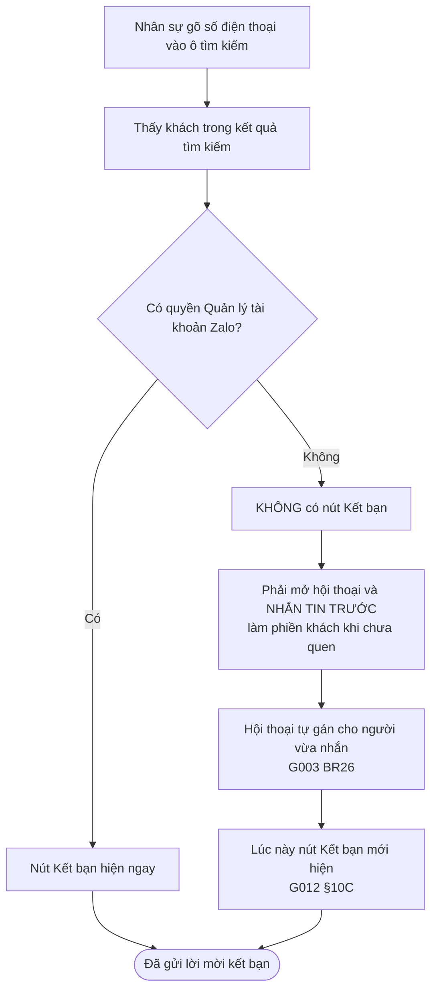
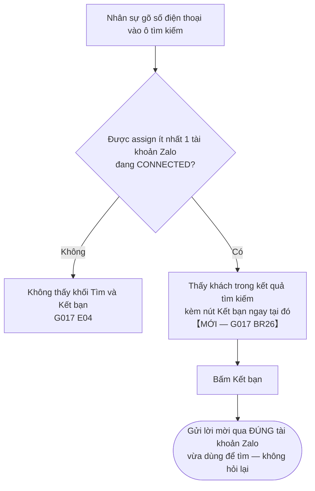

# [CR-001] Quyền kết bạn của nhân sự

| Trường | Nội dung |
|--------|----------|
| **Mã yêu cầu** | **CR-001** |
| **Tiêu đề** | Nhân sự không có quyền "Quản lý tài khoản Zalo" vẫn phải kết bạn được |
| **Ngày nhận** | 2026-09-17 |
| **Người yêu cầu** | **Khách hàng nội bộ (Mingi)** |
| **Spec bị sửa** | **G007** v1.2 · **G017** v1.1 · **PHÂN QUYỀN — Ma trận tổng hợp** |
| **Mức ưu tiên** | **Cao** — khách đang chờ |
| **Owner (BA)** | Trân (BA) |
| **Last updated** | 2026-09-24 |

> **Tình huống:** hiện nhân sự phải **nhắn tin trước** mới kết bạn được. Khách muốn kết bạn **ngay từ kết quả tìm kiếm**.
>
> Tài liệu hiện **chưa nêu rõ điều kiện quyền cho từng lối vào kết bạn** — phiếu này bổ sung quy tắc để chỉ còn một cách hiểu.

---

## 1. Yêu cầu của khách

Nguyên văn:

> *"Tài khoản nhân sự → Tìm thấy người dùng → Cho phép Kết bạn luôn."*
>
> Hiện trạng khách quan sát được:
> 1. Nhân sự **có** quyền Quản lý tài khoản → xuất hiện nút **"Kết bạn ngay"**
> 2. Nhân sự **không có** quyền Quản lý tài khoản → **cần nhắn tin trước** mới kết bạn được
>
> Mong muốn: nhân sự **kết bạn được ngay kể cả khi không có quyền Quản lý tài khoản**.

**Mong muốn cụ thể:** gõ số điện thoại vào ô tìm kiếm → tìm ra người → **nút Kết bạn hiện ngay trên kết quả**, bấm là gửi lời mời qua **đúng tài khoản Zalo vừa dùng để tìm**.

**Không phải** đi đường vòng hiện nay: mở hội thoại → **nhắn tin trước** → hội thoại mới được auto-assign → lúc đó nút Kết bạn mới hiện.

**Mong muốn này hợp lý về nghiệp vụ.** Phiếu bổ sung quy tắc để điều kiện quyền được nói rõ ở từng lối vào (xem §2.2).

---

## 1b. Luồng kết bạn — các bước thực tế

Ghi lại để thấy quyền được kiểm ở bước nào:

| Bước | Thao tác | Điều kiện áp dụng |
|---:|---|---|
| 1 | Mở một trong **4 lối vào** kết bạn | Được assign **≥1 tài khoản Zalo đang CONNECTED** (**BR18**, **BR19**) |
| 2 | **Chọn tài khoản Zalo** dùng để kết bạn | Danh sách chỉ gồm tài khoản được assign (**BR10**) · phải hiển thị **đầy đủ, cuộn được** (**BR20** — xem **CR-002**) |
| 3 | Nhập số điện thoại, hoặc chọn người từ kết quả tìm kiếm | — |
| 4 | Bấm **Kết bạn** → gửi lời mời qua tài khoản đã chọn | **BR01** |

### Hiện tại — vì sao khách kêu

> Auto-generated — comment nếu cần sửa logic

**Nhánh dài bên phải chính là chỗ khách kêu:** không có nút → nhắn tin trước → hội thoại tự gán → lúc đó nút mới hiện. Bốn bước để làm một việc lẽ ra một bước.

### Sau khi sửa

> Auto-generated — comment nếu cần sửa logic

**Hai điểm để dev tự kiểm:**

- **Câu hỏi ở đầu luồng đổi hẳn** — từ *"Có quyền Quản lý tài khoản Zalo?"* thành *"Được assign tài khoản Zalo chưa?"*. Đó là nội dung của **G007 BR18**: chỉ còn **một** điều kiện duy nhất.
- **Sơ đồ sau khi sửa không còn nhánh nào dẫn tới "nhắn tin trước".** Còn nhánh đó nghĩa là chưa xong.

> **Lối ④ đi đường khác hẳn.** Không có bước 2 *(dùng luôn tài khoản Zalo của hội thoại đang mở)*, và **vốn đã mở cho mọi nhân sự**: nhắn tin trước → hội thoại **auto-assign** cho người click (**G003 BR26** Case A) → có quyền truy cập hội thoại → nút **Kết bạn** hiện (**G012 §10C**).
>
> **Đây chính là cái khách đang phải làm** khi nói *"cần nhắn tin trước mới kết bạn được"*. Lối ④ hoạt động đúng; vấn đề nằm ở **ba lối còn lại**.

> **Bước 2 là phạm vi của [CR-002]:** danh sách tài khoản đang bị cắt ở 10, nên nhân sự được phân quyền tài khoản thứ 11 trở đi **không chọn được** — quyền cấp đúng nhưng giao diện chặn mất.

---

## 2.1 Điều khoản hiện hành — trích nguyên văn

| Mã | Nội dung đang ghi trong tài liệu | Vị trí |
|---|---|---|
| **G007 §2 — Actors & Roles** | Admin/Owner · Nhân viên quản lý · **Nhân viên thường** — cả ba đều *"**Toàn bộ thao tác**"* | `G007:41–45` |
| **G007 UC-01** | Nút **Kết bạn** nằm **trên header màn danh sách hội thoại**, cạnh nút Tìm kiếm. Điều kiện tiên quyết chỉ là *"Có ít nhất 1 tài khoản Zalo đang hoạt động trong workspace"* | `G007:51` |
| **G007 BR10** | *"Dropdown chỉ liệt kê tài khoản Zalo đang hoạt động mà user hiện tại **được assign** (theo G002)"* | `G007:152` |
| **G007 OOS07** | *"Phân quyền riêng biệt theo role cho từng thao tác trong Danh bạ"* — **Out of Scope** | `G007:328` |
| **G017 §1** | *"Là Admin **hoặc Staff được phân quyền**, tôi muốn gõ một từ khoá hoặc số điện thoại…"* | `G017:41` |
| **G017 E04** | Chỉ chặn khi *"Staff **chưa được assign tài khoản Zalo nào**"* → trạng thái rỗng | `G017:235` |
| **G003 §10B** | Icon header đổi label thành **"Kết bạn"**, trỏ sang **G007 UC-01** — **không kèm điều kiện quyền nào** | `G003:400` |
| **G012 §10C** | *"Thấy và click nút Kết bạn — Admin: Có · Staff: Có **(nếu có quyền truy cập hội thoại — G002)**"* | `G012:240` |
| **G003 BR26** *(Case A)* | Mở hội thoại từ tham chiếu liên hệ, chưa có hội thoại → tạo mới và **auto-assign cho người click**; *"người đó thấy và nhắn được ngay dù không có quyền BR18"* | `G003:324` · `G003:615` |

**Khoảng trống:** các điều khoản trên nói về **ai được thao tác trong Danh bạ** và **dropdown liệt kê tài khoản nào**, nhưng **chưa nêu rõ điều kiện quyền cho từng lối vào kết bạn**, cũng **chưa nói nút Kết bạn phải hiện ở đâu và khi nào**. Đây là phần phiếu này bổ sung.

---

## 2.2 Đề nghị viết rõ thành quy tắc

| Doc | Mã | Nội dung bổ sung |
|---|---|---|
| **G017** *(trọng tâm)* | **BR26** | Nút Kết bạn ngay tại kết quả tìm kiếm — xem bảng dưới |
| **G007** | **BR18** *(mới)* | **Kết bạn không đòi quyền quản trị nào.** Điều kiện duy nhất: nhân sự **được assign ít nhất 1 tài khoản Zalo đang CONNECTED** (G002). **KHÔNG** yêu cầu quyền *"Quản lý tài khoản Zalo"*, **KHÔNG** yêu cầu quyền *"Quản lý nhóm"*, **KHÔNG** yêu cầu phải có hội thoại trước. Áp cho **cả 4 lối vào** ở BR19 |
| **G007** | **BR19** *(mới)* | **Bốn lối vào kết bạn, đều bình đẳng về quyền:** ① header màn danh sách hội thoại (UC-01) · ② màn Danh bạ (UC-01b) · ③ khối **Tìm & Kết bạn** trong tìm kiếm (**G017**) · ④ trong hội thoại đang mở (**G012**). **Không lối nào được đặt thêm điều kiện quyền riêng.** Lối ④ cần có hội thoại chỉ vì bản chất vị trí, **không** phải là bước bắt buộc trước khi dùng ba lối kia |
| **G017** | **BR24** *(mới)* | Khối **Tìm & Kết bạn** hiện với **mọi nhân sự được assign ≥1 tài khoản Zalo** (nhất quán E04 và **G007 BR18**). Không đòi quyền quản trị nào |
| **G017** | **BR26** *(mới)* | **Nút "Gửi lời mời kết bạn" hiện NGAY trên kết quả tìm kiếm** *(đúng như §7a đang ghi)*. **Không** yêu cầu mở hội thoại, **không** yêu cầu nhắn tin trước. Lời mời gửi qua **đúng tài khoản Zalo đã dùng để tìm** — không hỏi lại người dùng chọn tài khoản |
| **Ma trận phân quyền** | **§6** *(mới)* | Bổ sung phần **Danh bạ & Kết bạn** — xem mục 2.5 |

---

## 2.3 Vì sao phải làm

**Đường đi hiện tại có cơ sở trong tài liệu.** Nhân sự nhắn tin trước thì hội thoại **auto-assign** cho họ (G003 BR26), có hội thoại tức là có quyền truy cập, mà có quyền truy cập thì nút **Kết bạn** trong hội thoại hiện ra (G012 §10C). Vì vậy **lối ④ vẫn dùng được** kể cả khi chưa được cấp quyền quản trị.

Nhưng khi đó là **đường duy nhất**, nhân sự **buộc phải nhắn tin trước** mới kết bạn được — tức là phải chủ động làm phiền khách trước khi thiết lập quan hệ, ngược quy trình bán hàng. Ba lối còn lại (header danh sách hội thoại · màn Danh bạ · khối Tìm & Kết bạn) cần mở để có đường ngắn hơn.

Nguyên nhân sâu hơn: quyền kết bạn hiện **chỉ suy ra được** bằng cách ghép **3 mảnh rời**: bảng Actors (§2) + BR10 (dropdown theo assign) + OOS07 (cố ý không phân quyền theo thao tác). Không có chỗ nào nói thẳng *"kết bạn cần quyền gì"* — người đọc phải tự ráp, và ráp khác nhau thì ra kết luận khác nhau.

Thêm nữa, **Ma trận phân quyền — tài liệu người ta tra đầu tiên khi hỏi "ai được làm gì" — không có một dòng nào về kết bạn**. Người tra không thấy gì thì mặc định suy là "chắc cần quyền quản trị".

---

## 2.4 Rà xung đột

| Kiểm tra | Kết quả |
|---|---|
| BR dùng chung (`PROJECT_KNOWLEDGE §5`) có bị phá không? | **Không.** BR-C02 (phân quyền theo tài khoản Zalo) và BR-C06 (ẩn / disable / toast) đều được giữ nguyên — BR18 nằm **trong** khuôn khổ đó, không mở rộng thêm |
| Spec khác đang trích dẫn điều khoản này? | **G003 §10B** và **G012 §10C** đều trỏ về G007 UC-01, và cả hai đã ghi đúng — không phải sửa |
| Có tạo ra 2 nguồn sự thật không? | **Không.** G007 là tài liệu chủ quản; G017 BR24 chỉ **trỏ về** G007 BR18, không định nghĩa lại |
| Dữ liệu đã phát sinh theo quy tắc cũ xử lý ra sao? | **Không có dữ liệu nào.** Đây là quy tắc hiển thị nút, không sinh dữ liệu |
| Có nới lỏng bảo mật không? | **Không.** Nhân sự vẫn chỉ kết bạn được **qua tài khoản Zalo mình được assign** (G007 BR10) — phạm vi không đổi một milimet |

---

## 2.5 Phạm vi sửa

**G007 → v1.3**
☑ Business Rule *(BR18, BR19 mới)* ☑ Acceptance Criteria ☑ Dependencies *(thêm G017)* ☐ Happy Path ☐ Alternative Flow ☐ Exception ☐ State Machine ☐ UI Notes

**G017 → v1.2**
☑ Business Rule *(BR24, BR26 mới)* ☑ Acceptance Criteria ☐ các mục còn lại

**Ma trận phân quyền → thêm §6 Danh bạ & Kết bạn**

| Quyền / Hành động | Để làm gì | Admin | NS Quản lý | Nhân sự | Nguồn |
|---|---|:---:|:---:|:---:|---|
| **Gửi lời mời kết bạn** | Kết bạn Zalo với khách qua tài khoản được assign | ✓ | ✓ | **✓** | G007 §2 · BR10 · **BR18** |
| Thu hồi lời mời đã gửi | Huỷ lời mời đang chờ | ✓ | ✓ | ✓ | G007 UC-02 |
| Chấp nhận / Từ chối lời mời đến | Xử lý lời mời khách gửi tới | ✓ | ✓ | ✓ | G007 UC-03 · G012 §10C |
| Xoá bạn | Gỡ khỏi danh bạ, giữ lịch sử tin nhắn | ✓ | ✓ | ✓ | G007 UC-05 · BR11 ⚠️ xem R-01 |
| Đặt tên gợi nhớ cho liên hệ | Đặt tên dễ nhận ra cho khách | ✓ | ✓ | ✓ | **G032 BR06** |

> **Điều kiện chung cho cả 5 dòng:** được assign **≥1 tài khoản Zalo đang CONNECTED** (G002). **Không** hành động nào trong bảng này đòi quyền *"Quản lý tài khoản Zalo"* — G007 OOS07 cố ý không phân quyền theo từng thao tác trong Danh bạ.

---

## 2.6 Điểm chưa rõ

*Không còn điểm chưa rõ. 4 điểm nghiệp vụ đã chốt qua interview ngày 2026-09-22:*

| Điểm | Chốt |
|---|---|
| Đầu ra | Phiếu CR này |
| Lối vào kết bạn | **Cả 4 lối** đang có trong docs, bình đẳng về quyền |
| Điều kiện | **Chỉ cần** được assign ≥1 tài khoản Zalo đang CONNECTED |
| Ma trận phân quyền | **Bổ sung §6** trong cùng đợt |

---

## 2.7 Kết luận BA

| Trường | Nội dung |
|---|---|
| **Phân loại** | **CR** — nghiệp vụ **đã có** trong G007 và G017, phiếu này **viết rõ** điều đang nói chưa rõ. Không tạo Spec mới, không đổi quy tắc |
| **Version sau khi sửa** | G007 **v1.3** · G017 **v1.2** · Ma trận **+§6** |
| **Việc cho Dev** | ① **Hiện nút Kết bạn ngay trên kết quả tìm kiếm**, gửi qua đúng tài khoản đã dùng để tìm — bỏ yêu cầu phải mở hội thoại và nhắn tin trước *(G017 BR26)*. ② **Gỡ điều kiện quyền "Quản lý tài khoản Zalo"** khỏi các lối vào kết bạn; giữ nguyên điều kiện assign tài khoản Zalo (G002) là điều kiện **duy nhất**. *(Lối ④ trong hội thoại đang chạy đúng qua auto-assign — không phải sửa.)* |
| **Việc cho BA** | Sửa G007 · G017 · Ma trận phân quyền · cập nhật PROJECT_KNOWLEDGE |
| **Trả lời khách hàng nội bộ** | *"Mong muốn của anh hợp lý. Bên em đang bổ sung quy tắc vào tài liệu và phối hợp với đội kỹ thuật để làm."* |

---

## 3. Theo dõi phiếu

Trạng thái và danh sách đầy đủ mọi phiếu: xem **[SỔ THEO DÕI YÊU CẦU]** — đó là nơi **duy nhất** cập nhật trạng thái. Phiếu này không giữ bảng riêng.
