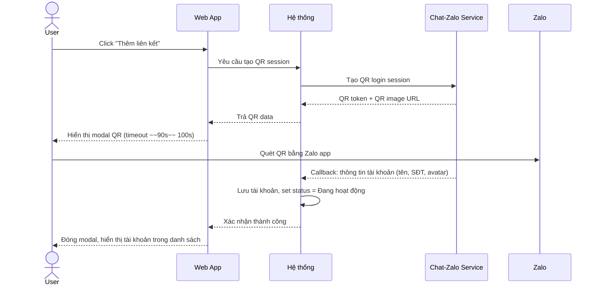
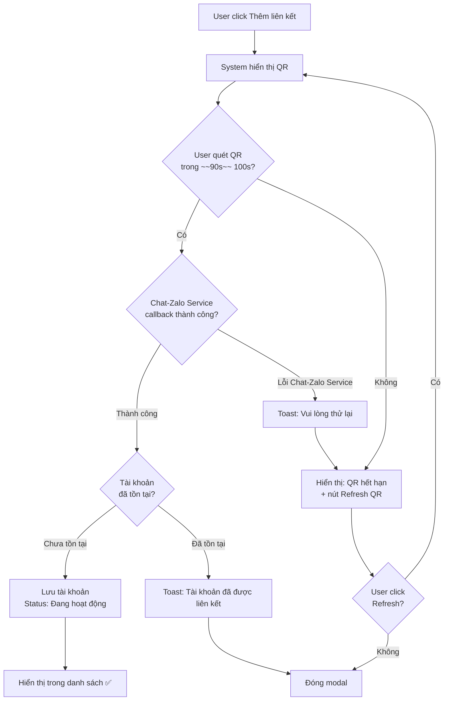
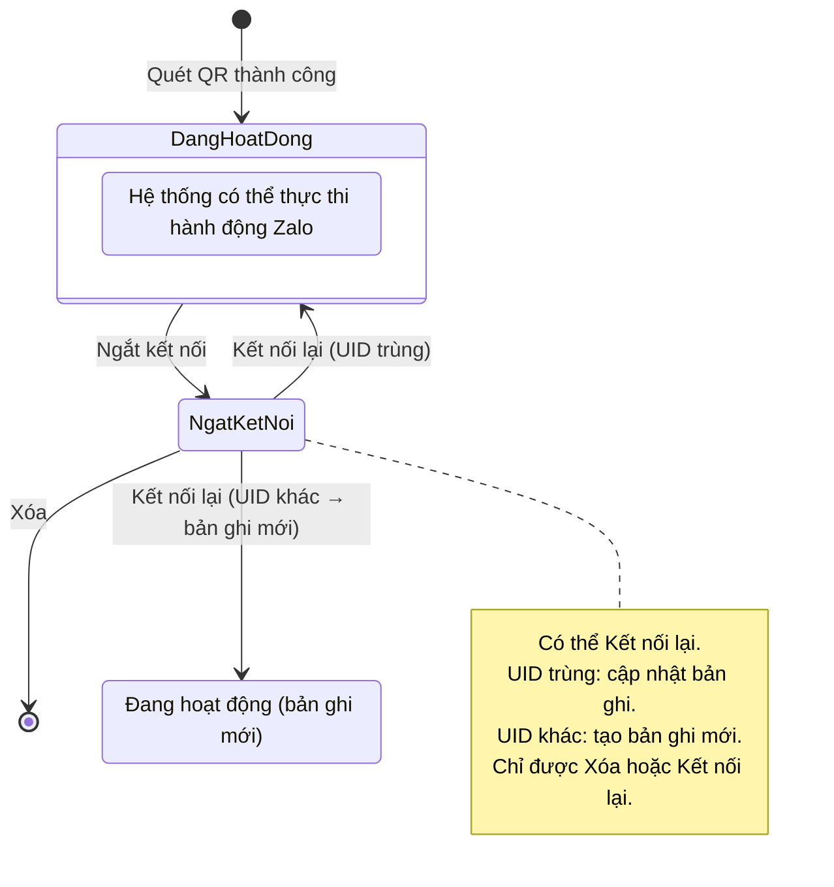

# [G001] Liên kết tài khoản Zalo

| Trường | Nội dung |
|--------|----------|
| **Feature ID** | G001 |
| **Tên** | Liên kết tài khoản Zalo (Zalo Account Linking) |
| **Module** | Thiết lập / Settings |
| **Owner (BA)** | Thành |
| **Dev assignee** | — |
| **Priority** | — |
| **Version** | 1.1 |
| **Status** | Draft |
| **Last updated** | 2026-06-09 |

---

## 1. Tổng quan (Overview)

Hệ thống cần cho phép Admin/Owner và nhân viên được cấp quyền liên kết tài khoản Zalo cá nhân vào workspace, để hệ thống có thể gửi/nhận tin nhắn Zalo thay mặt tài khoản đó. Tính năng này là nền tảng cho toàn bộ các tính năng chat Zalo trong sản phẩm.

**Use Case Description:**
> Là Admin/Owner hoặc Staff được cấp quyền, tôi muốn liên kết tài khoản Zalo vào workspace bằng cách quét mã QR, để hệ thống có thể thực hiện các tác vụ Zalo thay mặt tôi.

**Người dùng mục tiêu (Target users):**
- **Admin/Owner** của workspace — toàn quyền
- **Staff** được cấp quyền "Quản lý tài khoản Zalo" — toàn quyền tương đương

---

## 2. Điều kiện tiên quyết (Pre-conditions & Trigger)

**Trigger:** User click nút "Thêm liên kết" tại trang ~~Thiết lập > Liên kết tài khoản~~ **Chat - Zalo > Thiết lập > Tài khoản Zalo**.

**Pre-conditions:**
- [ ] User đã đăng nhập và có session hợp lệ
- [ ] User có quyền "Quản lý tài khoản Zalo" (Admin/Owner hoặc Staff được cấp quyền)
- [ ] Thiết bị có kết nối internet

**Post-conditions (sau khi thành công):**
- Tài khoản Zalo xuất hiện trong danh sách với trạng thái **Đang hoạt động**
- Hệ thống có thể thực thi hành động thông qua tài khoản Zalo vừa liên kết

---

## 3. Luồng chính (Happy Path)

1. **[User]** Vào ~~**Thiết lập > Liên kết tài khoản**~~ **Chat - Zalo > Thiết lập > Tài khoản Zalo**
2. **[User]** Click nút **"Thêm liên kết"**
3. **[System]** Gọi Chat-Zalo Service để tạo QR session → hiển thị modal "Đăng nhập tài khoản Zalo" với mã QR
4. **[User]** Mở ứng dụng Zalo trên điện thoại, quét mã QR trong vòng 100 giây
5. **[Chat-Zalo Service]** Xác thực QR, gửi callback về hệ thống kèm thông tin tài khoản (tên, SĐT, avatar)
6. **[System]** Nhận callback, lưu thông tin tài khoản, đặt trạng thái **Đang hoạt động**
7. **[System]** Đóng modal, hiển thị tài khoản mới trong danh sách

> Auto-generated — comment nếu cần sửa logic

---

## 4. Luồng phụ (Alternative Flows)

### AF01 — QR hết hạn, user refresh và quét lại

- **Xảy ra khi:** User không quét QR trong vòng ~~90 giây~~ 100 giây
- **3a.** System hiển thị thông báo hết hạn + nút **"Refresh QR"** _(thay bước 3)_
- **4a.** User click "Refresh QR" → System tạo QR mới, đếm ngược lại ~~90 giây~~ 100 giây
  - Use Case tiếp tục bước 4

### AF02 — Kết nối lại tài khoản Ngắt kết nối

- **Xảy ra khi:** User click **"Kết nối lại"** trên row có trạng thái **Ngắt kết nối**
- **1a.** System mở modal QR (cùng giao diện với luồng "Thêm liên kết")
- **2a.** User quét QR bằng Zalo app
- **3a.** Chat-Zalo Service callback về UID + thông tin tài khoản
- **4a.** System so sánh UID callback với UID của tài khoản đang kết nối lại:
  - **4a.i — UID trùng khớp:** Cập nhật trạng thái bản ghi hiện tại → **Đang hoạt động**, cập nhật thông tin profile (tên, SĐT, avatar), đóng modal
  - **4a.ii — UID khác:** Tạo bản ghi **mới** với trạng thái **Đang hoạt động**; bản ghi cũ (Ngắt kết nối) giữ nguyên, đóng modal

---

## 5. Luồng ngoại lệ (Exception Flows)

| Code | Trigger (Điều kiện kích hoạt) | UI Response (Phản hồi giao diện) | Recovery (Hướng xử lý) |
|------|-------------------------------|----------------------------------|------------------------|
| E01 | QR timeout ~~90s~~ 100s — user không quét kịp | Hiển thị thông báo "Mã QR đã hết hạn" + nút **"Refresh QR"** | User click Refresh để lấy QR mới |
| E02 | Tài khoản Zalo đã tồn tại trong workspace này | Toast: **"Tài khoản Zalo này đã được liên kết trong workspace"** | User đóng modal, kiểm tra danh sách |
| E03 | Chat-Zalo Service callback lỗi / timeout | Toast: **"Vui lòng thử lại"** | User click Refresh QR hoặc thử lại sau |
| E04 | Mất kết nối mạng khi đang chờ QR | Toast: **"Không thể kết nối. Vui lòng thử lại."** | User kiểm tra mạng, mở lại modal |
| E05 | Kết nối lại nhưng UID callback khác UID tài khoản đang reconnect | Toast: **"Tài khoản Zalo khác — đã thêm vào danh sách như một liên kết mới"** | Bản ghi cũ giữ Ngắt kết nối, bản ghi mới Đang hoạt động |

> Auto-generated — comment nếu cần sửa logic

---

## 6. Business Rules — Quy tắc nghiệp vụ

| Code | Rule (Quy tắc) | Lý do |
|------|----------------|-------|
| BR01 | ~~Trạng thái **Ngắt kết nối** là terminal — không thể chuyển ngược lại "Đang hoạt động"~~ **[CHANGED v1.1 — cho phép Kết nối lại qua QR]** Tài khoản **Ngắt kết nối** có thể chuyển về **Đang hoạt động** nếu quét QR thành công **và UID khớp** với bản ghi cũ | Cho phép tái liên kết tài khoản cùng chủ mà không cần xóa và thêm lại |
| BR02 | ~~Muốn tái liên kết tài khoản Zalo đã Ngắt kết nối: phải **Xóa** trước, sau đó **Thêm liên kết** lại bằng QR~~ **[CHANGED v1.1]** Click **"Kết nối lại"** trên row Ngắt kết nối → mở modal QR → (a) UID trùng: cập nhật bản ghi hiện tại → Đang hoạt động; (b) UID khác: tạo bản ghi mới Đang hoạt động, bản ghi cũ giữ Ngắt kết nối | Xem AF02 và BR07 |
| BR07 | Khi "Kết nối lại" với UID khác: bản ghi cũ (Ngắt kết nối) **không bị xóa hay thay đổi**; bản ghi mới được tạo độc lập | Đảm bảo audit trail — bản ghi cũ vẫn tồn tại trong hệ thống |
| BR03 | Khi tài khoản ở trạng thái **Ngắt kết nối**: hệ thống không thực thi bất kỳ hành động nào (gửi/nhận tin nhắn) qua tài khoản đó | Ngăn hành động trái phép sau khi thu hồi quyền |
| BR04 | **Xóa** chỉ được thực hiện sau khi tài khoản đã ở trạng thái **Ngắt kết nối** | Ngăn xóa nhầm tài khoản đang hoạt động |
| BR05 | Thông tin hiển thị (tên, SĐT, avatar) lấy từ Zalo profile — không cho phép chỉnh sửa trong hệ thống | Đảm bảo thông tin khớp với Zalo thực tế |
| BR06 | Tài khoản Zalo chỉ có thể đăng nhập trên 1 thiết bị (cơ chế Zalo) — nếu đã liên kết ở nơi khác, Zalo tự động xử lý phiên cũ | Out of scope — hệ thống không cần xử lý thêm |

---

## 7. State Machine — Trạng thái tài khoản Zalo

**Entity:** Tài khoản Zalo liên kết

| Từ trạng thái | Sự kiện | Sang trạng thái | Điều kiện | Tác động |
|---------------|---------|-----------------|-----------|----------|
| _(chưa liên kết)_ | Quét QR thành công | **Đang hoạt động** | Callback Chat-Zalo Service hợp lệ, chưa tồn tại trong workspace | Lưu thông tin tài khoản |
| **Đang hoạt động** | Chọn "Ngắt kết nối" | **Ngắt kết nối** | User có quyền quản lý tài khoản Zalo | Dừng mọi hành động qua tài khoản này |
| **Ngắt kết nối** | Chọn "Xóa" | _(đã xóa khỏi danh sách)_ | User có quyền quản lý tài khoản Zalo | Xóa bản ghi khỏi hệ thống |
| **Ngắt kết nối** | Click "Kết nối lại" → quét QR → **UID trùng** | **Đang hoạt động** | UID callback == UID bản ghi hiện tại | Cập nhật status + profile, không tạo bản ghi mới |
| **Ngắt kết nối** | Click "Kết nối lại" → quét QR → **UID khác** | _(bản ghi cũ giữ nguyên)_ | UID callback ≠ UID bản ghi hiện tại | Tạo bản ghi mới Đang hoạt động; bản ghi cũ không thay đổi |

> ~~**Terminal state:** Ngắt kết nối không thể đảo ngược — để tái liên kết phải Xóa và quét QR lại từ đầu.~~ **[CHANGED v1.1]** Ngắt kết nối có thể chuyển về Đang hoạt động qua "Kết nối lại" nếu UID khớp.

> Auto-generated — comment nếu cần sửa logic

---

## 8. Dữ liệu hiển thị (Display Fields)

Thông tin mỗi tài khoản Zalo hiển thị trong danh sách:

| # | Tên cột | Nguồn dữ liệu | Ghi chú |
|---|---------|---------------|---------|
| 1 | Avatar | Zalo profile | Hiển thị ảnh tròn |
| 2 | Tên đăng nhập | Zalo profile (display name) | Không cho phép chỉnh sửa |
| 3 | Số điện thoại | Zalo profile | Format: +84xxxxxxxxx |
| 4 | Thời gian cập nhật | Hệ thống ghi lại | Thời điểm liên kết hoặc thay đổi trạng thái gần nhất |
| 5 | Trạng thái | Hệ thống | Dropdown: **Đang hoạt động** / **Ngắt kết nối** |
| 6 | Hành động | — | Nút **Kết nối lại** + Nút **Xóa** (cả hai chỉ hiện khi đã Ngắt kết nối) |

---

## 9. UI/UX Notes

### 9A — Trang danh sách (Thiết lập > Liên kết tài khoản)

- Các nút góc trên phải: **Xuất Excel**, **Liên kết từ xa** *(out of scope)*, **Thêm liên kết**
- Bảng danh sách hiển thị tất cả tài khoản đã liên kết (mọi trạng thái)
- **Trạng thái** hiển thị dưới dạng dropdown inline tại mỗi row

### 9B — Modal QR

- Tiêu đề: "Đăng nhập tài khoản Zalo"
- Hiển thị: mã QR + đếm ngược ~~90 giây~~ 100 giây
- Khi hết ~~90s~~ 100s: ẩn QR, hiển thị nút **"Refresh QR"**
- Modal **không** dismiss khi click ra ngoài (tránh mất session)
- Nút **X** để đóng modal thủ công

### 9C — Trạng thái & Hành động có điều kiện

| Trạng thái | Dropdown options | Nút Kết nối lại | Nút Xóa |
|------------|-----------------|-----------------|---------|
| Đang hoạt động | Đang hoạt động ✓, Ngắt kết nối | Ẩn | Ẩn |
| Ngắt kết nối | Đang hoạt động *(disabled)*, Ngắt kết nối ✓ | Hiện | Hiện |

- Chọn "Ngắt kết nối" trong dropdown → hiển thị confirm dialog trước khi thực hiện
- Click "Kết nối lại" → mở modal QR (cùng giao diện Thêm liên kết, tiêu đề: "Kết nối lại tài khoản Zalo")
- Click "Xóa" → hiển thị confirm dialog trước khi thực hiện

---

## 10. Acceptance Criteria — Tiêu chí nghiệm thu

### Happy Path
- [ ] User có quyền click "Thêm liên kết" → modal QR hiển thị trong vòng 3 giây
- [ ] User quét QR thành công → tài khoản xuất hiện trong danh sách với trạng thái "Đang hoạt động", không cần reload trang
- [ ] Thông tin hiển thị (tên, SĐT, avatar) khớp với Zalo profile thực tế

### QR & Timeout
- [ ] QR hiển thị đếm ngược ~~90 giây~~ 100 giây
- [ ] Sau ~~90s~~ 100s không quét → QR ẩn, nút "Refresh QR" xuất hiện
- [ ] Click "Refresh QR" → QR mới hiển thị, đếm ngược lại ~~90s~~ 100s

### Exception
- [ ] Quét QR bằng tài khoản Zalo đã có trong workspace → toast "Tài khoản Zalo này đã được liên kết trong workspace", không tạo bản ghi trùng
- [ ] Chat-Zalo Service lỗi → toast "Vui lòng thử lại", modal không tự đóng

### State Machine
- [ ] Tài khoản "Đang hoạt động" → chọn "Ngắt kết nối" → confirm dialog → trạng thái đổi thành "Ngắt kết nối"
- [ ] Tài khoản "Ngắt kết nối" → không có option chuyển lại "Đang hoạt động" qua dropdown
- [ ] Tài khoản "Ngắt kết nối" → nút Xóa xuất hiện → confirm dialog → xóa khỏi danh sách
- [ ] Tài khoản "Đang hoạt động" → không có nút Xóa, không có nút Kết nối lại

### Kết nối lại
- [ ] Tài khoản "Ngắt kết nối" → nút **"Kết nối lại"** hiển thị
- [ ] Click "Kết nối lại" → modal QR mở với tiêu đề "Kết nối lại tài khoản Zalo"
- [ ] Quét QR bằng tài khoản Zalo **cùng UID** → trạng thái bản ghi cũ đổi thành "Đang hoạt động", profile được cập nhật, không tạo bản ghi mới
- [ ] Quét QR bằng tài khoản Zalo **khác UID** → tạo bản ghi mới "Đang hoạt động", bản ghi cũ giữ nguyên "Ngắt kết nối", toast thông báo "Tài khoản Zalo khác — đã thêm vào danh sách như một liên kết mới"

### Phân quyền
- [ ] User không có quyền "Quản lý tài khoản Zalo" → không hiển thị màn hình Quản lý tài khoản Zalo, hiển thị thông báo: "Tài khoản chưa được cấp quyền"
- [ ] User không có quyền thực hiện thao tác → hệ thống từ chối (không phải bỏ qua)

---

## 11. Out of Scope — Ngoài phạm vi

- Giới hạn số lượng tài khoản Zalo theo gói billing
- Tính năng "Liên kết từ xa"
- Mobile app — web only
- Audit log (ai liên kết, ai xóa, lúc mấy giờ)
- Phân quyền chi tiết cho Staff (xem docs riêng)
- Xử lý trường hợp Zalo account đã liên kết ở workspace khác (Zalo tự xử lý)

---

## 12. Dependencies — Phụ thuộc

| Phụ thuộc vào | Ghi chú |
|---------------|---------|
| Chat-Zalo Service (QR flow) | Cần tích hợp với Chat-Zalo Service |
| Tính năng phân quyền Staff | Out of scope — cần hoàn thiện trước khi Staff có thể sử dụng |

---

## 13. Open Questions — Câu hỏi chưa giải quyết

| # | Câu hỏi | Owner | Deadline | Trả lời |
|---|---------|-------|----------|---------|
| Q1 | Khi tài khoản Zalo bị Ngắt kết nối, các tin nhắn đang pending xử lý thế nào? | PM | — | Covered bởi G003 BR10 — Staff vẫn xem lịch sử, không gửi mới cho đến khi kết nối lại |
| Q2 | Có cần thông báo (in-app/email) khi tài khoản Zalo bị Ngắt kết nối không? | PM | — | Có — gửi in-app notification trong ERP Gopany |

---

## 14. Performance & Scalability

| Mục | Yêu cầu |
|-----|---------|
| Thời gian hiển thị QR sau click | < 3 giây |
| Thời gian nhận callback | Phụ thuộc Chat-Zalo Service (ngoài tầm kiểm soát) |

---

## 15. Rollout & Migration

| Mục | Chi tiết |
|-----|---------|
| Rollout strategy | All users có quyền |
| Data migration | Không — tính năng mới hoàn toàn |
| Breaking change | Không |
| Rollback plan | Ẩn tính năng nếu cần — không ảnh hưởng data hiện tại |

---

## Changelog

| Ngày | Version | Người thay đổi | Sections | Nội dung | File:Line |
|------|---------|----------------|----------|----------|-----------|
| 2026-06-05 | v1.0 | Thành (BA) | — | Tạo draft | — |
| 2026-06-05 | v1.0 | Thành (BA) | 3,5,7,10,12,14 | Cập nhật: thay Zalo API → Chat-Zalo Service | — |
| 2026-06-09 | v1.0→v1.1 | Thành (BA) | BR01,BR02,BR07,AF02,E05,7,8,9C,10 | Thêm luồng "Kết nối lại": button trên row Ngắt kết nối, mở QR, UID trùng → cập nhật bản ghi, UID khác → tạo bản ghi mới | L89–99 (AF02), L109 (E05), L137–139 (BR01/BR02/BR07), L156–159 (State Machine table), L161–178 (diagram), L198 (Section 8), L220–226 (Section 9C), L253–257 (AC) |

---

> **Lưu ý cho AI khi đọc spec này:**
> - Section 6 (Business Rules) là **bắt buộc implement đầy đủ**, đặc biệt BR01–BR04 về state machine
> - Section 7 (State Machine) định nghĩa toàn bộ trạng thái — không tự thêm trạng thái mới
> - **Ngắt kết nối là terminal state** — không có transition ngược lại Đang hoạt động
> - Section 11 (Out of Scope) là danh sách **cấm** — không implement dù có vẻ logic
> - Section 10 (AC) là checklist tự verify trước khi báo done
