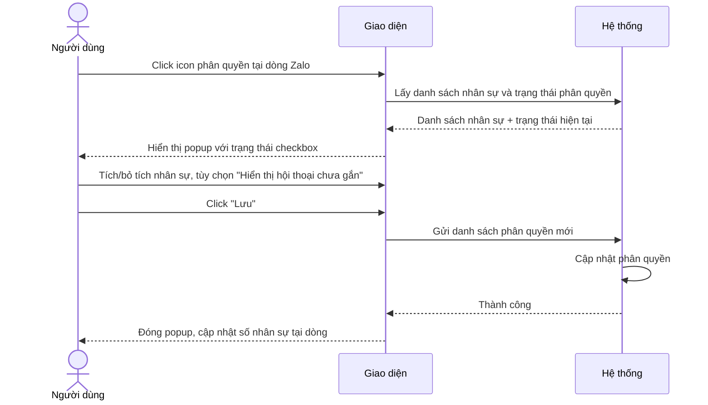
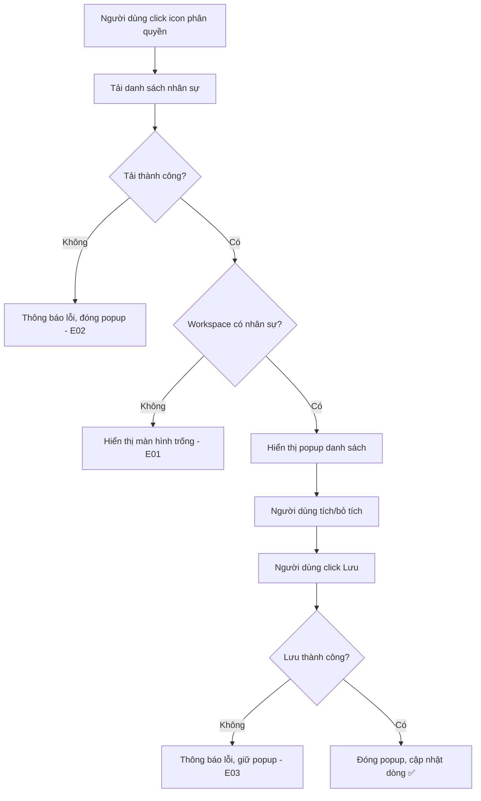
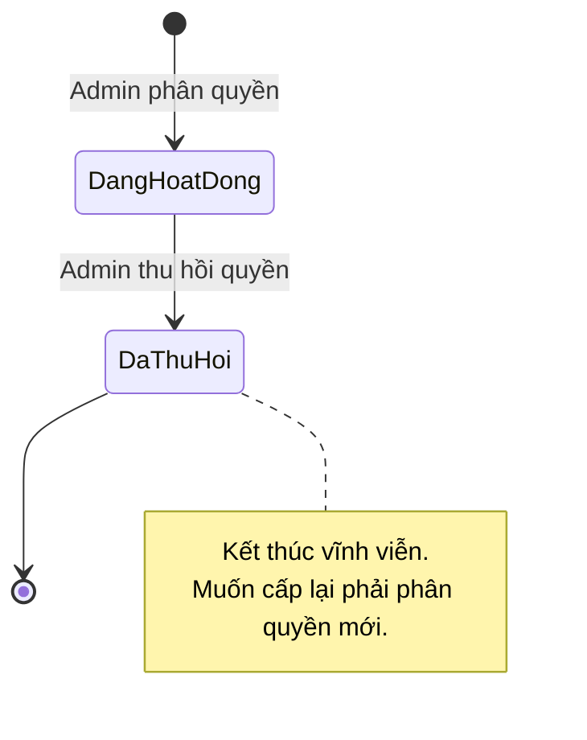

# [G002] Chia sẻ tài khoản Zalo cho Staff

| Trường | Nội dung |
|--------|----------|
| **Feature ID** | G002 |
| **Tên** | Chia sẻ tài khoản Zalo cho Staff (Zalo Account Staff Assignment) |
| **Module** | Thiết lập / Settings |
| **Owner (BA)** | Thành |
| **Dev assignee** | — |
| **Priority** | — |
| **Version** | 1.2 |
| **Status** | Draft |
| **Last updated** | 2026-06-26 |

---

## 1. Tổng quan (Overview)

Admin/Owner hoặc Staff có quyền "Quản lý tài khoản Zalo" có thể phân quyền tài khoản Zalo đã liên kết cho một hoặc nhiều Staff. Staff được phân quyền có thể xem tin nhắn (từ thời điểm được phân quyền trở đi) và gửi tin nhắn từ tài khoản Zalo đó. Tính năng này là nền tảng để phân chia công việc xử lý hội thoại Zalo giữa các thành viên trong workspace.

**Use Case Description:**
> Là Admin/Owner hoặc Staff có quyền "Quản lý tài khoản Zalo", tôi muốn phân quyền tài khoản Zalo cho Staff cụ thể, để họ có thể xem và gửi tin nhắn thay mặt tài khoản Zalo đó.

**Người dùng mục tiêu (Target users):**
- **Admin/Owner** — toàn quyền phân quyền / thu hồi quyền
- **Staff có quyền "Quản lý tài khoản Zalo"** — toàn quyền tương đương

**Phụ thuộc:** G001 (Liên kết tài khoản Zalo)

---

## 2. Điều kiện tiên quyết (Pre-conditions & Trigger)

**Trigger:** Người dùng click icon phân quyền tại dòng tài khoản Zalo trong màn hình ~~Thiết lập > Quản lý tài khoản Zalo~~ **Chat - Zalo > Thiết lập > Tài khoản Zalo**.

**Pre-conditions:**
- [ ] Người dùng đã đăng nhập
- [ ] Người dùng có quyền "Quản lý tài khoản Zalo"
- [ ] Tài khoản Zalo tồn tại trong workspace ~~và ở trạng thái **Đang hoạt động** (tài khoản Ngắt kết nối không thể phân quyền)~~ (icon phân quyền hiển thị ở mọi trạng thái — xem BR01)

**Post-conditions (sau khi thành công):**
- Danh sách phân quyền được cập nhật: Staff được chọn → có quyền xem và gửi tin; Staff bị bỏ chọn → mất quyền
- Số lượng nhân sự được phân quyền cập nhật hiển thị tại dòng tài khoản Zalo

---

## 3. Luồng chính (Happy Path)

1. **[Người dùng]** Vào ~~**Thiết lập > Quản lý tài khoản Zalo**~~ **Chat - Zalo > Thiết lập > Tài khoản Zalo**
2. **[Người dùng]** Click icon phân quyền tại dòng tài khoản Zalo muốn chia sẻ
3. **[Hệ thống]** Hiển thị popup danh sách toàn bộ nhân sự trong workspace với trạng thái phân quyền hiện tại:
   - Mỗi nhân sự có: ô chọn (checkbox) + tùy chọn **"Hiển thị cuộc hội thoại chưa gắn nhân sự"** (mờ/không thể click nếu nhân sự chưa được chọn)
   - Bộ lọc: **Tất cả / Đã phân quyền / Chưa phân quyền**
   - Nút **"Lưu"** và **"Hủy"**
4. **[Người dùng]** Tích/bỏ tích ô chọn nhân sự [→ E01, E02]
   - Khi tích nhân sự → tùy chọn "Hiển thị cuộc hội thoại chưa gắn nhân sự" của dòng đó chuyển sang **có thể click**
   - Khi bỏ tích nhân sự → tùy chọn "Hiển thị..." tự động bỏ chọn và trở về **mờ/không thể click**
5. **[Người dùng]** Tùy chọn: tích "Hiển thị cuộc hội thoại chưa gắn nhân sự" cho nhân sự muốn
6. **[Người dùng]** Click **"Lưu"** [→ E03, E04]
7. **[Hệ thống]** Cập nhật danh sách phân quyền theo lựa chọn mới nhất
8. **[Hệ thống]** Đóng popup, cập nhật số nhân sự hiển thị tại dòng tài khoản Zalo

> Auto-generated — comment nếu cần sửa logic

---

## 4. Luồng phụ (Alternative Flows)

### AF01 — Người dùng không thay đổi gì, click Hủy

- Xảy ra khi: Người dùng mở popup nhưng không muốn lưu
- **6a.** Người dùng click **"Hủy"** _(thay bước 6)_
- **7a.** Hệ thống đóng popup, không thay đổi dữ liệu
  - Use Case kết thúc.

### AF02 — Thu hồi toàn bộ phân quyền

- Xảy ra khi: Người dùng bỏ tích tất cả nhân sự đang được phân quyền
- **4a.** Người dùng bỏ tích tất cả → tất cả tùy chọn "Hiển thị..." tự động bỏ chọn và mờ _(thay bước 4)_
- **7a.** Hệ thống thu hồi quyền của toàn bộ nhân sự đang được phân quyền _(thay bước 7)_
  - Use Case tiếp tục bước 8.

---

## 5. Luồng ngoại lệ (Exception Flows)

| Code | Trigger (Điều kiện kích hoạt) | Phản hồi giao diện | Thông báo bên ngoài | Hướng xử lý |
|------|-------------------------------|-------------------|---------------------|-------------|
| E01 | Workspace không có nhân sự nào | Màn hình trống trong popup: "Chưa có nhân sự trong workspace" | — | Admin thêm nhân sự trước |
| E02 | Không thể tải danh sách nhân sự | Thông báo lỗi: "Không thể tải danh sách nhân sự. Vui lòng thử lại." Popup đóng | Ghi nhận lỗi hệ thống | Người dùng mở lại popup |
| E03 | Lưu thất bại do lỗi hệ thống | Thông báo lỗi: "Lưu thất bại. Vui lòng thử lại." Giữ nguyên popup | Ghi nhận lỗi hệ thống | Người dùng click Lưu lại |

> Auto-generated — comment nếu cần sửa logic

---

## 6. Business Rules — Quy tắc nghiệp vụ

| Code | Rule (Quy tắc) | Lý do |
|------|----------------|-------|
| BR01 | ~~Chỉ phân quyền được cho tài khoản Zalo ở trạng thái **Đang hoạt động** — tài khoản Ngắt kết nối không thể phân quyền~~ Icon phân quyền hiển thị ở mọi trạng thái; khi click vào tài khoản đang **Ngắt kết nối** → toast: **"Tài khoản đã ngắt kết nối. Vui lòng kết nối lại"**, không mở popup | Align với G003 — icon luôn hiện, runtime error thay vì ẩn icon |
| BR02 | Không giới hạn số nhân sự được phân quyền cho 1 tài khoản Zalo | Yêu cầu nghiệp vụ |
| BR03 | ~~Nhân sự được phân quyền chỉ thấy tin nhắn từ **thời điểm được phân quyền trở đi** — không xem được lịch sử trước đó~~ **[CHANGED v1.2]** Nhân sự được phân quyền thấy **toàn bộ lịch sử tin nhắn** của tài khoản Zalo đó | ~~Bảo mật dữ liệu lịch sử~~ Chốt theo yêu cầu nghiệp vụ |
| BR04 | Nhiều nhân sự có thể cùng bật **"Hiển thị cuộc hội thoại chưa gắn nhân sự"** — tất cả cùng thấy và ai xử lý trước thì thôi | Cho phép nhiều người xử lý song song |
| BR09 | Khi nhân sự bật **"Hiển thị cuộc hội thoại chưa gắn nhân sự"**, nhân sự đó thấy **2 loại hội thoại**: (1) các hội thoại chưa được gắn cho bất kỳ nhân sự nào; (2) các hội thoại đã được gắn cho chính nhân sự đó. Hội thoại đã gắn cho nhân sự khác **không hiển thị**. | Phân tách rõ phạm vi hiển thị — tránh nhầm với "thấy tất cả hội thoại trong hệ thống" |
| BR05 | ~~Khi tài khoản Zalo bị **xóa** là **soft delete** → conversations/messages gắn với tài khoản đó cũng soft delete theo; toàn bộ dữ liệu vẫn giữ trong DB~~ **[CHANGED v1.2]** Khi tài khoản Zalo bị **xóa** là **hard delete** → toàn bộ conversations/messages gắn với tài khoản đó bị xóa vĩnh viễn khỏi DB | Xác nhận từ dev (Xuân Tùng, 26/06/2026) |
| BR06 | ~~Khi tài khoản Zalo được **liên kết lại** (cùng tài khoản Zalo cũ nhận diện qua Zalo UID) → toàn bộ phân quyền cũ **tự động khôi phục**, không cần phân quyền lại~~ **[REMOVED v1.2]** Kết nối lại bằng QR tạo tài khoản mới hoàn toàn — không recover được dữ liệu cũ theo Zalo UID | ~~Trải nghiệm liền mạch sau khi tái liên kết~~ Không khả thi về mặt kỹ thuật |
| BR07 | Nhân sự được phân quyền **không có quyền** Ngắt kết nối hoặc Xóa tài khoản Zalo — chỉ được xem và gửi tin nhắn | Phân tách quyền quản trị và quyền vận hành |
| BR08 | ~~Thu hồi quyền nhân sự được lưu lại lịch sử (không xóa hẳn)~~ **[CHANGED v1.2]** Thu hồi quyền **không lưu trữ** lịch sử | ~~Đảm bảo truy vết được ai từng có quyền~~ Chốt theo yêu cầu nghiệp vụ |

**Ma trận phân quyền:**

| Hành động | Admin/Owner | Staff có quyền "Quản lý Zalo" | Staff được phân quyền | Staff khác |
|-----------|:-----------:|:-----------------------------:|:---------------------:|:----------:|
| Mở popup phân quyền | ✅ | ✅ | ❌ | ❌ |
| Phân quyền nhân sự | ✅ | ✅ | ❌ | ❌ |
| Thu hồi quyền nhân sự | ✅ | ✅ | ❌ | ❌ |
| Xem tin nhắn | ✅ | ✅ | ~~✅ (từ thời điểm được phân quyền)~~ **[CHANGED v1.2]** ✅ (toàn bộ lịch sử) | ❌ |
| Gửi tin nhắn | ✅ | ✅ | ✅ | ❌ |
| Ngắt kết nối / Xóa tài khoản Zalo | ✅ | ✅ | ❌ | ❌ |

---

## 7. State Machine — Vòng đời phân quyền

**Đối tượng:** Bản ghi phân quyền giữa 1 nhân sự và 1 tài khoản Zalo

| Từ trạng thái | Sự kiện | Sang trạng thái | Điều kiện | Tác động |
|---------------|---------|-----------------|-----------|----------|
| _(chưa tồn tại)_ | Admin tích nhân sự + Lưu | **Đang hoạt động** | Điều kiện tiên quyết thỏa | Nhân sự bắt đầu có quyền |
| **Đang hoạt động** | Admin bỏ tích nhân sự + Lưu | **Đã thu hồi** | — | Nhân sự mất quyền |
| ~~**Đang hoạt động**~~ | ~~Tài khoản Zalo bị xóa~~ | ~~**Tạm giữ**~~ | — | ~~Phân quyền giữ nguyên, chờ tài khoản được liên kết lại~~ **[REMOVED v1.2]** QR reconnect = tài khoản mới, không restore được |
| ~~**Tạm giữ**~~ | ~~Tài khoản Zalo được liên kết lại (cùng tài khoản)~~ | ~~**Đang hoạt động**~~ | ~~Tài khoản Zalo được khôi phục~~ | ~~Phân quyền tự động có hiệu lực trở lại~~ **[REMOVED v1.2]** |
| **Đã thu hồi** | _(không có)_ | _(kết thúc)_ | — | Muốn cấp lại phải thực hiện phân quyền mới |

> ~~**Lưu ý:** Trạng thái **Tạm giữ** không phải kết thúc — có thể chuyển về **Đang hoạt động** khi tài khoản Zalo được liên kết lại.~~ **[REMOVED v1.2]** Trạng thái Tạm giữ bị bỏ — kết nối lại QR tạo tài khoản mới, không có cơ chế restore.

> **[CHANGED v1.2]** Bỏ trạng thái **Tạm giữ** — kết nối lại Zalo bằng QR tạo tài khoản mới, không restore được phân quyền cũ.

> Auto-generated — comment nếu cần sửa logic

---

## 8. UI/UX Notes — Ghi chú giao diện

### 8A — Tổng quan
- Hiển thị tại: popup — trigger từ icon phân quyền tại dòng tài khoản Zalo, màn hình ~~Thiết lập > Quản lý tài khoản Zalo~~ **Chat - Zalo > Thiết lập > Tài khoản Zalo**
- Responsive: desktop only (theo G001)
- Figma: [link nếu có]

### 8B — Bổ sung tại danh sách tài khoản Zalo

Mỗi dòng tài khoản Zalo bổ sung:
- **Icon phân quyền** — trigger popup
- **Số nhân sự đã phân quyền** — hiển thị cạnh icon (vd: "3 nhân sự")

### 8C — Popup phân quyền

| Thành phần | Mô tả |
|------------|-------|
| Bộ lọc | 3 tab: **Tất cả / Đã phân quyền / Chưa phân quyền** |
| Ô chọn nhân sự | Tích nếu đang được phân quyền, không tích nếu chưa |
| Tùy chọn "Hiển thị cuộc hội thoại chưa gắn nhân sự" | Mờ/không thể click khi nhân sự chưa được tích; có thể click khi nhân sự được tích; tự bỏ chọn và mờ khi nhân sự bị bỏ tích |
| Màn hình trống | Icon + text "Chưa có nhân sự trong workspace" |
| Nút Lưu | Mờ/disabled khi không có thay đổi hoặc đang xử lý |
| Nút Hủy | Đóng popup, không lưu |

### 8D — Trạng thái & Phản hồi
- Lưu thành công: đóng popup, cập nhật số nhân sự tại dòng (không tải lại trang)
- Lỗi hệ thống: thông báo lỗi, giữ nguyên popup và trạng thái đang chọn
- Đang xử lý: nút Lưu hiển thị loading, không thể thao tác thêm

### 8E — Quyền & Hiển thị có điều kiện
- Icon phân quyền ẩn hoàn toàn với người dùng không có quyền "Quản lý tài khoản Zalo"

---

## 9. Acceptance Criteria — Tiêu chí nghiệm thu

### Happy Path
- [ ] Admin tích 2 nhân sự + Lưu → cả 2 nhân sự thấy tài khoản Zalo trong giao diện làm việc của mình
- [ ] Admin bỏ tích 1 nhân sự đang được phân quyền + Lưu → nhân sự đó không còn thấy tài khoản Zalo
- [ ] Admin tích nhân sự + bật "Hiển thị cuộc hội thoại chưa gắn nhân sự" + Lưu → nhân sự đó thấy: (1) hội thoại chưa gắn cho bất kỳ nhân sự nào, và (2) hội thoại được gắn cho chính nhân sự đó — **không thấy** hội thoại đã gắn cho nhân sự khác

### Tùy chọn "Hiển thị hội thoại chưa gắn nhân sự"
- [ ] Nhân sự chưa được tích → tùy chọn "Hiển thị..." ở trạng thái mờ, không thể click
- [ ] Nhân sự được tích → tùy chọn "Hiển thị..." chuyển sang có thể click
- [ ] Bỏ tích nhân sự đang bật "Hiển thị..." → tùy chọn tự tắt và trở về mờ

### Business Rules
- [ ] Phân quyền nhân sự cho tài khoản Zalo đang Ngắt kết nối → ~~hệ thống không cho phép, icon phân quyền bị disable hoặc hiển thị thông báo lỗi~~ icon vẫn hiển thị; click → toast **"Tài khoản đã ngắt kết nối. Vui lòng kết nối lại"**, không mở popup
- [ ] ~~Tài khoản Zalo bị xóa (soft delete) → conversations/messages gắn với tài khoản đó soft delete theo; dữ liệu vẫn còn trong DB~~ **[CHANGED v1.2]** Tài khoản Zalo bị xóa (hard delete) → toàn bộ conversations/messages bị xóa vĩnh viễn
- [ ] ~~Liên kết lại cùng tài khoản Zalo → phân quyền cũ tự động khôi phục, không cần phân quyền lại~~ **[REMOVED v1.2]** Kết nối QR = tài khoản mới, không restore phân quyền cũ
- [ ] Nhân sự được phân quyền không thấy nút "Ngắt kết nối" / "Xóa" tại tài khoản Zalo được chia sẻ
- [ ] ~~Nhân sự chỉ thấy tin nhắn từ thời điểm được phân quyền trở đi, không thấy lịch sử trước đó~~ **[CHANGED v1.2]** Nhân sự thấy toàn bộ lịch sử tin nhắn của tài khoản Zalo được phân quyền

### Phân quyền (Authorization)
- [ ] Người dùng không có quyền "Quản lý tài khoản Zalo" → không thấy icon phân quyền
- [ ] Người dùng không có quyền cố gắng lưu → hệ thống từ chối
- [ ] Staff có quyền "Quản lý tài khoản Zalo" → phân quyền được cho nhân sự khác

### Cô lập dữ liệu giữa các workspace ⚠️ (bắt buộc)
- [ ] Người dùng workspace A không thể xem hoặc chỉnh phân quyền của workspace B
- [ ] Không thể phân quyền nhân sự thuộc workspace khác

### Edge Cases
- [ ] Workspace không có nhân sự → popup hiển thị màn hình trống, không bị lỗi
- [ ] Không thay đổi gì trong popup → nút Lưu mờ, không gọi hệ thống
- [ ] 2 Admin cùng mở popup và Lưu đồng thời → kết quả theo lần lưu cuối, không bị lỗi dữ liệu

---

## 10. Out of Scope — Ngoài phạm vi

- Thông báo (trong app / email) cho nhân sự khi được phân quyền hoặc thu hồi quyền
- Phân quyền chi tiết hơn: chỉ xem vs xem + gửi (hiện tại nhân sự được phân quyền có cả 2)
- Giới hạn số nhân sự theo gói dịch vụ
- Màn hình nhân sự tự xem mình đang được phân quyền vào tài khoản Zalo nào (spec sau)
- Ngắt kết nối / Xóa tài khoản Zalo từ nhân sự (thuộc spec phân quyền riêng)
- Lịch sử hành động phân quyền (ai phân quyền ai, lúc nào)

---

## 11. Dependencies — Phụ thuộc

| Phụ thuộc vào | Trạng thái | Ghi chú |
|---------------|-----------|---------|
| G001 — Liên kết tài khoản Zalo | Draft | Tài khoản Zalo phải tồn tại trong hệ thống trước |
| Quản lý nhân sự (Staff management) | — | Danh sách nhân sự trong workspace phải có trước |

| Được phụ thuộc bởi | Ghi chú |
|--------------------|---------|
| Tính năng gửi/nhận tin nhắn Zalo (chưa có spec) | Cần biết nhân sự nào được dùng tài khoản Zalo nào |

---

## 12. Open Questions — Câu hỏi chưa giải quyết

| # | Câu hỏi | Owner | Deadline | Trả lời |
|---|---------|-------|----------|---------|
| Q1 | Khi nhiều nhân sự cùng bật "Hiển thị hội thoại chưa gắn" và cùng thấy 1 hội thoại — có cơ chế "nhận xử lý" hội thoại không? | PM Thành | 2026-06-05 | Không cần cơ chế nhận xử lý — toàn bộ nhân sự được tích đều thấy, ai xử lý trước thì thôi |
| Q2 | Khi tài khoản Zalo đang Ngắt kết nối — icon phân quyền bị disable hoàn toàn hay vẫn hiện nhưng show thông báo khi click? | PM Thành | 2026-06-05 | ✅ Icon vẫn hiển thị; click → toast "Tài khoản đã ngắt kết nối. Vui lòng kết nối lại" (không mở popup) |

---

## 13. Rollout & Migration — Triển khai

| Mục | Chi tiết |
|-----|---------|
| Rollout | Toàn bộ người dùng (tính năng mới, không ảnh hưởng luồng cũ) |
| Dữ liệu hiện tại | Không ảnh hưởng — chỉ thêm dữ liệu mới |
| Rollback | Tắt tính năng, ẩn icon phân quyền — không mất dữ liệu hiện có |
| Thứ tự triển khai | 1. Backend → 2. Frontend |

---

## Changelog — Lịch sử thay đổi

| Ngày | Version | Người thay đổi | Sections | Nội dung |
|------|---------|----------------|----------|----------|
| 2026-06-05 | v1.0 | Thành (BA) | — | Tạo draft |
| 2026-06-05 | v1.1 | Thành (BA) | Section 2, BR01, AC, Q2 | Cập nhật: tài khoản Ngắt kết nối không thể phân quyền (align với G003) |
| 2026-06-26 | v1.2 | Thành (BA) | BR03, BR05, BR06, BR08, Section 7, AC | BR03: staff thấy toàn bộ lịch sử; BR05: clarify soft delete; BR06: removed — QR reconnect = tài khoản mới; BR08: không lưu lịch sử thu hồi quyền; State machine: bỏ trạng thái Tạm giữ |
