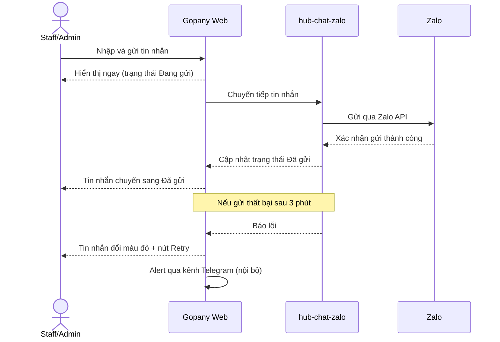
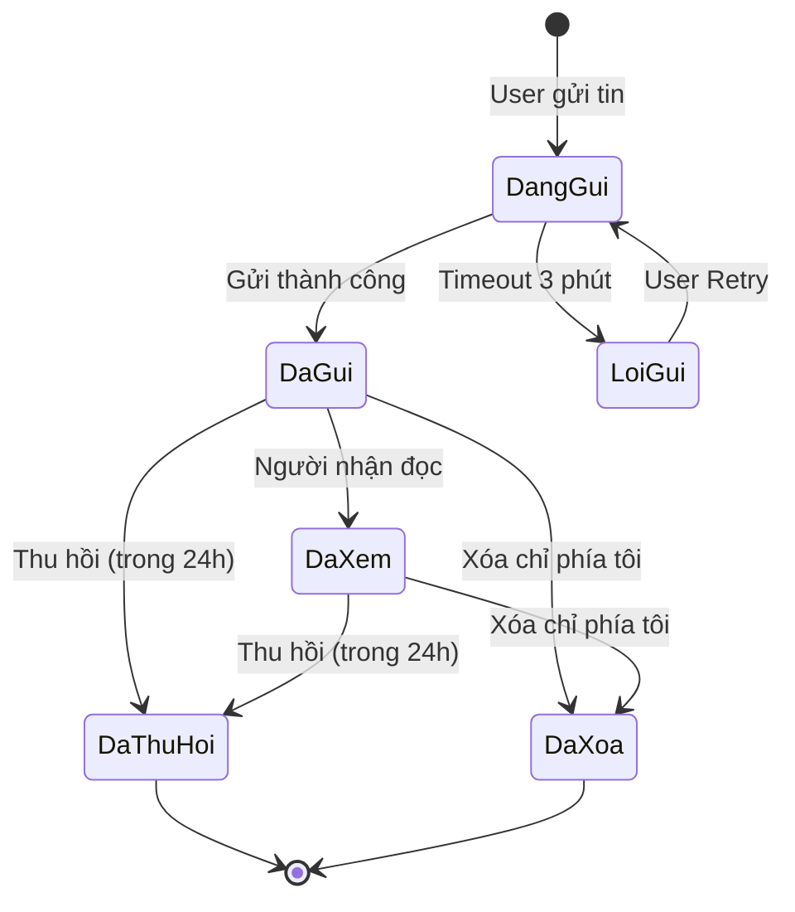

# [G003] Chat

| Trường | Nội dung |
|--------|----------|
| **Feature ID** | G003 |
| **Tên** | Chat (Nhắn tin đa nhân sự trên tài khoản Zalo) |
| **Module** | Chat |
| **Owner (BA)** | Thành |
| **Dev assignee** | — |
| **Priority** | — |
| **Version** | ~~1.5~~ ~~1.6~~ ~~1.7~~ ~~1.8~~ ~~1.9~~ ~~1.10~~ **1.11** |
| **Status** | Final |
| **Last updated** | ~~2026-07-20~~ ~~2026-07-22~~ ~~2026-07-27~~ ~~2026-07-28~~ ~~2026-07-30~~ **2026-08-03** |

---

## 1. Tổng quan (Overview)

Hiện tại mỗi Staff chỉ có thể nhắn tin trên một tài khoản Zalo riêng lẻ, không có không gian làm việc chung. Tính năng Chat cho phép nhiều Admin và Staff trong cùng một workspace cùng xem và gửi tin nhắn trên một hoặc nhiều tài khoản Zalo được liên kết, với đầy đủ lịch sử, phân công hội thoại và audit trail về người gửi.

**Use Case Description:**
> Là Admin hoặc Staff được phân quyền, tôi muốn xem và gửi tin nhắn qua tài khoản Zalo của workspace, để cả nhóm có thể cùng xử lý hội thoại với khách hàng mà không cần chia sẻ đăng nhập Zalo.

**Người dùng mục tiêu (Target users):**
- **Admin/Owner** — xem toàn bộ hội thoại của tất cả tài khoản Zalo trong workspace
- **Staff được phân quyền (G002)** — xem và gửi tin nhắn trên tài khoản Zalo được assign
- **Staff có quyền "Hiển thị cuộc hội thoại chưa gắn nhân sự"** — thêm quyền xem hội thoại chưa được assign cho ai

**Phụ thuộc:** G001 (Liên kết tài khoản Zalo), G002 (Phân quyền tài khoản Zalo cho Staff)

---

## 2. Điều kiện tiên quyết (Pre-conditions & Trigger)

**Trigger:** User click mục "Tin nhắn" ~~trên sidebar hệ thống~~ trong nhóm **Chat** trên sidebar.

**Pre-conditions:**
- [ ] User đã đăng nhập và có session hợp lệ
- [ ] Với Staff: đã được assign vào ít nhất một tài khoản Zalo qua G002
- [ ] Với Admin/Owner: không yêu cầu assign — mặc định thấy tất cả
- [ ] Tài khoản Zalo nguồn phải ở trạng thái **Đang hoạt động** để gửi tin; trạng thái **Ngắt kết nối** chỉ cho phép xem lịch sử

**Post-conditions (sau khi gửi tin nhắn thành công):**
- Tin nhắn được lưu vào hệ thống với thông tin: nội dung, người gửi (Staff/Admin), tài khoản Zalo thực thi, thời gian
- Hội thoại nổi lên đầu danh sách
- Các Staff khác trong workspace nhận được tin nhắn mới realtime (qua hub-chat-zalo)

---

## 3. Luồng chính (Happy Path)

Tính năng Chat bao gồm ~~8~~ ~~7~~ **6** Use Case. Các Use Case được mô tả lần lượt dưới đây.

> **[v1.4]** **UC-03 đã chuyển sang G007** · **[v1.5] UC-05 đã chuyển sang G014**.
> Mã UC được **giữ nguyên (không đánh số lại)** để bảo toàn traceability của các tham chiếu cũ.

---

### UC-01 — Xem danh sách hội thoại

1. **[User]** Click "Tin nhắn" ~~trên sidebar~~ trong nhóm **Chat** trên sidebar
2. **[Hệ thống]** Hiển thị màn hình 3-panel:
   - Panel trái: danh sách hội thoại
   - Panel giữa: placeholder "Vui lòng chọn đoạn chat"
   - Panel phải: ẩn
3. **[Hệ thống]** Load danh sách hội thoại, mặc định tab `Tất cả`, sort theo tin nhắn mới nhất, load 20 hội thoại đầu tiên
4. **[User]** Scroll xuống cuối danh sách → hệ thống load thêm 20 hội thoại tiếp theo (infinite scroll)
5. **[User]** Click vào một Conversation Item
6. **[Hệ thống]** Hiển thị chi tiết hội thoại tại panel giữa, load 20 tin nhắn gần nhất
7. **[Hệ thống]** Hiển thị thông tin chi tiết tại panel phải (tab Thông tin)
8. **[Hệ thống]** Đánh dấu hội thoại đã đọc; badge chưa đọc biến mất

**Ghi chú:** Tab `Chưa đọc` chỉ cập nhật sau khi user chuyển tab, không cập nhật realtime trong lúc đang đọc hội thoại.

---

### UC-02 — Gửi tin nhắn

#### UC-02a — Gửi tin nhắn text

1. **[User]** Đang ở chi tiết hội thoại, click vào input box
2. **[User]** Nhập nội dung — ~~(tối đa 1.000 ký tự)~~ **[CHANGED v1.7]** không giới hạn độ dài, không bị chặn gõ (BR03)
3. **[User]** Nhấn Enter hoặc click icon gửi ~~[→ E03, E06]~~ **[→ E03]**
3b. **[Hệ thống]** **[NEW v1.7]** Nếu nội dung > 1.000 ký tự → **tự động tách** thành nhiều phần ≤ 1.000 ký tự theo ranh giới xuống dòng/khoảng trắng (BR03, BR03b). Nếu ≤ 1.000 → giữ nguyên 1 tin
4. **[Hệ thống]** Hiển thị **từng phần** như tin nhắn riêng, trạng thái "Đang gửi" (icon loading + label inline)
5. **[Hệ thống]** Gửi **nối tiếp, đúng thứ tự** qua hub-chat-zalo → Zalo (BR03c) [→ E03]
6. **[Hệ thống]** Mỗi phần chuyển sang trạng thái "Đã gửi"; hiển thị tên người gửi + thời gian. Phần lỗi → "Lỗi gửi" + Retry riêng, không ảnh hưởng phần đã gửi (BR03c)
7. **[Hệ thống]** Hội thoại nổi lên đầu danh sách

#### UC-02b — Gửi ảnh

1. **[User]** Click icon "Gửi hình ảnh" trong toolbar
2. **[User]** Chọn một hoặc nhiều ảnh từ máy [→ E04, E05]
3. **[Hệ thống]** Kiểm tra dung lượng trước khi upload: mỗi ảnh ~~≤200MB~~ ≤5MB, tổng lô ~~≤200MB~~ ≤25MB [→ E04, E05]
4. **[Hệ thống]** Upload và gửi ảnh qua hub-chat-zalo → Zalo
5. **[Hệ thống]** Ảnh hiển thị preview trong hội thoại (PNG/JPG view trực tiếp)

#### UC-02c — Gửi file/video

1. **[User]** Click icon "Gửi tệp tin" trong toolbar
2. **[User]** Chọn file từ máy [→ E04]
3. **[Hệ thống]** Kiểm tra dung lượng: file ~~≤1GB~~ ≤5MB, video ~~≤1GB~~ ≤5MB [→ E04]
4. **[Hệ thống]** Upload và gửi file qua hub-chat-zalo → Zalo
5. **[Hệ thống]** File hiển thị với icon download; video hiển thị nút download (không view trực tiếp)



> Auto-generated — comment nếu cần sửa logic

---

### ~~UC-03 — Tìm kiếm & Kết bạn mới~~ → **[MOVED v1.4] Đã chuyển sang G007**

> **[CHANGED v1.4 — align G007]** Toàn bộ luồng tìm kiếm số điện thoại & kết bạn **không còn thuộc phạm vi G003**. G007 §1 chốt: entry point cũ trong G003 **bị loại bỏ**; entry point chính nay là button **Kết bạn** trên header danh sách hội thoại, spec đầy đủ tại **G007 UC-01**.
> Dev/QA đọc **G007 UC-01, UC-01b, AF01–AF04, E01–E06, BR01–BR10** thay cho UC-03 này.

~~1. **[User]** Click icon `Add friend` trên header danh sách chat~~
~~2. **[Hệ thống]** Hiển thị popup: input số điện thoại + dropdown chọn tài khoản Zalo thực thi~~
~~3. **[User]** Nhập số điện thoại → nhấn Enter hoặc click tìm kiếm [→ E07]~~
~~4. **[Hệ thống]** Tìm kiếm qua Zalo → hiển thị thông tin profile: ảnh bìa, avatar, tên (kèm icon chỉnh sửa tên), giới tính, ngày sinh, số điện thoại [→ E07]~~
~~5. **[User]** (Tuỳ chọn) Gắn thẻ nhanh cho người dùng vừa tìm thấy~~
~~6a. **[User]** Click `Kết bạn` → hệ thống gửi lời mời kết bạn qua Zalo; button đổi thành "Đã gửi lời mời"~~
~~6b. **[User]** Click `Nhắn tin` → đóng popup, tạo hội thoại mới và mở chi tiết hội thoại~~

~~**Ghi chú:** Nếu hai tài khoản đã là bạn bè trên Zalo → chỉ hiển thị button `Nhắn tin`.~~

---

### UC-04 — Nhắc hẹn

1. **[User]** Đang ở chi tiết hội thoại, click icon `Nhắc hẹn` trong toolbar
2. **[Hệ thống]** Hiển thị popup nhắc hẹn gồm:
   - Label "Nhập nội dung" + Textbox (nếu click từ tin nhắn cụ thể: prefill nội dung tin đó; nếu click từ icon toolbar: để trống)
   - Label "Chọn thời gian" + Options: 15 phút, 30 phút, 9:00 ngày mai, Khác (mở datepicker + calendar)
   - Label "Chọn ngày nhắc" hiển thị kết quả thời gian đã chọn
   - Chọn kiểu vòng lặp: Không lặp lại | Hàng ngày | Hàng tuần | Hàng tháng
   - Chọn người nhận nhắc: Chỉ mình tôi | Tất cả ~~(tất cả Staff có quyền xem hội thoại)~~ (tất cả người trong cuộc trò chuyện: với chat cá nhân = người nhận + Staff đang xem hội thoại; với group = gửi notification vào group theo luồng Zalo)
   - Button `Hủy` và `Lưu`
3. **[User]** Điền thông tin → click `Lưu`
4. **[Hệ thống]** Lưu nhắc hẹn gắn với hội thoại
5. **[Hệ thống]** Hiển thị block nhắc hẹn trong hội thoại: `⏰ {nội dung} | {ngày giờ} | Chỉnh sửa nhắc hẹn`
6. **[Hệ thống]** Đến giờ nhắc → hiển thị toast notification trên màn hình + block `⏰` trong hội thoại; nếu nhiều nhắc hẹn cùng lúc → delay 3 giây giữa các thông báo

**Ghi chú:** Xóa nhắc hẹn → hiển thị "Bạn đã xóa nhắc hẹn: {nội dung nhắc hẹn}" trong hội thoại.

---

### ~~UC-05 — Ghim tin nhắn~~ → **[MOVED v1.5] Đã chuyển sang G014**

> **[CHANGED v1.5]** Ghim tin nhắn nay có **spec riêng: G014 — Ghim tin nhắn**, đặc tả đầy đủ 16 sections (4 UC, 9 Exception, 17 BR, State Machine).
> **Không implement theo mô tả 5 bước dưới đây.** Đọc **G014** thay thế.
> Điểm khác biệt chính so với bản cũ: ghim là **Zalo-native dùng chung** cấp hội thoại · tin ghim bị thu hồi → **tự bỏ ghim, trả lại slot** · đủ 3 tin → **popup cho chọn tin thay thế** thay vì chặn cứng.

~~1. **[User]** Hover vào tin nhắn → click option `Ghim`~~
~~2. **[Hệ thống]** Tin nhắn được ghim, hiển thị ở khu vực ghim cạnh Header hội thoại [→ BR08]~~
~~3. Khi có nhiều tin ghim: hiển thị số lượng tại khu vực ghim~~
~~4. **[User]** Click vào khu vực ghim → popup hiển thị danh sách tin nhắn đã ghim + icon bỏ ghim từng cái~~
~~5. **[User]** Click icon bỏ ghim → tin biến khỏi danh sách ghim~~

---

### UC-06 — Xóa / Thu hồi tin nhắn

1. **[User]** Hover vào tin nhắn **do mình gửi từ web Gopany** → click option `Thu hồi` hoặc `Xóa chỉ phía tôi` [→ E08]
2. **[Hệ thống]** Thực thi hành động trên Zalo (qua hub-chat-zalo)
3. **[Hệ thống]** Trên Gopany: tin nhắn chuyển sang style disable + label `Đã thu hồi` / `Đã xóa`; nội dung gốc vẫn hiển thị (không xóa khỏi Gopany)

**Ghi chú:** Tin nhắn gửi từ **điện thoại** (không phải web Gopany) — Staff vẫn có thể thu hồi từ Gopany; khi thu hồi sẽ hiển thị tên Staff đã thực hiện thu hồi.

---

### UC-07 — Assign nhân viên vào hội thoại

1. **[Admin hoặc Staff có quyền assign]** Đang ở chi tiết hội thoại, click icon `Assign` trên header
2. **[Hệ thống]** Mở panel phải hiển thị danh sách nhân viên: có ô tìm kiếm + checkbox chọn nhân viên
3. **[User]** Tìm kiếm và chọn nhân viên muốn assign → click `Lưu`
4. **[Hệ thống]** Hội thoại xuất hiện trong danh sách chat của nhân viên được assign
5. ~~**[Admin]** Có thể unassign nhân viên bằng cách bỏ chọn checkbox → click `Lưu`~~ **[Admin only]** Có thể unassign nhân viên bằng cách bỏ chọn checkbox → click `Lưu`; Staff có quyền assign **không thể** unassign

---

### UC-08 — Chuyển tiếp tin nhắn

1. **[User]** Hover vào tin nhắn → click **"Chuyển tiếp"** [→ BR19]; **[BỔ SUNG v1.11]** hoặc dùng **"Chọn nhiều"** để chọn **tối đa 50 tin nhắn** rồi chuyển tiếp (BR27)
2. **[Hệ thống]** Mở popup **"Chuyển tiếp"** gồm:
   - **Filter tài khoản Zalo** (single select) — mặc định là tài khoản Zalo của hội thoại nguồn; chỉ hiện các tài khoản Zalo user đang có quyền xem (BR23)
   - **Filter tag** (single select) — lọc hội thoại theo tag; mặc định "Tất cả"
   - Ô tìm kiếm
   - Danh sách hội thoại thuộc tài khoản Zalo đã chọn mà user **đang có quyền xem** (BR23) — hội thoại được gán cho mình, hội thoại chưa gán (nếu có quyền BR18); ngoại trừ nhóm đã rời/bị xóa (BR25)
   - Nhóm có cài đặt **"Chỉ trưởng/phó nhóm được nhắn tin"** → hiển thị nhưng bị **disable**, không thể chọn (BR21)
3. **[User]** Chọn một hoặc nhiều người / nhóm muốn chuyển tiếp đến — **[BỔ SUNG v1.11] tối đa 99 hội thoại** (BR22, BR27)
4. **[User]** Click **"Gửi"**
5. **[Hệ thống]** Gửi nội dung tin nhắn gốc đến từng người / nhóm đã chọn dưới dạng **tin nhắn thường** qua Zalo; **[BỔ SUNG v1.11]** nếu chọn nhiều tin → gửi đủ các tin, **giữ nguyên thứ tự** [→ E09]
6. **[Hệ thống]** Toast: *"Đã chuyển tiếp"*; popup đóng lại

*Use case kết thúc.*

**Định dạng hỗ trợ:** Text · Ảnh · File · Video
**Không thể chuyển tiếp:** Tin nhắn đã thu hồi (BR19 — option ẩn hoàn toàn)

---

## 4. Luồng phụ (Alternative Flows)

### AF01 — Filter theo tài khoản Zalo kết hợp tab Chưa đọc

- Xảy ra khi: User đang ở tab `Chưa đọc` và chọn filter theo tài khoản Zalo A
- Danh sách chỉ hiển thị hội thoại **chưa đọc thuộc tài khoản Zalo A**
- Use Case tiếp tục bước 5 (UC-01).

### AF02 — Staff có nhiều tài khoản Zalo

- Xảy ra khi: Staff được assign vào nhiều tài khoản Zalo (qua G002)
- Mặc định: danh sách hiển thị **tất cả hội thoại của tất cả tài khoản Zalo được assign**
- User dùng filter để xem từng tài khoản riêng lẻ
- Use Case tiếp tục bước 5 (UC-01).

### ~~AF03 — Kết bạn với người đã có trên Zalo (UC-03)~~ → **[MOVED v1.4] Đã chuyển sang G007 AF01**

- ~~Xảy ra khi: Số điện thoại tìm được và hai tài khoản đã là bạn bè~~
- ~~Bước 6: chỉ hiển thị button `Nhắn tin`, ẩn `Kết bạn`~~
- ~~Use Case tiếp tục bước 6b (UC-03).~~

### AF04 — Hội thoại nhóm

- Áp dụng tương tự cá nhân, với các khác biệt:
  - Header: hiển thị số thành viên bên dưới tên nhóm
  - Avatar: ngẫu nhiên theo nhóm
  - Panel phải: hiển thị thêm icon `Rời nhóm` và `Ẩn trò chuyện`; không có `Chặn người dùng`
  - Trạng thái đã xem: hiển thị list avatar ngang của tất cả Staff đã đọc; hover từng avatar → tên Staff
  - Use Case tiếp tục bình thường.

### AF05 — Tin nhắn gửi từ điện thoại (không qua web Gopany)

- Xảy ra khi: Chủ tài khoản Zalo gửi tin từ điện thoại cá nhân
- Tin hiển thị trong hội thoại **không kèm tên người gửi**
- Option `Thu hồi` vẫn hiển thị và có thể thực thi từ web Gopany; khi thu hồi → hiển thị tên Staff đã thu hồi
- Use Case tiếp tục bình thường.

---

## 5. Luồng ngoại lệ (Exception Flows)

| Code | Trigger (Điều kiện kích hoạt) | UI Response | Notification |
|------|-------------------------------|-------------|--------------|
| E01 | Danh sách hội thoại load thất bại | Hiển thị "Vui lòng tải lại" ở giữa màn hình | — |
| E02 | User mở hội thoại của tài khoản Zalo đã Ngắt kết nối | Vẫn cho xem lịch sử; popup cảnh báo "Mất kết nối tài khoản Zalo {Tên tài khoản}. Vui lòng kết nối lại" (có thể đóng popup) | — |
| E03 | Gửi tin thất bại — không gửi được sau 3 phút | Tin nhắn đổi sang màu đỏ + hiển thị nút Retry | Alert qua kênh Telegram (nội bộ) nếu lỗi do kết nối giữa hub-chat và Gopany |
| E04 | File/ảnh/video vượt giới hạn dung lượng (~~ảnh >200MB, file/video >1GB~~ >5MB/file với mọi định dạng) | Thông báo lỗi ngay khi chọn file, trước khi upload | — |
| E05 | Tổng dung lượng nhiều ảnh trong 1 lần gửi ~~>200MB~~ >25MB | Chặn toàn bộ lô ảnh đó, thông báo lỗi | — |
| ~~E06~~ | ~~Tin nhắn text vượt 1.000 ký tự~~ | ~~Không cho gõ thêm ký tự (chặn tại input)~~ → **[CHANGED v1.7] Đã bãi bỏ**: vượt 1.000 ký tự **không còn là ngoại lệ** — hệ thống tự tách thành nhiều tin (BR03, BR03b).<br>**⚠️ Dev lưu ý:** bản đang chạy **cho gõ và cho bấm Gửi**, nhưng **từ chối gửi** kèm toast *"Nội dung tin nhắn phải nhỏ hơn 1000 ký tự"* — **phải gỡ bỏ toast và điều kiện chặn này**. Mã E06 không tái sử dụng | — |
| ~~E07~~ | ~~Tìm số điện thoại thất bại (lỗi kết nối hoặc không tìm thấy)~~ ~~Hiển thị "Vui lòng thực hiện lại"~~ **[MOVED v1.4]** Theo UC-03 sang **G007 E04/E05/E06** | — |
| E08 | User cố thu hồi tin nhắn đã gửi quá 24 giờ | Option `Thu hồi` không hiển thị (ẩn hoàn toàn) | — |
| E09 | Chuyển tiếp tin nhắn thất bại (lỗi Zalo API hoặc mất kết nối) | Toast: *"Không thể chuyển tiếp, vui lòng thử lại"*; popup giữ nguyên để user thử lại | — |

**Exception Confirmation Log — G003**

| Code | Từ UC | Nguồn HP hay Độc lập | Confirmed |
|------|-------|----------------------|-----------|
| E01 | UC-01 | Bước 3 | ✅ |
| E02 | UC-01 | Bước 5 | ✅ |
| E03 | UC-02 | Bước 5 | ✅ |
| E04 | UC-02b/c | Bước 3 | ✅ |
| E05 | UC-02b | Bước 3 | ✅ |
| ~~E06~~ | ~~UC-02a bước 2~~ | — | **[v1.7] Đã bãi bỏ** — xem §5 |
| ~~E07~~ | ~~UC-03~~ | ~~Bước 3–4~~ | **[MOVED v1.4] → G007** |
| E08 | UC-06 | Bước 1 | ✅ |
| E09 | UC-08 | Bước 5 | ✅ |

---

## 6. Business Rules — Quy tắc nghiệp vụ

| Code | Rule | Lý do |
|------|------|-------|
| BR01 | Mỗi hội thoại thuộc về 1 tài khoản Zalo cố định — không thể gửi tin từ tài khoản Zalo khác trong cùng hội thoại | Đảm bảo audit trail và tránh nhầm lẫn tài khoản gửi |
| BR02 | Staff chỉ thấy hội thoại của tài khoản Zalo được assign qua G002 | Phân quyền dữ liệu theo tài khoản |
| BR03 | ~~Tin nhắn text giới hạn 1.000 ký tự mỗi lần gửi~~ **[CHANGED v1.7]** Ô soạn tin **không giới hạn độ dài**: **không chặn gõ**, **không chặn thao tác gửi**, và **không báo lỗi độ dài**. **Tại thời điểm nhấn Gửi**, nếu nội dung vượt **1.000 ký tự** → hệ thống **tự động tách thành nhiều tin nhắn nối tiếp**, mỗi tin ≤ 1.000 ký tự. Trong lúc soạn **không tách, không chia ô** | 1.000 là giới hạn của **Zalo API**, không phải giới hạn nghiệp vụ. Auto tách để người dùng gửi được nội dung dài mà vẫn không vi phạm giới hạn Zalo — thay vì chặn và bắt tự cắt tay. **Nhất quán G005 (Tin nhắn mẫu) v1.2 BR08** |
| **BR03b** | **[NEW v1.7]** **Quy tắc cắt:** cắt tại **dấu xuống dòng** gần nhất trước mốc 1.000 ký tự; nếu không có, cắt tại **khoảng trắng** gần nhất — **không vỡ từ giữa chừng**. Nếu một đoạn liền không có ranh giới nào trong 1.000 ký tự → cắt cứng tại 1.000 | Tin nhắn gửi cho khách phải đọc được; tránh cắt giữa từ, số điện thoại hoặc link |
| **BR03c** | **[NEW v1.7]** Các phần sau khi tách gửi **nối tiếp, đúng thứ tự**; mỗi phần là **một tin nhắn độc lập** với trạng thái riêng theo §7 (Đang gửi / Đã gửi / Lỗi gửi). Một phần lỗi → phần đó hiện **"Lỗi gửi" + nút Retry riêng**, **không** ảnh hưởng các phần đã gửi thành công | Nhất quán vòng đời tin nhắn sẵn có (§7); cho phép thử lại đúng phần lỗi thay vì gửi lại toàn bộ |
| BR04 | Giới hạn file đính kèm: ~~ảnh ≤200MB/file; video ≤1GB/file; tệp tin khác ≤1GB/file~~ tối đa **5MB/file** với mọi định dạng (ảnh, video, tệp tin) | Giới hạn hệ thống |
| BR05 | Gửi nhiều ảnh cùng lúc: tổng dung lượng ~~≤200MB~~ ≤25MB/lần gửi (tối đa 5 ảnh × 5MB) | Tránh quá tải upload |
| BR06 | Tin nhắn chỉ có thể thu hồi trong vòng 24 giờ kể từ lúc gửi | Giới hạn nghiệp vụ của Zalo |
| BR07 | Xóa/Thu hồi chỉ thực thi trên Zalo; trên Gopany chuyển sang dạng disable + hiển thị nội dung gốc với label trạng thái | Gopany giữ lại lịch sử đầy đủ |
| ~~BR08~~ | ~~Mỗi hội thoại ghim tối đa 3 tin nhắn~~ **[MOVED v1.5]** Giới hạn 3 tin giữ nguyên nhưng toàn bộ quy tắc ghim tin nhắn nay nằm ở **G014 BR01–BR17** | Xem G014 |
| BR09 | Tin nhắn đã thu hồi không thể tiếp tục xóa (terminal state) | Tránh nhầm lẫn trạng thái |
| BR10 | Tài khoản Zalo ở trạng thái Ngắt kết nối: vẫn xem được lịch sử nhưng không gửi được tin mới | Bảo toàn lịch sử kể cả khi mất kết nối |
| BR11 | Admin/Owner thấy tất cả hội thoại của tất cả tài khoản Zalo trong workspace — không cần assign | Quyền quản trị toàn bộ |
| BR12 | Staff bị unassign khỏi tài khoản Zalo (G002) → các hội thoại liên quan ẩn khỏi danh sách ngay lập tức | Nhất quán với phân quyền G002 |
| BR13 | Tin nhắn đến khi Staff offline vẫn được lưu và hiển thị khi Staff online lại | Không phụ thuộc trạng thái online của Staff |
| BR14 | Mỗi hội thoại có thể assign cho một hoặc nhiều nhân viên | Hỗ trợ xử lý hội thoại theo nhóm |
| BR15 | ~~Admin và Staff được cấp quyền assign riêng (cấp con — khác với "Quản lý tài khoản Zalo" ở G002) đều có thể assign nhân viên vào hội thoại~~ Admin và Staff có quyền assign đều có thể **assign** nhân viên vào hội thoại; chỉ **Admin** có thể **unassign** | Phân tách quyền assign (Staff + Admin) và unassign (Admin only) |
| BR16 | Nhân viên được assign vào hội thoại → hội thoại hiển thị trong danh sách của nhân viên đó | Cơ chế phân công hội thoại |
| BR17 | Nhiều nhắc hẹn đến cùng lúc trong 1 hội thoại → delay 3 giây giữa các thông báo | Tránh spam notification |
| BR18 | Staff có quyền "Hiển thị cuộc hội thoại chưa gắn nhân sự" (cấu hình trong G002) mới thấy hội thoại chưa được assign | Phân quyền linh hoạt theo nhu cầu từng nhân viên |
| BR19 | Option **"Chuyển tiếp"** ẩn hoàn toàn với tin nhắn đã bị thu hồi | Nội dung đã thu hồi không còn tồn tại, chuyển tiếp vô nghĩa |
| BR20 | Tin nhắn được chuyển tiếp đến đích dưới dạng **tin nhắn thường** — không có label hay định dạng đặc biệt | Đơn giản hóa xử lý; tránh phức tạp hóa không cần thiết |
| BR21 | Nhóm có cài đặt **"Chỉ trưởng/phó nhóm được nhắn tin"** → hiển thị trong popup chuyển tiếp nhưng **bị disable**, không thể chọn | Zalo block gửi tin vào nhóm này — không cho chọn để tránh lỗi runtime |
| BR22 | Cho phép chọn **nhiều người / nhóm cùng lúc** trong popup chuyển tiếp; hệ thống gửi song song đến từng đích | Tiết kiệm thao tác khi cần forward cho nhiều người |
| BR23 | **Popup chuyển tiếp chỉ hiển thị hội thoại trong cùng 1 tài khoản Zalo** — mặc định filter theo tài khoản Zalo của hội thoại nguồn; user chỉ forward được vào hội thoại thuộc tài khoản Zalo đang chọn (không forward cross-account). Danh sách hội thoại hiển thị đúng những gì user có quyền xem trong account đó. Ngoại lệ: nhóm đã rời/bị xóa (BR25) | Mỗi Zalo account là 1 kênh độc lập — forward cross-account làm rò rỉ nội dung giữa các kênh |
| ~~BR24~~ | ~~Staff có quyền "Hiển thị cuộc hội thoại chưa gắn nhân sự" (BR18) chỉ được xem và nhắn tin — cấm chuyển tiếp cả 2 chiều~~ → **Đã bãi bỏ**: rule mới BR23 cho phép forward với mọi hội thoại user thấy được, kể cả hội thoại chưa gán | ~~Chưa được assign = không có quyền phát tán nội dung~~ |
| BR25 | Hội thoại nhóm mà user **đã bị xóa hoặc tự rời** (còn lưu lịch sử theo G008 BR11) → **cấm chuyển tiếp cả 2 chiều**: (1) option **"Chuyển tiếp"** ẩn hoàn toàn trên mọi tin nhắn trong nhóm đó (không forward ra ngoài); (2) nhóm đó không xuất hiện làm điểm đến trong popup (không forward vào trong) | Không còn là thành viên active = không có quyền phát tán nội dung từ/vào nhóm đó; nhất quán với việc input đã bị disable (G008 BR11) |
| **BR26** | **[NEW v1.8] Mở hội thoại từ một tham chiếu liên hệ** (click **card danh thiếp** — G013; nút **Nhắn tin** — G007). Tài khoản Zalo dùng để mở = **tài khoản Zalo của ngữ cảnh đang thao tác** *(với card danh thiếp: tài khoản của hội thoại đang chứa card — user đã có quyền cấp tài khoản ở đây nên không phát sinh chặn quyền cấp 1)*. Xử lý theo 3 nhánh: **(A)** liên hệ **chưa từng có hội thoại** với tài khoản Zalo đó → **mở hội thoại nháp (draft)**; **hội thoại thật chỉ được tạo khi người thực hiện gửi tin nhắn đầu tiên**, khi đó **auto-assign cho người thực hiện** (thấy và nhắn được ngay, không phụ thuộc BR18) — *nhất quán G007 BR08/BR09*; **(B)** **đã có hội thoại** với liên hệ đó **và người thực hiện đang có quyền xem** (hội thoại được gán cho mình, hoặc chưa gán + có quyền BR18) → **mở** hội thoại đó; **(C)** **đã có hội thoại** với liên hệ đó nhưng **đang gán cho người khác — người thực hiện không có quyền xem** (ca "trùng khách") → **CHẶN**: mở khung hội thoại ở **trạng thái rỗng / chỉ đọc** (không hiển thị lịch sử, **khóa ô nhập**) kèm **banner** + **popup** khi click: *"Bạn không có quyền nhắn tin với khách này. Vui lòng liên hệ quản trị viên."*; **ghi log**; **không** tự assign; **không** nêu tên người đang phụ trách. Admin muốn cho tham gia → dùng **UC-07 (Assign)** | Liên hệ trong danh thiếp là khách được **giới thiệu** → chỉ cần chăm sóc ngay khi **chưa ai phụ trách** (Case A). Case C: khách **đã được nhân viên khác phục vụ** → không có khoảng trống chăm sóc; cho tự vào sẽ mở đường **giật khách / phá nhau** giữa sale. Chặn + để Admin quyết định assign qua UC-07 là an toàn. Không nêu tên người phụ trách để tránh chính rủi ro đó. Nhất quán **BR-C04** (từ chối + log) và **BR-C06** (runtime → thông báo) |
| **BR27** | **[NEW v1.11] Giới hạn chuyển tiếp (UC-08):** một lượt chuyển tiếp chọn **tối đa 50 tin nhắn** (qua **"Chọn nhiều"**) và chuyển tới **tối đa 99 hội thoại**; mỗi hội thoại đích nhận **đủ các tin đã chọn, giữ nguyên thứ tự**. **Chạm giới hạn → chặn chọn thêm** (checkbox tin / điểm đến bị mờ, disable) + hiển thị nhắc *"Tối đa 50 tin nhắn"* / *"Tối đa 99 hội thoại"* | **Giới hạn nghiệp vụ của Zalo** (giống mốc đang áp dụng) — tránh spam / quá tải khi gửi song song |

---

## 7. State Machine — Trạng thái tin nhắn

**Entity:** Tin nhắn gửi đi (từ web Gopany)

| Từ trạng thái | Sự kiện | Sang trạng thái | Điều kiện | Ghi chú |
|---------------|---------|-----------------|-----------|---------|
| _(chưa tồn tại)_ | User nhấn gửi | **Đang gửi** | — | Icon loading + label inline |
| Đang gửi | Gửi thành công (trong 3 phút) | **Đã gửi** | hub-chat-zalo xác nhận | — |
| Đang gửi | Gửi thất bại sau 3 phút | **Lỗi gửi** | Không nhận được xác nhận | Đổi màu đỏ + nút Retry |
| Đã gửi | Người nhận đọc | **Đã xem** | — | Icon avatar người xem |
| Đã gửi / Đã xem | User thu hồi (trong 24h) | **Đã thu hồi** | Thời gian ≤ 24h kể từ lúc gửi | Terminal. Nội dung gốc vẫn hiện dạng disable |
| Đã gửi / Đã xem | User xóa chỉ phía tôi | **Đã xóa** | — | Terminal. Nội dung gốc vẫn hiện dạng disable |
| Lỗi gửi | User click Retry | **Đang gửi** | — | Quay lại vòng gửi |

> **Terminal states:** Đã thu hồi, Đã xóa — không thể chuyển tiếp sang trạng thái khác.



> Auto-generated — comment nếu cần sửa logic

---

## 8. Data Model — Mô hình dữ liệu

N/A — Spec này thuần nghiệp vụ. Data model sẽ được định nghĩa trong tài liệu kỹ thuật riêng.

---

## 9. API Contract

N/A — Spec này thuần nghiệp vụ. API contract sẽ được định nghĩa trong tài liệu kỹ thuật riêng.

---

## 10. UI/UX Notes — Ghi chú giao diện

### 10A — Layout tổng thể

Màn hình Chat gồm **3 panel**:

```
[ Panel trái        ] [ Panel giữa               ] [ Panel phải       ]
[ Danh sách chat    ] [ Chi tiết hội thoại        ] [ Thông tin/Ghi chú]
```

- **Platform:** Web only
- **Responsive:** Không yêu cầu mobile
- **Empty state** (chưa có hội thoại nào): hiển thị trống

---

### 10B — Panel trái: Danh sách chat

**Header:**

| Element | Mô tả |
|---------|-------|
| Tìm kiếm | Tìm theo tên, số điện thoại, hoặc nội dung tin nhắn bên trong hội thoại. Kết quả highlight keyword + hiển thị số kết quả + icon up/down để điều hướng |
| ~~Add friend~~ **Kết bạn** | ~~Mở popup tìm kiếm & kết bạn theo SĐT (xem UC-03)~~ **[CHANGED v1.4]** Mở popup tìm kiếm & kết bạn — **spec tại G007 UC-01** (entry point chính, nằm cạnh button Tìm kiếm) |
| Add Group | Tạo nhóm trò chuyện mới |
| Filter | Lọc danh sách theo tài khoản Zalo; khi chọn Zalo A → chỉ hiện hội thoại thuộc Zalo A |

**Tabs:**

| Tab | Nội dung |
|-----|---------|
| Tất cả | Toàn bộ hội thoại |
| Chưa đọc | Hội thoại có tin chưa đọc; cập nhật sau khi chuyển tab (không realtime khi đang đọc) |
| ~~Phân loại thẻ~~ | Out of scope |

**Icons bên dưới tab:** `Cá nhân` | `Nhóm` | ~~Danh bạ~~ (Out of scope)

**Conversation Item (mỗi card trong danh sách):**

| Element | Mô tả |
|---------|-------|
| Avatar | Ảnh cá nhân hoặc avatar nhóm |
| Tên hội thoại | Tên cá nhân hoặc tên nhóm |
| Tin nhắn cuối | Preview nội dung + thời gian tương đối |
| Badge chưa đọc | Số tin chưa đọc |
| Icon chuông | ~~Bật/tắt Chrome push notification cho hội thoại này~~ **[CHANGED v1.4 — align G009 BR15/BR16]** Bật/tắt **thông báo hội thoại** (Zalo-native, per tài khoản Zalo). Gopany **không** có browser/Chrome push notification — khi tắt, hội thoại không được highlight nhưng **badge tin chưa đọc vẫn hiển thị**. Chi tiết: **G009 UC-05** |
| Tag/thẻ | Hiển thị 2–3 thẻ đầu; nếu nhiều hơn hiển thị "+N" |
| Icon tài khoản Zalo | Phân biệt tin đến từ tài khoản Zalo nào |
| Icon Pin | Chỉ thị hội thoại đang được ghim |
| Option menu (hiện khi hover) | Ghim/Bỏ ghim \| Phân loại \| Đánh dấu chưa đọc \| Bật/Tắt thông báo \| Tạo nhóm/Thêm thành viên \| Rời nhóm *(chỉ hội thoại nhóm)* \| Chặn người dùng |

---

### ~~10C — Popup Add Friend~~ → **[MOVED v1.4] Đã chuyển sang G007 §7 "Popup Kết bạn"**

> Toàn bộ đặc tả popup tìm kiếm & kết bạn nằm ở **G007**. Không implement theo bảng dưới đây.

| ~~Element~~ | ~~Mô tả~~ |
|---------|-------|
| ~~Input SĐT~~ | ~~Nhập số điện thoại cần tìm~~ |
| ~~Dropdown~~ | ~~Chọn tài khoản Zalo thực thi tìm kiếm~~ |
| ~~Kết quả~~ | ~~Ảnh bìa, avatar, tên (kèm icon chỉnh sửa tên), giới tính, ngày sinh, số điện thoại~~ |
| ~~Gắn thẻ nhanh~~ | ~~Danh sách thẻ + input tìm kiếm thẻ~~ |
| ~~Buttons~~ | ~~`Kết bạn` (đổi thành "Đã gửi lời mời" sau khi click) \| `Nhắn tin`~~ |
| ~~Out of scope~~ | ~~Gửi danh thiếp, Chặn tin nhắn~~ |

---

### 10D — Panel giữa: Chi tiết hội thoại

**Header hội thoại:**

| Element | Mô tả |
|---------|-------|
| Tên cá nhân/nhóm | Cá nhân: tên; Nhóm: tên + số thành viên bên dưới |
| Icons | Tìm kiếm trong hội thoại \| Đánh dấu chưa đọc \| Gắn thẻ \| Show/Hide panel phải \| Assign nhân viên |

**Hiển thị tin nhắn:**

| Loại tin | Hiển thị |
|----------|---------|
| Tin nhắn đến (từ khách) | Nội dung + thời gian; hover → option: Chuyển tiếp (UC-08) \| Ghim \| Copy \| Chọn nhiều \| Xóa |
| Tin nhắn gửi từ web Gopany | Nội dung + **tên người gửi** + thời gian; hover → option: Chuyển tiếp (UC-08) \| Ghim \| Copy \| Chọn nhiều \| Thu hồi *(nếu ≤24h)* \| Xóa chỉ phía tôi |
| Tin nhắn gửi từ điện thoại | Nội dung + thời gian; **không hiển thị tên người gửi**; hover → option: Chuyển tiếp (UC-08) \| Thu hồi *(từ Gopany)* |
| Tin đã thu hồi/xóa | Style disable + label "Đã thu hồi" / "Đã xóa"; nội dung gốc vẫn hiển thị |
| Tin đang gửi | Icon loading tĩnh + label "Đang gửi" inline dưới tin |
| Tin gửi thất bại | Màu đỏ + nút Retry |

**File & media:**

| Loại | Xử lý |
|------|-------|
| Ảnh PNG/JPG | View preview trực tiếp |
| Video | Hiển thị nút download; không view trực tiếp |
| File/tài liệu | Hiển thị icon download; click → download ngay |

**Per-message features:**
- Icon Reply (trả lời) trên mỗi tin nhắn
- Icon React (thả emoji) trên mỗi tin nhắn
- Trạng thái đã xem: icon avatar của người đã đọc; hover → username + họ tên; nhóm → list avatar ngang

**Khu vực ghim tin nhắn:** → **[MOVED v1.5] Chi tiết giao diện tại G014 §10A–10E**
- Hiển thị cạnh header hội thoại *(chỉ hiện khi có ≥1 tin ghim — G014 BR17)*
- Nhiều tin ghim → hiển thị số lượng
- Click → popup danh sách tin ghim + icon bỏ ghim từng cái

**Thanh tag (trên input):**
- Danh sách thẻ đã gán cho hội thoại, hiển thị ngang
- Icon mở rộng + button tìm kiếm thẻ

**Input box:**

| Element | Mô tả |
|---------|-------|
| Icon avatar tài khoản Zalo | Phân biệt tài khoản Zalo đang dùng để gửi |
| Placeholder | "Trả lời từ {tên tài khoản zalo}" |
| Icon emoji | Gửi biểu cảm |
| Icon sticker | Gửi sticker |
| Toolbar dưới | Tin nhắn mẫu *(Out of scope)* \| Gửi ảnh \| Gửi tệp tin \| Nhắc hẹn \| Mở rộng box chat \| ~~Danh thiếp~~ *(Out of scope)* |

**"Đang nhập..." indicator:**
- Hiển thị khi Staff khác đang gõ trong cùng hội thoại
- Kèm username của người đang nhập

---

### ~~10E — Panel phải: Thông tin chi tiết~~ → **[MOVED v1.10] Đã tách sang G011 — Panel Thông tin & Ghi chú**

> Toàn bộ đặc tả panel phải (2 tab `Thông tin` | `Ghi chú`, biến thể cá nhân/nhóm, Ảnh/Video · Tài liệu · Liên kết, Nhóm chung, Chặn người dùng / Rời nhóm, Ẩn trò chuyện, Ghi chú) nay nằm ở **G011**. Dev/QA đọc **G011** thay cho bảng dưới đây.

| ~~Element~~ | ~~Mô tả~~ |
|---------|-------|
| ~~Tabs~~ | ~~`Thông tin` \| `Ghi chú`~~ |
| ~~Tab Thông tin (cá nhân)~~ | ~~Avatar, Tên (sửa được), Icons (Tắt thông báo / Ghim / Tạo nhóm), Ảnh/Video, Tài liệu, Liên kết, Nhóm chung, Chặn người dùng, Ẩn trò chuyện~~ |
| ~~Tab Thông tin (nhóm)~~ | ~~Như cá nhân, thay Chặn người dùng bằng Rời nhóm~~ |
| ~~Tab Ghi chú~~ | ~~Input ghi chú tự do; mở rộng giai đoạn sau~~ |

---

### 10F — Quyền & Hiển thị có điều kiện

| Điều kiện | Hành vi |
|-----------|---------|
| Staff không có quyền assign hội thoại | Icon `Assign` không hiển thị |
| Staff có quyền assign, tài khoản Zalo Ngắt kết nối | Icon `Assign` hiển thị; click → toast "Tài khoản đã ngắt kết nối. Vui lòng kết nối lại" |
| Tin nhắn gửi quá 24h | Option `Thu hồi` ẩn hoàn toàn |
| Tài khoản Zalo Ngắt kết nối | Input gửi tin disable; popup cảnh báo |
| Hội thoại nhóm | Không hiển thị option `Chặn người dùng` |
| User mở popup chuyển tiếp từ bất kỳ hội thoại nào | Popup chỉ hiện hội thoại user đang có quyền xem — bao gồm hội thoại chưa gán (nếu có BR18); ngoại trừ nhóm đã rời/bị xóa (BR23, BR25) |
| Staff đang trong nhóm đã rời / bị xóa (read-only, G008 BR11) | Option `Chuyển tiếp` ẩn hoàn toàn trên mọi tin nhắn trong nhóm đó — không forward ra ngoài (BR25) |
| Staff mở popup chuyển tiếp từ hội thoại bất kỳ | Nhóm đã rời / bị xóa không xuất hiện làm điểm đến — không forward vào trong (BR25) |
| **[v1.11]** Đã chọn **50 tin nhắn** để chuyển tiếp | Không cho tích thêm tin (checkbox mờ); nhắc *"Tối đa 50 tin nhắn"* (BR27) |
| **[v1.11]** Đã chọn **99 hội thoại** đích trong popup chuyển tiếp | Không cho chọn thêm điểm đến; nhắc *"Tối đa 99 hội thoại"* (BR27) |

---

### 10G — Popup Chuyển tiếp: chọn nhiều & giới hạn **[NEW v1.11]**

**Chọn nhiều tin nguồn:**
- Bật **"Chọn nhiều"** → mỗi tin hiện **checkbox**; thanh trên cùng hiển thị bộ đếm **"Đã chọn X/50"**.
- Khi đủ **50 tin** → checkbox các tin chưa chọn **chuyển mờ / disable**; tooltip hoặc dòng nhắc *"Tối đa 50 tin nhắn"*.

**Chọn hội thoại đích (trong popup):**
- Mỗi hội thoại có **checkbox**; hiển thị bộ đếm **"Đã chọn X/99"** (hoặc dải chip điểm đến đã chọn).
- Khi đủ **99 hội thoại** → không cho tích thêm; dòng nhắc *"Tối đa 99 hội thoại"*.
- Nút **"Gửi"** hiển thị số đích đã chọn — **"Gửi (X)"**; **disable** khi chưa chọn đích nào.

**Trạng thái khác:** nhóm bị disable theo BR21 (không tích được) không tính vào bộ đếm; sau khi gửi → toast *"Đã chuyển tiếp"*, popup đóng (UC-08, BR27).

---

## 11. Acceptance Criteria — Tiêu chí nghiệm thu

### Phân quyền & Hiển thị
- [ ] Staff chỉ thấy hội thoại của tài khoản Zalo được assign; không thấy tài khoản khác
- [ ] Staff có quyền "Hiển thị cuộc hội thoại chưa gắn nhân sự" → thấy thêm hội thoại chưa assign
- [ ] Admin/Owner thấy tất cả hội thoại của tất cả tài khoản Zalo trong workspace
- [ ] Staff bị unassign (G002) → hội thoại liên quan ẩn ngay lập tức
- [ ] Icon `Assign` không hiển thị với Staff không có quyền assign hội thoại

### Danh sách hội thoại
- [ ] Filter theo tài khoản Zalo A → danh sách chỉ hiển thị hội thoại thuộc Zalo A
- [ ] Filter + tab `Chưa đọc` → chỉ hiển thị hội thoại chưa đọc của Zalo A
- [ ] Tab `Chưa đọc` cập nhật sau khi chuyển tab, không cập nhật realtime khi đang đọc
- [ ] Tin nhắn mới đến → hội thoại tự động nổi lên đầu danh sách (realtime, không cần F5)
- [ ] Scroll xuống cuối danh sách → load thêm 20 hội thoại tiếp theo
- [ ] Danh sách load thất bại → hiển thị "Vui lòng tải lại" (AC-E01)
- [ ] Hội thoại của tài khoản Zalo Ngắt kết nối → vẫn xem được lịch sử; popup cảnh báo mất kết nối có thể đóng (AC-E02)

### Gửi tin nhắn
- [ ] Gửi text thành công → tin hiển thị ngay với tên người gửi + thời gian; hội thoại nổi lên đầu
- [ ] ~~Gõ quá 1.000 ký tự → không thể gõ thêm (AC-BR03)~~ **[CHANGED v1.7]** Gõ/dán quá 1.000 ký tự → **vẫn gõ được**, nút Gửi **vẫn bấm được**, và tin **được gửi đi** (AC-BR03)
- [ ] **[v1.7] Regression:** gửi nội dung >1.000 ký tự → **KHÔNG** còn toast lỗi *"Nội dung tin nhắn phải nhỏ hơn 1000 ký tự"* (AC-BR03)
- [ ] **[v1.7]** Gửi nội dung 2.500 ký tự → tự tách thành **3 tin nhắn nối tiếp**, đúng thứ tự (AC-BR03, AC-BR03c)
- [ ] **[v1.7]** Điểm cắt rơi vào **dấu xuống dòng** nếu có, nếu không thì **khoảng trắng** — không có từ nào bị vỡ đôi (AC-BR03b)
- [ ] **[v1.7]** Đoạn liền >1.000 ký tự không có khoảng trắng → cắt cứng tại 1.000, không treo (AC-BR03b)
- [ ] **[v1.7]** Nội dung ≤ 1.000 ký tự → gửi thành **1 tin duy nhất**, không tách (AC-BR03)
- [ ] **[v1.7]** Một phần gửi lỗi → phần đó hiện "Lỗi gửi" + Retry riêng; các phần đã gửi **giữ nguyên** (AC-BR03c)
- [ ] **[v1.7]** Click Retry ở phần lỗi → chỉ gửi lại phần đó, không gửi lại toàn bộ (AC-BR03c)
- [ ] Upload ảnh/video/file >5MB → thông báo lỗi trước khi upload (AC-BR04)
- [ ] Upload nhiều ảnh tổng ~~>200MB~~ >25MB → chặn toàn bộ lô (AC-BR05)
- [ ] Gửi tin thất bại sau 3 phút → tin đổi màu đỏ + nút Retry; alert Telegram nếu lỗi kết nối Hub-chat và Gopany (AC-E03)
- [ ] "Đang nhập..." hiển thị kèm username khi Staff khác đang gõ

### Xóa / Thu hồi
- [ ] Thu hồi tin nhắn trong 24h → tin chuyển sang "Đã thu hồi" (disable), nội dung gốc vẫn hiện
- [ ] Option `Thu hồi` không hiển thị với tin gửi quá 24h (AC-E08)
- [ ] Tin đã thu hồi → không có option `Xóa chỉ phía tôi` (AC-BR09)
- [ ] Thu hồi tin từ điện thoại → hiển thị tên Staff đã thu hồi

### ~~Ghim tin nhắn~~ → **[MOVED v1.5] AC đầy đủ tại G014 §11**
- [ ] ~~Ghim tối đa 3 tin/hội thoại; khi đủ 3 → không cho ghim thêm (AC-BR08)~~ *(hành vi này đã đổi — G014 BR05: đủ 3 → popup cho chọn tin thay thế)*
- [ ] ~~Bỏ ghim → tin biến khỏi khu vực ghim trên header~~

### Nhắc hẹn
- [ ] Nhắc hẹn đến giờ → toast notification + block `⏰` hiển thị trong hội thoại
- [ ] Nhiều nhắc hẹn cùng lúc → delay 3 giây giữa các thông báo (AC-BR17)
- [ ] Xóa nhắc hẹn → hiển thị "Bạn đã xóa nhắc hẹn: {nội dung}" trong hội thoại

### ~~Tìm kiếm & Kết bạn~~ → **[MOVED v1.4] AC nằm ở G007 §9**
- [ ] ~~Tìm SĐT thành công + chưa kết bạn → hiển thị profile + button `Kết bạn` + `Nhắn tin`~~
- [ ] ~~Tìm SĐT + đã là bạn bè → chỉ hiển thị button `Nhắn tin`~~
- [ ] ~~Tìm SĐT thất bại → hiển thị "Vui lòng thực hiện lại" (AC-E07)~~
- [ ] ~~Click `Kết bạn` → button đổi thành "Đã gửi lời mời"~~
- [ ] ~~Click `Nhắn tin` → tạo hội thoại mới (nếu chưa có) và mở chi tiết~~

### Assign nhân viên
- [ ] Assign nhân viên vào hội thoại → hội thoại xuất hiện trong danh sách của nhân viên đó
- [ ] Staff có quyền assign → có thể assign nhân viên khác, **không thể** unassign (AC-BR15)
- [ ] Admin → có thể assign và unassign nhân viên (AC-BR15)
- [ ] Tin nhắn đến khi Staff offline → hiển thị đầy đủ khi Staff online lại (AC-BR13)

### Mở hội thoại từ tham chiếu liên hệ (BR26) ⭐ [v1.8]
- [ ] **[v1.8]** Click card danh thiếp → hội thoại mở trên **đúng tài khoản Zalo của hội thoại đang chứa card** (AC-BR26)
- [ ] **[v1.8] Case A:** liên hệ chưa có hội thoại trên tài khoản đó → tạo mới, **auto-assign cho người click**; người đó thấy và nhắn được ngay dù không có quyền BR18 (AC-BR26)
- [ ] **[v1.8] Case B:** liên hệ đã có hội thoại mình đang thấy → **mở** hội thoại đó, không tạo trùng (AC-BR26)
- [ ] **[v1.8] Case C (trùng khách):** liên hệ đã có hội thoại **gán cho nhân viên khác** → **bị chặn**: mở khung hội thoại **rỗng/chỉ đọc** (không lịch sử, khóa ô nhập) + banner/popup *"Bạn không có quyền nhắn tin với khách này. Vui lòng liên hệ quản trị viên."*; **có ghi log**; **không** tự assign; **không** lộ tên người phụ trách (AC-BR26)
- [ ] **[v1.8]** Admin click card trong ca "trùng khách" → **vẫn mở bình thường** (BR11 thấy hết → là Case B, không rơi vào Case C) (AC-BR26)

### Trạng thái đã xem
- [ ] Tin nhắn được đọc → hiển thị avatar người đã xem; hover → tên nhân viên
- [ ] Nhóm: hiển thị list avatar ngang của tất cả người đã đọc

### Chuyển tiếp tin nhắn
- [ ] Hover tin nhắn text / ảnh / file / video → option "Chuyển tiếp" hiển thị (AC-UC08)
- [ ] Tin nhắn đã thu hồi → option "Chuyển tiếp" ẩn hoàn toàn (AC-BR19)
- [ ] Staff đang trong nhóm đã rời hoặc bị xóa (trạng thái read-only) → option "Chuyển tiếp" ẩn hoàn toàn trên mọi tin nhắn trong nhóm đó (AC-BR25)
- [ ] Click "Chuyển tiếp" → popup mở với filter tài khoản Zalo, filter tag và ô tìm kiếm (AC-UC08)
- [ ] Filter tài khoản Zalo mặc định là tài khoản của hội thoại nguồn; chuyển sang account khác → danh sách hội thoại cập nhật theo (AC-BR23)
- [ ] Popup chỉ hiện hội thoại trong tài khoản Zalo đang chọn — không forward cross-account (AC-BR23)
- [ ] Filter tag (single select) → danh sách hội thoại lọc theo tag đã chọn (AC-UC08)
- [ ] Popup chỉ hiện hội thoại user đang có quyền xem trong account đó — không hiện hội thoại của người khác (AC-BR23)
- [ ] Staff có quyền "xem chưa gán" → popup hiện thêm hội thoại chưa gán làm điểm đến; có thể forward từ hội thoại chưa gán ra ngoài (AC-BR23)
- [ ] Nhóm đã rời hoặc bị xóa không xuất hiện làm điểm đến trong popup chuyển tiếp (AC-BR25)
- [ ] Nhóm có cài đặt "Chỉ trưởng/phó nhóm nhắn tin" → hiển thị trong popup nhưng disable, không thể chọn (AC-BR21)
- [ ] Chọn nhiều người / nhóm cùng lúc → click "Gửi" → tin gửi đến tất cả đích đã chọn dưới dạng tin nhắn thường (AC-BR22, AC-BR20)
- [ ] Chuyển tiếp thành công → toast "Đã chuyển tiếp"; popup đóng (AC-UC08)
- [ ] Chuyển tiếp thất bại → toast lỗi; popup giữ nguyên để thử lại (AC-E09)
- [ ] **[v1.11]** Dùng "Chọn nhiều" chuyển tiếp **tối đa 50 tin**; chọn tới 50 → không cho tích thêm + nhắc "Tối đa 50 tin nhắn" (AC-BR27)
- [ ] **[v1.11]** Popup chuyển tiếp: chọn **tối đa 99 hội thoại**; chọn tới 99 → không cho chọn thêm + nhắc "Tối đa 99 hội thoại" (AC-BR27)
- [ ] **[v1.11]** Chọn nhiều tin + nhiều đích → mỗi hội thoại đích nhận **đủ các tin, giữ nguyên thứ tự** (AC-BR27, AC-BR20)

---

## 12. Out of Scope — Ngoài phạm vi

| # | Nội dung |
|---|---------|
| OOS01 | Tin nhắn mẫu (spec riêng) |
| OOS02 | Gửi danh thiếp |
| OOS03 | Chặn tin nhắn từ popup Add friend |
| OOS04 | Tab Phân loại thẻ trong danh sách chat |
| OOS05 | Icon Danh bạ (danh sách bạn bè) |
| OOS06 | Hiển thị nhân viên được assign trong Conversation Item |
| OOS07 | Ghi chú nâng cao (mở rộng giai đoạn sau) |
| OOS08 | Mobile app |
| OOS09 | Sticker tùy chỉnh (dùng sticker Zalo native) |
| OOS10 | Export lịch sử chat |

---

## 13. Dependencies — Phụ thuộc

| Phụ thuộc vào | Feature | Trạng thái | Ghi chú |
|---------------|---------|-----------|---------|
| G001 — Liên kết tài khoản Zalo | G001 | Draft | Tài khoản Zalo phải tồn tại và `active` |
| G002 — Phân quyền tài khoản Zalo | G002 | Draft | Quyết định Staff thấy hội thoại nào |
| hub-chat-zalo service | — | — | Toàn bộ gửi/nhận tin đi qua service này |
| **G007 — Kết bạn** | G007 | Draft | **[NEW v1.4]** Luồng tìm kiếm SĐT & kết bạn (UC-03 cũ) đã chuyển sang G007 |
| **G014 — Ghim tin nhắn** | G014 | Draft | **[NEW v1.5]** Ghim tin nhắn (UC-05 + BR08 cũ) đã chuyển sang G014 |

~~**Lưu ý:** G002 đã được cập nhật lên v1.1 — tài khoản Zalo Ngắt kết nối **không thể phân quyền** (align với G003 BR10).~~

**Lưu ý [CHANGED v1.4]:** G002 hiện ở **v1.4**. Hành vi chuẩn theo **G002 BR01**: icon phân quyền **vẫn hiển thị** ở mọi trạng thái tài khoản Zalo; click vào tài khoản đang **Ngắt kết nối** → toast *"Tài khoản đã ngắt kết nối. Vui lòng kết nối lại"*, **không mở popup** (runtime error thay vì ẩn icon). Align với G003 BR10 và BR-C06.

| Được phụ thuộc bởi | Ghi chú |
|--------------------|---------|
| **G011 — Panel Thông tin & Ghi chú** | **[NEW v1.10]** Panel phải (§10E cũ) đã tách sang G011; kế thừa quyền xem hội thoại của G003 |
| Tính năng Tin nhắn mẫu (spec sau) | Cần G003 hoàn thành |
| Báo cáo / thống kê chat (tương lai) | Cần lịch sử tin nhắn từ G003 |

---

## 14. Open Questions — Câu hỏi chưa giải quyết

| # | Câu hỏi | Người quyết định | Deadline | Trả lời |
|---|---------|-----------------|----------|---------|
| OQ01 | Quyền assign nhân viên vào hội thoại (cấp con) — tên quyền chính thức trong hệ thống là gì? Cấu hình ở đâu? | PM | — | Tên quyền: **Assign**. Icon hiển thị trên header của conversation details (icon người dùng có dấu +). |

---

## 15. Performance & Scalability

| Mục | Yêu cầu |
|-----|---------|
| Load danh sách hội thoại | Phân trang 20 items, infinite scroll |
| Load lịch sử tin nhắn | 20 tin nhắn gần nhất; scroll lên load thêm |
| Realtime | Tin nhắn mới cập nhật realtime qua hub-chat-zalo (không cần F5) |
| "Đang nhập..." | Realtime khi Staff khác gõ trong hội thoại |
| Background job | Không có |

---

## 16. Rollout & Migration

| Mục | Chi tiết |
|-----|---------|
| Rollout strategy | Tất cả user trong workspace (không cần feature flag) |
| Data migration | Không — tính năng mới hoàn toàn |
| Breaking change | Không |
| User communication | Không cần thông báo trước |
| Deploy order | G001 + G002 phải hoàn thành trước khi deploy G003 |

---

## Changelog — Lịch sử thay đổi

| Ngày | Version | Người thay đổi | Sections | Nội dung | File:Line |
|------|---------|----------------|----------|----------|-----------|
| 2026-06-05 | v1.0 | Thành (BA) | — | Tạo draft | — |
| 2026-06-10 | v1.1 | Trân (BA) | 3,5,6,11 | Cập nhật giới hạn dung lượng file đính kèm: ~~ảnh 200MB, video/file 1GB~~ → tất cả định dạng tối đa **5MB/file**; batch ảnh ~~200MB~~ → **25MB** (5 ảnh × 5MB) | — |
| 2026-06-30 | v1.2 | Trân (BA) | 3 (UC-08), 5 (E09), 6 (BR19–23), 10D, 11 | Bổ sung UC-08 Chuyển tiếp tin nhắn: UC flow 6 bước, E09, BR19–22 (ẩn forward tin thu hồi, tin thường không label, nhóm restricted disable, multi-select), BR23 (phân quyền popup theo cuộc hội thoại được gán — Staff/Admin), cập nhật UI hover options, AC | — |
| 2026-07-01 | v1.3 | Trân (BA) | 3 (UC-08), 6 (BR23–BR25), 10F, 11 | Cập nhật rule chuyển tiếp tin nhắn: BR23 — popup giới hạn trong 1 tài khoản Zalo, hiển thị đúng quyền xem, bổ sung filter tài khoản Zalo và filter tag (single select); BR24 — bãi bỏ; BR25 — cấm forward cả 2 chiều với nhóm đã rời/bị xóa (G008 BR11). Cập nhật UC-08, 10F và AC | — |
| 2026-07-20 | v1.4 | Trân (BA) | Header, 3 (UC-03), 4 (AF03), 5 (E07), 10B, 10C, 11, 13, Changelog | **(I-11) Đồng bộ với G007:** gạch bỏ **UC-03 Tìm kiếm & Kết bạn**, AF03, E07, popup 10C và AC liên quan — toàn bộ đã chuyển sang **G007 UC-01**; đổi label icon header thành "Kết bạn". **(I-08) Đồng bộ với G009 BR15:** icon chuông trong Conversation Item không còn là "Chrome push notification" — Gopany không có browser push; badge vẫn hiển thị. **(I-17)** Cập nhật ghi chú về G002 (v1.1 → v1.4, làm rõ hành vi BR01). **(I-16)** Sắp xếp lại changelog theo thứ tự thời gian và sửa `Last updated` | — |
| 2026-07-20 | v1.5 | Trân (BA) | Header, 3 (UC-05), 6 (BR08), 10D, 11, 13 | **Tách Ghim tin nhắn sang G014:** gạch bỏ UC-05, BR08, khu vực ghim trong 10D và AC liên quan — thay bằng **G014** (spec riêng, 16 sections). Ghi rõ 3 thay đổi hành vi so với bản cũ: ghim Zalo-native dùng chung · tin ghim bị thu hồi tự bỏ ghim + trả slot · đủ 3 tin → popup chọn tin thay thế | — |
| 2026-07-20 | v1.6 | Trân (BA) | Footer | **Đồng bộ với G014:** đính chính hành vi ghi ở changelog v1.5 — *"tin ghim bị thu hồi tự bỏ ghim + trả slot"* **đã bị bãi bỏ**; bản chốt là **giữ nguyên ghim, không trả slot** (G014 BR07) và **vẫn hiện option "Bỏ ghim"** trên tin đã thu hồi (G014 BR04). Bổ sung dòng cảnh báo ở footer "Lưu ý cho AI" | — |
| 2026-07-22 | **v1.7** | Trân (BA) | 3 (UC-02a), 5 (E06), 6 (BR03, BR03b, BR03c), 11 | **Đảo ngược quy tắc 1.000 ký tự: chặn → auto tách.** Ô soạn tin **không giới hạn độ dài**: không chặn gõ, không chặn thao tác gửi, **không báo lỗi độ dài**; khi nhấn Gửi, nội dung >1.000 ký tự **tự động tách thành nhiều tin nối tiếp** (**BR03**). *Bản đang chạy cho gõ và cho bấm Gửi nhưng **từ chối gửi** kèm toast "Nội dung tin nhắn phải nhỏ hơn 1000 ký tự" — **phải gỡ**.* Thêm **BR03b** (cắt theo ranh giới xuống dòng/khoảng trắng, không vỡ từ; đoạn liền quá dài thì cắt cứng) và **BR03c** (mỗi phần là tin độc lập, gửi đúng thứ tự, phần lỗi có Retry riêng). **Bãi bỏ E06**. Cập nhật UC-02a và 7 mục AC. *Lý do: 1.000 là giới hạn Zalo API, không phải giới hạn nghiệp vụ — chặn người dùng là sai hướng.* Đồng bộ với **G005 (Tin nhắn mẫu) v1.2 BR08** — bản đó đã định nghĩa auto tách. Kéo theo **G009 v1.7** (BR12) | — |
| 2026-07-27 | **v1.8** | Trân (BA) | 6 (BR26), 11 | **Bổ sung BR26 — mở hội thoại từ tham chiếu liên hệ (click card danh thiếp G013 / nút Nhắn tin G007).** Phân quyền 2 cấp khi mở, tài khoản = ngữ cảnh đang xem: **Case A** chưa có hội thoại → tạo mới **auto-assign người tạo**; **Case B** đã có & mình thấy → **mở**; **Case C** "trùng khách" (đã có & người khác phụ trách) → **CHẶN**: khung hội thoại rỗng/chỉ đọc + banner/popup *"Bạn không có quyền nhắn tin với khách này. Vui lòng liên hệ quản trị viên."* + ghi log, không tự assign, không lộ tên người phụ trách; Admin cấp quyền qua UC-07. *Lý do Case C chặn: khách đã được người khác phục vụ nên không có khoảng trống chăm sóc; auto-join sẽ mở đường giật khách/phá nhau giữa sale.* Thêm nhóm AC. Kéo theo **G013 v1.2** | — |
| 2026-07-28 | **v1.9** | Trân (BA) | 6 (BR26) | **Làm rõ câu chữ BR26 theo phản hồi review (câu 1):** nói rõ 3 nhánh A/B/C bằng cụm "đã có hội thoại **với liên hệ đó**" và "người thực hiện **có/không có quyền xem** hội thoại"; **Case A:** click mở **hội thoại nháp**, hội thoại thật **chỉ tạo khi gửi tin đầu tiên** (auto-assign lúc đó — G007 BR08/BR09). Không đổi logic | — |
| 2026-07-30 | **v1.10** | Trân (BA) | 10E, 13 | **Tách Panel phải (Thông tin & Ghi chú) sang G011:** gạch bỏ nội dung chi tiết §10E — thay bằng **G011 — Panel Thông tin & Ghi chú** (spec riêng, 16 sections, 4 Open Questions). G003 §10E nay chỉ còn con trỏ sang G011. Bổ sung G011 vào Dependencies | — |
| 2026-08-03 | **v1.11** | Trân (BA) | 3 (UC-08), 6 (BR27), 10F, 10G, 11 | **Bổ sung giới hạn chuyển tiếp (Trân bổ sung docs):** **BR27** — một lượt chọn **tối đa 50 tin nhắn** (qua "Chọn nhiều") và **tối đa 99 hội thoại** đích; mỗi đích nhận đủ tin, giữ nguyên thứ tự. Chạm giới hạn → **chặn chọn thêm + nhắc** (không cho tích quá số). Lý do: **giới hạn nghiệp vụ Zalo**. Cập nhật UC-08 (b1/b3/b5), §10F (2 điều kiện), AC (3 mục) | — |

---

> **Lưu ý cho AI khi đọc spec này:**
> - Spec này là **thuần nghiệp vụ** — không có entity, variable, API contract. Tài liệu kỹ thuật sẽ được bổ sung riêng.
> - Section 5 (Exception Flows) và Section 6 (Business Rules) là **bắt buộc implement đầy đủ**.
> - Section 7 (State Machine) định nghĩa toàn bộ trạng thái hợp lệ của tin nhắn — không tự thêm trạng thái mới.
> - Section 12 (Out of Scope) là danh sách **cấm** — không implement dù có vẻ logic.
> - Section 11 (Acceptance Criteria) là checklist tự verify trước khi báo done.
> - Phân quyền 2 cấp: **cấp cha** = tài khoản Zalo (G002) | **cấp con** = hội thoại (G003 BR15).
> - ~~G002 cần **change request** để cập nhật pre-condition (xem Section 13).~~ **[v1.4]** Đã đồng bộ với G002 v1.4 — xem Section 13.
> - **[v1.4] UC-03, AF03, E07, 10C đã bị gạch bỏ** — luồng tìm kiếm SĐT & kết bạn thuộc **G007**. Không implement lại trong G003.
> - **[v1.5] UC-05 và BR08 đã bị gạch bỏ** — Ghim tin nhắn thuộc **G014**. Hành vi đã thay đổi so với bản cũ, KHÔNG implement theo G003.
> - **[v1.6] Đính chính:** hành vi *"tin ghim bị thu hồi thì tự bỏ ghim + trả slot"* ghi ở changelog v1.5 **đã bị bãi bỏ**. Bản chốt tại G014: tin ghim bị thu hồi/xóa **giữ nguyên ghim, không trả slot** (G014 BR07); option **"Bỏ ghim" vẫn hiện** trên tin đã thu hồi (G014 BR04). Ghim còn **đồng bộ hai chiều với app Zalo** (G014 UC-05, BR20/BR21). Đọc **G014** làm chuẩn.
> - **[v1.4] Không có browser/Chrome push notification** trong toàn hệ thống — chỉ broadcast realtime qua WebSocket (G009 BR15).
