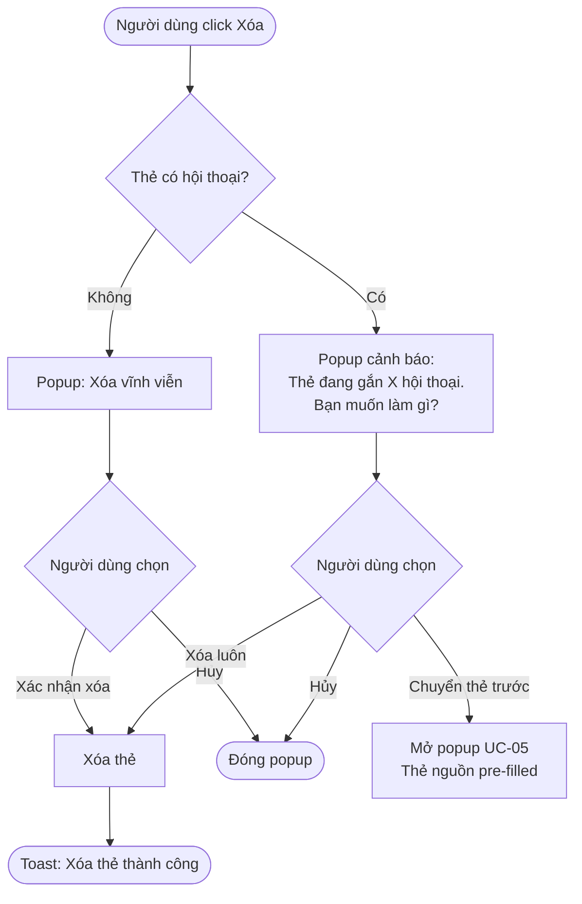
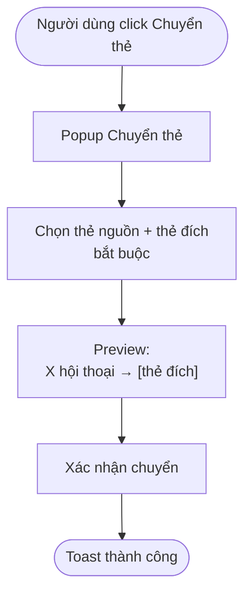
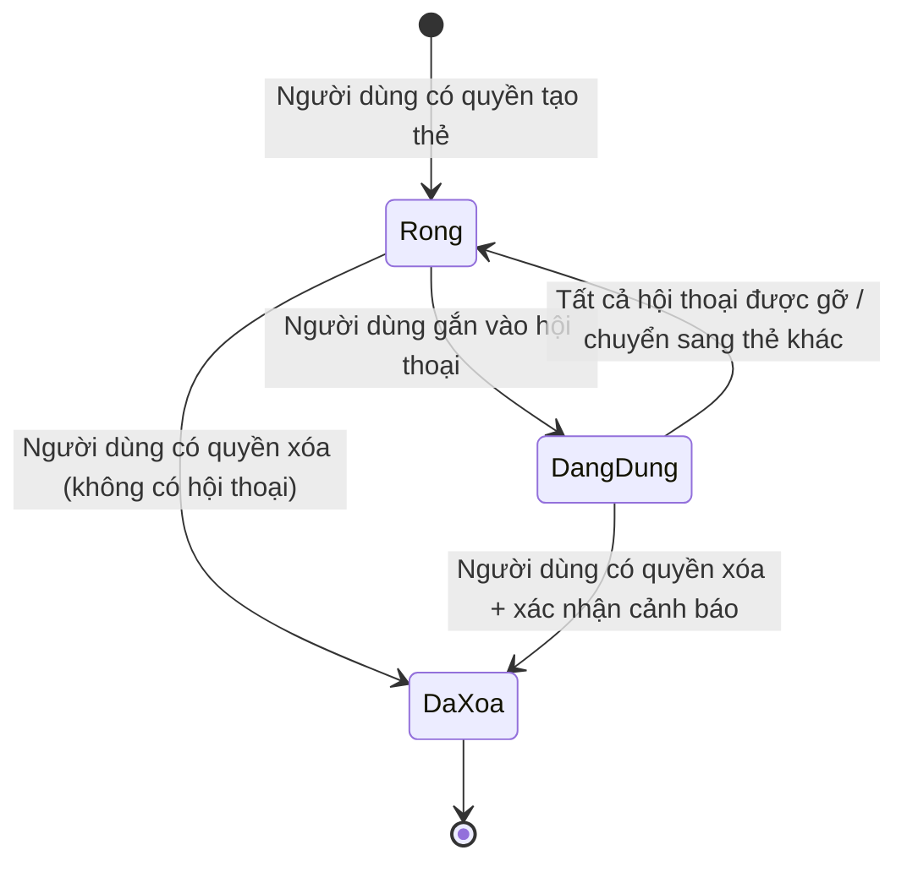

# [G004] Quản lý Thẻ

| Trường | Nội dung |
|--------|----------|
| **Feature ID** | G004 |
| **Tên** | Quản lý Thẻ (Phân loại hội thoại Zalo) |
| **Module** | Quản lý Thẻ |
| **Owner (BA)** | Trân |
| **Dev assignee** | — |
| **Priority** | — |
| **Version** | 1.3 |
| **Status** | Draft |
| **Last updated** | 2026-06-09 |

---

## 1. Tổng quan (Overview)

Hiện tại các hội thoại Zalo trong hệ thống chưa có cơ chế phân loại thống nhất. Tính năng Quản lý Thẻ cho phép Admin và nhân viên được cấp quyền tạo và quản lý các thẻ (tag) dùng để gắn nhãn hội thoại, từ đó hỗ trợ lọc danh sách, báo cáo, phân công xử lý và trigger workflow theo nhóm hội thoại có ý nghĩa.

**Use Case Description:**
> Là Admin hoặc nhân viên được cấp quyền, tôi muốn tạo và quản lý các thẻ phân loại, để gắn thẻ vào hội thoại khách hàng giúp việc theo dõi, báo cáo và phân công trở nên có tổ chức hơn.

**Người dùng mục tiêu (Target users):**
- **Admin / Quản lý** — toàn quyền tạo, sửa, xóa, chuyển thẻ; cấp/thu hồi quyền quản lý thẻ cho nhân viên
- ~~**Nhân viên (Staff)** — tạo và chỉnh sửa thẻ; gắn thẻ vào hội thoại tại màn hình Chat~~
- **Nhân viên được Admin cấp quyền Quản lý thẻ** — tạo, sửa, xóa, chuyển thẻ (tương đương Admin trong phạm vi module này)
- **Nhân viên chưa được cấp quyền** — chỉ gắn thẻ có sẵn vào hội thoại qua nút "Phân loại" tại danh sách hội thoại; không truy cập popup Quản lý Thẻ

**Phụ thuộc:** Tính năng Chat (người dùng gắn thẻ vào hội thoại); Module Quản lý nhân viên (Admin cấp/thu hồi quyền)

---

## 2. Điều kiện tiên quyết (Pre-conditions & Trigger)

**Trigger:**
- **Quản lý thẻ:** Người dùng click **"Phân loại"** tại màn hình danh sách hội thoại → chọn **"Quản lý thẻ phân loại"** → popup Quản lý Thẻ mở ra

**Pre-conditions:**
- [ ] Người dùng đã đăng nhập và có session hợp lệ
- [ ] **Người dùng là Admin** hoặc **nhân viên đã được Admin cấp quyền Quản lý thẻ** (để truy cập popup Quản lý Thẻ)

**Post-conditions chung:**
- Mọi thay đổi về thẻ (tên, màu, xóa) được phản ánh ngay lập tức trên tất cả hội thoại đang gắn thẻ đó

---

## 3. Luồng chính (Happy Path)

Module Quản lý Thẻ bao gồm 5 Use Case, mô tả lần lượt dưới đây.

---

### UC-01 — Xem danh sách thẻ

1. **[Người dùng có quyền]** Click **"Phân loại"** tại màn hình danh sách hội thoại → chọn **"Quản lý thẻ phân loại"**
2. **[Hệ thống]** Kiểm tra quyền [→ E05]; hiển thị popup Quản lý Thẻ với danh sách toàn bộ thẻ đã tạo

*Use case kết thúc.*

**Ghi chú:** Nếu chưa có thẻ nào, hệ thống hiển thị empty state: ~~*"Chưa có thẻ nào. Nhấn '+ Thêm phân loại' để bắt đầu."*~~ → *"Chưa có thẻ nào. Nhấn '+ Thêm mới thẻ' để bắt đầu."*

---

### UC-02 — Tạo thẻ mới

1. **[Người dùng có quyền]** Click button **"+ Thêm mới thẻ"** trong popup Quản lý Thẻ
2. **[Hệ thống]** Hiển thị form tạo thẻ
3. **[Người dùng có quyền]** Điền tên thẻ và chọn màu sắc → click **"Lưu"** [→ E01, E02, E08, E06, E07]
4. **[Hệ thống]** Lưu thẻ vào hệ thống
5. **[Hệ thống]** Hiển thị toast: *"Tạo thẻ thành công"*; thẻ mới xuất hiện trong danh sách

*Use case kết thúc.*

---

### UC-03 — Chỉnh sửa thẻ

1. **[Người dùng có quyền]** Click icon **Sửa** tương ứng với thẻ cần chỉnh sửa
2. **[Hệ thống]** Hiển thị form chỉnh sửa với dữ liệu hiện tại của thẻ
3. **[Người dùng có quyền]** Cập nhật tên và/hoặc màu sắc → click **"Lưu"** [→ E01, E02, E08, E06, E07]
4. **[Hệ thống]** Cập nhật thông tin thẻ
5. **[Hệ thống]** Hiển thị toast: *"Cập nhật thẻ thành công"*; thay đổi đồng bộ ngay lập tức trên tất cả hội thoại đang gắn thẻ đó [→ BR02]

*Use case kết thúc.*

---

### UC-04 — Xóa thẻ

1. **[Người dùng có quyền]** Click icon **Xóa** tương ứng với thẻ cần xóa
2. **[Hệ thống]** Kiểm tra thẻ có đang gắn hội thoại nào không
3. **[Hệ thống]** Hiển thị popup xác nhận (nội dung khác nhau tùy trường hợp — xem *Phần mềm thực hiện*)
4. **[Người dùng có quyền]** Bấm **"Xác nhận xóa"** [→ BR03]
5. **[Hệ thống]** Xóa thẻ; tự động gỡ thẻ khỏi tất cả hội thoại liên quan (kể cả hội thoại từ tài khoản Zalo đã ngắt liên kết) [→ BR09]
6. **[Hệ thống]** Hiển thị toast: *"Xóa thẻ thành công"*
7. **[Kết quả trên hội thoại]** Toàn bộ hội thoại từng mang thẻ này → nhãn thẻ biến mất khỏi hội thoại realtime; hội thoại không còn được phân loại bởi thẻ đó nữa

*Use case kết thúc.*

**Alternative flow:**

| Mã | Tình huống | Xử lý |
|----|-----------|-------|
| 4a | Người dùng bấm "Hủy" | Đóng popup, không thay đổi gì |
| 4b | Thẻ **đang có hội thoại** → Người dùng chọn "Chuyển thẻ" thay vì xóa | Đóng popup xóa, mở popup UC-05 với thẻ nguồn được điền sẵn bằng thẻ vừa chọn |

> Auto-generated — comment nếu cần sửa logic

**Phần mềm thực hiện — Popup xóa thẻ:**

- Title: **"Xóa thẻ?"**
- **Trường hợp thẻ không có hội thoại:**
  - Nội dung: *"Thẻ [tên thẻ] sẽ bị xóa vĩnh viễn."*
  - Button **"Xác nhận xóa"** (primary, màu đỏ) | Button **"Hủy"**
- **Trường hợp thẻ đang có hội thoại:**
  - Nội dung: *"Thẻ [tên thẻ] đang được gắn cho X hội thoại. Xóa thẻ sẽ gỡ thẻ khỏi toàn bộ hội thoại đó. Bạn có muốn chuyển thẻ sang thẻ khác trước khi xóa không?"*
  - Button **"Chuyển thẻ"** (secondary) | Button **"Xóa luôn"** (màu đỏ) | Button **"Hủy"**

---

### UC-05 — Chuyển thẻ

Chuyển toàn bộ hội thoại từ thẻ A sang thẻ B.

1. **[Người dùng có quyền]** Click button **"Chuyển thẻ"** trong popup Quản lý Thẻ
2. **[Hệ thống]** Hiển thị popup Chuyển thẻ
3. **[Người dùng có quyền]** Chọn **thẻ nguồn** và **thẻ đích** (bắt buộc) [→ E03, E04]
4. **[Hệ thống]** Cập nhật text preview theo lựa chọn
5. **[Người dùng có quyền]** Bấm **"Xác nhận chuyển"**
6. **[Hệ thống]** Chuyển toàn bộ hội thoại từ thẻ nguồn sang thẻ đích
7. **[Hệ thống]** Hiển thị toast: *"Chuyển thẻ thành công. X hội thoại đã được chuyển sang [tên thẻ đích]"*
8. **[Kết quả trên hội thoại]** Toàn bộ hội thoại từng mang thẻ nguồn → nhãn thẻ nguồn biến mất, nhãn thẻ đích xuất hiện thay thế realtime; thẻ nguồn còn 0 hội thoại nhưng vẫn tồn tại trong danh sách

*Use case kết thúc.*

**Alternative flow:**

| Mã | Tình huống | Xử lý |
|----|-----------|-------|
| 5a | Người dùng bấm "Hủy" | Đóng popup, không thay đổi gì |

> Auto-generated — comment nếu cần sửa logic

**Phần mềm thực hiện — Popup Chuyển thẻ:**

| Element | Mô tả |
|---------|-------|
| Title | "Chuyển thẻ" |
| Dropdown **Thẻ nguồn** | Bắt buộc. Hiển thị tên thẻ + số hội thoại hiện có |
| Dropdown **Thẻ đích** | Bắt buộc. Hiển thị tên thẻ + số hội thoại hiện có |
| Text preview | *"X hội thoại sẽ được chuyển từ [thẻ nguồn] sang [thẻ đích]"* — cập nhật động theo lựa chọn |
| Button **"Xác nhận chuyển"** | Primary |
| Button **"Hủy"** | — |

---

## 4. Luồng phụ (Alternative Flows)

### AF01 — Xóa thẻ → Chuyển thẻ trước (UC-04 → UC-05)

- Xảy ra khi: Thẻ đang có hội thoại, người dùng chọn "Chuyển thẻ" trong popup xóa
- Hệ thống đóng popup xóa và mở popup UC-05 với trường **Thẻ nguồn** được điền sẵn bằng thẻ vừa chọn xóa
- Người dùng hoàn thành UC-05 → sau đó có thể quay lại xóa thẻ nguồn (lúc này thẻ đã có 0 hội thoại)

---

## 5. Luồng ngoại lệ (Exception Flows)

| Code | Trigger (Điều kiện kích hoạt) | UI Response | Notification |
|------|-------------------------------|-------------|--------------|
| E01 | Người dùng bỏ trống tên thẻ khi tạo/sửa | Lỗi inline màu đỏ: *"Bắt buộc nhập"* dưới field tên thẻ | — |
| E02 | Tên thẻ đã tồn tại trong hệ thống (không phân biệt hoa thường, sau trim) | Lỗi inline: *"Tên thẻ đã tồn tại"* | — |
| E03 | Người dùng chọn thẻ nguồn và thẻ đích là cùng 1 thẻ (UC-05) | Lỗi inline: *"Thẻ nguồn và thẻ đích không được trùng nhau"* | — |
| E04 | Thẻ nguồn không có hội thoại nào (UC-05) | Thông báo: *"Thẻ này chưa có hội thoại nào để chuyển"*; nút "Xác nhận chuyển" disable | — |
| E05 | Nhân viên chưa được cấp quyền cố truy cập popup Quản lý Thẻ | Toast: *"Bạn không có quyền thực hiện thao tác này"* | — |
| E06 | Mất kết nối mạng khi đang lưu thẻ (UC-02, UC-03) | Toast: *"Không thể kết nối. Vui lòng thử lại"*; giữ nguyên form | — |
| E07 | Server lỗi 500 | Toast: *"Lỗi hệ thống. Vui lòng thử lại sau"*; không lưu dữ liệu | — |
| E08 | Tên thẻ chứa ký tự đặc biệt (!, @, #, $, /, ...) | Lỗi inline: *"Tên thẻ không được chứa ký tự đặc biệt"* | — |

**Exception Confirmation Log — Z-01**

| Code | Từ UC | Nguồn HP hay Độc lập | Confirmed |
|------|-------|----------------------|-----------|
| E01 | UC-02, UC-03 | Bước 3 | ✅ |
| E02 | UC-02, UC-03 | Bước 3 | ✅ |
| E03 | UC-05 | Bước 3 | ✅ |
| E04 | UC-05 | Bước 3 | ✅ |
| E05 | UC-01 | Bước 2 (pre-check) | ✅ |
| E06 | UC-02, UC-03 | Bước 3/4 | ✅ |
| E07 | Độc lập | — | ✅ |
| E08 | UC-02, UC-03 | Bước 3 | ✅ |

---

## 6. Business Rules — Quy tắc nghiệp vụ

| Code | Rule | Lý do |
|------|------|-------|
| ~~BR01~~ | ~~Tên thẻ không được trùng nhau trong cùng hệ thống (không phân biệt hoa thường)~~ | → Thay bằng BR01 mới |
| BR01 | Tên thẻ không được trùng nhau trong cùng hệ thống — so sánh **không phân biệt hoa thường**, **sau khi trim khoảng trắng thừa**. Ví dụ: `"  Khách VIP  "` và `"khách vip"` bị coi là trùng | Tránh nhầm lẫn khi gắn thẻ; đảm bảo dữ liệu sạch cho Báo cáo |
| BR02 | Khi người dùng sửa tên hoặc màu thẻ, thay đổi được đồng bộ ngay lập tức trên tất cả hội thoại đang gắn thẻ đó | Đảm bảo nhất quán dữ liệu |
| BR03 | Không thể xóa thẻ đang có hội thoại mà không có xác nhận; nếu xác nhận xóa, thẻ bị gỡ khỏi toàn bộ hội thoại liên quan | Tránh mất dữ liệu phân loại ngoài ý muốn |
| BR04 | Sau khi chuyển thẻ, thẻ nguồn vẫn tồn tại trong hệ thống với 0 hội thoại | Không tự động xóa thẻ nguồn sau khi chuyển |
| ~~BR05~~ | ~~Cả Admin và nhân viên đều có quyền tạo và chỉnh sửa thẻ~~ | → Thay bằng BR05 mới bên dưới |
| BR05 | Nhân viên mặc định chỉ có thể gắn thẻ có sẵn vào hội thoại tại Chat; phải được Admin **cấp quyền Quản lý thẻ** mới có thể tạo, sửa, xóa, chuyển thẻ | Kiểm soát tập trung — tránh nhân viên vô tình xóa/đổi thẻ ảnh hưởng toàn workspace |
| BR06 | Tên thẻ tối đa 50 ký tự | Giới hạn hiển thị giao diện |
| BR07 | Admin có thể cấp hoặc thu hồi quyền Quản lý thẻ của nhân viên bất kỳ lúc nào | Quản trị linh hoạt |
| BR08 | Khi Admin thu hồi quyền Quản lý thẻ của nhân viên, quyền mất hiệu lực ngay ở lần tải trang / reload tiếp theo — không cần đăng xuất | Bảo mật tức thì |
| BR09 | Khi tài khoản Zalo ngắt liên kết với workspace, thẻ đã gắn trên hội thoại trước đó **vẫn được giữ nguyên** — không tự động gỡ | Tránh mất dữ liệu phân loại đã thực hiện |
| BR10 | Hội thoại đang mở có thẻ bị xóa → thẻ biến mất realtime ngay trong session đó, không cần reload | Nhất quán với BR02 (đồng bộ tức thì) |
| BR11 | Tên thẻ chỉ được chứa chữ cái (có hoặc không có dấu tiếng Việt), số và khoảng trắng đơn giữa các từ. Không cho ký tự đặc biệt (!, @, #, $, /, ...). Hệ thống tự động trim khoảng trắng thừa đầu/cuối và thu gọn khoảng trắng nhiều liên tiếp thành 1 khi lưu. Ví dụ: `"  Khách  VIP  "` → lưu thành `"Khách VIP"` | Chuẩn hóa dữ liệu thẻ — đảm bảo nhất quán cho Báo cáo/thống kê; tiếng Việt có dấu được giữ nguyên để nhân viên dễ đọc |
| BR11 | Tên thẻ chỉ được chứa chữ cái (có hoặc không có dấu tiếng Việt), số và khoảng trắng đơn giữa các từ. Không cho ký tự đặc biệt (!, @, #, $, /, ...). Hệ thống tự động trim khoảng trắng thừa đầu/cuối và thu gọn khoảng trắng nhiều liên tiếp thành 1 khi lưu. Ví dụ: `"  Khách  VIP  "` → lưu thành `"Khách VIP"` | Chuẩn hóa dữ liệu thẻ — đảm bảo nhất quán cho Báo cáo/thống kê; tiếng Việt có dấu được giữ nguyên để nhân viên dễ đọc |
| BR12 | Khi đồng bộ thẻ từ Zalo: nếu thẻ Zalo trùng tên với thẻ đã có trong hệ thống (so sánh theo BR01: case-insensitive + sau trim) → **gộp làm 1 thẻ**, không tạo mới. Hội thoại từ cả hai Zalo đều được gắn vào thẻ đã tồn tại | Tránh bùng nổ thẻ trùng từ nhiều tài khoản Zalo liên kết; đảm bảo báo cáo không bị chia nhỏ theo tài khoản |

---

## 7. State Machine — Vòng đời Thẻ

**Entity:** Thẻ (Tag)

| Từ trạng thái | Sự kiện | Sang trạng thái | Điều kiện | Ghi chú |
|---------------|---------|-----------------|-----------|---------|
| _(chưa tồn tại)_ | Người dùng có quyền tạo thẻ | **Rỗng** | Tên hợp lệ, không trùng | 0 hội thoại |
| Rỗng | Người dùng gắn thẻ vào hội thoại | **Đang dùng** | — | ≥1 hội thoại |
| Đang dùng | Tất cả hội thoại bị gỡ / chuyển sang thẻ khác | **Rỗng** | Số hội thoại = 0 | — |
| Rỗng | Người dùng có quyền xóa thẻ (xác nhận đơn giản) | **Đã xóa** | Không có hội thoại | Terminal |
| Đang dùng | Người dùng có quyền xóa thẻ (xác nhận cảnh báo) | **Đã xóa** | Chọn "Xóa luôn" | Terminal; thẻ bị gỡ khỏi tất cả hội thoại |

> **Terminal state:** Đã xóa — không thể khôi phục.

> Auto-generated — comment nếu cần sửa logic

---

## 8. Data Model

N/A — Spec này thuần nghiệp vụ. Data model sẽ được định nghĩa trong tài liệu kỹ thuật riêng.

---

## 9. API Contract

N/A — Spec này thuần nghiệp vụ. API contract sẽ được định nghĩa trong tài liệu kỹ thuật riêng.

---

## 10. UI/UX Notes — Ghi chú giao diện

### 10A — Entry point & Popup Quản lý Thẻ

**Entry point:**

| Element | Mô tả |
|---------|-------|
| Vị trí | Nút **"Phân loại"** tại header màn hình danh sách hội thoại |
| Khi click "Phân loại" | Dropdown hiển thị danh sách thẻ để gắn vào hội thoại + link "Quản lý thẻ phân loại" ở cuối |
| Khi click "Quản lý thẻ phân loại" | Kiểm tra quyền → nếu có quyền: mở popup Quản lý Thẻ; nếu không: toast E05 |

**Popup Quản lý Thẻ:**

| Element | Mô tả |
|---------|-------|
| Ô tìm kiếm | Filter theo tên thẻ — lọc client-side, không gọi thêm API *(nhẹ, không ảnh hưởng performance)* |
| Danh sách thẻ | Tên thẻ + màu sắc + số hội thoại đang gắn |
| Nút hành động mỗi thẻ | Sửa \| Xóa |
| Button **"+ Thêm mới thẻ"** | Mở form UC-02 |
| Button **"Chuyển thẻ"** | Mở popup UC-05 |
| **Footer** | *"Tổng: X thẻ"* — cập nhật realtime khi tạo/xóa thẻ |

**Empty state:** ~~*"Chưa có thẻ nào. Nhấn '+ Thêm phân loại' để bắt đầu."*~~ → *"Chưa có thẻ nào. Nhấn '+ Thêm mới thẻ' để bắt đầu."*

---

### 10B — Form Tạo / Chỉnh sửa thẻ

| Trường | Loại | Bắt buộc | Ghi chú |
|--------|------|----------|---------|
| Tên thẻ | Text input | Có | Placeholder: *"Nhập tên thẻ"*. Tối đa 50 ký tự. Không cho ký tự đặc biệt (BR11). Hệ thống tự trim khi lưu |
| Màu sắc | Color picker | Có | Chọn từ bảng màu có sẵn hoặc nhập mã HEX |

- Button **"Lưu"** (primary) | Button **"Hủy"**
- Form chỉnh sửa (UC-03): hiển thị dữ liệu hiện tại của thẻ được chọn

---

### 10C — Popup Xóa thẻ

*(Xem chi tiết tại UC-04 — Phần mềm thực hiện)*

Điểm đặc biệt: khi thẻ đang có hội thoại, popup cung cấp **đường thoát** — nút "Chuyển thẻ" để migrate dữ liệu trước khi xóa thay vì chỉ xác nhận cứng.

---

### 10D — Popup Chuyển thẻ

*(Xem chi tiết tại UC-05 — Phần mềm thực hiện)*

Chỉ chuyển hàng loạt hội thoại từ thẻ nguồn sang thẻ đích — không kèm gán nhân viên.

---

## 11. Acceptance Criteria — Tiêu chí nghiệm thu

### Phân quyền
- [ ] ~~Admin và nhân viên đều truy cập được popup Quản lý Thẻ~~ → Admin và nhân viên **được cấp quyền** mới truy cập được popup Quản lý Thẻ (AC-BR05)
- [ ] Nhân viên chưa được cấp quyền click "Quản lý thẻ phân loại" → toast *"Bạn không có quyền thực hiện thao tác này"* (AC-E05)
- [ ] Admin thu hồi quyền nhân viên → nhân viên mất quyền sau lần reload tiếp theo, không cần đăng xuất (AC-BR08)
- [ ] ~~Admin và nhân viên đều tạo và chỉnh sửa thẻ được (AC-BR05)~~ → Đã cập nhật ở dòng trên

### Danh sách thẻ (UC-01)
- [ ] Click "Phân loại" → "Quản lý thẻ phân loại" → popup hiển thị đúng danh sách thẻ
- [ ] Ô tìm kiếm lọc realtime theo tên thẻ (client-side)
- [ ] Empty state hiển thị khi chưa có thẻ nào
- [ ] Footer popup hiển thị đúng tổng số thẻ; cập nhật realtime khi tạo/xóa

### Tạo thẻ (UC-02)
- [ ] Tạo thành công → toast "Tạo thẻ thành công"; thẻ hiển thị trong danh sách
- [ ] Bỏ trống tên → lỗi inline "Bắt buộc nhập" (AC-E01)
- [ ] Tên trùng (không phân biệt hoa thường, sau trim) → lỗi inline "Tên thẻ đã tồn tại" (AC-E02, AC-BR01)
- [ ] Nhập ký tự đặc biệt (!, @, /, ...) → lỗi inline "Tên thẻ không được chứa ký tự đặc biệt" (AC-E08, AC-BR11)
- [ ] Tên có khoảng trắng thừa → lưu xong hệ thống tự trim, hiển thị tên đã chuẩn hóa (AC-BR11)
- [ ] Nhập quá 50 ký tự → không thể gõ thêm (AC-BR06)
- [ ] Color picker: chọn từ bảng màu và nhập mã HEX đều hoạt động
- [ ] Mất mạng khi lưu → toast E06, giữ nguyên form

### Chỉnh sửa thẻ (UC-03)
- [ ] Form hiển thị đúng dữ liệu hiện tại của thẻ được chọn
- [ ] Lưu thành công → toast "Cập nhật thẻ thành công"
- [ ] Màu sắc cập nhật đồng bộ ngay lập tức trên tất cả hội thoại đang gắn thẻ (AC-BR02)
- [ ] Tên thẻ cập nhật đồng bộ ngay lập tức trên tất cả hội thoại đang gắn thẻ (AC-BR02)

### Xóa thẻ (UC-04)
- [ ] Thẻ không có hội thoại → popup đơn giản; xác nhận → xóa thành công (AC-BR03)
- [ ] Thẻ đang có hội thoại → popup 3 nút: "Chuyển thẻ" / "Xóa luôn" / "Hủy"
- [ ] Chọn "Xóa luôn" → thẻ bị xóa; thẻ tự động gỡ khỏi tất cả hội thoại liên quan
- [ ] Chọn "Chuyển thẻ" → đóng popup xóa, mở popup UC-05 với thẻ nguồn pre-filled
- [ ] Chọn "Hủy" → đóng popup, không có gì thay đổi
- [ ] Hội thoại đang mở có thẻ bị xóa → thẻ biến mất realtime không cần reload (AC-BR10)

### Chuyển thẻ (UC-05)
- [ ] Chọn thẻ nguồn + thẻ đích → chuyển thành công; toast *"Chuyển thẻ thành công. X hội thoại đã được chuyển sang [tên thẻ đích]"*
- [ ] Thẻ nguồn = thẻ đích → lỗi "Thẻ nguồn và thẻ đích không được trùng nhau" (AC-E03)
- [ ] Thẻ nguồn không có hội thoại → thông báo; nút "Xác nhận chuyển" bị disable (AC-E04)
- [ ] Sau chuyển thẻ: thẻ nguồn còn 0 hội thoại nhưng vẫn tồn tại trong danh sách (AC-BR04)
- [ ] Preview text cập nhật động theo lựa chọn thẻ nguồn/đích

### Edge cases — Tài khoản Zalo ngắt liên kết
- [ ] Tài khoản Zalo ngắt liên kết → thẻ đã gắn trên hội thoại trước đó vẫn hiển thị, không tự gỡ (AC-BR09)
- [ ] Xóa thẻ đang gắn hội thoại từ tài khoản đã ngắt liên kết → thẻ vẫn bị gỡ bình thường như hội thoại thông thường

### Edge cases — Đồng bộ thẻ từ nhiều Zalo (AC-BR12)
- [ ] Zalo 1 và Zalo 2 cùng có thẻ "Khách VIP" → đồng bộ chỉ tạo 1 thẻ trong hệ thống; hội thoại từ cả 2 Zalo đều gắn vào thẻ đó
- [ ] Thẻ Zalo "khách vip" trùng (case-insensitive) với thẻ "Khách VIP" đã có → gộp, không tạo thẻ mới

---

## 12. Out of Scope — Ngoài phạm vi

| # | Nội dung | Ghi chú |
|---|---------|---------|
| OOS01 | Xem chi tiết thẻ riêng biệt | Form Chỉnh sửa (UC-03) đã hiển thị đầy đủ thông tin |
| OOS02 | Gắn thẻ tự động theo điều kiện | VD: khách mới tự gắn "Khách mới", phát hiện từ khóa "phí" → chuyển sang "Tiềm năng". Cân nhắc cho phiên bản sau |
| OOS03 | Nhãn mặc định từ nguồn ads Zalo | Tính chất liên kết qua Zalo khác Meta Ads — chưa đủ nhất quán để áp nhãn mặc định |
| OOS04 | Gán hàng loạt nhân viên theo thẻ | Đưa vào backlog riêng |
| OOS05 | Xử lý thẻ đang được dùng trong báo cáo hoặc workflow khi bị xóa | Báo cáo và Workflow chưa có spec — xác định behavior khi design hai tính năng đó |

---

## 13. Dependencies — Phụ thuộc

| Phụ thuộc vào | Ghi chú |
|---------------|---------|
| Tính năng Chat | Người dùng gắn thẻ vào hội thoại tại màn hình Chat; thẻ phải tồn tại trước |
| Module Quản lý nhân viên | Admin cấp/thu hồi quyền Quản lý thẻ cho từng nhân viên |
| Tính năng Báo cáo | Dùng thẻ để phân loại dữ liệu báo cáo |
| Workflow / Automation | Dùng thẻ làm điều kiện trigger |

| Được phụ thuộc bởi | Ghi chú |
|--------------------|---------|
| Báo cáo / thống kê (tương lai) | Cần dữ liệu thẻ từ Z-01 |
| Auto-tagging (OOS02) | Cần module Quản lý Thẻ hoàn chỉnh trước |

---

## 14. Open Questions — Câu hỏi chưa giải quyết

| # | Câu hỏi | Người quyết định | Deadline | Trả lời |
|---|---------|-----------------|----------|---------|
| ~~OQ01~~ | ~~Khi xóa thẻ đang được dùng trong báo cáo hoặc trigger workflow — hệ thống xử lý thế nào? Báo cáo có lỗi không? Workflow có dừng không?~~ | ~~Team kỹ thuật~~ | ~~—~~ | ~~Chuyển sang Out of Scope — Báo cáo và Workflow là tính năng chưa có spec~~ |
| OQ02 | Quyền "Quản lý thẻ" được cấp ở đâu trong giao diện Admin? (Module Quản lý nhân viên hay một nơi riêng?) | Product Owner | — | — |
| OQ03 | Khi nhân viên có quyền đang điền form tạo/sửa thẻ, Admin thu hồi quyền ngay lúc đó — hệ thống xử lý thế nào? (Block lưu hay cho lưu lần cuối?) | Team kỹ thuật | — | — |

---

## 15. Performance & Scalability

| Mục | Yêu cầu |
|-----|---------|
| Load danh sách thẻ | Không phân trang (giả định số lượng thẻ nhỏ) |
| Tìm kiếm trong popup | Filter client-side — không gọi thêm API |
| Đồng bộ màu/tên thẻ | Cập nhật ngay lập tức trên tất cả hội thoại (BR02) |
| Chuyển thẻ hàng loạt | Không yêu cầu background job ở thời điểm này |

---

## 16. Rollout & Migration

| Mục | Chi tiết |
|-----|---------|
| Rollout strategy | Tất cả người dùng trong workspace (không cần feature flag) |
| Data migration | Không — tính năng mới hoàn toàn |
| Breaking change | Không |
| User communication | Không cần thông báo trước |
| Deploy order | Cần Module Quản lý nhân viên deploy trước (để Admin cấp quyền được) |

---

## Changelog — Lịch sử thay đổi

| Ngày | Version | Người thay đổi | Sections | Nội dung | File:Line |
|------|---------|----------------|----------|----------|-----------|
| 2026-06-08 | v1.0 | Trân (BA) | — | Tạo draft | — |
| 2026-06-08 | v1.1 | Trân (BA) | 1,2,3,4,6,7,10,11,12,16 | Staff có quyền tạo/sửa thẻ; UI chuyển sang dạng popup (không còn menu riêng); UC-05 bỏ phần gán nhân viên | — |
| 2026-06-09 | v1.2 | Trân (BA) | 1,2,3,5,6,7,10,11,13,14,15,16 | Phân quyền nhân viên theo cấp (mặc định chỉ dùng thẻ; cần Admin cấp quyền mới quản lý được); thêm E05–E07 (unauthorized, mất mạng, server 500); thêm search + footer popup; thêm BR07–BR10; thêm edge case ACs; thêm OQ02–OQ03 | — |
| 2026-06-09 | v1.3 | Trân (BA) | 2,3,4,5,6,10,11 | Đổi nhãn nút ~~"Thêm phân loại"~~ → "Thêm mới thẻ"; thêm BR11 (format tên thẻ); thêm BR12 (gộp thẻ trùng từ Zalo); cập nhật BR01 (trim); thêm E08; cập nhật AC; ~~trigger Gắn thẻ~~ chuyển sang AF02 (UC riêng); bổ sung kết quả tác động lên hội thoại vào UC-04 (bước 7) và UC-05 (bước 8) | — |
| 2026-06-09 | v1.4 | Trân (BA) | 2 | Xóa hẳn dòng trigger ~~Gắn thẻ vào hội thoại~~ khỏi Section 2 (không còn giữ gạch bỏ) | — |

---

> **Lưu ý cho AI khi đọc spec này:**
> - Spec này là **thuần nghiệp vụ** — không có entity, variable, API contract. Tài liệu kỹ thuật sẽ được bổ sung riêng.
> - Section 5 (Exception Flows) và Section 6 (Business Rules) là **bắt buộc implement đầy đủ**.
> - Section 7 (State Machine) định nghĩa toàn bộ trạng thái hợp lệ của thẻ — không tự thêm trạng thái mới.
> - Section 12 (Out of Scope) là danh sách **cấm** — không implement dù có vẻ logic.
> - Section 11 (Acceptance Criteria) là checklist tự verify trước khi báo done.
> - **BR05 quan trọng:** Nhân viên mặc định KHÔNG vào được popup Quản lý Thẻ — phải được Admin cấp quyền riêng.
> - **BR08 quan trọng:** Thu hồi quyền có hiệu lực ngay ở lần reload tiếp theo — không cần đăng xuất.
> - **BR09 quan trọng:** Tài khoản Zalo ngắt liên kết → thẻ đã gắn trên hội thoại vẫn giữ nguyên, KHÔNG tự gỡ.
> - **BR10 quan trọng:** Thẻ bị xóa → biến mất realtime trên hội thoại đang mở, không cần reload.
> - **BR11 quan trọng:** Tên thẻ chỉ chứa chữ cái (có dấu tiếng Việt OK), số, khoảng trắng — không cho ký tự đặc biệt. Hệ thống tự trim khi lưu.
> - **BR12 quan trọng:** Đồng bộ thẻ từ nhiều Zalo → gộp thẻ trùng tên (case-insensitive + sau trim) thành 1, KHÔNG tạo nhiều bản sao.
> - **UC-05:** Chuyển thẻ chỉ di chuyển hội thoại từ thẻ nguồn sang thẻ đích — KHÔNG kèm gán nhân viên.
> - **UC-04 flow đặc biệt:** Khi thẻ có hội thoại, popup cung cấp 3 lựa chọn (Chuyển thẻ / Xóa luôn / Hủy).
> - **Entry point:** Popup mở từ "Phân loại" → "Quản lý thẻ phân loại" tại màn hình danh sách hội thoại.
> - **OQ02, OQ03** cần xác nhận trước khi implement phần phân quyền nhân viên.
