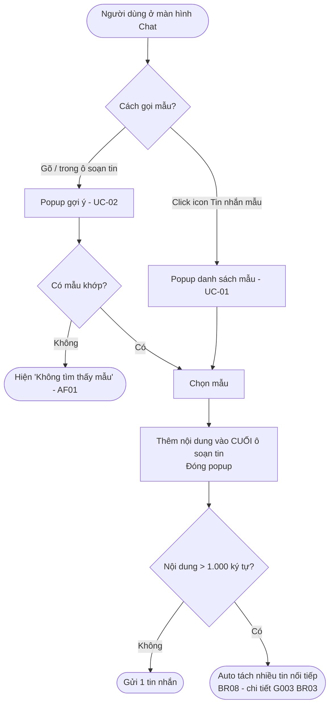
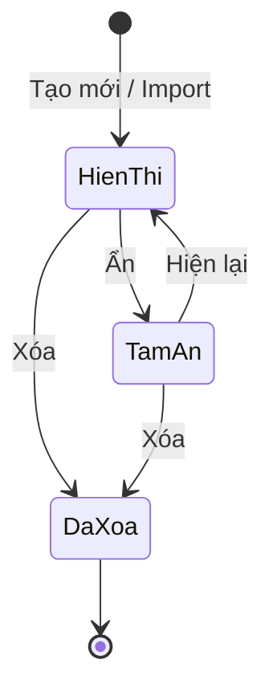

# [G005] Tin nhắn mẫu

| Trường | Nội dung |
|--------|----------|
| **Feature ID** | ~~Z-02~~ **G005** |
| **Tên** | Tin nhắn mẫu (Quick Reply Templates) |
| **Module** | Tin nhắn mẫu |
| **Owner (BA)** | Trân |
| **Dev assignee** | — |
| **Priority** | — |
| **Version** | ~~1.1~~ ~~1.2~~ ~~1.3~~ **1.4** |
| **Status** | Draft |
| **Last updated** | ~~2026-06-08~~ ~~2026-07-22~~ ~~2026-08-06~~ **2026-08-17** |

---

## 1. Tổng quan (Overview)

Hiện tại nhân viên phải gõ tay từng tin nhắn từ đầu, dẫn đến mất thời gian, dễ lỗi chính tả và thiếu nhất quán trong kịch bản tư vấn. Tính năng Tin nhắn mẫu cho phép Admin và nhân viên tạo, quản lý các mẫu tin nhắn dùng sẵn và sử dụng ngay tại màn hình Chat, giúp tăng tốc độ phản hồi, đồng bộ nội dung và nâng cao tỉ lệ chuyển đổi. **[v1.3]** Mẫu nay hỗ trợ **nội dung có định dạng văn bản** (in đậm/nghiêng/gạch chân/danh sách/trích dẫn) và **đính kèm hình ảnh, tệp tin** — để mẫu chào giá, brochure, hướng dẫn nhiều bước gửi được đầy đủ chỉ với một thao tác.

**Use Case Description:**
> Là Admin hoặc nhân viên, tôi muốn tạo và sử dụng tin nhắn mẫu ngay tại màn hình Chat, để gửi nhanh hơn, ít lỗi chính tả và đồng bộ kịch bản tư vấn trong toàn team.

**Người dùng mục tiêu (Target users):**
- **Admin / Quản lý** — tạo, sửa, xóa, ẩn/hiện, import mẫu; dùng mẫu khi chat
- **Nhân viên (Staff)** — tạo, sửa, xóa, ẩn/hiện, import mẫu (bao gồm mẫu của người khác); dùng mẫu khi chat

**Phụ thuộc:** **G003 (Chat)** — nhân viên dùng mẫu tại màn hình Chat; chi tiết §13

**Cross-reference:**
- **G003 — Chat:** ô soạn tin và luồng gửi. **[v1.2]** Quy tắc **auto tách khi vượt 1.000 ký tự** (BR08) được đặc tả chi tiết tại **G003 v1.7 BR03/BR03b/BR03c** — G005 không re-spec cơ chế tách. **[v1.3]** Giới hạn đính kèm file/ảnh **đồng bộ G003 BR04/BR05** (5MB/file, tối đa 5 ảnh/lô)
- **[v1.4] Định dạng văn bản:** bộ định dạng của mẫu = **Bold/Italic/Underline/Bullet list/Danh sách có thứ tự** (BR23) — **KHÁC G009** (G009 có Block quote, không có danh sách có thứ tự); cơ chế render Zalo-native tương tự G009 UC-04

---

## 2. Điều kiện tiên quyết (Pre-conditions & Trigger)

**Trigger:**
- **Dùng mẫu / Quản lý mẫu:** Người dùng click icon "Tin nhắn mẫu" nằm dưới ô soạn tin, góc trái màn hình Chat
- **Tìm mẫu nhanh:** Người dùng gõ `/` trong ô soạn tin

**Pre-conditions:**
- [ ] Người dùng đã đăng nhập và có session hợp lệ
- [ ] Người dùng đang ở màn hình Chat
- [ ] Không yêu cầu điều kiện khác (không cần kết nối Zalo, không cần trạng thái đặc biệt)

**Post-conditions chung:**
- Mọi thay đổi (tạo/sửa/xóa/ẩn/hiện) được phản ánh ngay trong danh sách popup và gợi ý `/` ở lần mở tiếp theo

---

## 3. Luồng chính (Happy Path)

Module Tin nhắn mẫu bao gồm **7 Use Case**.

### Sơ đồ luồng dùng mẫu **[NEW v1.2]**



> Auto-generated — comment nếu cần sửa logic

---

### UC-01 — Xem danh sách và dùng mẫu từ popup

1. **[Người dùng]** Click icon "Tin nhắn mẫu" dưới ô soạn tin, góc trái màn hình Chat
2. **[Hệ thống]** Hiển thị popup danh sách tin nhắn mẫu:
   - Mẫu đang hiển thị: mã + nội dung, theo thứ tự đã sắp xếp
   - ~~Mẫu tạm ẩn: hiển thị mờ, cuối danh sách~~ → Mẫu tạm ẩn **không hiện** trong popup này; chỉ thấy trong phần Quản lý
   - Kéo xuống để xem thêm
   - Cuối popup: nút **"Quản lý tin nhắn mẫu"**
3. **[Người dùng]** Click vào mẫu muốn dùng
4. **[Hệ thống]** Thêm nội dung mẫu (**giữ nguyên định dạng**) vào **cuối** ô soạn tin; **[NEW v1.3]** nếu mẫu **có đính kèm** → đưa hình ảnh/tệp vào ô soạn tin dạng **preview đính kèm** (chưa gửi); đóng popup (BR18, BR24)
5. **[Người dùng]** Chỉnh sửa nội dung / thêm bớt đính kèm nếu cần → bấm Gửi [→ BR08]

*Use case kết thúc.*

---

### UC-02 — Tìm mẫu bằng gõ `/` trong ô chat

1. **[Người dùng]** Gõ `/` trong ô soạn tin
2. **[Hệ thống]** Hiển thị popup gợi ý danh sách mẫu đang hiển thị (không hiện mẫu tạm ẩn)
3. **[Người dùng]** Gõ tiếp (ví dụ `/chao`) → danh sách lọc realtime theo mã [→ AF01]
4. **[Người dùng]** Click chọn mẫu
5. **[Hệ thống]** Thêm nội dung mẫu (**giữ định dạng**) vào **cuối** ô soạn tin; **[NEW v1.3]** đưa hình ảnh/tệp đính kèm (nếu có) vào ô soạn tin dạng preview; đóng popup gợi ý (BR18, BR24)
6. **[Người dùng]** Chỉnh sửa nội dung / đính kèm nếu cần → bấm Gửi [→ BR08]

*Use case kết thúc.*

**Ghi chú:** Nếu không có mẫu nào khớp → hệ thống hiển thị *"Không tìm thấy mẫu"* trong popup gợi ý.

---

### UC-03 — Tạo mẫu mới

1. **[Người dùng]** Click icon "Tin nhắn mẫu" → popup hiện ra → click **"+ Tạo mới"** trên đầu popup
2. **[Hệ thống]** Hiển thị form tạo mẫu
3. **[Người dùng]** Điền **Mã** và **Nội dung** *(bắt buộc)*. **[NEW v1.3]** Có thể **bôi đen để định dạng văn bản** (Bold/Italic/Underline/Bullet list/**Danh sách có thứ tự** — BR23) và **đính kèm hình ảnh / tệp tin** *(tùy chọn)* [→ E13, E14]
4. **[Người dùng]** Click **"Lưu"** [→ E01, E02, E03, E04, E09, E10]
5. **[Hệ thống]** Lưu mẫu vào hệ thống
6. **[Hệ thống]** Hiển thị toast: *"Tạo tin nhắn mẫu thành công"*; mẫu mới xuất hiện trong danh sách

*Use case kết thúc.*

> **[v1.3] Hai bề mặt tạo mẫu — cùng một form, cùng nghiệp vụ:**
> - **Trong Chat:** click icon → popup → **"+ Tạo mới"** → form (mô tả ở trên).
> - **Trong Cài đặt tin nhắn › Tin nhắn mẫu:** form **luôn hiển thị ở cột trái**, nút **"+ Thêm tin nhắn nhanh"** (không qua popup) — xem §10G.

---

### UC-04 — Chỉnh sửa mẫu

1. **[Người dùng]** Trong popup → click **"Quản lý tin nhắn mẫu"** (cuối danh sách)
2. **[Hệ thống]** Hiển thị danh sách mẫu kèm nút hành động: **Ẩn/Hiện \| Sửa \| Xóa**
3. **[Người dùng]** Click **"Sửa"** tương ứng với mẫu cần chỉnh sửa
4. **[Hệ thống]** Hiển thị form chỉnh sửa với dữ liệu hiện tại **[NEW v1.3]** (gồm cả **định dạng văn bản** và **hình ảnh/tệp đính kèm** đã lưu)
5. **[Người dùng]** Cập nhật Mã / Nội dung / định dạng; **thêm hoặc gỡ** hình ảnh, tệp đính kèm → click **"Lưu"** [→ E01, E02, E03, E04, E09, E10, E13, E14]
6. **[Hệ thống]** Cập nhật mẫu
7. **[Hệ thống]** Hiển thị toast: *"Cập nhật thành công"*

*Use case kết thúc.*

---

### UC-05 — Ẩn / Hiện mẫu

1. **[Người dùng]** Trong phần Quản lý → click nút **"Ẩn"** hoặc **"Hiện"** tương ứng với mẫu
2. **[Hệ thống]** Cập nhật trạng thái mẫu:
   - **Ẩn:** ~~Mẫu hiển thị mờ ở cuối popup; biến mất khỏi gợi ý `/`~~ → Mẫu biến mất khỏi popup danh sách và gợi ý `/`; chỉ hiển thị trong phần Quản lý (BR14)
   - **Hiện:** Mẫu trở về danh sách bình thường; xuất hiện lại trong gợi ý `/` ở lần mở tiếp theo (BR19)

*Use case kết thúc.*

---

### UC-06 — Xóa mẫu

1. **[Người dùng]** Trong phần Quản lý → click **"Xóa"** tương ứng với mẫu cần xóa
2. **[Hệ thống]** Hiển thị popup xác nhận: *"Bạn có chắc muốn xóa tin nhắn mẫu này không?"* (BR-C14)
3. **[Người dùng]** Bấm **"Xác nhận xóa"** [→ AF03]
4. **[Hệ thống]** Xóa mẫu **vĩnh viễn** (BR17)
5. **[Hệ thống]** Hiển thị toast: *"Xóa thành công"*

*Use case kết thúc.*

---

### UC-07 — Import file Excel

1. **[Người dùng]** Trong phần Quản lý → click **"Import"**
2. **[Hệ thống]** Hiển thị dialog với 2 lựa chọn: **"Tải file mẫu"** và **"Chọn file để import"**
3. **[Người dùng]** (Tuỳ chọn) Click **"Tải file mẫu"** → tải về file Excel template 2 cột (Mã, Nội dung) để điền
4. **[Người dùng]** Click **"Chọn file để import"** → chọn file Excel [→ E05]
5. **[Hệ thống]** Xử lý file: đọc **cột A = Mã** và **cột B = Nội dung**, **từ dòng 2 trở đi** (dòng 1 là tiêu đề, không đọc); bỏ qua mọi cột khác — BR20. Import các dòng hợp lệ, ghi nhận dòng lỗi [→ E07, E08, AF02, BR21]
6. **[Hệ thống]** Hiển thị toast kết quả

*Use case kết thúc.*

**Toast sau khi import:**

| Trường hợp | Toast |
|-----------|-------|
| Tất cả thành công | *"Đã import X tin nhắn mẫu thành công"* |
| Partial success | *"Đã import X thành công. Y dòng bị lỗi"* |
| Tất cả lỗi | Toast lỗi tương ứng (E07, E08) |

> **[NEW v1.3]** Import Excel chỉ mang **Mã + Nội dung dạng văn bản thuần** — **không** kèm định dạng (in đậm/nghiêng…) và **không** kèm hình ảnh/tệp. Muốn thêm định dạng hoặc đính kèm cho mẫu đã import → mở **Sửa** (UC-04) và bổ sung (BR26).

---

## 4. Luồng phụ (Alternative Flows)

### AF01 — Tìm mẫu bằng `/` không có kết quả

- **Xảy ra khi:** Người dùng gõ mã không khớp với bất kỳ mẫu nào (UC-02 bước 3)
- **[Hệ thống]** Hiển thị *"Không tìm thấy mẫu"* trong popup gợi ý
- **[Người dùng]** Tiếp tục gõ hoặc xóa ký tự để tìm lại → quay lại UC-02 bước 3

### AF02 — Import partial success

- **Xảy ra khi:** File Excel có một số dòng lỗi (mã trùng, thiếu trường bắt buộc…) (UC-07 bước 5)
- **[Hệ thống]** Import các dòng hợp lệ trước
- **[Hệ thống]** Toast: *"Đã import X thành công. Y dòng bị lỗi"*
- Dòng lỗi bị bỏ qua, **không rollback** dòng đã import thành công

### AF03 — Hủy xóa mẫu **[NEW v1.2]**

- **Xảy ra khi:** Người dùng mở popup xác nhận xóa nhưng đổi ý (UC-06 bước 3)
- **[Người dùng]** Bấm **"Hủy"**
- **[Hệ thống]** Đóng popup, **không** thay đổi gì

---

## 5. Luồng ngoại lệ (Exception Flows)

| Code | Trigger (Điều kiện kích hoạt) | UI Response | Notification |
|------|-------------------------------|-------------|--------------|
| E01 | Bỏ trống Mã khi tạo/sửa (UC-03 b3 · UC-04 b5) | Lỗi inline: *"Bắt buộc nhập"* dưới field Mã | — |
| E02 | Bỏ trống Nội dung khi tạo/sửa (UC-03 b3 · UC-04 b5) | Lỗi inline: *"Bắt buộc nhập"* dưới field Nội dung | — |
| E03 | Mã đã tồn tại trong hệ thống | Lỗi inline: *"Mã tin nhắn đã tồn tại"* | — |
| E04 | Mã không bắt đầu bằng dấu `/` | Lỗi inline: *"Mã phải bắt đầu bằng dấu /"* | — |
| E05 | File import không phải định dạng Excel (UC-07 b4) | Toast lỗi: *"Chỉ hỗ trợ file Excel (.xlsx, .xls)"* | — |
| ~~E06~~ | — | — | **[v1.2]** Mã **đã bỏ** từ v1.0 — giữ chỗ để bảo toàn traceability, **không tái sử dụng** |
| E07 | File import rỗng (không có dòng dữ liệu) (UC-07 b5) | Toast: *"File không có dữ liệu"* | — |
| E08 | Dòng import có mã trùng với mẫu đã có (UC-07 b5) | Toast: *"Import không thành công"* cho dòng đó | — |
| E09 | Mất mạng khi đang lưu mẫu | Toast: *"Không thể kết nối. Vui lòng thử lại"*; **giữ nguyên form** | — |
| E10 | Server lỗi 500 | Toast: *"Lỗi hệ thống. Vui lòng thử lại sau"*; không lưu dữ liệu | Ghi error log |
| ~~E11~~ | ~~File đính kèm > 5MB~~ | ~~Toast: "File vượt quá dung lượng cho phép (5MB)"~~ → **Đã bỏ** từ v1.1, **không tái sử dụng** (tính năng mở lại ở v1.3 dùng mã **E13**) | ~~—~~ |
| ~~E12~~ | ~~Upload hình ảnh thứ 6 trở đi~~ | ~~Lỗi inline: "Tối đa 5 hình ảnh cho 1 tin nhắn mẫu"~~ → **Đã bỏ** từ v1.1, **không tái sử dụng** (thay bằng **E14**) | ~~—~~ |
| **E13** | **[NEW v1.3]** Hình ảnh hoặc tệp đính kèm **> 5MB** (UC-03 b3 · UC-04 b5) | Lỗi ngay khi chọn, **trước khi upload**: *"File vượt quá dung lượng cho phép (5MB)"*; không thêm file đó vào mẫu | — |
| **E14** | **[NEW v1.3]** Vượt **5 hình ảnh** hoặc **1 tệp** trên 1 mẫu (UC-03 b3 · UC-04 b5) | Lỗi inline: *"Tối đa 5 hình ảnh và 1 tệp cho 1 tin nhắn mẫu"*; chặn thêm | — |

**Exception Confirmation Log — G005**

| Code | Từ UC | Nguồn HP hay Độc lập | Confirmed |
|------|-------|----------------------|-----------|
| E01 | UC-03 b3 · UC-04 b5 | Happy Path | ✅ |
| E02 | UC-03 b3 · UC-04 b5 | Happy Path | ✅ |
| E03 | UC-03 b3 · UC-04 b5 | Happy Path | ✅ |
| E04 | UC-03 b3 · UC-04 b5 | Happy Path | ✅ |
| E05 | UC-07, bước 4 | Happy Path | ✅ |
| E07 | UC-07, bước 5 | Happy Path | ✅ |
| E08 | UC-07, bước 5 | Happy Path | ✅ |
| E09 | Độc lập | Độc lập | ✅ |
| E10 | Độc lập | Độc lập | ✅ |
| ~~E11~~ | ~~UC-03, UC-04~~ | ~~Happy Path~~ | → Đã bỏ v1.1 (không tái dùng) |
| ~~E12~~ | ~~UC-03, UC-04~~ | ~~Happy Path~~ | → Đã bỏ v1.1 (không tái dùng) |
| **E13** | UC-03 b3 · UC-04 b5 | Happy Path | ✅ **[v1.3]** |
| **E14** | UC-03 b3 · UC-04 b5 | Happy Path | ✅ **[v1.3]** |

---

## 6. Business Rules — Quy tắc nghiệp vụ

| Code | Rule | Lý do |
|------|------|-------|
| BR01 | Mã tin nhắn phải bắt đầu bằng dấu `/` (ví dụ: `/chao`) | Hệ thống nhận diện khi người dùng gõ `/` trong ô chat |
| BR02 | Mã tin nhắn không được trùng nhau trong cùng hệ thống | Tránh nhầm lẫn khi tìm kiếm bằng mã |
| BR03 | Tất cả mẫu (của Admin + mọi nhân viên) hiển thị chung cho toàn bộ người dùng | Đồng bộ kịch bản tư vấn toàn team |
| BR04 | **Không giới hạn số lượng** tin nhắn mẫu | — |
| BR05 | Cả Admin và nhân viên đều có quyền tạo, sửa, xóa, ẩn/hiện, import — **kể cả mẫu của người khác** | — |
| BR06 | Import partial success: dòng hợp lệ được tạo, dòng lỗi bị bỏ qua và báo số lượng | Không để lỗi 1 dòng chặn toàn bộ file |
| BR07 | Mã tối đa **20 ký tự** | Giới hạn hiển thị giao diện |
| BR08 | ~~Nội dung mẫu không giới hạn ký tự~~ **[CHANGED v1.4] Nội dung mẫu tối đa 3.000 ký tự.** Zalo giới hạn **1.000 ký tự/lần gửi**; mẫu **>1.000 ký tự** → khi nhấn Gửi **tự động tách thành nhiều tin liên tiếp** (mỗi tin ≤1.000) cho đến hết.<br>**[v1.4] Phân công tách:** việc **tách tin khi vượt 1.000 do FE thực hiện** (tại thời điểm gửi); **backend validate mỗi lần gọi ≤1.000 ký tự**. **Trong lúc soạn/lưu mẫu: KHÔNG tách, KHÔNG chia ô** — nội dung là một khối liền mạch. Điểm cắt/thứ tự/xử lý lỗi từng phần: **G003 v1.7 BR03/BR03b/BR03c**; G005 không re-spec | Trần **3.000 ký tự** cho mẫu; Zalo giới hạn 1.000/lần nên tách khi gửi; **FE tách, BE chốt ≤1.000/lần gọi** để an toàn |
| BR09 | Người dùng có thể sửa/xóa mẫu do người khác tạo | Quản lý tập trung, linh hoạt |
| ~~BR10~~ | ~~File đính kèm: tất cả định dạng, tối đa 5MB/file, tối đa 1 file~~ → **Đã bỏ**: chuyển sang OOS06 | — |
| ~~BR11~~ | ~~Hình ảnh đính kèm: tất cả định dạng, tối đa 5 hình/mẫu~~ → **Đã bỏ**: chuyển sang OOS06 | — |
| ~~BR12~~ | ~~Chọn mẫu có đính kèm → file/ảnh gửi cùng tin nhắn cho khách~~ → **Đã bỏ**: chuyển sang OOS06 | — |
| BR13 | Import chỉ nhận định dạng Excel (`.xlsx`, `.xls`) | Chuẩn hoá format dữ liệu đầu vào |
| BR14 | ~~Mẫu tạm ẩn không hiện trong gợi ý `/` nhưng vẫn hiển thị mờ ở cuối popup chính~~ → Mẫu tạm ẩn **không hiện** trong popup danh sách và gợi ý `/`; chỉ thấy được trong phần Quản lý | Tránh nhầm lẫn khi dùng mẫu |
| BR15 | Mẫu tạm ẩn **vẫn có thể sửa** nội dung | Cho phép chỉnh sửa trước khi mở lại |
| BR16 | Thứ tự mẫu trong danh sách do người dùng tự sắp xếp bằng **kéo thả**; thứ tự được lưu lại | — |
| BR17 | Xóa mẫu là **vĩnh viễn** — không thể khôi phục | Terminal state |
| **BR18** | **[NEW v1.2]** Nội dung mẫu được **thêm vào cuối** ô soạn tin, **không thay thế** nội dung đang có | Cho phép ghép nhiều mẫu hoặc gõ thêm trước/sau khi chèn |
| **BR19** | **[NEW v1.2]** Thay đổi trạng thái **ẩn/hiện** có hiệu lực ở **lần mở popup / gợi ý tiếp theo**, không cập nhật realtime trong session đang mở | Đơn giản hóa; tần suất thay đổi thấp |
| **BR20** | **[NEW v1.2]** **Import đọc dữ liệu theo vị trí cột:** **cột A = Mã**, **cột B = Nội dung**. **Luôn đọc dữ liệu từ dòng 2 (A2/B2) trở đi**; dòng 1 mặc định là hàng tiêu đề, **không đọc** — kể cả khi để trống hoặc chứa dữ liệu. Không bắt buộc dùng file mẫu hệ thống — file người dùng tự tạo vẫn import được miễn đúng vị trí 2 cột. Mọi cột **từ cột C trở đi** bị **bỏ qua hoàn toàn** — không đọc, không lưu, **không báo lỗi**; file vẫn import bình thường | Đọc theo **vị trí** (không dò nội dung tiêu đề) giữ logic đơn giản, đúng với file mẫu hệ thống. Người dùng thường ghi chú thêm vào file (phân loại, người tạo, ghi chú nội bộ…) — chặn lại chỉ gây khó chịu mà không được lợi gì |
| **BR21** | **[NEW v1.2]** Dòng có **cột A hoặc cột B trống** → tính là **dòng lỗi**, bị bỏ qua; các dòng hợp lệ khác vẫn được import (theo BR06 — partial success) | Nhất quán với quy tắc bắt buộc nhập của form (E01, E02) |
| **BR22** | **[NEW v1.3]** Mẫu có thể **đính kèm hình ảnh** (tối đa **5 ảnh/mẫu**, mỗi ảnh **≤5MB**) và **tệp tin** (tối đa **1 tệp/mẫu**, **≤5MB**, mọi định dạng) — dung lượng đồng bộ giới hạn đính kèm chat **G003 BR04/BR05** | Mẫu chào giá, brochure, hướng dẫn cần gửi kèm hình/tệp; dùng chung trần dung lượng với chat cho nhất quán |
| **BR23** | ~~[v1.3] Bold/Italic/Underline/Bullet list/**Block quote** (theo G009 BR11)~~ **[CHANGED v1.4] Bộ định dạng văn bản của mẫu:** **Bold · Italic · Underline · Bullet list** (danh sách không thứ tự) · **Danh sách có thứ tự** (đánh số 1, 2, 3… — `lst_2`) — kết hợp được nhiều định dạng; Zalo render native. **BỎ Block quote**; **BỔ SUNG Danh sách có thứ tự**. → Bộ định dạng mẫu **KHÁC G009** (G009 có Block quote, không có danh sách có thứ tự) — G005 tự định nghĩa bộ này, không re-dùng nguyên G009 BR11 | Theo yêu cầu cập nhật; mẫu CSKH cần danh sách đánh số hơn là trích dẫn |
| **BR24** | **[NEW v1.3]** Chọn mẫu (popup hoặc gõ `/`) có đính kèm/định dạng → nội dung **giữ nguyên định dạng** thêm vào **cuối** ô soạn tin, hình ảnh/tệp đưa vào ô soạn tin dạng **preview đính kèm** (**chưa gửi**); người dùng tự bấm **Gửi**. **[NEW v1.4] Thứ tự gửi: NỘI DUNG (text) trước, ĐÍNH KÈM (ảnh/tệp) sau.** | Nhất quán BR18 — xem lại/sửa/ghép mẫu trước khi gửi; thứ tự nội dung-trước-đính-kèm-sau để khách đọc ngữ cảnh rồi mới tới file |
| **BR25** | **[NEW v1.3]** **Nội dung vẫn bắt buộc** kể cả khi mẫu có hình ảnh/tệp — không cho lưu mẫu chỉ gồm đính kèm mà trống Nội dung (E02 vẫn áp dụng) | Giữ mẫu luôn có phần text nhận diện; đơn giản, ít nhánh ngoại lệ |
| **BR26** | **[NEW v1.3]** **Import Excel không mang định dạng và đính kèm** — mẫu import là **văn bản thuần**. Thêm định dạng/đính kèm phải qua **Sửa mẫu** (UC-04) | Excel chỉ có 2 cột Mã/Nội dung; định dạng & file nằm ngoài phạm vi import |

---

## 7. State Machine — Vòng đời Tin nhắn mẫu

**Entity:** Tin nhắn mẫu (Message Template)

| Từ trạng thái | Sự kiện | Sang trạng thái | Điều kiện | Ghi chú |
|---------------|---------|-----------------|-----------|---------|
| *(chưa tồn tại)* | Tạo mới / Import | **Hiển thị** | Mã hợp lệ, không trùng | Xuất hiện trong danh sách |
| Hiển thị | Ẩn | **Tạm ẩn** | — | ~~Mờ, cuối danh sách;~~ Ẩn khỏi popup và gợi ý `/`; chỉ hiện trong Quản lý |
| Tạm ẩn | Hiện lại | **Hiển thị** | — | Trở về danh sách bình thường |
| Hiển thị | Xóa | **Đã xóa** | — | Terminal |
| Tạm ẩn | Xóa | **Đã xóa** | — | Terminal |
| Hiển thị / Tạm ẩn | Sửa nội dung/mã | *(không đổi trạng thái)* | Mã hợp lệ, không trùng | — |

> **Terminal state:** Đã xóa — không thể khôi phục (BR17).



> Auto-generated — comment nếu cần sửa logic

---

## 8. Data Model

N/A — Spec này thuần nghiệp vụ. Data model sẽ được định nghĩa trong tài liệu kỹ thuật riêng.

---

## 9. API Contract

N/A — Spec này thuần nghiệp vụ. API contract sẽ được định nghĩa trong tài liệu kỹ thuật riêng.

---

## 10. UI/UX Notes — Ghi chú giao diện

### 10A — Icon và vị trí

| Element | Mô tả |
|---------|-------|
| Vị trí | Icon **"Tin nhắn mẫu"** nằm dưới ô soạn tin, góc trái màn hình Chat |
| Trigger | Click icon → mở popup danh sách mẫu |

---

### 10B — Popup Tin nhắn mẫu (danh sách)

| Element | Mô tả |
|---------|-------|
| Đầu popup | Nút **"+ Tạo mới"** |
| Danh sách | Mã (`/chao`) + nội dung; kéo xuống để xem thêm |
| Mẫu tạm ẩn | ~~Hiển thị mờ ở cuối danh sách~~ → **Không hiển thị** trong popup này; chỉ thấy trong phần Quản lý (BR14) |
| Cuối popup | Nút **"Quản lý tin nhắn mẫu"** |
| Sắp xếp | Kéo thả tự do; thứ tự được lưu lại (BR16) |
| **[v1.2] Empty state** | Chưa có mẫu nào → popup hiển thị trống kèm dòng hướng dẫn và nút **"+ Tạo mới"** |

---

### 10C — Phần Quản lý tin nhắn mẫu

> **[v1.3] Bố cục chuẩn (màn Cài đặt tin nhắn › tab Tin nhắn mẫu):** **form Tạo/Sửa ở CỘT TRÁI**, **danh sách mẫu ở CỘT PHẢI** (chi tiết wireframe §10G).

| Element | Mô tả |
|---------|-------|
| Danh sách | Tất cả mẫu (cả **Đang bật** + **Đã tắt**), tiêu đề kèm **số lượng** *"Danh sách tin nhắn mẫu (N)"*; mỗi dòng có: **⠿** kéo-thả (BR16) · mã + nội dung rút gọn · hành động |
| **[v1.3] Bật/Tắt (Ẩn/Hiện)** | Trạng thái Hiển thị/Tạm ẩn của mẫu (UC-05, BR14) thể hiện bằng **công tắc toggle** trên mỗi dòng; bộ lọc dùng nhãn **"Đang bật / Đã tắt"**. *Bật = Hiển thị · Tắt = Tạm ẩn* — nghiệp vụ không đổi |
| **[v1.3] Sửa** | **Không có nút "Sửa" riêng** — click vào dòng mẫu → nạp dữ liệu vào **form cột trái** (nút đổi thành *"Lưu thay đổi"*) |
| Xóa | Icon **🗑** trên mỗi dòng → popup xác nhận (UC-06) |
| Nút Tải file mẫu / Import | Ở **đầu card danh sách** (góc phải); Import mở dialog import |
| **[v1.3] Empty state** | Chưa có mẫu → khu vực danh sách hiển thị *"Chưa có tin nhắn nhanh nào. Hãy thêm mới nhé!"* + icon ⊞ |
| **⚠️ [v1.3] Lưu ý mô tả màn** | Dòng phụ đề trên màn hiện ghi *"…được lưu cục bộ trên trình duyệt"* — **SAI**. Mẫu **lưu trên hệ thống, dùng chung toàn team** (BR03/BR05/BR09). **Dev cần sửa câu mô tả** thành dùng-chung, và **không** implement kiểu localStorage |

---

### 10D — Form Tạo / Chỉnh sửa mẫu

| Trường | Loại | Bắt buộc | Ghi chú |
|--------|------|----------|---------|
| Mã | Text input | Có | Placeholder: *"/mã_tin_nhắn"*. Tối đa **20 ký tự**. Phải bắt đầu bằng `/` |
| Nội dung | ~~Textarea~~ **[v1.3] Rich text editor** | Có | **[v1.4] Tối đa 3.000 ký tự** (Zalo giới hạn 1.000/lần gửi; mẫu >1.000 → **tự tách khi gửi**, FE tách/BE validate ≤1.000 — BR08). **[NEW v1.3]** Bôi đen text → **toolbar định dạng**: **B** (Bold), *I* (Italic), <u>U</u> (Underline), ≡ (Bullet list), **1. (Danh sách có thứ tự)** — BR23 |
| ~~File đính kèm~~ **[v1.3] Đính kèm tệp** | File upload | Không | ~~Tất cả định dạng, tối đa 5MB → OOS06~~ → **[NEW v1.3]** Mọi định dạng, **≤5MB/tệp**, **tối đa 1 tệp/mẫu** (BR22). Hiển thị tệp đã thêm + nút gỡ [→ E13, E14] |
| ~~Hình ảnh~~ **[v1.3] Đính kèm hình ảnh** | Image upload | Không | ~~Tất cả định dạng, tối đa 5 hình → OOS06~~ → **[NEW v1.3]** **≤5MB/ảnh**, **tối đa 5 ảnh/mẫu** (BR22). Thumbnail preview + nút gỡ từng ảnh [→ E13, E14] |

- Button **"Lưu"** (primary) | Button **"Hủy"**
- **[NEW v1.3]** Ô Nội dung + khu vực đính kèm nằm cùng form; **Nội dung vẫn bắt buộc** dù đã đính kèm (BR25)

---

### 10E — Gợi ý `/` trong ô chat

| Trường hợp | Hành vi |
|-----------|---------|
| Gõ `/` | Popup gợi ý xuất hiện ngay tại ô chat |
| Gõ `/chao` | Lọc realtime theo mã |
| Không khớp | Hiện *"Không tìm thấy mẫu"* (AF01) |
| Chọn mẫu | Nội dung thêm vào **cuối** ô soạn tin; popup đóng (BR18) |
| Mẫu tạm ẩn | Không hiện trong gợi ý `/` (BR14) |

---

### 10F — Dialog Import

| Element | Mô tả |
|---------|-------|
| Nút "Tải file mẫu" | Download file Excel template **2 cột: Mã (cột A) và Nội dung (cột B)** |
| **[v1.2] Ghi chú trong dialog** | Dòng hướng dẫn: *"Hệ thống chỉ đọc **cột A (Mã)** và **cột B (Nội dung)**, **dữ liệu bắt đầu từ dòng 2**. Không bắt buộc dùng file mẫu; nếu cần ghi chú thêm, vui lòng thêm cột **từ cột C trở đi**."* |
| Nút "Chọn file để import" | Mở file picker, chỉ nhận `.xlsx`, `.xls` (BR13) |
| Toast kết quả | Hiển thị số lượng import thành công và lỗi |

---

### 10G — Wireframe tổng thể màn hình **[NEW v1.3]**

> Layout chuẩn (theo màn thực tế): **form Tạo/Sửa nằm CỘT TRÁI**, **danh sách mẫu CỘT PHẢI** (nút *Tải file mẫu / Import* ở đầu card danh sách). Phần **mới v1.3** đánh dấu 🆕.

```
┌─ CÀI ĐẶT TIN NHẮN ─────────────────────────────────────────────────────────────────┐
│  Liên kết tài khoản   │   Quản lý thẻ   │  ▎Tin nhắn mẫu▎ (active)                     │
├────────────────────────────────────────────────────────────────────────────────────┤
│  Quản lý tin nhắn mẫu                                                                 │
│  Tạo & quản lý Quick Replies…                                                        │
│                                                                                      │
│ ┌─ Tạo tin nhắn mới ─────────────────┐   ┌─ Danh sách tin nhắn mẫu (N) ───────────┐ │
│ │ Mã tin nhắn                        │   │            [⭳ Tải file mẫu] [⭱ Import]  │ │
│ │ ┌────────────────────────────────┐ │   │ 🔍 Tìm kiếm…                           │ │
│ │ │ /  │ Mã tin nhắn   (≤20 ký tự)  │ │   │ [Tất cả][●Đang bật][Đã tắt]            │ │
│ │ └────────────────────────────────┘ │   │ ────────────────────────────────────── │ │
│ │                                    │   │ ⠿ /mau1  Nội dung mẫu 1…      [◉] 🗑   │ │
│ │ Nội dung *                         │   │ ⠿ /mau2  Nội dung mẫu 2…      [ ○] 🗑   │ │
│ │ 🆕┌ Toolbar (hiện khi bôi đen) ─┐  │   │ ⠿ /mau3  Nội dung mẫu 3…      [◉] 🗑   │ │
│ │   │  B  I  U̲   ≡  1.           │  │   │ ⠿ /mau4  Nội dung mẫu 4…      [ ○] 🗑   │ │
│ │   └──────────────────────────────┘  │   │                                        │ │
│ │ ┌────────────────────────────────┐ │   │  (kéo ⠿ để sắp xếp thứ tự)             │ │
│ │ │ Nhập nội dung tin nhắn mẫu…     │ │   │                                        │ │
│ │ │ (đậm/nghiêng/gạch chân/danh sách│ │   │  ── Empty state (khi = 0) ──           │ │
│ │ │  /trích dẫn — theo G009)        │ │   │        ⊞  Chưa có tin nhắn nhanh nào.  │ │
│ │ └────────────────────────────────┘ │   │            Hãy thêm mới nhé!           │ │
│ │                                    │   │                                        │ │
│ │ 🆕 Đính kèm [📷 Thêm ảnh][📎 Thêm tệp]│  │                                        │ │
│ │   ┌────┐┌────┐┌ + ┐  (tối đa 5 ảnh) │   │                                        │ │
│ │   │img✕││img✕│└───┘  ≤5MB/ảnh       │   │                                        │ │
│ │   📄 baogia.pdf 1.2MB          ✕    │   │                                        │ │
│ │      (tối đa 1 tệp · ≤5MB)          │   │                                        │ │
│ │                                    │   │                                        │ │
│ │ [   + Thêm tin nhắn nhanh   ]      │   │                                        │ │
│ └────────────────────────────────────┘   └────────────────────────────────────────┘ │
└────────────────────────────────────────────────────────────────────────────────────┘
```

- **Tạo vs Sửa:** click một mẫu ở danh sách phải → form trái nạp dữ liệu mẫu đó (gồm định dạng + đính kèm đã lưu), nút đổi thành **"Lưu thay đổi"**.
- Mỗi dòng danh sách: **⠿** kéo-thả sắp xếp (BR16) · **mã + nội dung rút gọn** · **toggle Bật/Tắt** (UC-05, BR14) · **🗑 Xóa** (UC-06).

**Ghi chú hành vi (khớp Business Rules):**
- **Nội dung \*** = **bắt buộc** dù đã đính kèm (BR25) → nút **Thêm/Lưu** mờ nếu trống Mã hoặc Nội dung.
- Ảnh/tệp **>5MB** → báo lỗi ngay khi chọn, không thêm (E13).
- Thêm ảnh **thứ 6** hoặc tệp **thứ 2** → chặn, báo *"Tối đa 5 hình ảnh và 1 tệp"* (E14).
- Khi **dùng mẫu** (màn Chat): nội dung **giữ định dạng** + ảnh/tệp vào ô soạn tin dạng **preview, CHƯA gửi** — nhân viên tự bấm Gửi (BR24).

---

## 11. Acceptance Criteria — Tiêu chí nghiệm thu

### Phân quyền
- [ ] Admin và nhân viên đều truy cập được panel Tin nhắn mẫu (AC-BR05)
- [ ] Admin và nhân viên đều tạo, sửa, xóa, ẩn/hiện, import được — kể cả mẫu của người khác (AC-BR05, AC-BR09)
- [ ] **[v1.3]** Mẫu do A tạo **hiển thị cho B** ở **máy/trình duyệt khác** → xác nhận lưu **trên hệ thống, dùng chung**, KHÔNG phải localStorage (AC-BR03)

### Dùng mẫu từ popup (UC-01)
- [ ] ~~Click icon → popup hiện danh sách mẫu đang hiển thị + mẫu tạm ẩn (mờ, cuối danh sách)~~ → Click icon → popup **chỉ** hiện mẫu đang **Hiển thị**; mẫu tạm ẩn không xuất hiện (AC-BR14)
- [ ] Click mẫu → nội dung mẫu thêm vào **cuối** ô soạn tin (không thay thế nội dung cũ) (AC-BR18)
- [ ] **[v1.2]** Chưa có mẫu nào → popup hiển thị empty state kèm nút **"+ Tạo mới"** (AC-10B)

### Tìm mẫu bằng `/` (UC-02 / AF01)
- [ ] Gõ `/` trong ô chat → popup gợi ý xuất hiện
- [ ] Gõ `/chao` → danh sách lọc realtime theo mã
- [ ] Không khớp mẫu nào → hiển thị *"Không tìm thấy mẫu"* (AC-AF01)
- [ ] Mẫu tạm ẩn **không hiện** trong gợi ý `/` (AC-BR14)
- [ ] Chọn mẫu → nội dung thêm vào cuối ô soạn tin, popup gợi ý đóng (AC-BR18)

### Tạo mẫu (UC-03)
- [ ] Tạo thành công → toast *"Tạo tin nhắn mẫu thành công"*; mẫu xuất hiện trong danh sách
- [ ] Bỏ trống Mã → lỗi inline *"Bắt buộc nhập"* (AC-E01)
- [ ] Bỏ trống Nội dung → lỗi inline *"Bắt buộc nhập"* (AC-E02)
- [ ] Mã đã tồn tại → lỗi inline *"Mã tin nhắn đã tồn tại"* (AC-E03, AC-BR02)
- [ ] Mã không bắt đầu bằng `/` → lỗi inline *"Mã phải bắt đầu bằng dấu /"* (AC-E04, AC-BR01)
- [ ] Mã quá **20 ký tự** → không thể gõ thêm (AC-BR07)
- [ ] **[v1.4]** Nội dung mẫu **tối đa 3.000 ký tự**: đủ 3.000 vẫn gõ/lưu được; **vượt 3.000 → không gõ thêm được** (AC-BR08)
- [ ] ~~File đính kèm > 5MB → toast lỗi (AC-E11)~~ → **[v1.3]** thay bằng AC-E13 bên dưới
- [ ] ~~Upload hình ảnh thứ 6 → lỗi "Tối đa 5 hình ảnh" (AC-E12)~~ → **[v1.3]** thay bằng AC-E14 bên dưới

### Định dạng văn bản & Đính kèm **[NEW v1.3]**
- [ ] Bôi đen text trong Nội dung → toolbar hiện đúng 5 định dạng: **Bold/Italic/Underline/Bullet list/Danh sách có thứ tự**; **KHÔNG** có Block quote (AC-BR23)
- [ ] Định dạng lưu cùng mẫu; chọn mẫu → nội dung vào ô soạn tin **giữ nguyên định dạng** (AC-BR23, AC-BR24)
- [ ] Đính kèm ảnh (≤5, ≤5MB/ảnh) và tệp (≤1, ≤5MB) → lưu thành công, hiển thị preview + nút gỡ (AC-BR22)
- [ ] Chọn mẫu có đính kèm → hình ảnh/tệp vào ô soạn tin dạng **preview, chưa gửi**; người dùng tự bấm Gửi (AC-BR24)
- [ ] **[v1.4]** Gửi mẫu có đính kèm → thứ tự: **nội dung (text) trước, đính kèm (ảnh/tệp) sau** (AC-BR24)
- [ ] File/ảnh **>5MB** → lỗi ngay khi chọn, không thêm vào mẫu (AC-E13)
- [ ] Thêm ảnh **thứ 6** hoặc tệp **thứ 2** → lỗi *"Tối đa 5 hình ảnh và 1 tệp…"*, chặn (AC-E14)
- [ ] Mẫu **trống Nội dung** dù đã có đính kèm → **không lưu được**, báo lỗi Nội dung bắt buộc (AC-BR25, AC-E02)
- [ ] Mẫu **import từ Excel** không có định dạng/đính kèm; muốn thêm phải mở Sửa (AC-BR26)

### Chỉnh sửa mẫu (UC-04)
- [ ] Form hiển thị đúng dữ liệu hiện tại của mẫu
- [ ] Lưu thành công → toast *"Cập nhật thành công"*
- [ ] Mẫu đang tạm ẩn **vẫn sửa được** nội dung (AC-BR15)

### Ẩn / Hiện mẫu (UC-05)
- [ ] ~~Ẩn mẫu → mẫu hiển thị mờ cuối popup; biến mất khỏi gợi ý `/`~~ → Ẩn mẫu → mẫu **biến mất khỏi popup danh sách và gợi ý** `/`; chỉ thấy trong phần Quản lý (AC-BR14)
- [ ] Hiện lại mẫu → mẫu trở về danh sách bình thường
- [ ] **[v1.2]** Đổi trạng thái ẩn/hiện có hiệu lực ở **lần mở popup tiếp theo**, không realtime trong session đang mở (AC-BR19)

### Xóa mẫu (UC-06)
- [ ] Click Xóa → popup xác nhận → xác nhận → xóa thành công, toast *"Xóa thành công"* (AC-BR17)
- [ ] Bấm Hủy → đóng popup, không thay đổi gì (AC-AF03)

### Import file (UC-07)
- [ ] Nút "Tải file mẫu" hoạt động → tải về file Excel template **2 cột (Mã, Nội dung)**
- [ ] Import file Excel hợp lệ → toast *"Đã import X tin nhắn mẫu thành công"*
- [ ] Import 50 dòng, 3 lỗi → toast *"Đã import 47 thành công. 3 dòng bị lỗi"* (AC-AF02, AC-BR06)
- [ ] File không phải Excel → toast lỗi (AC-E05, AC-BR13)
- [ ] File rỗng → toast *"File không có dữ liệu"* (AC-E07)
- [ ] Dòng có mã trùng → toast *"Import không thành công"* cho dòng đó (AC-E08)
- [ ] **[v1.2]** File có **thêm cột C, D, E…** → **vẫn import bình thường**; dữ liệu các cột đó **bị bỏ qua**, không báo lỗi (AC-BR20)
- [ ] **[v1.2]** Hệ thống đọc đúng **cột A = Mã**, **cột B = Nội dung**; **dữ liệu bắt buộc bắt đầu từ dòng 2** — mẫu đặt ở dòng 1 sẽ **không** được import (AC-BR20)
- [ ] **[v1.2]** File **tự tạo** (không dùng file mẫu hệ thống), đủ 2 cột đúng vị trí → **import bình thường** (AC-BR20)
- [ ] **[v1.2]** File **xóa/để trống dòng tiêu đề** nhưng dữ liệu vẫn bắt đầu từ dòng 2 → import **đủ**, không mất mẫu (AC-BR20)
- [ ] **[v1.2]** Dòng có cột A **hoặc** cột B trống → tính là dòng lỗi, bị bỏ qua; dòng hợp lệ khác vẫn import (AC-BR21, AC-BR06)

### Sắp xếp
- [ ] Kéo thả mẫu trong danh sách → thứ tự được lưu lại (AC-BR16)

### Giới hạn ký tự Zalo (BR08) ⭐
- [ ] **[v1.4]** Nội dung mẫu **tối đa 3.000 ký tự** (vượt → chặn) (AC-BR08)
- [ ] Mẫu có nội dung **≤ 1.000 ký tự** → gửi **1 tin nhắn duy nhất** (AC-BR08)
- [ ] Mẫu có nội dung **> 1.000 ký tự** → **tự tách thành nhiều tin nhắn liên tiếp** khi bấm Gửi, đúng thứ tự (AC-BR08, G003 AC-BR03)
- [ ] **[v1.4]** Việc tách do **FE thực hiện** khi gửi; **backend nhận ≤1.000 ký tự/lần gọi** (FE đã tách) — >1.000/lần backend từ chối (AC-BR08)
- [ ] **[v1.2]** Điểm cắt và xử lý lỗi từng phần theo **G003 BR03b/BR03c** (AC-BR08)

### Lỗi
- [ ] Mất mạng khi lưu → toast *"Không thể kết nối. Vui lòng thử lại"*, **giữ nguyên form** (AC-E09)
- [ ] Server 500 → toast *"Lỗi hệ thống. Vui lòng thử lại sau"*, không lưu dữ liệu (AC-E10)

---

## 12. Out of Scope — Ngoài phạm vi

| # | Nội dung | Ghi chú |
|---|---------|---------|
| OOS01 | Gắn tin nhắn mẫu tự động theo điều kiện | Cân nhắc cho phiên bản sau kết hợp Workflow |
| OOS02 | Phân nhóm / danh mục mẫu | Ví dụ: nhóm "Chào hỏi", nhóm "Báo giá" |
| OOS03 | Lịch sử chỉnh sửa mẫu | Audit trail — đưa vào backlog riêng |
| OOS04 | Phân quyền riêng theo từng mẫu | Ví dụ: mẫu riêng tư chỉ mình tạo ra mới thấy |
| OOS05 | Import định dạng CSV, Word | Chỉ hỗ trợ Excel |
| ~~OOS06~~ | ~~Đính kèm file và hình ảnh vào tin nhắn mẫu~~ | **[v1.3] ĐÃ ĐƯA VÀO SCOPE** — đặc tả tại UC-03/UC-04, BR22–BR26, E13/E14, §10D |
| OOS07 | **[NEW v1.3]** Chỉnh sửa **ảnh** trong mẫu (cắt, chú thích, vẽ) | Chỉ upload/gỡ, không chỉnh sửa ảnh |
| OOS08 | **[NEW v1.3]** Định dạng nâng cao ngoài G009 (màu chữ, cỡ chữ, bảng, chèn link có nhãn) | Zalo native không render; giữ đúng bộ G009 BR11 |

---

## 13. Dependencies — Phụ thuộc

| Phụ thuộc vào | Ghi chú |
|---------------|---------|
| **G003 — Chat** | Nhân viên dùng mẫu tại màn hình Chat; panel mẫu nằm trong UI Chat. **[v1.2]** Cơ chế **auto tách khi vượt 1.000 ký tự** (BR08) đặc tả tại **G003 v1.7 BR03/BR03b/BR03c**. **[v1.3]** Giới hạn đính kèm file/ảnh đồng bộ **G003 BR04/BR05** |
| **[v1.3] G009 — Tính năng bổ sung Chat** | Bộ **định dạng văn bản** của mẫu tái dùng **G009 UC-04 / BR11**; cần G009 (định dạng) hoạt động để mẫu có định dạng gửi/render đúng |

| Được phụ thuộc bởi | Ghi chú |
|--------------------|---------|
| Workflow / Automation (tương lai) | Có thể dùng mẫu làm nội dung tự động gửi |

---

## 14. Open Questions — Câu hỏi chưa giải quyết

| # | Câu hỏi | Người quyết định | Deadline | Trả lời |
|---|---------|-----------------|----------|---------|
| ~~OQ01~~ | ~~File Excel import có template chuẩn — cần team kỹ thuật định nghĩa cấu trúc cột (Mã, Nội dung) và cung cấp file mẫu~~ | ~~Team kỹ thuật~~ | ~~—~~ | ✅ **Đã giải quyết:** File mẫu Excel gồm 2 cột — **Mã** và **Nội dung**. Không cần team kỹ thuật định nghĩa thêm |
| ~~OQ02~~ | ~~**Ai thực hiện việc tách tin** khi nội dung vượt 1.000 ký tự — Zalo tự tách hay hệ thống tách?~~ | ~~Tech Lead~~ | ~~—~~ | ✅ **Đã giải quyết (2026-07-22):** **Hệ thống tách, tại thời điểm nhấn Gửi**. G003 BR03b (điểm cắt) và BR03c (Retry từng phần) **có hiệu lực đầy đủ** |

---

## 15. Performance & Scalability

| Mục | Yêu cầu |
|-----|---------|
| Load danh sách mẫu | Không phân trang (số lượng mẫu nhỏ) |
| Gợi ý `/` | Lọc **realtime, không gọi API** (lọc client-side) |
| Import file | Xử lý **đồng bộ**, không cần background job |
| **[v1.2]** Mẫu dài | Việc tách tin thực hiện **tại thời điểm gửi** — không ảnh hưởng tốc độ mở popup hay lưu mẫu |

---

## 16. Rollout & Migration

| Mục | Chi tiết |
|-----|---------|
| Rollout strategy | Tất cả người dùng trong workspace (không cần feature flag) |
| Data migration | Không — tính năng mới hoàn toàn |
| Breaking change | Không |
| User communication | Không cần thông báo trước |
| Deploy order | **[v1.2]** Cần **G003 v1.7** (auto tách) deploy **trước hoặc cùng lúc** để mẫu dài gửi đúng |

---

## Changelog — Lịch sử thay đổi

| Ngày | Version | Người thay đổi | Sections | Nội dung | File:Line |
|------|---------|----------------|----------|----------|-----------|
| 2026-06-08 | v1.0 | Trân (BA) | — | Tạo draft | — |
| 2026-06-08 | v1.1 | Trân (BA) | 3, 5, 6, 7, 10, 11, 12, 14 | Mẫu ẩn chỉ hiện trong Quản lý (bỏ mờ cuối popup); **BR08** cập nhật giới hạn 1.000 ký tự Zalo — mẫu dài tự tách; file/ảnh đính kèm chuyển sang OOS06; OQ01 đã giải quyết (2 cột Excel) | — |
| 2026-07-22 | **v1.2** | Trân (BA) | Header, 1, 3, 4, 5, 6, 10, 11, 13, 14, 15, 16 | **Đổi mã `Z-02` → `G005`** và **chuẩn hóa format** theo PROJECT_KNOWLEDGE §2.1; **thay thế hoàn toàn** file `G005 v1.0` cũ (2026-06-09) — draft khác, không còn hiệu lực. **Bổ sung:** sơ đồ luồng dùng mẫu · **AF03** (hủy xóa) · **BR18** (nội dung thêm vào cuối ô soạn tin) · **BR19** (ẩn/hiện có hiệu lực ở lần mở tiếp theo) · ghi chú **bộ 6 Exception chuẩn** · **empty state** (10B) · AC cho E09/E10/BR08/BR18/BR19 · cross-reference **G003 v1.7**. **BR20** (import đọc **theo vị trí cột**: A = Mã, B = Nội dung, **luôn từ dòng 2 trở đi** — dòng 1 là tiêu đề dù trống hay có dữ liệu; không bắt buộc dùng file mẫu; **bỏ qua mọi cột thừa**, không báo lỗi) · **BR21** (dòng thiếu Mã/Nội dung → dòng lỗi) + ghi chú hướng dẫn trong dialog import. **Ghi chú `E06` đã bỏ** (bảo toàn traceability). **BR08** chốt rõ **hệ thống tách** (không phải Zalo tự tách) và cross-reference **G003 BR03/BR03b/BR03c**; đóng **OQ02** | — |
| 2026-08-06 | **v1.3** | Trân (BA) | Header, 1, 3, 5, 6, 10C, 10D, 10G, 11, 12, 13 | **Mở lại tính năng đính kèm + bổ sung định dạng văn bản cho mẫu.** **Bố cục chuẩn:** form Tạo/Sửa cột trái · danh sách cột phải (§10C, §10G wireframe); trạng thái ẩn/hiện thể hiện bằng **toggle Bật/Tắt** (nghiệp vụ UC-05/BR14 không đổi); Sửa = click dòng → nạp form (không có nút Sửa riêng); nút "+ Thêm tin nhắn nhanh" ở màn Cài đặt. **Làm rõ:** mẫu **lưu trên hệ thống, dùng chung toàn team** (BR03) — mô tả UI *"lưu cục bộ trên trình duyệt"* là **sai, dev cần sửa**; thêm AC kiểm chứng chia sẻ chéo máy. Mẫu hỗ trợ **định dạng văn bản** (Bold/Italic/Underline/Bullet list/Block quote — tái dùng **G009 UC-04/BR11**) và **đính kèm** hình ảnh (≤5 ảnh, ≤5MB/ảnh) + tệp (≤1 tệp, ≤5MB — dung lượng đồng bộ **G003 BR04/BR05**). Chọn mẫu có đính kèm/định dạng → đưa vào ô soạn tin **giữ định dạng**, đính kèm dạng **preview chưa gửi** (**BR24**, nhất quán BR18). **BR22** (giới hạn đính kèm) · **BR23** (định dạng) · **BR24** (hành vi dùng mẫu) · **BR25** (Nội dung vẫn bắt buộc dù có đính kèm) · **BR26** (import Excel không mang định dạng/đính kèm). Ngoại lệ mới **E13** (file/ảnh >5MB) · **E14** (vượt 5 ảnh/1 tệp) — **E11/E12 giữ bỏ, không tái dùng**. Form §10D: Nội dung thành rich text editor + khu vực upload. **OOS06 đưa vào scope**; thêm **OOS07** (chỉnh sửa ảnh) · **OOS08** (định dạng nâng cao ngoài G009). Thêm phụ thuộc **G009** | — |
| 2026-08-17 | **v1.4** | Trân (BA) | 1, 3, 6 (BR08, BR23, BR24), 10D, 11 | **Cập nhật theo dev/BA (3 ý):** **BR23** — **bỏ Block quote**, **bổ sung Danh sách có thứ tự** (`lst_2`) → bộ định dạng mẫu = Bold/Italic/Underline/Bullet list/Danh sách có thứ tự (**KHÁC G009** — không còn re-dùng nguyên G009 BR11). **BR08** — đổi *"không giới hạn ký tự"* → **tối đa 3.000 ký tự**; **FE tách tin khi >1.000**, **backend validate ≤1.000/mỗi lần gọi**. **BR24** — ghi rõ **thứ tự gửi: nội dung trước, đính kèm sau**. Cập nhật cross-ref §1, UC-03, §10D, mockup toolbar, AC, ghi chú dev | — |

---

> **Lưu ý cho Dev & AI khi đọc spec này:**
> - **[v1.2] Tài liệu này thay thế hoàn toàn** bản `G005 v1.0` (2026-06-09) và bản mang mã `Z-02`. Đây là **nguồn sự thật duy nhất** cho Tin nhắn mẫu.
> - Spec này là **thuần nghiệp vụ** — không có entity, variable, API contract.
> - Section 5 (Exception Flows) và Section 6 (Business Rules) là **bắt buộc implement đầy đủ**.
> - Section 7 (State Machine) định nghĩa toàn bộ trạng thái hợp lệ — không tự thêm trạng thái mới.
> - Section 12 (Out of Scope) là danh sách **cấm**. **[v1.3] OOS06 (file/ảnh đính kèm) đã ĐƯA VÀO SCOPE** — xem BR22–BR26. Cấm hiện tại: **OOS07** (chỉnh sửa ảnh), **OOS08** (định dạng nâng cao ngoài G009).
> - **[v1.4] Đính kèm & định dạng:** mẫu hỗ trợ **định dạng văn bản** = **Bold/Italic/Underline/Bullet list/Danh sách có thứ tự** (BR23 — **KHÁC G009**: bỏ Block quote, thêm Danh sách có thứ tự) và **đính kèm** ảnh (≤5, ≤5MB) + tệp (≤1, ≤5MB). Chọn mẫu có đính kèm → đưa vào ô soạn tin dạng **preview, CHƯA gửi**; **thứ tự gửi: nội dung trước, đính kèm sau** (BR24). **Nội dung vẫn bắt buộc** (BR25). **Import Excel KHÔNG mang định dạng/đính kèm** (BR26). Mã **E13/E14** là mã mới — **E11/E12 đã bỏ, không tái dùng**.
> - Section 11 (Acceptance Criteria) là checklist tự verify trước khi báo done.
> - **BR08 quan trọng [v1.4]:** nội dung mẫu **tối đa 3.000 ký tự**. Zalo giới hạn 1.000 ký tự/lần gửi — mẫu >1.000 được **tự tách thành nhiều tin khi nhấn Gửi** (mỗi tin ≤1.000), **KHÔNG tách lúc soạn**. **Phân công: FE tách khi gửi; backend validate ≤1.000 ký tự/mỗi lần gọi.** Cơ chế điểm cắt xem **G003 v1.7 BR03/BR03b/BR03c**.
> - **[v1.3] Lưu trữ:** mẫu **lưu trên hệ thống, DÙNG CHUNG toàn team** (BR03/BR05/BR09) — **KHÔNG** lưu localStorage/cục bộ trình duyệt. Câu mô tả trên màn *"…được lưu cục bộ trên trình duyệt"* **SAI**, cần sửa thành dùng-chung.
> - **BR14 quan trọng:** Mẫu tạm ẩn **KHÔNG** hiện trong popup danh sách lẫn gợi ý `/` — chỉ thấy trong phần Quản lý. **[v1.3]** Trạng thái ẩn/hiện = **toggle Bật/Tắt** trên mỗi dòng (Bật=Hiển thị, Tắt=Tạm ẩn).
> - **BR18:** nội dung mẫu **thêm vào cuối** ô soạn tin, **không thay thế** nội dung đang gõ dở.
> - **BR19:** thay đổi ẩn/hiện có hiệu lực ở **lần mở popup / gợi ý tiếp theo**, không realtime trong session đang mở.
> - **UC-07 + BR20:** Import chỉ nhận Excel. Đọc **theo vị trí cột**: **A = Mã**, **B = Nội dung**, **luôn từ dòng 2 trở đi** (dòng 1 là tiêu đề, bỏ — kể cả khi trống hoặc có dữ liệu). Không bắt buộc dùng file mẫu. **Mọi cột từ C trở đi bị bỏ qua** — file vẫn import bình thường, **KHÔNG báo lỗi, KHÔNG chặn**.
> - **Mã `E06` và `BR10–BR12` đã bỏ** — giữ chỗ để bảo toàn traceability, **không tái sử dụng**.
