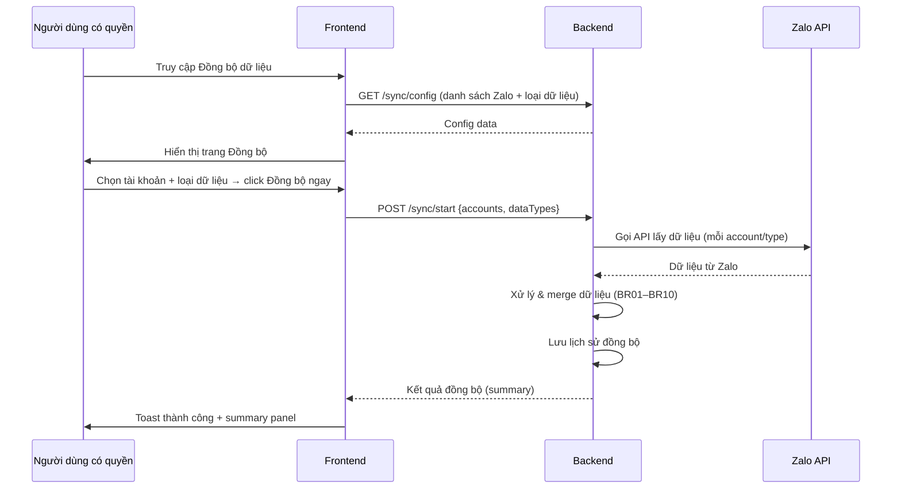
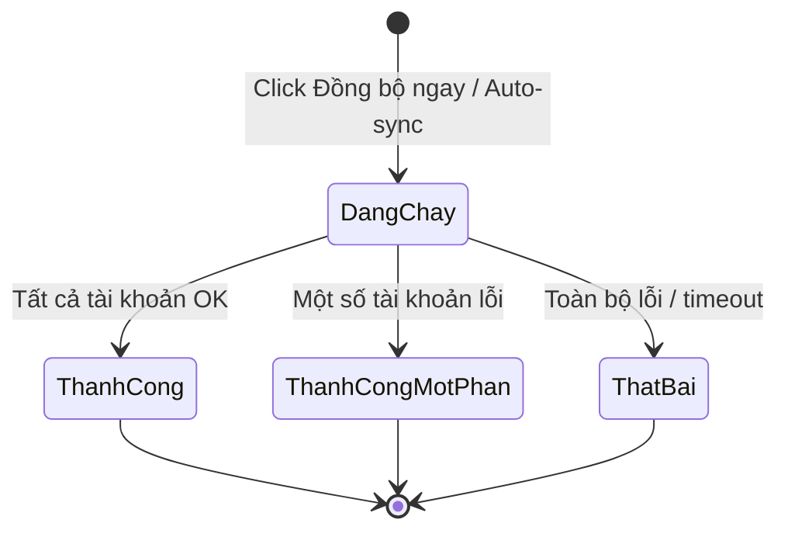

# [G006] Đồng bộ dữ liệu từ Zalo

| Trường | Nội dung |
|--------|----------|
| **Feature ID** | G006 |
| **Tên** | Đồng bộ dữ liệu từ Zalo |
| **Module** | Đồng bộ dữ liệu |
| **Owner (BA)** | Trân |
| **Dev assignee** | — |
| **Priority** | — |
| **Version** | 1.1 |
| **Status** | Draft |
| **Last updated** | 2026-06-09 |

---

## 1. Tổng quan (Overview)

Dữ liệu trên Zalo OA (thẻ, danh bạ, nhóm hội thoại) và hệ thống Gopany ChatZalo có thể không đồng nhất theo thời gian do người dùng thao tác trực tiếp trên Zalo. Tính năng Đồng bộ dữ liệu cho phép Admin và nhân viên được phân quyền kéo dữ liệu từ Zalo về hệ thống theo yêu cầu, đảm bảo dữ liệu hai bên nhất quán.

**Use Case Description:**
> Là Admin, tôi muốn đồng bộ thủ công dữ liệu từ Zalo về hệ thống, để đảm bảo thẻ phân loại~~, danh bạ khách hàng và nhóm hội thoại~~ → và danh bạ khách hàng trong Gopany luôn phản ánh trạng thái thực tế trên Zalo.

**Loại dữ liệu đồng bộ:**
| Loại | Nguồn | Mô tả |
|------|-------|-------|
| **Thẻ (Tag)** | Zalo OA → Gopany | Đồng bộ các nhãn phân loại hội thoại từ Zalo |
| **Danh bạ (Contacts)** | Zalo OA → Gopany | Đồng bộ danh sách bạn/follower từ tài khoản Zalo |
| ~~**Nhóm (Groups)**~~ | ~~Zalo OA → Gopany~~ | ~~Đồng bộ các nhóm hội thoại từ tài khoản Zalo~~ |

> **v1.1 change:** Loại **Hội thoại (Conversations)** đã bị loại bỏ khỏi phạm vi. Chỉ còn ~~3~~ → 2 loại: Thẻ, Danh bạ~~, Nhóm~~.

**Người dùng mục tiêu (Target users):**
- **Admin** — toàn quyền đồng bộ tất cả loại dữ liệu, tất cả tài khoản Zalo
- **Nhân viên được Admin cấp quyền Đồng bộ dữ liệu** — toàn quyền tương đương Admin trong module này
- **Nhân viên thông thường** — không có quyền truy cập tính năng này

**Phụ thuộc:** G001 (Liên kết tài khoản Zalo) — phải có ít nhất 1 tài khoản Zalo đang hoạt động mới sync được; G004 (Quản lý Thẻ) — logic gộp tag trùng khi sync.

---

## 2. Điều kiện tiên quyết (Pre-conditions & Trigger)

**Trigger:**
- **Đồng bộ thủ công:** Người dùng truy cập **Thiết lập** → **Đồng bộ dữ liệu** → chọn loại dữ liệu + tài khoản Zalo → click **"Đồng bộ ngay"**
- **Đồng bộ tự động (Auto-sync):** Khi Admin lần đầu liên kết thành công tài khoản Zalo (G001) → hệ thống tự động đồng bộ toàn bộ dữ liệu của tài khoản đó [→ BR25]

**Pre-conditions:**
- [ ] Người dùng đã đăng nhập và có session hợp lệ
- [ ] Người dùng là **Admin** hoặc **nhân viên được cấp quyền Đồng bộ dữ liệu** [→ BR26]
- [ ] Workspace có ít nhất **1 tài khoản Zalo đang hoạt động** (trạng thái "Đang hoạt động" theo G001) [→ BR27]

**Post-conditions chung:**
- Sau khi đồng bộ hoàn tất, dữ liệu trong hệ thống được cập nhật theo dữ liệu từ Zalo
- Lịch sử đồng bộ được ghi lại (loại dữ liệu, tài khoản Zalo, thời gian, kết quả)

---

## 3. Luồng chính (Happy Path)

### UC-01 — Đồng bộ thủ công dữ liệu từ Zalo

1. **[Người dùng có quyền]** Truy cập **Thiết lập** → **Đồng bộ dữ liệu**
2. **[Hệ thống]** Kiểm tra quyền [→ E01]; hiển thị trang Đồng bộ dữ liệu
3. **[Hệ thống]** Hiển thị:
   - Danh sách tài khoản Zalo đang hoạt động (checkbox chọn)
   - Danh sách loại dữ liệu (Thẻ / Danh bạ ~~/ Nhóm~~) với checkbox chọn
   - Lịch sử đồng bộ gần nhất (loại, tài khoản, thời gian, kết quả)
4. **[Người dùng có quyền]** Chọn **ít nhất 1 tài khoản Zalo** [→ E02] và **ít nhất 1 loại dữ liệu** [→ E03]
5. **[Người dùng có quyền]** Click **"Đồng bộ ngay"**
6. **[Hệ thống]** Hiển thị trạng thái đang đồng bộ (loading indicator); nút "Đồng bộ ngay" chuyển sang disabled
7. **[Hệ thống]** Gọi API Zalo để lấy dữ liệu cho từng tài khoản đã chọn [→ E04, E05, E06]
8. **[Hệ thống]** Xử lý dữ liệu theo từng loại (xem chi tiết tại Section 6 — Business Rules)
9. **[Hệ thống]** Lưu lịch sử đồng bộ; cập nhật timestamp "Đồng bộ lần cuối"
10. **[Hệ thống]** Hiển thị kết quả: toast thành công + summary panel (số lượng đã thêm/cập nhật/bỏ qua cho từng loại dữ liệu)

*Use case kết thúc.*

> Auto-generated — comment nếu cần sửa logic

---

### UC-02 — Auto-sync khi liên kết tài khoản Zalo lần đầu

1. **[Hệ thống]** Nhận tín hiệu từ G001: tài khoản Zalo vừa được liên kết thành công lần đầu
2. **[Hệ thống]** Tự động bắt đầu đồng bộ toàn bộ ~~3~~ → 2 loại dữ liệu (Thẻ + Danh bạ ~~+ Nhóm~~) của tài khoản đó [→ BR25]
3. **[Hệ thống]** Xử lý dữ liệu theo Business Rules (giống UC-01)
4. **[Hệ thống]** Lưu lịch sử đồng bộ; **không hiển thị popup xác nhận** cho người dùng [→ BR25]
5. **[Hệ thống]** (Tùy chọn) Hiển thị toast nhẹ: *"Đang đồng bộ dữ liệu từ Zalo..."* → *"Đồng bộ hoàn tất"*

*Use case kết thúc.*

---

## 4. Luồng phụ (Alternative Flows)

### AF01 — Đồng bộ một phần thành công (UC-01, bước 7–9)

- Người dùng chọn 2 tài khoản Zalo; 1 tài khoản đồng bộ thành công, 1 tài khoản lỗi kết nối
- Hệ thống: tài khoản thành công → xử lý bình thường; tài khoản lỗi → ghi log lỗi
- Toast: *"Đồng bộ một phần thành công. 1/2 tài khoản đồng bộ được. Xem chi tiết lỗi."*

### AF02 — Xem lịch sử đồng bộ

- Người dùng click vào một row trong bảng lịch sử đồng bộ
- Hệ thống hiển thị modal chi tiết: loại dữ liệu, số bản ghi thêm/cập nhật/bỏ qua, thời gian hoàn tất, lỗi (nếu có)

---

## 5. Luồng ngoại lệ (Exception Flows)

| Code | Trigger (Điều kiện kích hoạt) | UI Response | Notification |
|------|-------------------------------|-------------|--------------|
| E01 | Nhân viên không có quyền truy cập trang Đồng bộ dữ liệu | Toast: *"Bạn không có quyền thực hiện thao tác này"* | — |
| E02 | Người dùng click "Đồng bộ ngay" mà chưa chọn tài khoản Zalo nào | Lỗi inline: *"Vui lòng chọn ít nhất 1 tài khoản Zalo để đồng bộ"* | — |
| E03 | Người dùng click "Đồng bộ ngay" mà chưa chọn loại dữ liệu nào | Lỗi inline: *"Vui lòng chọn ít nhất 1 loại dữ liệu để đồng bộ"* | — |
| E04 | Token tài khoản Zalo hết hạn trong lúc đồng bộ | Toast: *"Tài khoản Zalo [tên] đã hết phiên đăng nhập. Vui lòng kết nối lại."* + link đến G001 | — |
| E05 | Mất kết nối mạng trong lúc đồng bộ | Toast: *"Mất kết nối. Quá trình đồng bộ bị gián đoạn. Vui lòng thử lại."* | — |
| E06 | Zalo API trả về lỗi (rate limit, server error) | Toast: *"Zalo API không phản hồi. Vui lòng thử lại sau."*; lưu log lỗi | — |
| E07 | Workspace chưa có tài khoản Zalo nào được liên kết (hoặc tất cả đã ngắt kết nối) | Trang Đồng bộ hiển thị thông báo: *"Chưa có tài khoản Zalo nào đang hoạt động. Vui lòng liên kết tài khoản Zalo trước."* + link đến G001 | — |

**Exception Confirmation Log — G006**

| Code | Từ UC | Nguồn HP hay Độc lập | Confirmed |
|------|-------|----------------------|-----------|
| E01 | UC-01 | Bước 2 (pre-check) | ✅ |
| E02 | UC-01 | Bước 5 (validation) | ✅ |
| E03 | UC-01 | Bước 5 (validation) | ✅ |
| E04 | UC-01 | Bước 7 | ✅ |
| E05 | UC-01 | Bước 7 | ✅ |
| E06 | UC-01 | Bước 7 | ✅ |
| E07 | UC-01 | Bước 3 (pre-check) | ✅ |

---

## 6. Business Rules — Quy tắc nghiệp vụ

### Nhóm BR-TAG — Đồng bộ Thẻ

| Code | Rule | Lý do |
|------|------|-------|
| BR01 | Thẻ mới từ Zalo chưa tồn tại trong hệ thống → **thêm mới** vào hệ thống | Đồng bộ đầy đủ dữ liệu |
| BR02 | Thẻ từ Zalo trùng tên với thẻ đã có trong hệ thống (so sánh case-insensitive, sau trim) → **gộp làm 1** (dùng theo BR12 của G004), không tạo thêm | Tránh bùng nổ tag trùng từ nhiều nguồn |
| BR03 | Thẻ đã có trong hệ thống nhưng không còn trên Zalo → **giữ nguyên** trong hệ thống (không xóa) | Người dùng có thể đã tạo thẻ thủ công trong Gopany |

### Nhóm BR-CONTACT — Đồng bộ Danh bạ

| Code | Rule | Lý do |
|------|------|-------|
| BR04 | Danh bạ mới từ Zalo chưa tồn tại trong hệ thống → **thêm mới** | Đồng bộ đầy đủ |
| BR05 | Danh bạ từ Zalo đã tồn tại trong hệ thống (khớp UID Zalo) → **cập nhật thông tin** từ Zalo (tên, avatar, ...) [→ v1.1 change: trước đây giữ nguyên hệ thống, nay cập nhật từ Zalo] | Đảm bảo thông tin liên lạc luôn mới nhất |
| BR06 | **[v1.1 thay đổi]** Khi danh bạ đã tồn tại trong hệ thống: **cập nhật từ Zalo** (tên, avatar, số điện thoại nếu Zalo trả về) — không giữ nguyên dữ liệu cũ trong hệ thống | Quyết định ưu tiên dữ liệu Zalo là nguồn gốc chính thống; đảo ngược BR06 v1.0 |
| BR07 | Danh bạ trong hệ thống nhưng không còn trong Zalo → **giữ nguyên** trong hệ thống (không xóa) | Có thể là khách hàng đã hủy kết bạn nhưng vẫn cần lưu lịch sử |

### ~~Nhóm BR-GROUP — Đồng bộ Nhóm~~

| Code | Rule | Lý do |
|------|------|-------|
| ~~BR08~~ | ~~Nhóm mới từ Zalo chưa tồn tại trong hệ thống → **thêm mới**~~ | ~~Đã bỏ — Đồng bộ nhóm không còn trong phạm vi~~ |
| ~~BR09~~ | ~~Nhóm từ Zalo đã tồn tại trong hệ thống (khớp Group ID Zalo) → **cập nhật thông tin** từ Zalo (tên nhóm, avatar, thành viên)~~ | ~~Đã bỏ~~ |
| ~~BR10~~ | ~~Nhóm trong hệ thống nhưng không còn trên Zalo (nhóm bị giải tán hoặc bot bị mời ra) → **giữ nguyên** trong hệ thống (không xóa); đánh dấu trạng thái "Không còn trên Zalo"~~ | ~~Đã bỏ~~ |

### Nhóm BR-GENERAL — Quy tắc chung

| Code | Rule | Lý do |
|------|------|-------|
| BR20 | Đồng bộ được thực hiện **theo từng tài khoản Zalo** — lỗi 1 tài khoản không block tài khoản khác | Tránh toàn bộ bị block vì 1 tài khoản hỏng |
| BR21 | Khi đang đồng bộ: nút "Đồng bộ ngay" bị disable; không cho phép gọi thêm lệnh đồng bộ mới | Tránh race condition |
| BR22 | Không giới hạn số lần đồng bộ thủ công trong ngày | Admin cần linh hoạt khi có sự kiện đột xuất |
| BR23 | Lịch sử đồng bộ lưu tối thiểu **30 ngày** gần nhất | Audit trail |
| BR24 | Dữ liệu từ Zalo được xử lý theo **batch** — không block UI trong lúc đồng bộ | UX: người dùng vẫn dùng được app khi sync đang chạy |
| BR25 | **Auto-sync khi liên kết lần đầu (UC-02):** Hệ thống tự động đồng bộ toàn bộ 3 loại dữ liệu ngay sau khi liên kết thành công — **không cần xác nhận từ người dùng**, không hiện popup | Onboarding nhanh — dữ liệu Zalo có sẵn ngay |
| BR26 | **Phân quyền:** Admin → toàn quyền; Nhân viên được cấp quyền "Đồng bộ dữ liệu" → toàn quyền tương đương Admin trong module này; Nhân viên thông thường → **không có quyền truy cập** | Kiểm soát ai được phép kéo dữ liệu về hệ thống |
| BR27 | Phải chọn **ít nhất 1 tài khoản Zalo** trước khi bắt đầu đồng bộ thủ công | Không thể đồng bộ nếu không có nguồn dữ liệu |

---

## 7. State Machine — Vòng đời phiên Đồng bộ

**Entity:** Sync Job (phiên đồng bộ)

| Từ trạng thái | Sự kiện | Sang trạng thái | Điều kiện | Ghi chú |
|---------------|---------|-----------------|-----------|---------|
| _(chưa tồn tại)_ | Người dùng click "Đồng bộ ngay" / Auto-sync | **Đang chạy** | Pre-conditions OK | Nút Đồng bộ disabled |
| Đang chạy | Hoàn tất tất cả tài khoản đã chọn | **Thành công** | — | Terminal partial |
| Đang chạy | Một số tài khoản lỗi, một số thành công | **Thành công một phần** | — | Terminal partial |
| Đang chạy | Toàn bộ tài khoản lỗi | **Thất bại** | — | Terminal |
| Đang chạy | Mất kết nối / timeout | **Thất bại** | — | Terminal |

> Mọi trạng thái terminal đều được lưu vào lịch sử đồng bộ (BR23).

> Auto-generated — comment nếu cần sửa logic

---

## 8. Data Model

N/A — Spec này thuần nghiệp vụ. Data model sẽ được định nghĩa trong tài liệu kỹ thuật riêng.

---

## 9. API Contract

N/A — Spec này thuần nghiệp vụ. API contract sẽ được định nghĩa trong tài liệu kỹ thuật riêng.

---

## 10. UI/UX Notes — Ghi chú giao diện

### 10A — Trang Đồng bộ dữ liệu (Thiết lập)

**Entry point:** Menu **Thiết lập** → **Đồng bộ dữ liệu**

**Layout trang:**

| Vùng | Nội dung |
|------|---------|
| **Vùng chọn tài khoản Zalo** | Danh sách tài khoản Zalo đang hoạt động; checkbox chọn từng tài khoản hoặc "Chọn tất cả" |
| **Vùng chọn loại dữ liệu** | ~~3~~ → 2 checkbox: ☐ Thẻ (Tag) / ☐ Danh bạ (Contacts) ~~/ ☐ Nhóm (Groups)~~; mô tả ngắn mỗi loại |
| **Button "Đồng bộ ngay"** | Primary; disabled khi đang đồng bộ hoặc chưa chọn đủ tài khoản + loại dữ liệu |
| **Lịch sử đồng bộ** | Bảng: Thời gian \| Tài khoản Zalo \| Loại dữ liệu \| Kết quả \| Chi tiết |
| **Trạng thái "Không có Zalo"** | Khi workspace chưa có tài khoản Zalo hoạt động: hiển thị empty state + link đến G001 (E07) |

**Trạng thái Loading:**
- Nút "Đồng bộ ngay" → "Đang đồng bộ..." + spinner
- Mỗi tài khoản Zalo đang sync hiển thị progress indicator riêng
- Page không bị lock — người dùng vẫn điều hướng sang trang khác được

---

### 10B — Summary Panel sau khi đồng bộ

Hiển thị ngay dưới nút "Đồng bộ ngay" hoặc trong toast expanded:

| Loại dữ liệu | Thêm mới | Cập nhật | Bỏ qua / Giữ nguyên |
|-------------|---------|---------|---------------------|
| Thẻ | X | — | Y |
| Danh bạ | X | X | Y |
| ~~Nhóm~~ | ~~X~~ | ~~X~~ | ~~Y~~ |

---

### 10C — Lịch sử đồng bộ

| Cột | Nội dung |
|-----|---------|
| Thời gian | Timestamp đồng bộ bắt đầu (và kết thúc) |
| Tài khoản Zalo | Tên tài khoản |
| Loại dữ liệu | Tag / Contacts / Groups (có thể nhiều loại trong 1 phiên) |
| Kết quả | Badge: Thành công / Thành công một phần / Thất bại |
| Chi tiết | Link xem modal chi tiết (AF02) |

Hiển thị 30 ngày gần nhất, mặc định sort theo thời gian mới nhất trước.

---

## 11. Acceptance Criteria — Tiêu chí nghiệm thu

### Phân quyền
- [ ] Nhân viên không có quyền truy cập trang Đồng bộ dữ liệu → toast E01 (AC-BR26)
- [ ] Admin và nhân viên có quyền truy cập và thực hiện đồng bộ bình thường (AC-BR26)

### Trang Đồng bộ (UC-01)
- [ ] Trang hiển thị đúng danh sách tài khoản Zalo đang hoạt động
- [ ] Workspace không có tài khoản Zalo hoạt động → empty state + link G001 (AC-E07)
- [ ] Click "Đồng bộ ngay" không chọn tài khoản → lỗi inline E02
- [ ] Click "Đồng bộ ngay" không chọn loại dữ liệu → lỗi inline E03

### Đồng bộ thành công (UC-01)
- [ ] Chọn 1+ tài khoản + 1+ loại dữ liệu → đồng bộ thành công → toast + summary panel
- [ ] Nút "Đồng bộ ngay" disabled trong lúc đang sync; re-enable sau khi xong (AC-BR21)
- [ ] Summary panel hiển thị đúng số lượng thêm mới / cập nhật / bỏ qua cho từng loại
- [ ] Lịch sử đồng bộ cập nhật sau mỗi phiên sync (AC-BR23)

### Xử lý lỗi
- [ ] Token Zalo hết hạn → toast E04 + link đến G001 (AC-E04)
- [ ] Mất mạng → toast E05 (AC-E05)
- [ ] Zalo API lỗi → toast E06 (AC-E06)
- [ ] 1 tài khoản lỗi, 1 tài khoản OK → đồng bộ 1 phần; toast AF01 (AC-BR20)

### Business Rules — Thẻ
- [ ] Thẻ mới từ Zalo → được thêm vào hệ thống (AC-BR01)
- [ ] Thẻ từ Zalo trùng tên (case-insensitive, sau trim) với thẻ đã có → gộp, không tạo thêm (AC-BR02)
- [ ] Thẻ trong hệ thống không có trên Zalo → giữ nguyên, không xóa (AC-BR03)

### Business Rules — Danh bạ
- [ ] Danh bạ mới từ Zalo → được thêm vào hệ thống (AC-BR04)
- [ ] Danh bạ đã tồn tại (khớp UID) → cập nhật tên/avatar từ Zalo, không giữ dữ liệu cũ (AC-BR05, AC-BR06) [v1.1]
- [ ] Danh bạ trong hệ thống không có trên Zalo → giữ nguyên, không xóa (AC-BR07)

### ~~Business Rules — Nhóm~~
- [ ] ~~Nhóm mới từ Zalo → được thêm vào hệ thống (AC-BR08)~~
- [ ] ~~Nhóm đã tồn tại (khớp Group ID) → cập nhật tên/avatar/thành viên từ Zalo (AC-BR09)~~
- [ ] ~~Nhóm trong hệ thống không còn trên Zalo → giữ nguyên, đánh dấu "Không còn trên Zalo" (AC-BR10)~~

### Auto-sync (UC-02)
- [ ] Liên kết tài khoản Zalo thành công (G001) → hệ thống tự động đồng bộ ~~3~~ → 2 loại dữ liệu (Thẻ + Danh bạ) mà không cần xác nhận người dùng (AC-BR25)
- [ ] Auto-sync không hiển thị popup xác nhận (AC-BR25)
- [ ] Auto-sync ghi lịch sử đồng bộ (AC-BR23)

### Hiệu năng
- [ ] Trong lúc đồng bộ, người dùng vẫn điều hướng sang trang khác được (không block UI) (AC-BR24)

---

## 12. Out of Scope — Ngoài phạm vi

| # | Nội dung | Ghi chú |
|---|---------|---------|
| OOS01 | ~~Đồng bộ Hội thoại (Conversations)~~ | Đã loại bỏ từ v1.1 |
| OOS02 | Đồng bộ hai chiều (Gopany → Zalo) | Chỉ một chiều Zalo → Gopany trong v1.x |
| OOS03 | Đồng bộ tự động theo lịch (scheduled auto-sync, VD: mỗi 30 phút) | Cân nhắc cho phiên bản sau; hiện chỉ có thủ công + auto khi liên kết lần đầu |
| OOS04 | Webhook realtime từ Zalo (nhận push event) | Phụ thuộc Zalo API hỗ trợ; đưa vào backlog khi Zalo có webhook |
| OOS05 | Chọn field cụ thể để đồng bộ (VD: chỉ đồng bộ avatar, không đồng bộ tên) | Granular sync — phức tạp; cân nhắc phiên bản sau |

---

## 13. Dependencies — Phụ thuộc

| Phụ thuộc vào | Ghi chú |
|---------------|---------|
| G001 — Liên kết tài khoản Zalo | Phải có ít nhất 1 tài khoản Zalo đang hoạt động; UC-02 được trigger từ G001 |
| G004 — Quản lý Thẻ | Logic gộp tag trùng khi sync (BR02 tham chiếu BR12 của G004) |
| Module Quản lý nhân viên | Admin cấp/thu hồi quyền Đồng bộ dữ liệu (BR26) |
| Zalo API | Nguồn dữ liệu thực tế; giới hạn rate, token, response format phụ thuộc Zalo |

| Được phụ thuộc bởi | Ghi chú |
|--------------------|---------|
| Tính năng Báo cáo (tương lai) | Cần danh bạ và nhóm đầy đủ để thống kê |
| Workflow / Automation (tương lai) | Có thể trigger sync theo sự kiện |

---

## 14. Open Questions — Câu hỏi chưa giải quyết

| # | Câu hỏi | Người quyết định | Deadline | Trả lời |
|---|---------|-----------------|----------|---------|
| OQ01 | Nếu số lượng danh bạ hoặc nhóm trên Zalo rất lớn (>10,000 bản ghi), đồng bộ xử lý thế nào? Có cần phân trang hoặc batch xử lý không? | Team kỹ thuật | — | — |
| OQ02 | Khi auto-sync (UC-02) đang chạy và Admin đồng thời click "Đồng bộ ngay" thủ công — hệ thống xử lý thế nào? (Block thủ công, queue, hay chạy song song?) | Team kỹ thuật | — | — |
| OQ03 | Thông tin nào của danh bạ được cập nhật từ Zalo (BR06)? Tên hiển thị, avatar, số điện thoại — cần xác nhận Zalo API trả về gì. | Team kỹ thuật | — | — |
| ~~OQ04~~ | ~~Nhóm "Không còn trên Zalo" (BR10) — cần hiển thị thế nào trong danh sách hội thoại? (Ẩn? Hiện với nhãn đặc biệt? Chuyển sang archive?)~~ | ~~Product Owner~~ | ~~—~~ | ~~Đã bỏ — Đồng bộ nhóm không còn trong phạm vi~~ |

---

## 15. Performance & Scalability

| Mục | Yêu cầu |
|-----|---------|
| Không block UI | Sync chạy background; người dùng vẫn dùng app bình thường trong khi sync (BR24) |
| Batch processing | Dữ liệu lớn cần xử lý batch — không load toàn bộ vào memory (OQ01 cần xác nhận) |
| Rate limit Zalo | Backend tự throttle để không vượt rate limit Zalo API |
| Concurrent sync | Tối đa 1 sync job tại một thời điểm / workspace (BR21) |
| Lịch sử | Lưu 30 ngày; sau 30 ngày tự archive hoặc xóa (BR23) |

---

## 16. Rollout & Migration

| Mục | Chi tiết |
|-----|---------|
| Rollout strategy | Tất cả workspace có tài khoản Zalo đã liên kết (không cần feature flag) |
| Data migration | Không — tính năng mới; dữ liệu sẽ được đồng bộ lần đầu khi user trigger hoặc khi liên kết thêm tài khoản Zalo |
| Breaking change | **Có — v1.1 đảo ngược BR06:** Danh bạ trùng UID nay được cập nhật từ Zalo, trước đây giữ nguyên hệ thống. Cần thông báo nội bộ cho team dev và QA |
| User communication | Ghi chú trong release notes: "Dữ liệu danh bạ sẽ được cập nhật từ Zalo khi đồng bộ" |
| Deploy order | Cần G001 (Liên kết Zalo) và G004 (Quản lý Thẻ) deploy trước |

---

## Changelog — Lịch sử thay đổi

| Ngày | Version | Người thay đổi | Sections | Nội dung | File:Line |
|------|---------|----------------|----------|----------|-----------|
| 2026-06-08 | v1.0 | Trân (BA) | — | Tạo draft; 4 loại dữ liệu: Tag, Contacts, Groups, Conversations; BR06 v1.0: giữ nguyên dữ liệu hệ thống khi contact trùng | — |
| 2026-06-09 | v1.1 | Trân (BA) | 1,3,6,12,16 | Loại bỏ Hội thoại (Conversations) khỏi phạm vi (OOS01); đảo ngược BR06: nay cập nhật từ Zalo thay vì giữ hệ thống; thêm BR25 (auto-sync khi liên kết lần đầu); thêm BR26 (phân quyền); thêm BR27 (bắt buộc chọn tài khoản); bổ sung UC-02 (Auto-sync); thêm E07 | — |
| 2026-06-23 | v1.2 | Trân (BA) | 1,3,6,10,11,14 | Gạch bỏ toàn bộ phần Đồng bộ nhóm: bỏ loại dữ liệu Nhóm khỏi phạm vi; gạch bỏ BR08/BR09/BR10; cập nhật UC-01/UC-02 (2 loại thay vì 3); cập nhật UI 10A/10B; gạch bỏ AC nhóm; gạch bỏ OQ04 | — |

---

> **Lưu ý cho AI khi đọc spec này:**
> - Spec này là **thuần nghiệp vụ** — không có entity, variable, API contract. Tài liệu kỹ thuật sẽ được bổ sung riêng.
> - Section 5 (Exception Flows) và Section 6 (Business Rules) là **bắt buộc implement đầy đủ**.
> - Section 7 (State Machine) mô tả vòng đời của một **phiên đồng bộ (Sync Job)**, không phải entity dữ liệu.
> - Section 12 (Out of Scope) là danh sách **cấm** — đặc biệt OOS01 (Hội thoại đã bị loại v1.1) và OOS02 (không sync ngược Gopany→Zalo).
> - Section 11 (Acceptance Criteria) là checklist tự verify trước khi báo done.
> - **BR06 v1.1 BREAKING CHANGE quan trọng:** Khi danh bạ đã tồn tại (khớp UID), hệ thống **CẬP NHẬT** từ Zalo — không giữ nguyên như v1.0. Dev và QA cần lưu ý.
> - **BR25 quan trọng:** Auto-sync khi liên kết Zalo lần đầu → KHÔNG hỏi xác nhận người dùng.
> - **BR26 quan trọng:** Nhân viên thông thường KHÔNG có quyền truy cập module này — chỉ Admin hoặc nhân viên được cấp quyền riêng.
> - **BR27 quan trọng:** Phải chọn ≥1 tài khoản Zalo trước khi sync thủ công.
> - **BR03, BR07:** Dữ liệu trong hệ thống nhưng không còn trên Zalo → **giữ nguyên, KHÔNG xóa** (áp dụng cho Tag và Contacts). ~~BR10 (Groups) đã bỏ — Đồng bộ nhóm không còn trong phạm vi.~~
> - **OOS01:** Loại Hội thoại (Conversations) đã bị loại bỏ từ v1.1 — KHÔNG implement.
> - **OQ01–OQ03** cần xác nhận trước khi implement để tránh performance issue và UX bug. ~~OQ04 đã bỏ.~~
