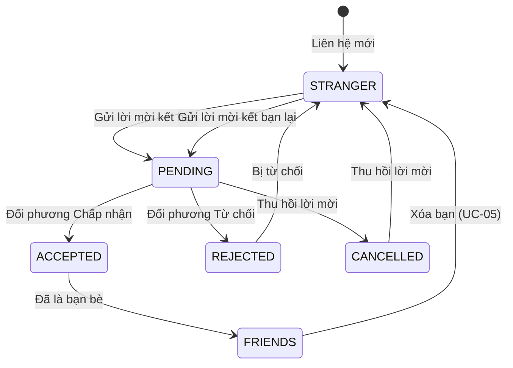
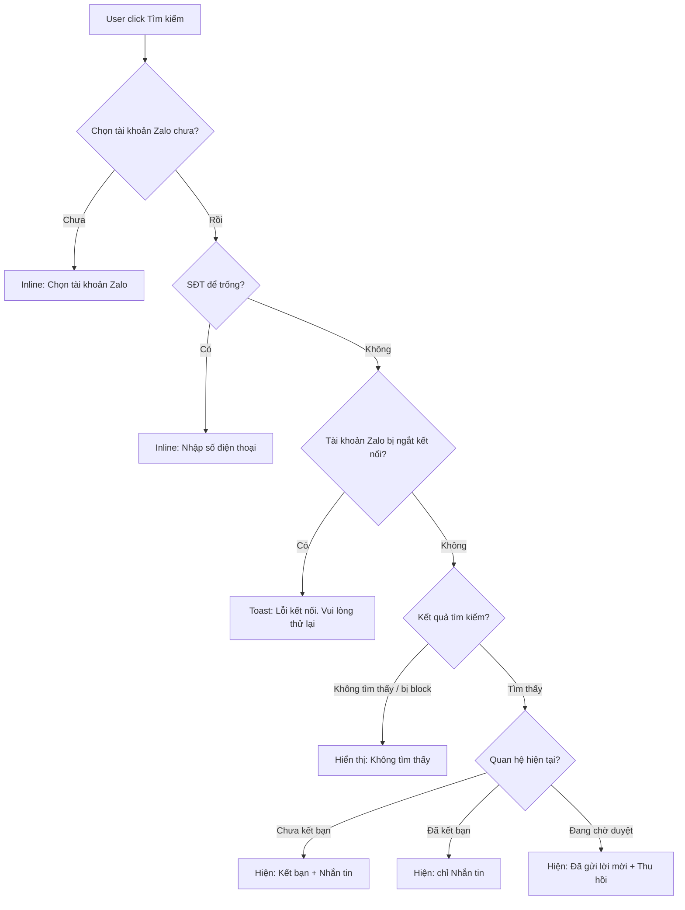

# [G007] Kết bạn

| Trường | Nội dung |
|--------|----------|
| **Feature ID** | G007 |
| **Tên** | Kết bạn |
| **Module** | Danh bạ |
| **Owner (BA)** | Thành |
| **Dev assignee** | — |
| **Priority** | — |
| **Version** | 1.1 |
| **Status** | Draft |
| **Last updated** | 2026-07-01 |

---

## 1. Tổng quan (Overview)

Hiện tại hệ thống ChatZalo chưa có cơ chế quản lý quan hệ bạn bè giữa tài khoản Zalo của workspace và các liên hệ bên ngoài. Tính năng Kết bạn cho phép Admin và nhân viên gửi lời mời kết bạn qua Zalo, quản lý lời mời đến/đi, và xem danh sách bạn bè của toàn bộ tài khoản Zalo trong workspace — tất cả trong giao diện Gopany mà không cần thao tác trực tiếp trên Zalo.

**Use Case Description:**
> Là Admin hoặc nhân viên, tôi muốn gửi lời mời kết bạn Zalo đến một số điện thoại và quản lý danh bạ của các tài khoản Zalo trong workspace, để mở rộng mạng lưới liên hệ và thuận tiện nhắn tin.

**Người dùng mục tiêu (Target users):**
- **Admin/Owner** — toàn quyền
- **Nhân viên quản lý** — toàn quyền
- **Nhân viên thường** — toàn quyền

**Phụ thuộc:** G001 (Liên kết tài khoản Zalo), G002 (Phân quyền tài khoản Zalo cho Staff), G003 (Chat)

**Entry points:**
- **[Chính]** Button **Kết bạn** trên header màn hình danh sách hội thoại (cạnh button Tìm kiếm) → popup tìm kiếm & kết bạn
- **[Phụ]** Button **Thêm bạn** trong màn hình Danh bạ → cùng popup

**Lưu ý cross-feature (G003):** Luồng tìm kiếm số điện thoại trực tiếp từ input tìm kiếm danh sách hội thoại (G003 UC-03 entry point cũ) bị loại bỏ. Popup tìm kiếm & kết bạn (G003 UC-03) nay được spec đầy đủ trong G007.

---

## 2. Actors & Roles

| Actor | Mô tả | Quyền |
|-------|-------|-------|
| Admin/Owner | Quản trị viên workspace | Toàn bộ thao tác |
| Nhân viên quản lý | Nhân viên có role quản lý | Toàn bộ thao tác |
| Nhân viên thường | Nhân viên cơ bản | Toàn bộ thao tác |

---

## 3. Luồng chính (Happy Path)

### UC-01 — Gửi lời mời kết bạn (Luồng chính — từ màn hình danh sách hội thoại)

**Điều kiện tiên quyết:** Có ít nhất 1 tài khoản Zalo đang hoạt động trong workspace.

1. **[User]** Trên màn hình danh sách hội thoại → click button **Kết bạn** trên header (cạnh button Tìm kiếm)
2. **[Hệ thống]** Hiển thị popup: dropdown chọn tài khoản Zalo (bắt buộc, mặc định trống) + input số điện thoại + button Tìm kiếm
3. **[User]** Chọn tài khoản Zalo từ dropdown → nhập số điện thoại → click Tìm kiếm [→ E01, E02, E03, E04]
4. **[Hệ thống]** Hiển thị profile: avatar, tên (kèm icon đổi tên), số điện thoại, button **Kết bạn** và **Nhắn tin** [→ E05]
5. **[User]** Click **Kết bạn** [→ AF01, AF02]
6. **[Hệ thống]** Gửi lời mời kết bạn qua tài khoản Zalo đã chọn; button đổi thành **Đã gửi lời mời** + button **Thu hồi**
7. **[Hệ thống]** Lời mời xuất hiện trong tab **Đã gửi** của màn hình Lời mời kết bạn

### UC-01b — Gửi lời mời kết bạn (Luồng phụ — từ màn hình Danh bạ)

**Điều kiện tiên quyết:** Có ít nhất 1 tài khoản Zalo đang hoạt động trong workspace.

1. **[User]** Vào màn hình Danh bạ → click button **Thêm bạn**
2. **[Hệ thống]** Hiển thị cùng popup như UC-01 bước 2
3. Các bước tiếp theo giống UC-01 từ bước 3 trở đi

### UC-02 — Thu hồi lời mời đã gửi

1. **[User]** Vào màn hình Danh bạ → menu **Lời mời kết bạn** → tab **Đã gửi**
2. **[Hệ thống]** Hiển thị danh sách lời mời đang chờ; mỗi card: avatar, tên, icon nhắn tin, button **Thu hồi**
3. **[User]** Click **Thu hồi** trên card
4. **[Hệ thống]** Hủy lời mời; card biến mất khỏi tab Đã gửi

### UC-03 — Xử lý lời mời kết bạn đến

1. **[Hệ thống]** Nhận thông tin lời mời kết bạn mới đến tài khoản Zalo trong workspace → gửi notification (hệ thống notification có sẵn của Gopany)
2. **[User]** Vào màn hình Danh bạ → menu **Lời mời kết bạn** → tab **Đã nhận**
3. **[Hệ thống]** Hiển thị danh sách lời mời; mỗi card: avatar, tên, icon nhắn tin, nội dung lời nhắn kèm (nếu có), button **Chấp nhận** + **Từ chối**
4. **[User]** Click **Chấp nhận** hoặc **Từ chối**
5. **[Hệ thống]** Xử lý → gửi notification cho người đã gửi lời mời; card biến khỏi tab Đã nhận

### UC-04 — Xem và quản lý Danh bạ

1. **[User]** Vào màn hình Danh bạ
2. **[Hệ thống]** Hiển thị danh sách tất cả liên hệ là bạn bè của ít nhất 1 tài khoản Zalo trong workspace; mỗi card: avatar liên hệ, tên, avatar(s) tài khoản Zalo có chung bạn bè
3. **[User]** Hover vào card → hiện button **Option** với các hành động: **Gắn thẻ**, **Đổi tên**, **Xóa bạn**
4. **[User]** Click icon **Nhắn tin** trên card → mở màn hình chat với liên hệ đó (tạo hội thoại nếu chưa có)

### UC-05 — Xóa bạn

1. **[User]** Vào màn hình Danh bạ → hover vào card liên hệ → click **Option** → chọn **"Xóa bạn"**
2. **[Hệ thống]** Hiển thị popup xác nhận: *"Bạn có chắc muốn xóa [Tên] khỏi danh bạ? Lịch sử tin nhắn vẫn được lưu giữ."* + button **Xóa bạn** + **Hủy**
3. **[User]** Click **Xóa bạn** [→ E07]
4. **[Hệ thống]** Thực hiện xóa bạn trên Zalo qua tài khoản Zalo đang active (BR11); card biến khỏi danh sách Danh bạ; toast *"Đã xóa bạn"*; nếu đang mở hội thoại với liên hệ đó → hiển thị banner *"Gửi yêu cầu kết bạn tới người này"* + button **"Gửi kết bạn"** dưới tên đối phương (BR14)

*Use case kết thúc.*

**Ghi chú:** Zalo không gửi notification cho đối phương khi bị xóa bạn (BR13).

---

## 4. Luồng phụ (Alternative Flows)

### AF01 — Tìm thấy liên hệ đã là bạn bè (UC-01)
- Bước 4: chỉ hiển thị button **Nhắn tin**, ẩn button **Kết bạn**

### AF02 — Tìm thấy liên hệ đã được gửi lời mời (UC-01)
- Bước 4: hiển thị button **Đã gửi lời mời** (disabled) + button **Thu hồi** thay cho **Kết bạn**

### AF03 — Nhắn tin từ popup trước khi kết bạn (UC-01)
- Bước 5 (thay thế): **[User]** Click **Nhắn tin**
- **[Hệ thống]** Đóng popup → mở màn hình chat với liên hệ đó (tạo hội thoại nếu chưa có)
- Không gửi lời mời kết bạn — 2 hành động độc lập nhau

### AF04 — Nhắn tin từ card Danh bạ / Lời mời (UC-02, UC-03, UC-04)
- Click icon nhắn tin trên card → mở màn hình chat tương tự G003

---

## 5. Luồng ngoại lệ (Exception Flows)

| ID | Điều kiện | Thông báo / Hành vi | Notification |
|----|-----------|---------------------|-------------|
| E01 | Dropdown tài khoản Zalo chưa được chọn | Inline: "Chọn tài khoản Zalo" | — |
| E02 | Số điện thoại để trống | Inline: "Nhập số điện thoại" | — |
| E03 | Tài khoản Zalo được chọn bị ngắt kết nối | Toast: "Lỗi kết nối. Vui lòng thử lại" | — |
| E04 | Số điện thoại không tồn tại trên Zalo | Hiển thị "Không tìm thấy" dưới input | — |
| E05 | Số điện thoại tồn tại nhưng đã block tài khoản Zalo | Hiển thị "Không tìm thấy" (không lộ bị block) | — |
| E06 | Lỗi hệ thống / không nhận được phản hồi | Toast: "Lỗi kết nối. Vui lòng thử lại" | Ghi log lỗi |
| E07 | Xóa bạn thất bại (lỗi API hoặc mất kết nối) | Toast: "Không thể xóa bạn, vui lòng thử lại"; popup đóng | Ghi log lỗi |
| E08 | Gửi tin nhắn sau khi xóa bạn — đối phương chỉ nhận tin từ bạn bè | Toast: "Không thể gửi tin nhắn tới người này" | — |

---

## 6. Business Rules — Quy tắc nghiệp vụ

| ID | Rule |
|----|------|
| BR01 | Gửi lời mời kết bạn luôn thực thi qua tài khoản Zalo được chọn trong dropdown — không tự động chọn |
| BR02 | Một tài khoản Zalo chỉ có 1 lời mời đang chờ với cùng 1 số điện thoại tại 1 thời điểm |
| BR03 | Danh bạ lưu nội bộ hệ thống — đổi tên, gắn thẻ trong Gopany không ảnh hưởng dữ liệu trên Zalo |
| BR04 | Nếu cùng 1 liên hệ là bạn bè với nhiều tài khoản Zalo → hiển thị 1 dòng trong Danh bạ, kèm avatar tất cả tài khoản Zalo chung |
| BR05 | Lời mời kết bạn không có thời hạn hết hạn — hệ thống không tự expire |
| BR06 | Số điện thoại bị block hiển thị giống "Không tìm thấy" — không lộ thông tin bị block |
| BR07 | Sau khi Chấp nhận/Từ chối lời mời → gửi notification đến người đã gửi lời mời (hệ thống notification Gopany) |
| BR08 | Kết bạn và nhắn tin là 2 hành động độc lập — kết bạn thành công không tự tạo hội thoại |
| BR09 | Nhắn tin từ popup/card → tạo hội thoại nếu chưa có, sử dụng tài khoản Zalo được chọn |
| BR10 | Dropdown chỉ liệt kê tài khoản Zalo đang hoạt động mà user hiện tại được assign (theo G002) |
| BR11 | Xóa bạn thực hiện qua tài khoản Zalo **đang active** — không có dropdown chọn tài khoản. "Đang active" = tài khoản Zalo đang được chọn trong global filter màn hình danh sách hội thoại; nếu đang xem "Tất cả" (không filter) → xóa theo tài khoản Zalo đầu tiên mà liên hệ đó có chung với user. Xóa bạn trên tài khoản Zalo A không ảnh hưởng quan hệ bạn bè với tài khoản Zalo B trong cùng workspace |
| BR12 | Lịch sử tin nhắn được giữ nguyên sau khi xóa bạn — không xóa hội thoại |
| BR13 | Zalo không gửi notification cho đối phương khi bị xóa bạn — hành động im lặng |
| BR14 | Sau khi xóa bạn, nếu đang mở hội thoại với liên hệ đó → hiển thị banner *"Gửi yêu cầu kết bạn tới người này"* + button **"Gửi kết bạn"** dưới tên đối phương (nhất quán với Zalo native); trạng thái quan hệ trở về STRANGER |
| BR15 | Gopany nhận webhook khi **đối phương xóa bạn mình** → tự cập nhật trạng thái về STRANGER; nếu đang mở hội thoại → hiển thị banner "Gửi kết bạn" tương tự BR14. **⏳ Pending OQ01** — dev skip cho đến khi xác nhận webhook Zalo có event này |
| BR16 | Gửi tin nhắn sau khi xóa bạn (khi đang gõ dở hoặc hội thoại vẫn mở): nếu đối phương **không chặn tin từ người lạ** → gửi được bình thường; nếu đối phương **chỉ nhận tin từ bạn bè** → gửi thất bại → hiển thị E08 |
| BR17 | Nhóm chung với liên hệ đã xóa bạn vẫn hoạt động bình thường — quan hệ nhóm độc lập với quan hệ bạn bè |

> Auto-generated — comment nếu cần sửa logic

---

## 7. UI Components — Thành phần giao diện

### Màn hình danh sách hội thoại (Header)

| Thành phần | Mô tả |
|------------|-------|
| Button **Kết bạn** | Entry point chính — nằm trên header cạnh button Tìm kiếm; click mở popup tìm kiếm & kết bạn |

### Màn hình Danh bạ

| Thành phần | Mô tả |
|------------|-------|
| Button **Thêm bạn** | Entry point phụ — cùng popup như header |
| Menu **Lời mời kết bạn** | Dẫn đến màn hình quản lý lời mời (2 tab: Đã gửi / Đã nhận) |
| Card liên hệ | Avatar, tên, avatar(s) tài khoản Zalo chung, icon nhắn tin |
| Option button (hover) | Hiện khi hover vào card: **Gắn thẻ**, **Đổi tên**, **Xóa bạn** |

### Popup Kết bạn

| Thành phần | Mô tả |
|------------|-------|
| Dropdown tài khoản Zalo | Bắt buộc chọn, mặc định trống, chỉ liệt kê tài khoản đang hoạt động mà user được assign |
| Input số điện thoại | Nhập số điện thoại cần tìm |
| Button Tìm kiếm | Kích hoạt tìm kiếm |
| Kết quả | Avatar, tên (kèm icon đổi tên), số điện thoại |
| Button **Kết bạn** | Đổi thành "Đã gửi lời mời" + **Thu hồi** sau khi gửi |
| Button **Nhắn tin** | Mở màn hình chat — độc lập với Kết bạn |

### Màn hình Chat (sau khi xóa bạn)

| Thành phần | Mô tả |
|------------|-------|
| Banner **"Gửi yêu cầu kết bạn tới người này"** | Hiển thị phía trên input chat khi đối phương là STRANGER — tự xuất hiện sau khi xóa bạn (BR14) hoặc khi nhận webhook đối phương xóa mình (BR15) |
| Button **"Gửi kết bạn"** | Nằm trên banner — click gửi lời mời kết bạn lại; đổi thành "Đã gửi lời mời" sau khi click |

### Màn hình Lời mời kết bạn

**Tab Đã gửi:**

| Thành phần | Mô tả |
|------------|-------|
| Card | Avatar, tên, icon nhắn tin |
| Button **Thu hồi** | Hủy lời mời đang chờ |

**Tab Đã nhận:**

| Thành phần | Mô tả |
|------------|-------|
| Card | Avatar, tên, icon nhắn tin, nội dung lời nhắn kèm (ẩn nếu không có) |
| Button **Chấp nhận** | Đồng ý kết bạn |
| Button **Từ chối** | Từ chối lời mời |

---

## 8. Notification

Tất cả notification trong G007 sử dụng hệ thống notification có sẵn của Gopany.

| Trigger | Nội dung gợi ý |
|---------|---------------|
| Lời mời kết bạn mới đến | "[Tên] đã gửi lời mời kết bạn đến [Tài khoản Zalo]" |
| Đối phương Chấp nhận lời mời | "[Tên] đã chấp nhận lời mời kết bạn" |
| Đối phương Từ chối lời mời | "[Tên] đã từ chối lời mời kết bạn" |

---

## 9. Acceptance Criteria — Tiêu chí nghiệm thu

> Auto-generated — comment nếu cần sửa logic

### Popup Kết bạn (mở từ cả 2 entry points)
- [ ] Button **Kết bạn** trên header danh sách hội thoại → mở popup (UC-01, entry point chính)
- [ ] Button **Thêm bạn** trong Danh bạ → mở cùng popup (UC-01b, entry point phụ)
- [ ] Dropdown trống → click Tìm kiếm → inline "Chọn tài khoản Zalo" (E01)
- [ ] SĐT để trống → inline "Nhập số điện thoại" (E02)
- [ ] Tài khoản Zalo ngắt kết nối → toast "Lỗi kết nối. Vui lòng thử lại" (E03)
- [ ] SĐT không tồn tại trên Zalo → hiển thị "Không tìm thấy" (E04)
- [ ] SĐT bị block → hiển thị "Không tìm thấy" — không lộ thông tin bị block (E05, BR06)
- [ ] Tìm thấy, chưa kết bạn → hiển thị profile + button **Kết bạn** + **Nhắn tin**
- [ ] Tìm thấy, đã là bạn bè → chỉ hiển thị button **Nhắn tin** (AF01)
- [ ] Tìm thấy, đang chờ duyệt → hiển thị **Đã gửi lời mời** (disabled) + **Thu hồi** (AF02)
- [ ] Click **Kết bạn** → button đổi thành "Đã gửi lời mời" + hiện button **Thu hồi** (UC-01 step 6)
- [ ] Click **Nhắn tin** → mở màn hình chat, tạo hội thoại nếu chưa có (AF03, BR09)
- [ ] Kết bạn và nhắn tin hoàn toàn độc lập nhau (BR08)

### Lời mời kết bạn — Tab Đã gửi
- [ ] Chỉ hiển thị lời mời đang chờ duyệt (BR05)
- [ ] Mỗi card: avatar, tên, icon nhắn tin, button **Thu hồi**
- [ ] Click **Thu hồi** → card biến mất (UC-02)
- [ ] Click icon nhắn tin → mở màn hình chat (AF04)

### Lời mời kết bạn — Tab Đã nhận
- [ ] Lời mời mới đến → notification Gopany (UC-03, BR07)
- [ ] Mỗi card: avatar, tên, nội dung lời nhắn (ẩn nếu không có), icon nhắn tin, button **Chấp nhận** + **Từ chối**
- [ ] Click **Chấp nhận** → card biến khỏi tab; người gửi nhận notification (UC-03 step 5)
- [ ] Click **Từ chối** → card biến khỏi tab; người gửi nhận notification (UC-03 step 5)
- [ ] Click icon nhắn tin → mở màn hình chat (AF04)

### Màn hình Danh bạ
- [ ] Hiển thị bạn bè của tất cả tài khoản Zalo đang hoạt động trong workspace (BR04)
- [ ] Liên hệ chung của nhiều tài khoản Zalo → 1 dòng, hiển thị nhiều avatar tài khoản Zalo (BR04)
- [ ] Hover vào card → hiện **Option**: **Gắn thẻ**, **Đổi tên**, **Xóa bạn** (UC-04 step 3)
- [ ] Đổi tên → lưu nội bộ, không ảnh hưởng Zalo (BR03)
- [ ] Hiển thị tên đã đổi nếu có, fallback tên gốc từ Zalo
- [ ] Click icon nhắn tin → mở màn hình chat (AF04, BR09)
- [ ] Mỗi user chỉ thấy danh bạ trong workspace của mình

### Xóa bạn (UC-05)
- [ ] Hover card → Option → "Xóa bạn" → hiển thị popup xác nhận, không có dropdown chọn tài khoản (UC-05, BR11)
- [ ] Click "Hủy" trong popup → popup đóng, không có thay đổi nào
- [ ] Xác nhận xóa thành công → card biến khỏi danh sách Danh bạ; toast "Đã xóa bạn" (UC-05 step 4)
- [ ] Đang mở hội thoại với liên hệ đó khi xóa bạn → hiện banner "Gửi yêu cầu kết bạn tới người này" + button "Gửi kết bạn" dưới tên đối phương (BR14)
- [ ] Đối phương xóa bạn mình → Gopany tự cập nhật STRANGER; banner "Gửi kết bạn" xuất hiện trong hội thoại nếu đang mở (BR15)
- [ ] Gửi tin sau khi xóa bạn — đối phương không chặn người lạ → gửi thành công (BR16)
- [ ] Gửi tin sau khi xóa bạn — đối phương chỉ nhận tin từ bạn bè → toast lỗi (E08, BR16)
- [ ] Nhóm chung với liên hệ đã xóa bạn vẫn hoạt động bình thường (BR17)
- [ ] Lịch sử tin nhắn với liên hệ đó vẫn còn sau khi xóa bạn (BR12)
- [ ] Xóa bạn thất bại → toast lỗi; popup đóng (E07)
- [ ] Xóa bạn tài khoản Zalo A → quan hệ bạn bè với tài khoản Zalo B không bị ảnh hưởng (BR11)

---

## 10. Out of Scope — Ngoài phạm vi

| # | Nội dung |
|---|---------|
| OOS01 | Tìm kiếm SĐT từ input tìm kiếm trong danh sách hội thoại (G003) — đã loại bỏ |
| ~~OOS02~~ | ~~Xóa bạn / Unfriend~~ → **Đã đưa vào scope — UC-05** |
| OOS03 | Chặn liên hệ |
| OOS04 | Import danh bạ hàng loạt |
| OOS05 | Đồng bộ danh sách bạn bè khi lần đầu liên kết tài khoản Zalo |
| OOS06 | Mobile app |
| OOS07 | Phân quyền riêng biệt theo role cho từng thao tác trong Danh bạ |
| OOS08 | Lịch sử thay đổi danh bạ |

---

## 11. Dependencies — Phụ thuộc

| Phụ thuộc vào | Feature | Trạng thái | Ghi chú |
|---------------|---------|-----------|---------|
| G001 — Liên kết tài khoản Zalo | G001 | Draft | Tài khoản Zalo phải đang hoạt động mới dùng được |
| G002 — Phân quyền tài khoản Zalo | G002 | Draft | Dropdown chỉ hiển thị tài khoản user được assign |
| G003 — Chat | G003 | Draft | Mở màn hình chat khi click Nhắn tin |

---

## 12. Open Questions — Câu hỏi chưa giải quyết

| ID | Câu hỏi | Nguồn | Trạng thái |
|----|---------|-------|-----------|
| OQ01 | Zalo API có webhook event khi đối phương xóa bạn mình không? Nếu có, payload format là gì? → BR15 phụ thuộc vào câu trả lời này | Dev | ⏳ Chờ xác nhận |

---

## 13. Notes — Ghi chú

- Toàn bộ dữ liệu danh bạ lưu nội bộ hệ thống — thao tác trong Gopany (đổi tên, gắn thẻ) không ghi ngược lên Zalo
- Dropdown tài khoản Zalo trong popup chỉ liệt kê tài khoản mà user hiện tại được assign (theo G002), không phải toàn bộ workspace

---

## Changelog — Lịch sử thay đổi

| Ngày | Version | Tác giả | CR | Mô tả | Approved by |
|------|---------|---------|-----|-------|-------------|
| 2026-06-13 | v1.0 | Thành | — | Tạo draft | — |
| 2026-07-01 | v1.1 | Trân (BA) | Tất cả | Bổ sung UC-05 Xóa bạn, BR11–17, E07–08, OQ01; hoàn thiện State Machine; cập nhật UI, AC | — |

---

> **Lưu ý cho AI khi đọc spec này:**
> - Section 5 (Exception Flows) và Section 6 (Business Rules) là **bắt buộc implement đầy đủ**.
> - Section 6 (State Machine lời mời) định nghĩa toàn bộ trạng thái — không tự thêm trạng thái mới.
> - Section 10 (Out of Scope) là danh sách **cấm** — không implement dù có vẻ logic.
> - Section 9 (Acceptance Criteria) là checklist tự verify trước khi báo done.
> - **BR06 quan trọng:** SĐT bị block hiển thị giống "Không tìm thấy" — không lộ thông tin bị block.
> - **BR08 quan trọng:** Kết bạn và nhắn tin là 2 hành động hoàn toàn độc lập nhau.
> - **BR10 quan trọng:** Dropdown chỉ liệt kê tài khoản Zalo user được assign theo G002, không phải toàn bộ workspace.
> - **Entry point chính:** Button Kết bạn trên header danh sách hội thoại (không phải từ input tìm kiếm G003).
