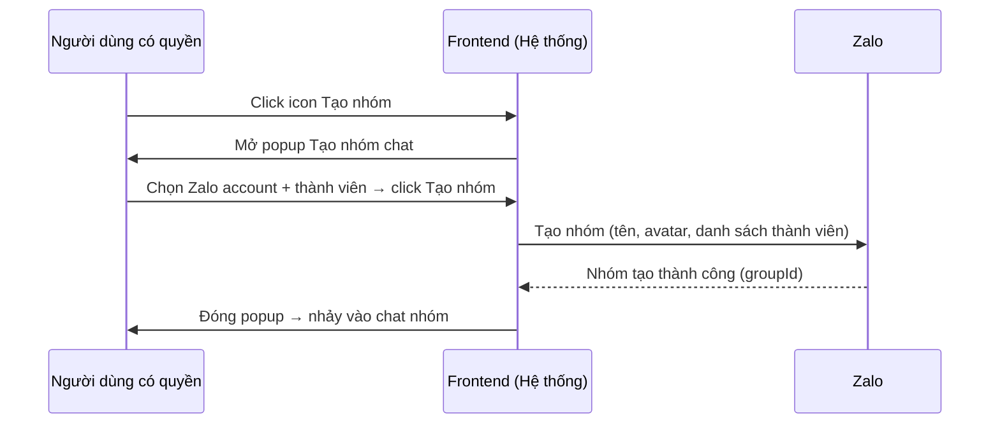
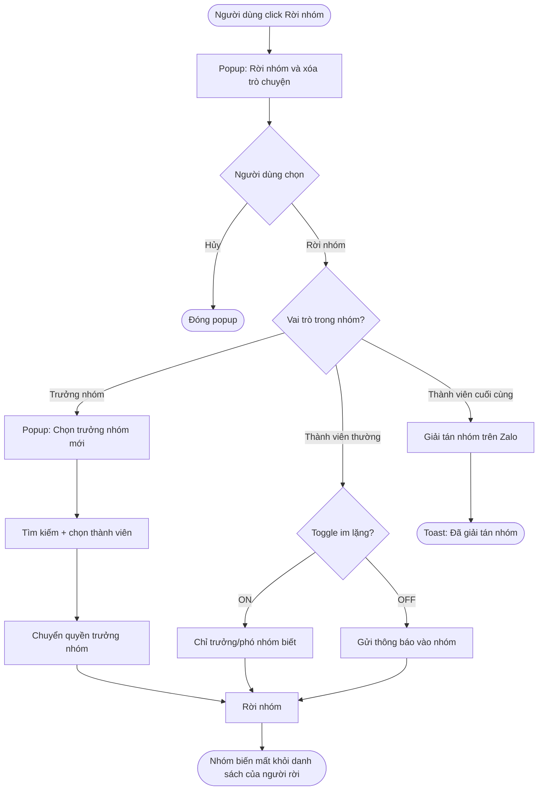
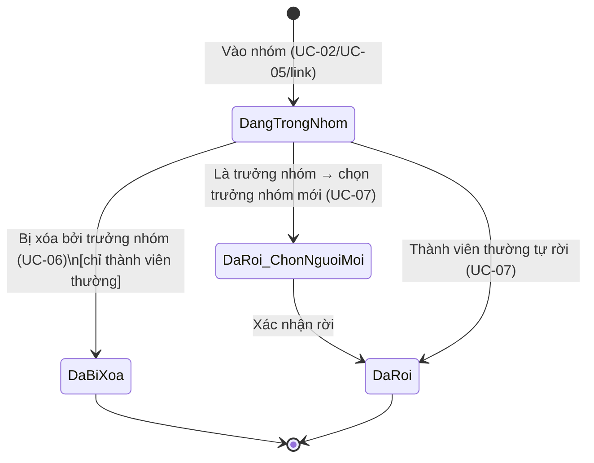

# [G008] Quản lý nhóm

| Trường | Nội dung |
|--------|----------|
| **Feature ID** | G008 |
| **Tên** | Quản lý nhóm Zalo |
| **Module** | Quản lý nhóm |
| **Owner (BA)** | Trân |
| **Dev assignee** | — |
| **Priority** | — |
| **Version** | 1.1 |
| **Status** | Draft |
| **Last updated** | 2026-06-26 |

---

## 1. Tổng quan (Overview)

Hệ thống hiện chỉ hỗ trợ hội thoại 1-1 giữa nhân viên và khách hàng. Trong thực tế CSKH, nhiều tình huống yêu cầu nhiều nhân viên cùng tham gia một hội thoại, hoặc phục vụ một nhóm khách hàng trong cùng một luồng giao tiếp. Tính năng Quản lý nhóm cho phép Admin và nhân viên được phân quyền tạo và quản lý nhóm chat Zalo trực tiếp trong hệ thống, tập trung toàn bộ hoạt động CSKH theo nhóm trên một nền tảng duy nhất mà không cần chuyển sang app Zalo riêng.

**Use Case Description:**
> Là Admin / Nhân viên có quyền "Quản lý nhóm", tôi muốn tạo và quản lý nhóm chat Zalo trong hệ thống, để hỗ trợ nhiều khách hàng hoặc nhiều CSKH cùng lúc trong một hội thoại mà không cần mở app Zalo riêng.

**Người dùng mục tiêu (Target users):**
- **Admin workspace** — toàn quyền: tạo nhóm, xem thành viên, thêm/xóa thành viên, rời nhóm; sửa tên/avatar chỉ khi là trưởng nhóm hoặc phó nhóm trong nhóm đó
- **Nhân viên được cấp quyền "Quản lý nhóm"** — toàn quyền tương đương Admin trong module này; sửa tên/avatar chỉ khi là trưởng nhóm hoặc phó nhóm trong nhóm đó
- **Nhân viên không được cấp quyền** — chỉ đọc danh sách nhóm, nhắn tin CSKH và gắn thẻ trong phạm vi được gán; các nút tạo/sửa/thêm thành viên bị ẩn

**Phụ thuộc:** G001 (Liên kết tài khoản Zalo), G002 (Chia sẻ tài khoản Zalo cho Staff), G003 (Chat), G006 (Đồng bộ dữ liệu), G007 (Kết bạn & Danh bạ)

---

## 2. Điều kiện tiên quyết (Pre-conditions & Trigger)

**Trigger:**
- **Tạo nhóm (UC-02):** User click icon **Tạo nhóm** trên header danh sách hội thoại (cạnh ô kết bạn và ô tìm kiếm)
- **Xem / Quản lý nhóm (UC-03–UC-07):** User mở chat nhóm → thao tác từ **panel thông tin nhóm** bên phải màn hình chat (giống G003)
- **@Mention thành viên (UC-08):** User gõ `@` trong ô soạn thảo của nhóm chat

**Pre-conditions:**
- [ ] Người dùng đã đăng nhập và có session hợp lệ
- [ ] **Để tạo nhóm (UC-02):** Người dùng là Admin hoặc nhân viên có quyền "Quản lý nhóm" **và** được gán ít nhất 1 tài khoản Zalo đang hoạt động (G001 + G002) → nếu không được gán Zalo account, nút tạo nhóm bị ẩn/disabled [→ E02]
- [ ] **Để sửa tên nhóm/avatar (UC-04):** Người dùng là Admin hoặc nhân viên có quyền "Quản lý nhóm" **và** là trưởng nhóm hoặc phó nhóm trong nhóm đó
- [ ] **Để thêm thành viên (UC-05):** Người dùng là Admin hoặc nhân viên có quyền "Quản lý nhóm"
- [ ] **Để xóa thành viên (UC-06):** Người dùng là **trưởng nhóm** (Zalo giao quyền) trong nhóm đó
- [ ] **Để rời nhóm (UC-07):** Tất cả thành viên (không cần quyền đặc biệt)
- [ ] **Để @mention (UC-08):** Tất cả thành viên nhóm có quyền nhắn tin trong hội thoại đó
- [ ] **Để xem (UC-01, UC-03):** Tất cả người dùng đã đăng nhập

**Post-conditions chung:**
- Mọi thay đổi (tạo nhóm, thêm/xóa thành viên, sửa tên/avatar, rời nhóm) được phản ánh thật trên Zalo và cập nhật ngay trong hệ thống

---

## 3. Luồng chính (Happy Path)

Module Quản lý nhóm bao gồm 8 Use Case.

---

### UC-01 — Xem danh sách nhóm

1. **[Người dùng]** Vào màn hình danh sách hội thoại (G003)
2. **[Hệ thống]** Hiển thị tất cả hội thoại; danh sách chia theo tab: **Tất cả / Chưa đọc / Nhóm** — người dùng click tab **"Nhóm"** để chỉ thấy hội thoại nhóm
3. **[Người dùng]** Click vào nhóm để vào chat

*Use case kết thúc.*

**Ghi chú:** Nhóm bao gồm cả nhóm sync từ Zalo về (G006) và nhóm tạo mới trong hệ thống. Nhân viên không có quyền "Quản lý nhóm" thấy danh sách nhóm bình thường nhưng ẩn các nút hành động quản lý.

---

### UC-02 — Tạo nhóm mới

1. **[Người dùng có quyền]** Click icon **Tạo nhóm** trên header danh sách hội thoại [→ E02]
2. **[Hệ thống]** Mở popup **"Tạo nhóm chat"** với các trường: avatar nhóm (tùy chọn) + tên nhóm (tùy chọn, tối đa 100 ký tự) + dropdown chọn tài khoản Zalo + ô tìm kiếm thành viên
3. **[Người dùng có quyền]** (Tùy chọn) Upload avatar nhóm và nhập tên nhóm
4. **[Người dùng có quyền]** Chọn tài khoản Zalo từ dropdown (chỉ hiện Zalo được gán theo G002)
5. **[Hệ thống]** Hiển thị danh sách liên hệ của tài khoản Zalo đó
6. **[Người dùng có quyền]** Tìm kiếm và chọn thành viên (theo tên nếu đã kết bạn Zalo; theo SĐT nếu chưa kết bạn)
7. **[Người dùng có quyền]** Click **"Tạo nhóm"** — button bị disabled nếu chưa chọn đủ **≥2 thành viên** (xem BR01)
8. **[Hệ thống]** Tạo nhóm thật trên Zalo; nếu không nhập tên → tự generate tên từ tên các thành viên (giống Zalo native) [→ E01]
9. **[Hệ thống]** Popup đóng; tự nhảy vào chat nhóm vừa tạo
10. **[Hệ thống]** Nhóm mới xuất hiện trong danh sách hội thoại

*Use case kết thúc.*

> **Lưu ý:** Tính năng "Mời qua link" không có trong popup Tạo nhóm vì nhóm chưa tồn tại trên Zalo. Sau khi tạo xong, dùng UC-05 để mời thêm thành viên qua link.

> Auto-generated — comment nếu cần sửa logic

---

### UC-03 — Xem thành viên nhóm

1. **[Người dùng]** Mở chat nhóm
2. **[Hệ thống]** Hiển thị panel thông tin nhóm bên phải màn hình chat
3. **[Người dùng]** Click vào mục **"Thành viên"** trong panel
4. **[Hệ thống]** Hiển thị danh sách thành viên với:
   - Nút **"Thêm thành viên"** ở trên cùng (chỉ hiện với người có quyền)
   - Sub-header **"Danh sách thành viên (N)"** kèm menu ...
   - Ô tìm kiếm **"Tìm kiếm thành viên"**
   - Mỗi thành viên gồm: avatar · tên · role badge (**Trưởng nhóm** / **Phó nhóm** / trống)
   - Thành viên chưa kết bạn hiển thị nút **"Kết bạn"** bên phải
5. **[Người dùng]** Xem danh sách thành viên

*Use case kết thúc.*

---

### UC-04 — Chỉnh sửa tên / avatar nhóm

**Nhánh A — Sửa tên nhóm:**

1. **[Người dùng có quyền và là trưởng/phó nhóm]** Mở panel thông tin nhóm → click icon bút cạnh tên nhóm
2. **[Hệ thống]** Ô tên nhóm chuyển thành editable field, hiển thị tên hiện tại; nút **"Lưu"** xuất hiện — **disabled** nếu ô trống
3. **[Người dùng có quyền và là trưởng/phó nhóm]** Xóa trắng tên → nút Lưu vẫn disabled; hệ thống không cho thực hiện thao tác (xem BR17)
4. **[Người dùng có quyền và là trưởng/phó nhóm]** Nhập tên hợp lệ (1–100 ký tự) → nút Lưu **enabled**
5. **[Người dùng có quyền và là trưởng/phó nhóm]** Click **"Lưu"**
6. **[Hệ thống]** Kiểm tra trước khi lưu: xác nhận tên hợp lệ → Cập nhật tên nhóm [→ E01]
7. **[Hệ thống]** Kiểm tra sau khi lưu: nhận xác nhận từ Zalo → cập nhật tên trong hệ thống → đồng bộ hoàn tất; tên mới hiển thị ngay trong panel và danh sách hội thoại

**Nhánh B — Thay avatar nhóm:**

1. **[Người dùng có quyền và là trưởng/phó nhóm]** Mở panel thông tin nhóm → click vào avatar nhóm
2. **[Hệ thống]** Mở file picker
3. **[Người dùng có quyền và là trưởng/phó nhóm]** Chọn ảnh (tối đa 5MB — xem BR04)
4. **[Hệ thống]** Kiểm tra trước khi lưu: xác nhận định dạng và dung lượng → gửi lên Zalo [→ E01]
5. **[Hệ thống]** Kiểm tra sau khi lưu: nhận xác nhận từ Zalo → cập nhật avatar trong hệ thống → đồng bộ hoàn tất

*Use case kết thúc.*

---

### UC-05 — Thêm thành viên

1. **[Người dùng có quyền]** Mở panel thông tin nhóm → click **"Thêm thành viên"**
2. **[Hệ thống]** Hiển thị giao diện tìm kiếm (tương tự bước tìm kiếm trong UC-02); thành viên đã trong nhóm hiển thị **mờ + checkbox đã tick** trong kết quả tìm kiếm, không thể chọn thêm (xem BR13)
3. **[Người dùng có quyền]** Tìm kiếm theo tên (đã kết bạn Zalo) hoặc SĐT (chưa kết bạn) → chọn thành viên [→ AF01]
4. **[Người dùng có quyền]** Xác nhận thêm [→ E05]
5. **[Hệ thống]** Thêm thành viên vào nhóm trên Zalo [→ E01]; thành viên mới xuất hiện trong danh sách

*Use case kết thúc.*

---

### UC-06 — Xóa thành viên

1. **[Trưởng nhóm]** Mở panel thông tin nhóm → icon **Xóa** chỉ hiển thị cạnh các thành viên **không phải trưởng nhóm** (xem BR08)
2. **[Trưởng nhóm]** Click icon **Xóa** cạnh thành viên cần xóa
3. **[Hệ thống]** Hiển thị popup xác nhận: *"Bạn có chắc muốn xóa [tên thành viên] khỏi nhóm?"*
4. **[Trưởng nhóm]** Bấm **"Xác nhận"**
5. **[Hệ thống]** Xóa thành viên khỏi nhóm trên Zalo [→ E01]
6. **[Hệ thống]** Danh sách thành viên cập nhật ngay

*Use case kết thúc.*

**Alternative flow:**

| Mã | Tình huống | Xử lý |
|----|-----------|-------|
| 4a | Người dùng bấm "Hủy" | Đóng popup, không thay đổi gì |

---

### UC-07 — Rời nhóm

1. **[Người dùng]** Mở panel thông tin nhóm → click **"Rời nhóm"**
2. **[Hệ thống]** Hiển thị popup **"Rời nhóm và xóa trò chuyện"** gồm:
   - Cảnh báo: *"Bạn sẽ không thể xem lại tin nhắn trong nhóm này sau khi rời nhóm."*
   - Toggle **"Rời nhóm trong im lặng"** (mặc định **OFF**) — khi ON: chỉ trưởng/phó nhóm biết bạn rời nhóm, không có thông báo gửi vào nhóm
   - Nút **"Hủy"** và nút **"Rời nhóm"** (đỏ)
3. **[Người dùng]** (Tuỳ chọn) Bật toggle "Rời nhóm trong im lặng"
4. **[Người dùng]** Bấm **"Rời nhóm"**
5. **[Hệ thống]** Xử lý theo vai trò trước [→ E01]:
   - **Nếu là trưởng nhóm:** Hiển thị popup **"Chọn trưởng nhóm mới trước khi rời"**; bên dưới có ô tìm kiếm và dropdown danh sách thành viên còn lại, mỗi tên có ô tick chọn → chọn 1 người → xác nhận → quyền chuyển sang người được chọn → trưởng nhóm cũ rời nhóm (xem BR09)
   - **Nếu là thành viên cuối cùng:** Nhóm bị giải tán trên Zalo → toast *"Đã giải tán nhóm"* [→ AF02, BR10] *(bỏ qua toggle im lặng)*
   - **Nếu là thành viên thường:** Áp dụng toggle im lặng → nếu ON: không gửi thông báo vào nhóm, chỉ trưởng/phó nhóm thấy; nếu OFF: gửi thông báo hệ thống vào nhóm
6. **[Hệ thống]** Người dùng bị xóa khỏi nhóm; nhóm biến mất khỏi danh sách hội thoại của người đó

*Use case kết thúc.*

> Auto-generated — comment nếu cần sửa logic

---

### UC-08 — @Mention thành viên trong nhóm

1. **[Người dùng]** Trong ô soạn thảo của nhóm chat, gõ ký tự `@`
2. **[Hệ thống]** Hiển thị dropdown danh sách thành viên hiện tại trong nhóm + tùy chọn **@all** ở đầu danh sách
3. **[Người dùng]** (Tùy chọn) Gõ thêm tên sau `@` để filter realtime → chọn thành viên hoặc **@all** [→ BR21]
4. **[Hệ thống]** Tag `@[tên thành viên]` hoặc `@all` được chèn vào ô soạn thảo tại vị trí con trỏ
5. **[Người dùng]** Tiếp tục soạn nội dung → gửi tin nhắn
6. **[Hệ thống]** Gửi tin nhắn qua Zalo [→ E01]; tin hiển thị trong khung chat với tag @mention được highlight; gửi browser push notification riêng đến người được mention — **kể cả khi họ đang tắt thông báo hội thoại** (G009 UC-05) [→ BR19]; @all → notify tất cả thành viên

**Ghi chú:** Tin nhắn có @[tên người dùng] → **liên quan đến người đó** (được đánh dấu riêng trong danh sách); tin nhắn không có @ → không đánh dấu.

*Use case kết thúc.*

---

## 4. Luồng phụ (Alternative Flows)

### AF01 — Mời thành viên qua link (UC-05)

- Xảy ra khi: Người dùng muốn thêm người không có trong danh sách bạn bè (chưa kết bạn Zalo)
- **[Người dùng có quyền]** Click **"Mời qua link"** trong giao diện Thêm thành viên
- **[Hệ thống]** Lấy link nhóm (hệ thống tự tạo link có sẵn cho mỗi nhóm) → copy vào clipboard → Toast: *"Đã copy link nhóm"*
- **[Người dùng có quyền]** Tự gửi link cho người muốn mời qua kênh ngoài hệ thống
- Người được mời click link → vào nhóm → xuất hiện trong danh sách thành viên

### AF02 — Thành viên cuối cùng rời nhóm (UC-07)

- Xảy ra khi: Người rời là thành viên duy nhất còn lại trong nhóm (kể cả nếu đó là trưởng nhóm — bỏ qua bước chọn trưởng nhóm mới vì không còn thành viên nào)
- Nhóm bị giải tán trên Zalo
- Toast: *"Đã giải tán nhóm"*
- Nhóm biến mất hoàn toàn khỏi danh sách hội thoại

### AF03 — Tài khoản Zalo kết nối lại (G001)

- Xảy ra khi: Tài khoản Zalo đang ở trạng thái **Kết nối gián đoạn** (G001) được kết nối lại
- Người dùng có thể nhắn tin và thực hiện các thao tác quản lý bình thường

---

## 5. Luồng ngoại lệ (Exception Flows)

| Code | Trigger (Điều kiện kích hoạt) | UI Response | Notification |
|------|-------------------------------|-------------|--------------|
| E01 | Thao tác gửi lên Zalo thất bại (lỗi kết nối Zalo / token hết hạn) | Toast lỗi + giữ nguyên popup/form để user thử lại | — |
| E02 | User không được gán tài khoản Zalo nào (G002) | Nút tạo nhóm bị ẩn/disabled; không vào được popup | — |
| E03 | Mất kết nối mạng khi đang thực hiện thao tác | Toast: *"Mất kết nối, vui lòng thử lại"* + giữ nguyên form | — |
| E04 | Server lỗi 500 bất kỳ lúc nào | Toast lỗi chung | Ghi error log |
| E05 | User thêm thành viên khi nhóm đã đạt giới hạn (UC-05, bước 4) — tối đa **100** với tài khoản Zalo cá nhân; Zalo Business có thể cao hơn (xem BR02) | Toast: *"Nhóm đã đạt giới hạn thành viên"* | — |

**Exception Confirmation Log — G008**

| Code | Từ UC | Nguồn HP hay Độc lập | Confirmed |
|------|-------|----------------------|-----------|
| E01 | UC-02/04/05/06/07, bước gửi Zalo | Happy Path | ✅ |
| E02 | UC-02, pre-condition | Happy Path | ✅ |
| E03 | Độc lập | Độc lập | ✅ |
| E04 | Độc lập | Độc lập | ✅ |
| E05 | UC-05, bước 4 | Happy Path | ✅ |

---

## 6. Business Rules — Quy tắc nghiệp vụ

| Code | Rule | Lý do |
|------|------|-------|
| BR01 | Nhóm cần **≥2 thành viên** kể cả người tạo. Button "Tạo nhóm" bị disabled cho đến khi đủ điều kiện | Nhóm chat tối thiểu 2 người |
| BR02 | Tối đa **100 thành viên** với tài khoản Zalo cá nhân; tài khoản **Zalo Business** có thể vượt 100 (giới hạn do Zalo Business quy định — cần xác nhận con số cụ thể) | Giới hạn Zalo native theo loại tài khoản |
| BR03 | **Tên nhóm tùy chọn**, tối đa 100 ký tự. Nếu không nhập khi tạo → hệ thống tự generate tên từ tên các thành viên (giống Zalo native) | Linh hoạt cho người dùng, đồng nhất với hành vi Zalo |
| BR04 | **Avatar nhóm tùy chọn**, định dạng tương tự Zalo, tối đa **5MB** | Đồng nhất với giới hạn Zalo native |
| BR05 | Chỉ **Admin workspace + nhân viên có quyền "Quản lý nhóm"** được: tạo nhóm, thêm thành viên | Kiểm soát tập trung, tránh thay đổi ngoài ý muốn |
| BR05b | **Sửa tên nhóm/avatar (UC-04)** yêu cầu thêm điều kiện: người dùng phải là **trưởng nhóm hoặc phó nhóm** trong nhóm đó (ngoài việc có quyền "Quản lý nhóm"). Lý do: Zalo có thể khóa quyền sửa khi nhóm >100 thành viên hoặc trưởng nhóm khóa quyền — hệ thống fix cứng điều kiện này để tránh lỗi | Đồng bộ với cơ chế Zalo native; tránh lỗi khi Zalo block thao tác |
| BR06 | **Nhân viên không có quyền "Quản lý nhóm"** → thấy danh sách nhóm, nhưng các nút tạo/sửa/thêm thành viên bị ẩn; chỉ được nhắn tin CSKH và gắn thẻ trong phạm vi được gán | Đảm bảo nhân viên vẫn làm được việc chính |
| BR07 | Dropdown tài khoản Zalo khi tạo nhóm → **chỉ hiện tài khoản Zalo user được gán** (G002), không hiện toàn bộ workspace | Đảm bảo phân quyền theo G002 |
| BR08 | **Trưởng nhóm không thể bị xóa** bởi bất kỳ ai; icon Xóa không hiển thị cạnh tên trưởng nhóm; trưởng nhóm chỉ có thể **tự rời** (UC-07) và phải chọn trưởng nhóm mới trước khi rời | Cơ chế Zalo — trưởng nhóm không thể bị ép rời |
| BR09 | Khi **trưởng nhóm rời nhóm** (UC-07) → hệ thống bắt buộc **chọn trưởng nhóm mới** từ danh sách thành viên còn lại trước khi rời; nếu là thành viên cuối cùng → bỏ qua bước này, nhóm giải tán (AF02) | Nhóm luôn có trưởng nhóm chừng nào còn thành viên |
| BR10 | Khi **thành viên cuối cùng rời nhóm** (UC-07) → nhóm bị giải tán trên Zalo; toast *"Đã giải tán nhóm"*; nhóm bị **soft delete** — ẩn khỏi danh sách hội thoại active nhưng dữ liệu và lịch sử chat vẫn lưu trữ (xem BR11) | Soft delete — hệ thống nội bộ, không xóa vật lý |
| BR11 | Sau khi **rời nhóm hoặc nhóm bị giải tán**: ô nhập tin nhắn bị **disable** (không thể gửi thêm); lịch sử chat vẫn được **lưu trữ và hiển thị** để người dùng đọc lại | Hành vi Zalo — rời nhóm không xóa lịch sử phía client |
| BR13 | Người đã là thành viên nhóm → **mờ + checkbox đã tick** trong kết quả tìm kiếm khi thêm thành viên (UC-05); không thể chọn thêm lần nữa | Tránh nhầm lẫn, tránh thêm trùng |
| BR14 | Tìm thành viên: đã kết bạn Zalo → tìm theo **tên**; chưa kết bạn → tìm theo **SĐT** hoặc **mời link** | Bao phủ cả 2 trường hợp người dùng cần thêm |
| BR15 | **Mời qua link** (AF01, UC-05): hệ thống **tự tạo link nhóm** có sẵn (không tạo mới mỗi lần); user click "Mời qua link" → link copy vào clipboard → toast *"Đã copy link nhóm"*; user **tự gửi link** cho người muốn mời qua kênh ngoài hệ thống; người nhận click link → vào nhóm → xuất hiện trong danh sách thành viên | Không buộc phải kết bạn trước |
| BR16 | Nhóm tạo **trên Zalo và trong hệ thống phải đồng bộ** — thành viên thấy nhóm trên cả Zalo app lẫn hệ thống | Đảm bảo tính nhất quán dữ liệu |
| BR17 | Khi sửa tên nhóm (UC-04), nếu user **xóa trắng tên** → **button Lưu bị disabled** khi ô tên trống; hệ thống không cho phép lưu (user phải nhập lại tên hợp lệ) | Rõ ràng về constraint, tránh hiểu nhầm |
| BR18 | Tất cả thành viên nhóm có quyền nhắn tin đều có thể dùng @mention — không phân biệt Admin hay nhân viên thường | Không restrict quyền mention |
| BR19 | @mention **override** cài đặt tắt thông báo hội thoại (G009 UC-05): người bị mention vẫn nhận browser push notification ngay cả khi đang mute. Tin nhắn có @[tên người dùng] → **đánh dấu là liên quan** đến người đó trong danh sách hội thoại; tin nhắn không có @ → không đánh dấu. | Đảm bảo mention quan trọng không bị bỏ qua |
| BR20 | Có 2 loại mention: **@[tên thành viên]** (cá nhân) và **@all** (toàn bộ thành viên nhóm). @all gửi notification đến tất cả thành viên | Linh hoạt tùy mục đích CSKH |
| BR21 | Gõ `@` → dropdown thành viên + @all xuất hiện; gõ thêm tên sau `@` → filter realtime; click chọn → tag chèn vào ô soạn tại vị trí con trỏ | UX chuẩn mention |
| BR22 | Tag @mention trong tin nhắn đã gửi **vẫn hiển thị tên gốc** kể cả sau khi người đó rời nhóm — không thay đổi retroactively | Giữ nguyên lịch sử chat |

---

## 7. State Machine — Vòng đời Thành viên Nhóm

### Entity: Thành viên nhóm (Group Member)

| Từ trạng thái | Sự kiện | Sang trạng thái | Điều kiện | Ghi chú |
|---------------|---------|-----------------|-----------|---------|
| _(chưa tồn tại)_ | UC-02/UC-05: Thêm vào nhóm / vào qua link | **Đang trong nhóm** | Zalo xử lý thành công | Chỉ tồn tại trong hệ thống khi đã vào nhóm |
| Đang trong nhóm | UC-06: Bị xóa bởi trưởng nhóm | **Đã bị xóa** | Chỉ trưởng nhóm được xóa thành viên thường; trưởng nhóm không thể bị xóa | Terminal |
| Đang trong nhóm *(trưởng nhóm)* | UC-07: Chọn trưởng nhóm mới → tự rời | **Đã rời** | Phải chọn người thay thế trước khi rời; nếu là thành viên cuối → bỏ qua, nhóm giải tán (AF02) | Terminal |
| Đang trong nhóm *(thành viên thường)* | UC-07: Tự rời nhóm | **Đã rời** | Tự xác nhận | Terminal |

> **Terminal states:** Đã bị xóa, Đã rời — thành viên không còn trong nhóm.
> **Lưu ý:** Thành viên được mời qua link nhưng chưa vào nhóm **không tồn tại trong hệ thống** — chỉ xuất hiện sau khi đã vào nhóm.

> Auto-generated — comment nếu cần sửa logic

---

## 8. Data Model

N/A — Spec này thuần nghiệp vụ. Data model sẽ được định nghĩa trong tài liệu kỹ thuật riêng.

---

## 9. API Contract

N/A — Spec này thuần nghiệp vụ. API contract sẽ được định nghĩa trong tài liệu kỹ thuật riêng.

---

## 10. UI/UX Notes — Ghi chú giao diện

### 10A — Entry point & Tổng quan

| Element | Mô tả |
|---------|-------|
| **Icon Tạo nhóm** | Nằm trên header danh sách hội thoại, cạnh ô kết bạn và ô tìm kiếm |
| **Danh sách nhóm** | Hiển thị chung trong danh sách hội thoại (G003); click tab **"Nhóm"** để chỉ thấy hội thoại nhóm |
| **Quản lý nhóm** | Thực hiện từ **panel thông tin nhóm** bên phải màn hình chat (giống G003) |
| **Staff không quyền** | Thấy nhóm trong danh sách hội thoại; ẩn nút Tạo nhóm, Thêm thành viên, Xóa thành viên, Sửa tên/avatar; vẫn thấy danh sách thành viên (read-only) |

---

### 10B — Popup "Tạo nhóm chat"

| Element | Mô tả |
|---------|-------|
| **Avatar nhóm** | Icon camera + placeholder; click để upload ảnh (tùy chọn) |
| **Tên nhóm** | Text input, placeholder: *"Nhập tên nhóm... (tùy chọn)"*, tối đa 100 ký tự |
| **Dropdown tài khoản Zalo** | Bắt buộc chọn; chỉ hiện Zalo account user được gán (G002). Empty state: *"Chọn tài khoản Zalo để xem danh sách liên hệ"* |
| **Ô tìm kiếm thành viên** | Placeholder: *"Nhập tên, số điện thoại..."*; tìm theo tên (đã kết bạn) hoặc SĐT (chưa kết bạn) |
| **Danh sách liên hệ** | Hiện sau khi chọn Zalo account; checkbox chọn từng người. Empty state (account không có liên hệ): *"Tài khoản này chưa có liên hệ"* |
| **Button "Tạo nhóm"** | Primary; **disabled** khi chưa đủ **≥2 thành viên** hoặc chưa chọn Zalo account |
| **Button "Hủy"** | Đóng popup |

> **Lưu ý:** Popup tạo nhóm không có nút "Mời qua link" — tính năng này chỉ có trong UC-05 (Thêm thành viên) sau khi nhóm đã tồn tại.

---

### 10C — Panel thông tin nhóm (bên phải chat)

| Element | Mô tả | Quyền |
|---------|-------|-------|
| Avatar nhóm | Hiển thị; click để sửa avatar nhóm | Admin + có quyền + là trưởng/phó nhóm |
| Tên nhóm | Hiển thị; click icon bút để sửa tên nhóm; button Lưu disabled khi ô trống | Admin + có quyền + là trưởng/phó nhóm |
| Số thành viên | *"X thành viên"* | Tất cả |
| Danh sách thành viên | Tên + avatar từng người; icon Xóa chỉ hiển thị cạnh thành viên thường (không hiển thị cạnh trưởng nhóm) | Xóa: chỉ trưởng nhóm |
| **Tìm tin nhắn** | Tìm kiếm nội dung trong hội thoại nhóm | Tất cả |
| Button **"Thêm thành viên"** | Mở giao diện tìm kiếm (tương tự UC-02, có thêm nút "Mời qua link" → AF01) | Admin + có quyền |
| **Tắt thông báo** | Tắt/bật thông báo nhóm (G009 UC-05); @mention vẫn override | Tất cả |
| **Ảnh, file, link** | Xem lại media và file đã chia sẻ trong nhóm | Tất cả |
| **Lịch nhóm** | Xem/tạo sự kiện nhóm | Tất cả |
| **Tin nhắn đã ghim** | Xem danh sách tin nhắn được ghim (G003) | Tất cả |
| **Link nhóm** | Hiển thị link mời nhóm để copy và gửi cho người muốn mời | Admin + có quyền |
| **Ghim trò chuyện** | Ghim/bỏ ghim hội thoại nhóm lên đầu danh sách (G009 UC-06) | Tất cả |
| **Chuyển quyền trưởng nhóm** | Chuyển quyền trưởng nhóm cho thành viên khác mà không cần rời nhóm | Chỉ trưởng nhóm |
| Button **"Rời nhóm"** | Hiện với tất cả thành viên; trưởng nhóm phải chọn người thay trước khi rời (UC-07) | Tất cả |
| Button **"Giải tán nhóm"** | Giải tán nhóm hoàn toàn trên Zalo — yêu cầu xác nhận; không thể hoàn tác | Chỉ trưởng nhóm |

---

### 10D — Phản hồi hệ thống

| Tình huống | Hiển thị |
|-----------|---------|
| Tạo nhóm thành công | Popup đóng → nhảy vào chat nhóm |
| Xóa thành viên | Popup xác nhận trước khi xóa |
| Rời nhóm (thành viên thường) | Popup xác nhận: *"Bạn có chắc muốn rời nhóm [tên nhóm]?"* |
| Rời nhóm (trưởng nhóm) | Popup: *"Chọn trưởng nhóm mới trước khi rời"* → chọn người → xác nhận |
| Giải tán nhóm | Popup xác nhận → Toast: *"Đã giải tán nhóm"* → nhóm biến mất hoàn toàn khỏi danh sách |
| Copy link mời | Toast: *"Đã copy link nhóm"* |

---

## 11. Acceptance Criteria — Tiêu chí nghiệm thu

### Happy Path

- [ ] Admin tạo nhóm với ≥2 người (kể cả người tạo), đặt tên + avatar → nhóm tạo thật trên Zalo → popup đóng → tự nhảy vào chat nhóm → nhóm xuất hiện trong danh sách hội thoại (AC-UC02)
- [ ] Tạo nhóm không nhập tên → tên nhóm tự generate từ tên thành viên, giống Zalo native (AC-BR03)
- [ ] Mở chat nhóm → panel thông tin nhóm hiển thị đúng danh sách thành viên hiện tại (AC-UC03)
- [ ] Người có quyền và là trưởng/phó nhóm click icon bút → sửa tên nhóm (Nhánh A) → tên cập nhật ngay trên Zalo và trong hệ thống (AC-UC04)
- [ ] Người có quyền và là trưởng/phó nhóm click avatar → thay avatar nhóm (Nhánh B) → avatar cập nhật ngay trên Zalo và trong hệ thống (AC-UC04)
- [ ] Admin/có quyền thêm thành viên → thành viên mới xuất hiện trong danh sách panel và được thêm thật trên Zalo (AC-UC05)
- [ ] Trưởng nhóm xóa thành viên thường (qua popup xác nhận) → thành viên bị xóa khỏi nhóm trên Zalo (AC-UC06)
- [ ] Icon Xóa **không hiển thị** cạnh tên trưởng nhóm; không thể xóa trưởng nhóm (AC-BR08)
- [ ] Thành viên thường rời nhóm → popup **"Rời nhóm và xóa trò chuyện"** → xác nhận → không còn thấy nhóm trong danh sách hội thoại active; lịch sử chat vẫn lưu trữ (AC-UC07, AC-BR11)
- [ ] Toggle "Rời nhóm trong im lặng" mặc định **OFF**; bật ON → rời nhóm không có thông báo hệ thống trong nhóm, chỉ trưởng/phó nhóm thấy (AC-UC07)
- [ ] Toggle OFF → rời nhóm có thông báo hệ thống gửi vào nhóm (AC-UC07)
- [ ] Trưởng nhóm rời nhóm (chưa phải người cuối) → popup "Chọn trưởng nhóm mới" → chọn người → xác nhận → quyền chuyển sang người được chọn → trưởng nhóm cũ rời (AC-BR09, AC-UC07)
- [ ] Thành viên cuối cùng rời nhóm → toast *"Đã giải tán nhóm"*; nhóm biến mất khỏi danh sách hội thoại (AC-BR10, AC-AF02)

### Validation

- [ ] Button "Tạo nhóm" bị disabled khi chưa chọn đủ **≥2 thành viên** → không thể click (AC-BR01)
- [ ] Tên nhóm nhập quá 100 ký tự → không gõ thêm được (AC-BR03)
- [ ] Sửa tên nhóm (Nhánh A), xóa trắng tên → button Lưu **bị disabled**; không thể submit; hệ thống không cập nhật lên Zalo (AC-BR17)
- [ ] Tìm thành viên đã trong nhóm → người đó hiển thị **mờ + checkbox đã tick** trong kết quả tìm kiếm; không thể chọn thêm (AC-BR13)
- [ ] Thêm thành viên khi nhóm đã đạt giới hạn → toast *"Nhóm đã đạt giới hạn thành viên"* (AC-E05, AC-BR02)

### Phân quyền

- [ ] Staff không có quyền "Quản lý nhóm" → icon tạo nhóm bị ẩn/disabled (AC-BR06)
- [ ] Staff không có quyền → vào chat nhóm thấy danh sách thành viên (read-only) nhưng không thấy nút Thêm thành viên, Xóa thành viên, Sửa tên/avatar (AC-BR06)
- [ ] User không được gán Zalo account → nút tạo nhóm ẩn/disabled (AC-E02, AC-BR07)
- [ ] Dropdown tài khoản Zalo khi tạo nhóm chỉ hiện Zalo account user được gán (AC-BR07)

### State Machine (Group Member)

- [ ] Nhóm bị giải tán → vẫn còn trong danh sách hội thoại (soft delete — không xóa vật lý); ô nhập tin nhắn bị **disable**; lịch sử chat vẫn đọc được (AC-BR10, AC-BR11)

### Alternative Flows

- [ ] Click "Mời qua link" (trong giao diện Thêm thành viên) → link được copy vào clipboard → toast *"Đã copy link nhóm"* (AC-AF01, AC-BR15)
- [ ] Người được mời vào nhóm qua link → xuất hiện trong danh sách thành viên trong hệ thống

### Edge Cases

- [ ] Tìm thành viên chưa kết bạn bằng SĐT → kết quả xuất hiện để chọn (AC-BR14)
- [ ] Mất mạng khi đang tạo nhóm → toast *"Mất kết nối, vui lòng thử lại"* + giữ nguyên form (AC-E03)
- [ ] Danh sách liên hệ của Zalo account được chọn trống → empty state *"Tài khoản này chưa có liên hệ"* hiển thị đúng

### UC-08 — @Mention

- [ ] Gõ `@` trong ô soạn thảo nhóm → dropdown danh sách thành viên + @all xuất hiện (AC-BR21)
- [ ] Gõ `@` + tên → danh sách filter realtime đúng tên (AC-BR21)
- [ ] Chọn thành viên → tag `@[tên]` chèn vào ô soạn tại vị trí con trỏ (AC-BR21)
- [ ] Chọn @all → tag `@all` chèn vào ô soạn (AC-BR20)
- [ ] Gửi tin có @mention → người được mention nhận browser push notification (AC-BR19)
- [ ] Người đang tắt thông báo hội thoại (G009 UC-05) bị @mention → vẫn nhận notification (AC-BR19)
- [ ] @all → tất cả thành viên nhóm đều nhận notification (AC-BR20)
- [ ] Người được @mention đã rời nhóm → tag vẫn hiển thị tên gốc trong lịch sử chat (AC-BR22)

---

## 12. Out of Scope — Ngoài phạm vi

| # | Nội dung | Ghi chú |
|---|---------|---------|
| OOS01 | Thành viên trạng thái "Đang chờ" (đã mời link nhưng chưa vào nhóm) | Chỉ tồn tại trong hệ thống khi đã vào nhóm |
| OOS02 | Ghim tin nhắn trong nhóm | Thuộc phạm vi G003 (Chat) |
| OOS03 | Báo cáo hoạt động nhóm (số tin nhắn, thành viên tích cực...) | Backlog — phiên bản sau |
| OOS04 | Bulk tạo nhiều nhóm cùng lúc | Backlog |
| OOS05 | Lịch sử thành viên (ai đã từng vào/rời nhóm lúc nào) | Backlog |
| OOS06 | @mention trong hội thoại 1-1 | Không có ý nghĩa trong hội thoại 2 người |
| OOS07 | Xem lại danh sách tin nhắn mình bị @mention | Backlog |

---

## 13. Dependencies — Phụ thuộc

| Phụ thuộc vào | Ghi chú |
|---------------|---------|
| **G001 — Liên kết tài khoản Zalo** | Phải có ít nhất 1 Zalo account đang hoạt động |
| **G002 — Chia sẻ tài khoản Zalo cho Staff** | Quyết định Zalo account nào user được gán → dùng để tạo nhóm và lọc dropdown |
| **G003 — Chat** | Nhóm hiển thị trong danh sách hội thoại; panel thông tin nhóm nằm trong màn hình chat |
| **G006 — Đồng bộ dữ liệu** | Nhóm có thể được sync từ Zalo về; G006 trigger khi phát hiện nhóm bị xóa trên Zalo |
| **G007 — Kết bạn & Danh bạ** | Danh sách liên hệ đã kết bạn Zalo dùng để tìm kiếm thành viên |

| Được phụ thuộc bởi | Ghi chú |
|--------------------|---------|
| Báo cáo / thống kê (tương lai) | Cần dữ liệu nhóm và thành viên |
| Workflow / Automation (tương lai) | Có thể trigger action khi có thành viên mới vào nhóm |

---

## 14. Open Questions — Câu hỏi chưa giải quyết

Không có câu hỏi mở.

---

## Changelog — Lịch sử thay đổi

| Ngày | Version | Người thay đổi | Sections | Nội dung | File:Line |
|------|---------|----------------|----------|----------|-----------|
| 2026-06-19 | v1.0 | Trân (BA) | — | Tạo draft | — |
| 2026-06-22 | v1.0 | Trân (BA) + Review | All | Review toàn bộ: (1) Thêm UC-08 @mention + BR18–BR22; (2) Đổi "nhóm chủ Zalo" → "trưởng nhóm"; (3) Bỏ trạng thái nhóm (BR11/BR12 removed, Section 7 chỉ giữ Group Member); (4) Cập nhật UC-04 (Nhánh A/B, button Lưu disabled); (5) Cập nhật UC-06/07 (chỉ trưởng nhóm xóa; trưởng nhóm phải chọn người mới trước khi rời); (6) BR01 ≥2 thành viên, BR02 Zalo Business, BR04 5MB, BR08/09/13/15/16/17/19 update; (7) Section 10 panel đầy đủ (Giải tán nhóm in-scope); (8) OOS renumber, AC update | — |
| 2026-06-26 | v1.1 | Thanh (review) | UC-04, BR05, BR05b, Section 2, 10C, 11 | Fix quyền sửa tên/avatar: yêu cầu thêm điều kiện là trưởng nhóm hoặc phó nhóm (ngoài quyền "Quản lý nhóm"). Lý do: Zalo có thể khóa quyền khi >100 thành viên hoặc trưởng nhóm khóa — fix cứng để tránh lỗi | — |

---

> **Lưu ý cho AI khi đọc spec này:**
> - Spec này là **thuần nghiệp vụ** — Section 8 và 9 ghi N/A. Không tự thêm data model hay API contract.
> - Section 5 (Exception Flows) và Section 6 (Business Rules) là **bắt buộc implement đầy đủ**.
> - Section 7 (State Machine) chỉ có **Group Member lifecycle** — nhóm không có trạng thái, chỉ tồn tại hoặc không tồn tại trên Zalo. Không tự thêm trạng thái nhóm.
> - Section 12 (Out of Scope) là danh sách **cấm**.
> - Section 11 (Acceptance Criteria) là checklist tự verify trước khi báo done.
> - **BR01 quan trọng:** Nhóm cần **≥2 thành viên** kể cả người tạo — Button "Tạo nhóm" disabled cho đến khi đủ điều kiện.
> - **BR05 + BR05b + BR06 quan trọng:** Chỉ Admin + nhân viên có quyền "Quản lý nhóm" mới tạo/thêm được; **sửa tên/avatar** thêm điều kiện phải là trưởng nhóm hoặc phó nhóm; **chỉ trưởng nhóm** mới xóa được thành viên thường; nhân viên không quyền chỉ đọc + nhắn tin.
> - **BR08 quan trọng:** Trưởng nhóm KHÔNG thể bị xóa bởi bất kỳ ai — icon Xóa không hiển thị cạnh tên trưởng nhóm.
> - **BR09 quan trọng:** Trưởng nhóm muốn rời nhóm → PHẢI chọn trưởng nhóm mới trước (trừ khi là thành viên cuối).
> - **BR16 quan trọng:** Nhóm tạo trong hệ thống đồng bộ THẬT với Zalo — không phải record nội bộ.
> - **BR17 quan trọng:** Xóa trắng tên nhóm khi sửa → button Lưu bị disabled; không gửi lên Zalo.
> - **BR19 quan trọng:** @mention đánh dấu tin nhắn là "liên quan" đến người được mention trong danh sách hội thoại; @mention override tắt thông báo.
> - **"Trưởng nhóm"** = người được Zalo giao quyền trưởng nhóm, KHÔNG phải người sở hữu Zalo account kết nối với hệ thống.
> - **Thành viên mời link chưa vào nhóm KHÔNG tồn tại trong hệ thống** — chỉ xuất hiện sau khi đã vào nhóm.
> - **AF01 (Mời qua link) chỉ áp dụng cho UC-05**, không áp dụng trong popup Tạo nhóm (UC-02) vì nhóm chưa tồn tại trên Zalo.
> - **BR02:** Giới hạn 100 thành viên áp dụng cho Zalo cá nhân; Zalo Business có thể vượt 100 — cần xác nhận con số cụ thể.