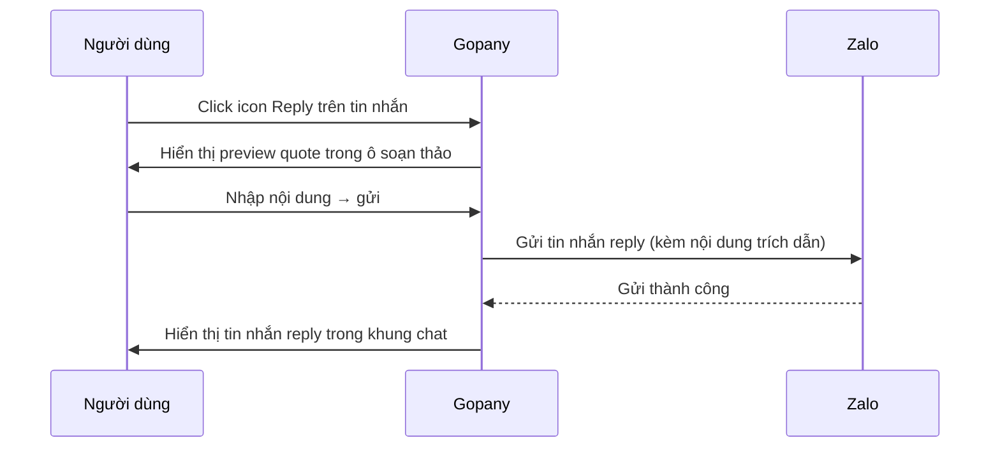

# [G009] Tính năng bổ sung Chat

| Trường | Nội dung |
|--------|----------|
| **Feature ID** | G009 |
| **Tên** | Tính năng bổ sung Chat |
| **Module** | Chat |
| **Owner (BA)** | Trân |
| **Dev assignee** | — |
| **Priority** | — |
| **Version** | ~~1.6~~ ~~1.7~~ ~~1.8~~ ~~1.9~~ ~~1.10~~ ~~1.11~~ **1.12** |
| **Status** | Final |
| **Last updated** | ~~2026-07-20~~ ~~2026-07-22~~ ~~2026-07-27~~ ~~2026-07-29~~ ~~2026-08-03~~ ~~2026-08-21~~ **2026-08-26** |

---

## 1. Tổng quan (Overview)

G003 đã spec các luồng chat cốt lõi. G009 bổ sung ~~6~~ **5** tính năng tương tác tin nhắn và hội thoại còn thiếu: React tin nhắn, Trả lời tin nhắn (Reply), Quản lý danh sách nhắc hẹn, Định dạng văn bản, ~~Tắt/Bật thông báo hội thoại,~~ **[MOVED v1.11 → tách sang G028]** và Ghim hội thoại — nhằm nâng cao trải nghiệm CSKH trong Gopany ChatZalo.

**Ghi chú cross-reference:** Tính năng **Ghim tin nhắn** (item #16 trong backlog) ~~đã được spec đầy đủ tại **G003 UC-05**~~ **[CHANGED v1.6]** nay có spec riêng: **G014 — Ghim tin nhắn** (max 3 tin/hội thoại, Zalo-native dùng chung, popup thay thế khi đủ 3). G009 không re-spec tính năng này; xem **G014**.

> ⚠️ **Đừng nhầm:** **G009 UC-06 = Ghim *hội thoại*** (5 hội thoại/tài khoản Zalo) — khác hoàn toàn với **G014 = Ghim *tin nhắn*** (3 tin/hội thoại). Xem bảng so sánh tại G014 §1.3.

**Use Case Description:**
> Là Staff trong workspace Gopany, tôi muốn có thêm các công cụ tương tác tin nhắn và quản lý hội thoại (react, reply, nhắc hẹn, định dạng, tắt thông báo, ghim hội thoại), để làm việc CSKH hiệu quả hơn mà không cần rời khỏi Gopany.

**Người dùng mục tiêu (Target users):**
- **Tất cả Staff trong workspace** — toàn bộ các tính năng trong G009 dành cho mọi nhân viên (không phân biệt quyền Admin hay Staff thường)

**Phụ thuộc:** G003 (Chat — luồng cốt lõi, nhắc hẹn UC-04, ghim tin nhắn UC-05), G001 (Liên kết tài khoản Zalo), G002 (Chia sẻ tài khoản Zalo)

---

## 2. Điều kiện tiên quyết (Pre-conditions & Trigger)

**Trigger:**
- **React (UC-01):** User hover/long-press vào tin nhắn → chọn emoji từ picker
- **Reply (UC-02):** User click icon Reply trên tin nhắn → soạn và gửi
- **Danh sách nhắc hẹn (UC-03):** User mở panel nhắc hẹn trong hội thoại
- **Định dạng văn bản (UC-04):** User dùng toolbar định dạng trước/trong khi soạn tin
- ~~**Tắt/Bật thông báo (UC-05):** User click icon chuông trong panel phải hoặc option menu hội thoại~~ **[MOVED v1.11 → G028]**
- **Ghim hội thoại (UC-06):** User click Ghim trong option menu hoặc panel phải hội thoại

**Pre-conditions:**
- [ ] Người dùng đã đăng nhập và có session hợp lệ
- [ ] **UC-01, UC-02, UC-04:** Hội thoại đang mở; tin nhắn hiển thị trong khung chat
- [ ] **UC-03:** Hội thoại đang mở
- [ ] **UC-05, UC-06:** Hội thoại đang mở hoặc người dùng ở màn hình danh sách hội thoại

**Post-conditions chung:**
- React và Reply được gửi và hiển thị thật trên Zalo — không chỉ là record nội bộ Gopany
- ~~Tất cả cài đặt per-user (tắt thông báo, ghim hội thoại) được lưu riêng cho từng user — không ảnh hưởng đến người khác trong workspace~~ ~~→ Tắt thông báo và ghim hội thoại dùng Zalo-native API — ảnh hưởng trực tiếp tài khoản Zalo gốc; tất cả staff dùng chung tài khoản Zalo đều bị ảnh hưởng~~ **[CHANGED v1.12]** Tắt thông báo (nay ở **G028**) và **ghim hội thoại** đều là **per-user** — lưu riêng từng nhân sự, **không** ảnh hưởng người khác, **không** gọi Zalo

---

## 3. Luồng chính (Happy Path)

Module G009 bao gồm 6 Use Case.

---

### UC-01 — Thả react cho tin nhắn

1. **[Người dùng]** Hover vào tin nhắn → icon emoji picker xuất hiện
2. **[Hệ thống]** Hiển thị bộ chọn react: **6 emoji Zalo native** (👍 Thích `LIKE` · ❤️ Yêu thích `HEART` · 😆 Haha `HAHA` · 😮 Wow `WOW` · 😢 Buồn `CRY` · 😡 Tức giận `ANGRY`) + **icon gạch chéo** ở cuối để **gỡ react của mình** (BR02)
3. **[Người dùng]** Tap 1 emoji → thả react cho tin nhắn [→ E01, E02]
4. **[Hệ thống]** Gửi react lên Zalo; **cộng thêm 1 vào count** của emoji đó; cập nhật hiển thị react dưới tin nhắn ngay lập tức (BR02)
5. **[Hệ thống]** Trên **bong bóng tin nhắn** hiển thị **tối đa 3 loại emoji + tổng số lượt** (BR03); click vào khu vực react → mở **breakdown chi tiết**: đầy đủ tất cả loại emoji + số lượng từng loại + tên người đã react

*Use case kết thúc.*

**Cơ chế react (Zalo native — BR02) [CHANGED v1.8]:**
- ~~Người dùng đã react → click vào emoji khác → bỏ react cũ, chọn react mới~~ → Có thể react **nhiều loại emoji khác nhau cùng lúc** trên 1 tin — tất cả cùng hiển thị, không thay thế nhau
- ~~Người dùng đã react → click lại đúng emoji đó → bỏ react (toggle off)~~ → Tap lại đúng emoji đang giữ → **count +1** (react thêm lần nữa), **không** toggle off
- **Gỡ react của mình:** mở bộ chọn react → bấm **icon gạch chéo** (cuối picker) → gỡ react của chính mình khỏi tin nhắn

**Minh hoạ "tap cộng dồn count" [v1.9]:** *(A, B là 2 người dùng cùng react 1 tin nhắn)*

| Bước | Thao tác | Trạng thái react của tin |
|------|----------|--------------------------|
| 1 | A tap ❤️ | ❤️ 1 |
| 2 | A tap ❤️ **lần nữa** | ❤️ 2 *(cùng người, count +1 — không toggle off)* |
| 3 | A tap 👍 | ❤️ 2 · 👍 1 *(1 người giữ nhiều emoji cùng lúc)* |
| 4 | B tap ❤️ | ❤️ 3 · 👍 1 |
| 5 | A bấm **icon gạch chéo** | ❤️ 1 · 👍 0 → còn **❤️ 1** *(gỡ toàn bộ react của A; B vẫn giữ)* |

- **Hiển thị trên bong bóng** (bước 4): `❤️ 👍  4` — tối đa 3 loại emoji + **tổng lượt = 4** (BR03).
- **Breakdown chi tiết** (bước 4): ❤️ **3** *(A×2, B×1)* · 👍 **1** *(A)* — kèm tên người (BR03).

---

### UC-02 — Trả lời tin nhắn (Reply)

1. **[Người dùng]** Click icon Reply trên tin nhắn muốn trả lời [→ E02]
2. **[Hệ thống]** Hiển thị preview quote của tin nhắn gốc trong ô soạn thảo (kiểu block quote thu gọn phía trên input)
3. **[Người dùng]** Soạn nội dung trả lời → gửi
4. **[Hệ thống]** Gửi tin nhắn reply qua Zalo [→ E04]; hiển thị trong khung chat với phần quote thu gọn phía trên nội dung trả lời

*Use case kết thúc.*

**Ghi chú xử lý đặc biệt:**
- ~~Reply tin nhắn đã thu hồi → phần quote hiển thị là *"Tin nhắn đã thu hồi"* (BR06)~~ → Không cho reply vào tin nhắn đã thu hồi (BR04 — icon reply ẩn)
- Reply một tin nhắn reply khác (nested reply) → chỉ quote tin nhắn ngay trước đó, không đệ quy về bản gốc (BR07)

> Auto-generated — comment nếu cần sửa logic

---

### UC-03 — Xem và quản lý danh sách nhắc hẹn

1. **[Người dùng]** Mở hội thoại → vào panel nhắc hẹn (G003 UI)
2. **[Hệ thống]** Hiển thị danh sách nhắc hẹn thuộc hội thoại đó ~~; tất cả staff trong workspace đều thấy~~ **[CHANGED v1.10]** theo loại **Cá nhân / Mọi người** (G019 BR03); danh sách tập trung ngoài hội thoại: **G019** (BR08)

**Nhánh A — Sửa nhắc hẹn:**

3a. **[Người dùng]** Chọn nhắc hẹn cần sửa → click icon chỉnh sửa → thay đổi nội dung/thời gian → lưu [→ E04]
4a. **[Hệ thống]** Cập nhật nhắc hẹn; danh sách refresh ngay

**Nhánh B — Xóa nhắc hẹn:**

3b. **[Người dùng]** Chọn nhắc hẹn cần xóa → click icon xóa → popup xác nhận xuất hiện
4b. **[Người dùng]** Xác nhận xóa [→ E04]
5b. **[Hệ thống]** Xóa nhắc hẹn; danh sách refresh ngay

> **3b — Hủy xóa:** Người dùng bấm **"Hủy"** trong popup → popup đóng, nhắc hẹn giữ nguyên, không có thay đổi nào được lưu.

*Use case kết thúc.*

**Ghi chú:** Tạo nhắc hẹn mới đã được spec ở **G003 UC-04** — không re-spec ở đây.

---

### UC-04 — Gửi tin nhắn có định dạng văn bản

1. **[Người dùng]** Mở ô soạn thảo trong hội thoại → select (bôi đen) đoạn văn bản muốn định dạng
2. **[Hệ thống]** Toolbar định dạng xuất hiện ngay trên vùng text được select: **Bold**, **Italic**, **Underline**, **Bullet list**, **Block quote**
3. **[Người dùng]** Chọn loại định dạng
4. **[Người dùng]** Soạn nội dung → gửi [→ E01, E04]
5. **[Hệ thống]** Gửi tin nhắn qua Zalo; nội dung hiển thị với định dạng tương ứng trong khung chat (Zalo render natively — BR11)

*Use case kết thúc.*

**Ghi chú:** ~~Giới hạn 1000 ký tự/tin nhắn kế thừa từ G003 BR03 — đếm theo ký tự plaintext, không tính markup (BR12).~~ **[CHANGED v1.7]** Ô soạn tin **không giới hạn độ dài**; nội dung >1.000 ký tự được **auto tách thành nhiều tin** khi gửi (G003 BR03/BR03b). Mốc 1.000 đếm theo ký tự **plaintext**, không tính markup và **không tính phần quote** (BR12).

---

### UC-05 — Tắt / Bật thông báo hội thoại ~~[nội dung cũ]~~ **[MOVED v1.11 → G028]**

> **Đã tách sang [G028] — Tắt / Bật thông báo hội thoại.** Toàn bộ luồng (thời hạn 1 giờ / 4 giờ / Đến 8 giờ sáng / Cho đến khi bật lại, tự bật lại, bật lại thủ công, phạm vi theo tài khoản Zalo dùng chung) nay đặc tả đầy đủ tại **G028**. Giữ số **UC-05** để không xô lệch tham chiếu cũ.

---

### UC-06 — Ghim hội thoại

1. **[Người dùng]** Hover vào hội thoại trong danh sách → click icon option menu → chọn **"Ghim"** (hoặc từ panel phải trong chat)
2. **[Hệ thống]** Kiểm tra số hội thoại đang ghim của ~~tài khoản Zalo~~ **user** *(per-user — BR19, **[CR v1.12]**)* [→ E03]
3. **[Hệ thống]** Ghim hội thoại; hội thoại nổi lên đầu danh sách; thứ tự ghim theo LIFO — hội thoại ghim sau đứng trên cùng, đẩy các hội thoại ghim cũ xuống (BR17)
4. **[Hệ thống]** Icon ghim xuất hiện trên hội thoại đó; option menu đổi sang **"Bỏ ghim"**

*Bỏ ghim:*

5. **[Người dùng]** Click option menu → chọn **"Bỏ ghim"**
6. **[Hệ thống]** Xóa ghim; hội thoại trở về vị trí bình thường theo thứ tự thời gian tin nhắn mới nhất (BR18)

*Use case kết thúc.*

---

## 4. Luồng phụ (Alternative Flows)

### AF01 — Hủy reply trước khi gửi (UC-02)

- Xảy ra khi: User click icon Reply (bước 1 UC-02) nhưng quyết định không trả lời
- **[Người dùng]** Click icon **X** trên quote preview trong ô soạn thảo
- **[Hệ thống]** Đóng quote preview; ô soạn thảo trở về trạng thái soạn tin thường
- Không có tin nhắn nào được gửi đi

### AF02 — Đạt giới hạn ghim (UC-06)

- Xảy ra khi: User cố ghim hội thoại thứ 6 (bước 2 UC-06) → E03 fire
- **[Hệ thống]** Toast: *"Chỉ có thể ghim tối đa 5 hội thoại"*
- **[Người dùng]** Cần bỏ ghim ít nhất 1 hội thoại (UC-06 bỏ ghim) trước, sau đó thực hiện lại UC-06

---

## 5. Luồng ngoại lệ (Exception Flows)

| Code | Trigger (Điều kiện kích hoạt) | UI Response | Notification |
|------|-------------------------------|-------------|--------------|
| E01 | Gửi tin nhắn / react thất bại phía Zalo hoặc server | Toast lỗi: *"Không thể thực hiện, vui lòng thử lại"* | — |
| E02 | User cố react hoặc reply vào tin nhắn đã thu hồi | Icon react ẩn (không hiện picker); icon reply ẩn | — |
| E03 | User cố ghim hội thoại thứ 6 (đã có 5 ghim) | Toast: *"Chỉ có thể ghim tối đa 5 hội thoại"* | — |
| E04 | Mất kết nối mạng khi thực hiện thao tác | Toast: *"Mất kết nối, vui lòng thử lại"* + giữ nguyên form | — |
| E05 | Server lỗi 500 bất kỳ lúc nào | Toast lỗi chung | Ghi error log |
| E06 | Ghim hội thoại thất bại phía Zalo (lỗi server/API, không phải lỗi giới hạn E03) | Toast: *"Không thể ghim hội thoại, vui lòng thử lại"* | — |

**Exception Confirmation Log — G009**

| Code | Từ UC | Nguồn HP hay Độc lập | Confirmed |
|------|-------|----------------------|-----------|
| E01 | UC-01/02/04, bước gửi | Happy Path | ✅ |
| E02 | UC-01/02, tin nhắn đã thu hồi | Happy Path | ✅ |
| E03 | UC-06, bước 2 | Happy Path | ✅ |
| E04 | Độc lập | Độc lập | ✅ |
| E05 | Độc lập | Độc lập | ✅ |
| E06 | UC-06, bước ghim | Happy Path | ✅ |

---

## 6. Business Rules — Quy tắc nghiệp vụ

| Code | Rule | Lý do |
|------|------|-------|
| BR01 | Zalo native có **6 emoji react cố định** — không tùy chỉnh thêm hay bớt: 👍 Thích (`LIKE`) · ❤️ Yêu thích (`HEART`) · 😆 Haha (`HAHA`) · 😮 Wow (`WOW`) · 😢 Buồn (`CRY`) · 😡 Tức giận (`ANGRY`) | Phụ thuộc Zalo API; đồng nhất với Zalo |
| BR02 | ~~Mỗi user chỉ giữ **1 react / tin nhắn** tại 1 thời điểm. Chọn emoji khác → bỏ cái cũ, ghi cái mới. Click lại đúng emoji đang giữ → toggle off (bỏ react)~~ **[CHANGED v1.8 — đúng Zalo native]** Một user có thể giữ **nhiều loại emoji cùng lúc** trên 1 tin nhắn. Mỗi lần tap một emoji → **cộng thêm 1 vào count** của emoji đó (cùng một người tap nhiều lần → count tăng dồn; **không** thay thế emoji cũ, **không** toggle off). **Gỡ react của chính mình:** mở lại bộ chọn react → bấm **icon gạch chéo** (biểu tượng cuối trong picker, sau 6 emoji) → gỡ react của mình khỏi tin nhắn | Đúng cơ chế Zalo native: react **tích lũy**, cho phép nhiều emoji/người và tap lại = +1; gỡ bằng icon gạch chéo |
| BR03 | React **chỉ xuất hiện khi có ít nhất 1 react**, không hiển thị khi chưa ai react. Có **2 mức hiển thị** *(đúng Zalo native)*: **(1) Trên bong bóng tin nhắn** — hiển thị **tối đa 3 loại emoji** (icon) + **tổng số lượt react** của cả tin *(dù có nhiều hơn 3 loại thì bong bóng vẫn chỉ hiện 3 icon + tổng)*; **theo thứ tự cố định Zalo native** (không sort theo count). **(2) Breakdown chi tiết** (mở khi click vào khu vực react) — liệt kê **đầy đủ tất cả loại emoji** + **số lượng từng loại** + **danh sách tên người** đã react mỗi loại. Số lượng = **tổng lượt react**, gồm cả cùng một người tap nhiều lần (BR02). **Reaction từ Zalo native (điện thoại) không thuộc 6 emoji BR01 → vẫn hiển thị với emoji gốc từ Zalo.** React đồng bộ **realtime** qua WebSocket — tất cả Staff, tab và thiết bị dùng chung ZaloAccount đều thấy cập nhật ngay | **[CHANGED v1.8]** Đúng Zalo native: bong bóng gọn (tối đa 3 icon + tổng), chi tiết xem ở breakdown. Nhất quán shared-account model (G002) |
| BR04 | **Icon react và icon reply đều ẩn** khi tin nhắn đã bị thu hồi — không cho react hoặc reply vào tin nhắn thu hồi. Nếu emoji picker đang mở thì **đóng ngay** khi tin bị thu hồi | Tin nhắn không còn nội dung, react/reply vô nghĩa |
| BR05 | Reply hiển thị dạng **quote block thu gọn** phía trên nội dung trả lời trong khung chat. Quote bị cắt ở **100 ký tự**. Tin gốc có ảnh/file đính kèm → quote hiển thị nhãn `[Hình ảnh]` hoặc `[File]` thay vì nội dung. **Định dạng văn bản (bold, italic, underline) bị strip trong quote — hiển thị plain text** (nhất quán với Zalo native) | Giữ ngữ cảnh hội thoại |
| BR06 | ~~Reply tin nhắn đã thu hồi → phần quote hiển thị là *"Tin nhắn đã thu hồi"*; vẫn cho phép gửi reply~~ → Không cho reply vào tin nhắn đã thu hồi (BR04 ưu tiên — icon reply ẩn). Nếu tin bị thu hồi trong lúc user đang soạn reply → quote preview tự cập nhật thành *"Tin nhắn đã thu hồi"* và ô reply bị đóng | ~~Người nhận biết ngữ cảnh, không block hành động~~ → Đồng nhất với BR04 |
| BR07 | **Nested reply**: reply một tin nhắn đã là reply → chỉ quote tin nhắn ngay trước đó (không đệ quy về bản gốc) | Tránh quote lồng nhau phức tạp |
| BR21 | Quote trong reply đã gửi **tự cập nhật thành "Tin nhắn đã thu hồi"** nếu tin gốc bị thu hồi sau đó — áp dụng cho tất cả reply tham chiếu tin đó | Nhất quán với BR04; người đọc không thấy nội dung đã bị thu hồi |
| BR08 | ~~Danh sách nhắc hẹn trong hội thoại **hiển thị cho tất cả staff** trong workspace đang xem hội thoại đó~~ **[CHANGED v1.10 — chuyển sang G019]** Nhắc hẹn có **loại `Cá nhân`** (chỉ người tạo, nội bộ) **/ `Mọi người`** (đẩy lên Zalo, nhắc theo Zalo native). Danh sách + phân quyền: **G019 BR02/BR03/BR05** | ~~Chia sẻ thông tin nhắc hẹn trong đội nhóm~~ Phân tách Cá nhân vs Mọi người (G019) |
| BR09 | Tất cả staff có thể **sửa và xóa** nhắc hẹn trong hội thoại (không chỉ người tạo) | Linh hoạt cho teamwork |
| BR10 | Sửa nhắc hẹn **không** tự động gửi lại notification — chỉ cập nhật thông tin | Tránh spam thông báo |
| BR11 | Định dạng văn bản gồm: **Bold, Italic, Underline, Bullet list, Block quote** — Zalo render natively; không cần xử lý thêm. **Có thể kết hợp nhiều định dạng cùng lúc** (Bold + Italic, Italic + Underline...) — Zalo hỗ trợ render kết hợp | Zalo hỗ trợ sẵn |
| BR12 | ~~Giới hạn **1000 ký tự/tin nhắn** (kế thừa G003 BR03); đếm theo ký tự plaintext, không tính markup định dạng, **không tính phần quote trong reply**~~ **[CHANGED v1.7]** **Không chặn** khi vượt 1.000 ký tự — nội dung dài được **auto tách thành nhiều tin nối tiếp** (kế thừa G003 BR03/BR03b/BR03c). Mốc **1.000 ký tự** để tách đếm theo **plaintext**, không tính markup định dạng và **không tính phần quote trong reply** | Nhất quán với G003 v1.7 |
| ~~BR13~~ | **[MOVED v1.11 → G028 BR01/BR02/BR04]** Thời hạn tắt (1 giờ / 4 giờ / Đến 8 giờ sáng / Cho đến khi bật lại), tự bật lại, reset không cộng dồn, quy tắc "Đến 8 giờ sáng" — xem **G028** | — |
| ~~BR14~~ | **[MOVED v1.11 → G028 BR03]** Bật lại thủ công → hủy hẹn giờ ngay — xem **G028** | — |
| ~~BR15~~ | **[MOVED v1.11 → G028 BR05]** Khi tắt: không phát thông báo (G027); badge/số chưa đọc vẫn hiển thị — xem **G028** | — |
| ~~BR16~~ | **[MOVED v1.11 → G028 BR06]** Phạm vi tắt thông báo — nay chốt **per-user** (xem **G028**; thay cho hướng "theo cả tài khoản" cũ) | — |
| BR17 | Ghim hội thoại theo **LIFO** (Last In First Out): hội thoại ghim sau đứng trên cùng; ghim cũ bị đẩy xuống nhưng vẫn trong nhóm ghim. **Thứ tự cố định theo thời điểm ghim — tin nhắn mới trong hội thoại đã ghim không thay đổi vị trí** | Nhất quán với Zalo native |
| BR18 | Bỏ ghim → hội thoại trở về vị trí theo **thứ tự tin nhắn mới nhất** như hội thoại thường | Không để hội thoại "mất chỗ" |
| BR19 | ~~Ghim hội thoại là cài đặt **per-user** — tối đa **5 hội thoại** ghim/user~~ ~~→ Ghim hội thoại dùng **Zalo-native API** — ảnh hưởng tài khoản Zalo gốc; tất cả staff dùng chung tài khoản đều thấy hội thoại được ghim; tối đa **5 hội thoại** ghim/tài khoản Zalo.~~ **[CHANGED v1.12 — về lại per-user, khớp code đang chạy]** Ghim hội thoại là cài đặt **per-user**: mỗi nhân sự có danh sách ghim riêng, tối đa **5 hội thoại/user**; A ghim/bỏ ghim **không** ảnh hưởng người khác. Xử lý **nội bộ Gopany, không gọi Zalo**. **Hội thoại đang ghim bị giải tán/xóa → ghim tự bỏ**, không chiếm slot. **Ẩn hội thoại đang ghim (G024) → tự bỏ ghim** (giải phóng slot) — xem G024 | Đúng code đang chạy + nhất quán hướng per-user (G024/G028/G029); 5 slot chung cả team thì quá ít |
| BR20 | **Không giới hạn số nhắc hẹn** trong một hội thoại — user có thể tạo bao nhiêu nhắc hẹn tùy ý (G003 UC-04) | Không có nghiệp vụ nào yêu cầu giới hạn |

---

## 7. State Machine — Vòng đời

### ~~Entity: Trạng thái thông báo hội thoại~~ **[MOVED v1.11 → G028 §7]**

> Vòng đời trạng thái tắt/bật thông báo nay ở **G028 §7 State Machine**.

### Entity: Trạng thái ghim hội thoại (~~per tài khoản Zalo — Zalo-native~~ → **per-user** [v1.12])

| Từ trạng thái | Sự kiện | Sang trạng thái | Điều kiện | Ghi chú |
|---------------|---------|-----------------|-----------|---------|
| **Chưa ghim** | UC-06: Ghim | **Đã ghim** | Số hội thoại đang ghim của **user** < 5 (**per-user**) | E03 nếu đã đủ 5 |
| **Đã ghim** | Ẩn hội thoại (G024) | **Chưa ghim** | — | Tự bỏ ghim khi ẩn (giải phóng slot); Hoàn tác khôi phục cả ghim |
| **Đã ghim** | UC-06: Bỏ ghim | **Chưa ghim** | — | Không có guard |

---

## 8. Data Model

N/A — Spec này thuần nghiệp vụ. Data model sẽ được định nghĩa trong tài liệu kỹ thuật riêng.

---

## 9. API Contract

N/A — Spec này thuần nghiệp vụ. API contract sẽ được định nghĩa trong tài liệu kỹ thuật riêng.

---

## 10. UI/UX Notes — Ghi chú giao diện

### 10A — React tin nhắn (UC-01)

| Element | Mô tả |
|---------|-------|
| **Trigger** | Hover vào tin nhắn → xuất hiện icon emoji picker (floating) |
| **Emoji picker** | 6 emoji Zalo native, hiển thị theo hàng ngang: 👍 · ❤️ · 😆 · 😮 · 😢 · 😡 |
| **Breakdown react** | Hiển thị dưới tin nhắn: `[emoji] [số]` cho mỗi loại có người react; **ẩn hoàn toàn khi chưa có ai react**; thứ tự emoji theo Zalo native (cố định) |
| **Hover breakdown** | Hover vào từng emoji → tooltip/popup danh sách tên người đã react |
| **Trạng thái đã react** | Emoji user đã chọn được highlight / viền khác để phân biệt |
| **Tin nhắn thu hồi** | Icon emoji picker ẩn hoàn toàn; nếu picker đang mở → đóng ngay lập tức |

---

### 10B — Reply tin nhắn (UC-02)

| Element | Mô tả |
|---------|-------|
| **Trigger** | Hover vào tin nhắn → icon Reply (mũi tên quay lại) xuất hiện |
| **Quote preview** | Block thu gọn phía trên input: hiển thị tên người gửi + nội dung rút gọn **tối đa 100 ký tự**; tin có ảnh/file → hiển thị `[Hình ảnh]` / `[File]` |
| **Tin nhắn thu hồi** | Icon reply ẩn hoàn toàn (BR04); nếu tin bị thu hồi trong lúc đang soạn reply → ô reply đóng lại; reply đã gửi trước đó tự cập nhật quote thành *"Tin nhắn đã thu hồi"* (BR21) |
| **Hủy reply** | Icon X trong quote preview để hủy reply, quay về soạn tin thường |
| **Hiển thị trong chat** | Reply hiển thị với quote block thu gọn + nội dung trả lời phía dưới |

---

### 10C — Danh sách nhắc hẹn (UC-03)

| Element | Mô tả |
|---------|-------|
| **Entry point** | Panel trong hội thoại (vị trí tương tự G003 UC-04) |
| **Danh sách** | Hiển thị theo thứ tự thời gian nhắc hẹn **tăng dần** (gần nhất lên trên — nhắc hẹn sắp đến hiển thị đầu tiên); mỗi item có: nội dung + thời gian + icon sửa + icon xóa |
| **Sửa nhắc hẹn** | Inline hoặc popup chỉnh sửa; lưu ngay sau confirm |
| **Xóa nhắc hẹn** | Xác nhận trước khi xóa; danh sách refresh ngay |
| **Empty state** | *"Hội thoại này chưa có nhắc hẹn nào"* |

---

### 10D — Định dạng văn bản (UC-04)

| Element | Mô tả |
|---------|-------|
| **Toolbar** | **Chỉ xuất hiện khi user select text** (theo Zalo native) — floating ngay trên vùng được bôi đen; các button: **B** (Bold), *I* (Italic), <u>U</u> (Underline), ≡ (Bullet list), ❝ (Block quote) |
| **Preview** | Định dạng hiển thị ngay trong ô soạn thảo trước khi gửi |
| **Giới hạn ký tự** | Counter 1000 ký tự, đếm plaintext |

---

### ~~10E — Tắt/Bật thông báo (UC-05)~~ **[MOVED v1.11 → G028 §10]**

> Ghi chú giao diện tắt/bật thông báo nay ở **G028 §10**.

---

### 10F — Ghim hội thoại (UC-06)

| Element | Mô tả |
|---------|-------|
| **Entry point 1** | Option menu hội thoại trong danh sách (hover → ••• → Ghim/Bỏ ghim) |
| **Entry point 2** | Panel phải trong hội thoại → nút Ghim |
| **Vị trí ghim** | Đầu danh sách hội thoại; nhóm hội thoại ghim nằm trên nhóm hội thoại thường |
| **Icon ghim** | Icon ghim (📌 style) hiển thị trên thumbnail hội thoại đang ghim |
| **Thứ tự LIFO** | Hội thoại ghim sau đứng trên; khi bỏ ghim, vị trí trong nhóm ghim còn lại không thay đổi |
| **Toast giới hạn** | *"Chỉ có thể ghim tối đa 5 hội thoại"* khi cố ghim thứ 6 |

---

## 11. Acceptance Criteria — Tiêu chí nghiệm thu

### UC-01 — React

- [ ] Hover vào tin nhắn → xuất hiện picker với đúng 6 emoji Zalo: 👍 ❤️ 😆 😮 😢 😡 **[v1.8]** + **icon gạch chéo** để gỡ react (AC-BR01, AC-BR02)
- [ ] Chọn emoji → react lưu thành công; khu vực react hiện dưới tin nhắn (AC-UC01)
- [ ] **[v1.8]** Trên bong bóng tin nhắn: hiển thị **tối đa 3 loại emoji + tổng số lượt**; react đủ cả 6 loại → bong bóng vẫn chỉ hiện **3 icon + tổng** (AC-BR03)
- [ ] **[v1.8]** Click khu vực react → **breakdown chi tiết**: đầy đủ tất cả loại emoji + số lượng từng loại + tên người react (AC-BR03)
- [ ] Hover/xem breakdown chi tiết → hiện đúng tên người đã react từng emoji (AC-BR03)
- [ ] ~~React emoji khác khi đã có react → bỏ react cũ, cập nhật react mới~~ **[CHANGED v1.8]** React **nhiều emoji khác nhau** cùng lúc trên 1 tin → tất cả cùng hiển thị, không thay thế nhau (AC-BR02)
- [ ] ~~Click lại đúng emoji đang giữ → bỏ react (toggle off)~~ **[CHANGED v1.8]** Tap lại đúng emoji đang giữ → **count +1**, không toggle off (AC-BR02)
- [ ] **[v1.8]** Cùng một người tap 1 emoji 3 lần → count emoji đó tăng thành 3 (AC-BR02, AC-BR03)
- [ ] **[v1.8]** Bấm **icon gạch chéo** trong bộ chọn react → gỡ react của chính mình khỏi tin nhắn (AC-BR02)
- [ ] Tin nhắn đã thu hồi → icon emoji picker ẩn hoàn toàn (AC-BR04, AC-E02)
- [ ] Picker đang mở → tin bị thu hồi → picker đóng ngay, không cho chọn emoji (AC-BR04)
- [ ] Emoji hiển thị theo thứ tự cố định Zalo native, không sort theo count (AC-BR03)
- [ ] React từ Zalo native (điện thoại) ngoài 6 emoji BR01 → vẫn hiển thị trong breakdown với emoji gốc (AC-BR03)
- [ ] Staff A react → Staff B dùng chung ZaloAccount thấy react cập nhật realtime không cần reload; áp dụng cho tất cả tab và thiết bị (AC-BR03)

### UC-02 — Reply

- [ ] Click icon Reply → quote preview xuất hiện trong ô soạn thảo với đúng nội dung tin gốc (AC-UC02)
- [ ] Gửi reply → hiển thị trong chat với quote block + nội dung trả lời (AC-BR05)
- [ ] ~~Reply tin nhắn đã thu hồi → quote hiển thị *"Tin nhắn đã thu hồi"* (AC-BR06)~~ → Tin nhắn đã thu hồi: icon reply ẩn, không thể click reply (AC-BR04)
- [ ] Reply một tin nhắn reply khác → chỉ quote tin nhắn ngay trước đó, không đệ quy (AC-BR07)
- [ ] Quote trong reply bị cắt tối đa 100 ký tự (AC-BR05)
- [ ] Reply tin nhắn có ảnh → quote hiển thị `[Hình ảnh]`; có file → hiển thị `[File]` (AC-BR05)
- [ ] Reply tin nhắn có định dạng (bold/italic/underline) → quote hiển thị plain text, không giữ định dạng (AC-BR05)
- [ ] Tin gốc bị thu hồi sau khi đã có reply → quote trong tất cả reply tham chiếu tự cập nhật thành *"Tin nhắn đã thu hồi"* (AC-BR21)
- [ ] Gõ 1000 ký tự nội dung reply → vẫn gõ được bình thường (phần quote không bị tính vào giới hạn) (AC-BR12)
- [ ] Click X trong quote preview → hủy reply, quay về soạn tin thường

### UC-03 — Danh sách nhắc hẹn

- [ ] Mở panel nhắc hẹn → hiển thị đúng danh sách nhắc hẹn của hội thoại đó (AC-UC03)
- [ ] Tất cả staff trong workspace đều thấy cùng danh sách nhắc hẹn (AC-BR08)
- [ ] Sửa nhắc hẹn → danh sách cập nhật ngay (AC-UC03, AC-BR09)
- [ ] Xóa nhắc hẹn → biến mất khỏi danh sách sau xác nhận (AC-UC03)
- [ ] Hội thoại chưa có nhắc hẹn → empty state hiện đúng (AC-10C)

### UC-04 — Định dạng văn bản

- [ ] Toolbar hiển thị đủ 5 định dạng: Bold, Italic, Underline, Bullet list, Block quote (AC-BR11)
- [ ] Soạn tin có định dạng → gửi → Zalo hiển thị đúng định dạng (AC-BR11)
- [ ] Kết hợp Bold + Italic trong cùng đoạn → Zalo render đúng cả hai (AC-BR11)
- [ ] Counter đếm đúng ký tự plaintext, không đếm markup; **[v1.7]** vượt 1000 ký tự **không** chặn gõ (AC-BR12)
- [ ] ~~Nhập quá 1000 ký tự → không gõ thêm được (AC-BR12)~~ **[CHANGED v1.7]** Nhập quá 1000 ký tự → **vẫn gõ được**; khi gửi tự tách thành nhiều tin (AC-BR12, G003 AC-BR03)
- [ ] **[v1.7]** Reply có quote: phần quote **không** tính vào mốc 1.000 khi xác định điểm tách (AC-BR12)

### ~~UC-05 — Tắt/Bật thông báo~~ **[MOVED v1.11 → G028 §11]**

> Tiêu chí nghiệm thu tắt/bật thông báo nay ở **G028 §11**.

### UC-06 — Ghim hội thoại

- [ ] Ghim hội thoại → xuất hiện ngay ở đầu danh sách; icon ghim hiện trên thumbnail (AC-UC06)
- [ ] Ghim 2 hội thoại lần lượt → hội thoại ghim sau đứng trên cùng (AC-BR17, LIFO)
- [ ] Hội thoại đã ghim nhận tin nhắn mới → vị trí trong nhóm ghim không thay đổi (AC-BR17)
- [ ] Bỏ ghim → hội thoại trở về vị trí theo tin nhắn mới nhất (AC-BR18)
- [ ] Cố ghim hội thoại thứ 6 → toast *"Chỉ có thể ghim tối đa 5 hội thoại"* (AC-E03, AC-BR19)
- [ ] Hội thoại đang ghim bị giải tán → ghim tự bỏ, slot giảm về 4 (AC-BR19)
- [ ] **[CHANGED v1.12]** ~~Ghim Zalo-native: staff B dùng chung tài khoản Zalo sẽ thấy hội thoại đã ghim~~ → **Ghim per-user:** User A ghim hội thoại X → **User B KHÔNG thấy** ghim đó (AC-BR19)
- [ ] **[v1.12]** Ẩn hội thoại đang ghim → **tự bỏ ghim**, slot giảm 1; Hoàn tác (~5s) khôi phục cả ghim (AC-BR19, G024)
- [ ] `GET /conversations/pinned` trả về 7 hội thoại → chỉ hiển thị 5 đầu tiên (AC-BR19)
- [ ] Ghim hội thoại thất bại (lỗi API, không phải giới hạn) → toast *"Không thể ghim hội thoại, vui lòng thử lại"* (AC-E06)

---

## 12. Out of Scope — Ngoài phạm vi

| # | Nội dung | Ghi chú |
|---|---------|---------|
| OOS01 | Tùy chỉnh bộ emoji react | Phụ thuộc Zalo native — cố định 6 emoji |
| ~~OOS02~~ | ~~React nhiều emoji cùng lúc / 1 user~~ → **[CHANGED v1.8] Đã đưa vào phạm vi**: react nhiều emoji cùng lúc/user và tap cộng dồn count nay là hành vi chuẩn theo **BR02** (đúng Zalo native) | ~~Chỉ 1 react / tin nhắn / user theo BR02~~ |
| OOS03 | Ghim tin nhắn trong hội thoại | ~~Đã spec đầy đủ tại G003 UC-05~~ **[CHANGED v1.6]** Đã spec đầy đủ tại **G014 — Ghim tin nhắn** |
| OOS04 | Định dạng văn bản ngoài 5 loại đã liệt kê (màu chữ, cỡ chữ, bảng...) | Zalo không hỗ trợ — backlog |
| OOS05 | Nhắc lại thông báo nhắc hẹn khi sửa | BR10: không tự gửi lại notification khi sửa |
| OOS06 | Lịch sử ai đã react gì (audit log) | Backlog |
| ~~OOS07~~ | ~~Tắt thông báo toàn bộ workspace (all conversations)~~ **[MOVED v1.11 → G028 OOS01]** | — |
| OOS08 | React bằng emoji tùy chỉnh / sticker | Zalo không hỗ trợ |

---

## 13. Dependencies — Phụ thuộc

| Phụ thuộc vào | Ghi chú |
|---------------|---------|
| **G003 — Chat** | G009 mở rộng G003; UC-03 (nhắc hẹn) kế thừa từ G003 UC-04; **[v1.7]** BR12 kế thừa **G003 BR03/BR03b/BR03c** — auto tách khi vượt 1.000 ký tự, không chặn |
| **G014 — Ghim tin nhắn** | **[NEW v1.6]** Tính năng riêng biệt với G009 UC-06 (Ghim hội thoại) — xem G014 §1.3 để phân biệt |
| **G028 — Tắt/Bật thông báo hội thoại** | **[NEW v1.11]** Tách từ G009 UC-05 (Tắt/Bật thông báo) — nay đặc tả riêng tại G028 |
| **G001 — Liên kết tài khoản Zalo** | Mọi thao tác gửi lên Zalo (react, reply, định dạng) phụ thuộc tài khoản Zalo đang hoạt động; trạng thái Kết nối gián đoạn từ G001 block toàn bộ |
| **G002 — Chia sẻ tài khoản Zalo cho Staff** | Phân quyền truy cập hội thoại |

| Được phụ thuộc bởi | Ghi chú |
|--------------------|---------|
| Báo cáo / Analytics (tương lai) | Dữ liệu react, reply rate có thể dùng cho phân tích |

---

## 14. Open Questions — Câu hỏi chưa giải quyết

_Không có câu hỏi mở — toàn bộ OQ01–OQ07 đã thảo luận và chốt xong (quyết định đã đưa vào các Business Rule / UC tương ứng)._

---

## 15. Performance & Scalability

| Mục | Yêu cầu |
|-----|---------|
| Load react | Realtime — react xuất hiện ngay sau khi người khác react trong hội thoại (push từ Zalo qua WebSocket); áp dụng cho tất cả Staff, tab, thiết bị dùng chung cùng ZaloAccount |
| Tooltip người react | Load tên từ cache danh bạ; không cần API riêng mỗi lần hover |
| Danh sách nhắc hẹn | Load khi mở panel; không cần realtime polling |
| Định dạng văn bản | Render client-side trước khi gửi; không cần server preview |
| Ghim hội thoại | Zalo-native API — không lưu client-side; danh sách ghim lấy từ `GET /conversations/pinned` |
| Tắt thông báo | Hẹn giờ xử lý server-side để đảm bảo tự bật lại đúng giờ kể cả khi user offline |

---

## 16. Rollout & Migration

| Mục | Chi tiết |
|-----|---------|
| Rollout strategy | Tất cả user ngay (không cần feature flag) |
| Data migration | Không — tính năng mới hoàn toàn; không có dữ liệu cũ cần migrate |
| Breaking change | Không |
| User communication | Không cần thông báo trước |
| Deploy order | G003 phải deploy xong trước G009 |

---

## Changelog — Lịch sử thay đổi

| Ngày | Version | Người thay đổi | Sections | Nội dung | File:Line |
|------|---------|----------------|----------|----------|-----------|
| 2026-06-19 | v1.0 | Trân (BA) | — | Tạo draft | — |
| 2026-06-30 | v1.1 | Team kỹ thuật | BR01, BR06, BR16, BR19, UC-01, UC-02, UC-06, Section 7, 10, 11, 14, 15 | (1) BR01: liệt kê 6 emoji theo API values (LIKE/HEART/HAHA/WOW/CRY/ANGRY); (2) BR06: bỏ cho phép reply tin thu hồi — BR04 ưu tiên; (3) BR16/BR19: đổi từ per-user → Zalo-native, tất cả staff dùng chung account đều bị ảnh hưởng; (4) Mute/Pin: Zalo-native API, không lưu Gopany-side; (5) Mute "8 giờ" → "Đến 8 giờ sáng"; (6) Thêm OQ04–OQ06: UC-02 Reply / UC-04 Rich text / Reaction real-time chờ xác nhận API | — |
| 2026-06-30 | v1.2 | Trân (BA) | Section 7, 6 (BR13, BR15, BR21), 3 (UC-05, UC-06), 11, 14 | (1) State Machine Mute: "per user" → "per tài khoản Zalo — Zalo-native" (nhất quán BR16); (2) Điều kiện Mute: "1h/4h/8h" → "1h / 4h / Đến 8 giờ sáng"; (3) BR13: bổ sung rule "Đến 8 giờ sáng" = 8:00 lần tiếp theo (trước 8:00 → hôm nay, từ 8:00 → ngày mai); (4) Xóa yêu cầu browser push notification khỏi BR15/UC-05/AC; (5) UC-06: "của user" → "của tài khoản Zalo" (nhất quán BR19); (6) OQ02 chốt: không resend notification, API hỗ trợ PATCH; (7) OQ04 cập nhật: chiều gửi đã có API, chờ xác nhận chiều nhận; (8) OQ06 cập nhật: webhook đã có, chờ xác nhận payload format nhiều reaction; (9) Bổ sung 2 AC edge case 06:00/09:00 cho BR13 | — |
| 2026-07-02 | v1.3 | Trân (BA) | 6 (BR05), 11 | BR05: bổ sung — định dạng văn bản bị strip trong quote reply, hiển thị plain text (nhất quán Zalo native); cập nhật AC | — |
| 2026-07-02 | v1.4 | Trân (BA) | 6 (BR05), 14 | BR05: quote reply hiển thị plain text, strip định dạng (nhất quán Zalo native); đóng OQ04 (reply 2 chiều hoàn tất) và OQ06 (message_reacted luôn là object đơn); xóa footer note trùng lặp OQ03 | — |
| 2026-07-09 | v1.5 | Trân (BA) | 6 (BR03, BR19), 5 (E06, Log), 11 (UC-01, UC-06), 15 | BR03: bổ sung hiển thị reaction ngoài 6 emoji BR01 từ Zalo native + đồng bộ realtime qua WebSocket cho tất cả Staff/tab/thiết bị cùng ZaloAccount; BR19: nếu GET /conversations/pinned trả về >5, chỉ hiển thị 5 đầu tiên; thêm E06 (ghim thất bại → toast cụ thể); cập nhật AC và Performance section | — |
| 2026-07-20 | v1.6 | Trân (BA) | 1, 12 (OOS03), 13, footer | Cập nhật cross-reference **Ghim tin nhắn**: G003 UC-05 → **G014** (spec riêng); bổ sung cảnh báo phân biệt **Ghim hội thoại (G009 UC-06)** vs **Ghim tin nhắn (G014)**; thêm G014 vào Dependencies | — |
| 2026-07-22 | **v1.7** | Trân (BA) | 3 (UC-04 ghi chú), 6 (BR12), 11, 13 | **Đồng bộ G003 v1.7 — bỏ chặn 1.000 ký tự.** BR12 nay kế thừa **auto tách** thay vì chặn input: vượt 1.000 ký tự vẫn gõ được, khi gửi tự tách thành nhiều tin nối tiếp (G003 BR03/BR03b/BR03c). Mốc 1.000 vẫn đếm **plaintext**, không tính markup và **không tính quote** — nay dùng để xác định **điểm tách** thay vì điểm chặn. Cập nhật ghi chú UC-04, 3 mục AC, Dependencies | — |
| 2026-07-27 | **v1.8** | Trân (BA) | 3 (UC-01), 6 (BR02, BR03), 11, 12 (OOS02), 14 (OQ07) | **Sửa react cho đúng Zalo native.** **BR02:** một user giữ **nhiều emoji cùng lúc**; tap một emoji → **count +1** (không toggle off, không thay thế); **gỡ react = bấm icon gạch chéo** trong bộ chọn (đóng OQ07). **BR03:** trên bong bóng chỉ hiện **tối đa 3 loại emoji + tổng lượt**; xem đầy đủ (>3 loại) qua **breakdown chi tiết** (đủ loại + số lượng từng loại + tên người). Đảo **OOS02** (react nhiều emoji/user nay trong phạm vi). Cập nhật UC-01, AC. **§14: đóng toàn bộ OQ01–OQ07 và bỏ trống** — quyết định đã đưa vào BR/UC | — |
| 2026-07-29 | **v1.9** | Trân (BA) | 3 (UC-01) | **Bổ sung minh hoạ cơ chế react (câu 2 review):** thêm bảng ví dụ tap-cộng-dồn-count (A/B react, tap lại = +1, nhiều emoji/người, gỡ bằng icon gạch chéo) + minh hoạ hiển thị bong bóng vs breakdown. Không đổi logic | — |
| 2026-08-03 | **v1.10** | Trân (BA) | 3 (UC-03), 6 (BR08) | **Đồng bộ nhắc hẹn với G019:** BR08 — "tất cả staff đều thấy" → nhắc hẹn có loại **Cá nhân / Mọi người** (Cá nhân chỉ người tạo nội bộ; Mọi người đẩy lên Zalo native); danh sách tập trung + phân quyền chuyển sang **G019**. Cập nhật UC-03 b2 | — |
| 2026-08-21 | **v1.11** | Trân (BA) | 1, 2, 3 (UC-05), 6 (BR13–16), 7, 10 (10E), 11, 12 (OOS07), 13 | **Tách tính năng Tắt/Bật thông báo hội thoại sang [G028].** Gạch bỏ nội dung UC-05, BR13–BR16, State Machine "Trạng thái thông báo", §10E, AC UC-05, OOS07 — nay đặc tả đầy đủ tại **G028**; **giữ số UC-05** để không xô lệch tham chiếu (R9). Cập nhật §1 (còn 5 tính năng), thêm G028 vào Dependencies. Nội dung cũ giữ lịch sử ở các bản trước | — |
| 2026-08-26 | **v1.12** | Trân (BA) | 2, 3 (UC-06), 6 (BR19), 7, 11, 13, footer | **🔺 CHANGE REQUEST (dev — doc lệch code).** **Ghim hội thoại về PER-USER** (đảo lại v1.1 shared): mỗi nhân sự 5 slot riêng, không gọi Zalo (khớp code). **Ẩn hội thoại đang ghim → tự bỏ ghim** (giải phóng slot; chi tiết G024 BR11). Cập nhật BR19, State Machine (+transition Ẩn→Chưa ghim), UC-06 b2, AC, footer. | — |

---

> **Lưu ý cho AI khi đọc spec này:**
> - Spec này là **thuần nghiệp vụ** — Section 8 và 9 ghi N/A. Không tự thêm data model hay API contract.
> - G009 là **bổ sung cho G003**, không thay thế. Đọc G003 song song để hiểu đầy đủ luồng chat.
> - **Ghim tin nhắn** (backlog item #16) đã spec đầy đủ ở ~~G003 UC-05~~ **G014** — không implement lại ở G009. **G009 UC-06 là Ghim HỘI THOẠI, khác hoàn toàn.**
> - **BR04 + E02:** Icon react VÀ icon reply đều ẩn khi tin nhắn bị thu hồi — không thể react hoặc reply vào tin thu hồi.
> - **BR06 (v1.1):** ~~Reply tin nhắn thu hồi vẫn được phép~~ → BR04 ưu tiên, không cho reply. Nếu tin bị thu hồi trong lúc đang soạn reply → ô reply đóng lại.
> - **BR07:** Nested reply chỉ quote immediate parent — không đệ quy.
> - **BR13–BR16 [MOVED v1.11 → G028]:** Tắt/Bật thông báo hội thoại nay ở **G028**. UC-05 giữ số nhưng nội dung đã tách.
> - **BR17–BR19 [CHANGE REQUEST v1.12]:** ~~Ghim hội thoại dùng Zalo-native API — per tài khoản Zalo (không per-user), max 5, thứ tự LIFO.~~ → Ghim hội thoại là **per-user** (nội bộ Gopany, không gọi Zalo), max **5/user**, thứ tự LIFO. **Ẩn hội thoại đang ghim (G024) → tự bỏ ghim** (giải phóng slot).
