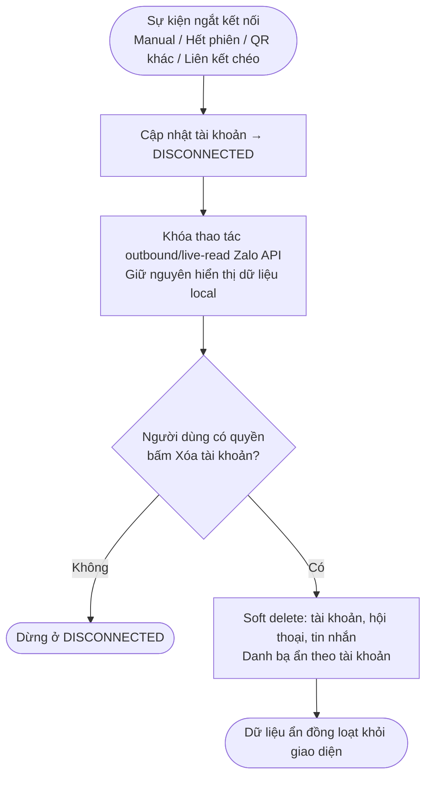
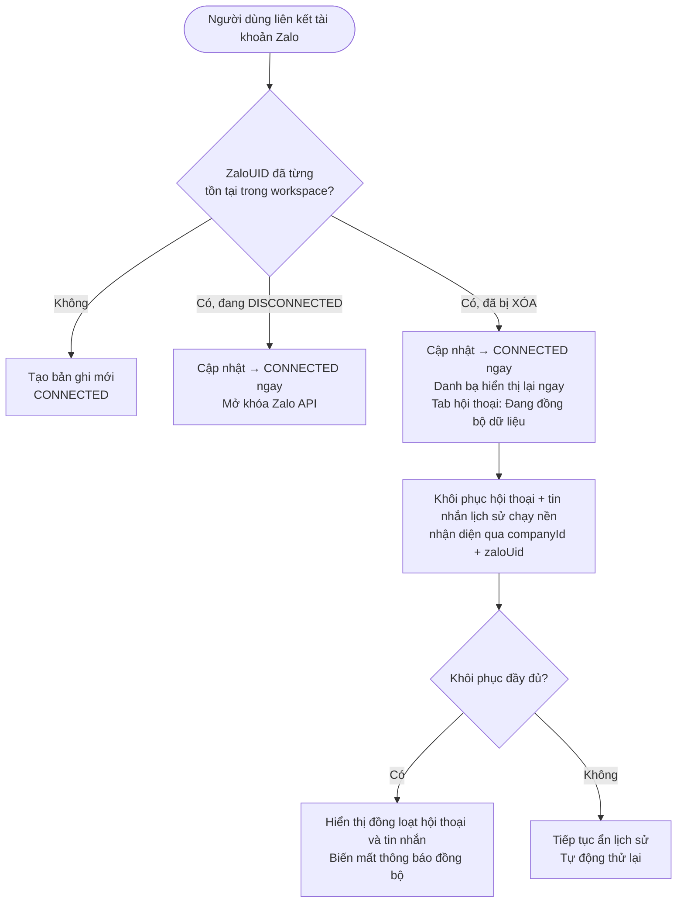
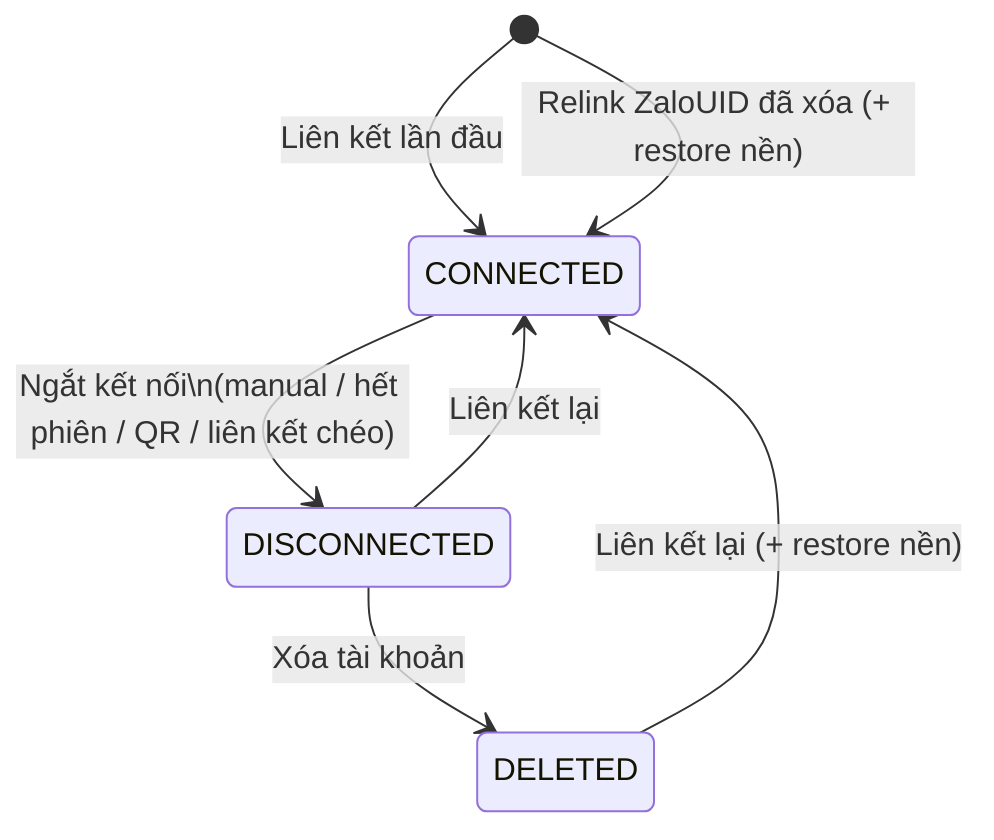

# [G010] Soft Delete & Khôi phục dữ liệu tài khoản Zalo

| Trường | Nội dung |
|--------|----------|
| **Feature ID** | G010 |
| **Tên** | Soft Delete & Khôi phục dữ liệu tài khoản Zalo |
| **Module** | Liên kết tài khoản |
| **Owner (BA)** | Trân |
| **Dev assignee** | — |
| **Priority** | — |
| **Version** | 1.2 |
| **Status** | Draft |
| **Last updated** | 2026-07-15 |

---

## 1. Tổng quan (Overview)

Tài liệu quy định luồng xử lý dữ liệu (hội thoại, danh bạ, tags, nhắc hẹn, nhóm, phân quyền) khi tài khoản Zalo bị ngắt kết nối, bị xóa khỏi workspace, và khi được liên kết lại.

**Hành vi cốt lõi:**
- **Ngắt kết nối** (bất kỳ lý do): chỉ cập nhật trạng thái **DISCONNECTED**. Dữ liệu **không bị ẩn** — người dùng có quyền vẫn xem bình thường; các thao tác gọi Zalo API bị khóa.
- **Xóa tài khoản** (chỉ khi đang DISCONNECTED): soft delete dữ liệu local (tài khoản, hội thoại, tin nhắn). Danh bạ không bị xóa vật lý — chỉ ẩn theo tài khoản và hiển thị lại ngay khi liên kết lại. Dữ liệu soft-delete giữ vô thời hạn. Không gọi Zalo API.
- **Liên kết lại**: tài khoản chuyển sang **CONNECTED ngay lập tức**. Nếu đã từng bị xóa → danh bạ hiển thị lại ngay cùng tài khoản; hội thoại và tin nhắn lịch sử được khôi phục chạy nền; tab hội thoại hiển thị *"Đang đồng bộ dữ liệu"* cho đến khi hoàn tất.
- **Liên kết chéo** (ZaloUID đang ở workspace khác): workspace cũ chuyển sang DISCONNECTED — dữ liệu workspace cũ **vẫn hiển thị** ở đó; không soft delete.

G010 spec 3 luồng chính:
1. **UC-01** — Ngắt kết nối → DISCONNECTED, dữ liệu giữ nguyên
2. **UC-02** — Xóa tài khoản (khi DISCONNECTED) → Soft delete, ẩn dữ liệu
3. **UC-03** — Liên kết lại → CONNECTED ngay / Khôi phục dữ liệu nền

**Cross-reference:**
- **G001 — Liên kết tài khoản Zalo:** G010 mở rộng luồng ngắt kết nối và liên kết của G001; quyền kế thừa từ G001
- **G002 — Chia sẻ tài khoản Zalo cho Staff:** Phân quyền Staff xem dữ liệu; khi tài khoản DISCONNECTED → Staff vẫn xem được; khi DELETED → Staff không xem được

---

## 2. Điều kiện tiên quyết (Pre-conditions & Trigger)

Chỉ **Admin hoặc người dùng có quyền tương ứng** mới được ngắt kết nối, xóa, hoặc liên kết tài khoản Zalo. Người dùng không có quyền bị từ chối — không làm thay đổi dữ liệu hay ChatZalo.

G010 áp dụng khi:
- Tài khoản bị ngắt kết nối: người dùng thao tác thủ công, Zalo báo hết phiên, bị quét mã QR khác, hoặc bị liên kết sang workspace khác
- Người dùng có quyền bấm **Xóa tài khoản** (chỉ khả dụng khi tài khoản đang DISCONNECTED)
- Người dùng liên kết lại tài khoản Zalo vào workspace

---

## 3. Luồng chính (Happy Path)

### Sơ đồ luồng — Ngắt kết nối & Xóa

### Sơ đồ luồng — Liên kết lại

> Auto-generated — comment nếu cần sửa logic

---

### UC-01 — Ngắt kết nối → DISCONNECTED

1. **[Sự kiện]** Hệ thống ghi nhận yêu cầu ngắt kết nối đối với tài khoản Zalo (bất kỳ trigger nào)
2. **[Hệ thống]** Cập nhật trạng thái tài khoản sang **DISCONNECTED** — không toast, không notification (BR12)
3. **[Hệ thống]** **Không ẩn dữ liệu.** Toàn bộ hội thoại, tin nhắn, danh bạ, tags, nhóm vẫn hiển thị bình thường với người dùng có quyền (BR04)
4. **[Hệ thống]** Khóa tất cả thao tác outbound/live-read Zalo API (nhắn tin, đồng bộ, xem nhắc hẹn live...) (BR04)

*Use case kết thúc.*

---

### UC-02 — Xóa tài khoản → Soft delete

> **Điều kiện:** Tài khoản đang ở trạng thái DISCONNECTED. Nút Xóa không hiển thị khi tài khoản CONNECTED (BR05).

1. **[Người dùng]** Bấm **Xóa tài khoản**
2. **[Hệ thống]** Soft delete dữ liệu local: tài khoản, hội thoại, tin nhắn (BR01). Giữ nguyên: quan hệ/phân quyền, thành viên nhóm, tags đã gắn, trạng thái đọc, ghim, reaction [→ E02]
3. **[Hệ thống]** Danh bạ **tự ẩn theo tài khoản** — không cần action xóa riêng; sẽ tự khôi phục khi liên kết lại (BR14)
4. **[Hệ thống]** Sau khi Xóa trả thành công → toàn bộ dữ liệu trong phạm vi ẩn **đồng thời** khỏi giao diện — không toast (BR12)
5. **[Hệ thống]** Không gọi Zalo API — chỉ xử lý cục bộ trên Gopany

> **Ưu tiên lệnh Xóa:** Nếu người dùng Xóa trong lúc một tiến trình khôi phục nền đang chạy → lệnh Xóa được ưu tiên, tiến trình khôi phục bị hủy. Dữ liệu vẫn thuộc diện soft-delete và có thể khôi phục ở lần relink hợp lệ tiếp theo (BR10).

*Use case kết thúc.*

---

### UC-03 — Liên kết lại → Khôi phục

1. **[Người dùng]** Liên kết tài khoản Zalo (G001)
2. **[Hệ thống]** Nhận diện ZaloUID vừa liên kết bằng cặp **companyId + zaloUid** (BR03)
3. **[Hệ thống]** Xử lý theo trạng thái cũ:

   - **ZaloUID chưa từng có trong workspace:** Tạo bản ghi mới → CONNECTED. Không restore.
   - **Tài khoản đang DISCONNECTED:** Cập nhật → CONNECTED ngay. Mở khóa Zalo API. Các màn hình tự phản ánh. Không restore (dữ liệu chưa bị ẩn).
   - **Tài khoản đã bị XÓA (soft-deleted):** Cập nhật → CONNECTED ngay. Danh bạ hiển thị lại ngay cùng tài khoản (BR14). Tab hội thoại hiển thị *"Đang đồng bộ dữ liệu"*. Người dùng được nhắn tin và tạo dữ liệu mới ngay (BR08). Chạy nền: khôi phục hội thoại và tin nhắn lịch sử (BR06) [→ E01]

4. **[Hệ thống]** Khi khôi phục lịch sử đầy đủ → hội thoại và tin nhắn lịch sử xuất hiện **đồng loạt**; thông báo *"Đang đồng bộ"* biến mất (BR07)
5. **[Hệ thống]** Mọi thay đổi trạng thái diễn ra im lặng — không toast, không notification (BR12)

*Use case kết thúc.*

---

## 4. Luồng phụ (Alternative Flows)

N/A

---

## 5. Luồng ngoại lệ (Exception Flows)

| Code | Trigger | UI Response | Notification |
|------|---------|-------------|--------------|
| E01 | Khôi phục nền thất bại (UC-03) | Silent — hệ thống tự thử lại; account vẫn CONNECTED; lịch sử tiếp tục ẩn | Ghi error log |
| E02 | Xóa tài khoản thất bại (UC-02) | Toast lỗi cho người thực hiện; account vẫn DISCONNECTED, dữ liệu không đổi | Ghi error log |
| E03 | Ngắt kết nối thất bại (UC-01) | Toast lỗi cho người thực hiện; account vẫn CONNECTED, dữ liệu nguyên vẹn | Ghi error log |
| E04 | Server lỗi 500 | Toast lỗi chung | Ghi error log |

**Exception Confirmation Log — G010**

| Code | Từ UC | Nguồn HP hay Độc lập | Confirmed |
|------|-------|----------------------|-----------|
| E01 | UC-03, bước 3 | Happy Path | ✅ |
| E02 | UC-02, bước 2 | Happy Path | ✅ |
| E03 | UC-01, bước 2 | Happy Path | ✅ |
| E04 | Độc lập | Độc lập | ✅ |

---

## 6. Business Rules — Quy tắc nghiệp vụ

| Code | Rule | Lý do |
|------|------|-------|
| BR01 | Khi tài khoản bị xóa → dữ liệu **không bị xóa vĩnh viễn**; chỉ ẩn khỏi giao diện và giữ **vô thời hạn** trong hệ thống | Bảo toàn dữ liệu kinh doanh |
| BR02 | Dữ liệu phân theo **workspace** — dữ liệu phát sinh khi Zalo ở workspace B thuộc B; ở workspace C thuộc C; hai phần độc lập | Cô lập dữ liệu đa workspace |
| BR03 | Nhận dạng "cùng tài khoản cũ" bằng **companyId + zaloUid**. Cùng SĐT nhưng ZaloUID khác → coi như **tài khoản mới**, không khôi phục dữ liệu cũ | ZaloUID là định danh duy nhất và ổn định |
| BR04 | Tài khoản DISCONNECTED → **dữ liệu vẫn hiển thị** bình thường với người có quyền; chỉ khóa các thao tác outbound/live-read Zalo API | Ngắt kết nối ≠ mất dữ liệu |
| BR05 | Nút **Xóa tài khoản** chỉ khả dụng khi tài khoản đang DISCONNECTED — không xóa được tài khoản đang CONNECTED | Bắt buộc ngắt trước khi xóa |
| BR06 | Relink tài khoản đã bị xóa → khôi phục **toàn bộ dữ liệu của workspace hiện tại** thuộc ZaloUID đó; dữ liệu workspace khác không được chuyển sang | Tôn trọng ownership theo workspace |
| BR07 | **Hội thoại và tin nhắn** lịch sử chỉ xuất hiện **đồng loạt** sau khi khôi phục hoàn tất — không xuất hiện từng phần. All-or-nothing không áp dụng cho Account hay danh bạ (cả hai hiển thị ngay) | Tránh trạng thái "khôi phục một nửa" |
| BR08 | Trong lúc khôi phục nền → người dùng **vẫn nhắn tin và tạo dữ liệu mới bình thường**; dữ liệu mới hiển thị ngay, không chờ restore xong | Không gián đoạn công việc |
| BR09 | Liên kết chéo (ZaloUID đang ở workspace khác) → workspace cũ chỉ chuyển sang **DISCONNECTED**; dữ liệu workspace cũ **không bị soft delete**, vẫn hiển thị ở workspace cũ | Workspace cũ không mất dữ liệu |
| BR10 | Lệnh **Xóa mới nhất được ưu tiên** — nếu Xóa phát sinh trong lúc restore đang chạy, tiến trình restore bị hủy; dữ liệu thuộc diện soft-delete và có thể khôi phục ở lần relink tiếp theo | Nhất quán trạng thái |
| BR11 | Webhook cũ/trùng/muộn **không** làm lùi trạng thái hoặc làm dữ liệu đã xóa xuất hiện lại | Idempotency |
| BR12 | Mọi thay đổi trạng thái (disconnect, delete, reconnect) diễn ra **im lặng**; lỗi thao tác chỉ báo **người thực hiện**, không broadcast | Không gián đoạn UX Staff |
| BR13 | Khôi phục phục hồi **trạng thái cuối cùng** trước khi tài khoản rời đi; hành động workspace đã thực hiện trong thời gian đó (ví dụ: xóa tag thủ công) **không bị rollback** | Tôn trọng hành động chủ ý |
| BR14 | Danh bạ **ẩn theo tài khoản** khi soft delete — không cần action xóa riêng. Khi relink, danh bạ **hiển thị lại ngay** cùng tài khoản, không chạy nền như hội thoại | Danh bạ gắn với vòng đời tài khoản Zalo, không cần restore nền |

---

## 7. State Machine — Vòng đời

### Entity: Trạng thái tài khoản Zalo trong workspace

| Từ trạng thái | Sự kiện | Sang trạng thái | Ghi chú |
|---------------|---------|-----------------|---------|
| _(chưa có)_ | Liên kết lần đầu | **CONNECTED** | Tạo bản ghi mới |
| _(chưa có)_ | Liên kết — ZaloUID đã bị xóa | **CONNECTED** + restore nền | BR06 |
| **CONNECTED** | Ngắt (manual / hết phiên / QR khác / liên kết chéo) | **DISCONNECTED** | Dữ liệu vẫn hiển thị — BR04 |
| **DISCONNECTED** | Liên kết lại | **CONNECTED** | Không cần restore |
| **DISCONNECTED** | Xóa tài khoản | **DELETED** (soft) | Dữ liệu ẩn — BR01 |
| **DELETED** | Liên kết lại cùng companyId + zaloUid | **CONNECTED** + restore nền | BR06 |

> Auto-generated — comment nếu cần sửa logic

### Entity: Trạng thái dữ liệu workspace

| Trạng thái tài khoản | Dữ liệu hiển thị | Zalo API |
|---------------------|------------------|----------|
| **CONNECTED** | Hiển thị đầy đủ | Mở |
| **DISCONNECTED** | Hiển thị đầy đủ | Khóa |
| **DELETED** | Ẩn hoàn toàn | Khóa |
| **DELETED** đang restore | Hiển thị *"Đang đồng bộ"*; lịch sử ẩn; dữ liệu mới hiển thị ngay | Mở |

---

## 8. Hành vi hệ thống & Đồng bộ giao diện

**Khôi phục dữ liệu:** Khi tài khoản bị xóa (DELETED) được liên kết lại, trạng thái mở khóa lập tức (CONNECTED). Danh bạ hiển thị lại ngay cùng tài khoản. Hội thoại và tin nhắn lịch sử được xử lý ngầm và đồng bộ lên giao diện khi mọi thứ đã sẵn sàng. Không quy định SLA khôi phục cố định.

**Trạng thái hiển thị nhất quán:** Mọi thao tác Xóa tài khoản hay Khôi phục đều yêu cầu giao diện hiển thị trạng thái hoàn chỉnh — không có trạng thái "xóa một nửa". Nếu có lệnh Xóa mới phát sinh lúc đang khôi phục, tiến trình khôi phục cũ bị hủy bỏ.

**Đồng bộ tự động:** Các client (web/mobile) đang mở phải tự động phản ánh trạng thái mới nhất khi có sự kiện thay đổi (Disconnect, Delete, Reconnect) — không cần reload trang.

---

## 9. API Contract

N/A — Spec này thuần nghiệp vụ. API contract sẽ được định nghĩa trong tài liệu kỹ thuật riêng.

---

## 10. UI/UX Notes — Ghi chú giao diện

### 10A — Trạng thái DISCONNECTED

| Element | Mô tả |
|---------|-------|
| Hội thoại | Hiển thị bình thường — chỉ đọc |
| Danh bạ | Hiển thị bình thường — chỉ đọc |
| Tags, nhóm | Hiển thị bình thường |
| Nhắc hẹn (live data) | Không xem được — yêu cầu Zalo API |
| Thanh chat / nút outbound | Khóa — tooltip: *"Tài khoản Zalo đang ngắt kết nối"* |
| Thông báo cho Staff | Không có |

### 10B — Trạng thái DELETED

| Element | Mô tả |
|---------|-------|
| Toàn bộ dữ liệu | Ẩn khỏi giao diện |
| Thông báo | Không có toast hay notification |

### 10C — Trạng thái đang khôi phục (DELETED → CONNECTED, restore nền)

| Element | Mô tả |
|---------|-------|
| Trạng thái tài khoản | CONNECTED ngay — người dùng thao tác bình thường |
| Danh bạ | Hiển thị lại ngay cùng tài khoản — không chờ restore (BR14) |
| Tab hội thoại | Banner: *"Đang đồng bộ dữ liệu"* |
| Hội thoại / tin nhắn lịch sử | Ẩn cho đến khi khôi phục hoàn tất; xuất hiện đồng loạt (BR07) |
| Dữ liệu mới | Hiển thị ngay lập tức, không chờ restore (BR08) |
| Khi restore xong | Banner biến mất; toàn bộ hội thoại và tin nhắn hợp lệ xuất hiện cùng lúc |

### 10D — Phân quyền

| Hành động | Admin | Người dùng có quyền | Staff thường |
|-----------|-------|---------------------|--------------|
| Ngắt kết nối tài khoản (UC-01) | Có | Có | Không |
| Xóa tài khoản (UC-02) | Có | Có | Không |
| Liên kết lại tài khoản (UC-03) | Có | Có | Không |
| Xem dữ liệu khi CONNECTED | Có | Có | Có (theo G002) |
| Xem dữ liệu khi DISCONNECTED | Có | Có | Có (theo G002) |
| Xem dữ liệu khi DELETED | Không | Không | Không |

> Phân quyền cụ thể (permission key, Keycloak) kế thừa từ G001. G002 quy định Staff nào được xem dữ liệu khi tài khoản đang hoạt động.

---

## 11. Acceptance Criteria — Tiêu chí nghiệm thu

### UC-01 — Ngắt kết nối

- [ ] Ngắt kết nối thành công → tài khoản DISCONNECTED, dữ liệu (hội thoại, danh bạ, tags, nhóm) **vẫn hiển thị** bình thường (AC-BR04)
- [ ] Thanh chat và các nút outbound bị khóa khi DISCONNECTED (AC-BR04)
- [ ] Nhắc hẹn live không xem được khi DISCONNECTED
- [ ] Không có toast hay notification khi ngắt thành công (AC-BR12)
- [ ] Liên kết chéo → workspace cũ DISCONNECTED, dữ liệu workspace cũ **không mất** (AC-BR09)
- [ ] Ngắt kết nối thất bại → account vẫn CONNECTED, chỉ người thực hiện nhận lỗi (AC-E03)

### UC-02 — Xóa tài khoản

- [ ] Nút Xóa chỉ hiển thị khi tài khoản đang DISCONNECTED (AC-BR05)
- [ ] Xóa thành công → toàn bộ dữ liệu (hội thoại, tin nhắn, danh bạ) ẩn **đồng thời** khỏi giao diện, không có trạng thái "ẩn một nửa" (AC-BR07)
- [ ] Danh bạ ẩn theo tài khoản khi xóa — không cần thao tác xóa danh bạ riêng (AC-BR14)
- [ ] Dữ liệu soft-delete không tự hết hạn — vẫn đủ điều kiện khôi phục ở lần relink tiếp theo (AC-BR01)
- [ ] Xóa trong lúc restore đang chạy → tiến trình restore hủy, dữ liệu ẩn nhất quán (AC-BR10)
- [ ] Xóa thất bại → account vẫn DISCONNECTED, chỉ người thực hiện nhận lỗi (AC-E02)

### UC-03 — Liên kết lại

- [ ] Relink ZaloUID chưa từng có → tài khoản mới hoàn toàn, CONNECTED, không restore (AC-BR03)
- [ ] Relink ZaloUID đang DISCONNECTED → CONNECTED ngay, không cần restore (AC-BR04)
- [ ] Relink ZaloUID đã bị xóa → CONNECTED ngay **trước khi** lịch sử khôi phục xong (AC-BR06)
- [ ] Đồng bộ danh bạ thủ công không hồi sinh contact đã xóa thủ công; hoạt động Zalo mới (tin nhắn, kết bạn) làm contact liên quan xuất hiện lại (AC-BR14)
- [ ] Relink tài khoản đã xóa → danh bạ hiển thị lại ngay cùng tài khoản, không chờ khôi phục hội thoại (AC-BR14)
- [ ] Tab hội thoại hiển thị *"Đang đồng bộ dữ liệu"*; hội thoại và tin nhắn lịch sử không xuất hiện từng phần (AC-BR07)
- [ ] Dữ liệu mới tạo trong lúc restore hiển thị ngay và không bị mất khi hợp nhất (AC-BR08)
- [ ] Sau khi restore hoàn tất → toàn bộ lịch sử hợp lệ xuất hiện cùng lúc, banner biến mất
- [ ] Webhook cũ/trùng/muộn không làm lùi trạng thái hoặc làm dữ liệu đã xóa xuất hiện lại (AC-BR11)
- [ ] Restore thất bại → account vẫn CONNECTED, hệ thống tự thử lại, không toast (AC-E01)
- [ ] Hội thoại đã xóa thủ công trước đó nhận hoạt động mới → chỉ dữ liệu từ hoạt động mới xuất hiện; lịch sử cũ vẫn ẩn (AC-BR13)
- [ ] Lời mời kết bạn không thuộc dữ liệu soft-delete/restore — chỉ khả dụng khi Account CONNECTED

### Giả định đã chốt

| # | Giả định | Ghi chú |
|---|---------|---------|
| A01 | **Ưu tiên lệnh Xóa:** Lệnh Xóa mới nhất thắng tiến trình restore đang chạy | BR10 |
| A02 | **Hoạt động mới:** Hoạt động mới không làm hồi sinh lịch sử đã xóa thủ công | BR13 |
| A03 | **SLA khôi phục:** Không cam kết SLA định lượng; trạng thái *"Đang đồng bộ"* tồn tại đến khi hoàn tất | — |
| A04 | **All-or-nothing:** Chỉ áp dụng cho hội thoại và tin nhắn lịch sử — không áp dụng cho Account hay danh bạ (cả hai hiển thị ngay) | BR07 |
| A05 | **Danh bạ không soft-delete:** Danh bạ chỉ ẩn theo tài khoản, không cần xóa/khôi phục nền riêng | BR14 |
| A06 | **Dữ liệu legacy:** Dữ liệu đã xóa theo cơ chế cũ trước khi phát hành G010 không thuộc phạm vi khôi phục | — |

---

## 12. Out of Scope — Ngoài phạm vi

| # | Nội dung | Ghi chú |
|---|---------|---------|
| OOS01 | Export dữ liệu trước khi ngắt kết nối | Backlog |
| OOS02 | Audit log — ai ngắt kết nối lúc mấy giờ | Backlog |
| OOS03 | Khôi phục một phần (chọn lọc từng loại dữ liệu muốn restore) | Backlog — hiện khôi phục toàn bộ hoặc không |
| OOS04 | Thông báo cho Staff khi dữ liệu bị ẩn hoặc được khôi phục | Im lặng theo BR12 |
| OOS05 | SLA khôi phục cố định | Không cam kết; trạng thái *"Đang đồng bộ"* tồn tại đến khi hoàn tất |

---

## 13. Dependencies — Phụ thuộc

| Phụ thuộc vào | Ghi chú |
|---------------|---------|
| **G001 — Liên kết tài khoản Zalo** | G010 mở rộng luồng ngắt kết nối và liên kết của G001; quyền kế thừa G001 |
| **G002 — Chia sẻ tài khoản Zalo cho Staff** | Phân quyền Staff xem dữ liệu; DISCONNECTED → Staff vẫn xem; DELETED → Staff không xem |
| **G004 — Quản lý thẻ** | Tags bị ẩn khi DELETED; khôi phục không rollback tag đã xóa thủ công (BR13) |
| **G008 — Quản lý nhóm** | Danh sách nhóm ẩn khi DELETED; xuất hiện lại sau restore |

| Được phụ thuộc bởi | Ghi chú |
|--------------------|---------|
| — | — |

---

## 14. Performance & Scalability

| Mục | Yêu cầu |
|-----|---------|
| Cập nhật trạng thái | DISCONNECTED / DELETED / CONNECTED phản ánh ngay trên tất cả client đang mở — không cần reload |
| Khôi phục | Chạy nền — không block UI; người dùng thao tác bình thường trong lúc chờ |
| Workspace lớn | Tài khoản có nhiều hội thoại/danh bạ — không ảnh hưởng thời gian CONNECTED |
| SLA khôi phục | Không cam kết định lượng |

---

## Changelog — Lịch sử thay đổi

| Ngày | Version | Người thay đổi | Sections | Nội dung | File:Line |
|------|---------|----------------|----------|----------|-----------|
| 2026-07-13 | v1.0 | Trân (BA) | — | Tạo draft | — |
| 2026-07-13 | v1.1 | Trân (BA) | All | Thay SĐT → ZaloUID; viết lại Section 2; bỏ UC Zalo thu hồi; bỏ popup liên kết chéo; bỏ OQ và Rollout; thêm phân quyền 10C; renumber BR/UC | — |
| 2026-07-15 | v1.2 | Trân (BA) | All | Tách ngắt kết nối vs xóa: DISCONNECTED không ẩn dữ liệu; chỉ DELETED mới ẩn. Relink → CONNECTED ngay + restore nền + all-or-nothing display (chỉ hội thoại/tin nhắn). Danh bạ hiển thị lại ngay khi relink, không chạy nền. Liên kết chéo → workspace cũ chỉ DISCONNECTED. Thêm BR04–BR14, Section 8 hành vi hệ thống, Giả định đã chốt, cập nhật state machine 3 trạng thái | — |

---

> **Lưu ý cho AI khi đọc spec này:**
> - **BR04:** DISCONNECTED ≠ mất dữ liệu — dữ liệu vẫn hiển thị; chỉ Zalo API bị khóa.
> - **BR05:** Không cho phép xóa tài khoản đang CONNECTED — phải ngắt trước.
> - **BR07:** Lịch sử restore all-or-nothing — không hiển thị từng phần.
> - **BR09:** Liên kết chéo → workspace cũ DISCONNECTED, không soft delete.
> - **BR10:** Lệnh Xóa thắng tiến trình restore đang chạy.
> - **BR12:** Im lặng cho state changes; lỗi chỉ báo người thực hiện.
> - Section 12 (Out of Scope) là danh sách **cấm** — không implement dù có vẻ logic.
