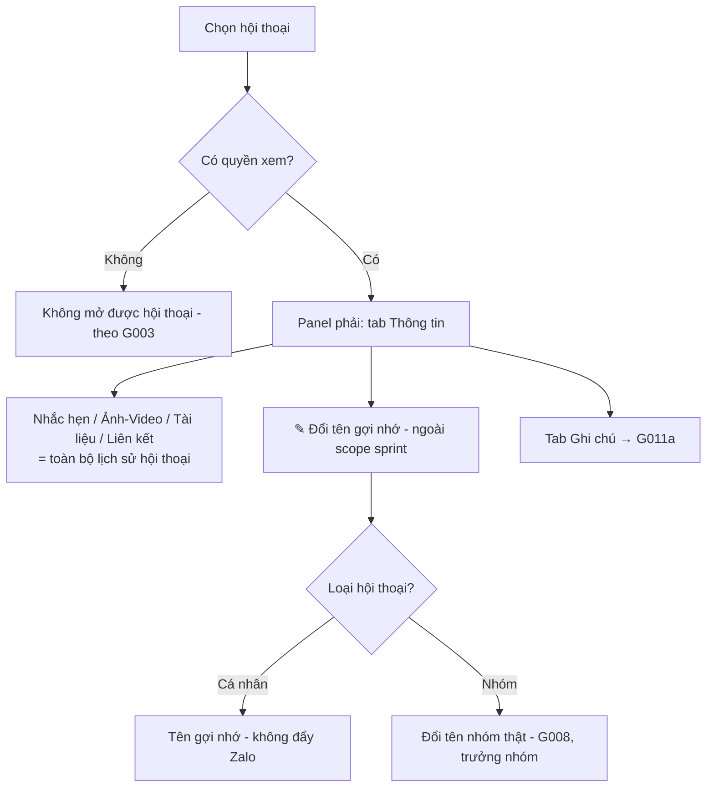

# [G011] Panel Thông tin

| Trường | Nội dung |
|--------|----------|
| **Feature ID** | G011 |
| **Tên** | Panel Thông tin (Conversation Info Panel) |
| **Module** | Chăm sóc khách hàng / Chat - Zalo |
| **Owner (BA)** | Trân (BA) |
| **Dev assignee** | — |
| **Priority** | — |
| **Version** | 1.1 |
| **Status** | Draft |
| **Last updated** | 2026-08-04 |

> **Panel phải có 2 tab:** **`Thông tin`** (tài liệu này) và **`Ghi chú`** (tách riêng sang **G011a — Panel Ghi chú**). Tách để dev build Ghi chú trước, độc lập với phần **đổi tên gợi nhớ**.
>
> ⚠️ **Scope sprint hiện tại:** phần **✎ Đổi tên gợi nhớ (UC-02/BR06)** *tạm thời chưa làm trong tuần này* — vẫn giữ đặc tả để triển khai sau.

---

## 1. Tổng quan (Overview)

**Panel phải** của màn hình Chat hiển thị thông tin chi tiết của hội thoại đang mở, có nút **X để đóng**. Panel gồm **2 tab**:
- **Tab `Thông tin`** *(tài liệu này)* — *thuần thông tin*: header (avatar, tên + đổi tên gợi nhớ) và các mục **Nhắc hẹn · Ảnh/Video · Tài liệu · Liên kết** đã trao đổi trong hội thoại.
- **Tab `Ghi chú`** → đặc tả tại **G011a** (hồ sơ khách hàng nội bộ).

Tài liệu này **tách từ G003 §10E**.

> **Phạm vi:** Panel phải **không chứa nút thao tác** (Ghim, Tắt thông báo, Tạo nhóm, Rời nhóm, Chặn, Ẩn trò chuyện…). Các thao tác đó nằm ở **menu tùy chọn của hội thoại tại panel trái** (G003 §10B) / Zalo-native — G011 chỉ trỏ sang, không re-spec.

**Use Case Description:**
> Là Admin hoặc nhân viên đang xử lý một hội thoại, tôi muốn xem thông tin đã trao đổi (nhắc hẹn, ảnh/tài liệu/liên kết) ngay bên phải khung chat, để nắm bối cảnh khách hàng.

**Người dùng mục tiêu (Target users):**
- **Admin/Owner** — xem panel của mọi hội thoại
- **Staff được phân quyền (G002/G003)** — xem panel của hội thoại thuộc tài khoản Zalo được phân quyền / hội thoại được gán

**Phụ thuộc:** G003 (Chat), G002 (Phân quyền), G007 (Danh bạ — tên gợi nhớ), G008 (Nhóm), G009 (Nhắc hẹn / G019).

---

## 2. Điều kiện tiên quyết (Pre-conditions & Trigger)

**Trigger:** Người dùng **chọn/mở một hội thoại** ở panel giữa → panel phải hiển thị thông tin hội thoại đó (mặc định tab `Thông tin`).

**Pre-conditions:**
- [ ] Người dùng đã đăng nhập, đang ở màn hình **Chat - Zalo**
- [ ] Đã có một hội thoại được chọn (chưa chọn → panel phải không hiển thị)
- [ ] Người dùng có quyền xem hội thoại đó (G003 BR02/BR11/BR18)

**Post-conditions:** Panel phải hiển thị đúng thông tin hội thoại đang mở, đúng loại (cá nhân/nhóm).

---

## 3. Luồng chính (Happy Path)

### UC-01 — Mở panel, chuyển tab, đóng panel
1. **[Người dùng]** Chọn một hội thoại ở panel giữa
2. **[Hệ thống]** Hiển thị panel phải, mặc định tab **`Thông tin`** theo loại hội thoại (cá nhân/nhóm)
3. **[Người dùng]** Chuyển đổi giữa 2 tab **`Thông tin`** | **`Ghi chú`** *(Ghi chú — G011a)*
4. **[Người dùng]** Bấm **X** → đóng panel phải (khung chat mở rộng); mở lại từ hội thoại

### UC-02 — Đổi tên gợi nhớ  *(⚠️ ngoài scope sprint hiện tại)*
1. **[Người dùng]** Tại header tab Thông tin, bấm icon **✎** cạnh Tên [→ E03]
2. **[Người dùng]** Nhập tên mới, xác nhận [→ E01, E02]
3. **[Hệ thống]** Lưu tên:
   - **Hội thoại cá nhân** → lưu **tên gợi nhớ** (cùng tên với Danh bạ G007 — một nguồn duy nhất), thay tên Zalo khi hiển thị, **không đẩy lên Zalo** (BR06)
   - **Hội thoại nhóm** → **đổi tên nhóm thật** theo **G008** (chỉ **trưởng nhóm**; gọi Zalo) [→ E04]

### UC-03 — Xem thông tin đã trao đổi
1. **[Người dùng]** Tại tab Thông tin, xem các mục thu gọn được:
   - **Nhắc hẹn** — danh sách nhắc hẹn của hội thoại (dữ liệu G003 UC-04 / G019); trống → *"Không có nhắc hẹn nào"*
   - **Ảnh/Video** — tóm tắt ảnh/video đã gửi
   - **Tài liệu** — tóm tắt file đã gửi
   - **Liên kết** — tóm tắt link đã chia sẻ
2. **[Người dùng]** Click một mục → mở/xem chi tiết (click **Nhắc hẹn** → điều hướng tới nhắc hẹn; quản lý theo G003 UC-04 / G019)
   - Ảnh/Video · Tài liệu · Liên kết lấy từ **toàn bộ lịch sử hội thoại** (BR04)



> Auto-generated — comment nếu cần sửa logic

---

## 4. Luồng phụ (Alternative Flows)

### AF01 — Chuyển hội thoại khác khi panel đang mở
- Panel nạp lại thông tin của hội thoại mới; giữ tab đang mở.

### AF02 — Hội thoại nhóm vs cá nhân
- Tab Thông tin đổi theo loại hội thoại: **cá nhân** → ✎ tên gợi nhớ; **nhóm** → ✎ đổi tên nhóm thật (G008). Nội dung mục Nhắc hẹn/Ảnh/Tài liệu/Liên kết giống nhau.

### AF03 — Đóng & mở lại panel
- Sau khi bấm X đóng, mở lại panel từ hội thoại → panel hiển thị lại, mặc định tab `Thông tin`.

---

## 5. Luồng ngoại lệ (Exception Flows)

| Code | Trigger | Phản hồi giao diện | Thông báo bên ngoài | Hướng xử lý |
|------|---------|-------------------|---------------------|-------------|
| E01 | Lưu **tên gợi nhớ** thất bại (Server 500) | Toast: *"Lỗi hệ thống. Vui lòng thử lại sau"*; giữ nội dung đang nhập | Ghi error log | Người dùng lưu lại |
| E02 | Mất mạng khi đang lưu tên | Toast: *"Mất kết nối, vui lòng thử lại"*; **giữ nguyên nội dung đang nhập** | — | Người dùng lưu lại khi có mạng |
| E03 | Nhân sự **không phải trưởng nhóm** cố **đổi tên nhóm** | Toast: *"Bạn không có quyền thực hiện thao tác này"* | Ghi log truy cập trái phép | — (xem BR08 / G008) |
| E04 | Đổi **tên nhóm** khi tài khoản Zalo **Ngắt kết nối** | Toast: *"Tài khoản Zalo đang ngắt kết nối. Vui lòng kết nối lại"* | — | Kết nối lại (G001) |
| E05 (Empty state) | Hội thoại chưa có ảnh/tài liệu/liên kết/nhắc hẹn | Từng mục hiển thị text trống tương ứng (*"Không có… "*) | — | — |

**Exception Confirmation Log:** E01 → UC-02 b2 · E02 → UC-02 b2 · E03 → UC-02 b1 · E04 → UC-02 b3 (nhánh nhóm) · E05 → UC-03.

> **Không áp dụng:** *Unauthorized xem panel* → xử lý ở tầng mở hội thoại (G003). *Zalo API lỗi khi đổi tên nhóm* → thuộc G008. *Exception của Tab Ghi chú* → xem **G011a**.

---

## 6. Business Rules — Quy tắc nghiệp vụ

| Code | Rule (Quy tắc) | Lý do |
|------|----------------|-------|
| BR01 | Panel phải chỉ hiển thị khi đã chọn một hội thoại; có nút **X** để đóng và mở lại | Nhất quán panel thật + tiết kiệm không gian |
| BR02 | Panel gồm **2 tab: `Thông tin` \| `Ghi chú`** (Ghi chú → **G011a**), mặc định mở tab `Thông tin` | Cấu trúc chốt |
| BR03 | Tab Thông tin **thuần thông tin**: header + **Nhắc hẹn · Ảnh/Video · Tài liệu · Liên kết**. **Không** đặt nút thao tác (Ghim / Tắt thông báo / Tạo nhóm / Rời nhóm / Chặn / Ẩn trò chuyện) — các thao tác này ở **menu hội thoại panel trái** (G003 §10B) | Tránh 2 nguồn thao tác trùng lặp |
| BR04 | **Ảnh/Video · Tài liệu · Liên kết** tổng hợp từ **toàn bộ lịch sử hội thoại** — kể cả tin trước thời điểm phân quyền | Nhất quán **G002 BR03** (nhân sự xem được toàn bộ lịch sử) |
| BR05 | Mục **Nhắc hẹn** hiển thị nhắc hẹn của hội thoại (dữ liệu từ G003 UC-04 / **G019**); trống → *"Không có nhắc hẹn nào"*. **Click một nhắc hẹn → điều hướng tới nhắc hẹn** (theo G019); thao tác quản lý không thực hiện tại panel | Panel chỉ để xem & điều hướng |
| BR06 | **Đổi tên gợi nhớ (✎)** *(ngoài scope sprint hiện tại)*: hội thoại **cá nhân** = đặt **tên gợi nhớ** — **CÙNG một tên với "Đổi tên trong Danh bạ" (G007)**, là **một nguồn duy nhất**; thay tên Zalo ở mọi nơi hiển thị, **không đẩy lên Zalo**. Hội thoại **nhóm** = **đổi tên nhóm thật** theo **G008** (chỉ **trưởng nhóm**) | Một cơ chế đặt tên duy nhất; nhóm là dữ liệu Zalo dùng chung |
| BR07 | Panel kế thừa **quyền xem hội thoại** từ G002/G003 (BR02/BR11/BR18) — không có quyền xem hội thoại thì không thấy panel | Nhất quán phân quyền |
| BR08 | **Quyền đổi tên:** **Đổi tên gợi nhớ (cá nhân)** — **theo G007** (nhân sự có quyền xem hội thoại / quản lý danh bạ đổi được). **Đổi tên nhóm** — chỉ **trưởng nhóm** (G008) | Tên gợi nhớ cá nhân thống nhất với G007; đổi tên nhóm là dữ liệu chung nên giới hạn |
| ~~BR09~~ | **[Tách sang G011a]** Tab Ghi chú (hồ sơ khách hàng) — xem **G011a** | — |
| BR10 | Thao tác gọi Zalo trên panel (**đổi tên nhóm**) **bị khóa khi tài khoản Zalo Ngắt kết nối** → toast cảnh báo | Nhất quán **BR-C06** / G003 BR10 |
| ~~BR11~~ | **[Tách sang G011a]** Khóa lạc quan hồ sơ Ghi chú — xem **G011a** | — |

---

## 7. State Machine

N/A cho Tab Thông tin — không có vòng đời trạng thái riêng. *(Vòng đời hồ sơ Ghi chú: xem **G011a §7**.)*

---

## 8. Data Model

N/A — Spec này thuần nghiệp vụ. Data model sẽ được định nghĩa trong tài liệu kỹ thuật riêng.

---

## 9. API Contract

> Tài liệu nghiệp vụ — chưa đặc tả chi tiết API. Tên gợi nhớ (alias) dùng API nội bộ; đổi tên nhóm dùng API Zalo (qua G008). Dev bổ sung khi thiết kế kỹ thuật.

---

## 10. UI/UX Notes — Ghi chú giao diện

### 10A — Vị trí & hành vi
Panel phải trong layout 3 cột của màn hình Chat (G003 §10A). **Web only**. Có nút **X** đóng panel. Mặc định mở tab `Thông tin`.

### 10B — Wireframe (Tab `Thông tin`)
```
┌──────────────────────────────────┐
│                               [X] │
│            ( Avatar )             │
│         Nguyễn Thu Hồng  ✎        │  ✎ Đổi tên gợi nhớ (ngoài scope sprint)
│  ┌ Thông tin ┐  Ghi chú           │
│  └───────────┘                    │
│  ▾ Nhắc hẹn        (Không có…)     │
│  ▾ Ảnh / Video   [img][img][img]→ │
│  ▾ Tài liệu       (Không có…)      │
│  ▾ Liên kết       (Chưa có…)       │
└──────────────────────────────────┘
```
*(Wireframe Tab `Ghi chú`: xem **G011a**.)*

### 10C — Tab `Thông tin` — element
| Element | Mô tả |
|---------|-------|
| Header | Avatar + Tên + nút **X** đóng |
| ✎ Đổi tên gợi nhớ | Cạnh Tên — cá nhân: tên gợi nhớ (G007); nhóm: đổi tên nhóm (G008). *Ngoài scope sprint hiện tại* |
| Nhắc hẹn | Section thu gọn được; danh sách nhắc hẹn hội thoại; trống → *"Không có nhắc hẹn nào"*; click → điều hướng (G019) |
| Ảnh / Video | Section thu gọn được; tóm tắt ảnh/video đã gửi; click → xem thêm |
| Tài liệu | Tóm tắt file đã gửi; trống → *"Không có tài liệu nào"* |
| Liên kết | Tóm tắt link đã chia sẻ; trống → *"Chưa có liên kết được chia sẻ trong hội thoại này"* |

### 10D — Tab `Ghi chú`
→ Xem **G011a — Panel Ghi chú**.

### 10E — Quyền & Hiển thị có điều kiện
| Điều kiện | Hành vi |
|-----------|---------|
| Không có quyền xem hội thoại | Không mở được hội thoại → không thấy panel (G003) |
| Hội thoại cá nhân | ✎ Đổi tên gợi nhớ theo quyền **G007** |
| Hội thoại nhóm, nhân sự **không phải trưởng nhóm** | Ẩn/không cho dùng ✎ Đổi tên nhóm (BR08 / G008) |
| Tài khoản Zalo Ngắt kết nối | Đổi tên nhóm → toast "Tài khoản Zalo đang ngắt kết nối. Vui lòng kết nối lại" |

---

## 11. Acceptance Criteria — Tiêu chí nghiệm thu

- [ ] Chọn hội thoại → panel phải hiện tab Thông tin; bấm X → đóng panel; mở lại được (AC-BR01/BR02)
- [ ] Có 2 tab `Thông tin` | `Ghi chú`; chuyển sang Ghi chú → nội dung theo G011a (AC-BR02)
- [ ] Tab Thông tin chỉ có Header + Nhắc hẹn + Ảnh/Video + Tài liệu + Liên kết; **không** có nút Ghim/Tắt thông báo/Tạo nhóm/Rời nhóm/Chặn/Ẩn (AC-BR03)
- [ ] Ảnh/Video · Tài liệu · Liên kết hiển thị nội dung từ **toàn bộ lịch sử** hội thoại (AC-BR04)
- [ ] Nhắc hẹn hiển thị đúng; hội thoại chưa có → *"Không có nhắc hẹn nào"*; click → điều hướng G019 (AC-BR05, AC-E05)
- [ ] ✎ Đổi tên hội thoại **cá nhân** → lưu **tên gợi nhớ** (cùng tên Danh bạ G007), thay tên Zalo, **không** đổi trên Zalo (AC-BR06) *(ngoài scope sprint)*
- [ ] ✎ Đổi tên hội thoại **nhóm** → đổi tên nhóm thật theo G008 (chỉ trưởng nhóm); nhân sự không phải trưởng nhóm → toast từ chối (AC-BR06, AC-BR08, AC-E03)
- [ ] Đổi tên nhóm khi tài khoản Zalo Ngắt kết nối → bị khóa + toast (AC-BR10, AC-E04)
- [ ] Không có quyền xem hội thoại → không thấy panel (AC-BR07)
- [ ] Lưu tên lỗi hệ thống / mất mạng → giữ nội dung đang nhập, cho lưu lại (AC-E01, AC-E02)
- [ ] Chuyển hội thoại khác → panel nạp lại đúng thông tin (AC-AF01)

---

## 12. Out of Scope — Ngoài phạm vi

- **Tab Ghi chú** → đặc tả riêng ở **G011a** (không thuộc tài liệu này).
- Các mục sau **không thuộc panel phải** — ở **menu hội thoại panel trái** (G003 §10B) / G008 / G009 / Zalo-native: **Ghim hội thoại** · **Tắt/Bật thông báo** · **Tạo nhóm / Thêm thành viên · Rời nhóm** · **Xem nhóm chung** · Dịch trò chuyện · Đánh dấu bạn thân · Tin nhắn tự xóa · Báo xấu · Dung lượng · Xóa lịch sử.
- **Phân loại thẻ** trong panel (thuộc G004).

> Quyết định liên quan (owner: G003 §10B menu, không thuộc G011): **Ẩn trò chuyện** = tạm ẩn, tự hiện lại khi có tin mới · **Chặn người dùng** = giai đoạn sau.

---

## 13. Dependencies — Phụ thuộc

| Phụ thuộc vào | Ghi chú |
|---------------|---------|
| G003 — Chat | Panel phải là 1 phần layout Chat; quyền xem hội thoại; menu thao tác panel trái (§10B) |
| G002 — Phân quyền | Quyền xem hội thoại; toàn bộ lịch sử (BR03) |
| G007 — Kết bạn/Danh bạ | Tên gợi nhớ (một nguồn với đổi tên danh bạ) |
| G008 — Quản lý nhóm | Đổi tên nhóm (trưởng nhóm) |
| G009 / G019 | Nhắc hẹn (xem + điều hướng) |

| Được phụ thuộc bởi | Ghi chú |
|--------------------|---------|
| **G011a — Panel Ghi chú** | Tab Ghi chú của cùng panel phải |

---

## 14. Open Questions — Câu hỏi chưa giải quyết

| # | Câu hỏi | Owner | Trả lời |
|---|---------|-------|---------|
| ~~Q3~~ | ~~Trạng thái online lấy từ đâu?~~ | BA | ✅ **Bỏ chấm online** ở giai đoạn này |
| ~~Q4~~ | ~~Precedence tên hiển thị?~~ | BA | ✅ **Một tên gợi nhớ duy nhất, gộp với Danh bạ G007** (BR06) |
| ~~Q6~~ | ~~Nhắc hẹn thao tác tới đâu?~~ | BA | ✅ **Xem + click điều hướng** (G019) (BR05) |
| ~~Q7~~ | ~~Phân trang media / trạng thái khôi phục?~~ | Dev | ✅ **Cách tải để Dev quyết** (không chặn UI); đang khôi phục nền → bổ sung dần (§15) |
| ~~Q8~~ | ~~Quyền đổi tên gợi nhớ?~~ | BA | ✅ **Theo G007** — nhân sự sửa được (cá nhân); nhóm chỉ trưởng nhóm (BR08) |

> ✅ **Không còn Open Question.** *(Open Question của Tab Ghi chú: xem G011a.)*

---

## 15. Performance — Hiệu năng

- Nạp lại panel khi đổi hội thoại phải nhanh, **không chặn thao tác chat**.
- Danh sách Ảnh/Video/Tài liệu/Liên kết dạng **tóm tắt**; **cách tải (theo lô/lazy-load hay tải sẵn) do Dev quyết**, miễn không chặn giao diện.
- Khi tài khoản vừa liên kết lại và lịch sử **đang khôi phục nền** (G010) → media hiển thị theo dữ liệu đã có, **bổ sung dần** khi khôi phục xong.

---

## 16. Rollout & Migration — Triển khai

| Mục | Chi tiết |
|-----|---------|
| Rollout | Toàn bộ người dùng — panel là phần của màn hình Chat |
| Dữ liệu hiện tại | Tên gợi nhớ (alias) là dữ liệu mới; không ảnh hưởng dữ liệu chat cũ |
| Rollback | Ẩn panel phải — không mất dữ liệu chat |
| Thứ tự triển khai | 1. Backend → 2. Frontend. *(Tab Ghi chú build theo G011a.)* |

---

## Changelog — Lịch sử thay đổi

| Ngày | Version | Người thay đổi | Sections | Nội dung |
|------|---------|----------------|----------|----------|
| 2026-07-30 | v1.0 | Trân (BA) | Toàn bộ | Tạo G011 — Panel Thông tin & Ghi chú (tách từ **G003 §10E**). Panel 2 tab, X đóng. Tab Thông tin (Header + Nhắc hẹn + Ảnh/Video + Tài liệu + Liên kết, toàn bộ lịch sử — G002 BR03). ✎ Đổi tên gợi nhớ (cá nhân = tên gợi nhớ gộp Danh bạ G007; nhóm = đổi tên nhóm G008). Tab Ghi chú = hồ sơ khách hàng dùng chung, khóa lạc quan. Bỏ chấm online |
| 2026-08-04 | **v1.1** | Trân (BA) | Toàn bộ | **Tách Tab Ghi chú sang G011a** (dev build Ghi chú trước, độc lập với đổi tên gợi nhớ). G011 nay = **Panel Thông tin** (Tab Thông tin: header/đổi tên, Nhắc hẹn, Ảnh-Video/Tài liệu/Liên kết). Đánh dấu **✎ Đổi tên gợi nhớ ngoài scope sprint hiện tại**. BR09/BR11 giữ số, trỏ sang G011a. Bổ sung G007 vào Dependencies; nhắc hẹn trỏ **G019** |

---

> **Lưu ý cho Dev & AI khi đọc spec này:**
> - **Panel phải 2 tab:** `Thông tin` (tài liệu này) + `Ghi chú` (**G011a**).
> - Tab Thông tin = **thuần thông tin**, **không** nút thao tác (ở menu panel trái — G003 §10B).
> - **Ảnh/Video · Tài liệu · Liên kết = toàn bộ lịch sử hội thoại** (G002 BR03).
> - **✎ Đổi tên gợi nhớ**: một tên gợi nhớ duy nhất gộp với Danh bạ **G007** (không đẩy Zalo); nhóm = đổi tên nhóm thật (G008, trưởng nhóm). **⚠️ Ngoài scope sprint hiện tại.**
> - **Nhắc hẹn**: chỉ xem + điều hướng sang **G019**.
