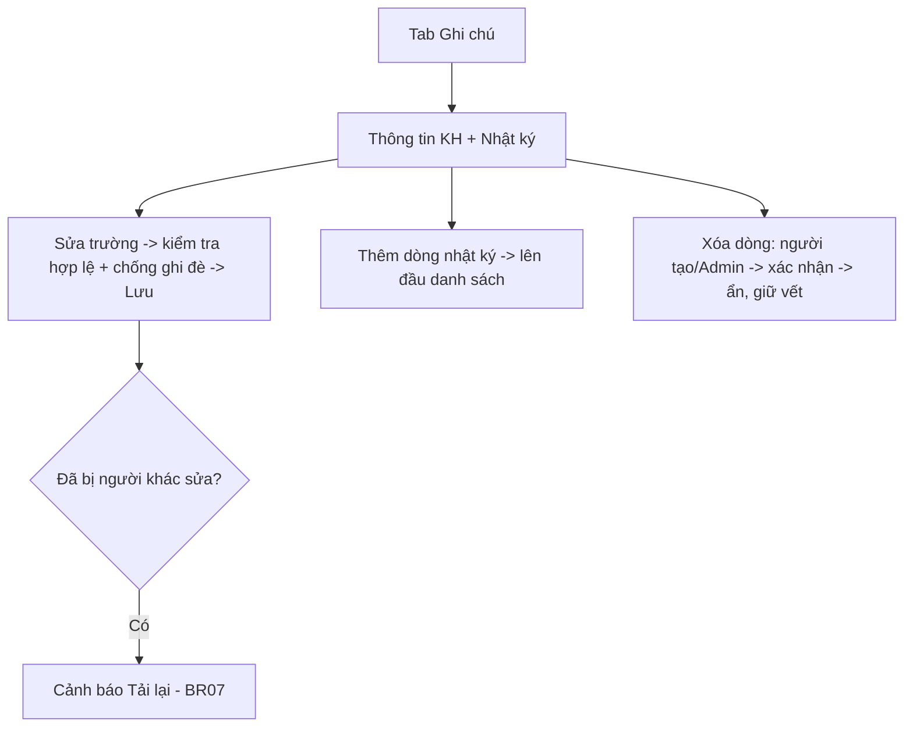

# [G011a] Panel Ghi chú (Hồ sơ khách hàng)

| Trường | Nội dung |
|--------|----------|
| **Feature ID** | G011a |
| **Tên** | Panel Ghi chú — Hồ sơ khách hàng (Customer Note Panel) |
| **Module** | Chăm sóc khách hàng / Chat - Zalo |
| **Owner (BA)** | Trân (BA) |
| **Dev assignee** | — |
| **Priority** | — |
| **Version** | 1.3 |
| **Status** | Draft |
| **Last updated** | 2026-08-06 |

> **Tách từ G011.** Panel phải gồm 2 tab: **`Thông tin`** (**G011**) và **`Ghi chú`** (tài liệu này).
> *Tài liệu thuần nghiệp vụ — chi tiết kỹ thuật (mã lỗi API, schema DB, đặt tên định danh) do tài liệu kỹ thuật của dev định nghĩa.*

---

## 1. Tổng quan (Overview)

Tab **`Ghi chú`** trong panel phải là **hồ sơ khách hàng nội bộ** của hội thoại, gồm **2 phần**:
- **(A) Thông tin khách hàng** — trường cố định (Họ tên, Năm sinh, SĐT, Email, Sản phẩm quan tâm), mỗi trường **1 giá trị**.
- **(B) Nhật ký ghi chú** — **nhiều dòng cộng dồn**, mỗi dòng kèm **người ghi + thời gian**; **không sửa nội dung sau khi tạo**, **hỗ trợ xóa** (BR04, BR11).

Hồ sơ **dùng chung** cho team, **không đẩy lên Zalo**. Hội thoại có dữ liệu hồ sơ → hiển thị **dấu "Có hồ sơ"** (BR10).

**Use Case Description:**
> Là nhân viên đang xử lý một hội thoại, tôi muốn xem/ghi hồ sơ & nhật ký ghi chú nội bộ về khách hàng ngay cạnh khung chat, để cả team nắm thông tin và phối hợp chăm sóc.

**Người dùng mục tiêu:** Nhân sự có quyền xem hội thoại (G002/G003) · **Admin**.

**Phụ thuộc:** G011, G002, G003, G010.

---

## 2. Điều kiện tiên quyết (Pre-conditions & Trigger)

**Trigger:** Trong panel phải, người dùng chọn tab **`Ghi chú`**.

**Pre-conditions:**
- [ ] Đang mở một hội thoại và **có quyền xem** hội thoại đó (G002/G003)
- [ ] Panel phải đang hiển thị (G011)

**Post-conditions:** Hồ sơ (thông tin + nhật ký) hiển thị; thay đổi được lưu; người khác thấy khi tải lại (BR12).

---

## 3. Luồng chính (Happy Path)

### UC-01 — Xem hồ sơ Ghi chú
1. **[Người dùng]** Chuyển sang tab **`Ghi chú`**
2. **[Hệ thống]** Hiển thị **Thông tin khách hàng** + **Nhật ký ghi chú** (mới nhất trên cùng, tải **20 dòng/lần** — BR11) [→ E01]

### UC-02 — Cập nhật Thông tin khách hàng
1. **[Người dùng]** Nhập/sửa **Họ tên · Năm sinh · SĐT · Email · Sản phẩm quan tâm** (các trường **không bắt buộc**)
2. **[Người dùng]** Bấm **Lưu** [→ E01, E02, E03, E05]
3. **[Hệ thống]** Kiểm tra hợp lệ & cắt khoảng trắng (BR02); chống ghi đè khi có người vừa sửa (BR07); lưu; người khác thấy khi tải lại

### UC-03 — Thêm dòng nhật ký ghi chú
1. **[Người dùng]** Nhập nội dung ô **"Thêm ghi chú"** → bấm **Gửi** [→ E01, E02, E05]
2. **[Hệ thống]** Kiểm tra hợp lệ (không để trống, ≤ 2.000 ký tự); thêm **1 dòng mới** (người ghi + thời gian), hiện **lên đầu** danh sách (BR04, BR11)

### UC-04 — Xóa dòng nhật ký ghi chú
1. **[Người tạo dòng, hoặc Admin]** Bấm icon **Xóa** tại dòng nhật ký [→ E04]
2. **[Hệ thống]** Hiển thị popup xác nhận: *"Bạn có chắc chắn muốn xóa ghi chú này? Thao tác này không thể hoàn tác trên giao diện."*
3. **[Actor]** Xác nhận **Xóa**
4. **[Hệ thống]** Xóa dòng — **ẩn ngay** khỏi danh sách, **không tính vào số lượng**; **giữ vết để truy vết**, **không khôi phục được trên giao diện** (BR11)



> Auto-generated — comment nếu cần sửa logic

---

## 4. Luồng phụ (Alternative Flows)

- **AF01 — Chuyển hội thoại khác:** panel nạp lại thông tin + nhật ký của hội thoại mới.
- **AF02 — Lưu thông tin trống:** cho phép lưu dù để trống một/nhiều trường (BR02).
- **AF03 — Nhiều người ghi nhật ký:** mỗi người thêm dòng riêng, không đè nhau (BR04).
- **AF04 — Người khác xem cùng lúc:** thấy dữ liệu mới khi **tải lại panel / chuyển hội thoại rồi quay lại / bị chặn ghi đè** (BR12).

---

## 5. Luồng ngoại lệ (Exception Flows)

| Code | Trigger | Phản hồi giao diện | Hướng xử lý |
|------|---------|-------------------|-------------|
| E01 | Tải/lưu thất bại (lỗi hệ thống) | Toast: *"Lỗi hệ thống. Vui lòng thử lại sau"* | Thử lại |
| E02 | Mất mạng khi lưu | Toast: *"Mất kết nối, vui lòng thử lại"*; giữ nội dung đang nhập | Lưu lại khi có mạng |
| E03 | Lưu **Thông tin** nhưng đã bị người khác cập nhật (xung đột) | Cảnh báo *"Hồ sơ thông tin đã được cập nhật bởi người dùng khác. Vui lòng tải lại."* + nút **Tải lại** | Tải lại rồi nhập lại (BR07) |
| E04 | Xóa dòng nhật ký nhưng **không phải người tạo & không phải Admin** | Toast: *"Bạn không có quyền xóa ghi chú này"* | — (BR11) |
| E05 | Nội dung không hợp lệ (để trống / quá dài / sai định dạng SĐT/Email) | Báo lỗi ngay tại trường tương ứng | Sửa lại (BR02) |
| E06 | Không có quyền xem hội thoại | Toast: *"Bạn không có quyền truy cập hội thoại này"* | — (BR03) |

> Xóa dòng đã bị người khác xóa trước đó → thông báo *"Ghi chú không tồn tại hoặc đã bị xóa"* + tự tải lại danh sách.

---

## 6. Business Rules — Quy tắc nghiệp vụ

| Code | Rule | Lý do |
|------|------|-------|
| BR01 | Tab Ghi chú = **hồ sơ khách hàng nội bộ dùng chung** theo hội thoại, **không đẩy Zalo**. Gồm **(A) trường cố định** + **(B) nhật ký ghi chú nhiều dòng** | Tập trung thông tin CSKH cho cả team |
| BR02 | **Kiểm tra hợp lệ & giới hạn (có cắt khoảng trắng thừa):** SĐT tối đa **15 ký tự** + **là số điện thoại hợp lệ**; Email tối đa **255** + **đúng định dạng email**; Họ tên tối đa **100**; trường khác tối đa **255**; **1 dòng nhật ký tối đa 2.000** + **không để trống/chỉ khoảng trắng**. Trường Phần A **không bắt buộc** | Toàn vẹn & đồng nhất dữ liệu; tránh rác |
| BR03 | **Quyền xem/sửa/thêm ghi chú = quyền xem hội thoại.** Không thêm lớp phân quyền riêng cho ghi chú | Chống giành khách đã chặn ở **tầng quyền xem hội thoại** (G002 BR09 / G003 BR26) |
| BR04 | **Nhật ký:** mỗi lần ghi tạo **1 dòng mới (cộng dồn)** kèm **người ghi + thời gian**; **không đè** dòng khác; **2 người lưu 2 ghi chú khác nhau = 2 bản ghi riêng**. **Không cập nhật nội dung sau khi tạo; hỗ trợ xóa theo BR11** | Giữ đủ ý nhiều người; truy vết rõ |
| BR05 | Kế thừa **quyền xem hội thoại** từ G002/G003 — không có quyền xem thì không thấy panel | Nhất quán phân quyền |
| BR06 | Hồ sơ **không đồng bộ** CRM/module khác; **không** đẩy Zalo | Phạm vi nội bộ, giai đoạn đầu |
| BR07 | **Chống ghi đè khi sửa Thông tin đồng thời (khóa lạc quan):** khi Lưu mà hồ sơ đã bị người khác cập nhật sau lúc nạp form → **không lưu đè**; cảnh báo tải lại (E03). Khi Tải lại → lấy dữ liệu mới nhất, **ghi đè** nội dung chưa lưu trong form | Chống mất dữ liệu ở phần trường thông tin dùng chung |
| BR08 | Hồ sơ gắn theo **từng hội thoại**. Cùng một người ở **nhiều hội thoại / nhiều tài khoản Zalo → mỗi hội thoại một hồ sơ riêng**, **không gộp** *(gộp theo khách = ngoài scope)* | Nhất quán phân quyền theo tài khoản (G002) |
| BR09 | **Vòng đời theo trạng thái tài khoản/hội thoại:** **XÓA tài khoản Zalo** (soft delete — G010) → hội thoại + ghi chú **ẩn nhưng KHÔNG mất**; **khôi phục** khi **liên kết lại** đúng tài khoản. **NGẮT KẾT NỐI: dữ liệu VẪN xem được bình thường (KHÔNG ẩn)**. **Mất quyền xem** (gỡ gán) → ẩn với người đó, hiện lại khi được gán lại | Nhất quán G010 (ngắt kết nối không ẩn dữ liệu) |
| BR10 | **Dấu "Có hồ sơ" = có ÍT NHẤT 1 trường thông tin bất kỳ (SĐT/Email/Họ tên/…) có dữ liệu SAU KHI CẮT KHOẢNG TRẮNG.** Trường chỉ chứa khoảng trắng → sau khi cắt thành rỗng → **không** bật dấu | Đánh dấu hội thoại đã có thông tin khách |
| BR11 | **Xóa dòng nhật ký:** **người tạo dòng hoặc Admin** được xóa. Dòng đã xóa: **ẩn khỏi giao diện**, **không tính vào số lượng**, **không khôi phục được trên giao diện**; hệ thống **giữ vết** để truy vết. Người khác không xóa được | Cho sửa lỗi/nhầm nhưng giữ vết |
| BR12 | **Cập nhật giữa các user = tải lại theo yêu cầu, KHÔNG realtime.** Người khác thấy dữ liệu mới khi: (1) bấm Tải lại panel, (2) chuyển hội thoại rồi quay lại, (3) bị chặn ghi đè khi cố lưu dữ liệu cũ | Tránh tải hệ thống bằng cập nhật thời gian thực |
| BR13 | **Hiển thị người tạo:** nếu nhân sự tạo ghi chú **đã nghỉ/bị vô hiệu hóa** → hiển thị **"[Tên cũ] (đã nghỉ)"** | Giữ ngữ cảnh khi nhân sự biến động |

---

## 7. State Machine — Vòng đời hồ sơ Ghi chú

**Thông tin (Phần A)** — dấu **"Có hồ sơ"** = có ≥1 trường bất kỳ có dữ liệu sau khi cắt khoảng trắng (BR10):

| Từ trạng thái | Sự kiện | Sang trạng thái | Tác động |
|---------------|---------|-----------------|----------|
| _(chưa có hồ sơ)_ | Nhập ≥1 trường + Lưu | **Có hồ sơ** | Bật dấu "Có hồ sơ" |
| **Có hồ sơ** | Sửa + Lưu | **Có hồ sơ** | Ghi đè; xung đột → cảnh báo tải lại (BR07) |
| **Có hồ sơ** | Xóa hết mọi trường + Lưu | _(chưa có hồ sơ)_ | Tắt dấu |

**Nhật ký (Phần B):** **Thêm dòng** (cộng dồn) · **Xóa dòng** (người tạo/Admin — ẩn, giữ vết, BR11). **Không** sửa nội dung dòng.

> **Ẩn/khôi phục (BR09):** chỉ khi **XÓA tài khoản** hoặc **mất quyền xem** → ẩn; **liên kết lại/gán lại** → hiện. **Ngắt kết nối KHÔNG ẩn.**

---

## 8. Data Model

N/A — Spec này thuần nghiệp vụ. Data model do tài liệu kỹ thuật của dev định nghĩa.

---

## 9. API Contract

N/A — Spec này thuần nghiệp vụ. Mã lỗi & contract API do tài liệu kỹ thuật của dev định nghĩa.

---

## 10. UI/UX Notes — Ghi chú giao diện

### 10A — Vị trí
Tab **`Ghi chú`** — tab thứ 2 của panel phải (tab 1 = `Thông tin`, xem G011). Dùng chung nút **X** đóng panel.

### 10B — Wireframe
```
┌──────────────────────────────────┐
│                               [X] │
│      Nguyễn Thu Hồng  ● Có hồ sơ  │
│  Thông tin   ┌ Ghi chú ┐          │
│  ▸ Thông tin khách hàng           │
│    Họ tên      [________________] │
│    Năm sinh    [________________] │
│    SĐT         [________________] │
│    Email       [________________] │
│    SP quan tâm [________________] │
│                          [ Lưu ]  │
│ ─────────────────────────────────│
│  ▸ Nhật ký ghi chú                │
│   • Trà · 05/08 10:22        [🗑] │
│     Khách hẹn gọi lại chiều       │
│   • Nam · 05/08 09:10        [🗑] │
│     Đã gửi báo giá gỗ sồi         │
│   [ Thêm ghi chú…        ] [Gửi]  │
└──────────────────────────────────┘
```

### 10C — Element
| Element | Mô tả |
|---------|-------|
| Thông tin khách hàng | Trường cố định; kiểm tra hợp lệ + cắt khoảng trắng (BR02); nút **Lưu** |
| Nhật ký ghi chú | Danh sách dòng (mới nhất trên cùng); mỗi dòng: **người ghi · thời gian · nội dung** + **icon Xóa 🗑** (hiện với **người tạo dòng & Admin** — BR11) → popup xác nhận; ô **"Thêm ghi chú"** + Gửi. **Tải 20 dòng/lần**, dòng mới hiện lên đầu |
| Dấu "Có hồ sơ" | **Chấm/nhãn xanh** cạnh tên khách ở **Header khung chat** và **danh sách hội thoại**; bật khi có ≥1 trường có dữ liệu (BR10) |

### 10D — Quyền & hiển thị có điều kiện
| Điều kiện | Hành vi |
|-----------|---------|
| Không có quyền xem hội thoại | Không thấy panel (G003) |
| Phần A đã bị người khác cập nhật khi đang sửa | Lưu → cảnh báo Tải lại (BR07) |
| Icon Xóa dòng nhật ký | Chỉ hiện với người tạo dòng đó & Admin (BR11) |
| Tài khoản Zalo **ngắt kết nối** | Ghi chú **vẫn xem được bình thường** (BR09) |
| Tài khoản Zalo **bị xóa** / mất quyền | Ghi chú ẩn; liên kết lại/gán lại → hiện (BR09) |

---

## 11. Acceptance Criteria — Tiêu chí nghiệm thu

- [ ] Chuyển tab Ghi chú → hiển thị Thông tin + Nhật ký (tải 20 dòng, mới nhất trên cùng) (AC-BR01, AC-BR11)
- [ ] **Kiểm tra hợp lệ:** SĐT ≤15 + đúng định dạng; Email ≤255 + đúng định dạng; Họ tên ≤100; nhật ký ≤2000 + không để trống; đều cắt khoảng trắng; sai → báo lỗi tại trường (AC-BR02, AC-E05)
- [ ] Trường Phần A **không bắt buộc** — để trống vẫn lưu (AC-BR02)
- [ ] Nhật ký: 2 người thêm 2 dòng → cả 2 còn, không đè; **không sửa nội dung sau khi tạo** (AC-BR04)
- [ ] **Xóa dòng (UC-04):** người tạo hoặc Admin → popup xác nhận → ẩn ngay, không tính số lượng, không khôi phục UI; người khác → toast từ chối (AC-BR11, AC-E04)
- [ ] **Chống ghi đè Thông tin:** 2 người sửa → người lưu sau bị cảnh báo tải lại, không đè (AC-BR07, AC-E03)
- [ ] **"Có hồ sơ"** bật khi có ≥1 trường bất kỳ có dữ liệu sau cắt khoảng trắng; chỉ khoảng trắng → không bật; dấu hiện ở Header + danh sách hội thoại (AC-BR10)
- [ ] Quyền: mọi nhân sự có quyền xem hội thoại xem/sửa/thêm được (AC-BR03, AC-E06)
- [ ] Hồ sơ **không** đẩy Zalo, **không** đồng bộ CRM (AC-BR06)
- [ ] Cùng 1 người ở 2 hội thoại → 2 hồ sơ riêng (AC-BR08)
- [ ] **Ngắt kết nối** → ghi chú vẫn xem được; **xóa tài khoản** → ẩn, liên kết lại → khôi phục (AC-BR09)
- [ ] Người khác thấy dữ liệu mới khi tải lại/đổi hội thoại/bị chặn ghi đè — **không realtime** (AC-BR12)
- [ ] Người tạo là nhân sự đã nghỉ → hiển thị "[Tên cũ] (đã nghỉ)" (AC-BR13)

---

## 12. Out of Scope — Ngoài phạm vi

- **Sửa nội dung** dòng nhật ký (chỉ cho xóa — BR11)
- **Khôi phục** ghi chú đã xóa trên giao diện
- **Cập nhật thời gian thực (realtime)** — dùng tải lại (BR12)
- **Gộp hồ sơ theo khách** (cùng người ở nhiều hội thoại)
- Đồng bộ CRM / đẩy Zalo · đính kèm tệp · trường tùy biến

---

## 13. Dependencies — Phụ thuộc

| Phụ thuộc vào | Ghi chú |
|---|---|
| G011 — Panel Thông tin | Panel phải chứa 2 tab; tab Ghi chú là tài liệu này |
| G002 — Phân quyền | Quyền xem hội thoại → thấy/chỉnh hồ sơ; chống giành khách ở tầng này |
| G003 — Chat | Ngữ cảnh hội thoại |
| G010 — Soft Delete & Khôi phục | Vòng đời ẩn/khôi phục khi **xóa** tài khoản (không phải ngắt kết nối — BR09) |

---

## 14. Open Questions — Câu hỏi chưa giải quyết

Không còn — toàn bộ đã chốt.

---

## 15. Performance — Hiệu năng
- **Không realtime** (BR12) — tải lại theo yêu cầu.
- Nhật ký **tải 20 dòng/lần**, mới nhất trên cùng.
- Nạp/lưu hồ sơ nhanh, không chặn giao diện.

---

## 16. Rollout & Migration — Triển khai

| Mục | Chi tiết |
|-----|---------|
| Rollout | Toàn bộ người dùng — tab Ghi chú trong panel phải |
| Dữ liệu hiện tại | Hồ sơ/nhật ký là dữ liệu mới; không ảnh hưởng dữ liệu chat cũ |
| Rollback | Ẩn tab Ghi chú — không mất dữ liệu chat |
| Thứ tự | 1. Backend → 2. Frontend |

---

## Changelog — Lịch sử thay đổi

| Ngày | Version | Người thay đổi | Sections | Nội dung |
|------|---------|----------------|----------|----------|
| 2026-08-04 | 1.0–1.2 | Trân (BA) | Toàn bộ | Tách Panel Ghi chú từ G011; mô hình 2 phần (thông tin + nhật ký nhiều dòng), chống ghi đè, xóa dòng (người ghi/Admin) |
| 2026-08-06 | **1.3** | Trân (BA) | Toàn bộ | Bỏ "append-only" → *không sửa nội dung sau khi tạo, hỗ trợ xóa*. Thêm **UC-04 Xóa dòng** (popup xác nhận, ẩn + giữ vết, không khôi phục trên giao diện). **BR02 kiểm tra hợp lệ chốt cứng** (SĐT ≤15 + đúng định dạng, Email ≤255 + đúng format, Họ tên ≤100, nhật ký ≤2000 không để trống, cắt khoảng trắng). **BR07 chống ghi đè** (cảnh báo tải lại). **BR10 "Có hồ sơ" = bất kỳ trường có dữ liệu sau cắt khoảng trắng**. **BR12 không realtime, tải lại theo yêu cầu**. **BR13 người tạo đã nghỉ → "[Tên cũ] (đã nghỉ)"**. Nhật ký tải 20 dòng/lần, mới nhất trên cùng; dấu "Có hồ sơ" ở Header + danh sách hội thoại. **Sửa BR09:** ngắt kết nối **KHÔNG ẩn** ghi chú (chỉ xóa tài khoản mới ẩn). Thuật ngữ quyền dùng **Admin**. §8/§9 giữ **N/A (thuần nghiệp vụ)** |

---

> **Lưu ý cho Dev & AI:**
> - Nhật ký: **không sửa nội dung**; **xóa** (người tạo/Admin) → ẩn + giữ vết, **không khôi phục trên UI**.
> - Phần A: **chống ghi đè** — hồ sơ đã bị người khác sửa thì cảnh báo tải lại, không đè.
> - **Kiểm tra hợp lệ chốt cứng** (BR02). **"Có hồ sơ" = bất kỳ trường có dữ liệu sau cắt khoảng trắng** (BR10).
> - **Ngắt kết nối KHÔNG ẩn** ghi chú; chỉ **xóa tài khoản** (G010) mới ẩn + khôi phục khi liên kết lại (BR09).
> - **Không realtime** — tải lại theo yêu cầu (BR12).
> - Chi tiết kỹ thuật (mã lỗi API, schema DB, đặt tên định danh) → **tài liệu kỹ thuật của dev**.
