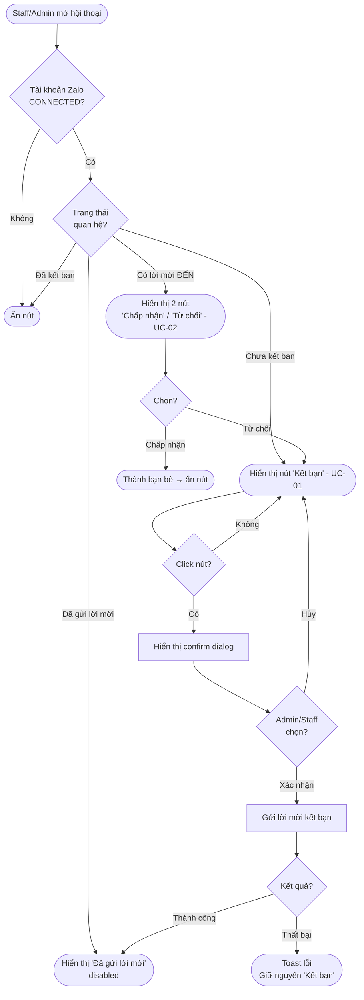
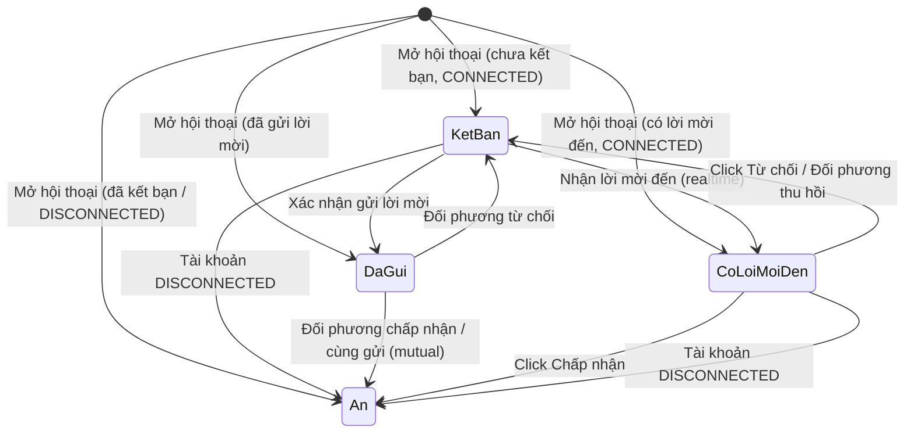

# [G012] Nút "Kết bạn" trong hội thoại

| Trường | Nội dung |
|--------|----------|
| **Feature ID** | G012 |
| **Tên** | Nút "Kết bạn" trong hội thoại |
| **Module** | Chat |
| **Owner (BA)** | Trân |
| **Dev assignee** | — |
| **Priority** | — |
| **Version** | ~~1.0~~ **1.1** |
| **Status** | Draft |
| **Last updated** | ~~2026-07-15~~ **2026-07-22** |

---

## 1. Tổng quan (Overview)

Hiển thị nút **"Kết bạn"** bên dưới tên Zalo trong giao diện hội thoại khi Staff/Admin đang chat với người dùng chưa là bạn bè. Cho phép gửi lời mời kết bạn trực tiếp từ màn hình chat mà không cần chuyển sang màn hình danh bạ.

**[NEW v1.1]** Bổ sung **chiều nhận**: khi đối phương đã gửi lời mời kết bạn cho tài khoản Zalo của mình, hội thoại hiển thị 2 nút **"Chấp nhận" / "Từ chối"** để xử lý nhanh ngay trong chat, không phải ra màn hình Danh bạ (G007 UC-03).

**Cross-reference:**
- **G007 — Kết bạn:** G012 là shortcut **cả hai chiều** (gửi lời mời và xử lý lời mời đến) từ hội thoại; logic kết bạn và trạng thái quan hệ kế thừa G007. Riêng chiều nhận, G012 UC-02 là lối tắt của **G007 UC-03** (vốn chỉ có ở màn hình Danh bạ → tab Đã nhận)

**Use Case Description:**
> ~~Là Staff/Admin, tôi muốn gửi lời mời kết bạn ngay trong khi đang nhắn tin với khách hàng, để không phải thoát ra ngoài tìm trong danh bạ.~~ **[CHANGED v1.1]** Là Staff/Admin, tôi muốn **gửi lời mời kết bạn, hoặc chấp nhận/từ chối lời mời đến** ngay trong khi đang nhắn tin với khách hàng, để không phải thoát ra ngoài màn hình danh bạ.

**Người dùng mục tiêu:** Admin và Staff có quyền truy cập hội thoại.

---

## 2. Điều kiện tiên quyết (Pre-conditions & Trigger)

**Trigger:** Staff/Admin mở một hội thoại bất kỳ.

**Pre-conditions:**
- Tài khoản Zalo đang ở trạng thái **CONNECTED**
- Người dùng trong hội thoại **chưa là bạn bè** với tài khoản Zalo đó
- **[NEW v1.1]** Nhánh nhận (UC-02): đối phương **đã gửi lời mời kết bạn** cho tài khoản Zalo này và lời mời **đang chờ xử lý** (G007 — trạng thái có lời mời đến)

---

## 3. Luồng chính (Happy Path)

### Sơ đồ luồng

> Auto-generated — comment nếu cần sửa logic. **[v1.1]** Bổ sung nhánh "Có lời mời đến" → UC-02.

---

### UC-01 — Gửi lời mời kết bạn từ hội thoại

1. **[Hệ thống]** Kiểm tra trạng thái quan hệ khi mở hội thoại → chưa kết bạn, chưa gửi lời mời → hiển thị nút **"Kết bạn"** bên dưới tên Zalo (BR01)
2. **[Staff/Admin]** Click nút **"Kết bạn"**
3. **[Hệ thống]** Hiển thị confirm dialog: *"Bạn có muốn gửi lời mời kết bạn đến [tên]?"* với **Xác nhận** · **Hủy** (BR05)
4. **[Staff/Admin]** Click **Xác nhận**
5. **[Hệ thống]** Gửi lời mời kết bạn (G007) [→ E01]
6. **[Hệ thống]** Nút đổi thành **"Đã gửi lời mời"** — disabled (BR02)

*Use case kết thúc.*

---

### UC-02 — Xử lý lời mời kết bạn đến (từ hội thoại) **[NEW v1.1]**

> **Xảy ra khi:** đối phương đã gửi lời mời kết bạn cho tài khoản Zalo của mình; Staff/Admin mở hội thoại với người đó.

1. **[Hệ thống]** Kiểm tra trạng thái quan hệ khi mở hội thoại → **có lời mời đến đang chờ** → hiển thị **2 nút "Chấp nhận" / "Từ chối"** bên dưới tên Zalo, **thay cho** nút "Kết bạn" (BR07)
   > *Đã xác nhận (2026-07-22): hệ thống truy được trạng thái "có lời mời đến" **theo từng hội thoại**, không chỉ dạng danh sách tổng — đủ để render 2 nút đúng hội thoại.*
2. **[Staff/Admin]** Click **"Chấp nhận"** hoặc **"Từ chối"** — **không** có confirm dialog, xử lý ngay (BR10) [→ E01]
   - **Chấp nhận** → **[Hệ thống]** xử lý qua G007 → hai bên thành bạn bè → **ẩn** cả 2 nút (BR08)
   - **Từ chối** → **[Hệ thống]** xử lý qua G007 → quan hệ về STRANGER → hiển thị nút **"Kết bạn"** (chiều gửi — UC-01) để có thể chủ động mời lại sau (BR09)
3. **[Hệ thống]** Gửi notification cho đối phương qua hệ thống notification Gopany (G007 BR07)

*Use case kết thúc.*

---

## 4. Luồng phụ (Alternative Flows)

### AF01 — Staff/Admin hủy confirm dialog (UC-01 bước 3)

- **[Staff/Admin]** Click **"Hủy"** trong dialog
- **[Hệ thống]** Đóng dialog; nút giữ nguyên trạng thái **"Kết bạn"**

### AF02 — Đối phương từ chối lời mời

- **[Hệ thống]** Nhận sự kiện đối phương từ chối lời mời kết bạn
- **[Hệ thống]** Nút trở lại trạng thái **"Kết bạn"** (BR03)

### AF03 — Đối phương thu hồi lời mời đến (UC-02) **[NEW v1.1]**

- **Xảy ra khi:** đang hiển thị 2 nút "Chấp nhận"/"Từ chối" thì đối phương **thu hồi** lời mời (từ phía họ)
- **[Hệ thống]** Nhận sự kiện → **ẩn** 2 nút; quan hệ về STRANGER → hiển thị nút **"Kết bạn"** (chiều gửi) (BR11)

### AF04 — Hai bên cùng gửi lời mời (UC-01 ↔ UC-02) **[NEW v1.1]**

- **Xảy ra khi:** mình đang ở trạng thái **"Đã gửi lời mời"** thì đối phương cũng gửi lời mời cho mình (hoặc ngược lại)
- **[Hệ thống]** Zalo tự động ghép thành bạn bè (mutual) → **ẩn** nút (BR12)

---

## 5. Luồng ngoại lệ (Exception Flows)

| Code | Trigger | UI Response | Notification |
|------|---------|-------------|--------------|
| E01 | ~~Gửi lời mời thất bại (lỗi mạng / Zalo API — UC-01 bước 5)~~ **[CHANGED v1.1]** Gửi lời mời **hoặc** Chấp nhận/Từ chối thất bại do Zalo API lỗi (UC-01 b5 · UC-02 b2) | Toast: *"Không thể thực hiện, vui lòng thử lại"*; nút giữ nguyên trạng thái trước thao tác | Ghi error log |
| E02 | Server lỗi 500 | ~~Toast lỗi chung~~ **[CHANGED v1.1]** Toast: *"Lỗi hệ thống. Vui lòng thử lại sau"* | Ghi error log |
| **E03** | **[NEW v1.1]** Mất mạng khi đang thao tác (gửi / chấp nhận / từ chối) | Toast: *"Mất kết nối, vui lòng thử lại"*; giữ nguyên trạng thái nút | — |
| **E04** | **[NEW v1.1]** Người dùng không còn quyền truy cập hội thoại khi gọi API (thu hồi phân quyền giữa chừng) | Toast: *"Bạn không có quyền thực hiện thao tác này"* + ghi log truy cập trái phép | Ghi log |

**Exception Confirmation Log — G012**

| Code | Từ UC | Nguồn HP hay Độc lập | Confirmed |
|------|-------|----------------------|-----------|
| E01 | UC-01 b5 · **[v1.1]** UC-02 b2 | Happy Path | ✅ |
| E02 | Độc lập | Độc lập | ✅ |
| **E03** | Độc lập | Độc lập | ✅ |
| **E04** | UC-01 b5 · UC-02 b2 | Happy Path | ✅ |

> **[NEW v1.1] Bộ 6 Exception chuẩn:** *Unauthorized* → **E04**. *Mất mạng* → **E03**. *Server 500* → **E02**. *Zalo API lỗi* → **E01**. *DISCONNECTED* → không phát sinh exception (ẩn nút — BR06). *Empty state* → không phát sinh.

---

## 6. Business Rules — Quy tắc nghiệp vụ

| Code | Rule | Lý do |
|------|------|-------|
| BR01 | Nút **"Kết bạn"** chỉ hiển thị khi: tài khoản Zalo CONNECTED **và** quan hệ là "chưa kết bạn, chưa gửi lời mời" | Tránh gửi lời mời trùng hoặc không thực hiện được |
| BR02 | Sau khi gửi lời mời thành công → nút chuyển thành **"Đã gửi lời mời"** (disabled); không cho gửi lại trong khi chờ | Tránh gửi trùng |
| BR03 | Khi đối phương từ chối → nút trở lại **"Kết bạn"** | Cho phép gửi lại |
| BR04 | Khi đối phương chấp nhận kết bạn → nút **ẩn hoàn toàn** (real-time hoặc khi reload) | Nút không còn ý nghĩa khi đã là bạn bè |
| BR05 | Bắt buộc hiển thị confirm dialog trước khi gửi — không gửi ngay khi click | Tránh gửi nhầm |
| BR06 | Khi tài khoản Zalo DISCONNECTED → **ẩn nút** (cả nút gửi lẫn 2 nút nhận) | Không gọi được API Zalo |
| **BR07** | **[NEW v1.1]** Khi **có lời mời đến đang chờ** → hiển thị **2 nút "Chấp nhận"/"Từ chối"**, **thay cho** nút "Kết bạn". Trạng thái có lời mời đến **ưu tiên** hơn trạng thái "chưa kết bạn" | Nếu vẫn hiện nút gửi khi đối phương đã mời mình → tạo lời mời chéo vô nghĩa; ưu tiên xử lý lời mời sẵn có |
| **BR08** | **[NEW v1.1]** Click **"Chấp nhận"** thành công → hai bên thành bạn bè → **ẩn** cả 2 nút | Đã là bạn bè thì nút không còn ý nghĩa (nhất quán BR04) |
| **BR09** | **[NEW v1.1]** Click **"Từ chối"** thành công → quan hệ về STRANGER → hiển thị nút **"Kết bạn"** (chiều gửi) | Cho phép chủ động mời lại sau; nhất quán G007 state machine (REJECTED → STRANGER) |
| **BR10** | **[NEW v1.1]** Chấp nhận / Từ chối **không** có confirm dialog — xử lý ngay khi click | Ưu tiên thao tác nhanh; đồng bộ G007 UC-03 (bấm là xử lý ngay) |
| **BR11** | **[NEW v1.1]** Đối phương **thu hồi** lời mời khi đang hiển thị 2 nút → ẩn 2 nút, quan hệ về STRANGER, hiển thị nút "Kết bạn" | Lời mời không còn tồn tại thì không thể chấp nhận/từ chối |
| **BR12** | **[NEW v1.1]** Hai bên cùng gửi lời mời (mình "Đã gửi lời mời" + đối phương cũng gửi) → Zalo tự ghép thành bạn bè → ẩn nút | Bám hành vi Zalo-native (BR-C15); tránh trạng thái kẹt |

---

## 7. State Machine — Trạng thái nút

| Từ trạng thái | Sự kiện | Sang trạng thái |
|---------------|---------|-----------------|
| _(ẩn)_ | Mở hội thoại — chưa kết bạn, chưa gửi lời mời, CONNECTED | **Kết bạn** |
| _(ẩn)_ | Mở hội thoại — đã gửi lời mời chưa được xác nhận | **Đã gửi lời mời** |
| _(ẩn)_ | **[NEW v1.1]** Mở hội thoại — có lời mời đến đang chờ, CONNECTED | **Có lời mời đến** |
| **Kết bạn** | Xác nhận gửi lời mời → thành công | **Đã gửi lời mời** |
| **Kết bạn** | **[NEW v1.1]** Nhận lời mời đến từ đối phương (realtime) | **Có lời mời đến** |
| **Kết bạn** | Tài khoản Zalo DISCONNECTED | _(ẩn)_ |
| **Đã gửi lời mời** | Đối phương từ chối | **Kết bạn** |
| **Đã gửi lời mời** | Đối phương chấp nhận | _(ẩn)_ |
| **[NEW v1.1] Có lời mời đến** | Click **Chấp nhận** → thành công | _(ẩn)_ |
| **[NEW v1.1] Có lời mời đến** | Click **Từ chối** → thành công | **Kết bạn** |
| **[NEW v1.1] Có lời mời đến** | Đối phương thu hồi lời mời (BR11) | **Kết bạn** |
| **[NEW v1.1] Có lời mời đến** | Tài khoản Zalo DISCONNECTED | _(ẩn)_ |

> Auto-generated — comment nếu cần sửa logic. **[v1.1]** Bổ sung trạng thái **Có lời mời đến**.

---

## 8. Data Model

N/A — Không có data model mới. Trạng thái quan hệ kết bạn kế thừa từ G007.

---

## 9. API Contract

N/A — Spec này thuần nghiệp vụ. API contract kế thừa từ G007.

---

## 10. UI/UX Notes — Ghi chú giao diện

### 10A — Vị trí nút

| Element | Mô tả |
|---------|-------|
| Vị trí | Bên dưới tên Zalo trong header hoặc panel thông tin hội thoại |
| Trạng thái **"Kết bạn"** | Nút active, màu primary |
| Trạng thái **"Đã gửi lời mời"** | Nút grayed out, disabled, không click được |
| **[NEW v1.1]** Trạng thái **"Có lời mời đến"** | **2 nút cạnh nhau**: **"Chấp nhận"** (primary) và **"Từ chối"** (secondary); cả hai click là xử lý ngay, không confirm (BR10) |
| Trạng thái ẩn | Không chiếm không gian layout |

### 10B — Confirm Dialog

| Element | Mô tả |
|---------|-------|
| Nội dung | *"Bạn có muốn gửi lời mời kết bạn đến [tên]?"* |
| Nút hành động | **Xác nhận** · **Hủy** |

### 10C — Phân quyền

| Hành động | Admin | Staff |
|-----------|-------|-------|
| Thấy và click nút "Kết bạn" | Có | Có (nếu có quyền truy cập hội thoại — G002) |
| **[NEW v1.1]** Thấy và click "Chấp nhận"/"Từ chối" | Có | Có (nếu có quyền truy cập hội thoại — G002) |

---

## 11. Acceptance Criteria — Tiêu chí nghiệm thu

### UC-01 — Gửi lời mời kết bạn

- [ ] Mở hội thoại với người chưa kết bạn, tài khoản CONNECTED → nút "Kết bạn" hiển thị bên dưới tên (AC-BR01)
- [ ] Click nút → confirm dialog xuất hiện trước khi gửi (AC-BR05)
- [ ] Click Hủy → dialog đóng, nút giữ nguyên "Kết bạn" (AC-AF01)
- [ ] Click Xác nhận → lời mời gửi thành công → nút đổi thành "Đã gửi lời mời" disabled (AC-BR02)
- [ ] Gửi lời mời thất bại → toast lỗi, nút giữ nguyên "Kết bạn" (AC-E01)
- [ ] Đối phương từ chối → nút trở lại "Kết bạn" (AC-BR03)
- [ ] Đối phương chấp nhận → nút ẩn hoàn toàn (AC-BR04)
- [ ] Tài khoản Zalo DISCONNECTED → nút ẩn (AC-BR06)
- [ ] Đã là bạn bè → nút ẩn (AC-BR01)

### UC-02 — Xử lý lời mời đến ⭐ **[NEW v1.1]**

- [ ] Mở hội thoại với người **đã gửi lời mời cho mình**, CONNECTED → hiển thị **2 nút "Chấp nhận"/"Từ chối"**, **không** hiện nút "Kết bạn" (AC-BR07)
- [ ] Click **"Chấp nhận"** → **không** confirm; hai bên thành bạn bè → cả 2 nút ẩn (AC-BR08, AC-BR10)
- [ ] Click **"Từ chối"** → **không** confirm; nút chuyển thành **"Kết bạn"** (chiều gửi) (AC-BR09, AC-BR10)
- [ ] Đang hiện 2 nút mà đối phương **thu hồi** lời mời → 2 nút ẩn, hiện nút "Kết bạn" (AC-BR11, AC-AF03)
- [ ] Đang "Đã gửi lời mời" mà đối phương cũng gửi → Zalo tự ghép bạn bè → nút ẩn (AC-BR12, AC-AF04)
- [ ] Có lời mời đến nhưng tài khoản **DISCONNECTED** → ẩn cả 2 nút (AC-BR06)
- [ ] Chấp nhận/Từ chối thất bại (Zalo API) → toast lỗi, giữ nguyên 2 nút (AC-E01)
- [ ] Staff không còn quyền truy cập hội thoại khi bấm → từ chối thao tác + toast (AC-E04)

---

## 12. Out of Scope — Ngoài phạm vi

| # | Nội dung | Ghi chú |
|---|---------|---------|
| OOS01 | Gửi lời mời kết bạn từ màn hình danh bạ | Đã có trong G007 |
| OOS02 | Xem danh sách lời mời đã gửi | G007 |
| OOS03 | Thu hồi lời mời kết bạn từ hội thoại | Backlog |
| OOS04 | **[NEW v1.1]** Xem/mở lời nhắn kèm theo lời mời đến trong hội thoại | G007 UC-03 (màn hình Danh bạ) hiển thị lời nhắn; G012 chỉ Chấp nhận/Từ chối nhanh |
| OOS05 | **[NEW v1.1]** Chặn / báo xấu người gửi lời mời | Ngoài phạm vi |

---

## 13. Dependencies — Phụ thuộc

| Phụ thuộc vào | Ghi chú |
|---------------|---------|
| **G007 — Kết bạn** | Logic gửi lời mời và trạng thái quan hệ. **[v1.1]** Chiều nhận: G012 UC-02 là lối tắt của **G007 UC-03** (xử lý lời mời đến); notification kế thừa G007 BR07 |
| **G002 — Chia sẻ tài khoản Zalo cho Staff** | Phân quyền Staff xem hội thoại |
| ~~**G010 — Soft Delete**~~ **[CHANGED v1.1] G001 — Liên kết tài khoản Zalo** | Trạng thái CONNECTED/DISCONNECTED của tài khoản Zalo do **G001** định nghĩa (G010 chỉ mở rộng vòng đời — sửa theo PROJECT_KNOWLEDGE I-22) |

---

## 14. Performance & Scalability

| Mục | Yêu cầu |
|-----|---------|
| Kiểm tra trạng thái quan hệ | Thực hiện khi load hội thoại — không delay hiển thị nút |
| Cập nhật trạng thái real-time | Khi đối phương chấp nhận/từ chối → nút cập nhật không cần reload trang |

---

## Changelog — Lịch sử thay đổi

| Ngày | Version | Người thay đổi | Sections | Nội dung | File:Line |
|------|---------|----------------|----------|----------|-----------|
| 2026-07-22 | **v1.1** | Trân (BA) | Header, §1, §2, §3 (UC-02 mới + flowchart), §4 (AF03, AF04), §5, §6, §7, §10, §11, §12, §13 | **Bổ sung chiều nhận:** thêm **UC-02** — xử lý lời mời kết bạn đến ngay trong hội thoại (2 nút Chấp nhận/Từ chối, **instant không confirm** — BR10). Thêm **BR07** (có lời mời đến → hiện 2 nút, ưu tiên hơn nút gửi) · **BR08** (chấp nhận → ẩn) · **BR09** (từ chối → hiện nút "Kết bạn") · **BR11** (đối phương thu hồi) · **BR12** (hai bên cùng gửi → mutual). Thêm trạng thái **"Có lời mời đến"** vào State Machine + diagram; **AF03/AF04**; bổ sung Exception chuẩn **E03** (mất mạng) · **E04** (Unauthorized), sửa E01/E02 wording. Sửa Dependencies: trạng thái CONNECTED do **G001** (I-22). Thêm OOS04–05, AC nhóm UC-02 | — |
| 2026-07-15 | v1.0 | Trân (BA) | — | Tạo draft | — |
