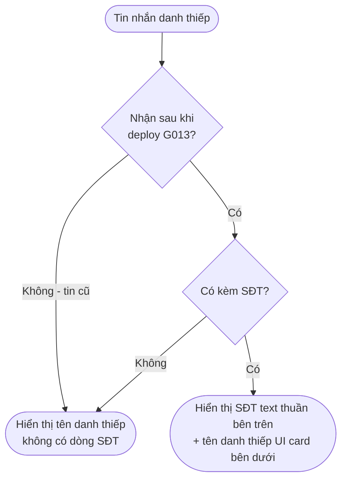

# [G013] Tách SĐT khỏi danh thiếp Zalo

| Trường | Nội dung |
|--------|----------|
| **Feature ID** | G013 |
| **Tên** | Tách SĐT khỏi danh thiếp Zalo |
| **Module** | Chat |
| **Owner (BA)** | Trân |
| **Dev assignee** | — |
| **Priority** | — |
| **Version** | ~~1.0~~ ~~1.1~~ ~~1.2~~ ~~1.3~~ **1.4** |
| **Status** | Draft |
| **Last updated** | ~~2026-07-15~~ ~~2026-07-22~~ ~~2026-07-27~~ ~~2026-07-28~~ **2026-08-11** |

---

## 1. Tổng quan (Overview)

Khi người dùng gửi tin nhắn danh thiếp kèm số điện thoại trên Zalo, hệ thống hiện tại chỉ hiển thị tên danh thiếp và bỏ qua số điện thoại. Feature này fix lỗi hiển thị: tách SĐT ra hiển thị riêng bên dưới danh thiếp dưới dạng text thuần.

**Hành vi hiện tại (bug):**
- Zalo gửi về: danh thiếp có tên + SĐT
- Gopany hiển thị: chỉ tên danh thiếp — SĐT bị ẩn

**Hành vi mong muốn:**
- Gopany hiển thị: SĐT bên trên (text thuần) + tên danh thiếp (UI card)

**Cross-reference:**
- **G012 — Nút Kết bạn:** Khi click vào card danh thiếp → mở hội thoại với người đó → nút Kết bạn (G012) hiển thị như bình thường.
- **G003 — Chat:** **[v1.2]** phân quyền & assign khi mở hội thoại từ card thuộc **G003 BR26** (G013 chỉ trỏ tới, không tự định nghĩa).

**Người dùng mục tiêu:** Staff và Admin xem hội thoại.

---

## 2. Điều kiện tiên quyết (Pre-conditions & Trigger)

G013 áp dụng khi:
- Tin nhắn trong hội thoại có type danh thiếp Zalo
- Danh thiếp đó kèm theo số điện thoại
- **[NEW v1.1]** Tin nhắn danh thiếp được **nhận sau thời điểm deploy G013**. Tin danh thiếp **cũ hơn** (đã lưu trước deploy) **không** hiển thị SĐT — giữ nguyên như hiện tại (BR05)

> Zalo giới hạn mỗi tin nhắn chỉ gửi được 1 danh thiếp — không xử lý trường hợp nhiều danh thiếp trong 1 tin nhắn.

---

## 3. Luồng chính (Happy Path)

### Sơ đồ luồng



> Auto-generated — comment nếu cần sửa logic. **[v1.1]** Bổ sung nhánh phân biệt tin nhận trước/sau deploy.

---

### UC-01 — Hiển thị danh thiếp kèm SĐT

1. **[Hệ thống]** Nhận tin nhắn type danh thiếp từ Zalo **sau thời điểm deploy** — có trường tên và SĐT (BR05)
2. **[Hệ thống]** Render UI card danh thiếp với tên liên lạc
3. **[Hệ thống]** Render SĐT dạng text thuần **bên trên** card danh thiếp (BR01, BR02)

*Use case kết thúc. Staff/Admin nhìn thấy SĐT phía trên và tên danh thiếp phía dưới trong bubble.*

> **[NEW v1.2]** Click vào card (dù có hay không có SĐT) → mở hội thoại với liên hệ **trên tài khoản Zalo của hội thoại đang xem**; phân quyền & assign theo BR06 → **G003 BR26**.

---

### UC-02 — Hiển thị danh thiếp không có SĐT

1. **[Hệ thống]** Nhận tin nhắn type danh thiếp từ Zalo — chỉ có trường tên, không có SĐT
2. **[Hệ thống]** Render UI card danh thiếp với tên liên lạc
3. **[Hệ thống]** Không render dòng SĐT (BR03)
4. **[Staff/Admin]** Click vào card danh thiếp → **mở** hội thoại với liên hệ đó nếu đã có (và có quyền), **hoặc mở hội thoại nháp** nếu chưa có — **trên đúng tài khoản Zalo của hội thoại đang chứa danh thiếp** (BR06); nút Kết bạn hiển thị theo G012

*Use case kết thúc. Card vẫn hoạt động bình thường — chỉ thiếu dòng SĐT.*

> **[NEW v1.1]** Tin danh thiếp **nhận trước khi deploy G013** cũng đi theo luồng này (chỉ hiển thị card tên, không có dòng SĐT) **dù payload gốc có SĐT** — vì dữ liệu cũ không được xử lý lại (BR05). Không cần migration.

---

### UC-03 — Copy SĐT từ danh thiếp **[NEW v1.4]**

1. **[Người dùng]** Bấm **icon Copy** cạnh SĐT — *hoặc* **right-click** vào tin danh thiếp → chọn **"Copy số [SĐT]"**
2. **[Hệ thống]** Copy SĐT vào clipboard; hiển thị toast *"Đã copy số điện thoại"* (BR02)

*Use case kết thúc.*

---

### UC-04 — Kết bạn / Nhắn tin từ danh thiếp **[NEW v1.4]**

1. **[Người dùng]** Trên card danh thiếp, bấm:
   - **"Nhắn tin"** → mở hội thoại với liên hệ theo **G003 BR26** (Case A/B/C; Case C "trùng khách" cùng tài khoản → nút vẫn hiện, bấm → banner/popup chặn) — BR07 [→ E01]
   - *hoặc* **"Kết bạn"** *(chỉ hiện khi chưa là bạn của tài khoản đang xem)* → gửi lời mời qua tài khoản Zalo của hội thoại đang chứa card, theo **G012** — BR07
2. **[Hệ thống]** Thực hiện hành động tương ứng

*Use case kết thúc.*

> **[v1.4]** Liên hệ **đã là bạn của tài khoản Zalo khác** → trên tài khoản đang xem **vẫn** Kết bạn/Nhắn tin được (khách mới — Case A); **không** chặn theo tài khoản khác (BR08).

---

## 4. Luồng phụ (Alternative Flows)

N/A

---

## 5. Luồng ngoại lệ (Exception Flows)

| Code | Trigger | UI Response | Notification |
|------|---------|-------------|--------------|
| E01 | Parse tin nhắn danh thiếp thất bại | Hiển thị tin nhắn dạng text thô; không crash | Ghi error log |
| E02 | Server lỗi 500 | Toast lỗi chung | Ghi error log |

**Exception Confirmation Log — G013**

| Code | Từ UC | Nguồn HP hay Độc lập | Confirmed |
|------|-------|----------------------|-----------|
| E01 | UC-01/UC-02 | Happy Path | ✅ |
| E02 | Độc lập | Độc lập | ✅ |

> **[NEW v1.2]** Click card **không vướng phân quyền cấp 1** (luôn mở trên tài khoản Zalo mình đang xem). Ca **"trùng khách"** ở cấp 2 (hội thoại gán cho người khác) → **bị chặn**: khung hội thoại rỗng/chỉ đọc + banner/popup *"Bạn không có quyền nhắn tin với khách này. Vui lòng liên hệ quản trị viên."* + ghi log (BR06 → G003 BR26).

---

## 6. Business Rules — Quy tắc nghiệp vụ

| Code | Rule | Lý do |
|------|------|-------|
| BR01 | SĐT hiển thị **bên trên** UI card danh thiếp, trong cùng bubble tin nhắn | SĐT là thông tin dẫn dắt, card là chi tiết |
| ~~BR02~~ | ~~SĐT hiển thị text thuần — không link, không click-to-call~~ **[CHANGED v1.4]** SĐT hiển thị text + **icon Copy cạnh SĐT** (click → copy SĐT vào clipboard + toast *"Đã copy số điện thoại"*). **Right-click vào tin danh thiếp** → menu ngữ cảnh có **"Copy số [SĐT]"** (nhất quán thao tác quen thuộc trên Zalo). **Vẫn KHÔNG click-to-call** (gọi điện = OOS01) | Copy nhanh SĐT để dán đi nơi khác; theo thói quen Zalo |
| BR03 | Nếu danh thiếp **không có SĐT** → không render dòng SĐT, không hiển thị placeholder | Tránh hiển thị thông tin trống |
| BR04 | Mỗi tin nhắn chỉ xử lý **1 danh thiếp** — giới hạn từ phía Zalo | Không cần xử lý multiple cards |
| **BR05** | **[NEW v1.1]** Chỉ tin danh thiếp **nhận sau thời điểm deploy G013** mới tách và hiển thị SĐT. Tin danh thiếp **cũ hơn** (đã lưu trước deploy) **không** hiển thị SĐT dù payload gốc có — giữ nguyên như hiện tại, **không xử lý ngược lịch sử** | SĐT được đọc và lưu từ payload tại thời điểm nhận tin; tin cũ chưa lưu trường này nên không hiển thị lại được. Tránh migration hàng loạt. Nhất quán G015 BR15 |
| **BR06** | **[NEW v1.2]** Click card danh thiếp → **mở** hội thoại với **liên hệ trong danh thiếp** (người có tên/SĐT trên card), **trên tài khoản Zalo của hội thoại đang chứa card**. Cơ chế phân quyền & assign khi mở tuân theo **G003 BR26**, 3 nhánh: **(A)** **chưa từng có hội thoại** giữa tài khoản Zalo đó và liên hệ này → click **mở hội thoại nháp (draft)** với người đó; **hội thoại thật chỉ được tạo khi người dùng gửi tin nhắn đầu tiên**, khi đó **auto-assign người click** *(nhất quán G007 BR08/BR09 — nhắn tin mới tạo hội thoại)*; **(B)** **đã có hội thoại** với liên hệ này **và hội thoại đó đang được gán cho mình, hoặc mình có quyền "Hiển thị hội thoại chưa gắn nhân sự" (BR18)** → **mở** hội thoại đó; **(C)** **đã có hội thoại** với liên hệ này nhưng **đang gán cho nhân viên khác — mình không có quyền xem** ("trùng khách") → **bị chặn**: mở khung hội thoại **rỗng/chỉ đọc** + banner/popup *"Bạn không có quyền nhắn tin với khách này. Vui lòng liên hệ quản trị viên."* + ghi log; Admin quyết định assign qua UC-07 | Khách trong danh thiếp được **giới thiệu** → chỉ ưu tiên chăm ngay khi **chưa ai phụ trách** (Case A). Case C khách đã có người phục vụ → chặn để tránh **tranh giành khách giữa nhân viên bán hàng**. Chi tiết phân quyền thuộc **G003 BR26** — G013 chỉ trỏ tới |
| **BR07** | **[NEW v1.4] Nút "Kết bạn" & "Nhắn tin" ngay trên card danh thiếp.**<br>• **Nhắn tin** → mở hội thoại với liên hệ theo **G003 BR26** (Case A mở nháp, auto-assign khi gửi tin đầu · Case B mở · **Case C "trùng khách" trong CÙNG tài khoản → nút vẫn hiển thị, bấm → banner/popup chặn** *"Bạn không có quyền nhắn tin với khách này…"* + ghi log — nhất quán BR06).<br>• **Kết bạn** → theo **G012** (chỉ hiển thị khi **chưa là bạn** của **tài khoản Zalo đang xem**; đã là bạn → ẩn nút); gửi lời mời qua **tài khoản Zalo của hội thoại đang chứa card**. | Thao tác nhanh ngay trên danh thiếp; tái dùng quy tắc sẵn có (BR26/G012), không phát sinh quy tắc mới |
| **BR08** | **[NEW v1.4] "Trùng khách" GIỮA CÁC TÀI KHOẢN ZALO = CHẤP NHẬN (không chặn).** Liên hệ trong danh thiếp **đã là bạn/khách của một tài khoản Zalo KHÁC** → **KHÔNG** chặn Kết bạn/Nhắn tin trên **tài khoản đang xem** (mỗi tài khoản Zalo là **kênh độc lập** — G007 BR11); trên tài khoản đang xem coi là **khách mới (Case A)**. **Ai chăm & chốt thì tính khách cho người đó** là **chính sách tính khách/báo cáo — NGOÀI phạm vi G013** (hệ thống chỉ *cho phép*, không tự tính). Chặn "trùng khách" **CHỈ** áp dụng **trong cùng MỘT tài khoản** (Case C — BR06/BR26). | Không quá hạn chế (tránh mất khách nếu tài khoản kia chăm không tốt); chấp nhận cạnh tranh, ai chốt được tính người đó |

---

## 7. State Machine — Vòng đời

N/A — Feature này là render logic, không có state machine.

---

## 8. Data Model

N/A — Không có data model mới. Dữ liệu danh thiếp và SĐT đến từ payload tin nhắn Zalo.

---

## 9. API Contract

N/A — Spec này thuần nghiệp vụ.

> Lưu ý cho dev: cần đọc thêm trường SĐT từ payload danh thiếp Zalo khi parse tin nhắn type `contact_card`.

---

## 10. UI/UX Notes — Ghi chú giao diện

### 10A — Layout bubble tin nhắn danh thiếp

| Element | Mô tả |
|---------|-------|
| UI card | Hiển thị avatar danh thiếp + tên liên lạc (giữ nguyên như hiện tại) |
| Dòng SĐT | Text, ngay **bên trên** card, trong cùng bubble |
| **[v1.4] Icon Copy** | Nằm **cạnh SĐT**; click → copy SĐT + toast *"Đã copy số điện thoại"* (BR02, UC-03) |
| **[v1.4] Right-click tin** | Menu ngữ cảnh có **"Copy số [SĐT]"** (UX Zalo) — BR02 |
| **[v1.4] 2 nút trên card** | **"Kết bạn"** *(chỉ hiện khi chưa là bạn — G012)* · **"Nhắn tin"** *(mở hội thoại — BR26)* — BR07 |
| Font / màu | Cùng style body text mặc định |
| Khi không có SĐT | Không hiển thị dòng SĐT (và icon Copy); 2 nút Kết bạn/Nhắn tin vẫn hiển thị |

**Minh họa:**
```
  0901 234 567  📋            ← SĐT + icon Copy (mới)
┌───────────────────────────┐
│ 👤  Nguyễn Văn A          │  ← UI card danh thiếp
│  [ Kết bạn ]  [ Nhắn tin ] │  ← 2 nút (mới)
└───────────────────────────┘
   (right-click tin → "Copy số 0901 234 567")
```

---

## 11. Acceptance Criteria — Tiêu chí nghiệm thu

- [ ] Tin nhắn danh thiếp có kèm SĐT → hiển thị SĐT text thuần bên trên + tên card bên dưới (AC-BR01, AC-BR02)
- [ ] Tin nhắn danh thiếp không có SĐT → chỉ hiển thị card tên, không có dòng SĐT (AC-BR03)
- [ ] **[v1.4]** Bấm **icon Copy** cạnh SĐT / **right-click → "Copy số"** → copy SĐT + toast *"Đã copy số điện thoại"* (AC-BR02, UC-03)
- [ ] SĐT **không** có click-to-call (gọi điện vẫn ngoài scope) (AC-BR02, OOS01)
- [ ] **[v1.4]** Card có 2 nút **Kết bạn/Nhắn tin**; **Nhắn tin** → mở hội thoại theo BR26; Case C (trùng khách cùng tài khoản) → nút vẫn hiện, bấm → banner/popup chặn (AC-BR07)
- [ ] **[v1.4]** **Kết bạn** chỉ hiện khi **chưa là bạn** của tài khoản đang xem (G012); gửi lời mời qua tài khoản đó (AC-BR07)
- [ ] **[v1.4]** Liên hệ **đã là bạn của tài khoản KHÁC** → trên tài khoản đang xem **vẫn** Kết bạn/Nhắn tin được (Case A), **không** chặn theo tài khoản khác (AC-BR08)
- [ ] ~~Tin nhắn cũ (lịch sử) có danh thiếp → cũng hiển thị SĐT sau khi deploy~~ **[CHANGED v1.1]** Tin danh thiếp **nhận sau deploy** → hiển thị SĐT (AC-BR05)
- [ ] **[NEW v1.1]** Tin danh thiếp **cũ (trước deploy)** → **không** hiển thị dòng SĐT, kể cả khi payload gốc có SĐT (AC-BR05)
- [ ] Parse thất bại → hiển thị text thô, không crash giao diện (AC-E01)
- [ ] **[v1.2]** Click card → mở hội thoại trên **tài khoản Zalo đang xem**; phân quyền/assign theo G003 BR26 (AC-BR06)
- [ ] **[v1.2]** Ca "trùng khách" (hội thoại gán cho người khác) → **bị chặn**: khung rỗng/chỉ đọc + banner/popup báo không có quyền + ghi log; **không** tự assign (AC-BR06, G003 AC-BR26)

---

## 12. Out of Scope — Ngoài phạm vi

| # | Nội dung | Ghi chú |
|---|---------|---------|
| OOS01 | ~~Click SĐT để gọi hoặc nhắn tin~~ **[v1.4]** **Copy SĐT + Kết bạn/Nhắn tin đã vào scope** (BR02, BR07). Còn **click-to-call (gọi điện)** vẫn ngoài phạm vi | Backlog phần gọi điện |
| OOS02b | **[v1.4]** Chống "trùng khách" **giữa các tài khoản Zalo** (chặn theo người, không theo tài khoản) | Đã quyết **không làm** — chấp nhận trùng khách giữa các tài khoản (BR08); nếu cần là bài riêng ảnh hưởng BR26/G007 |
| OOS02 | **[NEW v1.1]** Xử lý ngược để hiển thị SĐT cho tin danh thiếp cũ (trước deploy) | Không migration; chỉ áp dụng tin nhận sau deploy (BR05) |

---

## 13. Dependencies — Phụ thuộc

| Phụ thuộc vào | Ghi chú |
|---------------|---------|
| **G003 — Chat** | Hệ thống render tin nhắn; G013 mở rộng render cho type danh thiếp. **[v1.2]** Phân quyền & assign khi click card mở hội thoại theo **G003 BR26** |
| **G012 — Nút Kết bạn** | Nút **Kết bạn** trên card danh thiếp (chỉ hiện khi chưa là bạn của tài khoản đang xem); logic/trạng thái theo G012 (BR07) |
| **[v1.4] G007 — Kết bạn** | Nút **Nhắn tin** (mở/tạo hội thoại) & cơ chế gửi lời mời kế thừa G007; luật kênh độc lập theo tài khoản (G007 BR11 — BR08) |

---

## 14. Performance & Scalability

| Mục | Yêu cầu |
|-----|---------|
| Parse danh thiếp | Thực hiện tại thời điểm render tin nhắn — không ảnh hưởng load time |
| ~~Tin nhắn cũ~~ **[CHANGED v1.1] Tin nhắn cũ** | ~~Áp dụng ngay sau deploy, không cần migration~~ **Không** áp dụng ngược — chỉ tin nhận sau deploy mới tách SĐT (BR05). Không migration, không xử lý lại lịch sử |

---

## Changelog — Lịch sử thay đổi

| Ngày | Version | Người thay đổi | Sections | Nội dung | File:Line |
|------|---------|----------------|----------|----------|-----------|
| 2026-07-15 | v1.0 | Trân (BA) | — | Tạo draft | — |
| 2026-07-22 | **v1.1** | Trân (BA) | §2, §3 (flowchart, UC-01, UC-02), §6, §11, §12, §14 | **Giới hạn phạm vi theo thời điểm deploy:** chỉ tin danh thiếp **nhận sau deploy G013** mới tách SĐT; tin cũ (trước deploy) **không** hiển thị SĐT, không xử lý ngược lịch sử (**BR05**). **Đảo ngược** 2 chỗ ở bản v1.0 vốn ghi "tin cũ cũng hiển thị SĐT" (AC + §14). Thêm nhánh flowchart phân biệt trước/sau deploy, OOS02. Nhất quán G015 BR15 | — |
| 2026-07-27 | **v1.2** | Trân (BA) | §1, §3 (UC-01 note, UC-02 b4), §5, §6 (BR06), §11, §13 | **Xử lý phân quyền khi click card danh thiếp mở hội thoại.** Thêm **BR06** (trỏ tới **G003 BR26**): mở trên tài khoản Zalo đang xem; Case A chưa có hội thoại → tạo mới auto-assign người click; Case B đã có & mình thấy → mở; Case C "trùng khách" (đã có & người khác phụ trách) → **CHẶN** (khung rỗng/chỉ đọc + banner/popup báo không có quyền + ghi log; Admin cấp quyền qua UC-07) — tránh giật khách/phá nhau giữa sale. Chi tiết cơ chế đặt tại G003 (nơi định nghĩa assign) — G013 chỉ trỏ tới | — |
| 2026-07-28 | **v1.3** | Trân (BA) | §6 (BR06) | **Làm rõ câu chữ BR06 theo phản hồi review (câu 1):** nói rõ 3 nhánh — **(A)** liên hệ **chưa từng có hội thoại** với tài khoản Zalo đang xem; **(B)** **đã có hội thoại với liên hệ đó** và hội thoại **đang gán cho mình / mình có quyền BR18**; **(C)** đã có nhưng **gán cho người khác, mình không có quyền xem** (trùng khách → chặn). **Case A làm rõ:** click chỉ **mở hội thoại nháp**; hội thoại thật **chỉ tạo khi gửi tin đầu tiên** (auto-assign lúc đó) — nhất quán G007 BR08/BR09. Không đổi logic | — |
| 2026-08-11 | **v1.4** | Trân (BA) | §3 (UC-03, UC-04), §6 (BR02, BR07, BR08), §10, §11, §12, §13 | **Bổ sung 2 tính năng cho danh thiếp:** (1) **Copy SĐT** — icon Copy cạnh SĐT + right-click "Copy số" (UX Zalo), toast "Đã copy" (**BR02** đổi từ text-thuần; **UC-03**); vẫn không click-to-call. (2) **Nút Kết bạn & Nhắn tin ngay trên card** (**BR07**, **UC-04**): Nhắn tin → mở hội thoại theo **G003 BR26** (Case C trùng khách cùng tài khoản → nút vẫn hiện, bấm báo chặn); Kết bạn → theo **G012** (chỉ hiện khi chưa là bạn của tài khoản đang xem). **Quyền/"trùng khách": BR08** — chấp nhận **trùng khách giữa các tài khoản Zalo** (không chặn theo tài khoản khác — mỗi tài khoản Zalo là kênh độc lập G007 BR11; khách mới Case A); ai chăm & chốt tính khách người đó (chính sách báo cáo, ngoài G013); chặn "trùng khách" chỉ trong **cùng một tài khoản** (Case C). Thêm phụ thuộc **G007**; OOS01 (copy vào scope, chừa gọi điện) | — |
