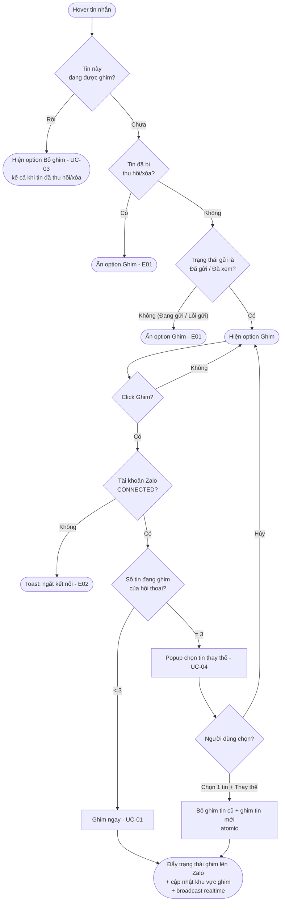
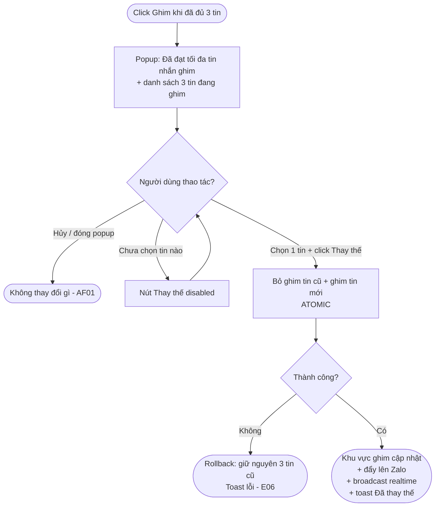
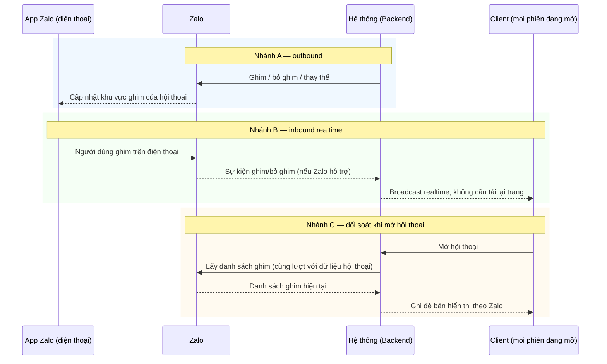
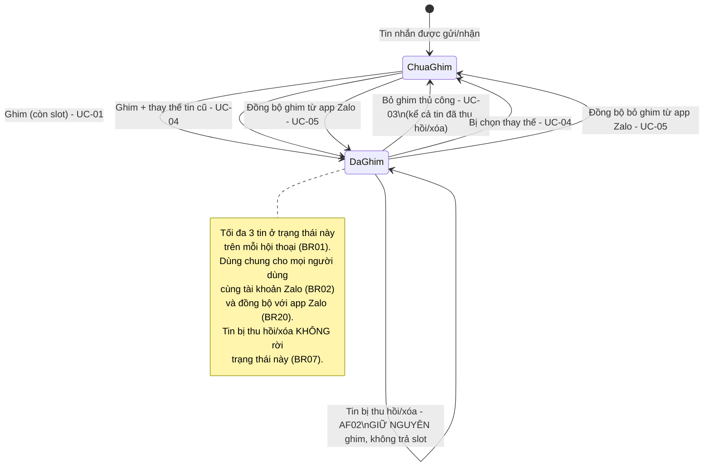

# [G014] Ghim tin nhắn

| Trường | Nội dung |
|--------|----------|
| **Feature ID** | G014 |
| **Tên** | Ghim tin nhắn (Pin Message) |
| **Module** | Chat |
| **Owner (BA)** | Trân |
| **Dev assignee** | — |
| **Priority** | **Cao — scope tuần hiện tại** |
| **Version** | ~~1.0~~ **1.1** |
| **Status** | Draft |
| **Last updated** | ~~2026-07-20~~ **2026-07-27** |

---

## 1. Tổng quan (Overview)

**Ghim tin nhắn** cho phép người dùng đánh dấu tối đa **3 tin nhắn** quan trọng trong một hội thoại — **cả hội thoại cá nhân (1:1) và hội thoại nhóm** — để truy cập nhanh mà không phải cuộn lại lịch sử chat. Ghim là thao tác **Zalo-native**: trạng thái ghim được đẩy lên Zalo và **đồng bộ hai chiều** với app Zalo trên điện thoại.

G014 tách từ **G003 UC-05** (trước đây chỉ có 5 bước + 1 Business Rule) thành tài liệu độc lập, đặc tả đầy đủ để Dev và QA có một nguồn duy nhất.

**Use Case Description:**
> Là người dùng đang xử lý hội thoại — cá nhân hoặc nhóm — tôi muốn ghim những tin nhắn quan trọng lên đầu hội thoại, để tôi và đồng nghiệp truy cập nhanh thông tin cần thiết, dù đang dùng hệ thống hay app Zalo trên điện thoại.

| Mục | Nội dung |
|-----|---------|
| **Người dùng mục tiêu** | **Admin/Owner** — mọi hội thoại trong workspace · **Staff được phân quyền** — trong phạm vi hội thoại được phép truy cập. **Không** yêu cầu quyền đặc biệt nào ngoài quyền truy cập hội thoại |
| **Phụ thuộc** | G001 (Liên kết Zalo) · G002 (Phân quyền) · G003 (Chat) · G008 (Nhóm) · G010 (Soft Delete) — chi tiết §13 |

---

### 1.1 — Phạm vi hội thoại: cá nhân **và** nhóm

Ghim tin nhắn áp dụng cho **cả hai loại hội thoại**, dùng **chung một luồng** — cùng giới hạn, cùng giao diện, cùng quy tắc (BR12).

| Loại hội thoại | Áp dụng | Ghi chú |
|----------------|:-------:|---------|
| **Hội thoại cá nhân (1:1)** | ✅ | Tin ghim hiển thị cho cả người dùng hệ thống và người dùng Zalo ở đầu bên kia |
| **Hội thoại nhóm** | ✅ | Tin ghim hiển thị cho **mọi thành viên nhóm** trên Zalo. **Thành viên thường cũng ghim được**, không cần là trưởng nhóm. **[v1.1]** **Thành viên vào nhóm sau** vẫn xem được **toàn bộ** tin ghim ngay khi mở hội thoại (BR22) |
| **Nhóm đã rời / bị giải tán** | ⚠️ Chỉ đọc | Xem được danh sách ghim; **không** ghim / bỏ ghim (BR13) |

> **Không có nhánh xử lý riêng cho nhóm.** Mọi Business Rule, Exception và Acceptance Criteria trong tài liệu này áp dụng như nhau cho cả hai loại hội thoại, trừ đúng một ngoại lệ đã nêu ở BR13.

---

### 1.2 — Nguyên tắc cốt lõi

| # | Nguyên tắc | Chi tiết |
|---|-----------|---------|
| 1 | **Cấp hội thoại, không phải cấp người dùng** | Giới hạn 3 tin tính **trên hội thoại**. **Không có** danh sách ghim riêng của từng người dùng (BR01, BR02) |
| 2 | **Dùng chung** | Mọi người dùng cùng tài khoản Zalo — và người ở đầu bên kia hội thoại / trong nhóm — thấy **cùng một danh sách ghim** (BR02) |
| 3 | **Zalo là nguồn sự thật** | Trạng thái ghim nằm trên Zalo, hệ thống không giữ bản riêng (BR20) |
| 4 | **Đồng bộ hai chiều** | Ghim từ hệ thống → hiện trên app Zalo ở điện thoại; ghim từ app Zalo → phản ánh về hệ thống (UC-05, BR20) |
| 5 | **Không giới hạn theo mốc phân quyền** | Danh sách ghim hiển thị đầy đủ cho mọi người có quyền truy cập hội thoại, kể cả tin ghim cũ hơn ngày họ được phân quyền — **ngoại lệ có chủ ý** của G002 BR03 (BR18) |

---

### 1.3 — Phân biệt hai tính năng dễ nhầm ⚠️

| | **Ghim tin nhắn** *(G014 — tài liệu này)* | **Ghim hội thoại** *(G009 UC-06)* |
|---|---|---|
| Đối tượng được ghim | Một **tin nhắn** bên trong hội thoại | Một **hội thoại** trong danh sách hội thoại |
| Giới hạn | **3 tin / hội thoại** | **5 hội thoại / tài khoản Zalo** |
| Vị trí hiển thị | Khu vực ghim cạnh header hội thoại | Đầu danh sách hội thoại (panel trái) |
| Khi vượt giới hạn | Popup cho chọn tin thay thế (UC-04) | Toast từ chối (G009 E03) |

> Hai tính năng **độc lập hoàn toàn**, không chia sẻ dữ liệu hay giới hạn. Đặt tên biến/endpoint phải phân biệt rõ để tránh nhầm khi bảo trì.

---

### 1.4 — Quan hệ với các Spec hiện có

| Spec | Quan hệ |
|------|---------|
| **G003 UC-05 + BR08** | **G014 thay thế hoàn toàn** — không implement theo G003 |
| **G008 OOS02** | *"Ghim tin nhắn trong nhóm — thuộc phạm vi G003"* → nay là **G014**. Nhóm và cá nhân dùng chung một luồng (§1.1, BR12) |
| **G009 OOS03** | *"Ghim tin nhắn — đã spec tại G003 UC-05"* → nay là **G014** |
| **G009 UC-06** | **Tính năng KHÁC** — *Ghim hội thoại*. Xem §1.3 |

---

## 2. Điều kiện tiên quyết (Pre-conditions & Trigger)

**Trigger:**

| # | Hành động | Điểm kích hoạt |
|---|-----------|----------------|
| T1 | Ghim tin nhắn | Hover vào tin nhắn trong khung chat → click option **"Ghim"** |
| T2 | Xem danh sách tin đã ghim | Click vào **khu vực ghim** cạnh header hội thoại |
| T3 | Bỏ ghim | Click icon bỏ ghim trong popup danh sách (T2), **hoặc** hover tin đã ghim → option **"Bỏ ghim"** |
| T4 | Đồng bộ trạng thái ghim | **[Hệ thống]** Mở hội thoại (đối soát lại với Zalo), **hoặc** nhận sự kiện ghim/bỏ ghim từ Zalo |

**Pre-conditions:**
- [ ] Người dùng đã đăng nhập và có session hợp lệ
- [ ] Người dùng có quyền truy cập hội thoại đó (theo G002 / G003 BR02, BR11, BR18)
- [ ] Hội thoại đang được mở ở khung chat
- [ ] **Để ghim / bỏ ghim:** tài khoản Zalo của hội thoại đang ở trạng thái **CONNECTED** [→ E02, BR10]
- [ ] **Để xem danh sách ghim:** không yêu cầu CONNECTED — xem được cả khi DISCONNECTED (BR10)
- [ ] **Để ghim mới:** tin nhắn mục tiêu chưa bị thu hồi hoặc xóa [→ E01, BR04]
- [ ] **Để ghim mới:** tin nhắn mục tiêu đang ở trạng thái **Đã gửi** hoặc **Đã xem** (G003 §7). Tin **Đang gửi** / **Lỗi gửi** chưa ghim được [→ E01, BR03]

**Post-conditions (sau khi ghim thành công):**
- Tin nhắn xuất hiện trong khu vực ghim của hội thoại, ở **vị trí trên cùng** (BR08)
- Số lượng tin ghim của hội thoại tăng lên (tối đa 3)
- Mọi phiên đang mở hội thoại đó — mọi người dùng, tab, thiết bị dùng chung tài khoản Zalo — cập nhật khu vực ghim **realtime**, không cần tải lại trang (BR09)
- Tin nhắn được ghim **trên Zalo**: người dùng mở app Zalo ở điện thoại thấy đúng tin đó trong khu vực ghim của hội thoại (BR20)
- Option hover của tin nhắn đó đổi từ **"Ghim"** sang **"Bỏ ghim"**

---

## 3. Luồng chính (Happy Path)

G014 gồm **5 Use Case**.

### Sơ đồ luồng tổng thể



> Auto-generated — comment nếu cần sửa logic

---

### UC-01 — Ghim tin nhắn (hội thoại còn slot)

1. **[Người dùng]** Hover vào tin nhắn trong khung chat → menu option xuất hiện
2. **[Người dùng]** Click option **"Ghim"** [→ E01, E02]
3. **[Hệ thống]** Kiểm tra số tin đang ghim của hội thoại:
   - **< 3** → tiếp tục bước 4
   - **= 3** → chuyển sang **UC-04** (popup thay thế), kết thúc UC-01 tại đây [→ BR05]
4. **[Hệ thống]** Gửi yêu cầu ghim lên Zalo [→ E03, E04, E05, E08]
5. **[Zalo]** Xác nhận ghim thành công; tin nhắn được ghim ở **cấp hội thoại trên Zalo** — hiển thị cho mọi thành viên hội thoại/nhóm và trên app Zalo ở điện thoại (BR02, BR20)
6. **[Hệ thống]** Hiển thị tin trong **khu vực ghim** cạnh header hội thoại, ở **vị trí trên cùng** (BR08); cập nhật số đếm nếu có nhiều hơn 1 tin ghim
7. **[Hệ thống]** Broadcast realtime tới mọi phiên đang mở hội thoại này (BR09)
8. **[Hệ thống]** Option hover của tin nhắn đó đổi thành **"Bỏ ghim"**

*Use case kết thúc.*

```mermaid
sequenceDiagram
    actor U as Người dùng
    participant C as Client
    participant S as Hệ thống (Backend)
    participant Z as Zalo
    participant P as App Zalo (điện thoại)

    U->>C: Hover tin nhắn → click "Ghim"
    C->>S: Yêu cầu ghim (hội thoại, tin nhắn)
    S->>S: Kiểm tra số tin đang ghim < 3
    S->>Z: Ghim tin nhắn
    Z-->>S: Xác nhận thành công
    Z-->>P: Tin hiển thị trong khu vực ghim của hội thoại
    S-->>C: Kết quả + danh sách ghim mới
    S-->>C: Broadcast realtime tới mọi phiên khác
    C-->>U: Tin xuất hiện đầu khu vực ghim;\noption đổi thành "Bỏ ghim"
```

> Auto-generated — comment nếu cần sửa logic

---

### UC-02 — Xem danh sách tin nhắn đã ghim

1. **[Người dùng]** Click vào **khu vực ghim** cạnh header hội thoại
2. **[Hệ thống]** Hiển thị popup **"Tin nhắn đã ghim"** chứa danh sách tin đang ghim, sắp xếp **tin ghim sau đứng trên** (BR08)
3. **[Hệ thống]** Mỗi dòng hiển thị: tên người gửi · nội dung rút gọn tối đa **100 ký tự** (tin media hiển thị nhãn loại; tin đã thu hồi/xóa hiển thị nhãn trạng thái kèm nội dung gốc) · thời điểm ghim · **icon bỏ ghim** (BR14)
4. **[Người dùng]** Đóng popup, hoặc thực hiện bỏ ghim [→ UC-03]

*Use case kết thúc.*

**Ghi chú:**
- Hội thoại chưa ghim tin nào → **khu vực ghim không hiển thị** (không chiếm chỗ layout, không hiện trạng thái rỗng) [→ BR17]
- Tài khoản Zalo **DISCONNECTED** → vẫn mở được popup, danh sách hiển thị **chỉ đọc**; icon bỏ ghim vẫn hiện nhưng click → E02 (BR10)
- Danh sách hiển thị **đầy đủ cho mọi người dùng có quyền truy cập hội thoại**, kể cả tin ghim gửi trước mốc phân quyền của họ (BR18)

---

### UC-03 — Bỏ ghim tin nhắn

**Nhánh A — Bỏ ghim từ popup danh sách:**

1. **[Người dùng]** Mở popup danh sách tin đã ghim (UC-02)
2. **[Người dùng]** Click **icon bỏ ghim** ở dòng tin cần bỏ [→ E02, E07]
3. **[Hệ thống]** Gửi yêu cầu bỏ ghim lên Zalo [→ E03, E04, E07, E08]
4. **[Zalo]** Xác nhận → tin biến khỏi khu vực ghim trên Zalo, kể cả trên app Zalo ở điện thoại (BR20)
5. **[Hệ thống]** Tin biến khỏi danh sách ghim và khỏi khu vực ghim; slot được trả lại (số tin ghim giảm 1); broadcast realtime (BR09)
6. **[Hệ thống]** Option hover của tin nhắn đó đổi lại thành **"Ghim"**

**Nhánh B — Bỏ ghim từ khung chat:**

1. **[Người dùng]** Hover vào tin nhắn **đang được ghim** trong khung chat
2. **[Người dùng]** Click option **"Bỏ ghim"** [→ E02, E07]
3. Các bước tiếp theo giống Nhánh A từ bước 3

*Use case kết thúc.*

> **Không có popup xác nhận** cho thao tác bỏ ghim — thao tác nhẹ và có thể ghim lại ngay (khác với các thao tác xóa dữ liệu theo BR-C14).
>
> Bỏ ghim áp dụng cho **cả tin nhắn đã bị thu hồi hoặc xóa** đang nằm trong danh sách ghim (BR04, BR07). Đây là **đường thoát duy nhất** để giải phóng slot của tin đó — nếu ẩn "Bỏ ghim" trên tin đã thu hồi thì hội thoại đủ 3 tin toàn tin đã thu hồi sẽ **kẹt slot vĩnh viễn**.

---

### UC-04 — Ghim khi hội thoại đã đủ 3 tin (thay thế tin đang ghim)

> **Điều kiện kích hoạt:** Người dùng click **"Ghim"** trên một tin nhắn trong khi hội thoại **đã có đủ 3 tin ghim** (UC-01 bước 3).

1. **[Hệ thống]** Hiển thị popup **"Đã đạt tối đa tin nhắn ghim"** gồm:
   - Nội dung: *"Hội thoại này đã ghim đủ 3 tin nhắn. Chọn 1 tin để bỏ ghim và thay bằng tin nhắn mới."*
   - Danh sách **3 tin đang ghim**, mỗi dòng có **ô chọn đơn (radio)** + tên người gửi + nội dung rút gọn 100 ký tự + thời điểm ghim
   - Khối xem trước tin nhắn **sắp được ghim**
   - Nút **"Thay thế"** *(primary — **disabled** cho đến khi chọn 1 tin)* và nút **"Hủy"**
2. **[Người dùng]** Chọn 1 tin trong 3 tin đang ghim [→ AF01]
3. **[Hệ thống]** Kích hoạt nút **"Thay thế"**
4. **[Người dùng]** Click **"Thay thế"** [→ E02]
5. **[Hệ thống]** Thực hiện **atomic**: bỏ ghim tin được chọn **và** ghim tin mới — hai thao tác thành công hoặc thất bại cùng nhau (BR06) [→ E06]
6. **[Hệ thống]** Đóng popup; khu vực ghim cập nhật: tin cũ biến mất, tin mới xuất hiện ở **vị trí trên cùng** (BR08)
7. **[Hệ thống]** Broadcast realtime tới mọi phiên đang mở hội thoại (BR09); trạng thái mới phản ánh sang app Zalo (BR20)
8. **[Hệ thống]** Toast: *"Đã thay thế tin nhắn ghim"*

*Use case kết thúc.*



> Auto-generated — comment nếu cần sửa logic

---

### UC-05 — Đồng bộ trạng thái ghim với app Zalo (hai chiều)

> **Actor:** Hệ thống · Zalo. Không có thao tác người dùng trực tiếp trong hệ thống.
> **Nguyên tắc:** **Zalo là nguồn sự thật.** Hệ thống không giữ danh sách ghim riêng (BR20).

**Nhánh A — Từ hệ thống ra app Zalo (outbound):**

1. **[Người dùng]** Ghim / bỏ ghim / thay thế trong hệ thống (UC-01, UC-03, UC-04)
2. **[Hệ thống]** Đẩy thao tác lên Zalo [→ E03, E04, E08]
3. **[Zalo]** Cập nhật trạng thái ghim ở **cấp hội thoại**
4. **[Zalo]** Trạng thái mới hiển thị trên **app Zalo ở điện thoại** và với mọi thành viên hội thoại/nhóm

**Nhánh B — Từ app Zalo về hệ thống (inbound, realtime):**

1. **[Người dùng]** Ghim / bỏ ghim trực tiếp trên **app Zalo ở điện thoại**
2. **[Zalo]** Gửi sự kiện đồng bộ về hệ thống *(nếu Zalo hỗ trợ sự kiện này; nếu không, **Nhánh C** là cơ chế bảo đảm)*
3. **[Hệ thống]** Cập nhật khu vực ghim và popup danh sách **realtime**, không cần tải lại trang (BR09)
4. **[Hệ thống]** Không toast, không notification (BR16)

**Nhánh C — Đối soát khi mở hội thoại (bảo đảm nhất quán):**

1. **[Người dùng]** Mở một hội thoại trong khung chat
2. **[Hệ thống]** Lấy danh sách ghim **từ Zalo** cùng lúc với dữ liệu hội thoại — không gọi thêm lượt riêng (BR21, §15) [→ E10]
3. **[Hệ thống]** **Ghi đè** bản hiển thị hiện có bằng danh sách vừa lấy — kể cả khi khác với bản đang hiển thị
4. **[Hệ thống]** Nếu nguồn trả về nhiều hơn 3 tin → chỉ hiển thị 3 tin mới nhất [→ E09, BR15]

*Use case kết thúc.*

> **Không dùng polling.** Ngoài sự kiện realtime (Nhánh B) và lần đối soát khi mở hội thoại (Nhánh C), hệ thống **không** chủ động hỏi Zalo theo chu kỳ (BR21, §15).



> Auto-generated — comment nếu cần sửa logic

---

## 4. Luồng phụ (Alternative Flows)

### AF01 — Hủy popup thay thế (UC-04, bước 2)

- **Xảy ra khi:** Người dùng mở popup thay thế nhưng quyết định không thay
- **[Người dùng]** Click **"Hủy"**, nhấn `Esc`, hoặc click ra ngoài popup
- **[Hệ thống]** Đóng popup; **không** thay đổi danh sách ghim; tin nhắn nguồn **không** được ghim
  - Use Case kết thúc.

### AF02 — Tin nhắn đang ghim bị thu hồi hoặc xóa

- **Xảy ra khi:** Một tin nhắn đang nằm trong danh sách ghim bị **thu hồi** (G003 UC-06) hoặc **xóa chỉ phía tôi**, bởi bất kỳ ai và từ bất kỳ nguồn nào (hệ thống hoặc app Zalo)
- **[Hệ thống]** **Giữ nguyên trạng thái ghim** — tin **vẫn nằm** trong khu vực ghim và trong popup danh sách; **slot không được trả lại** (BR07)
- **[Hệ thống]** Dòng tin đó đổi cách hiển thị: **nhãn trạng thái** *"Đã thu hồi"* / *"Đã xóa"* **kèm nội dung gốc rút gọn** ở dạng chỉ đọc (BR14)
- **[Hệ thống]** Nếu popup danh sách hoặc popup thay thế (UC-04) đang mở → dòng đó **vẫn hiển thị** và **vẫn chọn được** làm tin bị thay thế; lựa chọn đang chọn **không bị hủy**
- **[Người dùng]** Muốn giải phóng slot → **bỏ ghim thủ công** theo UC-03 (option "Bỏ ghim" vẫn khả dụng trên tin đã thu hồi/xóa — BR04)
- **[Hệ thống]** Không toast, không notification (BR16)
  - Use Case kết thúc.

### AF03 — Người dùng khác thay đổi danh sách ghim đồng thời

- **Xảy ra khi:** Người dùng B ghim / bỏ ghim / thay thế trong khi người dùng A đang mở cùng hội thoại. Bao gồm cả trường hợp B thao tác từ **app Zalo trên điện thoại** (UC-05 Nhánh B)
- **[Hệ thống]** Đẩy trạng thái mới tới phiên của A **realtime** (BR09); khu vực ghim và popup danh sách của A tự cập nhật
- Nếu A đang mở popup thay thế (UC-04) và danh sách ghim vừa đổi → popup **cập nhật lại danh sách 3 tin**; lựa chọn đang chọn bị hủy nếu tin đó không còn được ghim
- Nếu vì thay đổi đó mà hội thoại **còn dưới 3 tin ghim** → popup thay thế **tự đóng** và hệ thống ghim thẳng tin nguồn theo UC-01
  - Use Case kết thúc.

### AF04 — Quyền truy cập hội thoại bị thu hồi giữa chừng

- **Xảy ra khi:** Trong lúc người dùng đang mở hội thoại (và có thể đang mở popup danh sách ghim hoặc popup thay thế), quyền truy cập hội thoại đó bị mất — Admin gỡ phân quyền tài khoản Zalo (G002), hoặc hội thoại bị gán cho người khác và người dùng không bật *"Hiển thị hội thoại chưa gắn nhân sự"* (G003 BR18)
- **[Hệ thống]** Hội thoại **ẩn ngay lập tức** khỏi danh sách theo BR-C02 (không chờ tải lại trang)
- **[Hệ thống]** **Đóng ngay** mọi popup ghim đang mở (danh sách ghim, popup thay thế) [→ BR19]
- **[Hệ thống]** **Hủy** mọi thao tác ghim / bỏ ghim / thay thế đang chờ kết quả; **không** thực thi dù yêu cầu đã được gửi đi
- **[Hệ thống]** Toast: *"Bạn không còn quyền truy cập hội thoại này"*
  - Use Case kết thúc.

---

## 5. Luồng ngoại lệ (Exception Flows)

| Code | Trigger (Điều kiện kích hoạt) | UI Response | Recovery | Notification |
|------|-------------------------------|-------------|----------|--------------|
| E01 | Người dùng hover vào tin nhắn **chưa được ghim** đang ở trạng thái **đã thu hồi / đã xóa**, hoặc **Đang gửi / Lỗi gửi** (UC-01 bước 1) | Option **"Ghim"** **ẩn hoàn toàn** khỏi menu hover (BR03, BR04). Nếu tin đó **đang được ghim** → option **"Bỏ ghim" vẫn hiển thị** (BR07) | — | — |
| E02 | Tài khoản Zalo của hội thoại đang **DISCONNECTED** — người dùng click "Ghim" / "Bỏ ghim" / icon bỏ ghim (UC-01 b2, UC-03 b2, UC-04 b4) | Toast: *"Tài khoản Zalo đang ngắt kết nối. Vui lòng kết nối lại"*; **không** thay đổi danh sách ghim; danh sách vẫn **xem được** | Kết nối lại tài khoản Zalo (G001) | — |
| E03 | Zalo trả lỗi hoặc không phản hồi khi ghim / bỏ ghim (UC-01 b4, UC-03 b3, UC-05 nhánh A b2) | Toast: *"Không thể thực hiện, vui lòng thử lại"*; trạng thái ghim **giữ nguyên như trước thao tác** | Người dùng thử lại | Ghi error log |
| E04 | Mất kết nối mạng khi đang thực hiện thao tác | Toast: *"Mất kết nối, vui lòng thử lại"*; trạng thái ghim giữ nguyên; **giữ nguyên popup và lựa chọn đang chọn** | Người dùng kiểm tra mạng, thử lại | — |
| E05 | Tin nhắn **đã được người khác ghim** ngay trước đó (tranh chấp đồng thời, kể cả từ app Zalo) — hệ thống nhận yêu cầu ghim một tin đã ở trạng thái ghim | **Không** tạo bản ghi trùng, **không** báo lỗi; đồng bộ lại khu vực ghim theo trạng thái thực tế trên Zalo; option hover đổi thành "Bỏ ghim" | Tự xử lý — người dùng không cần thao tác | Ghi warning log |
| E06 | **Thay thế tin ghim thất bại** (UC-04 bước 5) — lỗi ở bước bỏ ghim tin cũ hoặc bước ghim tin mới | **Rollback toàn bộ**: giữ nguyên đúng 3 tin ghim ban đầu, tin nguồn **không** được ghim. Toast: *"Không thể thay thế tin nhắn ghim, vui lòng thử lại"*; popup **giữ nguyên** để thử lại | Người dùng click "Thay thế" lại | Ghi error log |
| E07 | Bỏ ghim thất bại (UC-03 bước 3) | Toast: *"Không thể bỏ ghim, vui lòng thử lại"*; tin **vẫn nằm** trong danh sách ghim | Người dùng thử lại | Ghi error log |
| E08 | Server lỗi 500 ở bất kỳ thao tác nào | Toast lỗi chung: *"Lỗi hệ thống. Vui lòng thử lại sau"* | Người dùng thử lại | Ghi error log |
| E09 | Nguồn dữ liệu trả về **nhiều hơn 3 tin ghim** cho một hội thoại (dữ liệu không nhất quán, hoặc ghim từ app Zalo vượt giới hạn) | Hệ thống chỉ hiển thị **3 tin ghim mới nhất**; không crash, không báo lỗi cho người dùng (BR15) | Tự xử lý | Ghi warning log |
| E10 | **Đối soát danh sách ghim khi mở hội thoại thất bại** (UC-05 nhánh C bước 2) — Zalo không phản hồi hoặc trả lỗi | **Không chặn việc mở hội thoại.** Khung chat và tin nhắn hiển thị bình thường; khu vực ghim hiển thị **bản gần nhất đã biết**; **không** hiện toast lỗi | Tự động thử lại ở lần mở hội thoại kế tiếp | Ghi warning log |

**Exception Confirmation Log — G014**

| Code | Từ UC | Nguồn HP hay Độc lập | Confirmed |
|------|-------|----------------------|-----------|
| E01 | UC-01, bước 1–2 | Happy Path | ✅ |
| E02 | UC-01 b2 · UC-03 b2 · UC-04 b4 | Happy Path | ✅ |
| E03 | UC-01 b4 · UC-03 b3 · UC-05 nhánh A b2 | Happy Path | ✅ |
| E04 | Độc lập | Độc lập | ✅ |
| E05 | UC-01, bước 4 | Happy Path | ✅ |
| E06 | UC-04, bước 5 | Happy Path | ✅ |
| E07 | UC-03, bước 3 | Happy Path | ✅ |
| E08 | Độc lập | Độc lập | ✅ |
| E09 | UC-02 b2 · UC-05 nhánh C b4 | Happy Path | ✅ |
| E10 | UC-05 nhánh C, bước 2 | Happy Path | ✅ |

> **Ghi chú về bộ 6 Exception chuẩn (PROJECT_KNOWLEDGE §6.3):**
> - **Unauthorized** — **có chủ ý không đặc tả trong G014.** Quyền truy cập hội thoại đã được kiểm soát ở tầng trên bởi **G002** (phân quyền tài khoản Zalo) và **G003 BR02/BR11/BR18** (phân quyền hội thoại); G014 không lặp lại. Trường hợp **mất quyền giữa chừng** được xử lý tại **AF04 + BR19**.
> - **Empty state** — không phát sinh exception; xử lý tại **BR17** (hội thoại chưa ghim tin nào → khu vực ghim không hiển thị).

---

## 6. Business Rules — Quy tắc nghiệp vụ

| Code | Rule | Lý do |
|------|------|-------|
| BR01 | Mỗi hội thoại ghim **tối đa 3 tin nhắn**. Giới hạn tính **trên hội thoại**, không tính trên người dùng *(kế thừa G003 BR08)* | Tránh lạm dụng ghim; giữ khu vực ghim gọn |
| BR02 | Ghim tin nhắn là thao tác **Zalo-native, cấp hội thoại**: trạng thái ghim được đẩy lên Zalo. **Mọi người dùng** dùng chung tài khoản Zalo đó — và người dùng Zalo ở đầu bên kia hoặc trong nhóm — đều thấy **cùng một danh sách ghim**. **Không** có danh sách ghim riêng theo từng người dùng | Nhất quán với Zalo native và với mô hình tài khoản dùng chung (G002, G009 BR19) |
| BR03 | Ghim được **mọi loại tin nhắn** hiển thị trong hội thoại: text, ảnh, video, tệp tin, sticker, tin nhắn có định dạng, tin nhắn reply. Nhưng chỉ ghim được tin **đã gửi xong** — tin ở trạng thái **Đang gửi** hoặc **Lỗi gửi** (G003 §7) → option **"Ghim"** **ẩn hoàn toàn** | Không loại trừ theo loại nội dung. Tin chưa gửi xong thì chưa tồn tại trên Zalo, không có gì để ghim (BR02) |
| BR04 | Tin nhắn **đã thu hồi hoặc đã xóa**: option **"Ghim"** **ẩn hoàn toàn** (không ghim **mới** được); nhưng nếu tin đó **đang được ghim** thì option **"Bỏ ghim" vẫn hiển thị bình thường** | Không cho ghim mới nội dung đã bị gỡ. Nhưng phải giữ "Bỏ ghim" làm **đường thoát giải phóng slot** — nếu ẩn cả hai, hội thoại đủ 3 tin toàn tin đã thu hồi sẽ kẹt slot vĩnh viễn (BR07) |
| BR05 | Khi hội thoại **đã đủ 3 tin ghim**: option **"Ghim"** **vẫn hiển thị bình thường**, không ẩn và không disable. Click → mở popup thay thế (UC-04) | Nguyên tắc BR-C06: điều kiện runtime thì báo khi thao tác, không ẩn control. Cho người dùng đường đi tiếp thay vì chặn cứng |
| BR06 | Thao tác **thay thế** (UC-04) là **atomic**: bỏ ghim tin cũ và ghim tin mới thành công hoặc thất bại **cùng nhau**. Không được phép tồn tại trạng thái trung gian chỉ còn 2 tin ghim | Tránh mất tin ghim khi thao tác lỗi giữa chừng |
| BR07 | Tin nhắn đang ghim bị **thu hồi hoặc xóa** (bởi bất kỳ ai, từ hệ thống hoặc app Zalo) → **giữ nguyên trạng thái ghim**. Tin **vẫn nằm** trong khu vực ghim và popup danh sách, hiển thị **nhãn trạng thái kèm nội dung gốc** ở dạng chỉ đọc; **slot KHÔNG được trả lại**. Muốn giải phóng slot → người dùng **bỏ ghim thủ công** (UC-03) | Khác Zalo, hệ thống **không xóa hẳn** nội dung — tin thu hồi/xóa vẫn giữ nội dung gốc dạng chỉ đọc (G003 BR07) nên tin ghim vẫn xem lại được. Thêm nữa, ghim là **Zalo-native dùng chung** (BR02): "xóa chỉ phía tôi" chỉ ảnh hưởng một phía, tự bỏ ghim sẽ gỡ ghim cho **cả hội thoại** — sai nghiệp vụ. Tình huống hiếm gặp, tác động thấp |
| BR08 | Thứ tự danh sách ghim theo **LIFO** — tin ghim sau đứng **trên cùng**. Tin nhắn mới đến trong hội thoại **không** làm thay đổi thứ tự ghim | Nhất quán với thứ tự ghim hội thoại G009 BR17 |
| BR09 | Mọi thay đổi ghim / bỏ ghim / thay thế được **broadcast realtime** tới **mọi phiên đang mở hội thoại đó** — mọi người dùng, mọi tab, mọi thiết bị dùng chung tài khoản Zalo — **không cần tải lại trang**. Áp dụng cho cả thay đổi đến từ **app Zalo** (BR20) | Mô hình tài khoản dùng chung; tránh hai người thao tác trên trạng thái cũ |
| BR10 | Tài khoản Zalo **DISCONNECTED**: **xem được** khu vực ghim và popup danh sách (chỉ đọc); **không** ghim / bỏ ghim / thay thế được → E02 | Nhất quán BR-C07 và G003 BR10: ngắt kết nối chỉ khóa thao tác outbound, không ẩn dữ liệu |
| BR11 | Trạng thái ghim thuộc phạm vi **soft delete** của tài khoản Zalo (G010): tài khoản **DELETED** → khu vực ghim ẩn cùng toàn bộ hội thoại; **liên kết lại** cùng `companyId + zaloUid` → danh sách ghim **khôi phục nguyên trạng** cùng hội thoại | G010 UC-02 nêu rõ trạng thái ghim được giữ nguyên khi soft delete |
| BR12 | **Hội thoại nhóm và hội thoại cá nhân (1:1) dùng chung một luồng ghim** — cùng giới hạn 3 tin, cùng giao diện, cùng quy tắc, cùng Exception. Trong nhóm, **thành viên thường cũng ghim được**, không yêu cầu là trưởng nhóm. Ngoại lệ duy nhất: nhóm ở trạng thái chỉ đọc (BR13) | Tránh hai nhánh code; G008 OOS02 đã chỉ định ghim tin nhắn nằm ngoài phạm vi module nhóm. Quyền ghim trong nhóm do **Zalo** quyết định, hệ thống không tự áp thêm điều kiện (BR-C15) |
| BR13 | Nhóm mà người dùng **đã rời hoặc bị xóa** (trạng thái chỉ đọc — G008 BR11): **xem được** danh sách ghim; option **"Ghim"** và **"Bỏ ghim"** **ẩn hoàn toàn** | Không còn là thành viên hoạt động thì không được thay đổi trạng thái nhóm; nhất quán với việc ô nhập tin đã bị khóa |
| BR14 | Nội dung hiển thị trong danh sách ghim: rút gọn tối đa **100 ký tự**; tin có đính kèm hiển thị nhãn `[Hình ảnh]` · `[Video]` · `[File]` thay cho nội dung; định dạng văn bản bị **strip**, hiển thị plain text; tin đã thu hồi/xóa hiển thị nhãn trạng thái *"Đã thu hồi"* / *"Đã xóa"* **kèm nội dung gốc rút gọn** | Nhất quán với quy tắc quote reply G009 BR05 và với G003 BR07 (giữ nội dung gốc dạng chỉ đọc) |
| BR15 | Nếu nguồn dữ liệu trả về **nhiều hơn 3 tin ghim** cho một hội thoại → hệ thống chỉ hiển thị **3 tin mới nhất**, không báo lỗi cho người dùng | Nhất quán G009 BR19 (danh sách ghim hội thoại trả >5 → chỉ hiện 5 đầu tiên); phòng dữ liệu lệch |
| BR16 | Ghim / bỏ ghim / thay thế **không sinh notification** cho người dùng khác — chỉ cập nhật giao diện realtime | Nhất quán BR-C15b (hệ thống không có browser push) và BR-C17 (thay đổi trạng thái diễn ra im lặng) |
| BR17 | Khu vực ghim **chỉ hiển thị khi hội thoại có ít nhất 1 tin ghim**. Hội thoại chưa ghim tin nào → khu vực ghim **không chiếm chỗ layout**, không hiển thị trạng thái rỗng | Nhất quán G009 BR03 (breakdown react chỉ hiện khi có react) |
| BR18 | Danh sách ghim hiển thị **đầy đủ nội dung** cho **mọi** người dùng có quyền truy cập hội thoại — **kể cả tin ghim được gửi trước thời điểm người đó được phân quyền**. **Không** áp mốc thời điểm phân quyền lên khu vực ghim và popup danh sách ghim | **Ngoại lệ có chủ ý của G002 BR03 / BR-C03.** Ghim là dữ liệu **cấp hội thoại dùng chung** (BR02) — nếu mỗi người thấy một danh sách khác nhau thì giới hạn 3 slot và popup thay thế (UC-04) sẽ không thể hiểu nhất quán. Tin đã được ghim là tin **cố ý làm nổi bật cho cả nhóm**, không phải lịch sử riêng tư |
| BR19 | Khi người dùng **mất quyền truy cập hội thoại giữa chừng** (gỡ phân quyền G002, hoặc hội thoại được gán cho người khác — G003 BR18): hội thoại ẩn ngay theo BR-C02; **đóng ngay** mọi popup ghim đang mở và **hủy** mọi thao tác ghim/bỏ ghim/thay thế đang chờ kết quả — không thực thi dù yêu cầu đã gửi đi | Tránh người dùng thay đổi trạng thái ghim của hội thoại mình không còn quyền; nhất quán BR-C02 (ẩn ngay lập tức) và BR-C05 (thu hồi quyền có hiệu lực ngay) |
| BR20 | **Đồng bộ hai chiều với app Zalo.** **Zalo là nguồn sự thật** cho trạng thái ghim. Ghim/bỏ ghim **trong hệ thống** → hiển thị trên **app Zalo ở điện thoại**; ghim/bỏ ghim **trên app Zalo** → phản ánh về hệ thống. Hệ thống **không** phân biệt nguồn thao tác và **không** giữ danh sách ghim riêng | Nếu mỗi phía giữ một danh sách riêng, người dùng sẽ thấy hai trạng thái khác nhau cho cùng một hội thoại — và giới hạn 3 slot sẽ tính sai. Nhất quán BR-C10 (Zalo là nguồn sự thật) và BR-C15 (bám giới hạn Zalo-native) |
| BR21 | **Cơ chế đồng bộ:** (1) **realtime** khi Zalo đẩy sự kiện ghim/bỏ ghim *(nếu Zalo hỗ trợ)*; (2) **đối soát bắt buộc mỗi lần mở hội thoại** — lấy lại danh sách ghim từ Zalo và **ghi đè** bản đang hiển thị. **Không dùng polling**; không có cơ chế hỏi Zalo theo chu kỳ | Đối soát khi mở hội thoại là cơ chế **bảo đảm** để trạng thái không lệch kể cả khi Zalo không có sự kiện realtime; đi cùng dữ liệu hội thoại nên không tốn thêm lượt gọi và không làm chậm hiển thị (§15) |
| **BR22** | **[NEW v1.1]** Thành viên **vào nhóm sau** vẫn thấy **toàn bộ** danh sách ghim ngay khi mở hội thoại, không phụ thuộc thời điểm vào nhóm — vì mỗi lần mở đều đối soát lại từ Zalo (BR21) | Danh sách ghim là dữ liệu **cấp hội thoại dùng chung** (BR02), luôn lấy từ Zalo mỗi lần mở |

---

## 7. State Machine — Vòng đời trạng thái ghim

**Entity:** Trạng thái ghim của **một tin nhắn** trong **một hội thoại** *(áp dụng như nhau cho hội thoại 1:1 và hội thoại nhóm — BR12)*

| Từ trạng thái | Sự kiện | Sang trạng thái | Điều kiện | Tác động |
|---------------|---------|-----------------|-----------|----------|
| **Chưa ghim** | UC-01: Ghim | **Đã ghim** | Số tin đang ghim của hội thoại **< 3**; tài khoản Zalo CONNECTED; tin chưa bị thu hồi/xóa; tin ở trạng thái *Đã gửi* hoặc *Đã xem* (BR03) | Tin lên đầu khu vực ghim; slot dùng +1; đẩy lên Zalo (BR20) |
| **Chưa ghim** | UC-04: Ghim + chọn tin thay thế + xác nhận | **Đã ghim** | Số tin đang ghim **= 3**; người dùng chọn đúng 1 tin để bỏ | Atomic: tin được chọn → *Chưa ghim*; tin này → *Đã ghim*; tổng slot giữ nguyên 3 (BR06) |
| **Chưa ghim** | UC-05: Đồng bộ ghim từ **app Zalo** | **Đã ghim** | Nhận sự kiện từ Zalo, hoặc phát hiện khi đối soát lúc mở hội thoại | Slot dùng +1 (BR20, BR21) |
| **Đã ghim** | UC-03: Bỏ ghim thủ công | **Chưa ghim** | Tài khoản Zalo CONNECTED. Áp dụng **cả** cho tin đã thu hồi/xóa (BR04) | Slot dùng −1; đẩy lên Zalo (BR20) |
| **Đã ghim** | UC-04: Bị chọn làm tin thay thế | **Chưa ghim** | Thao tác thay thế thành công | Nằm trong giao dịch atomic ở dòng 2 |
| **Đã ghim** | UC-05: Đồng bộ bỏ ghim từ **app Zalo** | **Chưa ghim** | Nhận sự kiện từ Zalo, hoặc phát hiện khi đối soát lúc mở hội thoại | Slot dùng −1 (BR20, BR21) |
| **Đã ghim** | AF02: Tin bị **thu hồi / xóa** | **Đã ghim** *(không đổi trạng thái)* | Tự động khi nhận sự kiện | Slot **giữ nguyên**; dòng đổi sang hiển thị nhãn trạng thái + nội dung gốc chỉ đọc (BR07, BR14); im lặng, không toast (BR16) |

> **Không có terminal state.** Một tin nhắn có thể được ghim và bỏ ghim không giới hạn số lần.



> Auto-generated — comment nếu cần sửa logic

---

## 8. Data Model

N/A — Spec này thuần nghiệp vụ. Data model do tài liệu kỹ thuật của backend định nghĩa.

**Dữ liệu tối thiểu cần có** *(gợi ý để thống nhất cách hiển thị — không phải schema bắt buộc)*:

| Thông tin | Dùng để |
|-----------|---------|
| Định danh hội thoại | Gom nhóm danh sách ghim, áp giới hạn 3 (BR01) |
| Loại hội thoại (cá nhân / nhóm) | **Chỉ** để xác định trạng thái chỉ đọc của nhóm đã rời (BR13) — không dùng để tách luồng xử lý (BR12) |
| Định danh tin nhắn được ghim | Đối chiếu với tin trong khung chat để đổi option hover Ghim/Bỏ ghim |
| Thời điểm ghim | Sắp xếp LIFO (BR08) |
| Thời điểm gửi của tin được ghim | Đối chiếu để xác nhận **không** áp mốc phân quyền lên khu vực ghim (BR18) |
| Người thực hiện ghim | Hiển thị (tùy chọn) — **không** dùng để phân quyền, vì ghim là cấp hội thoại (BR02) |
| Trạng thái tin nhắn gốc (Đang gửi / Lỗi gửi / Đã gửi / Đã xem / Đã thu hồi / Đã xóa) | Quyết định hiển thị option "Ghim" (BR03, BR04) và nhãn trạng thái trong danh sách ghim (BR14) |

---

## 9. API Contract

N/A — Spec này thuần nghiệp vụ. API contract sẽ được định nghĩa trong tài liệu kỹ thuật riêng.

---

## 10. UI/UX Notes — Ghi chú giao diện

### 10A — Khu vực ghim (cạnh header hội thoại)

| Element | Mô tả |
|---------|-------|
| **Vị trí** | Ngay dưới / cạnh header hội thoại, phía trên khung tin nhắn |
| **Áp dụng** | Giống hệt nhau ở hội thoại cá nhân (1:1) và hội thoại nhóm (BR12) |
| **Khi chưa có tin ghim** | **Không hiển thị**, không chiếm chỗ layout (BR17) |
| **Khi có 1 tin ghim** | Hiển thị icon ghim + nội dung rút gọn của tin ghim trên cùng |
| **Khi có 2–3 tin ghim** | Hiển thị tin ghim **trên cùng** + chỉ báo số lượng (VD: *"và 2 tin khác"* hoặc badge số) |
| **Tương tác** | Click vào khu vực → mở popup danh sách (UC-02) |
| **Cập nhật** | Realtime, không cần tải lại trang (BR09); đối soát lại theo Zalo mỗi lần mở hội thoại (BR21) |

---

### 10B — Popup "Tin nhắn đã ghim" (UC-02)

| Element | Mô tả |
|---------|-------|
| **Tiêu đề** | *"Tin nhắn đã ghim"* + số lượng, VD: *"Tin nhắn đã ghim (3)"* |
| **Danh sách** | Tối đa 3 dòng, sắp xếp **tin ghim sau lên trên** (BR08) |
| **Mỗi dòng** | Tên người gửi · nội dung rút gọn **100 ký tự** · thời điểm ghim · **icon bỏ ghim** (bên phải) |
| **Tin có đính kèm** | Hiển thị nhãn `[Hình ảnh]` · `[Video]` · `[File]` thay cho nội dung (BR14) |
| **Tin có định dạng** | Hiển thị **plain text**, strip bold/italic/underline (BR14) |
| **Tin đã thu hồi / đã xóa** | **Vẫn nằm trong danh sách** (BR07); hiển thị nhãn *"Đã thu hồi"* / *"Đã xóa"* + nội dung gốc rút gọn, dạng chỉ đọc; **icon bỏ ghim vẫn hiện** để giải phóng slot (BR04) |
| **Tin gửi trước mốc phân quyền** | Hiển thị **đầy đủ** như mọi tin khác — không ẩn, không rút gọn thêm (BR18) |
| **Khi DISCONNECTED** | Danh sách hiển thị bình thường; click icon bỏ ghim → toast E02 |
| **Khi nhóm chỉ đọc** *(đã rời/bị xóa)* | Danh sách hiển thị bình thường; **icon bỏ ghim ẩn hoàn toàn** (BR13) |
| **Đóng popup** | Nút X · nhấn `Esc` · click ra ngoài |

---

### 10C — Popup "Đã đạt tối đa tin nhắn ghim" (UC-04)

| Element | Mô tả |
|---------|-------|
| **Tiêu đề** | *"Đã đạt tối đa tin nhắn ghim"* |
| **Nội dung** | *"Hội thoại này đã ghim đủ 3 tin nhắn. Chọn 1 tin để bỏ ghim và thay bằng tin nhắn mới."* |
| **Danh sách chọn** | 3 tin đang ghim; mỗi dòng: **ô chọn đơn (radio)** + tên người gửi + nội dung rút gọn 100 ký tự + thời điểm ghim. Sắp xếp LIFO (BR08) |
| **Xem trước tin mới** | Khối riêng phía dưới danh sách: *"Tin nhắn sẽ được ghim:"* + nội dung rút gọn của tin nguồn |
| **Nút "Thay thế"** | Primary. **Disabled** khi chưa chọn tin nào; **enabled** ngay khi chọn 1 tin |
| **Nút "Hủy"** | Đóng popup, không thay đổi gì (AF01) |
| **Trạng thái đang xử lý** | Nút "Thay thế" hiển thị loading; **khóa** toàn bộ tương tác trong popup cho đến khi có kết quả |
| **Khi thất bại** | Popup **giữ nguyên** kèm toast lỗi để người dùng thử lại (E06) |
| **Tin đã thu hồi / đã xóa trong danh sách chọn** | **Vẫn hiển thị và vẫn chọn được** làm tin bị thay thế (BR07); hiển thị nhãn trạng thái + nội dung gốc rút gọn |
| **Khi danh sách ghim đổi lúc popup đang mở** *(kể cả do thao tác từ app Zalo)* | Cập nhật lại danh sách; bỏ chọn nếu tin đang chọn không còn ghim; nếu còn <3 tin ghim → **tự đóng popup** và ghim thẳng theo UC-01 (AF03) |
| **Khi mất quyền truy cập hội thoại** | Popup **đóng ngay**; thao tác đang chờ bị hủy; toast *"Bạn không còn quyền truy cập hội thoại này"* (AF04, BR19) |
| **Đóng popup** | Nút Hủy · nút X · `Esc` · click ra ngoài — đều tương đương Hủy |

---

### 10D — Option menu trên tin nhắn (hover)

| Trạng thái tin nhắn | Option hiển thị |
|---------------------|-----------------|
| Bình thường, **chưa ghim** | **"Ghim"** |
| Bình thường, **đang ghim** | **"Bỏ ghim"** |
| Trạng thái **Đang gửi** / **Lỗi gửi** | **Ẩn** option "Ghim" (BR03) |
| **Đã thu hồi / đã xóa**, **chưa ghim** | **Ẩn** option "Ghim" (BR04) |
| **Đã thu hồi / đã xóa**, **đang ghim** | **Hiện** option **"Bỏ ghim"** — đường thoát giải phóng slot (BR04, BR07) |
| Trong nhóm **đã rời / bị xóa** | **Ẩn hoàn toàn** cả "Ghim" và "Bỏ ghim" (BR13) |
| Tài khoản Zalo **DISCONNECTED** | **Vẫn hiển thị** option; click → toast E02 (BR10) |

> Option "Ghim"/"Bỏ ghim" nằm chung menu hover với các option đã có tại G003 (Chuyển tiếp · Copy · Chọn nhiều · Thu hồi · Xóa).

---

### 10E — Bảng tổng hợp hiển thị có điều kiện

| Điều kiện | Khu vực ghim | Popup danh sách | Option "Ghim" | Option / icon "Bỏ ghim" |
|-----------|:------------:|:---------------:|:-------------:|:-----------------------:|
| Bình thường, hội thoại có < 3 tin ghim | Hiện *(nếu ≥1 tin)* | Mở được | **Hiện** → ghim ngay | Hiện |
| Bình thường, hội thoại có đủ 3 tin ghim | Hiện | Mở được | **Hiện** → popup thay thế | Hiện |
| Hội thoại chưa ghim tin nào | **Ẩn** | — | Hiện | — |
| Tin đã thu hồi / xóa, **chưa ghim** | Hiện | Mở được | **Ẩn** | — |
| Tin đã thu hồi / xóa, **đang ghim** | Hiện *(có nhãn trạng thái)* | Mở được | **Ẩn** | **Hiện** |
| Tin **Đang gửi** / **Lỗi gửi** | Hiện | Mở được | **Ẩn** | — |
| Tin ghim gửi **trước mốc phân quyền** của người dùng | Hiện | Mở được | — | Hiện — **không** giới hạn theo mốc phân quyền (BR18) |
| Tài khoản Zalo DISCONNECTED | Hiện | Mở được *(chỉ đọc)* | Hiện → **toast E02** | Hiện → **toast E02** |
| Tài khoản Zalo DELETED | **Ẩn** *(cùng hội thoại)* | — | — | — |
| Hội thoại nhóm bình thường | Hiện | Mở được | **Hiện** *(mọi thành viên)* | Hiện |
| Nhóm đã rời / bị xóa (chỉ đọc) | Hiện | Mở được *(chỉ đọc)* | **Ẩn** | **Ẩn** |
| Mất quyền truy cập hội thoại giữa chừng | **Ẩn** *(cùng hội thoại)* | Popup **đóng ngay** | — | — |
| Đối soát với Zalo thất bại khi mở hội thoại | Hiện **bản gần nhất đã biết** | Mở được | Hiện | Hiện |

---

## 11. Acceptance Criteria — Tiêu chí nghiệm thu

### UC-01 — Ghim tin nhắn (còn slot)

- [ ] Hover tin nhắn chưa ghim → option **"Ghim"** hiển thị trong menu (AC-UC01)
- [ ] Click "Ghim" khi hội thoại có 0/1/2 tin ghim → tin được ghim ngay, **không** hiện popup nào (AC-UC01, AC-BR05)
- [ ] Tin vừa ghim xuất hiện ở **vị trí trên cùng** khu vực ghim (AC-BR08)
- [ ] Sau khi ghim, option hover của tin đó đổi thành **"Bỏ ghim"** (AC-UC01)
- [ ] Ghim được **mọi loại tin**: text · ảnh · video · file · sticker · tin có định dạng · tin reply (AC-BR03)
- [ ] Ghim tin thứ 3 → thành công; khu vực ghim hiển thị đủ 3 tin (AC-BR01)
- [ ] Tin ở trạng thái **Đang gửi** → option "Ghim" **không hiển thị** trong menu hover (AC-BR03)
- [ ] Tin ở trạng thái **Lỗi gửi** → option "Ghim" **không hiển thị**; sau khi Retry thành công (chuyển sang *Đã gửi*) → option "Ghim" hiện lại (AC-BR03)

### UC-02 — Xem danh sách tin đã ghim

- [ ] Hội thoại **chưa ghim tin nào** → khu vực ghim **không hiển thị**, không chiếm chỗ layout (AC-BR17)
- [ ] Hội thoại có ≥1 tin ghim → khu vực ghim hiển thị cạnh header (AC-10A)
- [ ] Click khu vực ghim → popup **"Tin nhắn đã ghim"** mở, hiển thị đúng số tin đang ghim (AC-UC02)
- [ ] Danh sách sắp xếp **tin ghim sau đứng trên** (AC-BR08)
- [ ] Nội dung mỗi dòng rút gọn tối đa **100 ký tự** (AC-BR14)
- [ ] Tin ghim là ảnh → hiển thị `[Hình ảnh]`; video → `[Video]`; file → `[File]` (AC-BR14)
- [ ] Tin ghim có định dạng (bold/italic/underline) → hiển thị **plain text** trong danh sách (AC-BR14)

### UC-03 — Bỏ ghim

- [ ] Click icon bỏ ghim trong popup → tin biến khỏi danh sách và khỏi khu vực ghim (AC-UC03 nhánh A)
- [ ] Hover tin đang ghim trong khung chat → option **"Bỏ ghim"** → click → tin được bỏ ghim (AC-UC03 nhánh B)
- [ ] Bỏ ghim **không** hiện popup xác nhận (AC-UC03)
- [ ] Sau khi bỏ ghim, **slot được trả lại** — ghim được tin mới ngay mà không cần thay thế (AC-BR01)
- [ ] Bỏ tin ghim cuối cùng → khu vực ghim **biến mất** khỏi layout (AC-BR17)
- [ ] Option hover của tin vừa bỏ ghim đổi lại thành **"Ghim"** (AC-UC03)

### UC-04 — Thay thế khi đã đủ 3 tin ⭐

- [ ] Hội thoại đã có **đủ 3 tin ghim** → option "Ghim" **vẫn hiển thị bình thường**, không ẩn, không disable (AC-BR05)
- [ ] Click "Ghim" khi đã đủ 3 → popup **"Đã đạt tối đa tin nhắn ghim"** mở ra (AC-UC04)
- [ ] Popup hiển thị đúng **3 tin đang ghim** kèm ô chọn đơn, sắp xếp LIFO (AC-UC04, AC-BR08)
- [ ] Popup hiển thị khối **xem trước tin nhắn sắp được ghim** (AC-10C)
- [ ] Chưa chọn tin nào → nút **"Thay thế" disabled** (AC-10C)
- [ ] Chọn 1 tin → nút "Thay thế" **enabled** (AC-10C)
- [ ] Chọn tin khác → lựa chọn cũ tự bỏ (ô chọn **đơn**, không phải nhiều lựa chọn) (AC-10C)
- [ ] Click "Thay thế" → tin được chọn bị bỏ ghim **và** tin mới được ghim; tổng vẫn đúng **3 tin** (AC-BR06)
- [ ] Sau thay thế: tin mới ở **vị trí trên cùng** khu vực ghim (AC-BR08)
- [ ] Sau thay thế: toast *"Đã thay thế tin nhắn ghim"* (AC-UC04)
- [ ] Click "Hủy" / `Esc` / click ra ngoài → popup đóng, **không** thay đổi gì, tin nguồn **không** được ghim (AC-AF01)
- [ ] Thay thế thất bại → **rollback**: vẫn đúng 3 tin ghim ban đầu, tin nguồn không được ghim; popup giữ nguyên + toast lỗi (AC-E06, AC-BR06)
- [ ] **Không** tồn tại trạng thái trung gian chỉ còn 2 tin ghim ở bất kỳ thời điểm nào (AC-BR06)

### UC-05 — Đồng bộ hai chiều với app Zalo ⭐

- [ ] Ghim 1 tin **trong hệ thống** → mở app Zalo trên điện thoại, đúng tin đó nằm trong khu vực ghim của hội thoại (AC-UC05 nhánh A, AC-BR20)
- [ ] Bỏ ghim **trong hệ thống** → tin biến khỏi khu vực ghim trên app Zalo (AC-UC05 nhánh A, AC-BR20)
- [ ] Thay thế tin ghim (UC-04) trong hệ thống → app Zalo hiển thị đúng 3 tin sau khi thay (AC-UC05 nhánh A, AC-BR20)
- [ ] Ghim 1 tin **trên app Zalo** → khu vực ghim trong hệ thống cập nhật **realtime**, không cần tải lại trang (AC-UC05 nhánh B, AC-BR09)
- [ ] Bỏ ghim **trên app Zalo** → tin biến khỏi khu vực ghim trong hệ thống realtime (AC-UC05 nhánh B)
- [ ] **Đối soát khi mở hội thoại:** ghim 1 tin trên app Zalo trong lúc hệ thống **không** mở hội thoại đó → mở lại hội thoại → khu vực ghim hiển thị **đúng trạng thái mới nhất từ Zalo** (AC-UC05 nhánh C, AC-BR21)
- [ ] Đối soát **ghi đè** bản đang hiển thị: nếu bản local khác Zalo → lấy theo Zalo (AC-BR20, AC-BR21)
- [ ] Danh sách ghim lấy **cùng lượt** với dữ liệu hội thoại — không có lượt gọi riêng làm chậm hiển thị hội thoại (AC-BR21, AC-15)
- [ ] Hệ thống **không** hỏi Zalo theo chu kỳ (không polling) khi hội thoại đang mở (AC-BR21)
- [ ] Ghim trên app Zalo tới tin thứ 4 *(nếu Zalo cho phép)* → hệ thống chỉ hiển thị **3 tin mới nhất**, không crash (AC-E09, AC-BR15)
- [ ] Đối soát thất bại khi mở hội thoại → hội thoại **vẫn mở bình thường**, khu vực ghim hiển thị bản gần nhất, **không** hiện toast lỗi (AC-E10)

### Hội thoại nhóm và hội thoại cá nhân ⭐

- [ ] Ghim tin nhắn trong **hội thoại cá nhân (1:1)** hoạt động đúng toàn bộ AC ở trên (AC-BR12)
- [ ] Ghim tin nhắn trong **hội thoại nhóm** hoạt động **giống hệt** hội thoại cá nhân: cùng giới hạn 3, cùng popup, cùng quy tắc, cùng Exception (AC-BR12)
- [ ] **Thành viên thường** trong nhóm (không phải trưởng nhóm) → ghim và bỏ ghim được bình thường (AC-BR12)
- [ ] Ghim tin trong nhóm từ hệ thống → **mọi thành viên nhóm** thấy tin đó trong khu vực ghim trên app Zalo (AC-BR12, AC-BR20)
- [ ] **[v1.1] Thành viên vừa được thêm vào nhóm** → mở hội thoại → thấy **ngay toàn bộ** danh sách ghim hiện có, **không** phải đợi có ghim mới hay danh sách vượt giới hạn (AC-BR22, AC-BR21)
- [ ] **[v1.1]** Nhóm có sẵn 3 tin ghim từ trước → thêm thành viên mới → thành viên đó mở hội thoại thấy **đủ 3 tin ghim** ngay lần mở đầu tiên (AC-BR22)
- [ ] Nhóm **đã rời hoặc bị xóa** (chỉ đọc) → danh sách ghim **vẫn xem được** (AC-BR13)
- [ ] Nhóm đã rời / bị xóa → option **"Ghim"** và **"Bỏ ghim"** **ẩn hoàn toàn** trên mọi tin nhắn trong nhóm đó (AC-BR13)

### Phạm vi ghim — dùng chung (BR02) ⭐

- [ ] Người dùng A ghim 1 tin → người dùng B (khác tài khoản đăng nhập, **cùng tài khoản Zalo**) thấy tin đó trong khu vực ghim **realtime**, không cần tải lại trang (AC-BR02, AC-BR09)
- [ ] Người dùng A bỏ ghim → khu vực ghim của người dùng B cập nhật realtime (AC-BR09)
- [ ] Giới hạn 3 tin tính **trên hội thoại**: A ghim 2 tin, B ghim 1 tin → hội thoại đã đủ 3; B ghim tin thứ 4 → popup thay thế (AC-BR01, AC-BR02)
- [ ] Cập nhật realtime áp dụng cho **mọi tab và mọi thiết bị** đang mở cùng hội thoại (AC-BR09)
- [ ] **Không** có notification nào được gửi cho người dùng khác khi ghim/bỏ ghim (AC-BR16)
- [ ] Staff được phân quyền **hôm nay** mở hội thoại có tin ghim từ **tháng trước** → **xem được đầy đủ** nội dung tin ghim đó trong khu vực ghim và popup danh sách (AC-BR18)
- [ ] Số tin ghim và nội dung danh sách ghim **giống hệt nhau** giữa Admin và mọi Staff có quyền truy cập hội thoại, bất kể mốc phân quyền khác nhau (AC-BR18, AC-BR02)

### Tin ghim bị thu hồi / xóa (BR07) ⭐

- [ ] Tin **đang được ghim** bị **thu hồi** → **vẫn nằm** trong khu vực ghim và popup danh sách; hiển thị nhãn *"Đã thu hồi"* + nội dung gốc rút gọn (AC-BR07, AC-BR14, AC-AF02)
- [ ] Tin **đang được ghim** bị **xóa chỉ phía tôi** → **vẫn nằm** trong khu vực ghim; **không** ảnh hưởng danh sách ghim của người dùng khác cùng hội thoại và trên app Zalo (AC-BR07, AC-BR02, AC-BR20)
- [ ] Sau khi tin ghim bị thu hồi → **slot KHÔNG được trả lại**: hội thoại vẫn tính đủ 3 tin; ghim tin mới → vẫn ra **popup thay thế** (AC-BR07, AC-BR01)
- [ ] Tin ghim bị thu hồi khi popup danh sách hoặc popup thay thế đang mở → dòng đó **vẫn hiển thị**, **vẫn chọn được**; lựa chọn đang chọn **không bị hủy** (AC-AF02)
- [ ] Hover tin **đã thu hồi/xóa đang được ghim** → option **"Bỏ ghim" vẫn hiển thị**; click → bỏ ghim thành công, slot được trả lại (AC-BR04, AC-BR07)
- [ ] Hội thoại có đủ 3 tin ghim **đều đã bị thu hồi** → người dùng vẫn giải phóng được slot bằng "Bỏ ghim"; **không** rơi vào trạng thái kẹt vĩnh viễn (AC-BR04)
- [ ] Tin ghim bị thu hồi → **không** toast, **không** notification (AC-BR07, AC-BR16)
- [ ] Tin **đã thu hồi / đã xóa** và **chưa được ghim** → option "Ghim" **ẩn hoàn toàn** trong menu hover (AC-BR04, AC-E01)

### Trạng thái tài khoản Zalo

- [ ] Tài khoản **DISCONNECTED** → khu vực ghim và popup danh sách **vẫn xem được** (AC-BR10)
- [ ] Tài khoản **DISCONNECTED** → click "Ghim" → toast *"Tài khoản Zalo đang ngắt kết nối. Vui lòng kết nối lại"*; danh sách ghim không đổi (AC-E02)
- [ ] Tài khoản **DISCONNECTED** → click icon bỏ ghim → cùng toast E02; tin vẫn nằm trong danh sách (AC-E02)
- [ ] Tài khoản **DELETED** → khu vực ghim ẩn cùng toàn bộ hội thoại (AC-BR11)
- [ ] Tài khoản DELETED được **liên kết lại** cùng `companyId + zaloUid` → danh sách ghim **khôi phục nguyên trạng** cùng hội thoại (AC-BR11)

### Quyền truy cập bị thu hồi giữa chừng

- [ ] Admin gỡ phân quyền tài khoản Zalo trong lúc Staff đang mở hội thoại → hội thoại **ẩn ngay lập tức**, không cần tải lại trang (AC-BR19, BR-C02)
- [ ] Staff đang mở **popup danh sách ghim** thì bị gỡ quyền → popup **đóng ngay** kèm toast *"Bạn không còn quyền truy cập hội thoại này"* (AC-AF04, AC-BR19)
- [ ] Staff đang mở **popup thay thế (UC-04)** và đã chọn tin thì bị gỡ quyền → popup **đóng ngay**, thao tác thay thế **không** được thực thi; danh sách ghim của hội thoại **giữ nguyên 3 tin cũ** (AC-AF04, AC-BR19)
- [ ] Staff click "Ghim" rồi bị gỡ quyền trước khi có kết quả → thao tác bị **hủy**, tin **không** được ghim (AC-BR19)

### Cô lập dữ liệu giữa các workspace ⚠️

- [ ] Người dùng workspace A **không** xem hoặc thao tác được trên danh sách ghim của hội thoại thuộc workspace B (AC-BR-C01)

### Xử lý lỗi & tranh chấp đồng thời

- [ ] Ghim thất bại phía Zalo → toast *"Không thể thực hiện, vui lòng thử lại"*; danh sách ghim **giữ nguyên như trước thao tác** (AC-E03)
- [ ] Bỏ ghim thất bại → toast *"Không thể bỏ ghim, vui lòng thử lại"*; tin **vẫn nằm** trong danh sách (AC-E07)
- [ ] Mất mạng khi thao tác → toast *"Mất kết nối, vui lòng thử lại"*; trạng thái ghim không đổi; popup và lựa chọn đang chọn **giữ nguyên** (AC-E04)
- [ ] Server 500 → toast *"Lỗi hệ thống. Vui lòng thử lại sau"* (AC-E08)
- [ ] Hai người dùng ghim **cùng một tin** gần như đồng thời → chỉ tạo **1 bản ghi ghim**, không lỗi, không trùng (AC-E05)
- [ ] Người dùng ghim trong hệ thống **cùng lúc** người khác ghim trên app Zalo → không tạo bản ghi trùng; trạng thái cuối khớp với Zalo (AC-E05, AC-BR20)
- [ ] Người dùng B bỏ ghim 1 tin trong lúc người dùng A đang mở popup thay thế → popup của A cập nhật lại; còn <3 tin ghim → popup **tự đóng** và tin nguồn của A được ghim thẳng (AC-AF03)
- [ ] Nguồn dữ liệu trả về 5 tin ghim cho 1 hội thoại → giao diện chỉ hiển thị **3 tin mới nhất**, không crash (AC-E09, AC-BR15)

---

## 12. Out of Scope — Ngoài phạm vi

| # | Nội dung | Ghi chú |
|---|---------|---------|
| OOS01 | **Nhảy tới vị trí tin gốc** khi click vào một dòng trong danh sách ghim | Backlog — cần cơ chế tải lịch sử tới đúng vị trí tin nhắn, chi phí cao, không kịp scope tuần này |
| OOS02 | Danh sách ghim **riêng theo từng người dùng** | Đã chốt: ghim là cấp hội thoại, dùng chung (BR02) |
| OOS03 | Thay đổi giới hạn 3 tin theo cấu hình workspace hoặc gói dịch vụ | Cố định 3 theo BR01 |
| OOS04 | Sắp xếp lại thứ tự tin ghim thủ công (kéo thả) | Thứ tự cố định LIFO theo BR08 |
| OOS05 | Lịch sử ai ghim / bỏ ghim lúc nào (audit log) | Backlog |
| OOS06 | Thông báo cho người dùng khác khi có tin được ghim | Im lặng theo BR16 |
| OOS07 | Tìm kiếm trong danh sách tin đã ghim | Tối đa 3 tin — không cần thiết |
| OOS08 | Ghim tin nhắn trên ứng dụng di động **của hệ thống** | Web only, nhất quán với G003. *(Không liên quan tới việc đồng bộ với **app Zalo** ở UC-05 — phần đó nằm trong phạm vi)* |
| OOS09 | **Polling** trạng thái ghim theo chu kỳ | Đồng bộ theo BR21: realtime + đối soát khi mở hội thoại |
| OOS10 | Phân quyền ghim riêng theo vai trò (chỉ trưởng nhóm được ghim, chỉ Admin được bỏ ghim…) | Ai truy cập được hội thoại thì ghim được (BR12); quyền do Zalo quyết định |
| OOS11 | Ghim hội thoại | Tính năng khác — xem **G009 UC-06** (§1.3) |

---

## 13. Dependencies — Phụ thuộc

| Phụ thuộc vào | Ghi chú |
|---------------|---------|
| **G003 — Chat** | Khung chat, menu hover trên tin nhắn, **trạng thái gửi của tin nhắn** (G003 §7 — chi phối BR03), trạng thái thu hồi/xóa và quy tắc giữ nội dung gốc (G003 BR07 — cơ sở của BR07). **G014 thay thế G003 UC-05 + BR08** |
| **G002 — Chia sẻ tài khoản Zalo cho Staff** | Quyết định người dùng nào truy cập được hội thoại nào. G014 BR18 là **ngoại lệ có chủ ý** của G002 BR03 — khu vực ghim không áp mốc thời điểm phân quyền. Gỡ phân quyền giữa chừng → AF04/BR19 |
| **G001 — Liên kết tài khoản Zalo** | Trạng thái CONNECTED / DISCONNECTED chi phối quyền thao tác (BR10) |
| **G010 — Soft Delete & Khôi phục dữ liệu** | Trạng thái DELETED ẩn khu vực ghim; liên kết lại khôi phục nguyên trạng (BR11) |
| **G008 — Quản lý nhóm** | Hội thoại nhóm dùng chung luồng ghim (§1.1, BR12); nhóm đã rời/bị xóa ở trạng thái chỉ đọc (BR13) |
| **G009 — Tính năng bổ sung Chat** | Tham chiếu quy tắc rút gọn nội dung 100 ký tự (BR14) và mô hình tài khoản dùng chung |

| Được phụ thuộc bởi | Ghi chú |
|--------------------|---------|
| **G003 — Chat** | UC-05 + BR08 đã gạch bỏ, trỏ sang G014; khu vực ghim trong 10D trỏ sang G014 §10A–10E |
| **G008 — Quản lý nhóm** | OOS02 chỉ định ghim tin nhắn trong nhóm thuộc phạm vi G014 (BR12, BR13); mục "Tin nhắn đã ghim" trong G008 §10 trỏ sang G014 |
| **G009 — Tính năng bổ sung Chat** | OOS03 trỏ sang G014; §1 và footer cảnh báo phân biệt **Ghim hội thoại (G009 UC-06)** vs **Ghim tin nhắn (G014)** |

---

## 14. Open Questions — Câu hỏi chưa giải quyết

_Không có câu hỏi mở._

---

## 15. Performance & Scalability

| Mục | Yêu cầu |
|-----|---------|
| Tải danh sách ghim | Lấy **cùng lúc** với dữ liệu hội thoại khi mở chat — **không** gọi thêm lượt riêng làm chậm hiển thị hội thoại (BR21) |
| Số lượng | Tối đa 3 bản ghi / hội thoại → không cần phân trang, không cần lazy load |
| Đồng bộ realtime | Thay đổi ghim đẩy tới mọi phiên đang mở hội thoại qua kênh realtime sẵn có; **không** dùng polling (BR21) |
| Đối soát với Zalo | Đúng **1 lần mỗi lần mở hội thoại**; đối soát thất bại **không** chặn việc mở hội thoại (E10) |
| Thao tác thay thế (UC-04) | Xử lý trong **một giao dịch**; giao diện chỉ gửi 1 yêu cầu (BR06) |
| Tin ghim bị thu hồi/xóa | **Không** phát sinh xử lý bỏ ghim; chỉ đổi cách hiển thị dòng đó. Trạng thái ghim và slot **không đổi** (BR07) |
| Nguồn sự thật | Trạng thái ghim lấy từ **Zalo** (BR20); **không** cache lâu dài phía giao diện, **không** tự tính giới hạn 3 ở phía giao diện để cho phép thao tác |

---

## 16. Rollout & Migration

_Chưa cập nhật._

---

## Changelog — Lịch sử thay đổi

| Ngày | Version | Người thay đổi | Sections | Nội dung | File:Line |
|------|---------|----------------|----------|----------|-----------|
| 2026-07-27 | **v1.1** | Trân (BA) | §1.1, §6 (BR22), §11 | **Làm rõ: thành viên vào nhóm sau xem được toàn bộ tin ghim.** Thêm **BR22** — hệ quả của cơ chế đối soát BR21: ai mở hội thoại (kể cả thành viên vừa được thêm) đều thấy ngay đầy đủ danh sách ghim, do danh sách luôn lấy lại từ Zalo mỗi lần mở. Thêm ghi chú §1.1 nhóm và 2 AC | — |
| 2026-07-20 | v1.0 | Trân (BA) | — | Tạo draft đầy đủ 16 sections. Tách **Ghim tin nhắn** từ G003 UC-05 + BR08 thành tài liệu độc lập: 5 Use Case, 4 Alternative Flow, 10 Exception, 21 Business Rule, State Machine và bộ Acceptance Criteria đầy đủ | — |

---

> **Lưu ý cho Dev & AI khi đọc spec này:**
> - **G014 thay thế G003 UC-05 + BR08** — không implement theo G003 nữa.
> - **Đừng nhầm với Ghim hội thoại (G009 UC-06)** — 2 tính năng khác nhau, khác giới hạn, khác vị trí. Xem §1.3. Đặt tên biến/endpoint phải phân biệt rõ.
> - **§1.1 quan trọng:** Ghim áp dụng cho **cả hội thoại cá nhân (1:1) và hội thoại nhóm**, dùng **chung một luồng** — không viết hai nhánh xử lý. Ngoại lệ duy nhất là nhóm chỉ đọc (BR13).
> - **BR02 quan trọng:** Ghim là **cấp hội thoại, đẩy lên Zalo, dùng chung**. KHÔNG có danh sách ghim riêng theo người dùng. Giới hạn 3 tính trên hội thoại.
> - **BR20 + BR21 quan trọng:** **Zalo là nguồn sự thật.** Đồng bộ **hai chiều** với app Zalo trên điện thoại: realtime khi Zalo đẩy sự kiện, **và bắt buộc đối soát lại mỗi lần mở hội thoại** (ghi đè bản đang hiển thị). **KHÔNG polling.**
> - **[v1.1] BR22:** thành viên **vào nhóm sau vẫn thấy toàn bộ tin ghim** ngay khi mở hội thoại — danh sách ghim luôn lấy lại từ Zalo mỗi lần mở (BR21).
> - **BR05 + UC-04 quan trọng:** Đủ 3 tin thì option "Ghim" **VẪN HIỆN** — click ra popup cho chọn tin thay thế. KHÔNG ẩn, KHÔNG disable, KHÔNG tự động đẩy tin cũ ra.
> - **BR06 quan trọng:** Thay thế phải **atomic**. Không được để lọt trạng thái chỉ còn 2 tin ghim.
> - **BR07 quan trọng:** Tin ghim bị thu hồi/xóa → **GIỮ NGUYÊN GHIM, KHÔNG trả slot**. Chỉ đổi hiển thị sang nhãn trạng thái + nội dung gốc. Muốn giải phóng slot thì người dùng tự bỏ ghim.
> - **BR04 quan trọng:** Tin đã thu hồi/xóa → ẩn **"Ghim"** nhưng **VẪN HIỆN "Bỏ ghim"** nếu tin đó đang được ghim. Ẩn cả hai sẽ làm **kẹt slot vĩnh viễn**.
> - **BR18 quan trọng:** Khu vực ghim **KHÔNG** áp mốc thời điểm phân quyền của G002 BR03 — Staff xem được cả tin ghim cũ hơn ngày mình được phân quyền. Đây là ngoại lệ **có chủ ý**, không phải lỗi.
> - **BR03:** Chỉ ghim được tin ở trạng thái *Đã gửi* / *Đã xem*. Tin *Đang gửi* / *Lỗi gửi* → ẩn option "Ghim".
> - **BR19 + AF04:** Mất quyền truy cập hội thoại giữa chừng → đóng ngay popup ghim, hủy thao tác đang chờ.
> - **BR09 quan trọng:** Mọi thay đổi phải broadcast **realtime** tới mọi phiên đang mở — mọi người dùng, tab, thiết bị dùng chung tài khoản Zalo.
> - **BR16:** Ghim/bỏ ghim **không** sinh notification. Hệ thống không có browser push notification.
> - G014 **không** đặc tả Exception *Unauthorized* — quyền truy cập hội thoại do G002/G003 kiểm soát ở tầng trên. Đây là quyết định có chủ ý, không phải thiếu sót.
> - Section 12 (Out of Scope) là danh sách **cấm** — đặc biệt OOS01 (nhảy tới tin gốc), OOS02 (ghim per-user) và OOS09 (polling).
> - Section 11 (Acceptance Criteria) là checklist tự verify trước khi báo done — các mục gắn ⭐ dễ bị bỏ sót nhất.
