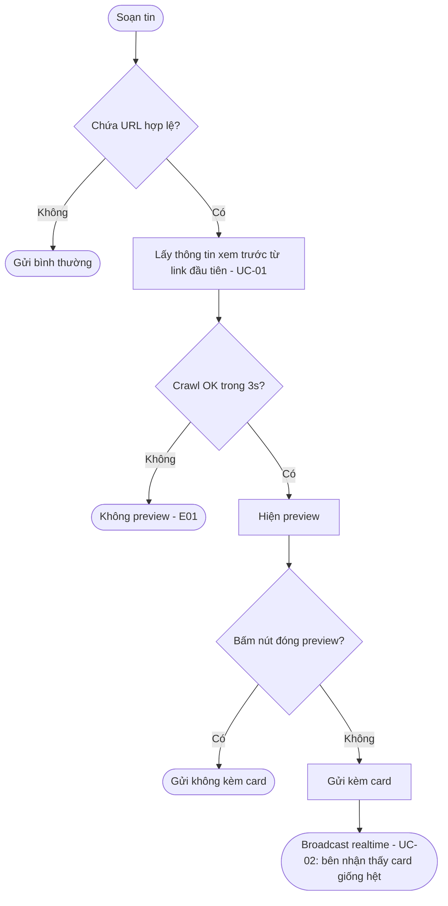
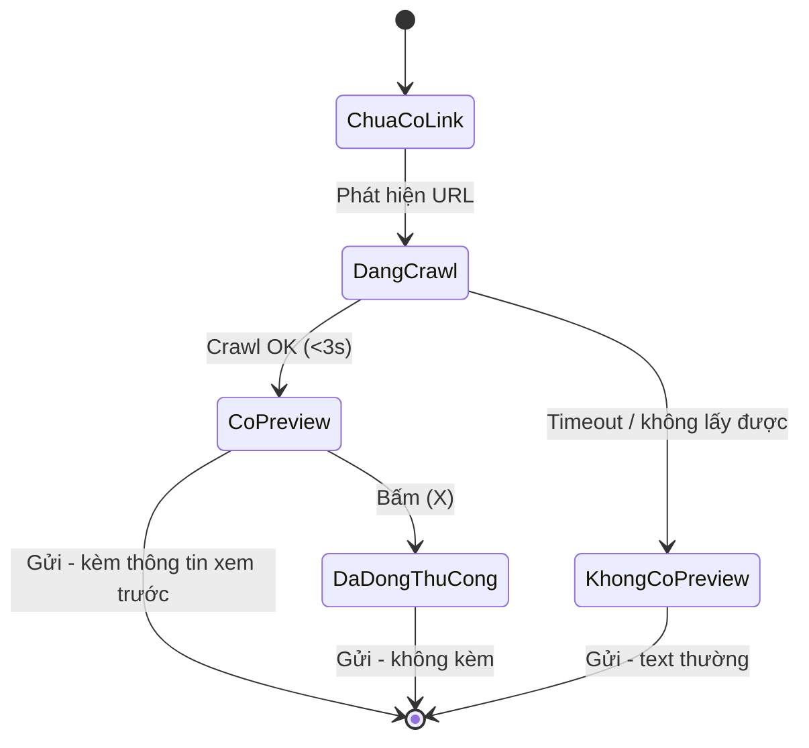

# [G015] Hiển thị Thumbnail khi gửi kèm Link

| Trường | Nội dung |
|--------|----------|
| **Feature ID** | G015 |
| **Tên** | Hiển thị Thumbnail khi gửi kèm Link (Link Preview) |
| **Module** | Chat |
| **Owner (BA)** | Trân |
| **Dev assignee** | — |
| **Priority** | ~~*Chưa xác nhận*~~ **[v1.1] Cao — scope tuần hiện tại** |
| **Version** | ~~1.0~~ **1.1** |
| **Status** | Draft |
| **Last updated** | 2026-07-21 |

> **[v1.1]** Nội dung gạch ngang là bản v1.0; bản mới viết ngay bên cạnh. Tổng hợp thay đổi ở Changelog cuối file.

---

## 1. Tổng quan

Khi tin nhắn chứa link (URL), hệ thống tự lấy thông tin xem trước (từ Open Graph) và hiển thị **card preview** (thumbnail, tiêu đề, mô tả) trong bong bóng chat — giống Link Preview của Zalo.

**Use Case Description:**
> Là người dùng đang chat, tôi muốn thấy hình ảnh và tiêu đề rút gọn của link được gửi, để nắm nhanh nội dung mà không cần mở link.

| Mục | Nội dung |
|-----|---------|
| **Người dùng mục tiêu** | Mọi người dùng có quyền truy cập hội thoại (Admin/Owner, Staff — G002/G003). Áp dụng như nhau cho hội thoại **1:1 và nhóm** |
| **Phạm vi** | **[v1.1]** Cả **tin gửi đi và tin nhận về** — tin đến từ Zalo cũng được crawl (UC-03, BR12) |
| **Phụ thuộc** | ~~G003 (Chat) — §13~~ **[v1.1]** G002 · G003 · **G005 · G008 · G009 · G014** — §13 |

> **Khác G014:** Đây **không** phải trạng thái Zalo-native đồng bộ 2 chiều — thông tin xem trước do hệ thống **tự lấy và lưu kèm tin nhắn**.

---

## 2. Pre-conditions & Trigger

| # | Trigger | Điểm kích hoạt |
|---|---------|----------------|
| T1 | Phát hiện link | Gõ/dán URL vào ô soạn tin |
| T2 | Gửi tin có link | Bấm gửi |
| T3 | Nhận tin có link | ~~Tin chứa link xuất hiện trong hội thoại~~ **[v1.1]** Tin chứa link từ Zalo về tới hội thoại → **UC-03** |

**Pre-conditions:**
- [ ] Đã đăng nhập, có quyền truy cập hội thoại (G002/G003 BR02, BR11, BR18)
- [ ] ~~Tài khoản Zalo **CONNECTED** để gửi tin (kế thừa G003 BR10) [→ E02]~~ **[v1.1] Để gửi tin:** tài khoản Zalo **CONNECTED** (G003 BR10) **[→ E06]**
- [ ] **[v1.1] Để xem card:** không yêu cầu CONNECTED (BR-C07)
- [ ] Nội dung vẫn trong giới hạn **1.000 ký tự** chung (G003 BR03)

**Post-conditions:**
- Tin nhắn hiển thị kèm card preview (nếu crawl thành công); thông tin xem trước lưu kèm tin nhắn, mọi phía xem chung, không crawl lại (BR09)
- Crawl thất bại/timeout → tin vẫn gửi thành công dạng text thường

---

## 3. Luồng chính (Happy Path)

> Auto-generated — comment nếu cần sửa logic. **[v1.1]** Sơ đồ chỉ mô tả luồng **gửi đi**; tin đến xem UC-03.

### UC-01 — Soạn và gửi tin có link

1. **[Người dùng]** Gõ/dán nội dung chứa URL
2. **[Hệ thống]** Nhận diện URL hợp lệ đầu tiên — **[v1.1]** chỉ `http://` / `https://` (BR01) [→ E01]
3. **[Hệ thống]** Link rút gọn → resolve redirect trước khi crawl (BR05)
4. **[Hệ thống]** Crawl: ưu tiên Open Graph, fallback `<title>`/`<meta description>` (BR02) [→ E01, **E05**]
5. **[Hệ thống]** Hiện card preview dưới ô soạn tin
6. **[Người dùng]** Có thể bấm **(X)** đóng preview, không mất text đang soạn ~~(BR11)~~ **[v1.1] (BR10)** [→ AF01]
7. **[Người dùng]** Bấm gửi → **[Hệ thống]** gửi tin kèm thông tin xem trước (nếu còn hiển thị) + broadcast realtime **[→ E03, E04, E06]**

*Use case kết thúc.*

### UC-02 — Hiển thị tin có link (bên nhận trong hệ thống)

1. **[Hệ thống]** Hiện **card giống hệt** bên gửi, dùng thông tin xem trước đã lưu kèm tin nhắn — **không crawl lại** (BR09)
2. **[Người dùng]** Bấm card → mở link tab mới ~~(BR12)~~ **[v1.1] (BR11)**

*Use case kết thúc.*

### UC-03 — Tin nhắn đến có link **[v1.1]**

> **Xảy ra khi:** tin chứa link từ Zalo về tới hội thoại — đối phương gửi, thành viên nhóm gửi, hoặc chủ tài khoản gửi từ điện thoại (G003 AF05).

1. **[Hệ thống]** Nhận tin, phát hiện URL hợp lệ đầu tiên (BR01, BR04)
2. **[Hệ thống]** Crawl **một lần duy nhất** khi nhận, theo quy tắc UC-01 bước 3–4 (BR12) [→ E01, E05]
3. **[Hệ thống]** Lưu thông tin xem trước **kèm tin nhắn**; mọi người xem hội thoại đều thấy **cùng một card** (BR09, BR12)
4. **[Hệ thống]** Broadcast realtime tới mọi phiên đang mở hội thoại (BR-C12)
5. Crawl thất bại/timeout → tin hiển thị **text thường**, không thử lại [→ E01]

*Use case kết thúc.*

---

## 4. Alternative Flows

### AF01 — Đóng preview trước khi gửi
Người dùng bấm **(X)** → ẩn card, giữ nguyên text đang soạn. Gửi ngay sau đó → tin đi **không kèm** thông tin xem trước.

---

## 5. Exception Flows

| Code | Trigger | UI Response | Notification |
|------|---------|-------------|--------------|
| E01 | Crawl timeout (>3s) hoặc không lấy được thông tin xem trước (UC-01 b2/b4 · **[v1.1]** UC-03 b2) | Không hiện card; tin vẫn gửi/hiển thị như text thường | Warning log |
| ~~E02~~ | ~~Domain blacklist / trang chặn crawler~~ → **[v1.1] Đã bỏ** — mã E02 không tái sử dụng. Trang chặn crawler nay rơi vào **E01** | — | — |
| E03 | Mất mạng khi crawl/gửi | Toast *"Mất kết nối, vui lòng thử lại"*; **[v1.1]** giữ nguyên nội dung đang soạn | — |
| E04 | Server lỗi 500 | Toast *"Lỗi hệ thống. Vui lòng thử lại sau"* | Error log |
| E05 | Ảnh `og:image` >5MB / lỗi decode (UC-01 b4 · **[v1.1]** UC-03 b2) | Card dùng icon mặc định thay ảnh | Warning log |
| **E06** | **[v1.1]** Tài khoản Zalo **DISCONNECTED** — bấm gửi (UC-01 b7) | Toast *"Tài khoản Zalo đang ngắt kết nối. Vui lòng kết nối lại"*; card ở tin cũ vẫn xem được | — |

**Exception Confirmation Log** — ~~E01–E02, E05 → Happy Path (UC-01 b2/b4); E03–E04 → Độc lập. Tất cả — Confirmed.~~ **[v1.1]** chuyển sang bảng (chuẩn PK §6.4):

| Code | Từ UC | Nguồn HP hay Độc lập | Confirmed |
|------|-------|----------------------|-----------|
| E01 | UC-01 b2/b4 · UC-03 b2 | Happy Path | ✅ |
| E03 | Độc lập | Độc lập | ✅ |
| E04 | Độc lập | Độc lập | ✅ |
| E05 | UC-01 b4 · UC-03 b2 | Happy Path | ✅ |
| E06 | UC-01 b7 | Happy Path | ✅ |

> **Bộ 6 Exception chuẩn:** *Unauthorized* — không đặc tả (đã kiểm soát ở G002/G003). *Zalo API lỗi* — không áp dụng (crawl là dịch vụ nội bộ). *Empty state* — không phát sinh. **[v1.1]** *DISCONNECTED* → **E06** · *Mất mạng* → E03 · *Server 500* → E04.

---

## 6. Business Rules

| Code | Rule | Lý do |
|------|------|-------|
| BR01 | ~~Nhận diện URL theo regex chuẩn (http/https), ngay khi soạn tin~~ **[v1.1]** Nhận diện URL ngay khi soạn tin, **chỉ** chấp nhận `http://` và `https://`. Text gõ trần không có scheme (VD `cand.vn`) **không** tính là link | Xem trước preview như Zalo native; tránh nhận nhầm text thường thành link |
| BR02 | Ưu tiên Open Graph → fallback `<title>`/meta description → không có gì thì không preview | Chuẩn phổ biến nhất |
| BR03 | ~~Card: thumbnail (1:1/16:9), tiêu đề & mô tả tối đa 2 dòng, kèm **domain gốc** viết thường, không có `https://`/`www.`~~ **[v1.1]** Card gồm: thumbnail (1:1 / 16:9), tiêu đề & mô tả tối đa **2 dòng** mỗi phần *(tên miền tách sang BR03b)* | Nhất quán quy tắc rút gọn (G009 BR05) |
| **BR03b** | **[v1.1]** Card luôn kèm **tên miền gốc**, viết thường, bỏ `https://` và `www.` (VD `https://cand.vn/...` → `cand.vn`) | Giống cách Zalo native hiển thị nguồn link |
| BR04 | Nhiều link trong 1 tin → chỉ preview link **đầu tiên** | Tránh quá tải giao diện |
| BR05 | Link rút gọn → resolve redirect trước khi crawl | Tránh preview sai (crawl trang rút gọn thay vì đích) |
| BR06 | Timeout crawl **3 giây**, không chặn gửi tin | Không làm chậm trải nghiệm gửi tin |
| ~~BR07~~ | ~~Domain blacklist → không crawl~~ → **[v1.1] Đã bãi bỏ**: chưa cần xử lý ở giai đoạn này. **Mọi domain đều được crawl và gửi bình thường**; trang chặn crawler thì không có card (E01) | ~~An toàn cho người dùng~~ |
| BR08 | Ảnh vượt 5MB/lỗi decode → icon mặc định | Nhất quán giới hạn ảnh (G003 BR04) |
| BR09 | ~~Cache kết quả crawl theo URL, TTL 24h; thông tin xem trước lưu kèm tin nhắn khi gửi, không crawl lại ở phía nhận~~ **[v1.1]** Thông tin xem trước **lưu kèm tin nhắn** và là **nguồn hiển thị duy nhất**: mọi người dùng, mọi thiết bị **trong hệ thống** thấy **cùng một card**; **không crawl lại** từ lần hiển thị thứ hai, kể cả khi trang gốc đã đổi *(cache tách sang BR09b)*. **[v1.1]** Phạm vi "giống hệt" **chỉ trong hệ thống** — phía **app Zalo do Zalo tự render**, có thể khác, và **không tính là lỗi** | Đồng nhất hiển thị giữa các phía (BR-C12); tránh card hết hạn theo cache |
| **BR09b** | **[v1.1]** Cache kết quả crawl **theo URL, TTL 24h** — chỉ để tránh crawl trùng lúc soạn/nhận tin. Cache hết hạn **không** ảnh hưởng card đã lưu kèm tin nhắn | Giảm tải crawl; tách bạch với dữ liệu hiển thị đã cố định |
| BR10 | Đóng (X) preview không ảnh hưởng nội dung text đang soạn | Cho người dùng quyền chọn hiển thị |
| BR11 | Bấm card mở tab mới; không cho copy ảnh, chỉ copy text link | Nhất quán quyền tương tác media khác |
| **BR12** | **[v1.1]** **Tin nhắn đến** chứa link → hệ thống crawl **một lần khi nhận** và lưu kèm tin nhắn (UC-03). Crawl thất bại → text thường, **không thử lại** | Phần lớn link trong hội thoại CSKH do khách gửi; chỉ crawl lúc soạn thì tin đến không bao giờ có card |
| **BR13** | **[v1.1]** **Chuyển tiếp** tin có card (G003 UC-08) → thông tin xem trước **đi theo** sang tin mới, **không crawl lại** | Preview là thuộc tính của tin nhắn (BR09); tránh tin đích khác tin nguồn |
| **BR14** | **[v1.1]** Tin có card bị **thu hồi hoặc xóa** (G003 BR07) → **giữ nguyên card**, chỉ **disable tương tác** (bấm không mở link) | Nhất quán BR-C13 (giữ lịch sử) và G014 BR07 |
| **BR15** | **[v1.1]** **Không crawl ngược** tin nhắn có trước khi phát hành G015 — tin cũ vĩnh viễn hiển thị text thường | Tránh crawl hàng loạt toàn bộ lịch sử |
| **BR16** | **[v1.1]** Hội thoại **1:1 và nhóm dùng chung một luồng**. Nhóm **đã rời / bị giải tán** (chỉ đọc — G008 BR11): card ở tin cũ **vẫn hiển thị và bấm mở được** | Tránh hai nhánh code; trạng thái chỉ đọc chỉ khóa gửi tin, không ẩn dữ liệu |
| **BR17** | **[v1.1]** Card **chỉ render trong bong bóng chat**. Ở mọi nơi hiển thị rút gọn — dòng **danh sách ghim** (G014 BR14) và khối **trích dẫn khi reply** (G009 BR05) — chỉ hiện **text rút gọn 100 ký tự**, **không** render card | Giữ nguyên quy tắc rút gọn sẵn có của G014/G009; không phá layout hai khu vực này |
| **BR18** | **[v1.1]** Nội dung chèn từ **tin nhắn mẫu** (G005, gọi bằng `/code`) có chứa link → crawl và hiện preview **giống hệt** như gõ tay | Sau khi chèn, nội dung nằm trong ô soạn tin như mọi tin khác — không có lý do xử lý khác |

---

## 7. State Machine (trạng thái preview lúc soạn tin)

> **[v1.1]** Chỉ áp dụng cho luồng **soạn và gửi (UC-01)**. Tin đến (UC-03) crawl một lần rồi cố định kết quả kèm tin nhắn.

> Auto-generated — comment nếu cần sửa logic. Trạng thái tạm thời phía client; sau khi gửi trở thành thuộc tính cố định của tin nhắn.

---

## 8. Data Model
N/A — thuần nghiệp vụ.

## 9. API Contract
N/A — thuần nghiệp vụ.

---

## 10. UI/UX Notes

- **Khi soạn tin:** card dưới ô nhập, gồm thumbnail + tiêu đề + mô tả + tên miền + nút (X); skeleton loading tối đa 3s
- **Trong bong bóng chat:** card dưới phần text, luôn kèm **tên miền nguồn** (VD `cand.vn`) ở cuối card; không chiếm layout nếu không có preview
- **Không có preview:** tin hiển thị như text thường, link vẫn bấm mở được
- **[v1.1] Tin đã thu hồi / xóa:** card **vẫn hiển thị** ở dạng disable — bấm không mở link (BR14)
- **[v1.1] Tài khoản DISCONNECTED · nhóm chỉ đọc:** card hiển thị và bấm mở bình thường; chỉ khóa gửi tin mới (BR16, E06)

---

## 11. Acceptance Criteria

### Gửi tin (UC-01)
- [ ] Link có đầy đủ Open Graph → card đúng thumbnail/tiêu đề/mô tả~~/domain~~ trong 3s (AC-BR01, AC-BR02, AC-BR03, AC-BR06)
- [ ] **[v1.1]** Card luôn hiển thị **tên miền gốc** viết thường, không có `https://` / `www.` (AC-BR03b)
- [ ] **[v1.1]** Text gõ trần `cand.vn` → **không** nhận diện là link, không preview (AC-BR01)
- [ ] Không lấy được thông tin xem trước → không card, không lỗi, không chặn gửi (AC-E01)
- [ ] Nhiều link → chỉ preview link đầu (AC-BR04)
- [ ] Link rút gọn → preview đúng link đích (AC-BR05)
- [ ] Bấm (X) → ẩn card, giữ nguyên text; gửi sau đó không kèm card (AC-BR10, AC-AF01)
- [ ] Ảnh lỗi/quá 5MB → icon mặc định (AC-BR08, AC-E05)
- [ ] Timeout 3s → gửi thành công dạng text thường (AC-BR06, AC-E01)

### Tin nhắn đến (UC-03) ⭐ **[v1.1]**
- [ ] Khách gửi link vào hội thoại → hệ thống crawl và hiện card, **không cần người dùng thao tác** (AC-BR12)
- [ ] Chủ tài khoản gửi link **từ điện thoại** (G003 AF05) → tin về hệ thống vẫn có card (AC-BR12)
- [ ] Tin đến crawl thất bại → text thường, **không thử lại** ở lần mở hội thoại sau (AC-BR12, AC-E01)
- [ ] Nhiều người cùng mở hội thoại → chỉ crawl **một lần**, mọi người thấy cùng một card (AC-BR09, AC-BR12)

### Hiển thị & vòng đời tin nhắn
- [ ] Bên nhận **trong hệ thống** thấy card **giống hệt** bên gửi, không crawl lại; bấm mở đúng link gốc (AC-BR09, AC-BR11)
- [ ] **[v1.1]** Đối chiếu card giữa **hệ thống và app Zalo** khác nhau → **không tính là lỗi** (AC-BR09, OOS09)
- [ ] **[v1.1]** Trang gốc đổi nội dung sau khi gửi → card **giữ nguyên** như lúc gửi (AC-BR09)
- [ ] Cùng link gửi lại trong 24h → lấy từ cache, không crawl lại ~~(AC-BR09)~~ **(AC-BR09b)**
- [ ] **[v1.1] Chuyển tiếp** tin có card → tin đích hiển thị card giống hệt tin nguồn (AC-BR13)
- [ ] **[v1.1]** Tin có card bị **thu hồi / xóa** → card vẫn hiển thị, bấm **không** mở được link (AC-BR14)
- [ ] **[v1.1]** Tin gửi **trước khi phát hành** G015 → vẫn là text thường, không tự sinh card (AC-BR15)
- [ ] **[v1.1]** **Ghim** tin có card (G014) → dòng danh sách ghim chỉ hiện **text rút gọn 100 ký tự**, không render card; card vẫn hiện trong khung chat (AC-BR17)
- [ ] **[v1.1]** **Reply** một tin có card (G009) → khối trích dẫn chỉ hiện **text rút gọn**, không render card (AC-BR17)
- [ ] **[v1.1]** Chèn **tin nhắn mẫu** có link bằng `/code` (G005) → preview hiện **giống hệt** như gõ tay (AC-BR18)
- [ ] **[v1.1]** Link thuộc **bất kỳ domain nào** đều crawl và gửi bình thường; trang chặn crawler → không card, tin vẫn gửi (AC-E01, AC-OOS10)

### Phạm vi hội thoại & quyền
- [ ] Áp dụng như nhau cho **1:1 và nhóm** (AC-BR16)
- [ ] **[v1.1]** Nhóm **đã rời / bị giải tán** → card ở tin cũ vẫn hiển thị và bấm mở được (AC-BR16)
- [ ] **[v1.1]** Tài khoản **DISCONNECTED** → xem card bình thường; bấm gửi → toast E06 (AC-E06)
- [ ] **[v1.1]** Người dùng workspace A **không** xem được card của hội thoại workspace B (AC-BR-C01)

### Lỗi
- [ ] Mất mạng / lỗi 500 → đúng toast tương ứng, giữ nguyên trạng thái đang soạn (AC-E03, AC-E04)

---

## 12. Out of Scope

| # | Nội dung |
|---|---------|
| OOS01 | Preview cho file đính kèm trực tiếp (thuộc G003) |
| OOS02 | Preview cho deep-link nội bộ |
| OOS03 | Cho chỉnh sửa thủ công tiêu đề/mô tả/ảnh preview |
| OOS04 | Preview nhiều link cùng lúc |
| OOS05 | Preview trên app di động của hệ thống (web only) |
| OOS06 | Notification riêng khi có preview |
| **OOS07** | **[v1.1]** Crawl bổ sung cho tin nhắn cũ trước khi phát hành G015 (BR15) |
| **OOS08** | **[v1.1]** Làm mới card khi trang gốc đổi nội dung (BR09) |
| **OOS09** | **[v1.1]** Đồng bộ card với preview do **app Zalo** tự render — hai bên có thể khác nhau, không tính là lỗi (BR09) |
| **OOS10** | **[v1.1]** Chặn crawl theo danh sách domain — BR07/E02 đã bãi bỏ, mọi domain đều crawl và gửi bình thường |

---

## 13. Dependencies

| Phụ thuộc vào | Ghi chú |
|---------------|---------|
| **G003 — Chat** | ~~Ô soạn tin, giới hạn 1.000 ký tự, trạng thái CONNECTED/DISCONNECTED~~ **[v1.1]** Ô soạn tin · giới hạn 1.000 ký tự (BR03) · ảnh 5MB (BR04) · CONNECTED/DISCONNECTED (BR10) · tin thu hồi/xóa giữ nội dung gốc (BR07 → BR14) · tin gửi từ điện thoại (AF05 → BR12) · chuyển tiếp (UC-08 → BR13) |
| **G002 — Chia sẻ tài khoản Zalo** | Quyền truy cập hội thoại (không lặp lại logic) |
| **G008 — Quản lý nhóm** | **[v1.1]** Nhóm đã rời / bị giải tán ở trạng thái chỉ đọc (BR11) → chi phối BR16 |
| **G014 — Ghim tin nhắn** | **[v1.1]** Danh sách ghim hiển thị text rút gọn 100 ký tự (BR14) → chi phối BR17 |
| **G009 — Tính năng bổ sung Chat** | **[v1.1]** Quy tắc rút gọn khối trích dẫn khi reply (BR05) → chi phối BR17 |
| **G005 — Tin nhắn mẫu** | **[v1.1]** Nội dung chèn bằng `/code` có link → xử lý như gõ tay (BR18) |

~~**Được phụ thuộc bởi:** chưa có Spec nào tham chiếu ngược.~~ **[v1.1]**

| Được phụ thuộc bởi | Ghi chú |
|--------------------|---------|
| — | Chưa có Spec nào tham chiếu ngược |

---

## 14. Performance & Scalability

| Mục | Yêu cầu |
|-----|---------|
| Crawl | Timeout 3s/link, không chặn gửi tin. **[v1.1]** Chạy ở **2 điểm**: lúc soạn tin (UC-01) và lúc **nhận tin** (UC-03) |
| **Số lần crawl** | **[v1.1] Đúng 1 lần / tin nhắn.** Không crawl lại theo thiết bị, người xem, hay lần mở hội thoại (BR09, BR12) |
| Cache | Theo URL, TTL 24h — **[v1.1]** chỉ tránh crawl trùng, **không** phải nguồn hiển thị (BR09b) |
| Ảnh | Giới hạn 5MB trước resize |
| Đồng bộ | Thông tin xem trước lưu kèm tin nhắn, không crawl lại theo thiết bị/người xem |
| **Tin đến hàng loạt** | **[v1.1]** Crawl chạy nền, không chặn hiển thị tin nhắn mới |

---

## Changelog

| Ngày | Version | Người thay đổi | Sections | Nội dung | File:Line |
|------|---------|----------------|----------|----------|-----------|
| 2026-07-21 | **v1.1** | Trân (BA) | Header, §1, §2, §3, §5, §6, §7, §10–§14 | **Bổ sung nghiệp vụ:** UC-03 + BR12 (tin đến cũng crawl) · BR13 (chuyển tiếp — card đi theo) · BR14 (thu hồi — giữ card) · BR15 (không crawl ngược lịch sử) · BR16 (1:1 và nhóm chung luồng) · BR17 (card chỉ render trong khung chat; danh sách ghim và khối trích dẫn chỉ hiện text rút gọn) · BR18 (tin nhắn mẫu có link xử lý như gõ tay) · E06 (DISCONNECTED) · OOS07–10 · G005/G008/G009/G014 vào Dependencies. **Bãi bỏ:** BR07 + E02 (domain blacklist) — chưa cần xử lý, mọi domain đều crawl và gửi bình thường. **Thu hẹp phạm vi BR09:** "card giống hệt" **chỉ trong hệ thống**, phía app Zalo do Zalo tự render, khác nhau không tính lỗi. **Tách rule gộp:** BR03/BR03b · BR09/BR09b. **Sửa tham chiếu sai:** UC-01 b6 `BR11`→BR10 · UC-02 b2 `BR12`→BR11 · Pre-condition `E02`→E06. **Chuẩn hóa:** Exception Confirmation Log và "Được phụ thuộc bởi" sang dạng bảng; AC chia 5 nhóm, thêm 18 mục. **Priority:** *Chưa xác nhận* → **Cao** | — |
| 2026-07-21 | v1.0 | Trân (BA) | — | Bản soạn đầu tiên | — |

---

> **Lưu ý cho Dev & AI:**
> - **G015 khác G014** — preview là crawl độc lập của hệ thống, không phải trạng thái Zalo-native đồng bộ 2 chiều.
> - **[v1.1] BR12:** crawl chạy **cả 2 chiều** — lúc soạn tin **và** lúc nhận tin. Bản v1.0 chỉ có chiều gửi đi, **không implement theo v1.0**.
> - **[v1.1] BR09 vs BR09b:** preview **lưu kèm tin nhắn** là nguồn hiển thị duy nhất (1 lần crawl/tin nhắn); cache 24h chỉ tránh crawl trùng. Đừng nhầm — v1.0 gộp chung.
> - **BR06:** timeout 3s **không chặn gửi tin**.
> - **[v1.1] BR14:** tin thu hồi/xóa → **giữ card**, chỉ disable tương tác.
> - **[v1.1] BR15:** **không** crawl ngược lịch sử.
> - **[v1.1] BR07 + E02 đã bãi bỏ** — không còn danh sách domain bị chặn; **mọi link đều crawl và gửi bình thường**. Trang chặn crawler thì rơi vào E01.
> - **[v1.1] BR09 — phạm vi:** "card giống hệt" chỉ đúng **trong hệ thống**. Card trên **app Zalo** do Zalo tự render, khác nhau **không phải bug** (OOS09).
> - *Unauthorized* và *Zalo API lỗi* cố ý không đặc tả (xem §5).
> - **Priority chưa xác nhận** — cần điền trước khi chuyển Dev.
