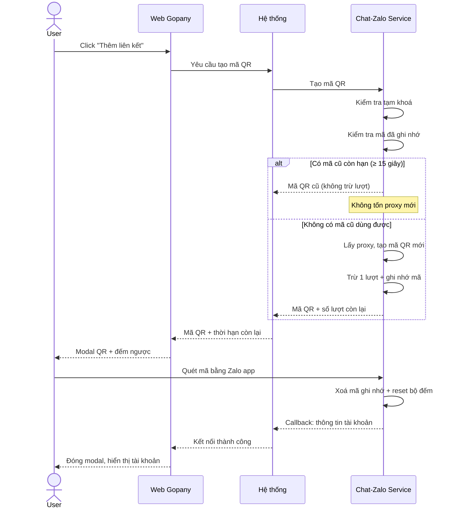
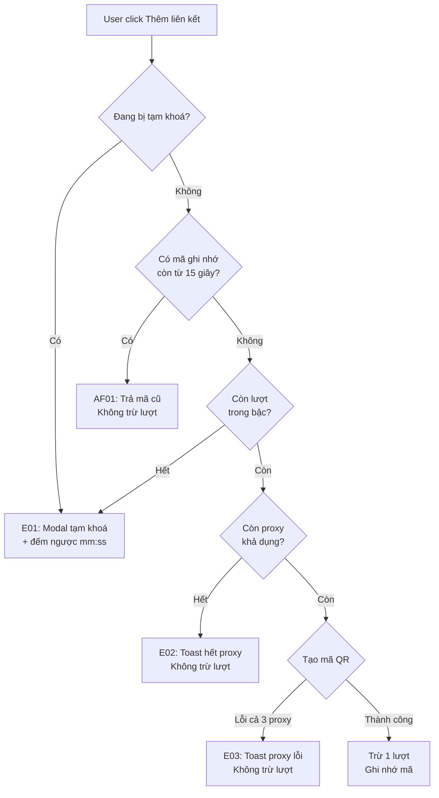
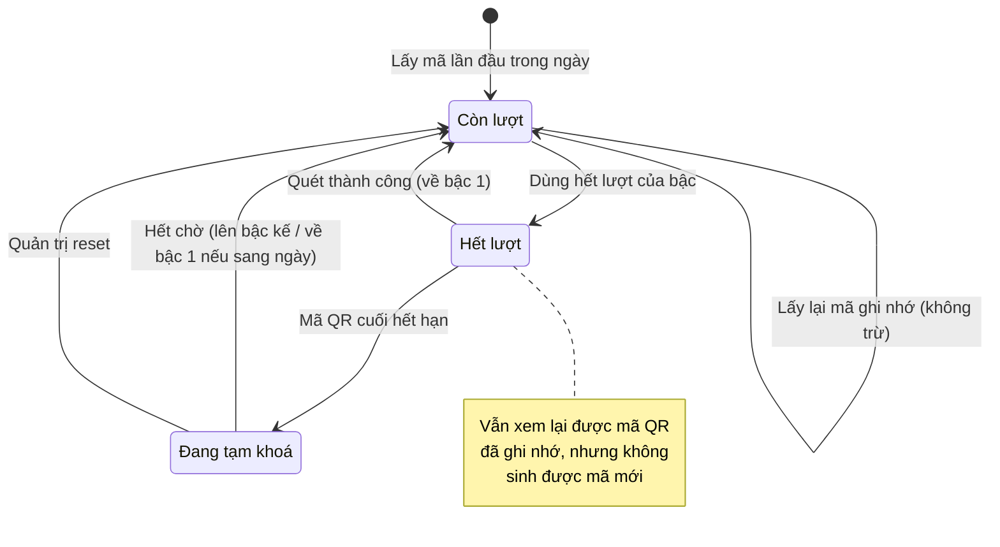

# [G016] Giới hạn lấy mã QR và ghi nhớ mã QR

| Trường | Nội dung |
|--------|----------|
| **Feature ID** | G016 |
| **Tên** | Giới hạn lấy mã QR và ghi nhớ mã QR chưa dùng |
| **Module** | Thiết lập / Tài khoản Zalo |
| **Owner (BA)** | Thành |
| **Dev assignee** | — |
| **Priority** | — |
| **Version** | 1.0 |
| **Status** | Draft |
| **Last updated** | 2026-07-29 |

---

## 1. Tổng quan (Overview)

Mỗi lần người dùng bấm **"Thêm liên kết"** ở G001, hệ thống sinh một mã QR mới. Mỗi mã QR đều chiếm **một proxy trong tối đa 2 phút** — proxy là tài nguyên hữu hạn, phải mua theo tháng.

Hiện tại không có giới hạn nào. Người dùng bấm bao nhiêu lần cũng được, và mỗi lần đóng rồi mở lại modal đều sinh một mã QR hoàn toàn mới dù mã cũ vẫn còn hạn.

**Hậu quả đo được:** 10 nhân viên mỗi người bấm 5 lần trong 2 phút chiếm **50 proxy cùng lúc**. Khi số proxy còn lại tụt xuống dưới ngưỡng an toàn, hệ thống **từ chối liên kết cho toàn bộ workspace** — kể cả người chưa từng bấm gì.

Tính năng này bổ sung hai cơ chế bổ trợ nhau:

| Cơ chế | Giải quyết tình huống | Nguyên tắc |
|---|---|---|
| **Ghi nhớ mã QR** | Người dùng đóng rồi mở lại modal | Mã cũ còn hạn → trả lại đúng mã đó, không sinh mã mới, không tốn proxy |
| **Giới hạn tần suất** | Người dùng liên tục lấy mã mới mà không quét | Bậc thang tăng dần trong ngày, reset ngay khi quét thành công |

**Use Case Description:**
> Là người quản trị hệ thống, tôi muốn giới hạn số mã QR mà mỗi người dùng lấy được trong ngày và tái sử dụng mã QR chưa dùng, để tài nguyên proxy không bị cạn vì thao tác lặp lại của một vài người, làm cả workspace không liên kết được tài khoản Zalo.

**Người dùng mục tiêu (Target users):**
- **Admin/Owner** của workspace — bị áp giới hạn
- **Staff** được cấp quyền "Quản lý tài khoản Zalo" — bị áp giới hạn, tính riêng theo từng người

**Phụ thuộc:** G001 (Liên kết tài khoản Zalo)

---

## 2. Điều kiện tiên quyết (Pre-conditions & Trigger)

**Trigger:**
- **T1** — User click **"Thêm liên kết"** tại **Chat - Zalo > Thiết lập > Tài khoản Zalo**
- **T2** — User click **"Kết nối lại"** trên row có trạng thái **Ngắt kết nối** *(G001 AF02)*

**Pre-conditions:**
- [ ] User đã đăng nhập và có session hợp lệ
- [ ] User có quyền "Quản lý tài khoản Zalo"
- [ ] Hệ thống còn proxy khả dụng
- [ ] User **không** đang trong thời gian bị tạm khoá lấy mã

**Post-conditions (sau khi thành công):**
- Nếu sinh mã QR mới: **trừ 1 lượt** của user và **ghi nhớ mã QR** cho tới khi mã hết hạn
- Nếu dùng hết lượt của bậc hiện tại: đặt mốc tạm khoá, tính từ khi mã QR vừa cấp hết hạn
- User nhận mã QR kèm thông tin số lượt còn lại

**Post-condition trở thành Trigger của Use Case khác:**

| Sự kiện | Kích hoạt |
|---|---|
| Quét mã QR thành công | **Xoá mã đã ghi nhớ** → **reset bộ đếm về bậc 1** → tài khoản chuyển **Đang hoạt động** *(G001 Section 7)* |

---

## 3. Luồng chính (Happy Path)

1. **[User]** Vào **Chat - Zalo > Thiết lập > Tài khoản Zalo**, click **"Thêm liên kết"**
2. **[System]** Yêu cầu Chat-Zalo Service tạo mã QR
3. **[Chat-Zalo Service]** Kiểm tra user có đang bị tạm khoá không → **không**
4. **[Chat-Zalo Service]** Kiểm tra có mã QR đã ghi nhớ còn dùng được không → **không có**
5. **[Chat-Zalo Service]** Kiểm tra còn proxy khả dụng → **còn**, tạo mã QR mới *(tự động thử proxy khác nếu lỗi, tối đa 3 lần)*
6. **[Chat-Zalo Service]** **Trừ 1 lượt** và **ghi nhớ mã QR** cho tới khi mã hết hạn
7. **[System]** Hiển thị modal **"Đăng nhập tài khoản Zalo"** với mã QR + đếm ngược 100 giây
8. **[User]** Mở ứng dụng Zalo trên điện thoại, quét mã QR
9. **[Chat-Zalo Service]** Xác thực thành công, **xoá mã đã ghi nhớ**, **reset bộ đếm về bậc 1**, gửi callback kèm thông tin tài khoản
10. **[System]** Lưu tài khoản với trạng thái **Đang hoạt động**, đóng modal, hiển thị trong danh sách

> Auto-generated — comment nếu cần sửa logic

---

## 4. Luồng phụ (Alternative Flows)

### AF01 — Dùng lại mã QR đã ghi nhớ

- **Xảy ra khi:** User đóng modal rồi mở lại, mã QR cũ còn hạn **từ 15 giây trở lên**
- **4a.** Chat-Zalo Service trả lại **đúng mã QR cũ** kèm thời gian còn lại thật *(thay bước 4–6)*
- **4a.i.** **Không** trừ lượt, **không** tốn thêm proxy
- **4a.ii.** Modal hiển thị mã QR với đếm ngược theo **thời gian còn lại thật**, **không** reset về 100 giây
  - Use Case tiếp tục bước 8

### AF02 — Mã đã ghi nhớ không còn dùng được

- **Xảy ra khi:** Mã cũ còn **dưới 15 giây**, hoặc phiên tạo mã đã kết thúc
- **4b.** Chat-Zalo Service bỏ mã đã ghi nhớ, coi như chưa có mã nào
  - Use Case tiếp tục bước 5 *(sinh mã mới, **có** trừ lượt)*

> Ngưỡng 15 giây: trả về mã QR chỉ còn 4 giây là trải nghiệm tệ hơn cả không ghi nhớ.

### AF03 — Kết nối lại tài khoản đã Ngắt kết nối *(từ trigger T2)*

- **Xảy ra khi:** User click **"Kết nối lại"** trên row Ngắt kết nối *(xem G001 AF02)*
- **5a.** Chat-Zalo Service dùng **proxy riêng đã gắn với tài khoản đó**, không lấy từ kho chung
- **5a.i.** Vẫn **trừ 1 lượt** như bình thường *(xem BR08)*
- **5a.ii.** Mã QR được ghi nhớ **riêng cho tài khoản đó**, không dùng chung với luồng "Thêm liên kết"
  - Use Case tiếp tục bước 6

### AF04 — Quét thành công khi đang ở bậc cao

- **Xảy ra khi:** User đang ở bậc 3 trở lên nhưng quét mã thành công
- **9a.** Bộ đếm reset thẳng về **bậc 1, đã dùng 0 lượt** — không giảm dần từng bậc
  - Use Case tiếp tục bước 10

> **Hệ quả nghiệp vụ quan trọng:** vì quét thành công là reset, **liên kết hàng loạt không bị ảnh hưởng**. Nhân viên liên kết 20 tài khoản liên tiếp, mỗi lần quét thành công đều reset nên không bao giờ chạm giới hạn. Bậc thang chỉ đánh vào hành vi lấy mã rồi bỏ.

---

## 5. Luồng ngoại lệ (Exception Flows)

| Code | Trigger (Điều kiện kích hoạt) | UI Response (Phản hồi giao diện) | Recovery (Hướng xử lý) |
|------|-------------------------------|----------------------------------|------------------------|
| E01 | User đang bị tạm khoá, hoặc hết lượt mà không có mã ghi nhớ dùng được | Modal: **"Tạm thời không thể lấy mã QR"** + *"Bạn đã lấy mã QR nhiều lần mà chưa đăng nhập. Vui lòng thử lại sau."* + đồng hồ đếm ngược **mm:ss** | Chờ hết thời gian, hoặc liên hệ quản trị hệ thống để reset |
| E02 | Hệ thống hết proxy khả dụng | Toast: **"Hệ thống không có proxy khả dụng, vui lòng thử lại sau."** | Quản trị nạp thêm proxy. **Không trừ lượt** |
| E03 | Đã thử đủ 3 proxy đều lỗi hoặc quá hạn chờ | Toast: **"Proxy không khả dụng, vui lòng thử lại sau."** | Thử lại sau. **Không trừ lượt** |
| E04 | Mã QR hết hạn trước khi user quét | Trong modal: **"Mã QR đã hết hạn"** + nút **"Refresh QR"** *(G001 E01)* | Click Refresh để lấy mã mới — **trừ tiếp 1 lượt** |
| E05 | User bấm **"Từ chối"** trên điện thoại | Trong modal: **"Bạn đã từ chối đăng nhập trên điện thoại"** | Quét lại hoặc đóng modal. Lượt **đã bị trừ** |
| E06 | Quét thành công nhưng proxy bị thu hồi trước khi kịp gán | Toast vàng: **"Đã kết nối nhưng chưa gán được proxy, hệ thống đang xử lý."** | Hệ thống tự cấp lại proxy ở lần kiểm tra kế tiếp. Bộ đếm **vẫn reset** |
| E07 | Session hết hạn giữa chừng | Chuyển về trang đăng nhập | Đăng nhập lại |
| E08 | User không có quyền **"Quản lý tài khoản Zalo"** | Không hiển thị màn hình Tài khoản Zalo *(G001 AC Phân quyền)* | Liên hệ Admin/Owner để được cấp quyền |
| E09 | User mở 2 tab và bấm cùng lúc | Cả hai tab hiển thị **cùng một** mã QR | Không cần xử lý. Trừ đúng **1 lượt** |

> Auto-generated — comment nếu cần sửa logic

---

## 6. Business Rules — Quy tắc nghiệp vụ

> Mục này chia làm **3 nhóm**: **6A** — giới hạn tần suất *(BR01–BR10)* · **6B** — ghi nhớ mã QR *(BR11–BR13)* · **6C** — vận hành & quản trị *(BR14–BR16)*

### 6A — Quy tắc giới hạn tần suất

| Code | Rule (Quy tắc) | Lý do |
|------|----------------|-------|
| BR01 | Bộ đếm trừ **theo mã QR sinh mới**, không theo số lần bấm nút. Lấy lại mã đã ghi nhớ **không** trừ lượt | Thứ cần bảo vệ là proxy. Bấm vào mã đã có sẵn thì không tốn proxy nào |
| BR02 | Bậc thang giới hạn trong ngày: · **Bậc 1** — 5 lượt, hết lượt tạm khoá **3 phút** · **Bậc 2** — 5 lượt, hết lượt tạm khoá **5 phút** · **Bậc 3** — 3 lượt, hết lượt tạm khoá **15 phút** · **Bậc n ≥ 4** — 1 lượt, tạm khoá **15 × (n − 3) phút** *(bậc 4: 15 phút · bậc 5: 30 phút · bậc 6: 45 phút…)* | Người dùng thật hiếm khi cần quá 5 mã. Người cố lạm dụng bị đẩy ra rất nhanh nhờ thời gian chờ tăng dần |
| BR03 | Thời gian tạm khoá **bắt đầu tính từ khi mã QR cuối cùng hết hạn**, không phải từ lúc cấp mã | Nếu tính từ lúc cấp, mã QR còn sống 100 giây sẽ nuốt mất hơn nửa hình phạt 3 phút |
| BR04 | Từ lúc hết lượt đến khi mã cuối hết hạn: user **vẫn xem lại được mã đó**, nhưng **không** sinh được mã mới. Nếu mã ghi nhớ không dùng được → áp dụng E01 ngay | Mã đó user đã được cấp hợp lệ, không có lý do lấy lại của họ và cũng không tốn thêm proxy |
| BR05 | Bộ đếm **reset về bậc 1, 0 lượt đã dùng** khi: **(a)** quét mã thành công, hoặc **(b)** hết thời gian tạm khoá **và** đã sang ngày mới | Quét thành công chứng minh user đang dùng đúng mục đích, không phải lạm dụng |
| BR06 | Thời gian tạm khoá được **tôn trọng tuyệt đối, kể cả khi sang ngày mới**. Bị khoá 45 phút lúc 23:50 vẫn phải chờ đủ 45 phút, sau đó mới reset về bậc 1 | Nếu mốc ngày gỡ khoá sớm, người lạm dụng lúc 23:50 chỉ phải chờ 10 phút — thành lỗ hổng |
| BR07 | Trong cùng một ngày, mỗi lần dùng hết lượt thì **lên một bậc**. Mốc ngày tính theo **00:00 giờ Việt Nam (GMT+7)** | Giới hạn chỉ áp dụng trong ngày, sang ngày mới làm lại từ đầu |
| BR08 | Luồng **"Kết nối lại"** (AF03) tuy dùng proxy riêng của tài khoản, **vẫn trừ lượt như bình thường** | Nếu miễn lượt, đây sẽ là đường đi vòng để lách giới hạn |
| BR09 | Giới hạn tính theo **từng user**, không theo workspace. Admin/Owner và từng Staff có bộ đếm riêng | Tính theo workspace sẽ khiến nhân viên này bị chặn oan vì thao tác của nhân viên khác |
| BR10 | **Hai nhân viên cùng workspace được phép liên kết hai tài khoản Zalo song song** | Hành vi trước đây: nhân viên B lấy mã sẽ âm thầm vô hiệu hoá mã của nhân viên A; A quét xong bị báo lỗi dù điện thoại báo thành công |

### 6B — Quy tắc ghi nhớ mã QR *(cache)*

> Nhóm quy tắc này trả lời câu hỏi: **user đóng modal rồi mở lại thì có phải sinh mã QR mới không?**

| Code | Rule (Quy tắc) | Lý do |
|------|----------------|-------|
| BR11 | Mã QR chỉ được ghi nhớ **tối đa bằng thời hạn thật của mã (100 giây)**, không kéo dài hơn | Mã chỉ quét được khi phiên tạo mã còn sống. Ghi nhớ lâu hơn sẽ trả về mã chết |
| BR12 | Mã đã ghi nhớ bị **xoá ngay** khi: quét thành công, mã hết hạn, user từ chối trên điện thoại, hoặc phiên tạo mã gặp lỗi | Tránh trả về mã không còn quét được |
| BR13 | Sau khi hệ thống khởi động lại, **mọi mã đã ghi nhớ trước đó đều bị coi là không dùng được** | Phiên tạo mã đã kết thúc theo, mã cũ không quét được nữa |

### 6C — Quy tắc vận hành & quản trị

| Code | Rule (Quy tắc) | Lý do |
|------|----------------|-------|
| BR14 | **Lỗi hệ thống không trừ lượt** (E02 hết proxy, E03 proxy lỗi). **Lỗi do hành vi user có trừ lượt** (E04 để mã hết hạn, E05 chủ động từ chối) | Không được phạt user vì lỗi của hệ thống |
| BR15 | Quản trị hệ thống có thể **xem và reset** bộ đếm của bất kỳ user nào | Đường thoát chính thức khi user bị kẹt vì lý do ngoài dự kiến |
| BR16 | Bậc thang **cấu hình được**, không cố định trong sản phẩm. Thay đổi chỉ có hiệu lực với lượt phát sinh **sau đó**, **không hồi tố** cho người đang bị khoá | Ngưỡng cần hiệu chỉnh theo số liệu thực tế mà không phải chờ bản phát hành mới |

---

## 7. State Machine — Bộ đếm của một user

**Entity:** Bộ đếm lấy mã QR của một user

| Từ trạng thái | Sự kiện | Sang trạng thái | Điều kiện | Tác động |
|---------------|---------|-----------------|-----------|----------|
| _(chưa có)_ | Lấy mã QR lần đầu trong ngày | **Còn lượt** | — | Tạo bộ đếm ở bậc 1 |
| **Còn lượt** | Sinh mã QR mới | **Còn lượt** | Vẫn còn lượt trong bậc | Trừ 1 lượt |
| **Còn lượt** | Lấy lại mã đã ghi nhớ | **Còn lượt** | Mã cũ còn ≥ 15 giây | Không đổi gì |
| **Còn lượt** | Dùng hết lượt của bậc | **Hết lượt** | Lượt còn lại = 0 | Đặt mốc khoá = thời điểm mã cuối hết hạn |
| **Hết lượt** | Mã QR cuối hết hạn | **Đang tạm khoá** | — | Bắt đầu tính thời gian chờ của bậc |
| **Hết lượt** | Quét mã thành công | **Còn lượt** | — | Reset về bậc 1 |
| **Đang tạm khoá** | Hết thời gian chờ | **Còn lượt** | Cùng ngày | Lên bậc kế tiếp |
| **Đang tạm khoá** | Hết thời gian chờ | **Còn lượt** | Đã sang ngày mới | Reset về bậc 1 |
| **Đang tạm khoá** | Quản trị reset | **Còn lượt** | Quản trị hệ thống thao tác | Reset về bậc 1 |

> **Không có trạng thái kết thúc (terminal)** — bộ đếm luôn quay về **Còn lượt**. Đường thoát khi bị kẹt: hết thời gian chờ, quét thành công, hoặc quản trị reset (BR15).

> Auto-generated — comment nếu cần sửa logic

### Trần lý thuyết

Trường hợp xấu nhất: một user cố lấy mã QR liên tục và **không bao giờ quét**.

| Bậc | Lượt | Thời gian mã QR | Thời gian tạm khoá | Tổng |
|:---:|:----:|-----------------|--------------------|------|
| 1 | 5 | ~8 phút 20 giây | 3 phút | ~11 phút |
| 2 | 5 | ~8 phút 20 giây | 5 phút | ~13 phút |
| 3 | 3 | 5 phút | 15 phút | 20 phút |
| 4 | 1 | 1 phút 40 giây | 15 phút | ~17 phút |
| 5 | 1 | 1 phút 40 giây | 30 phút | ~32 phút |
| … | … | … | tăng 15 phút mỗi bậc | … |

Cộng dồn tới khi hết 24 giờ → dừng ở khoảng **bậc 16**.

> **Trần: khoảng 26 mã QR / user / ngày.** So với hiện tại là **không giới hạn**.

---

## 8. Data Model — Mô hình dữ liệu

N/A — Spec này thuần nghiệp vụ. Data model sẽ được định nghĩa trong tài liệu kỹ thuật riêng.

---

## 9. API Contract

N/A — Spec này thuần nghiệp vụ. API contract sẽ được định nghĩa trong tài liệu kỹ thuật riêng.

---

## 10. UI/UX Notes — Ghi chú giao diện

### 10A — Tổng quan

| Element | Mô tả |
|---|---|
| Vị trí | Modal **"Đăng nhập tài khoản Zalo"** hiện có tại **Chat - Zalo > Thiết lập > Tài khoản Zalo** *(G001 9B)* |
| Màn hình mới | Modal **tạm khoá** — thay nội dung modal QR khi user bị chặn |
| Responsive | Có — modal phải dùng được trên mobile |

### 10B — Modal QR *(cập nhật từ G001 Section 9B)*

- Đồng hồ đếm ngược lấy theo **thời hạn thật của mã**, không mặc định 100 giây
- Khi nhận **mã cũ** (AF01): **không** chạy lại hiệu ứng tải, **không** reset đồng hồ về 100 giây — user phải cảm nhận được đây là mã cũ chứ không phải mã mới vừa sinh
- Khi **còn ≤ 2 lượt**: hiện dòng nhắc màu vàng dưới mã QR — *"Còn [N] lần lấy mã. Vui lòng quét mã để tránh phải chờ."*
- Khi **còn > 2 lượt**: **không hiển thị gì** về số lượt
- Giữ nguyên quy tắc cũ của G001: modal **không** dismiss khi click ra ngoài, có nút **X** đóng thủ công

### 10C — Modal tạm khoá (E01)

| Thành phần | Nội dung |
|---|---|
| Tiêu đề | **"Tạm thời không thể lấy mã QR"** |
| Nội dung | *"Bạn đã lấy mã QR nhiều lần mà chưa đăng nhập. Vui lòng thử lại sau."* |
| Đồng hồ | Đếm ngược dạng **mm:ss**, cập nhật mỗi giây |
| Khi đếm về 0 | Nút **"Lấy mã QR"** tự bật lại, không cần tải lại trang |
| Nút phụ | **"Đóng"** |

> Đồng hồ phía giao diện chỉ để hiển thị. Khi hết giờ, lần lấy mã tiếp theo vẫn phải qua kiểm tra của Chat-Zalo Service.

### 10D — Trạng thái & phản hồi

| Tình huống | Hiển thị |
|---|---|
| Đang tạo mã mới | Skeleton trong khung mã QR |
| Nhận mã cũ (AF01) | Hiện mã **ngay lập tức**, không skeleton |
| Hết proxy / proxy lỗi (E02, E03) | Toast đỏ + nút **"Thử lại"** |
| Bị tạm khoá (E01) | Modal tạm khoá |
| Kết nối thành công | Toast xanh + đóng modal + làm mới danh sách tài khoản |

---

## 11. Acceptance Criteria — Tiêu chí nghiệm thu

### Happy Path
- [ ] User chưa lấy mã nào trong ngày click "Thêm liên kết" → modal QR hiển thị, không có nhắc nhở số lượt
- [ ] Quét mã thành công → tài khoản xuất hiện **Đang hoạt động**; lấy mã lần sau trở về bậc 1 với đầy đủ lượt
- [ ] Liên kết thành công 6 tài khoản liên tiếp → **không lần nào** bị tạm khoá

### Ghi nhớ mã QR
- [ ] Lấy mã, đóng modal, mở lại sau 30 giây → hiện **đúng mã cũ**, số lượt còn lại **không đổi**
- [ ] Đồng hồ khi mở lại hiển thị khoảng **70 giây**, **không** phải 100 giây
- [ ] Mã cũ chỉ còn 10 giây → mở lại sinh **mã mới**, số lượt giảm 1
- [ ] Bấm 10 lần trong 100 giây → chỉ **1** proxy bị chiếm, số lượt chỉ giảm **1**
- [ ] Hệ thống khởi động lại → mở modal sinh mã mới, không trả mã cũ

### Bậc thang giới hạn
- [ ] Lấy 5 mã không quét, chờ mã thứ 5 hết hạn → lần lấy tiếp theo hiện **modal tạm khoá** đếm ngược ~**3 phút**
- [ ] Sau khi hết khoá bậc 1 → lấy được **5** mã nữa, hết lượt khoá **5 phút**
- [ ] Bậc 3 chỉ cấp **3** mã, hết lượt khoá **15 phút**
- [ ] Bậc 4 khoá **15 phút** · bậc 5 khoá **30 phút** · bậc 6 khoá **45 phút**
- [ ] Đang ở bậc 3, quét thành công → trở về **bậc 1** với đầy đủ 5 lượt
- [ ] Hết lượt nhưng mã cuối còn hạn → mở modal **vẫn thấy mã đó**, không hiện màn tạm khoá
- [ ] Hết lượt và mã cuối đã hết hạn → mở modal hiện **màn tạm khoá**

### Ranh giới ngày
- [ ] Bị khoá 45 phút lúc 23:50 → lúc 00:10 hôm sau **vẫn** bị khoá, còn khoảng 25 phút
- [ ] Hết khoá lúc 00:35 → trở về **bậc 1** với đầy đủ lượt
- [ ] Dùng 3/5 lượt bậc 1 lúc 23:00, không bị khoá → 00:01 hôm sau có lại đủ **5** lượt

### Không trừ lượt khi lỗi hệ thống
- [ ] Hệ thống hết proxy → toast lỗi, số lượt còn lại **không đổi**
- [ ] Cả 3 proxy đều lỗi → toast lỗi, số lượt còn lại **không đổi**
- [ ] Mã QR hết hạn mà không quét → số lượt **có** giảm 1
- [ ] User từ chối trên điện thoại → số lượt **có** giảm 1

### Phân quyền & cách ly
- [ ] Staff không có quyền "Quản lý tài khoản Zalo" → không vào được màn hình *(G001)*
- [ ] User của workspace A bị khoá → user của workspace B **không** bị ảnh hưởng
- [ ] Nhân viên A và nhân viên B **cùng workspace** cùng lấy mã QR → mỗi người nhận mã riêng, **cả hai đều quét thành công**, tạo ra 2 tài khoản Zalo khác nhau

### Trường hợp biên
- [ ] Mở 2 tab, bấm cùng lúc → chỉ **1** proxy bị chiếm, số lượt chỉ giảm **1**, cả 2 tab hiện cùng một mã
- [ ] Luồng **"Kết nối lại"** trên tài khoản đã có proxy → số lượt **vẫn** giảm 1

---

## 12. Out of Scope — Ngoài phạm vi

- **Màn hình quản trị bậc thang và reset bộ đếm** — thuộc hệ thống quản trị của Chat-Zalo Service, không nằm trong giao diện Gopany
- **Giới hạn cấp workspace** (ngoài cấp user) — workspace 50 nhân viên vẫn có thể sinh khoảng 1.300 mã QR/ngày. Cân nhắc lại sau khi có số liệu thật
- **Thống kê / biểu đồ** số lần chạm giới hạn
- **Thông báo cho quản trị** khi có người chạm bậc 4 trở lên
- **Mua thêm lượt** hoặc miễn giới hạn theo gói dịch vụ
- **Ghi nhớ mã QR riêng theo từng thiết bị** — mã ghi nhớ theo user nên dùng chung được trên mọi thiết bị của cùng người đó

---

## 13. Dependencies — Phụ thuộc

| Phụ thuộc vào | Ghi chú |
|---------------|---------|
| G001 — Liên kết tài khoản Zalo | Bổ sung bước kiểm soát vào đầu luồng G001; modal QR và luồng "Kết nối lại" giữ nguyên |
| Chat-Zalo Service | Bên thực thi giới hạn và ghi nhớ. Gopany chỉ hiển thị kết quả |
| Thời hạn mã QR = 100 giây | **Ràng buộc bên ngoài** do Zalo quy định, không đổi được. Mọi mốc thời gian trong tài liệu này phụ thuộc con số đó |

**Tính năng bị ảnh hưởng:**

| Tính năng | Ảnh hưởng |
|---|---|
| G001 — Liên kết tài khoản Zalo | Thêm bước kiểm soát ở đầu Happy Path; thêm modal tạm khoá; modal QR có thêm nhắc nhở số lượt |

---

## 14. Open Questions — Câu hỏi chưa giải quyết

| # | Câu hỏi | Owner | Deadline | Trả lời |
|---|---------|-------|----------|---------|
| Q1 | Trần khoảng 26 mã QR/user/ngày có phù hợp thực tế không? | PO | Sau 2 tuần vận hành | Theo dõi số liệu rồi hiệu chỉnh (BR16) |
| Q2 | Có cần ghi lại lịch sử mỗi lần quản trị reset bộ đếm (ai reset, lúc nào, lý do) không? | PO | Trước khi code | — |

---

## 15. Performance & Scalability

| Mục | Yêu cầu |
|-----|---------|
| Lượng sử dụng dự kiến | Thấp — vài trăm lượt lấy mã mỗi ngày trên toàn hệ thống |
| Thời gian hiển thị khi nhận mã cũ | **Gần như tức thì** |
| Thời gian hiển thị khi sinh mã mới | Giữ nguyên hiện trạng, phụ thuộc Chat-Zalo Service *(G001: < 3 giây)* |
| Hai yêu cầu cùng lúc từ một user | Chỉ được trừ **1 lượt** và chiếm **1 proxy** |

---

## 16. Rollout & Migration

| Mục | Chi tiết |
|-----|---------|
| Rollout strategy | **Bật ngay cho toàn bộ user**, không dùng cờ tính năng. Ngưỡng rất thoáng (5 mã ≈ 8 phút liên tục) nên người dùng thật gần như không chạm tới |
| Data migration | Chỉ cần nạp cấu hình bậc thang mặc định. **Không** có dữ liệu cũ cần chuyển đổi |
| Breaking change | **Không.** Người dùng bình thường không nhận ra thay đổi gì, ngoài việc đóng/mở lại modal thì thấy đúng mã cũ thay vì mã mới |
| Rollback plan | Rollback được hoàn toàn, **không mất dữ liệu nghiệp vụ** — bộ đếm và mã ghi nhớ đều là dữ liệu tạm |
| Theo dõi sau phát hành | 2 tuần đầu: số user chạm giới hạn mỗi ngày · tỷ lệ mã được phục vụ từ bộ nhớ · số proxy bị chiếm lúc cao điểm |

---

## Changelog

| Ngày | Version | Người thay đổi | Sections | Nội dung | File:Line |
|------|---------|----------------|----------|----------|-----------|
| 2026-07-29 | v1.0 | Thành (BA) | — | Tạo draft | — |

---

> **Lưu ý cho AI khi đọc spec này:**
> - Section 6 (Business Rules) là **bắt buộc implement đầy đủ**, đặc biệt BR01–BR05 về cách đếm và reset
> - Section 7 (State Machine) định nghĩa toàn bộ trạng thái của bộ đếm — không tự thêm trạng thái mới
> - **BR03 là điểm dễ làm sai nhất**: thời gian tạm khoá tính từ khi mã QR cuối *hết hạn*, không phải từ lúc *cấp mã*
> - **BR14 là điểm dễ làm sai thứ hai**: lỗi hệ thống không trừ lượt, lỗi hành vi user có trừ lượt
> - Section 12 (Out of Scope) là danh sách **cấm** — không implement dù có vẻ logic
> - Section 11 (AC) là checklist tự verify trước khi báo done
> - Data model và API contract **không** nằm trong tài liệu này — xem tài liệu kỹ thuật riêng
