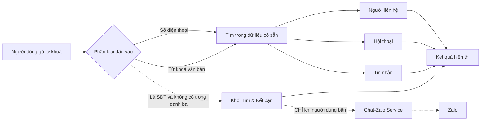
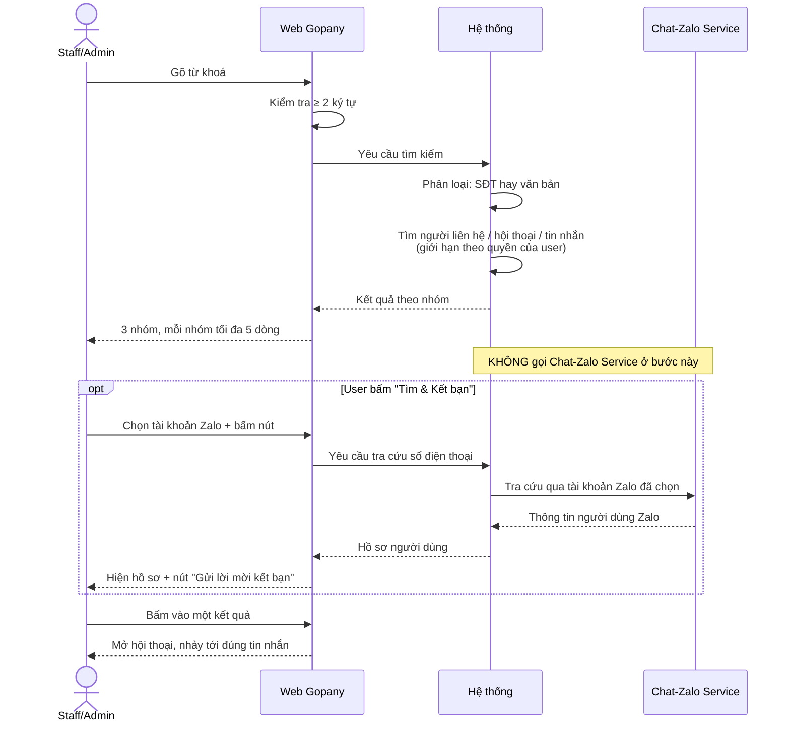
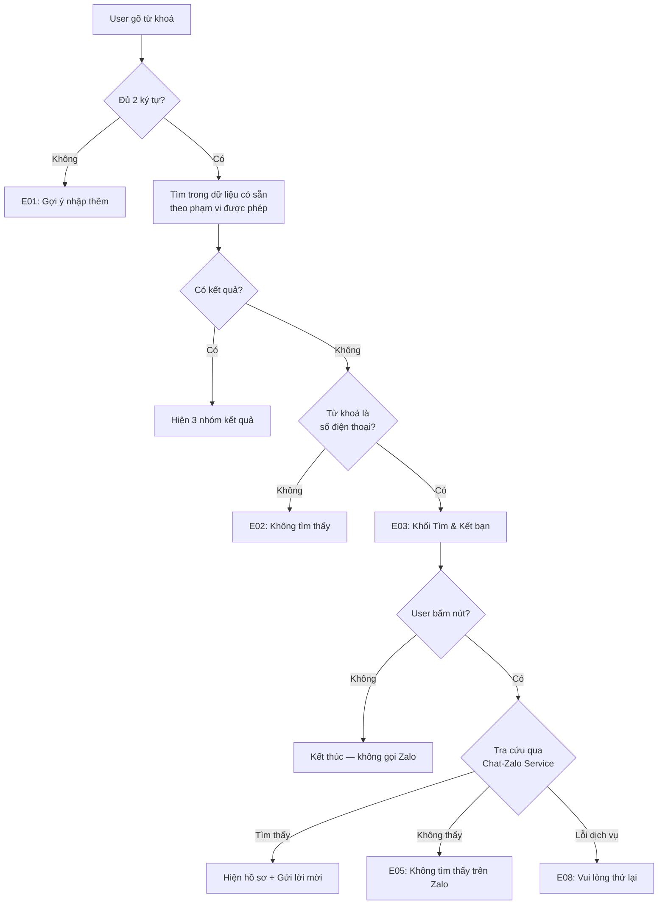
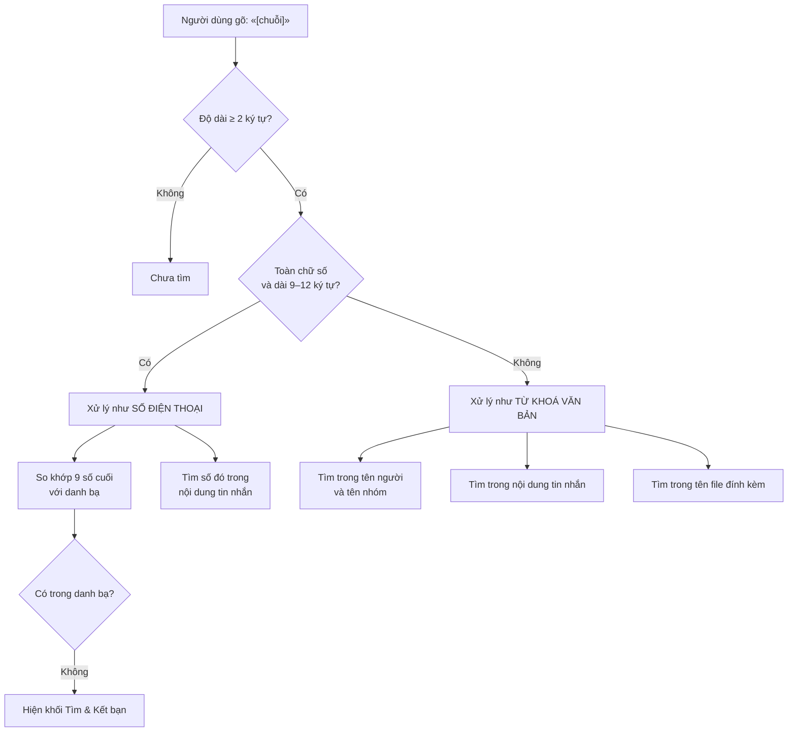

# [G017] Tìm kiếm hợp nhất — tin nhắn, hội thoại, người liên hệ

| Trường | Nội dung |
|--------|----------|
| **Feature ID** | G017 |
| **Tên** | Tìm kiếm hợp nhất — tin nhắn, hội thoại, người liên hệ |
| **Module** | Chat / Tìm kiếm |
| **Owner (BA)** | Thành |
| **Dev assignee** | — |
| **Priority** | — |
| **Version** | 1.1 |
| **Status** | Draft |
| **Last updated** | 2026-07-29 |

---

## 1. Tổng quan (Overview)

Hiện việc tìm kiếm bị **cắt rời thành nhiều chỗ**, mỗi chỗ chỉ làm được một việc:

| Muốn tìm | Phải làm gì |
|---|---|
| Một tin nhắn cũ | Phải **nhớ** nó nằm ở hội thoại nào → mở hội thoại đó → mới tìm được bên trong |
| Một người liên hệ | Vào màn hình danh bạ |
| Một người theo số điện thoại để kết bạn | Vào một chức năng khác nữa |

Hệ quả: nếu nhân viên **không nhớ** tin nhắn nằm ở hội thoại nào thì gần như không tìm ra. Với người xử lý hàng chục hội thoại mỗi ngày, đây là tình huống thường xuyên.

**Giải pháp: một ô tìm kiếm duy nhất.** Người dùng gõ một chuỗi bất kỳ — tên người, tên nhóm, nội dung tin nhắn, tên file, hay số điện thoại — hệ thống tự hiểu và trả về mọi thứ liên quan, gom theo nhóm.

Toàn bộ kết quả lấy từ **dữ liệu đã có sẵn trong hệ thống**. Hệ thống **không** tự gọi sang Zalo. Chỉ khi người dùng chủ động bấm **"Tìm & Kết bạn"** thì mới tra cứu trên Zalo qua Chat-Zalo Service.

Đi kèm là **cơ chế ghi nhớ kết quả**, để cùng một câu hỏi không phải trả lời lại hai lần:

| Ghi nhớ cái gì | Bao lâu | Lợi ích |
|---|---|---|
| Kết quả tra cứu số điện thoại trên Zalo | **7 ngày** | Bấm lại cùng một số không phát sinh thêm lượt gọi Zalo — giảm mạnh rủi ro Zalo hạn chế tài khoản của workspace |
| Kết quả tìm kiếm nội bộ | **30 giây** | Gõ lại cùng từ khoá, hoặc bấm "Xem tất cả" rồi quay lại → hiện tức thì |

**Use Case Description:**
> Là Admin hoặc Staff được phân quyền, tôi muốn gõ một từ khoá hoặc số điện thoại vào một ô duy nhất và thấy ngay mọi thứ liên quan — người liên hệ, hội thoại, tin nhắn — để không phải nhớ thông tin đó nằm ở đâu.

**Người dùng mục tiêu (Target users):**
- **Admin/Owner** của workspace — tìm trong toàn bộ workspace
- **Staff được phân quyền (G002)** — tìm trong phạm vi tài khoản Zalo và hội thoại mình có quyền xem
- **Staff có quyền "Hiển thị cuộc hội thoại chưa gắn nhân sự"** — tìm thêm được trong hội thoại chưa gán cho ai

**Phụ thuộc:** G003 (Chat), G002 (Phân quyền tài khoản Zalo cho Staff), G001 (Liên kết tài khoản Zalo), G008 (Quản lý nhóm)

### Sơ đồ tổng thể



> Auto-generated — comment nếu cần sửa logic

---

## 2. Điều kiện tiên quyết (Pre-conditions & Trigger)

**Trigger:**
- **T1** — User gõ từ khoá vào ô tìm kiếm ở đầu danh sách hội thoại
- **T2** — User bấm **"Xem tất cả"** của một nhóm kết quả
- **T3** — User bấm **"Tìm & Kết bạn"** trong khối kết bạn

**Pre-conditions:**
- [ ] User đã đăng nhập và có session hợp lệ
- [ ] Với Staff: đã được assign vào ít nhất một tài khoản Zalo qua G002
- [ ] Workspace có ít nhất một tài khoản Zalo **Đang hoạt động**
- [ ] Từ khoá có **từ 2 ký tự trở lên**

**Post-conditions (sau khi thành công):**
- Kết quả hiển thị theo nhóm — tìm kiếm là thao tác **chỉ đọc**, không tạo, sửa hay xoá dữ liệu
- Nếu user bấm vào một kết quả: mở hội thoại tương ứng, nhảy đúng tới tin nhắn được chọn

---

## 3. Luồng chính (Happy Path)

1. **[User]** Gõ từ khoá vào ô tìm kiếm ở đầu danh sách hội thoại
2. **[System]** Kiểm tra từ khoá có đủ **2 ký tự** không → đủ
3. **[System]** Phân loại đầu vào: **số điện thoại** hay **từ khoá văn bản**
4. **[System]** Tìm trong dữ liệu đã có sẵn, **giới hạn trong phạm vi user được phép xem** *(BR03)*
5. **[System]** Hiển thị kết quả theo 3 nhóm, mỗi nhóm tối đa **5 dòng** kèm nút **"Xem tất cả"**
6. **[User]** Bấm vào một kết quả
7. **[System]** Mở hội thoại tương ứng — nếu chọn từ nhóm **Tin nhắn** thì cuộn thẳng tới đúng tin nhắn đó và làm nổi bật nó



> Auto-generated — comment nếu cần sửa logic

### Cấu trúc kết quả

| Thứ tự | Nhóm | Khớp theo | Hiển thị mỗi dòng |
|:---:|---|---|---|
| 1 | **Người liên hệ** | Tên · số điện thoại | Avatar · tên · số điện thoại |
| 2 | **Hội thoại** | Tên cá nhân · tên nhóm | Avatar · tên · tin nhắn cuối |
| 3 | **Tin nhắn** | Nội dung · tên file đính kèm | Đoạn nội dung khớp *(bôi đậm từ khoá)* · tên hội thoại · ngày gửi |
| 4 | **Tìm & Kết bạn** | *(chỉ hiện khi là SĐT và không có trong danh bạ)* | Xem AF02 |

---

## 4. Luồng phụ (Alternative Flows)

### AF01 — Đầu vào là số điện thoại **có** trong danh bạ

- **Xảy ra khi:** User gõ chuỗi từ 9 chữ số trở lên, khớp với một người trong danh bạ
- **4a.** System so khớp theo **9 chữ số cuối** *(bỏ qua mã vùng, dấu cách, dấu chấm)*
- **4a.i.** Người liên hệ khớp hiện ở **nhóm 1**
- **4a.ii.** Nếu số đó còn xuất hiện trong nội dung tin nhắn → các tin đó hiện ở **nhóm 3**
- **4a.iii.** **Không** hiện khối "Tìm & Kết bạn"
  - Use Case tiếp tục bước 6

### AF02 — Đầu vào là số điện thoại **không có** trong danh bạ

- **Xảy ra khi:** Chuỗi từ 9 chữ số trở lên, không khớp người liên hệ nào
- **5a.** System hiển thị khối kết bạn thay cho nhóm rỗng:

```
ⓘ Không tìm thấy số này trong danh bạ.
  Vui lòng tìm kiếm hoặc kết bạn.

  Tài khoản Zalo thực hiện:  [ Zalo Kinh doanh 01  ▾ ]

           [ Tìm & Kết bạn ]
```

- **5a.i.** Ô chọn tài khoản chỉ liệt kê tài khoản Zalo mà user **được assign qua G002**
- **5a.ii.** Nếu chỉ có **1** tài khoản khả dụng → tự chọn sẵn, **ẩn** ô chọn
- **5a.iii.** Mặc định chọn tài khoản user **dùng gần nhất**
- **5a.iv.** Hệ thống **chưa** gọi sang Chat-Zalo Service ở bước này
- **6a.** User bấm **"Tìm & Kết bạn"** → System mới tra cứu qua tài khoản đã chọn
- **7a.** Tìm thấy → hiện hồ sơ người đó *(avatar, tên)* + nút **"Gửi lời mời kết bạn"**
  - Use Case kết thúc

### AF03 — Xem tất cả kết quả của một nhóm

- **Xảy ra khi:** Một nhóm có nhiều hơn 5 kết quả, user bấm **"Xem tất cả"**
- **5b.** System mở màn hình kết quả đầy đủ của riêng nhóm đó, có phân trang
- **5b.i.** Từ khoá được giữ nguyên, user sửa được ngay trên màn hình này
  - Use Case tiếp tục bước 6

### AF04 — Kết quả có tin nhắn đã thu hồi

- **Xảy ra khi:** Tin nhắn khớp từ khoá đã bị thu hồi *(G003 — thu hồi từ web Gopany hoặc từ điện thoại)*
- **5c.** System **vẫn hiển thị** tin đó trong nhóm Tin nhắn
- **5c.i.** Gắn nhãn **"Đã thu hồi"** rõ ràng ngay cạnh nội dung
  - Use Case tiếp tục bước 6

> Nội dung vẫn tìm được vì hệ thống có lưu. Nhãn là bắt buộc: người gửi thu hồi thường vì gửi nhầm hoặc muốn rút lại — nhân viên cần biết điều đó trước khi sử dụng thông tin.

### AF05 — Tìm theo tên file đính kèm

- **Xảy ra khi:** Từ khoá khớp với tên một file đã gửi/nhận
- **5d.** Tin nhắn chứa file đó hiện ở nhóm **Tin nhắn**, dòng hiển thị là **tên file** thay vì đoạn nội dung
  - Use Case tiếp tục bước 6

### AF06 — Kết quả thuộc nhóm đã rời hoặc đã bị xoá khỏi nhóm

- **Xảy ra khi:** Tin nhắn khớp nằm trong nhóm mà user đã tự rời hoặc bị xoá *(G008 BR11 — lịch sử vẫn được lưu)*
- **5e.** System **vẫn hiển thị** kết quả đó, nhất quán với việc user vẫn mở xem lại được lịch sử nhóm
- **5e.i.** Bấm vào → mở nhóm ở chế độ chỉ đọc, input vẫn bị vô hiệu hoá theo G008 BR11
  - Use Case tiếp tục bước 6

### AF07 — Dùng lại kết quả tra cứu số điện thoại đã ghi nhớ

- **Xảy ra khi:** User bấm **"Tìm & Kết bạn"** cho một số điện thoại đã từng tra cứu trong **7 ngày gần đây**, bằng **cùng tài khoản Zalo**
- **6b.** System trả lại **kết quả đã ghi nhớ**, **không** gọi sang Chat-Zalo Service *(thay bước 6a)*
- **6b.i.** Hồ sơ hiện ra ngay lập tức, không có trạng thái chờ
- **6b.ii.** Người dùng **không** phân biệt được đây là kết quả cũ — trải nghiệm giống hệt lần tra đầu
  - Use Case tiếp tục bước 7a

### AF08 — Dùng lại kết quả tìm kiếm đã ghi nhớ

- **Xảy ra khi:** User gõ lại **đúng từ khoá** đã tìm trong **30 giây** gần đây, hoặc bấm "Xem tất cả" rồi quay lại
- **4c.** System trả lại kết quả đã ghi nhớ **của chính user đó** *(thay bước 4)*
- **4c.i.** Kết quả hiện **tức thì**, không có skeleton
  - Use Case tiếp tục bước 6

---

## 5. Luồng ngoại lệ (Exception Flows)

| Code | Trigger (Điều kiện kích hoạt) | UI Response (Phản hồi giao diện) | Recovery (Hướng xử lý) |
|------|-------------------------------|----------------------------------|------------------------|
| E01 | Từ khoá **dưới 2 ký tự** | Chưa tìm. Gợi ý mờ: *"Nhập từ 2 ký tự để tìm kiếm"* | User gõ thêm |
| E02 | Không có kết quả nào, từ khoá **không phải** số điện thoại | Trạng thái rỗng: *"Không tìm thấy kết quả cho «[từ khoá]»"* + *"Thử từ khoá ngắn hơn hoặc kiểm tra lại chính tả"* | User đổi từ khoá |
| E03 | Không có kết quả nào, từ khoá **là** số điện thoại | Hiện khối **"Tìm & Kết bạn"** *(xem AF02)* | User bấm nút để tra cứu trên Zalo |
| E04 | Staff **chưa được assign** tài khoản Zalo nào *(G002)* | Trạng thái rỗng: *"Bạn chưa được phân quyền tài khoản Zalo nào"* | Liên hệ Admin/Owner để được phân quyền |
| E05 | Bấm **"Tìm & Kết bạn"** nhưng Zalo không tìm thấy số đó | Toast: *"Không tìm thấy người dùng Zalo với số điện thoại này"* | User kiểm tra lại số |
| E06 | Bấm **"Tìm & Kết bạn"** nhưng tài khoản Zalo đã chọn đang **Ngắt kết nối** | Toast: *"Tài khoản Zalo «[tên]» đang mất kết nối. Vui lòng chọn tài khoản khác hoặc kết nối lại."* | Chọn tài khoản khác, hoặc kết nối lại theo G001 |
| E07 | Bấm **"Tìm & Kết bạn"** với người **đã là bạn bè** | Toast: *"Đã là bạn bè"* + nút **"Mở hội thoại"** | User mở hội thoại luôn |
| E08 | Chat-Zalo Service lỗi / timeout khi tra cứu số điện thoại | Toast: *"Vui lòng thử lại"* | User bấm lại sau |
| E09 | Hệ thống tìm kiếm tạm thời gián đoạn | Vẫn trả kết quả nhưng **có thể thiếu và chậm hơn**. Dải cảnh báo nhẹ: *"Kết quả có thể chưa đầy đủ, vui lòng thử lại sau"* | User thử lại sau |



> Auto-generated — comment nếu cần sửa logic

---

## 6. Business Rules — Quy tắc nghiệp vụ

> Mục này chia làm **2 nhóm**: **6A** — quy tắc tìm kiếm *(BR01–BR18)* · **6B** — quy tắc ghi nhớ kết quả *(BR19–BR23)*

### 6A — Quy tắc tìm kiếm

| Code | Rule (Quy tắc) | Lý do |
|------|----------------|-------|
| BR01 | Từ khoá phải có **tối thiểu 2 ký tự** mới thực hiện tìm | Một ký tự khớp với gần như mọi thứ, kết quả vô nghĩa và làm hệ thống quét toàn bộ dữ liệu |
| BR02 | Chuỗi gồm **từ 9 đến 12 chữ số** được coi là **số điện thoại**; so khớp theo **9 chữ số cuối** | Bỏ qua khác biệt mã vùng (`0`, `+84`, `84`) và dấu cách/chấm người dùng hay gõ kèm |
| BR03 | **Phạm vi tìm của Staff** = hội thoại thuộc tài khoản Zalo được assign qua G002, **và** trong đó chỉ gồm: hội thoại được gán cho mình **+** hội thoại chưa gán cho ai *(nếu có quyền "Hiển thị cuộc hội thoại chưa gắn nhân sự")*.<br>**Admin/Owner** tìm trong toàn workspace | Kết quả tìm kiếm phải khớp đúng những gì user vốn đã xem được ở G003 (BR02, BR18). Nếu rộng hơn là rò rỉ nội dung; nếu hẹp hơn là tính năng vô dụng |
| BR04 | Thứ tự nhóm kết quả **cố định**: Người liên hệ → Hội thoại → Tin nhắn → Tìm & Kết bạn | Đi từ cụ thể tới rộng. Người dùng tìm tên thường muốn thấy người/hội thoại trước, tin nhắn sau |
| BR05 | Mỗi nhóm hiện tối đa **5 dòng**, kèm nút **"Xem tất cả"** nếu còn nữa | Giữ toàn bộ kết quả trong một màn hình, không phải cuộn dài |
| BR06 | Hệ thống **không bao giờ tự gọi sang Chat-Zalo Service** khi user gõ. Chỉ gọi khi user **chủ động bấm "Tìm & Kết bạn"** | Gõ tới đâu tra tới đó sẽ tạo hàng chục lượt tra cứu cho một lần tìm — Zalo có thể hạn chế hoặc khoá tài khoản của workspace |
| BR07 | Khối **"Tìm & Kết bạn"** chỉ hiện khi thoả **cả hai**: đầu vào là số điện thoại **và** số đó không có trong danh bạ | Người đã có trong danh bạ thì mở hội thoại là xong, không cần kết bạn lại |
| BR08 | Ô chọn tài khoản Zalo **chỉ liệt kê tài khoản mà user được assign qua G002** | Nếu không lọc, nhân viên sẽ kết bạn bằng tài khoản Zalo không thuộc phạm vi công việc của mình |
| BR09 | Chỉ có **1** tài khoản Zalo khả dụng → tự chọn sẵn và **ẩn** ô chọn | Bắt chọn khi chỉ có một lựa chọn là thao tác thừa |
| BR10 | Mặc định chọn tài khoản Zalo mà user **dùng gần nhất** | Đa số nhân viên làm việc cố định trên một tài khoản |
| BR11 | Tin nhắn **đã thu hồi vẫn tìm ra được**, nhưng **bắt buộc** gắn nhãn **"Đã thu hồi"** | Dữ liệu vẫn được lưu nên tìm được. Nhãn là bắt buộc vì người gửi thu hồi thường do gửi nhầm — nhân viên cần biết trước khi dùng thông tin đó |
| BR12 | Tìm được cả theo **tên file đính kèm**, không chỉ nội dung văn bản | Người dùng thường nhớ tên file *(«báo giá tháng 7.pdf»)* rõ hơn nội dung tin nhắn kèm theo |
| BR13 | **Không giới hạn thời gian lịch sử** — có bao nhiêu dữ liệu thì tìm được bấy nhiêu | Giá trị lớn nhất của tìm kiếm nằm ở dữ liệu cũ, thứ mà người dùng đã quên |
| BR14 | Kết quả sắp xếp theo **mức độ liên quan**, không theo thời gian | Tin khớp chính xác nhất phải lên đầu, kể cả khi nó cũ hơn |
| BR15 | Gõ **không dấu** vẫn ra kết quả **có dấu** *(«bao gia» → «báo giá»)* | Người dùng gõ nhanh thường bỏ dấu; bắt gõ đúng dấu sẽ khiến tính năng gần như vô dụng |
| BR16 | Bấm vào kết quả nhóm **Tin nhắn** → mở hội thoại **và cuộn thẳng tới đúng tin nhắn đó**, làm nổi bật nó | Mở hội thoại rồi bắt người dùng tự cuộn tìm lại là bỏ dở việc giữa chừng |
| BR17 | Tin nhắn trong **nhóm đã rời hoặc đã bị xoá khỏi nhóm** vẫn tìm được | Nhất quán với G008 BR11 — lịch sử vẫn được lưu và user vẫn mở xem lại được |
| BR18 | Tin nhắn vừa nhận cần **một khoảng rất ngắn** trước khi tìm được | Đánh đổi của cơ chế tra cứu nhanh. Không ảnh hưởng thực tế vì tin vừa nhận đang hiện ngay trên màn hình |

### 6B — Quy tắc ghi nhớ kết quả *(cache)*

> Nhóm quy tắc này trả lời câu hỏi: **cùng một câu hỏi có phải trả lời lại hai lần không?**
> Khác với "sổ tra cứu" ở BR14/BR18 — sổ tra cứu giúp *tìm nhanh*, ghi nhớ giúp *không phải tìm lại*.

| Code | Rule (Quy tắc) | Lý do |
|------|----------------|-------|
| BR19 | Kết quả tra cứu số điện thoại trên Zalo được **ghi nhớ 7 ngày**, theo từng cặp *(số điện thoại + tài khoản Zalo thực hiện)*. Bấm "Tìm & Kết bạn" lại trong thời hạn đó → trả kết quả đã ghi nhớ, **không gọi Zalo** | Kịch bản thật hay gặp là bấm đi bấm lại cùng một số. Ghi nhớ chặn được phần lớn lượt gọi thừa — thứ dễ khiến Zalo hạn chế tài khoản của workspace nhất |
| BR20 | Bản ghi nhớ tra cứu bị **xoá ngay** khi gửi lời mời kết bạn thành công cho số đó | Quan hệ đã thay đổi. Giữ kết quả cũ 7 ngày sẽ hiển thị sai trạng thái bạn bè |
| BR21 | Kết bạn thành công qua nút "Tìm & Kết bạn" → **thêm người đó vào danh bạ ngay lập tức**, không đợi đồng bộ thủ công của G006 | Nếu chờ đồng bộ thủ công, nhân viên vừa kết bạn xong gõ lại vẫn báo "không tìm thấy trong danh bạ" — người dùng sẽ nghĩ tính năng hỏng. Đây là dữ liệu hệ thống vừa tự tạo ra, không có lý do phải chờ |
| BR22 | Kết quả tìm kiếm nội bộ được **ghi nhớ 30 giây**. Gõ lại cùng từ khoá, hoặc bấm "Xem tất cả" rồi quay lại → hiện tức thì | Người dùng rất hay gõ rồi xoá rồi gõ lại. Không cần tìm lại từ đầu cho cùng một câu hỏi |
| BR23 | Bản ghi nhớ kết quả tìm kiếm **bắt buộc tách riêng theo từng user** — tuyệt đối không dùng chung giữa các user | Hai nhân viên gõ cùng một từ khoá sẽ ra kết quả **khác nhau** do phạm vi quyền khác nhau *(BR03)*. Dùng chung bản ghi nhớ = nhân viên này đọc được kết quả của nhân viên kia — rò rỉ dữ liệu |

---

## 7. State Machine — Trạng thái

**N/A** — Tìm kiếm là thao tác **chỉ đọc**, không tạo ra thực thể nào có vòng đời trạng thái.

Thay vào đó, phần quyết định nghiệp vụ nằm ở **cách hệ thống phân loại đầu vào**:



> Auto-generated — comment nếu cần sửa logic

---

## 8. Data Model — Mô hình dữ liệu

N/A — Spec này thuần nghiệp vụ. Data model sẽ được định nghĩa trong tài liệu kỹ thuật riêng.

> **Về cơ chế tra cứu nhanh:** hệ thống duy trì một **sổ tra cứu** riêng, ghi lại từ nào xuất hiện ở tin nhắn nào — giống mục lục ở cuối một cuốn sách dày. Nhờ đó không phải đọc lần lượt toàn bộ dữ liệu mỗi lần tìm. Cách xây dựng và duy trì sổ này thuộc tài liệu kỹ thuật.

---

## 9. API Contract

N/A — Spec này thuần nghiệp vụ. API contract sẽ được định nghĩa trong tài liệu kỹ thuật riêng.

---

## 10. UI/UX Notes — Ghi chú giao diện

### 10A — Vị trí và tổng quan

| Element | Mô tả |
|---|---|
| Ô tìm kiếm | Đặt ở **đầu danh sách hội thoại**, luôn hiển thị |
| Kết quả | Xổ xuống ngay dưới ô tìm kiếm, đè lên danh sách hội thoại |
| Đóng kết quả | Xoá hết từ khoá, bấm ra ngoài, hoặc phím `Esc` |
| Responsive | Có — trên mobile kết quả chiếm toàn màn hình |

### 10B — Hiển thị kết quả

- Mỗi nhóm có **tiêu đề + số lượng**: *"TIN NHẮN (12)"*
- **Bôi đậm** phần từ khoá khớp trong mỗi dòng
- Nhóm **Tin nhắn**: mỗi dòng hiện đoạn nội dung quanh từ khoá, kèm **tên hội thoại** và **ngày gửi**
- Nhóm không có kết quả → **ẩn hẳn**, không hiện tiêu đề rỗng
- Nút **"Xem tất cả"** ở cuối nhóm, chỉ hiện khi còn nhiều hơn 5 kết quả
- Tin nhắn đã thu hồi: nhãn **"Đã thu hồi"** dạng chip xám ngay cạnh nội dung *(BR11)*
- Tin nhắn có file: hiện **icon loại file + tên file** thay cho đoạn nội dung *(BR12)*

### 10C — Khối "Tìm & Kết bạn"

| Thành phần | Nội dung |
|---|---|
| Icon | ⓘ thông tin — **không** dùng icon lỗi |
| Dòng 1 | *"Không tìm thấy số này trong danh bạ."* |
| Dòng 2 | *"Vui lòng tìm kiếm hoặc kết bạn."* |
| Ô chọn | **"Tài khoản Zalo thực hiện"** — chỉ hiện khi có từ 2 tài khoản khả dụng trở lên *(BR09)* |
| Nút chính | **"Tìm & Kết bạn"** |
| Sau khi bấm | Hiện hồ sơ người dùng Zalo *(avatar, tên)* + nút **"Gửi lời mời kết bạn"** |

> Đây là **thông tin**, không phải lỗi. Dùng màu và icon trung tính — người dùng gõ một số lạ là chuyện bình thường.

### 10D — Trạng thái & phản hồi

| Tình huống | Hiển thị |
|---|---|
| Đang tìm | Skeleton 3 dòng trong vùng kết quả |
| Chưa đủ 2 ký tự | Dòng gợi ý mờ, không skeleton |
| Không có kết quả | Trạng thái rỗng + gợi ý đổi từ khoá |
| Đang tra cứu trên Zalo | Nút "Tìm & Kết bạn" chuyển sang trạng thái đang xử lý, **vô hiệu hoá** để tránh bấm nhiều lần |
| Hệ thống tìm kiếm gián đoạn | Dải cảnh báo nhẹ phía trên kết quả *(E09)* |

### 10E — Quyền & hiển thị có điều kiện

| Vai trò | Phạm vi tìm | Ô chọn tài khoản Zalo | Nút "Tìm & Kết bạn" |
|---|---|---|---|
| **Admin/Owner** | Toàn workspace | Mọi tài khoản trong workspace | ✅ |
| **Staff được assign tài khoản Zalo** | Hội thoại được gán cho mình, trong các tài khoản Zalo được assign | Chỉ tài khoản được assign | ✅ |
| **Staff có thêm quyền "Hiển thị cuộc hội thoại chưa gắn nhân sự"** | Như trên **+** hội thoại chưa gán cho ai | Chỉ tài khoản được assign | ✅ |
| **Staff chưa được assign tài khoản Zalo nào** | — | — | ❌ — trạng thái rỗng *(E04)* |

---

## 11. Acceptance Criteria — Tiêu chí nghiệm thu

### Tìm cơ bản
- [ ] Gõ 1 ký tự → không tìm, hiện gợi ý *"Nhập từ 2 ký tự để tìm kiếm"*
- [ ] Gõ 2 ký tự trở lên → kết quả hiện ra, gom theo nhóm có tiêu đề và số lượng
- [ ] Nhóm không có kết quả → **ẩn hẳn**, không hiện tiêu đề rỗng
- [ ] Từ khoá khớp được **bôi đậm** trong từng dòng kết quả

### Tìm theo tên
- [ ] Gõ tên một người liên hệ → người đó hiện ở nhóm **Người liên hệ**
- [ ] Gõ tên một nhóm chat → nhóm đó hiện ở nhóm **Hội thoại**
- [ ] Gõ `bao gia` (không dấu) → tìm ra tin nhắn chứa **"báo giá"**
- [ ] Kết quả khớp chính xác hơn được xếp **lên trên** kết quả khớp một phần

### Tìm tin nhắn
- [ ] Gõ một từ có trong tin nhắn của hội thoại **bất kỳ** → tin đó hiện ra, **không cần** mở hội thoại trước
- [ ] Mỗi dòng tin nhắn hiện đủ: đoạn nội dung · **tên hội thoại** · **ngày gửi**
- [ ] Bấm vào dòng tin nhắn → mở hội thoại **và cuộn thẳng tới đúng tin nhắn**, tin đó được làm nổi bật
- [ ] Gõ tên một file đã gửi → tin nhắn chứa file đó hiện ra, dòng kết quả hiện **tên file**
- [ ] Tin nhắn đã thu hồi khớp từ khoá → **vẫn hiện**, có nhãn **"Đã thu hồi"**
- [ ] Tin nhắn trong nhóm đã rời → **vẫn tìm được**; bấm vào mở nhóm ở chế độ chỉ đọc

### Tìm theo số điện thoại
- [ ] Gõ `0987654321` → so khớp đúng cả với số lưu dạng `+84987654321` và `84987654321`
- [ ] Số **có** trong danh bạ → hiện ở nhóm Người liên hệ, **không** hiện khối Tìm & Kết bạn
- [ ] Số **không có** trong danh bạ → hiện khối **Tìm & Kết bạn**
- [ ] Số điện thoại xuất hiện trong **nội dung** một tin nhắn → tin đó hiện ở nhóm Tin nhắn
- [ ] Gõ `0987` (4 chữ số) → xử lý như **từ khoá văn bản**, không hiện khối kết bạn

### Không tự gọi Zalo
- [ ] Gõ liên tục một số điện thoại rồi xoá đi gõ lại nhiều lần → **không** phát sinh lượt tra cứu Zalo nào
- [ ] Chỉ khi bấm **"Tìm & Kết bạn"** mới phát sinh đúng **1** lượt tra cứu
- [ ] Trong lúc đang tra cứu, nút bị **vô hiệu hoá**, bấm liên tục không tạo thêm lượt

### Ghi nhớ kết quả tra cứu Zalo
- [ ] Bấm "Tìm & Kết bạn" cho số X → gọi Zalo **1** lượt. Bấm lại cùng số X sau 1 phút → **0** lượt gọi thêm, hồ sơ hiện tức thì
- [ ] Bấm lại cùng số X sau **6 ngày** → vẫn dùng kết quả ghi nhớ, **không** gọi Zalo
- [ ] Bấm lại cùng số X sau **8 ngày** → ghi nhớ đã hết hạn, gọi Zalo lần mới
- [ ] Tra số X bằng tài khoản Zalo **A**, sau đó tra cùng số X bằng tài khoản **B** → **có** gọi Zalo *(ghi nhớ tách theo từng tài khoản)*
- [ ] Gửi lời mời kết bạn thành công cho số X → bản ghi nhớ bị **xoá ngay**; lần tra tiếp theo gọi Zalo mới

### Cập nhật danh bạ sau khi kết bạn
- [ ] Kết bạn thành công qua "Tìm & Kết bạn" → gõ lại số đó **ngay** → hiện ở nhóm **Người liên hệ**, **không** còn hiện khối "Tìm & Kết bạn"
- [ ] Không cần chạy đồng bộ thủ công (G006) thì người mới kết bạn vẫn tìm ra được

### Ghi nhớ kết quả tìm kiếm
- [ ] Gõ `báo giá` → xoá hết → gõ lại `báo giá` trong 30 giây → kết quả hiện **tức thì**, không skeleton
- [ ] Bấm "Xem tất cả" rồi bấm quay lại → kết quả hiện tức thì
- [ ] Gõ lại cùng từ khoá sau **hơn 30 giây** → tìm lại bình thường
- [ ] Nhân viên A gõ `báo giá` → ra 5 kết quả. Nhân viên B *(quyền khác)* gõ `báo giá` ngay sau đó → ra kết quả **theo đúng phạm vi của B**, **không** lấy kết quả của A

### Chọn tài khoản Zalo
- [ ] Workspace có 3 tài khoản, Staff được assign 2 → ô chọn chỉ hiện **2**
- [ ] Staff chỉ được assign 1 tài khoản → **ẩn** ô chọn, tự chọn sẵn tài khoản đó
- [ ] Mở lại ô tìm kiếm lần sau → mặc định chọn đúng tài khoản **dùng gần nhất**
- [ ] Chọn tài khoản đang **Ngắt kết nối** rồi bấm → toast báo lỗi, gợi ý chọn tài khoản khác

### Phân quyền và cách ly
- [ ] Staff tìm một từ chỉ có trong hội thoại **của tài khoản Zalo chưa được assign** → **không** ra kết quả nào
- [ ] Staff tìm một từ chỉ có trong hội thoại **đã gán cho nhân viên khác** → **không** ra kết quả nào
- [ ] Staff **không** có quyền "Hiển thị cuộc hội thoại chưa gắn nhân sự" → **không** tìm ra tin nhắn trong hội thoại chưa gán
- [ ] Staff **có** quyền đó → **có** tìm ra
- [ ] Admin/Owner tìm cùng các từ trên → **có** ra kết quả trong mọi trường hợp
- [ ] Staff chưa được assign tài khoản Zalo nào → trạng thái rỗng *"Bạn chưa được phân quyền tài khoản Zalo nào"*
- [ ] User workspace A tìm từ khoá chỉ có ở workspace B → **không** ra kết quả nào

### Xem tất cả
- [ ] Nhóm có hơn 5 kết quả → hiện nút **"Xem tất cả"**
- [ ] Nhóm có đúng 5 kết quả hoặc ít hơn → **không** hiện nút
- [ ] Bấm "Xem tất cả" → mở màn hình riêng của nhóm đó, có phân trang, **giữ nguyên** từ khoá

### Dữ liệu cũ
- [ ] Sau khi triển khai, tìm được tin nhắn từ **trước ngày bật tính năng**
- [ ] Không có giới hạn thời gian — tin nhắn cũ nhất trong hệ thống vẫn tìm được

---

## 12. Out of Scope — Ngoài phạm vi

- **Giới hạn tần suất tra cứu số điện thoại trên Zalo** — sẽ làm sau. *(Lưu ý: tra cứu quá nhiều có thể khiến Zalo hạn chế tài khoản Zalo của workspace — xem Open Question Q1)*
- **Bộ lọc nâng cao** — lọc theo khoảng ngày, theo người gửi, theo loại tin nhắn
- **Tìm trong nội dung file** — PDF, Word, Excel; chỉ tìm theo **tên file**
- **Tìm chữ trong ảnh** (OCR)
- **Lưu lịch sử tìm kiếm** và gợi ý từ khoá đã tìm *(khác với ghi nhớ kết quả ở BR22 — đây là lưu lại các từ khoá user đã gõ để gợi ý lần sau)*
- **Gợi ý tự động khi đang gõ** (autocomplete)
- **Tìm sticker, biểu cảm, tin nhắn thoại**
- **Xuất kết quả tìm kiếm** ra Excel

---

## 13. Dependencies — Phụ thuộc

| Phụ thuộc vào | Ghi chú |
|---------------|---------|
| G003 — Chat | Nguồn dữ liệu hội thoại và tin nhắn |
| G002 — Phân quyền tài khoản Zalo cho Staff | Quyết định phạm vi tìm của Staff *(BR03)* và danh sách trong ô chọn tài khoản *(BR08)*. Nếu chưa hoàn thiện, Staff sẽ không tìm được gì |
| G001 — Liên kết tài khoản Zalo | Trạng thái **Đang hoạt động / Ngắt kết nối** dùng cho E06 |
| G008 — Quản lý nhóm | Quy tắc nhóm đã rời/bị xoá vẫn giữ lịch sử *(BR17)* |
| G006 — Đồng bộ dữ liệu | Nguồn dữ liệu danh bạ. **BR21 bổ sung một đường ghi danh bạ mới**: kết bạn thành công qua ô tìm kiếm thì thêm ngay, không đợi đồng bộ thủ công |
| Danh bạ Zalo đã đồng bộ | Nguồn dữ liệu nhóm **Người liên hệ** và cơ sở quyết định có hiện khối kết bạn hay không *(BR07)* |
| Chat-Zalo Service | Chỉ dùng cho thao tác **"Tìm & Kết bạn"** |

**Tính năng bị ảnh hưởng:**

| Tính năng | Ảnh hưởng |
|---|---|
| Ô tìm kiếm hội thoại hiện tại | **Được thay thế** bằng ô tìm kiếm hợp nhất. Hành vi cũ (tìm tên hội thoại) trở thành nhóm 2 của kết quả mới |
| Tìm tin nhắn trong một hội thoại | **Giữ nguyên**, không bỏ. User vẫn tìm trong hội thoại đang mở như cũ |
| Màn hình danh bạ | Giữ nguyên. Ô tìm kiếm hợp nhất là lối tắt, không thay thế |

---

## 14. Open Questions — Câu hỏi chưa giải quyết

| # | Câu hỏi | Owner | Deadline | Trả lời |
|---|---------|-------|----------|---------|
| Q1 | Tra cứu số điện thoại trên Zalo quá nhiều có thể khiến Zalo hạn chế tài khoản Zalo của workspace. Đặt giới hạn ở mức nào và khi nào làm? | PO | Sau khi có số liệu thực tế | **Đã giảm nhẹ đáng kể nhờ BR19** — ghi nhớ 7 ngày chặn phần lớn lượt gọi lặp lại. Vẫn theo dõi số lượt tra cứu **số mới** sau khi phát hành rồi quyết định có cần thêm giới hạn không |
| Q2 | Gopany và Chat-Zalo lưu dữ liệu độc lập → **cùng một từ khoá có thể cho số lượng kết quả khác nhau ở hai hệ thống**. Có cần cơ chế đối chiếu không? | PO | — | — |
| Q3 | Khi kết quả rất nhiều *(vài nghìn tin nhắn khớp)*, có cần cho user thu hẹp bằng bộ lọc ngay lần đầu không? | PO | Sau 1 tháng vận hành | Theo dõi thực tế rồi quyết định |

---

## 15. Performance & Scalability

| Mục | Yêu cầu |
|-----|---------|
| Thời gian hiện kết quả | **Dưới 1 giây** kể cả khi workspace có hàng triệu tin nhắn |
| Thời gian tra cứu trên Zalo | Phụ thuộc Chat-Zalo Service — ngoài tầm kiểm soát. Giao diện phải hiện trạng thái đang xử lý |
| Độ trễ tin nhắn mới vào kết quả tìm kiếm | Rất ngắn, không ảnh hưởng thực tế *(BR18)* |
| Số kết quả tối đa mỗi nhóm ở màn hình chính | 5 |
| Khi hệ thống tìm kiếm gián đoạn | Vẫn phải trả về kết quả, chấp nhận thiếu và chậm hơn — **không được** báo lỗi trắng màn hình *(E09)* |

---

## 16. Rollout & Migration

| Mục | Chi tiết |
|-----|---------|
| Rollout strategy | Bật cho toàn bộ user có quyền |
| Data migration | Cần **nạp lại toàn bộ lịch sử** sẵn có vào sổ tra cứu, chạy một lần lúc triển khai. Bỏ qua bước này thì vài tháng đầu user sẽ tưởng tính năng hỏng vì không tìm ra tin nhắn cũ |
| Breaking change | **Không.** Ô tìm kiếm cũ được mở rộng thành ô tìm kiếm hợp nhất; hành vi cũ vẫn nằm trong kết quả mới |
| Ảnh hưởng user hiện tại | Tích cực — cùng một ô, giờ tìm được nhiều thứ hơn |
| Thông báo trước | Nên có thông báo trong ứng dụng giới thiệu ô tìm kiếm mới, đặc biệt là việc **tìm được tin nhắn mà không cần mở hội thoại** |
| Rollback plan | Thu gọn về hành vi cũ *(chỉ tìm tên hội thoại)*. **Không mất dữ liệu** — tìm kiếm là thao tác chỉ đọc |
| Theo dõi sau phát hành | Tháng đầu: tỷ lệ tìm kiếm có kết quả được bấm vào · nhóm kết quả nào được dùng nhiều nhất · số lượt bấm "Tìm & Kết bạn" mỗi ngày |

---

## Changelog

| Ngày | Version | Người thay đổi | Sections | Nội dung | File:Line |
|------|---------|----------------|----------|----------|-----------|
| 2026-07-29 | v1.0 | Thành (BA) | — | Tạo draft | — |
| 2026-07-29 | v1.0→v1.1 | Thành (BA) | 4, 6, 11, 13, 14 | Bổ sung phần **ghi nhớ kết quả** — v1.0 mới chỉ có sổ tra cứu (tìm nhanh), chưa có ghi nhớ (không tìm lại). Thêm BR19–BR23, AF07, AF08, 4 nhóm AC mới. **BR21 vá lỗ hổng nghiệp vụ**: trước đó kết bạn xong tìm lại vẫn không ra vì G006 chỉ đồng bộ danh bạ thủ công | BR19–BR23, AF07–AF08 |

---

> **Lưu ý cho AI khi đọc spec này:**
> - Section 6 (Business Rules) là **bắt buộc implement đầy đủ**
> - **BR06 là quy tắc quan trọng nhất**: hệ thống **không bao giờ** tự gọi Chat-Zalo Service khi user gõ. Chỉ gọi khi bấm "Tìm & Kết bạn". Vi phạm có thể khiến Zalo hạn chế tài khoản của workspace
> - **BR03 là quy tắc dễ bỏ sót nhất**: phạm vi tìm phải khớp **chính xác** với những gì user vốn xem được ở G003 (BR02 + BR18) — không rộng hơn, không hẹp hơn
> - **BR23 là quy tắc nguy hiểm nếu làm sai**: bản ghi nhớ kết quả tìm kiếm phải tách riêng theo **từng user**. Dùng chung một bản ghi nhớ cho cùng từ khoá = nhân viên này đọc được kết quả của nhân viên kia, vì phạm vi quyền của mỗi người khác nhau
> - **BR11**: tin nhắn đã thu hồi vẫn hiện nhưng **bắt buộc** có nhãn "Đã thu hồi" — không được bỏ nhãn
> - Section 12 (Out of Scope) là danh sách **cấm** — không implement dù có vẻ logic
> - Section 11 (AC) là checklist tự verify trước khi báo done
> - Data model và API contract **không** nằm trong tài liệu này — xem tài liệu kỹ thuật riêng
