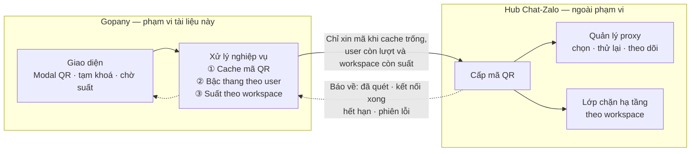
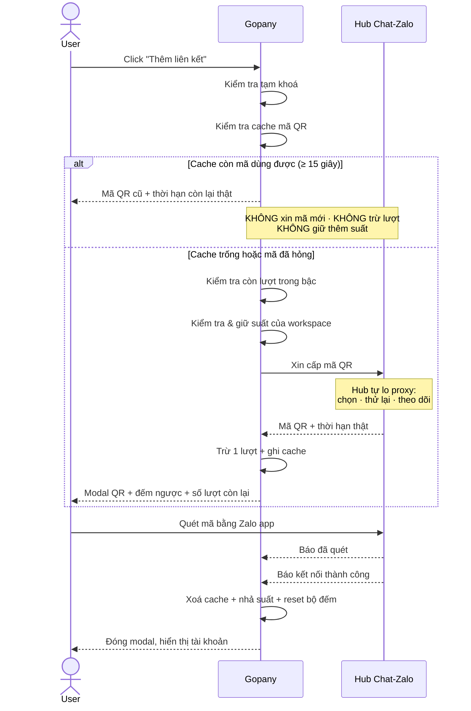
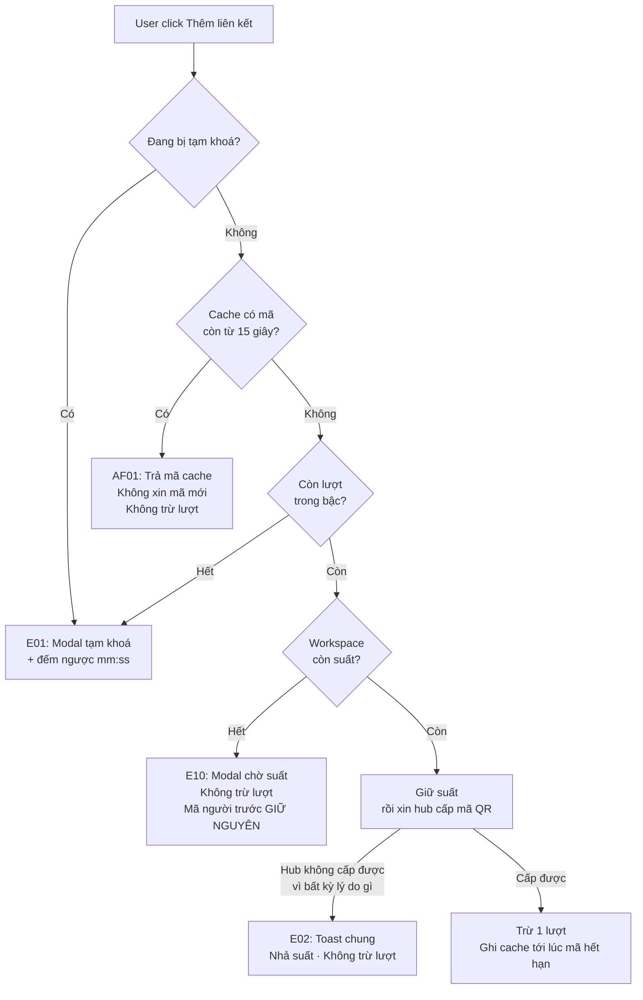
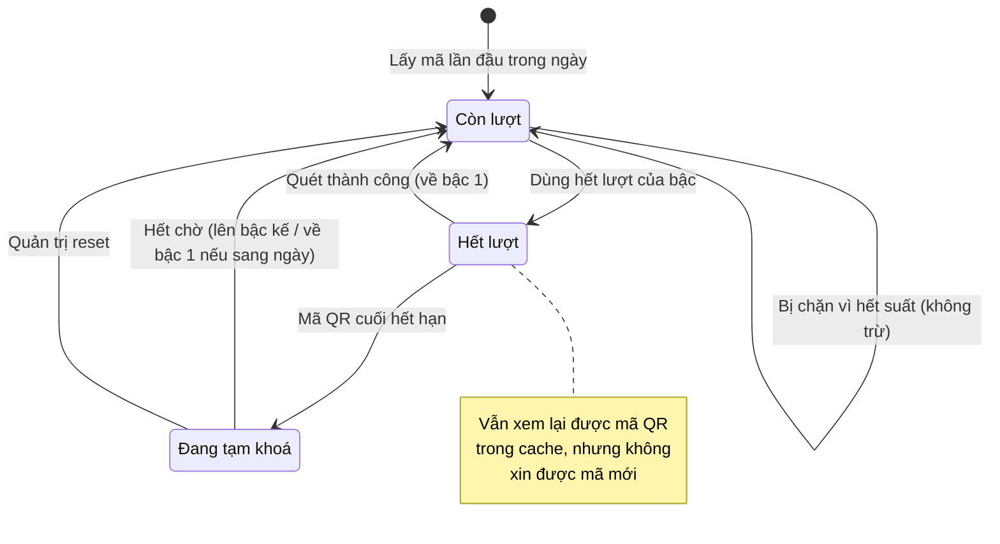

# [G018] Cache mã QR và giới hạn tần suất phía Gopany

| Trường | Nội dung |
|--------|----------|
| **Feature ID** | G018 |
| **Tên** | Cache mã QR và giới hạn tần suất lấy mã — phạm vi Gopany |
| **Module** | Thiết lập / Tài khoản Zalo |
| **Owner (BA)** | Thành |
| **Dev assignee** | — |
| **Priority** | — |
| **Version** | 1.2 |
| **Status** | Draft |
| **Last updated** | 2026-07-30 |

---

## 1. Tổng quan (Overview)

Mỗi lần người dùng bấm **"Thêm liên kết"** ở G001, Gopany yêu cầu hub Chat-Zalo cấp một mã QR mới. Hiện tại không có giới hạn nào: bấm bao nhiêu lần cũng được, và mỗi lần đóng rồi mở lại modal đều lấy một mã QR hoàn toàn mới **dù mã cũ vẫn còn hạn**.

Tài liệu này định nghĩa **ba cơ chế mà Gopany tự làm** để giảm số lần phải xin mã từ hub:

| Cơ chế | Giải quyết tình huống | Nguyên tắc |
|---|---|---|
| **Cache mã QR** | Một người đóng rồi mở lại modal | Mã cũ còn hạn → trả lại đúng mã đó, **không xin mã mới** |
| **Giới hạn tần suất** | Một người liên tục lấy mã mới mà không quét | Bậc thang tăng dần trong ngày, reset ngay khi quét thành công |
| **Suất liên kết đồng thời** | **Nhiều người** trong cùng workspace cùng lấy mã | Mỗi workspace chỉ có **N suất** *(mặc định 1)*, ai đến trước giữ trước |

Ba cơ chế cắt ba loại lãng phí khác nhau — thiếu cái nào cũng hở:

| | Cắt được | Không cắt được |
|---|---|---|
| Cache | 1 người bấm 5 lần | Nhiều người cùng bấm |
| Bậc thang | **Tổng** số mã của 1 người trong **ngày** | **Đỉnh** đồng thời |
| Suất liên kết | **Đỉnh** đồng thời của cả workspace | — |

Minh hoạ với workspace 10 nhân viên cùng thao tác, số mã QR sống cùng lúc:

```
Hiện trạng (không cache):     50   ██████████████████████████████
Chỉ cache theo user:          10   ██████
Thêm suất liên kết (N=1):      1   █
```

### 1A — Ranh giới trách nhiệm *(điểm khác biệt chính so với G016)*

**Proxy không còn là việc của Gopany.** Toàn bộ vòng đời proxy — chọn proxy, thử proxy khác khi lỗi, phát hiện hết proxy, gán proxy cho tài khoản sau khi kết nối — do **hub Chat-Zalo** xử lý. Gopany **không nhìn thấy**, **không cấu hình**, **không hiển thị** bất cứ thông tin nào về proxy.

| Việc | Ai làm | Gopany có biết không |
|---|---|:---:|
| Cache mã QR chưa dùng theo user | **Gopany** | ✅ |
| Bậc thang giới hạn theo từng user | **Gopany** | ✅ |
| Suất liên kết đồng thời theo workspace | **Gopany** | ✅ |
| Hiển thị số lượt còn lại / màn tạm khoá / màn chờ suất | **Gopany** | ✅ |
| Chọn proxy, thử lại proxy khác khi lỗi | Hub Chat-Zalo | ❌ |
| Hết proxy / proxy hỏng | Hub Chat-Zalo | ❌ *(chỉ nhận về một lỗi chung)* |
| Gán proxy riêng cho tài khoản khi "Kết nối lại" | Hub Chat-Zalo | ❌ |
| Lớp chặn hạ tầng theo workspace của hub | Hub Chat-Zalo | ❌ *(chỉ nhận về một lỗi chung)* |

Hệ quả trực tiếp: mọi lý do khiến hub không cấp được mã đều quy về **một thông báo duy nhất** phía Gopany ([E02](#e02)), và **không bao giờ trừ lượt** ([BR15](#br15)).



> Auto-generated — comment nếu cần sửa logic

**Use Case Description:**
> Là người quản trị hệ thống Gopany, tôi muốn Gopany tự cache mã QR chưa dùng, giới hạn số mã mỗi user lấy được trong ngày và giới hạn số mã sống đồng thời trong mỗi workspace, để số lần phải xin mã từ hub Chat-Zalo có **trần tính được** — mà không cần Gopany biết gì về proxy.

**Người dùng mục tiêu (Target users):**
- **Admin/Owner** của workspace — bị áp giới hạn
- **Staff** được cấp quyền "Quản lý tài khoản Zalo" — bị áp giới hạn, tính riêng theo từng người

**Phụ thuộc:** G001 (Liên kết tài khoản Zalo) · Hub Chat-Zalo

---

## 2. Điều kiện tiên quyết (Pre-conditions & Trigger)

**Trigger:**
- **T1** — User click **"Thêm liên kết"** tại **Chat - Zalo > Thiết lập > Tài khoản Zalo**
- **T2** — User click **"Kết nối lại"** trên row có trạng thái **Ngắt kết nối** *(G001 AF02)*
- **T3** — User click **"Refresh QR"** trong modal khi mã đã hết hạn *(G001 E01)*

**Pre-conditions:**
- [ ] User đã đăng nhập và có session hợp lệ
- [ ] User có quyền "Quản lý tài khoản Zalo"
- [ ] User **không** đang trong thời gian bị tạm khoá lấy mã
- [ ] Workspace **còn suất liên kết trống** *(không áp dụng cho luồng "Kết nối lại" — xem [BR22](#br22))*

> Điều kiện *"hệ thống còn proxy khả dụng"* của G016 **đã bị bỏ khỏi tiền đề** — Gopany không kiểm tra được và cũng không cần kiểm tra. Nếu hub không cấp được mã, Gopany xử lý theo [E02](#e02).

**Post-conditions (sau khi thành công):**
- Nếu xin được mã mới từ hub: **trừ 1 lượt** của user, **giữ 1 suất** của workspace, và **ghi mã vào cache** cho tới khi mã hết hạn
- Nếu phục vụ từ cache: **không** trừ lượt, **không** giữ thêm suất *(suất đang giữ vẫn là của mã đó)*, **không** xin mã mới
- Nếu dùng hết lượt của bậc hiện tại: đặt mốc tạm khoá, tính từ khi mã QR vừa cấp hết hạn
- User nhận mã QR kèm thông tin số lượt còn lại

**Post-condition trở thành Trigger của Use Case khác:**

| Sự kiện | Kích hoạt |
|---|---|
| Hub báo **kết nối thành công** *(user đã quét)* | **Xoá cache** → **nhả suất** → **reset bộ đếm về bậc 1** → tài khoản chuyển **Đang hoạt động** *(G001 Section 7)* |
| Hub báo **mã đã hết hạn** | **Xoá cache** → **nhả suất**. Bộ đếm **không** đổi |
| Hub báo **phiên gặp lỗi** *(kể cả user từ chối)* | **Xoá cache** → **nhả suất**. Bộ đếm **không** đổi |

---

## 3. Luồng chính (Happy Path)

1. **[User]** Vào **Chat - Zalo > Thiết lập > Tài khoản Zalo**, click **"Thêm liên kết"**
2. **[Gopany]** Kiểm tra user có đang bị tạm khoá không → **không**
3. **[Gopany]** Kiểm tra cache mã QR của user → **không có mã dùng được**
4. **[Gopany]** Kiểm tra bậc hiện tại còn lượt không → **còn**
5. **[Gopany]** Kiểm tra workspace còn suất liên kết trống không → **còn**, **giữ 1 suất**
6. **[Gopany]** Xin hub Chat-Zalo cấp mã QR → hub trả về mã QR kèm **thời hạn thật của mã**
7. **[Gopany]** **Trừ 1 lượt** và **ghi cache** mã QR tới đúng thời điểm mã hết hạn
8. **[Gopany]** Hiển thị modal **"Đăng nhập tài khoản Zalo"** với mã QR + đếm ngược theo thời hạn thật
9. **[User]** Mở ứng dụng Zalo trên điện thoại, quét mã QR
10. **[Hub]** Báo về **đã quét** → Gopany hiển thị *"Đã quét, vui lòng xác nhận trên điện thoại"*
11. **[Hub]** Báo về **kết nối thành công** kèm thông tin tài khoản
12. **[Gopany]** **Xoá cache**, **nhả suất**, **reset bộ đếm về bậc 1**, lưu tài khoản trạng thái **Đang hoạt động**
13. **[Gopany]** Đóng modal, hiển thị tài khoản trong danh sách



> Auto-generated — comment nếu cần sửa logic

---

## 4. Luồng phụ (Alternative Flows)

### <a id="af01"></a>AF01 — Phục vụ từ cache

- **Xảy ra khi:** User đóng modal rồi mở lại, mã QR trong cache còn hạn **từ 15 giây trở lên**
- **3a.** Gopany trả lại **đúng mã QR cũ** kèm thời gian còn lại thật *(thay bước 4–7)*
- **3a.i.** **Không** xin mã mới, **không** trừ lượt, **không** giữ thêm suất — suất đang giữ chính là của mã này
- **3a.ii.** Modal hiển thị mã QR với đếm ngược theo **thời gian còn lại thật**, **không** reset về 100 giây
- **3a.iii.** Vẫn là phiên đăng nhập cũ — user quét mã đó vẫn kết nối được bình thường
  - Use Case tiếp tục bước 9

### <a id="af02"></a>AF02 — Cache có nhưng không dùng được

- **Xảy ra khi:** Mã trong cache còn **dưới 15 giây**, hoặc hub đã báo mã đó hết hạn / phiên lỗi
- **3b.** Gopany xoá mã khỏi cache, coi như chưa có mã nào
  - Use Case tiếp tục bước 4 *(xin mã mới, **có** trừ lượt và **có** giữ suất)*

> Ngưỡng 15 giây: trả về mã QR chỉ còn 4 giây là trải nghiệm tệ hơn cả không cache.

### <a id="af03"></a>AF03 — Kết nối lại tài khoản đã Ngắt kết nối *(từ trigger T2)*

- **Xảy ra khi:** User click **"Kết nối lại"** trên row Ngắt kết nối *(xem G001 AF02)*
- **5a.** **Bỏ qua kiểm tra suất** — luồng này không chiếm suất của workspace *(xem [BR22](#br22))*
- **5a.i.** Nhiều tài khoản trong cùng workspace **kết nối lại song song được**, không phải xếp hàng
- **6a.** Gopany cho hub biết đang kết nối lại tài khoản nào. **Việc hub dùng proxy nào là chuyện của hub** — Gopany không quan tâm, không hiển thị gì về proxy
- **6a.i.** Vẫn **trừ 1 lượt** như bình thường *(xem [BR08](#br08))*
- **6a.ii.** Mã QR được cache **riêng cho tài khoản đó**, không dùng chung với luồng "Thêm liên kết" *(xem [BR12](#br12))*
  - Use Case tiếp tục bước 7

### <a id="af04"></a>AF04 — Quét thành công khi đang ở bậc cao

- **Xảy ra khi:** User đang ở bậc 3 trở lên nhưng quét mã thành công
- **12a.** Bộ đếm reset thẳng về **bậc 1, đã dùng 0 lượt** — không giảm dần từng bậc
  - Use Case tiếp tục bước 13

> **Hệ quả nghiệp vụ quan trọng:** vì quét thành công là reset, **liên kết hàng loạt không bị ảnh hưởng về mặt bậc thang**. Nhân viên liên kết 20 tài khoản liên tiếp, mỗi lần quét thành công đều reset nên không bao giờ chạm giới hạn. Bậc thang chỉ đánh vào hành vi lấy mã rồi bỏ.

### <a id="af05"></a>AF05 — Nhiều nhân viên cùng workspace lấy mã: xếp lượt

- **Xảy ra khi:** Nhân viên A đang giữ suất *(mã QR còn sống)*, nhân viên B bấm **"Thêm liên kết"**
- **5b.** Workspace hết suất → B **không được cấp mã mới**, nhận [E10](#e10) kèm thời gian còn lại của mã A
- **5b.i.** Mã QR của A **được giữ nguyên**, không bị vô hiệu hoá *(xem [BR20](#br20))*
- **5b.ii.** B **không bị trừ lượt** — chưa có mã nào được cấp cho B *(xem [BR23](#br23))*
- **5b.iii.** Khi A quét xong / mã A hết hạn → suất nhả ra, B bấm lại là lấy được ngay
  - Use Case kết thúc ở đây với B; A tiếp tục bình thường từ bước 9

> **Đây là thay đổi có chủ đích so với G016 BR10.** G016 muốn hai nhân viên liên kết **song song**; G018 chọn **tuần tự có thông báo**. Xem [6E](#s6e) để hiểu vì sao và vì sao lỗi gốc mà G016 muốn sửa **vẫn được sửa**.

---

## 5. Luồng ngoại lệ (Exception Flows)

| Code | Trigger (Điều kiện kích hoạt) | UI Response (Phản hồi giao diện) | Recovery (Hướng xử lý) |
|------|-------------------------------|----------------------------------|------------------------|
| <a id="e01"></a>E01 | User đang bị tạm khoá, hoặc hết lượt mà cache không có mã dùng được | Modal: **"Tạm thời không thể lấy mã QR"** + *"Bạn đã lấy mã QR nhiều lần mà chưa đăng nhập. Vui lòng thử lại sau."* + đồng hồ đếm ngược **mm:ss** | Chờ hết thời gian, hoặc liên hệ quản trị Gopany để reset ([BR16](#br16)) |
| <a id="e02"></a>E02 | **Hub không cấp được mã QR** — gộp mọi nguyên nhân: hết proxy, proxy hỏng, hub chặn theo hạn mức hạ tầng, hub không phản hồi | Toast đỏ: **"Hiện chưa lấy được mã QR, vui lòng thử lại sau."** + nút **"Thử lại"** | Thử lại. **Không trừ lượt**, **nhả suất ngay** ([BR15](#br15), [BR21](#br21)). Nguyên nhân cụ thể chỉ hub mới biết |
| <a id="e03"></a>E03 | Mã QR hết hạn trước khi user quét | Trong modal: **"Mã QR đã hết hạn"** + nút **"Refresh QR"** *(G001 E01)* | Click Refresh để lấy mã mới — **trừ tiếp 1 lượt**, **giữ suất lại**. Cache đã bị xoá |
| <a id="e04"></a>E04 | User bấm **"Từ chối"** trên điện thoại | Trong modal: **"Bạn đã từ chối đăng nhập trên điện thoại"** | Quét lại hoặc đóng modal. Lượt **đã bị trừ**, suất **đã nhả**. Cache đã bị xoá |
| <a id="e05"></a>E05 | Hub báo phiên đăng nhập gặp sự cố *(không phải user từ chối)* | Trong modal: **"Phiên đăng nhập gặp sự cố, vui lòng lấy mã mới."** + nút **"Refresh QR"** | Lấy mã mới — **trừ tiếp 1 lượt**. Cache đã bị xoá, suất đã nhả |
| <a id="e06"></a>E06 | Đã cấp mã cho user nhưng **hub không báo về gì** cho tới khi mã hết hạn | Modal tự chuyển sang **"Mã QR đã hết hạn"** khi đồng hồ về 0 | Đồng hồ đếm ngược phía Gopany là căn cứ duy nhất để đóng phiên **và nhả suất** khi hub im lặng ([BR21](#br21)). Lượt **đã bị trừ** |
| <a id="e07"></a>E07 | Session Gopany hết hạn giữa chừng | Chuyển về trang đăng nhập | Đăng nhập lại. Suất vẫn được giữ tới khi mã hết hạn |
| <a id="e08"></a>E08 | User không có quyền **"Quản lý tài khoản Zalo"** | Không hiển thị màn hình Tài khoản Zalo *(G001 AC Phân quyền)* | Liên hệ Admin/Owner để được cấp quyền |
| <a id="e09"></a>E09 | **Cùng một user** mở 2 tab và bấm cùng lúc | Cả hai tab hiển thị **cùng một** mã QR | Không cần xử lý. Chỉ xin hub **1 mã**, trừ **1 lượt**, giữ **1 suất** ([BR13](#br13)) |
| <a id="e10"></a>E10 | **Người khác trong workspace** đang giữ suất, workspace hết suất trống | Modal: **"Đang có người liên kết tài khoản"** + *"[Tên người đang giữ] đang liên kết một tài khoản Zalo. Vui lòng chờ khoảng [mm:ss] rồi thử lại."* + nút **"Thử lại"** *(mờ tới khi hết giờ)* | Chờ hết giờ rồi bấm lại. **Không trừ lượt** ([BR23](#br23)). Không áp dụng cho luồng "Kết nối lại" ([BR22](#br22)) |



> Auto-generated — comment nếu cần sửa logic

---

## 6. Business Rules — Quy tắc nghiệp vụ

> Mục này chia làm **4 nhóm**: **[6A](#s6a)** — giới hạn tần suất *([BR01](#br01)–[BR09](#br09))* · **[6B](#s6b)** — cache mã QR *([BR10](#br10)–[BR14](#br14))* · **[6C](#s6c)** — ranh giới với hub & vận hành *([BR15](#br15)–[BR18](#br18))* · **[6D](#s6d)** — suất liên kết đồng thời *([BR19](#br19)–[BR23](#br23))*
>
> Đánh số **độc lập với G016**. Bảng đối chiếu ở [mục 6E](#s6e) cho biết quy tắc nào giữ nguyên, quy tắc nào bị bỏ, quy tắc nào **cố ý đảo ngược**.

### <a id="s6a"></a>6A — Quy tắc giới hạn tần suất

| Code | Rule (Quy tắc) | Lý do |
|------|----------------|-------|
| <a id="br01"></a>BR01 | Bộ đếm trừ **theo mỗi mã QR hub cấp thành công**, không theo số lần bấm nút. Phục vụ từ cache **không** trừ lượt | Thứ cần giảm là số lần xin mã từ hub. Bấm vào mã đã có sẵn thì không xin mã nào |
| <a id="br02"></a>BR02 | Bậc thang giới hạn trong ngày:<br>· **Bậc 1** — 5 lượt, hết lượt tạm khoá **3 phút**<br>· **Bậc 2** — 5 lượt, hết lượt tạm khoá **5 phút**<br>· **Bậc 3** — 3 lượt, hết lượt tạm khoá **15 phút**<br>· **Bậc n ≥ 4** — 1 lượt, tạm khoá **15 × (n − 3) phút**<br>*(bậc 4: 15 phút · bậc 5: 30 phút · bậc 6: 45 phút…)* | Người dùng thật hiếm khi cần quá 5 mã. Người cố lạm dụng bị đẩy ra rất nhanh nhờ thời gian chờ tăng dần |
| <a id="br03"></a>BR03 | Thời gian tạm khoá **bắt đầu tính từ khi mã QR cuối cùng hết hạn**, không phải từ lúc xin được mã | Nếu tính từ lúc cấp, mã QR còn sống 100 giây sẽ nuốt mất hơn nửa hình phạt 3 phút |
| <a id="br04"></a>BR04 | Từ lúc hết lượt đến khi mã cuối hết hạn: user **vẫn xem lại được mã đó từ cache**, nhưng **không** lấy được mã mới. Nếu cache không dùng được → áp dụng [E01](#e01) ngay | Mã đó user đã được cấp hợp lệ, trả lại không tốn thêm lần xin mã nào |
| <a id="br05"></a>BR05 | Bộ đếm **reset về bậc 1, 0 lượt đã dùng** khi: **(a)** hub báo kết nối thành công, hoặc **(b)** hết thời gian tạm khoá **và** đã sang ngày mới | Quét thành công chứng minh user đang dùng đúng mục đích, không phải lạm dụng |
| <a id="br06"></a>BR06 | Thời gian tạm khoá được **tôn trọng tuyệt đối, kể cả khi sang ngày mới**. Bị khoá 45 phút lúc 23:50 vẫn phải chờ đủ 45 phút, sau đó mới reset về bậc 1 | Nếu mốc ngày gỡ khoá sớm, người lạm dụng lúc 23:50 chỉ phải chờ 10 phút — thành lỗ hổng |
| <a id="br07"></a>BR07 | Trong cùng một ngày, mỗi lần dùng hết lượt thì **lên một bậc**. Mốc ngày tính theo **00:00 giờ Việt Nam (GMT+7)** | Giới hạn chỉ áp dụng trong ngày, sang ngày mới làm lại từ đầu |
| <a id="br08"></a>BR08 | Luồng **"Kết nối lại"** ([AF03](#af03)) **vẫn trừ lượt như bình thường**, dù được miễn suất ([BR22](#br22)) | Bậc thang chặn hành vi lấy mã rồi bỏ — hành vi đó xảy ra ở cả hai luồng. Miễn lượt sẽ thành đường đi vòng để lách |
| <a id="br09"></a>BR09 | Bậc thang tính theo **từng user**, không theo workspace. Admin/Owner và từng Staff có bộ đếm riêng | Tính theo workspace sẽ khiến nhân viên này bị chặn oan vì thao tác của nhân viên khác |

### <a id="s6b"></a>6B — Quy tắc cache mã QR

> Nhóm quy tắc này trả lời câu hỏi: **user đóng modal rồi mở lại thì có phải xin mã mới không?**

| Code | Rule (Quy tắc) | Lý do |
|------|----------------|-------|
| <a id="br10"></a>BR10 | Thời hạn cache **lấy đúng theo thời hạn thật của mã do hub cho biết**, không tự đặt một con số cố định trong sản phẩm | Chỉ hub mới biết mã còn sống tới bao giờ. Đặt cứng 100 giây sẽ sai ngay khi hub đổi cấu hình |
| <a id="br11"></a>BR11 | Cache theo **từng user**, không theo workspace và không theo thiết bị. Cùng một người mở trên máy tính rồi mở trên điện thoại → **thấy cùng một mã** | Cache theo thiết bị thì đổi máy là mất. **Không** cache theo workspace: nhân viên B thấy mã của A rồi quét bằng điện thoại của B sẽ tạo ra tài khoản mà A tưởng là của mình |
| <a id="br12"></a>BR12 | Luồng **"Kết nối lại"** cache riêng theo **từng tài khoản Zalo** — không dùng chung với luồng "Thêm liên kết" | Hai luồng tạo ra hai loại phiên khác nhau; trả nhầm mã của luồng kia sẽ gắn tài khoản sai |
| <a id="br13"></a>BR13 | Hai yêu cầu **đồng thời** của cùng một user chỉ được xin hub **1 mã**, trừ **1 lượt** và giữ **1 suất** — yêu cầu đến sau nhận lại đúng mã của yêu cầu đầu | Đây chính là kịch bản "mở 2 tab bấm cùng lúc" ([E09](#e09)) |
| <a id="br14"></a>BR14 | Cache bị **xoá ngay** khi: hub báo kết nối thành công, hub báo mã hết hạn, hub báo phiên lỗi, hoặc mã đã quá hạn | Trả về mã đã chết còn tệ hơn không cache — user quét xong mới biết hỏng |

### <a id="s6c"></a>6C — Ranh giới với hub & vận hành

| Code | Rule (Quy tắc) | Lý do |
|------|----------------|-------|
| <a id="br15"></a>BR15 | **Mọi lỗi đến từ hub đều không trừ lượt** — không phân biệt nguyên nhân ([E02](#e02)).<br>**Lỗi do hành vi user thì có trừ lượt** ([E03](#e03) để mã hết hạn, [E04](#e04) chủ động từ chối, [E05](#e05) phiên lỗi sau khi đã cấp mã) | Không được phạt user vì lỗi của hạ tầng. Ranh giới rõ: **lượt chỉ bị trừ khi hub đã thực sự cấp được một mã QR** |
| <a id="br16"></a>BR16 | Quản trị Gopany có thể **xem và reset** bộ đếm, xoá cache, và **nhả suất** của bất kỳ user / workspace nào | Đường thoát chính thức khi user bị kẹt vì lý do ngoài dự kiến |
| <a id="br17"></a>BR17 | Gopany **không mô hình hoá lại giới hạn của hub**. Hub có lớp chặn riêng ở cấp workspace; khi lớp đó chặn, Gopany chỉ hiển thị [E02](#e02) chứ **không** suy đoán còn bao nhiêu lượt ở hub | Suy đoán trạng thái của hệ thống khác luôn lệch. Hai lớp giới hạn hoạt động độc lập là chấp nhận được — lớp Gopany lo trải nghiệm, lớp hub lo hạ tầng |
| <a id="br18"></a>BR18 | Bậc thang **và số suất N** đều **cấu hình được**, không cố định trong sản phẩm. Thay đổi chỉ có hiệu lực với lượt phát sinh **sau đó**, **không hồi tố** cho người đang bị khoá hoặc đang chờ suất | Ngưỡng cần hiệu chỉnh theo số liệu thực tế mà không phải chờ bản phát hành mới |

### <a id="s6d"></a>6D — Quy tắc suất liên kết đồng thời

> Nhóm quy tắc này trả lời câu hỏi: **nhiều người trong cùng workspace cùng lấy mã thì sao?**

| Code | Rule (Quy tắc) | Lý do |
|------|----------------|-------|
| <a id="br19"></a>BR19 | Mỗi workspace có **N suất liên kết**, mặc định **N = 1**. Tại một thời điểm, workspace chỉ được có tối đa **N mã QR đang sống** ở luồng "Thêm liên kết" | Bậc thang chỉ cắt **tổng** trong ngày, không cắt **đỉnh**. 10 nhân viên mỗi người bấm 1 lần đầu tiên — không ai chạm giới hạn nào mà vẫn ra 10 mã sống cùng lúc |
| <a id="br20"></a>BR20 | **Ai đến trước giữ trước.** Người đến sau bị từ chối kèm thời gian chờ ([E10](#e10)); mã của người đến trước **tuyệt đối không bị vô hiệu hoá** | Đây chính là lỗi mà G016 BR10 muốn sửa: hành vi cũ là người sau ghi đè, mã người trước thành rác mà không ai được báo. **Vẫn tốn tài nguyên như song song, mà trải nghiệm thì hỏng** |
| <a id="br21"></a>BR21 | Suất được **nhả** khi: hub báo kết nối thành công · hub báo mã hết hạn · hub báo phiên lỗi · mã quá hạn theo đồng hồ Gopany · hub không cấp được mã ([E02](#e02)).<br>**Không** nhả khi user chỉ đóng modal | User đóng modal nhưng mã **vẫn quét được trên điện thoại** ([AF01](#af01)). Nhả sớm rồi cấp mã cho người khác thì mã cũ vẫn sống — thành 2 mã, đúng thứ đang muốn tránh |
| <a id="br22"></a>BR22 | Luồng **"Kết nối lại"** ([AF03](#af03)) **không chiếm suất và không bị suất chặn**. Nhiều tài khoản trong cùng workspace kết nối lại **song song được** | Hub dùng **proxy đã gắn sẵn với chính tài khoản đó**, không lấy từ kho chung — không có tài nguyên chung nào bị tranh. Nếu bắt xếp hàng, workspace có 10 tài khoản rớt cùng lúc phải chờ ~17 phút mà chẳng tiết kiệm được gì |
| <a id="br23"></a>BR23 | Bị chặn vì hết suất ([E10](#e10)) **không trừ lượt** và **không** đẩy user lên bậc cao hơn | Cùng nguyên tắc với [BR15](#br15): chưa có mã nào được cấp thì chưa có gì để trừ. User bị chặn vì đồng nghiệp, không phải vì hành vi của chính họ |

### <a id="s6e"></a>6E — Đối chiếu với G016

| G016 | Trạng thái ở G018 | Ghi chú |
|---|---|---|
| BR01–BR09 *(bậc thang, reset, mốc ngày)* | **Giữ nguyên** → [BR01](#br01)–[BR09](#br09) | Đổi cách diễn đạt: "sinh mã QR" → "hub cấp mã thành công" |
| **BR10** *(hai nhân viên được liên kết song song)* | ⚠️ **CỐ Ý ĐẢO NGƯỢC** → [BR19](#br19)–[BR20](#br20) | Xem giải thích ngay dưới bảng |
| BR11–BR13 *(ghi nhớ mã QR)* | **Giữ nguyên và mở rộng** → [BR10](#br10)–[BR14](#br14) | Thêm [BR12](#br12) cache riêng cho "Kết nối lại" và [BR13](#br13) chống trùng đồng thời |
| BR14 *(lỗi hệ thống không trừ lượt)* | **Giữ nguyên, gộp lại** → [BR15](#br15) | Không còn liệt kê riêng "hết proxy" / "proxy lỗi" |
| BR16, BR17 | **Giữ nguyên** → [BR16](#br16), [BR18](#br18) | [BR18](#br18) mở rộng: **N cũng cấu hình được** |
| G016 E02, E03 *(hết proxy, proxy lỗi)* | **Gộp thành** [E02](#e02) | Gopany không phân biệt được nguyên nhân, và cũng không cần |
| G016 AF03 5a *(dùng proxy riêng của tài khoản)* | **Bỏ khỏi mô tả luồng**, nhưng **giữ làm lý do** cho [BR22](#br22) | Gopany không quản proxy, nhưng vẫn cần biết luồng này không tranh tài nguyên chung để quyết định miễn suất |
| — | **Mới:** [BR17](#br17) | Nêu rõ Gopany không mô hình hoá lại giới hạn của hub |
| — | **Mới:** [BR19](#br19)–[BR23](#br23), [E10](#e10), [AF05](#af05) | Cơ chế suất liên kết đồng thời |
| — | **Mới:** [E05](#e05), [E06](#e06) | Phiên lỗi và trường hợp hub im lặng |

#### Vì sao đảo ngược G016 BR10

G016 BR10 viết: *"Hai nhân viên cùng workspace được phép liên kết hai tài khoản Zalo song song"* — lý do là hành vi cũ khiến **nhân viên B lấy mã sẽ âm thầm vô hiệu hoá mã của nhân viên A; A quét xong bị báo lỗi dù điện thoại báo thành công.**

Đọc kỹ thì **lỗi cần sửa không phải là "thiếu song song"**, mà là **"âm thầm phá mã của người khác"**. Hai chuyện khác nhau:

| | Hành vi cũ *(lỗi)* | G016 BR10 | G018 [BR20](#br20) |
|---|---|---|---|
| Mã của A khi B bấm | **Bị giết âm thầm** | Còn nguyên | **Còn nguyên** |
| B có được báo không | Không | Không cần | **Có, kèm thời gian chờ** |
| Tài nguyên chiếm cùng lúc | **2** *(1 cái thành rác)* | 2 | **1** |
| A quét mã có lỗi không | **Có** | Không | **Không** |

→ [BR20](#br20) **sửa trọn vẹn lỗi gốc** mà G016 BR10 nhắm tới, đồng thời cắt tài nguyên đỉnh xuống còn 1. Cái mất duy nhất là khả năng liên kết song song — đổi lấy trần tài nguyên tính được. Vì liên kết tài khoản Zalo là thao tác **cài đặt ban đầu, tần suất rất thấp**, xác suất hai nhân viên trùng đúng một khoảng 100 giây là nhỏ, và khi trùng thì chờ 100 giây là chấp nhận được.

Nếu về sau số liệu cho thấy va chạm nhiều, **nâng N lên 2–3** theo [BR18](#br18) — không cần sửa thiết kế.

---

## 7. State Machine — Bộ đếm của một user

**Entity:** Bộ đếm lấy mã QR của một user

| Từ trạng thái | Sự kiện | Sang trạng thái | Điều kiện | Tác động |
|---------------|---------|-----------------|-----------|----------|
| _(chưa có)_ | Lấy mã QR lần đầu trong ngày | **Còn lượt** | — | Tạo bộ đếm ở bậc 1 |
| **Còn lượt** | Hub cấp mã thành công | **Còn lượt** | Vẫn còn lượt trong bậc | Trừ 1 lượt, ghi cache, giữ suất |
| **Còn lượt** | Phục vụ từ cache | **Còn lượt** | Mã cũ còn ≥ 15 giây | Không đổi gì |
| **Còn lượt** | Hub không cấp được mã | **Còn lượt** | Lý do bất kỳ | Không đổi gì, nhả suất ([BR15](#br15), [BR21](#br21)) |
| **Còn lượt** | **Bị chặn vì hết suất** | **Còn lượt** | Workspace hết suất | **Không đổi gì** ([BR23](#br23)) |
| **Còn lượt** | Dùng hết lượt của bậc | **Hết lượt** | Lượt còn lại = 0 | Đặt mốc khoá = lúc mã cuối hết hạn |
| **Hết lượt** | Mã QR cuối hết hạn | **Đang tạm khoá** | — | Bắt đầu tính thời gian chờ của bậc |
| **Hết lượt** | Hub báo kết nối thành công | **Còn lượt** | — | Reset về bậc 1, xoá cache, nhả suất |
| **Đang tạm khoá** | Hết thời gian chờ | **Còn lượt** | Cùng ngày | Lên bậc kế tiếp |
| **Đang tạm khoá** | Hết thời gian chờ | **Còn lượt** | Đã sang ngày mới | Reset về bậc 1 |
| **Đang tạm khoá** | Quản trị reset | **Còn lượt** | Quản trị Gopany thao tác | Reset về bậc 1 |

> **Không có trạng thái kết thúc (terminal)** — bộ đếm luôn quay về **Còn lượt**. Đường thoát khi bị kẹt: hết thời gian chờ, quét thành công, hoặc quản trị reset ([BR16](#br16)).
>
> **Suất liên kết không phải trạng thái của bộ đếm.** Nó là tài nguyên của **workspace**, sống độc lập — bị chặn vì hết suất không làm bộ đếm của user thay đổi gì.



> Auto-generated — comment nếu cần sửa logic

### 7A — Trần lý thuyết theo user

Trường hợp xấu nhất: một user cố lấy mã QR liên tục và **không bao giờ quét**.

| Bậc | Lượt | Thời gian mã QR | Thời gian tạm khoá | Tổng |
|:---:|:----:|-----------------|--------------------|------|
| 1 | 5 | ~8 phút 20 giây | 3 phút | ~11 phút |
| 2 | 5 | ~8 phút 20 giây | 5 phút | ~13 phút |
| 3 | 3 | 5 phút | 15 phút | 20 phút |
| 4 | 1 | 1 phút 40 giây | 15 phút | ~17 phút |
| 5 | 1 | 1 phút 40 giây | 30 phút | ~32 phút |
| … | … | … | tăng 15 phút mỗi bậc | … |

Cộng dồn tới khi hết 24 giờ → dừng ở khoảng **bậc 16**.

> **Trần: khoảng 26 lần xin mã / user / ngày.**

### 7B — Trần lý thuyết theo workspace

Với **N = 1**, mỗi thời điểm workspace chỉ có 1 mã sống, mỗi mã sống ~100 giây:

> **Trần cứng: khoảng 864 lần xin mã / workspace / ngày** *(24 giờ ÷ 100 giây)*, **và tối đa 1 mã sống tại mọi thời điểm** — không phụ thuộc workspace có bao nhiêu nhân viên.

Hai trần này ràng buộc lẫn nhau, cái nào chặt hơn thì cái đó có tác dụng:

| Quy mô workspace | Trần theo bậc thang *(26 × số user)* | Trần theo suất | **Trần thực tế** |
|---|---|---|---|
| 5 nhân viên | 130 | 864 | **130** — bậc thang chặn |
| 20 nhân viên | 520 | 864 | **520** — bậc thang chặn |
| 50 nhân viên | 1.300 | 864 | **864** — suất chặn |

→ Bậc thang lo workspace nhỏ, suất lo workspace lớn. Quan trọng hơn cả: **đỉnh đồng thời luôn = N**, bất kể quy mô.

---

## 8. Data Model — Mô hình dữ liệu

N/A — Spec này thuần nghiệp vụ. Data model sẽ được định nghĩa trong tài liệu kỹ thuật riêng.

> Chỉ cần nắm về mặt nghiệp vụ: **cache mã QR**, **bộ đếm** và **suất liên kết** đều là **dữ liệu tạm**, không thuộc dữ liệu nghiệp vụ chính, xoá đi không mất gì của khách hàng. Riêng bộ đếm có một ràng buộc phải giữ: **không được tự mất trước khi hết thời gian tạm khoá** ([BR06](#br06)) — mất là gỡ khoá sớm cho người đang bị phạt. Xem [Q2](#q2).
>
> Suất liên kết thì ngược lại: **mất đi là an toàn**. Sau khi Gopany khởi động lại, suất coi như trống — cùng lắm là workspace được thêm một mã sống, không gây sai nghiệp vụ.

---

## 9. API Contract

N/A — Spec này thuần nghiệp vụ. API contract sẽ được định nghĩa trong tài liệu kỹ thuật riêng.

> Về mặt nghiệp vụ, Gopany chỉ cần hub cung cấp đúng 2 thứ: **mã QR kèm thời hạn thật của nó** ([BR10](#br10)), và **thông báo về diễn biến của phiên** — đã quét, kết nối thành công, mã hết hạn, phiên lỗi. Không cần và không nhận bất kỳ thông tin nào về proxy ([BR17](#br17)).

---

## 10. UI/UX Notes — Ghi chú giao diện

### 10A — Tổng quan

| Element | Mô tả |
|---|---|
| Vị trí | Modal **"Đăng nhập tài khoản Zalo"** hiện có tại **Chat - Zalo > Thiết lập > Tài khoản Zalo** *(G001 9B)* |
| Màn hình mới | Modal **tạm khoá** ([E01](#e01)) và modal **chờ suất** ([E10](#e10)) — thay nội dung modal QR khi user bị chặn |
| Responsive | Có — modal phải dùng được trên mobile |

### 10B — Modal QR *(cập nhật từ G001 Section 9B)*

- Đồng hồ đếm ngược tính theo **thời hạn thật của mã**, **không** mặc định 100 giây
- Khi nhận mã từ cache ([AF01](#af01)): **không** chạy lại hiệu ứng tải, **không** reset đồng hồ — user phải cảm nhận được đây là mã cũ chứ không phải mã mới vừa lấy
- Khi **còn ≤ 2 lượt**: hiện dòng nhắc màu vàng dưới mã QR — *"Còn [N] lần lấy mã. Vui lòng quét mã để tránh phải chờ."* Số lượt hiển thị là số lượt **của bậc hiện tại**
- Khi **còn > 2 lượt**: **không hiển thị gì** về số lượt
- **Không** hiển thị bất cứ thông tin nào liên quan tới proxy, số proxy còn lại, số suất còn lại, hay tên hub — người dùng cuối không cần biết ([BR17](#br17))
- Giữ nguyên quy tắc cũ của G001: modal **không** dismiss khi click ra ngoài, có nút **X** đóng thủ công

### 10C — Modal tạm khoá ([E01](#e01))

| Thành phần | Nội dung |
|---|---|
| Tiêu đề | **"Tạm thời không thể lấy mã QR"** |
| Nội dung | *"Bạn đã lấy mã QR nhiều lần mà chưa đăng nhập. Vui lòng thử lại sau."* |
| Đồng hồ | Đếm ngược dạng **mm:ss** tới thời điểm hết khoá, cập nhật mỗi giây |
| Khi đếm về 0 | Nút **"Lấy mã QR"** tự bật lại, không cần tải lại trang |
| Nút phụ | **"Đóng"** |

### 10D — Modal chờ suất ([E10](#e10))

| Thành phần | Nội dung |
|---|---|
| Tiêu đề | **"Đang có người liên kết tài khoản"** |
| Nội dung | *"[Tên người đang giữ] đang liên kết một tài khoản Zalo. Vui lòng chờ khoảng [mm:ss] rồi thử lại."* |
| Đồng hồ | Đếm ngược tới lúc mã của người kia hết hạn |
| Khi đếm về 0 | Nút **"Thử lại"** tự bật, không tự động lấy mã |
| Nút phụ | **"Đóng"** |

> **Phải nêu tên người đang giữ suất.** Nếu chỉ báo "hệ thống đang bận", user sẽ hiểu là lỗi và gọi hỗ trợ. Nêu tên thì họ tự xử lý — quay sang hỏi đồng nghiệp một câu là xong.
>
> Hai modal [E01](#e01) và [E10](#e10) trông giống nhau nhưng **ý nghĩa khác hẳn**: E01 là *"bạn đã lấy quá nhiều"*, E10 là *"đồng nghiệp đang dùng"*. Không được gộp thành một thông báo chung — user cần biết lỗi do mình hay do người khác để biết phải làm gì.

### 10E — Trạng thái & phản hồi

| Tình huống | Hiển thị |
|---|---|
| Đang xin mã mới từ hub | Skeleton trong khung mã QR |
| Nhận mã từ cache ([AF01](#af01)) | Hiện mã **ngay lập tức**, không skeleton |
| Hub không cấp được mã ([E02](#e02)) | Toast đỏ **"Hiện chưa lấy được mã QR, vui lòng thử lại sau."** + nút **"Thử lại"** |
| Bị tạm khoá ([E01](#e01)) | Modal tạm khoá |
| Workspace hết suất ([E10](#e10)) | Modal chờ suất |
| Đã quét, chờ xác nhận | Đổi khung QR thành *"Đã quét, vui lòng xác nhận trên điện thoại"* + avatar nếu có |
| Kết nối thành công | Toast xanh + đóng modal + làm mới danh sách tài khoản |

---

## 11. Acceptance Criteria — Tiêu chí nghiệm thu

### Happy Path
- [ ] User chưa lấy mã nào trong ngày click "Thêm liên kết" → modal QR hiển thị, không có nhắc nhở số lượt
- [ ] Quét mã thành công → tài khoản xuất hiện **Đang hoạt động**; lấy mã lần sau trở về bậc 1 với đầy đủ lượt
- [ ] Liên kết thành công 6 tài khoản liên tiếp *(một người làm tuần tự)* → **không lần nào** bị tạm khoá hay bị chặn suất

### Cache mã QR
- [ ] Lấy mã, đóng modal, mở lại sau 30 giây → hiện **đúng mã cũ**, số lượt còn lại **không đổi**
- [ ] Lần mở lại đó **không** phát sinh lần xin mã nào tới hub
- [ ] Đồng hồ khi mở lại hiển thị khoảng **70 giây**, **không** phải 100 giây
- [ ] Mã cũ chỉ còn 10 giây → mở lại **xin mã mới**, số lượt giảm 1
- [ ] Bấm 10 lần trong 100 giây → chỉ **1** mã được xin từ hub, số lượt chỉ giảm **1**
- [ ] Hub báo mã hết hạn → mở modal ngay sau đó **xin mã mới**, không trả mã cũ
- [ ] Cùng một user mở trên 2 thiết bị khác nhau → thấy **cùng một mã** ([BR11](#br11))
- [ ] Luồng "Kết nối lại" tài khoản A rồi mở "Thêm liên kết" → **không** nhận nhầm mã của nhau ([BR12](#br12))

### Suất liên kết đồng thời
- [ ] A đang có mã sống, B bấm "Thêm liên kết" → B thấy **modal chờ suất** có **tên A** và thời gian còn lại
- [ ] Trong tình huống trên: mã của A **vẫn hiển thị bình thường**, A quét vẫn **thành công**
- [ ] Trong tình huống trên: số lượt của B **không giảm**, bậc của B **không tăng** ([BR23](#br23))
- [ ] A quét xong → B bấm lại **lấy được mã ngay**, không phải chờ hết 100 giây
- [ ] Mã của A hết hạn mà không ai quét → B bấm lại **lấy được mã ngay**
- [ ] A **đóng modal** nhưng chưa quét → B **vẫn** bị chặn cho tới khi mã A hết hạn ([BR21](#br21))
- [ ] A bấm rồi hub báo lỗi → suất **nhả ngay**, B bấm lại được luôn, không phải chờ 100 giây ([BR21](#br21))
- [ ] Chỉnh **N = 2** → A và B cùng lấy được mã, C bị chặn ([BR18](#br18), [BR19](#br19))
- [ ] Workspace X hết suất → workspace Y **không** bị ảnh hưởng

### Miễn suất cho luồng Kết nối lại
- [ ] A đang giữ suất ở luồng "Thêm liên kết", B bấm **"Kết nối lại"** → B **lấy được mã ngay**, không bị chặn ([BR22](#br22))
- [ ] 3 tài khoản trong cùng workspace cùng bấm "Kết nối lại" → **cả 3 lấy được mã song song**
- [ ] Luồng "Kết nối lại" **không** làm workspace hết suất — người khác vẫn bấm "Thêm liên kết" được
- [ ] Luồng "Kết nối lại" **vẫn trừ 1 lượt** của người thao tác ([BR08](#br08))

### Bậc thang giới hạn
- [ ] Lấy 5 mã không quét, chờ mã thứ 5 hết hạn → lần lấy tiếp theo hiện **modal tạm khoá** đếm ngược ~**3 phút**
- [ ] Sau khi hết khoá bậc 1 → lấy được **5** mã nữa, hết lượt khoá **5 phút**
- [ ] Bậc 3 chỉ cấp **3** mã, hết lượt khoá **15 phút**
- [ ] Bậc 4 khoá **15 phút** · bậc 5 khoá **30 phút** · bậc 6 khoá **45 phút**
- [ ] Đang ở bậc 3, quét thành công → trở về **bậc 1** với đầy đủ 5 lượt
- [ ] Hết lượt nhưng mã cuối còn hạn → mở modal **vẫn thấy mã đó**, không hiện màn tạm khoá
- [ ] Hết lượt và mã cuối đã hết hạn → mở modal hiện **màn tạm khoá**, **không** phải màn chờ suất

### Ranh giới ngày
- [ ] Bị khoá 45 phút lúc 23:50 → lúc 00:10 hôm sau **vẫn** bị khoá, còn khoảng 25 phút
- [ ] Hết khoá lúc 00:35 → trở về **bậc 1** với đầy đủ lượt
- [ ] Dùng 3/5 lượt bậc 1 lúc 23:00, không bị khoá → 00:01 hôm sau có lại đủ **5** lượt

### Không trừ lượt khi hub không cấp được mã
- [ ] Hub báo **hết proxy** → toast [E02](#e02), số lượt còn lại **không đổi**, **suất nhả ngay**
- [ ] Hub **chặn vì hạn mức hạ tầng** → toast [E02](#e02) *(cùng một thông báo)*, số lượt **không đổi**
- [ ] Hub **không phản hồi** → toast [E02](#e02), số lượt **không đổi**, suất **nhả**
- [ ] Trong cả 3 trường hợp trên: **không** có mã nào được ghi vào cache
- [ ] Mã QR hết hạn mà không quét → số lượt **có** giảm 1
- [ ] User từ chối trên điện thoại → số lượt **có** giảm 1

### Nhận thông báo từ hub
- [ ] Hub báo **kết nối thành công hai lần** cho cùng một phiên → bộ đếm chỉ reset **một lần**, suất chỉ nhả **một lần**
- [ ] Hub báo về **một phiên không còn tồn tại ở Gopany** → bỏ qua, bộ đếm / cache / suất **không đổi**
- [ ] Đã cấp mã nhưng **hub không báo về gì** → modal tự chuyển "Mã QR đã hết hạn" và **suất tự nhả** khi đồng hồ về 0 ([E06](#e06))

### Phân quyền & cách ly
- [ ] Staff không có quyền "Quản lý tài khoản Zalo" → không vào được màn hình *(G001)*
- [ ] User của workspace A bị khoá → user của workspace B **không** bị ảnh hưởng
- [ ] Nhân viên A **đang bị tạm khoá** *(bậc thang)* → nhân viên B cùng workspace **vẫn lấy được mã** ([BR09](#br09))
- [ ] Nhân viên A **đang giữ suất** → nhân viên B bị chặn — phân biệt rõ với trường hợp trên

### Trường hợp biên
- [ ] Cùng một user mở 2 tab, bấm cùng lúc → chỉ **1** mã được xin, **1** lượt giảm, **1** suất bị giữ, cả 2 tab hiện cùng một mã ([E09](#e09))
- [ ] Hai user khác nhau bấm **đúng cùng thời điểm** → chỉ **1** người lấy được mã, người kia thấy modal chờ suất — **không** có chuyện cả hai cùng lọt
- [ ] Quản trị reset bộ đếm của user đang bị khoá → user lấy được mã ngay, về bậc 1 ([BR16](#br16))
- [ ] Quản trị nhả suất của workspace đang kẹt → người tiếp theo lấy được mã ngay ([BR16](#br16))

---

## 12. Out of Scope — Ngoài phạm vi

**Thuộc về hub Chat-Zalo, Gopany không làm và không mô phỏng lại:**
- **Chọn proxy, thử lại proxy khác khi lỗi, theo dõi sức khoẻ proxy** — Gopany chỉ nhận kết quả cuối
- **Cảnh báo khi hub sắp hết proxy** — hub tự cảnh báo qua kênh vận hành của hub
- **Hiển thị số proxy còn lại** trên giao diện Gopany
- **Lớp chặn hạ tầng theo workspace của hub** — Gopany chỉ nhận về một lỗi chung ([BR17](#br17))
- **Màn hình quản trị proxy** dưới bất kỳ hình thức nào

**Thuộc về Gopany nhưng để lại sau:**
- **Hàng đợi tự động** — người bị chặn suất phải **tự bấm lại**, không có cơ chế tới lượt thì tự cấp. Cân nhắc nếu số liệu cho thấy va chạm nhiều
- **Giới hạn tổng số mã / workspace / ngày** — hiện chỉ giới hạn **đồng thời** ([BR19](#br19)), chưa giới hạn tổng. Trần tự nhiên ~864 mã/ngày là đủ trong giai đoạn đầu *(xem [7B](#7b--trần-lý-thuyết-theo-workspace))*
- **Thống kê / biểu đồ** số lần chạm giới hạn, tỷ lệ phục vụ từ cache, số lần va chạm suất
- **Thông báo cho quản trị** khi có người chạm bậc 4 trở lên
- **Mua thêm lượt / thêm suất** hoặc miễn giới hạn theo gói dịch vụ
- **Cache mã QR riêng theo từng thiết bị** — cố ý dùng chung theo user ([BR11](#br11))
- **Đồng bộ bậc thang / suất giữa Gopany và hub** — các lớp giới hạn hoạt động độc lập

---

## 13. Dependencies — Phụ thuộc

| Phụ thuộc vào | Ghi chú |
|---------------|---------|
| G001 — Liên kết tài khoản Zalo | Bổ sung bước kiểm soát vào đầu luồng G001; modal QR và luồng "Kết nối lại" giữ nguyên |
| Hub Chat-Zalo — cấp mã QR | Cần biết **thời hạn thật của mã** kèm theo mỗi lần cấp ([BR10](#br10)). Nếu hub không cho biết hoặc cho biết sai, cả cache lẫn suất đều sai theo — vì suất nhả dựa trên chính thời hạn đó |
| Hub Chat-Zalo — thông báo diễn biến phiên | Cần đủ 4 tình huống: đã quét · kết nối thành công · mã hết hạn · phiên lỗi. Thiếu tình huống nào thì tình huống đó phải chờ mã hết hạn mới đóng được và mới nhả suất ([E06](#e06)) |
| ⚠️ Hub Chat-Zalo — **hành vi của luồng Kết nối lại** | [BR22](#br22) miễn suất cho luồng này **dựa trên giả định: hub dùng proxy đã gắn sẵn với tài khoản, không lấy từ kho chung.** Nếu hub đổi sang lấy proxy từ kho chung, [BR22](#br22) **phải xem lại ngay** — nếu không, workspace có 20 tài khoản rớt sẽ chiếm 20 proxy cùng lúc mà không có gì chặn |
| Thời hạn mã QR ≈ 100 giây | **Ràng buộc bên ngoài** do Zalo quy định. Gopany **không** cố định con số này trong sản phẩm — luôn theo thời hạn hub cho biết ([BR10](#br10)) |

**Tính năng bị ảnh hưởng:**

| Tính năng | Ảnh hưởng |
|---|---|
| G001 — Liên kết tài khoản Zalo | Thêm bước kiểm soát ở đầu Happy Path; thêm 2 modal chặn; modal QR có thêm nhắc nhở số lượt và có thể hiện mã cũ thay vì mã mới |
| G016 — Giới hạn lấy mã QR và ghi nhớ mã QR | **G018 là bản thu hẹp phạm vi của G016 cho riêng Gopany, và cố ý đảo ngược BR10 của G016.** Xem bảng đối chiếu [6E](#s6e). Nếu G016 được giữ lại, **BR10 của nó phải được đánh dấu là đã thay thế**, nếu không hai tài liệu sẽ mâu thuẫn nhau |

---

## 14. Open Questions — Câu hỏi chưa giải quyết

| # | Câu hỏi | Owner | Deadline | Trả lời |
|---|---------|-------|----------|---------|
| Q1 | Trần khoảng 26 lần xin mã/user/ngày có phù hợp thực tế không? | PO | Sau 2 tuần vận hành | Theo dõi số liệu rồi hiệu chỉnh ([BR18](#br18)) |
| <a id="q2"></a>Q2 | Bộ đếm có được phép mất khi Gopany bảo trì / khởi động lại không? | PO + Tech Lead | Trước khi code | Mất bộ đếm = gỡ khoá sớm cho người đang bị phạt, trái [BR06](#br06). Cần chốt là chấp nhận hay phải giữ bền. *(Suất thì mất được — xem [Section 8](#8-data-model--mô-hình-dữ-liệu))* |
| <a id="q3"></a>Q3 | **N = 1 có đủ cho workspace lớn nhất hiện tại không?** | PO | Trước khi bật | Cần biết: workspace đông nhất có bao nhiêu nhân viên được cấp quyền "Quản lý tài khoản Zalo", và họ có thói quen liên kết nhiều tài khoản cùng lúc không. Nếu có → cân nhắc N = 2 cho riêng nhóm đó ([BR18](#br18)) |
| Q4 | Có cần ghi lại lịch sử mỗi lần quản trị reset bộ đếm / nhả suất (ai làm, lúc nào, lý do) không? | PO | Trước khi code | Không |
| Q5 | Modal chờ suất có nên nêu **tên người đang giữ** không, hay chỉ nói chung chung? | PO | Trước khi code | [10D](#10d--modal-chờ-suất-e10) đang chọn **nêu tên** để user tự xử lý thay vì gọi hỗ trợ. Cần xác nhận không vướng vấn đề riêng tư nội bộ |

---

## 15. Performance & Scalability

| Mục | Yêu cầu |
|-----|---------|
| Lượng sử dụng dự kiến | Thấp — vài trăm lượt lấy mã mỗi ngày trên toàn hệ thống |
| Thời gian hiển thị khi phục vụ từ cache | **Gần như tức thì** |
| Thời gian hiển thị khi xin mã mới | Giữ nguyên hiện trạng *(G001: < 3 giây)* |
| Khi hub không phản hồi | Không được để user chờ vô hạn — quá thời gian chờ hợp lý thì hiển thị [E02](#e02), **nhả suất**, **không trừ lượt** |
| Hai yêu cầu cùng lúc từ **một user** | Chỉ xin hub **1 mã**, trừ **1 lượt**, giữ **1 suất** ([BR13](#br13)) |
| Hai yêu cầu cùng lúc từ **hai user cùng workspace** | Chỉ **1** người giành được suất — không được có chuyện cả hai cùng lọt qua ([BR19](#br19)) |
| Trần tài nguyên đỉnh | **N mã sống / workspace tại mọi thời điểm** — tính được, không phụ thuộc số nhân viên |
| Mục tiêu đo được | Sau khi bật: **tỷ lệ mã phục vụ từ cache** · **số lần xin mã / tài khoản liên kết thành công** · **số lần va chạm suất mỗi ngày** *(dùng để chỉnh N)* |

---

## 16. Rollout & Migration

| Mục | Chi tiết |
|-----|---------|
| Rollout strategy | **Bật ngay cho toàn bộ user**, không dùng cờ tính năng |
| Thứ tự triển khai | Có thể triển khai **độc lập với hub** — không cần hub đổi gì. Nếu muốn tách nhỏ, theo thứ tự tăng dần mức ảnh hưởng:<br>**① Cache** *(giảm tải ngay, không ai bị chặn)* → **② Suất liên kết** *(cắt đỉnh, có người bị chặn)* → **③ Bậc thang** *(cắt tổng)* |
| Data migration | Chỉ cần nạp cấu hình bậc thang mặc định và **N = 1**. **Không** có dữ liệu cũ cần chuyển đổi |
| Breaking change | **Có, ở mức nhẹ.** Trước đây hai nhân viên bấm cùng lúc thì cả hai đều thấy mã *(dù mã người trước đã hỏng ngầm)*; nay người sau bị chặn có thông báo. **Cần báo trước cho khách có nhiều nhân viên quản lý tài khoản Zalo** |
| Rollback plan | Rollback được hoàn toàn, **không mất dữ liệu nghiệp vụ** — cache, bộ đếm và suất đều là dữ liệu tạm |
| Theo dõi sau phát hành | 2 tuần đầu: số user chạm giới hạn mỗi ngày · **số lần va chạm suất** · tỷ lệ mã phục vụ từ cache · số lần xin mã mỗi ngày *(so với trước khi bật)* · số lần hub từ chối cấp mã |

---

## Changelog

| Ngày | Version | Người thay đổi | Sections | Nội dung | File:Line |
|------|---------|----------------|----------|----------|-----------|
| 2026-07-30 | v1.0 | Thành (BA) | — | Tạo draft. Thu hẹp phạm vi từ G016 về đúng phần Gopany tự làm: **cache mã QR** + **giới hạn tần suất theo user**. Toàn bộ phần proxy chuyển sang hub Chat-Zalo — bỏ điều kiện tiên quyết "còn proxy khả dụng", gộp 2 exception proxy thành [E02](#e02) chung. Bổ sung [BR17](#br17), [BR12](#br12), [BR13](#br13), [E05](#e05)–[E06](#e06) | [6E](#s6e) |

| 2026-07-30 | v1.0→v1.1 | Thành (BA) | 3 · 5 · 6 · 8 · 9 · 10 · 11 · 13 · 15 | **Bỏ toàn bộ yếu tố kỹ thuật, đưa về spec thuần nghiệp vụ** như G016. Section 8 (Data Model) và Section 9 (API Contract) trả về **N/A**. Thay mọi thuật ngữ triển khai bằng ngôn ngữ nghiệp vụ: tên endpoint và mã lỗi → *"hub không cấp được mã"* · tên sự kiện → *"hub báo về…"* · tên trường → *"thời hạn thật của mã"* | [BR10](#br10) · [BR15](#br15) · [E02](#e02) |

| 2026-07-30 | v1.1→v1.2 | Thành (BA) | 1 · 2 · 3 · 4 · 5 · 6 · 7 · 10 · 11 · 12 · 13 · 14 · 15 · 16 | **Thêm cơ chế thứ ba: suất liên kết đồng thời theo workspace.** Phát hiện lỗ hổng: cache và bậc thang chỉ cắt **tổng**, không cắt **đỉnh** — 10 nhân viên mỗi người bấm 1 lần đầu tiên vẫn ra 10 mã sống cùng lúc mà không ai chạm giới hạn nào.<br>· Thêm nhóm quy tắc **[6D](#s6d)** *([BR19](#br19)–[BR23](#br23))*, ngoại lệ **[E10](#e10)**, luồng phụ **[AF05](#af05)** viết lại hoàn toàn, modal mới **[10D](#10d--modal-chờ-suất-e10)**<br>· **[BR22](#br22) miễn suất cho luồng "Kết nối lại"** — hub dùng proxy gắn sẵn của tài khoản, không tranh tài nguyên chung. Kèm cảnh báo phụ thuộc ở [Section 13](#13-dependencies--phụ-thuộc)<br>· ⚠️ **Cố ý đảo ngược G016 BR10** *(cho phép liên kết song song)* — giải thích đầy đủ tại [6E](#s6e), kèm bảng chứng minh lỗi gốc mà BR10 nhắm tới **vẫn được sửa trọn vẹn**<br>· Thêm **[7B](#7b--trần-lý-thuyết-theo-workspace)** — trần theo workspace và bảng so sánh cái nào chặn trước theo quy mô<br>· Rollout đổi từ "không breaking change" thành **breaking change mức nhẹ** — cần báo trước cho khách có nhiều nhân viên quản lý tài khoản Zalo | [BR19](#br19) · [BR20](#br20) · [BR22](#br22) · [E10](#e10) · [AF05](#af05) · [6E](#s6e) |

---

> **Lưu ý cho AI khi đọc spec này:**
> - **Section 1A định nghĩa ranh giới trách nhiệm — đọc trước tiên.** Mọi thứ liên quan tới proxy đều **không** thuộc tài liệu này
> - Ba cơ chế cắt ba loại lãng phí khác nhau — **implement thiếu một cái là hở một đường**: cache lo 1 người bấm nhiều lần · bậc thang lo tổng trong ngày · suất lo đỉnh đồng thời
> - Section 6 là **bắt buộc implement đầy đủ**, đặc biệt [BR01](#br01)–[BR05](#br05) *(cách đếm và reset)* và [BR19](#br19)–[BR23](#br23) *(suất)*
> - Section 7 định nghĩa trạng thái của **bộ đếm**; **suất là tài nguyên riêng của workspace, không phải trạng thái của bộ đếm** — không trộn hai thứ
> - **[BR03](#br03) là điểm dễ làm sai nhất**: thời gian tạm khoá tính từ khi mã QR cuối *hết hạn*, không phải từ lúc *lấy được mã*
> - **[BR21](#br21) là điểm dễ làm sai thứ hai**: suất **không** nhả khi user đóng modal — chỉ nhả khi mã thực sự chết. Nhả sớm là hỏng toàn bộ mục đích của cơ chế
> - **[BR15](#br15) + [BR23](#br23)**: lượt **chỉ** bị trừ khi hub đã thực sự cấp được một mã QR. Bị chặn vì hết suất, hoặc hub lỗi — đều **không** trừ
> - **[BR22](#br22)**: luồng "Kết nối lại" **miễn suất nhưng vẫn trừ lượt** — hai chuyện khác nhau, đừng gộp
> - **[BR10](#br10)**: không cố định 100 giây ở bất kỳ đâu — luôn theo thời hạn thật hub cho biết
> - Section 12 (Out of Scope) là danh sách **cấm** — không implement dù có vẻ logic, đặc biệt mọi thứ có chữ "proxy" và **hàng đợi tự động**
> - Section 11 (AC) là checklist tự verify trước khi báo done
> - Data model và API contract **không** nằm trong tài liệu này — xem tài liệu kỹ thuật riêng
