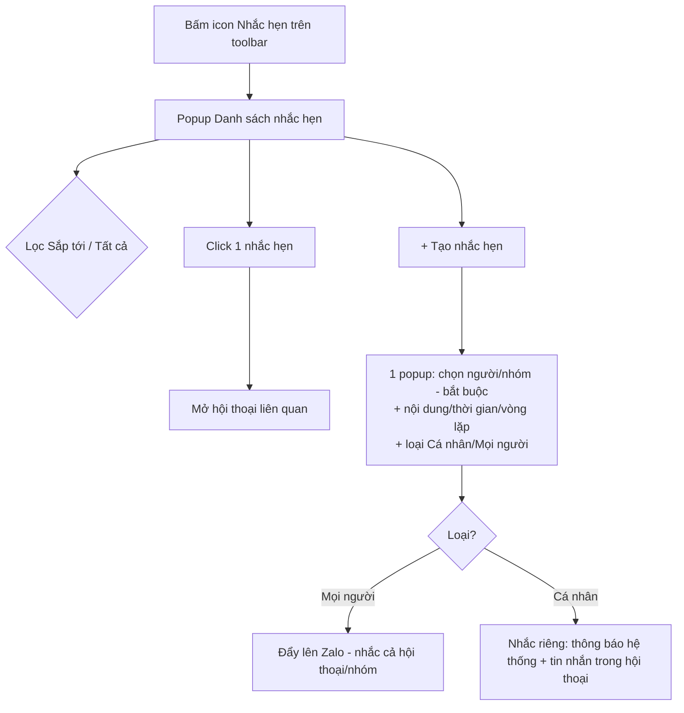

# [G019] Update Nhắc hẹn

| Trường | Nội dung |
|--------|----------|
| **Feature ID** | G019 |
| **Tên** | Update Nhắc hẹn (Advanced Reminders) |
| **Module** | Chăm sóc khách hàng / Chat - Zalo |
| **Owner (BA)** | Trân (BA) |
| **Dev assignee** | — |
| **Priority** | — |
| **Version** | ~~1.0~~ ~~1.1~~ ~~1.2~~ ~~1.3~~ **1.4** |
| **Status** | Draft |
| **Last updated** | ~~2026-08-06~~ ~~2026-08-10~~ **2026-08-12** |

---

## 1. Tổng quan (Overview)

G019 nâng cấp tính năng **Nhắc hẹn** hiện có (tạo tại **G003 UC-04**, quản lý tại **G009 UC-03**, hiển thị trong panel tại **G011**) với 3 bổ sung:

1. **Danh sách nhắc hẹn tập trung (bên ngoài hội thoại)** — thêm **icon Nhắc hẹn** trên thanh công cụ danh sách hội thoại; bấm → **popup danh sách nhắc hẹn** của người dùng.
2. **Loại nhắc hẹn: `Cá nhân` / `Mọi người`** — **Cá nhân** = chỉ người tạo (nội bộ); **Mọi người** = đẩy lên Zalo, nhắc theo luồng Zalo native. Thay khái niệm "Chỉ mình tôi | Tất cả" (G003 UC-04) và G009 BR08. *(KHÔNG có kiểu "chia sẻ nội bộ cho nhân sự Gopany".)*
3. **Nhắc hẹn LUÔN gắn 1 hội thoại (người hoặc nhóm) — bắt buộc** (đúng Zalo native); loại **Cá nhân** = nhắc riêng, **Mọi người** = nhắc cả hội thoại/nhóm qua Zalo.

**Use Case Description:**
> Là nhân viên CSKH, tôi muốn xem toàn bộ nhắc hẹn ở một chỗ, tạo nhắc hẹn cá nhân hoặc đồng bộ lên Zalo cho một người/nhóm, để không bỏ lỡ việc cần làm.

**Người dùng mục tiêu:** Admin/Owner · Staff được phân quyền (G002/G003).

**Phụ thuộc:** G003 (Chat — tạo nhắc hẹn, toolbar), G009 (quản lý nhắc hẹn hiện tại), G002 (quyền xem hội thoại), G011 (panel Nhắc hẹn).

---

## 2. Điều kiện tiên quyết (Pre-conditions & Trigger)

**Trigger:** Người dùng bấm **icon Nhắc hẹn** trên thanh công cụ danh sách hội thoại (màn hình Chat).

**Pre-conditions:**
- [ ] Đã đăng nhập, đang ở màn hình **Chat - Zalo**

**Post-conditions:** Popup hiển thị đúng các nhắc hẹn người dùng được phép thấy (BR02); mọi thao tác tạo/sửa/xóa phản ánh ngay.

---

## 3. Luồng chính (Happy Path)

### UC-01 — Mở popup Danh sách nhắc hẹn
1. **[Người dùng]** Bấm **icon Nhắc hẹn** trên thanh công cụ danh sách hội thoại (BR01)
2. **[Hệ thống]** Mở **popup "Nhắc hẹn"** gồm: filter **`Sắp tới` / `Tất cả`**, nút **Sắp xếp**, nút **"+ Tạo nhắc hẹn"**, nút **X** đóng; danh sách sắp theo **thời gian nhắc hẹn (giờ hẹn)** — **nhóm theo ngày hẹn**, trong ngày **theo giờ hẹn tăng dần** *(không phải ngày tạo)* (BR10) [→ E01]
3. **[Hệ thống]** Hiển thị: nhắc hẹn **Cá nhân của chính mình** + nhắc hẹn **Mọi người** của các hội thoại/tài khoản Zalo user có quyền xem (BR02)

### UC-02 — Xem & lọc / sắp xếp
1. **[Người dùng]** Chuyển filter **`Sắp tới`** ↔ **`Tất cả`** (BR10)
2. **[Người dùng]** (Tùy chọn) đổi cách **Sắp xếp**

### UC-03 — Click nhắc hẹn → mở hội thoại
1. **[Người dùng]** Click một dòng nhắc hẹn
2. **[Hệ thống]** **Mở hội thoại liên quan** (đúng Zalo native), nhảy tới nhắc hẹn trong hội thoại — **không** có màn Chi tiết riêng (BR07)

### UC-04 — Tạo nhắc hẹn *(từ danh sách ngoài)*
1. **[Người dùng]** Bấm **"+ Tạo nhắc hẹn"** → mở **MỘT popup form duy nhất** gồm: **chọn người/nhóm (BẮT BUỘC)** · nội dung · thời gian · vòng lặp · **loại `Cá nhân` / `Mọi người`** (mặc định Cá nhân) (BR03, BR04, BR06)
2. **[Người dùng]** Điền + Lưu [→ E02, E03, E04]
3. **[Hệ thống]** Lưu nhắc hẹn gắn hội thoại đã chọn; **Mọi người → đẩy lên Zalo** (BR09)

> Cũng có thể tạo nhắc hẹn ngay trong hội thoại (**G003 UC-04**) — khi đó đã có sẵn người/nhóm.

### UC-05 — Sửa / Xóa nhắc hẹn *(trong hội thoại)*
1. **[Người dùng]** Từ danh sách click nhắc hẹn → mở hội thoại (UC-03); **Sửa/Xóa trong hội thoại** theo **G009 UC-03**
2. **[Hệ thống]** Quyền theo BR05 (Cá nhân: người tạo; Mọi người: người tạo + Admin). Sau khi xóa → biến khỏi danh sách. **Không có trạng thái "Hoàn thành"** (BR08)



> Auto-generated — comment nếu cần sửa logic

---

## 4. Luồng phụ (Alternative Flows)

- **AF01 — Đóng popup:** bấm **X** → popup đóng, không đổi dữ liệu.
- ~~**AF02 — Đổi loại Cá nhân → Mọi người**~~ **[REMOVED v1.4]** **Không cho đổi loại sau khi tạo** (BR15). Tạo nhầm loại → **xóa & tạo lại**.
- **AF03 — Nhắc hẹn đã qua giờ:** vẫn còn trong danh sách, thấy ở filter **`Tất cả`** (BR08).

---

## 5. Luồng ngoại lệ (Exception Flows)

| Code | Trigger | Phản hồi giao diện | Hướng xử lý |
|------|---------|-------------------|-------------|
| E01 | Không có nhắc hẹn (theo filter đang chọn) | Empty state: **Tất cả** trống → *"Chưa có nhắc hẹn nào"*; **Sắp tới** trống → *"Không có nhắc hẹn sắp tới"* | Tạo mới |
| E02 | Tải / lưu thất bại (lỗi hệ thống) | Toast: *"Lỗi hệ thống. Vui lòng thử lại sau"*; giữ nội dung đang nhập | Thử lại |
| E03 | Mất mạng khi lưu | Toast: *"Mất kết nối, vui lòng thử lại"*; **giữ nguyên form** | Lưu lại khi có mạng |
| E04 | Trong form tạo, **chưa chọn người/nhóm** (bắt buộc) | Nhắc ngay tại form: *"Vui lòng chọn người hoặc nhóm"*; **chưa cho Lưu** | Chọn người/nhóm (BR06) |

**Exception Confirmation Log:** E01 → UC-01 b2 · E02 → UC-01 b2 / UC-04 b2 · E03 → UC-04 b2 · E04 → UC-04 b1.

---

## 6. Business Rules — Quy tắc nghiệp vụ

| Code | Rule | Lý do |
|------|------|-------|
| BR01 | **Điểm vào:** icon **Nhắc hẹn (đồng hồ báo thức ⏰)** trên **thanh công cụ danh sách hội thoại** (thay icon hiện tại tại vị trí đó); bấm → **popup Danh sách nhắc hẹn** | Truy cập tập trung |
| BR02 | Popup hiển thị: nhắc hẹn **Cá nhân của chính mình** + nhắc hẹn **Mọi người** của các hội thoại/tài khoản Zalo user **có quyền xem** (đồng bộ từ Zalo). **Không** thấy nhắc Cá nhân của người khác | Bảo mật + đúng phân quyền |
| BR03 | **Loại nhắc hẹn (2 lựa chọn):** **`Cá nhân`** = chỉ **người tạo** thấy & được nhắc (nội bộ Gopany, **không đẩy Zalo**). **`Mọi người`** = **đẩy nhắc hẹn lên Zalo**, đến giờ nhắc **theo luồng Zalo native** cho người/nhóm đã chọn (1:1: theo luồng Zalo; **nhóm: cả nhóm Zalo**). **KHÔNG có kiểu "chia sẻ nội bộ cho nhân sự Gopany".** *(Thay "Chỉ mình tôi \| Tất cả" — G003 UC-04, và G009 BR08)* | Đúng mô hình Zalo native |
| BR04 | Khi tạo, mặc định **`Cá nhân`**; có **ô tùy chọn "Mọi người"** để người dùng chủ động bật | Mặc định là việc cá nhân |
| BR05 | **Phân quyền sửa/xóa:** **Cá nhân** — chỉ **người tạo** (Admin không thấy/không sửa). **Mọi người** — **người tạo + Admin/quản lý**. *(Cơ chế sửa/xóa reminder đã đẩy lên Zalo — dev xác nhận)* | Cá nhân là riêng; Mọi người là dữ liệu Zalo dùng chung |
| BR06 | **Nhắc hẹn LUÔN gắn 1 hội thoại (người hoặc nhóm) — BẮT BUỘC.** Không có nhắc hẹn độc lập (đúng **Zalo native**: nhắc hẹn tạo trong ngữ cảnh 1 hội thoại). Tạo từ danh sách ngoài → **phải chọn người/nhóm** [→ E04] | Đúng Zalo native |
| BR07 | Click một nhắc hẹn trong danh sách → **mở hội thoại liên quan** (đúng **Zalo native** — nhảy tới nhắc hẹn trong hội thoại). **Không** có màn Chi tiết riêng; **Sửa/Xóa** thực hiện trong hội thoại (G009 UC-03) | Đúng Zalo native |
| BR08 | **Không có trạng thái "Hoàn thành".** Nhắc hẹn tồn tại đến khi bị **Xóa**; nhắc **đã qua giờ vẫn còn** (xem ở filter "Tất cả") | Giữ đơn giản |
| BR09 | **Thông báo đến giờ:** **Cá nhân** → (a) đẩy **thông báo lên Trung tâm thông báo** (§10F) + (b) hiển thị **card nhắc hẹn trong hội thoại** (chỉ người tạo thấy — chi tiết **BR16 / §10G**). **Mọi người** → nhắc **theo Zalo native** cho hội thoại/nhóm Zalo (đẩy lên Zalo). **Khi tài khoản Zalo NGẮT KẾT NỐI → CHỈ đẩy thông báo (icon hệ thống), KHÔNG đẩy tin nhắn vào hội thoại & không đẩy Zalo** (kênh Zalo không khả dụng nhưng dữ liệu vẫn hiển thị). **[v1.2] Khi XÓA liên kết → nhắc hẹn bị ẩn theo G010, KHÔNG nhắc trong lúc ẩn** (chi tiết BR12). **Nhiều nhắc cùng lúc → nhắc ĐÚNG GIỜ, KHÔNG giãn cách** | Nhắc đúng giờ; đúng mô hình Zalo (**dev xác nhận Zalo API**) |
| BR10 | Danh sách sắp theo **THỜI GIAN NHẮC HẸN (giờ hẹn thực tế)** — **nhóm theo ngày hẹn**, trong ngày **theo giờ hẹn tăng dần**; **KHÔNG** sắp theo ngày tạo. Filter **`Sắp tới`** (giờ hẹn từ hiện tại trở đi) / **`Tất cả`**; mặc định **`Sắp tới`** | Dễ theo dõi việc sắp đến hạn |
| BR11 | Nội dung · thời gian · vòng lặp (Không lặp / Hàng ngày / Hàng tuần / Hàng tháng) **kế thừa G003 UC-04** | Một nguồn cho phần tạo |
| BR12 | **[CHANGED v1.2 — đồng bộ G010] Vòng đời tài khoản Zalo & phân quyền:**<br>• **Ngắt kết nối (DISCONNECTED):** nhắc hẹn **KHÔNG ẩn — vẫn hiển thị + vẫn nhắc bằng thông báo** (loại `Mọi người` tạm chuyển sang thông báo vì không đẩy được Zalo). *(G010: DISCONNECTED không ẩn dữ liệu.)*<br>• **Xóa liên kết (DELETED — soft delete):** nhắc hẹn **ẩn cùng dữ liệu tài khoản, KHÔNG nhắc trong lúc ẩn**; **khôi phục khi liên kết lại** (companyId + zaloUid). *(G010: DELETED ẩn đồng loạt; §1 liệt kê nhắc hẹn trong phạm vi soft-delete.)*<br>• **Mất quyền xem hội thoại (unassign — G003 BR12):** ẩn nhắc hẹn của hội thoại đó với người bị gỡ quyền **VÀ KHÔNG bắn thông báo cho họ**; **hiện lại + nhắc lại (lần tương lai)** khi được gán lại. | Nhất quán G010 (soft-delete) + phân quyền; tránh nhắc trỏ tới hội thoại đã ẩn |
| BR13 | **Nhắc đúng giờ, kể cả offline:** nhắc bắn **đúng thời điểm** (tạo thông báo + tin nhắn) dù người dùng đang offline. **Khi online lại KHÔNG tự nhắc lại** | Nhắc đúng giờ, không lặp lại |
| **BR14** | **[NEW v1.1] Thông báo nhắc hẹn Cá nhân.** Đến giờ hẹn, nhắc loại **Cá nhân** tạo **1 thông báo** dùng **đúng khung chuẩn của Trung tâm thông báo** (Title / Nội dung / Phân loại):<br>• **Phân loại:** `Hội thoại`.<br>• **Title:** cố định = **"Nhắc hẹn"**.<br>• **Nội dung:** *{nội dung nhắc} — {tên hội thoại}* (+ vòng lặp nếu có). **Nội dung nhắc KHÔNG bắt buộc**; để trống → Nội dung chỉ còn **{tên hội thoại}**.<br>• **Bấm thông báo → mở hội thoại liên quan** + đánh dấu đã đọc (BR07).<br>• Thông báo hiểu được ngay không cần mở hội thoại, **kể cả** khi tài khoản Zalo ngắt/xóa liên kết (BR12).<br>• Mockup + map trường: **§10F**. | Dùng đúng component thông báo có sẵn (Title/Nội dung/Phân loại); Title cố định nên không lệ thuộc việc user có nhập nội dung hay không |
| **BR15** | ~~[v1.3] Đổi loại một chiều Cá nhân → Mọi người~~ **[CHANGED v1.4] Loại nhắc hẹn (`Cá nhân` / `Mọi người`) CHỐT tại thời điểm TẠO — KHÔNG đổi được sau khi lưu (cả hai chiều).** Trong màn **Sửa**, toggle loại **bị khóa** (chỉ đọc). **Tạo nhầm loại → xóa nhắc hẹn và tạo lại.** | Tránh xử lý chuyển đổi phức tạp (Cá nhân đang có thông báo nội bộ; Mọi người đã đẩy Zalo khó thu hồi) và tránh bất nhất "1 chiều được, chiều kia không". Nhắc hẹn nhẹ → xóa & tạo lại đơn giản |
| **BR16** | **[NEW v1.4] Card nhắc hẹn trong hội thoại.** Đến giờ hẹn, nhắc hiện **1 card trong hội thoại** (định dạng như Zalo native): **⏰** · Title **"Nhắc hẹn: {nội dung}"** *(nội dung trống → "Nhắc hẹn")* · dòng thời gian **"{Hôm nay/ngày} lúc {giờ hẹn}"** · nút **"MỞ LỊCH"** → **mở popup Danh sách nhắc hẹn** (UC-01).<br>• **Cá nhân:** card **chỉ người tạo thấy** (nội bộ Gopany, **không** đẩy Zalo — nhân viên khác dùng chung tài khoản Zalo & khách **KHÔNG** thấy) **+ kèm thông báo** ở Trung tâm thông báo (§10F, BR14).<br>• **Mọi người:** card **Zalo native** — đẩy lên Zalo, **cả hội thoại/nhóm (khách)** đều thấy. | Đúng trải nghiệm Zalo native; tách rõ card riêng tư (Cá nhân) vs card đẩy Zalo (Mọi người) |

---

## 7. State Machine — Vòng đời nhắc hẹn

| Từ trạng thái | Sự kiện | Sang trạng thái | Tác động |
|---------------|---------|-----------------|----------|
| _(chưa có)_ | Tạo + Lưu | **Sắp tới** | Hiển thị ở filter "Sắp tới" & "Tất cả" |
| **Sắp tới** | Đến giờ nhắc | **Đã qua** *(vẫn tồn tại)* | Bắn thông báo (BR09); chỉ còn ở filter "Tất cả" |
| **Sắp tới / Đã qua** | Xóa | _(kết thúc)_ | Biến mất khỏi danh sách |

> **Không** có trạng thái "Hoàn thành" (BR08). Nhắc lặp lại → tự lên **occurrence kế tiếp**, luôn hiển thị ở "Sắp tới".
> **[v1.2] Vòng đời tài khoản (BR12):** **Ngắt kết nối** → nhắc vẫn hiện + vẫn nhắc bằng thông báo. **Xóa liên kết** → nhắc **ẩn cùng dữ liệu** (G010), không nhắc; **khôi phục khi liên kết lại**. **Mất quyền xem** (unassign) → ẩn **+ không thông báo** với người đó; gán lại → hiện + nhắc lại.

---

## 8. Data Model

N/A — Spec này thuần nghiệp vụ. Data model sẽ được định nghĩa trong tài liệu kỹ thuật riêng.

---

## 9. API Contract

N/A — Spec này thuần nghiệp vụ. *(Loại `Mọi người` dùng API nhắc hẹn của Zalo — dev xác nhận khả năng đẩy/đồng bộ.)*

---

## 10. UI/UX Notes — Ghi chú giao diện

### 10A — Điểm vào
- **Icon Nhắc hẹn (đồng hồ báo thức ⏰)** trên **thanh công cụ danh sách hội thoại** (cạnh Tất cả / Chưa đọc / Nhóm / Ghim). **Không** dùng chuông thông báo 🔔.

### 10B — Popup Danh sách nhắc hẹn
```
┌───────────────────────────────────────────────┐
│  Nhắc hẹn                     ⇅ Sắp xếp    [X] │
│  [ Sắp tới ] Tất cả                + Tạo nhắc hẹn│
│───────────────────────────────────────────────│
│  HÔM NAY · THỨ HAI, 3 THÁNG 8                   │
│  08:00 ⏰ Dậy deeee            [Cá nhân]   ›    │
│  09:55 ⏰ tét lặp hàng ngày…   [Mọi người] › │
│        Trà trong Tét Chat Zalo1 · 🔁 Hàng ngày  │
│  …                                             │
│  THỨ BA, 4 THÁNG 8                              │
│  09:00 ⏰ Họp team tuần mới    [Mọi người] › │
│        … · 🔁 Hàng tuần                          │
└───────────────────────────────────────────────┘
```
| Thành phần | Mô tả |
|---|---|
| Header | Tiêu đề **"Nhắc hẹn"** · nút **Sắp xếp** · nút **X** |
| Filter | Pill **`Sắp tới`** (mặc định) / **`Tất cả`** |
| + Tạo nhắc hẹn | Mở form tạo (UC-04) |
| Dòng nhắc hẹn | Giờ (đậm) · **icon ⏰** · tiêu đề · phụ đề *"[Người/nhóm] trong [Tên hội thoại]"* · vòng lặp (nếu có) · **badge Cá nhân / Mọi người** · chevron **›** (click → mở hội thoại) |
| Empty state | *"Chưa có nhắc hẹn nào"* / *"Không có nhắc hẹn sắp tới"* |

> **Nền popup (overlay):** dạng **popover** — phủ **scrim mờ nhẹ (~20–25%, không blur nặng)**; popup giữ **shadow đậm + bo góc + nền trắng đặc**. **Click ra ngoài scrim → đóng.**

### 10C — Click nhắc hẹn
Click một dòng → **mở hội thoại liên quan** (Zalo native), nhảy tới nhắc hẹn trong hội thoại. **Không** có màn Chi tiết riêng; **Sửa/Xóa** trong hội thoại (G009 UC-03).

### 10D — Form Tạo / Sửa
**MỘT popup duy nhất:** **chọn người/nhóm (bắt buộc)** · nội dung · thời gian · vòng lặp *(kế thừa G003 UC-04)* · **toggle loại `Cá nhân` / `Mọi người`** (mặc định Cá nhân) — dòng mô tả: *Cá nhân = nhắc riêng mình · Mọi người = nhắc cả hội thoại/nhóm (hiển thị trên Zalo)*. Chưa chọn người/nhóm → chặn Lưu (E04). **[v1.4]** Chọn loại **chỉ khi TẠO**; khi **Sửa** → toggle loại **bị khóa** (chỉ đọc, không đổi loại — BR15). Chọn **Mọi người** khi tạo → nhắc **đẩy lên Zalo** (hiển thị cho cả hội thoại/khách).

### 10E — Badge & trạng thái
- **Cá nhân** = pill xám · **Mọi người** = pill xanh Zalo.
- Nhắc đã qua giờ có thể làm mờ nhẹ; chỉ hiện ở filter "Tất cả".

### 10F — Thông báo nhắc hẹn *(Trung tâm thông báo)* **[NEW v1.1]**
> Nhắc **Cá nhân** đến giờ → 1 thông báo theo **đúng khung chuẩn** của Trung tâm thông báo (mọi thông báo đều gồm: **Phân loại (tab) · avatar · Title · Nội dung · giờ · chấm chưa đọc**). *(Loại `Mọi người` nhắc theo Zalo native — không vào center này.)*
>
> **Trung tâm thông báo chia 4 tab theo module:** **Cửa hàng** (CMS) · **Công việc** (dự án) · **Hội thoại** (Zalo) · **Hệ thống** (còn lại). Nhắc hẹn thuộc module **Zalo** → luôn vào tab **`Hội thoại`**.

```
┌ Tab: Hội thoại ─────────────────────────────────────────────────────┐
│ [avatar]  Nhắc hẹn                                       9:00    ●   │  ← Title (cố định) + giờ + chấm chưa đọc
│           Gọi lại khách chốt đơn — Tết Chat Zalo1 · 🔁 Hàng ngày         │  ← Nội dung
└──────────────────────────────────────────────────────────────────────┘
   (click → mở hội thoại liên quan, đánh dấu đã đọc — BR07)
```
**Map nhắc hẹn vào khung thông báo chuẩn:**
| Trường (khung chuẩn) | Giá trị cho nhắc hẹn |
|---|---|
| **Phân loại (tab)** | **`Hội thoại`** |
| **Title** | Cố định **"Nhắc hẹn"** |
| **Nội dung** | *{nội dung nhắc} — {tên hội thoại}* (+ nhãn vòng lặp nếu có). **Nội dung nhắc trống → chỉ còn {tên hội thoại}**. *(Tên hội thoại = tên người/nhóm hoặc tên gợi nhớ — đã bao hàm "gắn với ai".)* |
| **Nhãn vòng lặp** | Hiển thị **đúng kiểu lặp** của nhắc hẹn: 🔁 **Hàng ngày / Hàng tuần / Hàng tháng**. **Không lặp → KHÔNG hiện nhãn** (4 mốc kế thừa G003 UC-04 / BR11) |
| **Avatar** | Avatar người/nhóm của hội thoại |
| **Giờ** (góc phải) | Thời điểm bắn = giờ hẹn |
| **Chấm chưa đọc** | Có; click → đánh dấu đã đọc |
| **Click** | Mở hội thoại liên quan (BR07) |

### 10G — Card nhắc hẹn trong hội thoại **[NEW v1.4]**
> Đến giờ hẹn → nhắc hiện **1 card trong hội thoại** (định dạng như Zalo native). **Cá nhân:** card **chỉ người tạo thấy** (nội bộ Gopany) + kèm thông báo §10F. **Mọi người:** card **Zalo native**, cả hội thoại/nhóm (khách) đều thấy. (BR16)

```
┌───────────────────────────────────┐
│                ⏰                 │
│       Nhắc hẹn: Dậy deeeee         │  ← Title "Nhắc hẹn: {nội dung}" (trống → "Nhắc hẹn")
│        Hôm nay lúc 08:00           │  ← {Hôm nay/ngày} lúc {giờ hẹn}
│      ┌─────────────────────┐      │
│      │      MỞ LỊCH         │      │  ← nút → mở popup Danh sách nhắc hẹn (UC-01)
│      └─────────────────────┘      │
└───────────────────────────────────┘
```
| Thành phần | Mô tả |
|---|---|
| Icon | **⏰** |
| Title | **"Nhắc hẹn: {nội dung}"** — nội dung trống → **"Nhắc hẹn"** |
| Dòng thời gian | **"{Hôm nay / ngày} lúc {giờ hẹn}"** |
| Nút **"MỞ LỊCH"** | Mở **popup Danh sách nhắc hẹn** (UC-01) |
| Phạm vi hiển thị | **Cá nhân** = chỉ người tạo thấy (nội bộ, không đẩy Zalo) · **Mọi người** = Zalo native, mọi người thấy |

> **Phân biệt với BR07:** trong **Danh sách nhắc hẹn**, click 1 dòng → **mở hội thoại** (BR07). Trên **card trong hội thoại**, nút **MỞ LỊCH** → **mở Danh sách nhắc hẹn** (chiều ngược lại) — không mâu thuẫn.

---

## 11. Acceptance Criteria — Tiêu chí nghiệm thu

- [ ] Bấm icon Nhắc hẹn → mở popup danh sách (AC-BR01)
- [ ] Popup hiện nhắc **Cá nhân của mình** + **Mọi người** của hội thoại mình có quyền xem; không hiện Cá nhân của người khác (AC-BR02)
- [ ] **Cá nhân**: chỉ người tạo thấy & được nhắc (nội bộ, không đẩy Zalo). **Mọi người**: đẩy lên Zalo, nhắc theo Zalo native (AC-BR03, AC-BR09)
- [ ] Tạo mới → mặc định **Cá nhân** (AC-BR04)
- [ ] Tạo từ danh sách ngoài: **1 popup duy nhất**; ô **chọn người/nhóm luôn hiện & bắt buộc** (AC-UC04)
- [ ] Chưa chọn người/nhóm (bắt buộc) → chặn Lưu, nhắc chọn (AC-BR06, AC-E04)
- [ ] Nhắc hẹn **LUÔN gắn hội thoại** (người/nhóm) — không có nhắc độc lập (AC-BR06)
- [ ] Sửa/Xóa **trong hội thoại** (G009): **Cá nhân** chỉ người tạo; **Mọi người** người tạo + Admin (AC-BR05)
- [ ] **[v1.4]** Loại nhắc hẹn **chốt khi tạo**; màn **Sửa** → toggle loại **bị khóa** (không đổi được cả 2 chiều) (AC-BR15)
- [ ] **[v1.4]** Tạo nhầm loại → **xóa & tạo lại** (không có chức năng đổi loại) (AC-BR15)
- [ ] Click 1 nhắc hẹn → **mở hội thoại liên quan** (Zalo native); không có màn Chi tiết (AC-BR07)
- [ ] Không có trạng thái "Hoàn thành"; nhắc đã qua giờ vẫn còn ở "Tất cả" (AC-BR08)
- [ ] Đến giờ: **Cá nhân** → thông báo (§10F) + **card trong hội thoại**; **Mọi người** → nhắc theo Zalo native. Nhiều nhắc cùng lúc → **đúng giờ, KHÔNG giãn cách** (AC-BR09)
- [ ] **[v1.4] Card nhắc hẹn trong hội thoại:** ⏰ + **"Nhắc hẹn: {nội dung}"** (trống → "Nhắc hẹn") + **"{ngày} lúc {giờ hẹn}"** + nút **"MỞ LỊCH"** → mở Danh sách nhắc hẹn (AC-BR16)
- [ ] **[v1.4]** **Cá nhân** → card **chỉ người tạo thấy** (nhân viên khác/khách không thấy); **Mọi người** → card **Zalo native** mọi người thấy (AC-BR16, AC-BR09)
- [ ] Danh sách **nhóm theo ngày hẹn, giờ hẹn tăng dần (theo thời gian nhắc, KHÔNG phải ngày tạo)**; filter Sắp tới/Tất cả, mặc định Sắp tới (AC-BR10)
- [ ] Lưu lỗi / mất mạng → giữ form, cho lưu lại (AC-E02, AC-E03)
- [ ] **[v1.2] Ngắt kết nối** → nhắc hẹn vẫn còn + vẫn nhắc **bằng thông báo** (không đẩy tin nhắn/Zalo) (AC-BR12)
- [ ] **[v1.2] Xóa liên kết** → nhắc hẹn **ẩn cùng dữ liệu, không nhắc**; **khôi phục khi liên kết lại** (AC-BR12, G010)
- [ ] **[v1.2] Mất quyền xem (unassign)** → ẩn nhắc hẹn **+ KHÔNG bắn thông báo** cho người bị gỡ; **hiện lại + nhắc lại** khi gán lại (AC-BR12)
- [ ] **Nhắc đúng giờ kể cả offline; online lại KHÔNG tự nhắc lại** (AC-BR13)
- [ ] **[v1.1]** Nhắc **Cá nhân** đến giờ → thông báo theo khung chuẩn: **Phân loại = Hội thoại · Title = "Nhắc hẹn" · Nội dung = {nội dung nhắc} — {tên hội thoại} (+ lặp)**; nội dung nhắc trống → Nội dung chỉ còn {tên hội thoại}; **click → mở hội thoại liên quan** + đánh dấu đã đọc (AC-BR14)

---

## 12. Out of Scope — Ngoài phạm vi

- Trạng thái **Hoàn thành** / đánh dấu xong
- Đồng bộ lịch ngoài (Google/Outlook Calendar)
- Nhắc qua kênh ngoài app (email/SMS)

---

## 13. Dependencies — Phụ thuộc

| Phụ thuộc vào | Ghi chú |
|---|---|
| G003 — Chat | Toolbar (điểm vào); form tạo nhắc hẹn (UC-04); thông báo (BR17) |
| G009 — Tính năng bổ sung Chat | Quản lý nhắc hẹn hiện tại (UC-03) — G019 thay **BR08 (Cá nhân/Mọi người)** |
| G002 — Phân quyền | Quyền xem hội thoại → phạm vi hiển thị Mọi người & danh sách |
| G011 — Panel Thông tin | Mục Nhắc hẹn trong panel (xem + điều hướng) |

| Được phụ thuộc bởi | — |
|---|---|

---

## 14. Open Questions — Câu hỏi chưa giải quyết

Không còn Open Question.

> ⚠️ **Flag kỹ thuật (dev xác nhận):** loại **`Mọi người`** phụ thuộc **Zalo API có cho phép tạo/đẩy nhắc hẹn lên hội thoại/nhóm Zalo và cơ chế sửa/xóa** (BR03/BR05/BR09). Nếu Zalo không hỗ trợ → cần điều chỉnh.

---

## 15. Performance — Hiệu năng
- Mở popup & tải danh sách nhanh, không chặn thao tác chat.
- Danh sách dài → tải theo lô / cuộn thêm.

---

## 16. Rollout & Migration — Triển khai

| Mục | Chi tiết |
|---|---|
| Rollout | Toàn bộ người dùng — thêm icon + popup trong màn hình Chat |
| **Dữ liệu hiện có** | Map nhắc hẹn cũ: người nhận **"Chỉ mình tôi" → `Cá nhân`**; **"Tất cả" → `Mọi người`** |
| Rollback | Ẩn icon + popup — không mất dữ liệu nhắc hẹn |
| Thứ tự | 1. Backend (Cá nhân/Mọi người, quyền, đồng bộ Zalo) → 2. Frontend (icon, popup, chi tiết) |

---

## Changelog — Lịch sử thay đổi

| Ngày | Version | Người thay đổi | Sections | Nội dung |
|------|---------|----------------|----------|----------|
| 2026-08-06 | 1.0 | Trân (BA) | Toàn bộ | Tạo G019 — **Update Nhắc hẹn**. Danh sách nhắc hẹn tập trung (icon ⏰ trên toolbar → popup **nhóm theo ngày hẹn, sắp theo giờ hẹn**). **Loại `Cá nhân` / `Mọi người`** (Cá nhân = nhắc riêng: thông báo hệ thống + tin nhắn trong hội thoại; Mọi người = đẩy lên Zalo, nhắc cả hội thoại/nhóm; mặc định Cá nhân) — **không có kiểu chia sẻ nội bộ cho nhân sự**. **Nhắc hẹn LUÔN gắn 1 hội thoại (người/nhóm) — bắt buộc** (đúng Zalo native). Tạo từ danh sách ngoài = **1 popup duy nhất** (chọn người/nhóm + nội dung/thời gian/vòng lặp + loại). **Click → mở hội thoại liên quan**; Sửa/Xóa trong hội thoại. Nhiều nhắc cùng lúc → đúng giờ, **không giãn cách**. Nhắc **đúng giờ kể cả offline, không tự nhắc lại**. **Ngắt/xóa tài khoản → chỉ đẩy thông báo (không đẩy tin nhắn/Zalo), nhắc hẹn không mất**. Không có trạng thái Hoàn thành. Migration: "Chỉ mình tôi"→Cá nhân, "Tất cả"→Mọi người. **Đồng bộ:** G003 UC-04 · G009 BR08 |
| 2026-08-10 | **1.1** | Trân (BA) | 6 (BR14), 10F, 11 | **Đặc tả thông báo nhắc hẹn Cá nhân theo ĐÚNG khung thông báo chuẩn (Title / Nội dung / Phân loại):** **BR14** + **§10F** — **Phân loại = `Hội thoại`** · **Title cố định = "Nhắc hẹn"** · **Nội dung = {nội dung nhắc} — {người/nhóm} · {hội thoại} (+ lặp)**, nội dung nhắc **tùy chọn** (trống → chỉ còn ngữ cảnh). **Click → mở hội thoại liên quan** + đánh dấu đã đọc (BR07); tự đủ nghĩa kể cả khi tài khoản Zalo ngắt/xóa (BR12). Thêm AC. *(Sửa từ bản mô tả layout tự-chế trước đó cho khớp component thông báo có sẵn.)* |
| 2026-08-10 | **1.2** | Trân (BA) | 6 (BR09, BR12), 7, 11 | **Gỡ conflict với G010 (vòng đời tài khoản Zalo):** tách rõ **Ngắt kết nối** vs **Xóa liên kết** (trước đây BR09/BR12 gộp chung → trái G010). **Ngắt kết nối:** nhắc vẫn hiện + vẫn nhắc bằng thông báo. **Xóa liên kết (soft delete):** nhắc **ẩn cùng dữ liệu tài khoản, không nhắc**, **khôi phục khi liên kết lại** (đúng G010 §1 — nhắc hẹn thuộc phạm vi soft-delete). **Mất quyền xem (unassign):** ẩn **+ KHÔNG bắn thông báo** cho người bị gỡ, hiện lại + nhắc lại khi gán lại. Cập nhật §7 note + AC |
| 2026-08-10 | **1.3** | Trân (BA) | 4 (AF02), 6 (BR15), 10D, 11 | **Đổi loại nhắc hẹn chỉ MỘT CHIỀU (BR15):** cho **Cá nhân → Mọi người** (có **popup xác nhận** vì đẩy nội dung ra Zalo cho khách/nhóm thấy); **CẤM Mọi người → Cá nhân** (đã đẩy Zalo → khóa tùy chọn Cá nhân) để khỏi phải thu hồi reminder trên Zalo. Muốn nhắc riêng → xóa & tạo mới. Cập nhật AF02, §10D (toggle khóa + popup xác nhận), AC |
| 2026-08-12 | **1.4** | Trân (BA) | 4 (AF02), 6 (BR09, BR15, BR16), 10D, 10G, 11 | **(1) Đặc tả CARD nhắc hẹn trong hội thoại (BR16 + §10G):** đến giờ → hiện card như Zalo native — ⏰ · **"Nhắc hẹn: {nội dung}"** (trống → "Nhắc hẹn") · **"{ngày} lúc {giờ hẹn}"** · nút **"MỞ LỊCH"** → mở **Danh sách nhắc hẹn** (UC-01). **Cá nhân:** card **chỉ người tạo thấy** (nội bộ, không đẩy Zalo) + kèm thông báo §10F. **Mọi người:** card **Zalo native**, cả hội thoại/khách thấy. Làm rõ BR09 (b); phân biệt với BR07 (MỞ LỊCH mở danh sách ≠ click danh sách mở hội thoại). **(2) Bỏ chức năng đổi loại nhắc hẹn (đảo quyết định v1.3) — BR15:** loại `Cá nhân` / `Mọi người` **chốt khi TẠO, KHÔNG đổi được sau khi lưu** (cả 2 chiều); màn Sửa → toggle loại **bị khóa**; tạo nhầm → **xóa & tạo lại** (tránh xử lý chuyển đổi phức tạp + tránh bất nhất "1 chiều được, chiều kia không"). Gỡ AF02 + popup xác nhận; cập nhật §10D, AC. **(3) Gọn Nội dung thông báo/AC:** `{người/nhóm} · {hội thoại}` → **`{tên hội thoại}`** (bỏ trùng lặp — tên hội thoại đã bao hàm người/nhóm) |

---

> **Lưu ý cho Dev & AI:**
> - **Loại nhắc hẹn = `Cá nhân` (chỉ người tạo, nội bộ) / `Mọi người` (đẩy lên Zalo, nhắc theo Zalo native).** KHÔNG có "chia sẻ nội bộ cho nhân sự Gopany". Mặc định **Cá nhân**.
> - **Nhắc hẹn LUÔN gắn 1 hội thoại (người/nhóm) — bắt buộc** (không có nhắc độc lập). Tạo từ danh sách ngoài = **1 popup** (chọn người/nhóm luôn hiện).
> - Danh sách vào từ **icon ⏰ trên toolbar** (không phải chuông); click 1 nhắc hẹn → **mở hội thoại liên quan** (Zalo native); Sửa/Xóa trong hội thoại.
> - **Cá nhân:** đến giờ → thông báo hệ thống + tin nhắn trong hội thoại. **Ngắt/xóa tài khoản → chỉ thông báo, không đẩy tin nhắn/Zalo**; nhắc **đúng giờ kể cả offline, không tự nhắc lại**; nhiều nhắc → **không giãn cách**.
> - **Không có trạng thái Hoàn thành.** Phần nội dung/thời gian/vòng lặp kế thừa **G003 UC-04**.
> - **⚠️ `Mọi người` phụ thuộc Zalo API** (tạo/đẩy/sửa/xóa nhắc hẹn trên Zalo) — dev xác nhận.
