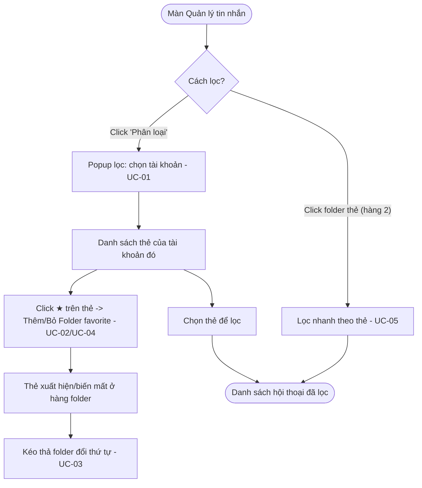

# [G020] Bộ lọc hội thoại & Folder thẻ

| Trường | Nội dung |
|--------|----------|
| **Feature ID** | **G020** |
| **Tên** | Bộ lọc hội thoại & Folder thẻ (UX danh sách hội thoại) |
| **Module** | Chat / Chăm sóc khách hàng |
| **Owner (BA)** | Trân |
| **Dev assignee** | — |
| **Priority** | — |
| **Version** | 1.0 |
| **Status** | Draft |
| **Last updated** | 2026-08-07 |

---

## 1. Tổng quan (Overview)

Điều chỉnh trải nghiệm **lọc & phân loại** ở màn hình **Quản lý tin nhắn** (danh sách hội thoại), gồm 3 thay đổi:

1. **Bỏ tab "Ghim"** khỏi hàng tab lọc — **giữ nguyên** tính năng ghim hội thoại (G009 UC-06); hội thoại ghim vẫn nổi lên đầu danh sách.
2. **Gộp dropdown "Phân loại"** thành **1 popup**: chọn **tài khoản Zalo** trước → danh sách **thẻ của tài khoản đó** hiển thị bên dưới để lọc.
3. **Folder thẻ (kiểu Telegram):** cho phép đưa thẻ lên **Folder yêu thích** hiển thị thành **hàng lọc nhanh** ngay dưới tiêu đề; **kéo thả đổi thứ tự**. Folder **dùng chung toàn workspace**.

**Use Case Description:**
> Là nhân viên CSKH, tôi muốn lọc hội thoại theo tài khoản Zalo và theo thẻ một cách nhanh gọn, và ghim những thẻ hay dùng thành folder truy cập nhanh, để tìm đúng nhóm hội thoại cần xử lý mà không phải thao tác nhiều bước.

**Người dùng mục tiêu:** Admin/Quản lý và Nhân viên (Staff) có quyền xem hội thoại.

**Phụ thuộc:** **G003 (Chat)** — danh sách hội thoại & bộ lọc; **G004 (Quản lý Thẻ)** — dữ liệu thẻ; **G009** — ghim hội thoại; **G010** — vòng đời tài khoản Zalo.

**Cross-reference:**
- **G003 §10B** — hàng tab lọc & Conversation Item (G020 thay thế phần mô tả bộ lọc/tab; G003 trỏ sang G020).
- **G004** — thẻ là dữ liệu dùng chung; **thuộc tính favorite + thứ tự folder** bổ sung tại G004 (dùng chung, khóa lạc quan).
- **G009 UC-06 / BR17** — ghim hội thoại (giữ nguyên).
- **G010 BR01/BR04/BR06** — tài khoản Zalo DISCONNECTED (giữ) vs DELETED (ẩn, khôi phục khi liên kết lại).

---

## 2. Điều kiện tiên quyết (Pre-conditions & Trigger)

**Trigger:**
- **Lọc đầy đủ:** click nút **"Phân loại"** cạnh ô Tìm kiếm → mở popup lọc.
- **Lọc nhanh:** click một **folder thẻ** ở hàng dưới tiêu đề.
- **Quản lý folder:** click icon **★** trên thẻ (trong popup) để thêm/bỏ favorite; **kéo thả** folder để đổi thứ tự.

**Pre-conditions:**
- [ ] Người dùng đã đăng nhập, có session hợp lệ và đang ở màn hình **Quản lý tin nhắn**.
- [ ] Có ít nhất 1 tài khoản Zalo được assign (BR11 G003).

**Post-conditions chung:**
- Kết quả lọc phản ánh ngay trên danh sách hội thoại.
- Thay đổi folder (favorite/thứ tự) **lưu trên hệ thống, dùng chung** — mọi người thấy ở lần tải/đồng bộ tiếp theo.

---

## 3. Luồng chính (Happy Path)

Module gồm **5 Use Case**. Riêng việc **bỏ tab Ghim** là thay đổi cấu hình UI (không phải UC) — xem BR01, §10A, AC.

### Sơ đồ luồng



> Auto-generated — comment nếu cần sửa logic

---

### UC-01 — Lọc hội thoại bằng popup "Phân loại"

1. **[Người dùng]** Click nút **"Phân loại"** cạnh ô Tìm kiếm
2. **[Hệ thống]** Mở **1 popup** gồm 2 phần:
   - **Trên:** ô chọn **Tài khoản Zalo** (mặc định *"Tất cả tài khoản"*; chỉ liệt kê tài khoản user có quyền xem)
   - **Dưới:** ô tìm thẻ + **danh sách thẻ** — mỗi thẻ có icon **★** (favorite) [→ BR02, BR03]
3. **[Người dùng]** (Tùy chọn) Chọn một tài khoản Zalo → danh sách thẻ bên dưới **lọc lại chỉ còn thẻ thuộc tài khoản đó** (BR03)
4. **[Người dùng]** Click **một hoặc nhiều thẻ** để lọc (mỗi thẻ toggle bật/tắt) [→ BR04, E03]
5. **[Hệ thống]** Danh sách hội thoại lọc theo **tài khoản đã chọn** và mang **bất kỳ thẻ nào** trong số đã chọn (OR — BR04); nút "Phân loại" hiển thị trạng thái đang lọc (các chip thẻ + nút Xóa lọc)

*Use case kết thúc.*

**Bỏ lọc:** click lại thẻ đang chọn để bỏ từng thẻ / bấm **"Xóa lọc"** để bỏ tất cả → danh sách trở về mặc định.

---

### UC-02 — Thêm thẻ vào Folder yêu thích

1. **[Người dùng]** Trong popup "Phân loại" → click icon **★** (rỗng) trên một thẻ [→ E01, E02]
2. **[Hệ thống]** Đánh dấu thẻ là **favorite** (★ tô đầy); thẻ **xuất hiện thành folder** ở **hàng folder** dưới tiêu đề, đặt ở **cuối** hàng
3. **[Hệ thống]** Thay đổi **lưu dùng chung toàn workspace** (BR06) — thành viên khác thấy ở lần tải/đồng bộ tiếp theo

*Use case kết thúc.*

---

### UC-03 — Sắp xếp thứ tự Folder thẻ

1. **[Người dùng]** Ở **hàng folder** → **kéo thả** một folder sang vị trí mới [→ E02]
2. **[Hệ thống]** Cập nhật thứ tự; **lưu dùng chung** (BR06)

*Use case kết thúc.*

---

### UC-04 — Bỏ thẻ khỏi Folder yêu thích

1. **[Người dùng]** Click **★** (đang đầy) trên thẻ trong popup, **hoặc** nút **✕** trên folder ở hàng folder
2. **[Hệ thống]** Gỡ thẻ khỏi hàng folder (**chỉ gỡ lối tắt — KHÔNG xóa thẻ**, BR07); lưu dùng chung (BR06)

*Use case kết thúc.*

> **Lưu ý:** thao tác này **khác hẳn** "Xóa thẻ" khỏi hệ thống (G004 UC — gỡ thẻ khỏi mọi hội thoại). Bỏ favorite **không** đụng tới thẻ hay hội thoại.

---

### UC-05 — Lọc nhanh bằng Folder thẻ

1. **[Người dùng]** Click **một hoặc nhiều folder thẻ** ở hàng folder (dưới tiêu đề) — mỗi folder toggle bật/tắt
2. **[Hệ thống]** Lọc danh sách hội thoại theo các thẻ đang chọn (**OR** — bất kỳ thẻ nào, BR04) ngay lập tức (không mở popup); folder đang chọn được **highlight**
3. **[Người dùng]** Click lại folder đang chọn → bỏ folder đó khỏi bộ lọc

*Use case kết thúc.*

**Kết hợp:** folder thẻ (hàng 2) **đồng bộ** trạng thái chọn với popup Phân loại; kết hợp được với tab lọc hàng 1 (vd `Chưa đọc` + folder `#VIP`) và filter tài khoản (BR08).

---

## 4. Luồng phụ (Alternative Flows)

### AF01 — "Tất cả tài khoản" trong popup Phân loại
- Xảy ra khi: user không chọn tài khoản cụ thể (giữ mặc định "Tất cả tài khoản") (UC-01 b3)
- **[Hệ thống]** Danh sách thẻ hiển thị **toàn bộ thẻ** của các tài khoản user có quyền; chọn thẻ → lọc hội thoại theo thẻ đó trên tất cả tài khoản

### AF02 — Chưa favorite thẻ nào
- Xảy ra khi: workspace chưa có thẻ nào được favorite
- **[Hệ thống]** **Hàng folder ẩn** (không chiếm chỗ); chỉ hiện lại khi có ≥1 thẻ được favorite (BR10)

---

## 5. Luồng ngoại lệ (Exception Flows)

| Code | Trigger | UI Response | Notification |
|------|---------|-------------|--------------|
| E01 | Favorite/sắp xếp thất bại phía hệ thống (lỗi server) | Toast: *"Không thể cập nhật, vui lòng thử lại"*; **hoàn tác** thay đổi trên UI | Ghi error log |
| E02 | **Khóa lạc quan:** người khác vừa đổi danh sách folder trong lúc mình đang sửa | Toast: *"Danh sách đã được cập nhật bởi người khác. Đang tải lại."*; nạp lại thứ tự mới nhất, hủy thao tác đang dở | — |
| E03 | Lọc theo thẻ nhưng không có hội thoại nào khớp | Empty state trong danh sách: *"Không có hội thoại nào"* | — |
| E04 | Tài khoản Zalo của thẻ đang lọc bị **xóa liên kết** (DELETED) | Thẻ/folder của tài khoản đó **ẩn** cùng dữ liệu (G010 BR01); nếu đang lọc theo thẻ đó → tự bỏ lọc, về mặc định | — |

**Exception Confirmation Log — G020**

| Code | Từ UC | Nguồn HP hay Độc lập | Confirmed |
|------|-------|----------------------|-----------|
| E01 | UC-02, UC-03 | Độc lập | ✅ |
| E02 | UC-02, UC-03 | Độc lập | ✅ |
| E03 | UC-01, UC-05 | Happy Path | ✅ |
| E04 | Độc lập | Độc lập | ✅ |

---

## 6. Business Rules — Quy tắc nghiệp vụ

| Code | Rule | Lý do |
|------|------|-------|
| BR01 | **Bỏ tab "Ghim"** khỏi hàng tab lọc. Tính năng **ghim hội thoại giữ nguyên** (G009 UC-06): hội thoại ghim vẫn **nổi lên đầu danh sách** (G009 BR17), vẫn ghim/bỏ ghim qua option menu | Tab lọc "Ghim" thừa vì hội thoại ghim đã luôn ở đầu; giảm rối giao diện |
| BR02 | Dropdown **"Phân loại" = 1 popup**: ô chọn **Tài khoản Zalo** ở trên (mặc định *"Tất cả tài khoản"*) + danh sách **thẻ** ở dưới | Ít thao tác, 1 màn nhìn thấy hết; đơn giản cho dev (không popup lồng nhau) |
| BR03 | Chọn **1 tài khoản Zalo** → danh sách thẻ chỉ còn **thẻ thuộc tài khoản đó**; chọn *"Tất cả tài khoản"* → hiển thị **toàn bộ thẻ** user có quyền | Thẻ được đồng bộ theo từng tài khoản Zalo; lọc theo tài khoản giúp danh sách thẻ gọn, đúng ngữ cảnh |
| BR04 | Bộ lọc theo thẻ là **chọn NHIỀU thẻ** (multi-select). Mỗi thẻ là một **toggle**: click để bật/tắt. Nhiều thẻ được chọn → lọc theo **OR (hợp)**: hiển thị hội thoại mang **bất kỳ thẻ nào** trong số đã chọn. Nút **"Xóa lọc"** bỏ toàn bộ thẻ đang chọn | Cho phép gộp nhiều nhóm hội thoại (vd VIP + Chốt đơn) trong một lần xem; OR khớp mô hình "folder gộp nhóm" |
| BR05 | **Folder thẻ (hàng 2)** = các thẻ được đánh dấu **favorite**; mỗi folder ứng với **1 thẻ**; click folder = lọc nhanh theo thẻ đó (UC-05) | Truy cập nhanh nhóm hội thoại hay dùng, giống folder chat Telegram |
| BR06 | **Favorite và thứ tự folder = DÙNG CHUNG toàn workspace**, lưu trên hệ thống. Khi 2+ người sửa cùng lúc → áp dụng **khóa lạc quan**: người lưu sau bị chặn và phải tải lại (E02) | Đồng bộ cách sắp xếp cho cả team; khóa lạc quan tránh ghi đè mất dữ liệu |
| BR07 | **Bỏ thẻ khỏi folder favorite = chỉ gỡ lối tắt.** Thẻ **vẫn tồn tại** trong hệ thống và **vẫn gắn trên các hội thoại**. KHÁC hoàn toàn "Xóa thẻ" (G004 — gỡ thẻ khỏi mọi hội thoại, có xác nhận) | Tránh nhầm giữa "dọn folder" và "xóa dữ liệu chung" — đúng lo ngại về thao tác trên dữ liệu dùng chung |
| BR08 | Ba lớp lọc **kết hợp được**: (1) tab hàng 1 (Tất cả/Chưa đọc/Nhóm) · (2) thẻ (folder hàng 2 / popup) · (3) filter tài khoản. **Giữa các thẻ với nhau = OR** (BR04); **giữa 3 lớp = AND** (giao). Ví dụ: `Chưa đọc` **AND** tài khoản A **AND** (`#VIP` **OR** `#Chốt đơn`) | Thu hẹp linh hoạt: gộp nhiều nhóm thẻ nhưng vẫn giao với tab/tài khoản |
| BR09 | **Không giới hạn cứng** số folder favorite; hàng folder **cuộn ngang** khi vượt bề rộng | Số thẻ hay dùng khác nhau theo team |
| BR10 | Chưa favorite thẻ nào → **hàng folder ẩn** (không chiếm chỗ); có ≥1 favorite → hiện lại (AF02) | Giữ giao diện gọn khi chưa dùng |
| BR11 | Thẻ/folder theo **vòng đời tài khoản Zalo** (G010): **DISCONNECTED** → vẫn hiển thị; **DELETED (xóa liên kết)** → ẩn cùng dữ liệu, khôi phục khi liên kết lại (`companyId + zaloUid`). **Lưu ý:** thẻ có thể **gộp xuyên nhiều tài khoản** (G004 BR12) → folder chỉ **ẩn khi KHÔNG còn tài khoản nào hiển thị thẻ đó**; nếu thẻ vẫn dùng ở tài khoản khác đang hoạt động thì **folder giữ nguyên** | Nhất quán G010 + G004 BR12; không mất folder khi chỉ 1 trong nhiều tài khoản bị xóa liên kết |
| **BR12** | **Quyền favorite & sắp xếp folder:** **mọi nhân sự có quyền xem hội thoại** đều được thêm/bỏ favorite và kéo thả thứ tự folder (thay đổi dùng chung toàn team — BR06). Không yêu cầu quyền "Quản lý thẻ" | Thao tác nhẹ, không phá dữ liệu (bỏ favorite ≠ xóa thẻ — BR07); mọi CSKH cần tự dọn folder lọc |
| **BR13** | Nút **"Phân loại"** (header danh sách hội thoại) **chỉ để LỌC** theo thẻ — **không** chứa link "Quản lý thẻ" và **không** dùng để gắn thẻ. **Quản lý thẻ** (tạo/sửa/xóa) vào từ **tab "Quản lý thẻ" trong Thiết lập hội thoại** (G004); **gắn thẻ vào hội thoại** = thao tác theo từng hội thoại (option menu / icon "Gắn thẻ" — G003) | Khớp prod: entry-point quản lý thẻ cũ qua "Phân loại" đã bị bỏ; tách bạch Lọc / Gắn / Quản lý |

---

## 7. State Machine

**Entity:** Thẻ trong Folder (Favorite state)

| Từ trạng thái | Sự kiện | Sang trạng thái | Ghi chú |
|---------------|---------|-----------------|---------|
| *(Thẻ thường)* | Click ★ (UC-02) | **Favorite (có folder)** | Xuất hiện ở hàng folder |
| Favorite | Click ★ / ✕ (UC-04) | **Thẻ thường** | Gỡ folder; thẻ vẫn tồn tại |
| Favorite | Kéo thả (UC-03) | Favorite *(đổi thứ tự)* | Không đổi trạng thái |
| Favorite / Thẻ thường | Tài khoản Zalo DELETED (G010) | **Ẩn** | Khôi phục khi liên kết lại |

> Không có trạng thái "đã xóa" ở đây — xóa thẻ thuộc G004.

---

## 8. Data Model

N/A — Spec thuần nghiệp vụ. (Thuộc tính *favorite* và *thứ tự folder* của thẻ định nghĩa chi tiết ở tài liệu kỹ thuật; nghiệp vụ: dùng chung workspace, khóa lạc quan — BR06.)

---

## 9. API Contract

N/A — Spec thuần nghiệp vụ.

---

## 10. UI/UX Notes — Ghi chú giao diện

### 10A — Bố cục 2 hàng lọc (dưới tiêu đề "Quản lý tin nhắn")

```
┌─ Quản lý tin nhắn ───────────────────────────────────────────────┐
│ ┌ 🔍 Tìm kiếm ─────────────────┐  [ ⇅ Phân loại ]                 │
│ └──────────────────────────────┘                                 │
│                                                                  │
│ HÀNG 1 (tab lọc):   Tất cả │ Chưa đọc │ Nhóm        ← ⛔ BỎ 'Ghim'│
│ HÀNG 2 (folder thẻ): [#VIP] [#Chốt đơn] [#Bảo hành] [ + ]  ⟵ cuộn ngang
│                       ⠿ kéo thả đổi thứ tự · ✕ để bỏ folder       │
│ ─────────────────────────────────────────────────────────────────│
│ Đoạn hội thoại                                                    │
│  ● Tết Chat Zalo1                                 09:55           │
│  ● Công ty TNHH Mộc An                            09:40           │
│  …                                                               │
└──────────────────────────────────────────────────────────────────┘
```
- **Hàng 1** = tab lọc sẵn có, **bỏ "Ghim"** (BR01).
- **Hàng 2** = folder thẻ favorite; ẩn khi chưa có favorite (BR10); cuộn ngang (BR09); nút **[ + ]** mở popup Phân loại để chọn thẻ favorite.
- Có thể chọn **nhiều folder** cùng lúc (OR — BR04); các folder đang chọn được **highlight**; hội thoại ghim vẫn nổi đầu danh sách (BR01).

### 10B — Popup "Phân loại" (1 popup)

```
┌─ LỌC HỘI THOẠI THEO THẺ ─────────────────────┐
│ ┌ 🔍 Tìm thẻ… ─────────────────────────────┐ │
│ └──────────────────────────────────────────┘ │
│                                              │
│  ★  #VIP                     (thẻ favorite)  │
│  ☆  #Chốt đơn                                │
│  ☆  #Bảo hành                                │
│  ☆  #Khiếu nại                               │
│    …(cuộn)                                    │
│ ──────────────────────────────────────────── │
│  Tài khoản:  [ Tất cả tài khoản        ▾ ]   │  ← chọn TK: lọc lại danh sách thẻ
│              ├ Tất cả tài khoản              │
│              └ Tố Trân                        │
└──────────────────────────────────────────────┘
```
- **Ô Tài khoản** ở trên cùng khối chọn (mặc định "Tất cả tài khoản"); đổi tài khoản → **danh sách thẻ lọc lại** theo tài khoản (BR03).
- Mỗi thẻ có **★/☆** để thêm/bỏ favorite (UC-02/UC-04); ★ đầy = đang favorite.
- Click **nhãn thẻ** = chọn/bỏ để lọc hội thoại; **chọn được nhiều thẻ** (OR — BR04). Thẻ đang chọn có dấu ✓/highlight.
- Empty: *"Chưa có thẻ nào"* nếu tài khoản chọn không có thẻ.
- **Popup này CHỈ để lọc** — **không** có link "Quản lý thẻ" và **không** dùng để gắn thẻ vào hội thoại (BR13). Quản lý thẻ vào từ **tab "Quản lý thẻ" trong Thiết lập hội thoại** (G004).

### 10C — Trạng thái đang lọc
- Nút "Phân loại" khi đang lọc: hiện **các chip thẻ đang chọn** (nhiều thẻ) + **✕ Xóa lọc** (bỏ tất cả).
- Kết hợp tab + folder + tài khoản → hiển thị các chip điều kiện đang bật.

---

## 11. Acceptance Criteria — Tiêu chí nghiệm thu

### Bỏ tab Ghim (BR01)
- [ ] Hàng tab lọc **không còn** "Ghim"; còn Tất cả / Chưa đọc / Nhóm
- [ ] Vẫn **ghim/bỏ ghim** hội thoại được qua option menu; hội thoại ghim **nổi đầu** danh sách (AC-BR01, G009)

### Popup Phân loại (UC-01)
- [ ] Click "Phân loại" → mở **1 popup**: ô Tài khoản ở trên + danh sách thẻ ở dưới (AC-BR02)
- [ ] Chọn 1 tài khoản → danh sách thẻ **chỉ còn thẻ của tài khoản đó** (AC-BR03)
- [ ] "Tất cả tài khoản" → hiển thị **toàn bộ thẻ** user có quyền (AC-AF01)
- [ ] Chọn **nhiều thẻ** → hội thoại hiện nếu mang **bất kỳ thẻ nào** đã chọn (OR); click lại 1 thẻ → bỏ thẻ đó; "Xóa lọc" → bỏ tất cả (AC-BR04)
- [ ] `Chưa đọc` + tài khoản A + (`#VIP` OR `#Chốt đơn`) → kết quả đúng phép **AND giữa lớp, OR giữa thẻ** (AC-BR08)
- [ ] Lọc không có kết quả → *"Không có hội thoại nào"* (AC-E03)

### Folder thẻ (UC-02/03/04/05)
- [ ] Click ★ trên thẻ → thẻ thành **folder** ở hàng 2, đặt cuối (AC-UC02)
- [ ] Folder **dùng chung**: user B thấy folder do user A tạo ở lần tải tiếp theo (AC-BR06)
- [ ] **Kéo thả** folder đổi thứ tự → lưu, cả team thấy giống nhau (AC-UC03, AC-BR06)
- [ ] Bỏ favorite (★/✕) → folder biến mất **nhưng thẻ vẫn còn** trên hội thoại và trong hệ thống (AC-BR07)
- [ ] Click folder → lọc nhanh theo thẻ; click lại → bỏ lọc (AC-UC05)
- [ ] Chưa favorite thẻ nào → **hàng folder ẩn** (AC-BR10)
- [ ] **Mọi nhân sự có quyền xem hội thoại** đều favorite/sắp xếp được folder (không cần quyền Quản lý thẻ) (AC-BR12)
- [ ] Popup "Phân loại" **không** có link Quản lý thẻ, **không** gắn thẻ; Quản lý thẻ vào từ tab trong Thiết lập hội thoại (AC-BR13)
- [ ] Kết hợp `Chưa đọc` + folder `#VIP` → danh sách là **giao** của 2 điều kiện (AC-BR08)

### Đồng thời & vòng đời
- [ ] 2 người sắp xếp folder cùng lúc → người sau nhận cảnh báo *"Danh sách đã được cập nhật…"*, tải lại (AC-E02)
- [ ] Tài khoản Zalo **DELETED** → thẻ/folder của tài khoản đó **ẩn**; liên kết lại → hiện lại (AC-BR11, AC-E04)
- [ ] Tài khoản **DISCONNECTED** → thẻ/folder **vẫn hiển thị** (AC-BR11)

---

## 12. Out of Scope — Ngoài phạm vi

| # | Nội dung | Ghi chú |
|---|---------|---------|
| OOS01 | Bộ lọc **phức hợp AND giữa các thẻ** (hội thoại có ĐỦ mọi thẻ) và lưu **bộ lọc tổ hợp** thành 1 folder | Phase này mỗi folder = 1 thẻ; chọn nhiều thẻ chỉ theo **OR** (BR04) |
| OOS02 | Favorite/thứ tự folder **riêng theo từng user** | Phase này dùng chung toàn team (BR06) |
| OOS03 | Tạo/sửa/xóa **thẻ** | Thuộc G004 |
| OOS04 | Ghim **tin nhắn** (G014) và ghim **hội thoại** (G009) | Chỉ bỏ *tab lọc* Ghim, không đụng 2 tính năng này |

---

## 13. Dependencies — Phụ thuộc

| Phụ thuộc vào | Ghi chú |
|---------------|---------|
| **G003 — Chat** | Danh sách hội thoại, hàng tab lọc, filter tài khoản (§10B) |
| **G004 — Quản lý Thẻ** | Dữ liệu thẻ; bổ sung thuộc tính **favorite + thứ tự** (dùng chung, khóa lạc quan) |
| **G009** | Ghim hội thoại (giữ nguyên khi bỏ tab Ghim) |
| **G010** | Vòng đời tài khoản Zalo (DISCONNECTED/DELETED) chi phối hiển thị thẻ/folder |

---

## 14. Performance & Scalability

| Mục | Yêu cầu |
|-----|---------|
| Lọc theo thẻ/tài khoản | Áp dụng ngay; nếu dữ liệu lớn → lọc phía server, có thể phân trang |
| Hàng folder | Cuộn ngang client-side; không phân trang |
| Sắp xếp folder | Lưu đồng bộ; khóa lạc quan chống ghi đè (BR06) |

---

## Changelog — Lịch sử thay đổi

| Ngày | Version | Người thay đổi | Sections | Nội dung | File:Line |
|------|---------|----------------|----------|----------|-----------|
| 2026-08-07 | v1.0 | Trân (BA) | Toàn bộ | Tạo spec: (1) **bỏ tab Ghim** (giữ tính năng ghim); (2) **gộp dropdown Phân loại thành 1 popup** — chọn tài khoản trên, thẻ (của tài khoản đó) dưới, **chọn nhiều thẻ — OR** (giữa thẻ OR, giữa lớp tab/tài khoản AND); (3) **Folder thẻ favorite** kiểu Telegram (hàng 2 dưới tiêu đề), kéo thả đổi thứ tự, **dùng chung toàn workspace** + khóa lạc quan, bỏ favorite ≠ xóa thẻ. **BR12** — favorite/sắp xếp cho **mọi nhân sự có quyền xem hội thoại**. **BR13** — nút "Phân loại" **chỉ để lọc** (không link Quản lý thẻ, không gắn thẻ); Quản lý thẻ vào từ **tab "Quản lý thẻ" trong Thiết lập hội thoại** (khớp prod — entry cũ đã bỏ). Cross-ref G003 §10B · G004 v1.6 (entry-point + favorite/thứ tự) · G009 · G010 | — |

---

> **Lưu ý cho Dev & AI khi đọc spec này:**
> - Spec **thuần nghiệp vụ** — không entity/API/DB.
> - **BR01:** chỉ **bỏ tab lọc "Ghim"**, KHÔNG bỏ tính năng ghim hội thoại (G009 UC-06 giữ nguyên).
> - **BR02/BR03:** dropdown Phân loại là **1 popup**, chọn tài khoản → lọc lại danh sách thẻ; **không** làm popup lồng nhau.
> - **BR04:** lọc theo thẻ **multi-select** — nhiều thẻ = **OR** (bất kỳ thẻ nào); kết hợp với tab/tài khoản = **AND**. Folder (hàng 2) và popup **đồng bộ** trạng thái chọn.
> - **BR06:** favorite + thứ tự folder **dùng chung toàn workspace** + **khóa lạc quan** (E02 khi ghi đè).
> - **BR07 quan trọng:** bỏ thẻ khỏi folder = **gỡ lối tắt**, KHÔNG xóa thẻ. Xóa thẻ là việc khác (G004).
> - **BR12:** favorite/sắp xếp folder cho **mọi nhân sự có quyền xem hội thoại** (không cần quyền Quản lý thẻ).
> - **BR13 (khớp prod):** nút "Phân loại" ở danh sách hội thoại **chỉ để LỌC**. **Không** có link Quản lý thẻ, **không** gắn thẻ tại đây. Quản lý thẻ = **tab "Quản lý thẻ" trong Thiết lập hội thoại** (G004 v1.6); gắn thẻ = theo từng hội thoại (G003).
> - **BR11:** thẻ/folder theo vòng đời tài khoản Zalo (G010) — DELETED thì ẩn, DISCONNECTED thì giữ.
