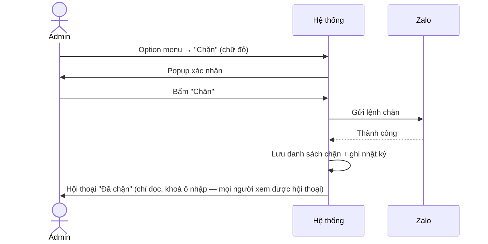
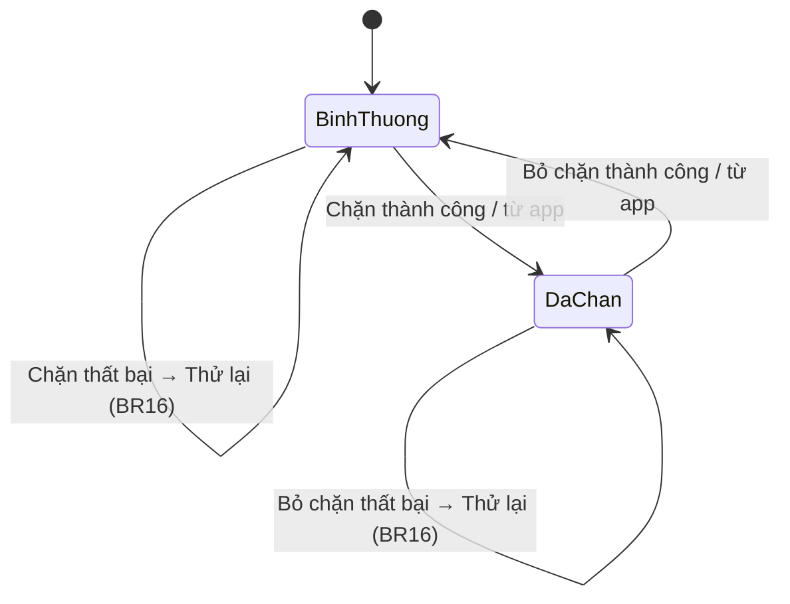

# [G030] Chặn người dùng

| Trường | Nội dung |
|--------|----------|
| **Feature ID** | **G030** |
| **Tên** | Chặn người dùng |
| **Module** | Chat / Chăm sóc khách hàng |
| **Owner (BA)** | Trân |
| **Version** | 1.0 |
| **Status** | Draft |
| **Last updated** | 2026-09-10 |

---

## 1. Tổng quan (Overview)

Cho phép **chặn một liên hệ (khách)** trong hội thoại **1:1** để ngăn spam/quấy rối. Chặn tính **theo từng tài khoản Zalo của hội thoại**, trạng thái **dùng chung cho những người được gán / có quyền xem hội thoại đó** (không phải toàn công ty). Vì tác động mạnh và khó thu hồi, quyền chặn **chỉ dành cho Admin**.

> **Vài điều cần biết về cách Zalo hoạt động:**
> - Đúng nút **"Chặn tin nhắn và cuộc gọi"** của Zalo Desktop (trong *Thông tin tài khoản* của liên hệ). Trên Desktop chỉ có **1 nút chặn gộp duy nhất** này — không tách nhiều loại như trên điện thoại. Phạm vi G030 = chặn hội thoại **1:1**.
> - **Trải nghiệm chặn của Zalo là HAI CHIỀU:** người chặn **cũng không nhắn được** cho người bị chặn (ô nhập khoá, hiện nút "Bỏ chặn"). Hệ thống mình làm **giống hệt** — nhưng chiều "mình→họ" phải do **hệ thống tự khoá** (BR03/BR04), vì khi gửi qua hệ thống Zalo vẫn cho tin đi. *(Đừng hiểu nhầm "Zalo cho nhắn một chiều nên mình cũng nên cho".)*
> - Khi chủ tài khoản tự bấm chặn/bỏ chặn **trên app Zalo**, hệ thống cũng **nhận được và cập nhật theo** (BR14).
> - Hệ thống **hiện chưa lấy lại được** danh sách đã chặn từ Zalo (dù app Zalo vẫn có sẵn màn này) → **tự lưu danh sách chặn và coi là bản chuẩn** (BR15) — giải pháp tạm, bỏ khi sau này lấy lại được.

**Use Case Description:**
> Là Admin, tôi muốn chặn một khách spam/quấy rối để họ không nhắn tin vào tài khoản được nữa, và bỏ chặn khi cần.

**Người dùng mục tiêu:** **Admin** (BR02).

**Phụ thuộc:** **G003** (hội thoại 1:1 & Option menu), **G002** (phân quyền), **G007** (danh bạ/kết bạn), **G010** (ngắt kết nối), **G011** (panel Thông tin), **G017** (tìm lại hội thoại đã chặn), **G008** (nhóm), **G019/G027/G029** (nhắc hẹn / thông báo / đếm chưa đọc).

---

## 2. Điều kiện tiên quyết (Pre-conditions & Trigger)

**Trigger:**
- **Chặn:** hội thoại **1:1** → **Option menu** (di chuột vào hàng hội thoại — G003 §10B) → **"Chặn"** (chữ đỏ).
- **Bỏ chặn:** (a) trong **hội thoại đã chặn**; hoặc (b) màn **"Danh sách người bị chặn"** (§10E).

**Pre-conditions:**
- [ ] Người dùng là **Admin** (BR02).
- [ ] Hội thoại là **1:1** (BR01).
- [ ] Tài khoản Zalo đang **kết nối bình thường** (BR10).

---

## 3. Luồng chính (Happy Path)

### Sơ đồ luồng (Chặn)


### UC-01 — Chặn người dùng
1. **[Người dùng]** Hội thoại 1:1 → Option menu → **"Chặn"** [→ E01, E03]
2. **[Hệ thống]** Popup xác nhận (BR07) [→ AF01]
3. **[Người dùng]** Bấm **"Chặn"**
4. **[Hệ thống]** Gửi lệnh chặn lên Zalo [→ E02, E03, E06, E07]; thêm vào danh sách chặn; ghi **nhật ký** (BR12)
5. **[Hệ thống]** Hội thoại thành **chỉ đọc + nhãn "Đã chặn"** (khoá ô nhập, giữ lịch sử); **mọi người được gán / xem được hội thoại** đều thấy (BR03/BR11). Lời mời kết bạn đang chờ **giữ nguyên** — không tự thu hồi/từ chối (BR06)

*Use case kết thúc.*

### UC-02 — Bỏ chặn (trong hội thoại)
1. **[Người dùng]** Trong hội thoại đã chặn → **"Bỏ chặn"** (tìm lại qua G017 nếu cần) [→ E01, E03]
2. **[Hệ thống]** Popup xác nhận (BR07) → bấm **"Bỏ chặn"**
3. **[Hệ thống]** Gửi lệnh bỏ chặn, gỡ **đúng tài khoản của hội thoại** (BR08); ghi nhật ký; hội thoại trở lại bình thường

*Use case kết thúc.*

### UC-03 — Bỏ chặn từ màn "Danh sách người bị chặn"
1. **[Admin]** Vào **Thiết lập › tài khoản Zalo › Danh sách người bị chặn** (BR15) → thấy các liên hệ đang bị chặn theo từng tài khoản
2. **[Người dùng]** Bấm **"Bỏ chặn"** → popup xác nhận (BR07) → gửi lệnh bỏ chặn, kèm **nhật ký + cập nhật tức thời** (BR11/BR12) — người đang mở hội thoại thấy ô nhập mở lại + gỡ nhãn ngay

> Đây là đường **duy nhất** gỡ được người bị chặn từ app Zalo mà chưa từng có hội thoại trong Gopany.

---

## 4. Luồng phụ (Alternative Flows)

### AF01 — Huỷ ở popup xác nhận
Bấm **"Huỷ"** / đóng popup → không thực hiện, không ghi gì.

### AF02 — Chặn/bỏ chặn ngay trên app Zalo (BR14)
1. **[Chủ tài khoản]** Bấm chặn/bỏ chặn **trực tiếp trên app Zalo điện thoại**.
2. **[Hệ thống]** Nhận được → cập nhật danh sách chặn + nhãn "Đã chặn" + **cập nhật tức thời** cho mọi người xem được hội thoại (nhật ký ghi nguồn: *đồng bộ từ Zalo*); **KHÔNG** đẩy thông báo (G027); **KHÔNG** xoá số chưa đọc (BR13); **KHÔNG** đụng lời mời kết bạn (BR06).
3. Liên hệ **chưa từng có hội thoại** → vẫn vào danh sách chặn, gỡ được ở màn Danh sách (BR15).

> *Ngoại lệ:* nếu lúc đó tài khoản đang ngắt kết nối → có thể không nhận được → coi như chưa cập nhật; khi kết nối lại/thao tác lại sẽ đồng bộ (BR16).

---

## 5. Luồng ngoại lệ (Exception Flows)

| Code | Trigger | Ứng xử |
|------|---------|--------|
| E01 | Không phải Admin | Mục "Chặn/Bỏ chặn" **không hiện**; cố gọi → Toast *"Bạn không có quyền thực hiện thao tác này"* + ghi nhật ký (BR02) |
| E02 | Chặn/bỏ chặn **thất bại** (lỗi Zalo / mất mạng) | Toast *"Không thực hiện được, vui lòng thử lại"*; giữ nguyên trạng thái cũ |
| E03 | Tài khoản Zalo **ngắt kết nối** | Chặn & bỏ chặn đều không làm được: *"Tài khoản Zalo đang ngắt kết nối. Vui lòng kết nối lại"* (BR10) |
| E04 | **Hai Admin cùng** chặn/bỏ chặn một người | Kết quả cuối vẫn nhất quán, không lỗi; cập nhật tức thời (BR11, BR17) |
| E05 | **Bấm dồn / lặp lại cùng thao tác** trong khoảng chờ | Khóa nút + nhắc *"Vui lòng thử lại sau giây lát"* (BR09) |
| E06 | **Gọi Zalo quá lâu — quay mãi chưa biết xong chưa** | **Coi là THẤT BẠI** — giữ nguyên trạng thái cũ, báo lỗi + nút **"Thử lại"** (BR16). *Không tạo trạng thái "Chưa rõ".* |
| E07 | Zalo báo **liên hệ đã bị chặn từ trước** | **Coi thành công** — đồng bộ nhãn, không báo lỗi đỏ (BR17). *Mọi lỗi khác → E02/E03* |
| E08 | **Chạm giới hạn số lần thao tác** (BR09) | Khóa + thông báo **nêu mốc được thao tác lại** (không dùng câu của E05 vì có thể chờ hàng giờ) |
| E09 | **Từ tài khoản đã chặn, vẫn cố gửi tin** cho người bị chặn (ô nhập lẽ ra đã khoá — lọt qua đường khác: chuyển tiếp, gửi lại tin lỗi, nhắn từ danh bạ…) | **Chặn không cho gửi** + Toast *"Bạn đang chặn liên hệ này. Bỏ chặn để tiếp tục nhắn tin."* (BR04) |

**Exception Confirmation Log**

| Code | Từ UC | Nguồn | Confirmed |
|------|-------|-------|-----------|
| E01 | UC-01/02 | BR02 | ✅ |
| E02 | UC-01/02 | Happy Path | ✅ |
| E03 | UC-01/02 | BR10 | ✅ |
| E04 | UC-01/02 | Hai người thao tác cùng lúc | ✅ |
| E05 | UC-01/02 | BR09 | ✅ |
| E06 | UC-01/02 | BR16 | ✅ |
| E07 | UC-01/02 | BR17 | ✅ |
| E08 | UC-01/02 | BR09 | ✅ |
| E09 | UC-01 (khi đã chặn) | BR04 | ✅ |

---

## 6. Business Rules — Quy tắc nghiệp vụ

### 6.1 — Phạm vi & quyền
| Code | Rule | Lý do |
|------|------|-------|
| BR01 | **Chặn tin nhắn 1:1**, tính **theo tài khoản Zalo của hội thoại**; trạng thái **dùng chung cho những người được gán / có quyền xem hội thoại đó** (những ai được chia sẻ tài khoản Zalo đó — G002), **không phải toàn công ty**. Hệ thống **tự lưu danh sách chặn** (bản chuẩn). *(Loại người khỏi nhóm → "Xóa thành viên" — G008.)* | Zalo chặn ở mức 1:1 theo từng tài khoản; ai thấy hội thoại thì thấy trạng thái chặn; chưa lấy lại được trạng thái từ Zalo |
| BR02 | **Chỉ Admin** chặn/bỏ chặn được. Nhân sự thường không thấy nút, vẫn thấy nhãn "Đã chặn" + ô nhập khoá, giữ phân công. | Tác động mạnh, khó thu hồi; nhưng minh bạch cho người trực |

### 6.2 — Chặn có tác dụng gì (2 chiều)
| Code | Rule | Lý do |
|------|------|-------|
| BR03 | **Khoá 2 chiều (như app Zalo):** chiều họ→mình Zalo tự lo; chiều mình→họ **hệ thống tự khoá** (BR04) vì gửi qua hệ thống Zalo vẫn cho tin đi. Hội thoại **chỉ đọc + nhãn "Đã chặn"**, giữ lịch sử. | Ngừng liên lạc cả 2 chiều như app Zalo |
| BR04 | **Cấm mọi đường gửi-tới người bị chặn (từ tài khoản đã chặn)** — cách **duy nhất** ngăn chiều mình→họ: ô soạn tin · chuyển tiếp VÀO · nhắn từ danh bạ · gửi lại tin lỗi · lời mời kết bạn · thêm vào nhóm; **nút Kết bạn/Nhắn tin vô hiệu**. **Vẫn được:** nhóm chung (BR05) · chuyển tiếp RA · mọi thao tác từ tài khoản khác. ⚠️ **Sót một đường = tin tới khách thật, Zalo không báo lỗi** → nghiệm thu đủ 2 phía. **Nếu có đường lọt tới bước gửi → chặn lại + Toast (E09)**, không để tin đi. | Còn nhiều đường lách; chiều mình→họ Zalo không đỡ hộ |
| BR05 | **Nhóm chung** (kiểm chứng 10/09): nhóm cũ vẫn thấy tên + tin cũ, vẫn nhắn & @mention bình thường; **nhưng cả hai không tạo được nhóm mới có nhau** (2 chiều — Zalo tự chặn). **Cách thể hiện khi tạo nhóm mới:** người đang bị chặn **KHÔNG xuất hiện trong danh sách chọn thành viên** (ẩn hẳn, không phải hiện rồi báo lỗi, cũng không phải hiện kèm nhãn) — cả 2 phía. | Block ở mức 1:1; nhóm cũ giữ nguyên; ẩn khỏi danh sách để không chọn nhầm rồi mới báo lỗi |
| BR06 | **Lời mời kết bạn đang chờ:** chặn/bỏ chặn **KHÔNG tự thu hồi, KHÔNG từ chối, KHÔNG khôi phục** lời mời đang chờ — giữ nguyên hiện trạng. (Chỉ **không cho gửi lời mời MỚI** tới người đang bị chặn — BR04.) | Giữ đơn giản, không chạy nền tác động phụ; Zalo không tự đụng tới lời mời khi chặn |

### 6.3 — Thao tác chặn / bỏ chặn
| Code | Rule | Lý do |
|------|------|-------|
| BR07 | **Popup xác nhận** trước khi Chặn và Bỏ chặn. | Tác động lớn, tránh bấm nhầm |
| BR08 | **Bỏ chặn = gỡ đúng tài khoản của hội thoại**; 2 đường: trong hội thoại (tìm qua G017) / màn Danh sách (§10E). Mỗi cặp (liên hệ × tài khoản) độc lập. | Đúng mô hình theo từng tài khoản |
| BR09 | **Chống thao tác dồn** (theo cặp liên hệ × tài khoản): khoá khi đang gửi · khoảng chờ ngắn khi lặp · giới hạn N lần/khoảng (chạm → E08). **Miễn** cho thao tác ngược (sửa nhầm) và **Thử lại khi thất bại** (BR16). Con số do đội kỹ thuật đặt. | Tránh Zalo phạt; nhưng không chặn đường sửa sai/phục hồi |
| BR10 | **Ngắt kết nối → không chặn/bỏ chặn được** (E03). *(Không gỡ nhãn tạm rồi báo Zalo sau — Zalo vẫn đang chặn nên dễ hiểu nhầm.)* | Kênh Zalo lúc đó không dùng được |

### 6.4 — Hiển thị & đồng bộ
| Code | Rule | Lý do |
|------|------|-------|
| BR11 | Nhãn **"Đã chặn"** hiện ở **4 nơi** (danh sách hội thoại · chi tiết · danh bạ · tìm kiếm), **theo từng tài khoản**. Chặn/bỏ chặn **cập nhật tức thời** cho **mọi người được gán / xem được hội thoại đó** (những ai được chia sẻ tài khoản Zalo — G002). | Nhiều người dùng chung tài khoản → tránh gửi nhầm |
| BR12 | **Nhật ký (audit):** ghi **ai · người bị chặn · tài khoản · thời điểm · nguồn** (Gopany / từ app Zalo). **Chỉ lưu để đối chiếu, KHÔNG chèn dòng vào hội thoại** — trạng thái chặn đã tự hiện qua **nhãn "Đã chặn" + ô nhập khoá + nút "Bỏ chặn"** (BR03/BR11). | Minh bạch "ai/khi nào" mà không phải chèn dòng giả vào luồng chat |
| BR13 | **Hội thoại đã chặn:** không đẩy thông báo (G027), không tính chưa đọc (G029). **Xoá số chưa đọc CHỈ khi chặn qua Gopany**; **chặn từ app → giữ nguyên số** (bị động, không khôi phục được). Nhắc hẹn nội bộ (G019) vẫn báo, kèm nhãn. | Đã chặn = hết việc; nhưng chặn từ app không nên xoá bộ đếm của những người dùng chung tài khoản |
| BR14 | **Chặn/bỏ chặn từ app Zalo** → hệ thống nhận được → cập nhật danh sách + nhãn + tức thời (nhật ký ghi nguồn *đồng bộ từ Zalo*); **không** thông báo, **không** xoá bộ đếm (BR13), **không** thu hồi lời mời (BR06). Xem AF02. | Cả team thấy hội thoại tự khoá dù không ai trong Gopany bấm |

### 6.5 — Kết quả thao tác & Danh sách
> Chỉ có **2 trạng thái**: **Bình thường** ↔ **Đã chặn**. Mỗi lần chặn/bỏ chặn chỉ có **2 kết quả: Thành công / Thất bại** — không có trạng thái trung gian.

| Code | Rule | Lý do |
|------|------|-------|
| BR15 | **Màn "Danh sách người bị chặn"** (chỉ Admin): liệt kê những liên hệ **đang bị chặn** theo tài khoản, cho **Bỏ chặn**. Đường **duy nhất** gỡ người bị chặn từ app chưa từng chat. Tài khoản xoá tạm → giữ, xoá hẳn → bỏ. **Giới hạn:** chỉ gồm những gì hệ thống ghi nhận được. | Chưa lấy lại được từ Zalo nên phải tự lưu + có màn để xử lý |
| BR16 | **Thất bại → cho Thử lại:** chặn/bỏ chặn không thành công (lỗi Zalo, mất mạng, **hoặc gọi Zalo quá lâu — quay mãi chưa biết xong chưa**) đều **coi là THẤT BẠI** → **giữ nguyên trạng thái cũ** (không đổi nhãn), báo lỗi + nút **"Thử lại"** (thử lại không dính giới hạn — BR09). **Không có trạng thái "Chưa rõ" riêng.** | Đơn giản, dứt khoát: không xong = chưa chặn, bấm lại; không treo trạng thái mập mờ |
| BR17 | **Bấm lại không gây lỗi (idempotent):** Zalo báo **đã bị chặn từ trước** → coi **thành công** (đồng bộ nhãn). **Lỗi khác** (mất kết nối…) → Thất bại → Thử lại (BR16). | Chỉ trùng-trạng-thái mới bỏ qua; không nuốt lỗi thật |

---

## 7. State Machine — Trạng thái chặn (theo liên hệ × tài khoản Zalo)

| Từ trạng thái | Sự kiện | Sang trạng thái |
|---------------|---------|-----------------|
| **Bình thường** | Chặn **thành công** (UC-01) / đồng bộ từ app | **Đã chặn** |
| **Đã chặn** | Bỏ chặn **thành công** (UC-02/03) / đồng bộ từ app | **Bình thường** |
| Bình thường / Đã chặn | Thao tác **thất bại** (lỗi / mất mạng / gọi Zalo quá lâu) | *(giữ nguyên trạng thái cũ)* → báo lỗi + **Thử lại** (BR16) |

> Chỉ **2 trạng thái**. Thất bại **không tạo trạng thái mới** — giữ nguyên trạng thái cũ, người dùng bấm **Thử lại**. Nhãn trên hội thoại suy ra từ tài khoản gắn hội thoại đó.



---

## 8. Data Model / 9. API Contract

**N/A — Spec thuần nghiệp vụ.**

> Vì hiện chưa lấy lại được danh sách chặn từ Zalo (dù app Zalo có sẵn màn này), hệ thống **tự lưu danh sách chặn** (nuôi màn Danh sách — BR15) và coi là bản chuẩn — giải pháp tạm, bỏ khi lấy lại được. Cách lưu & chi tiết kỹ thuật **do đội kỹ thuật quyết**.

---

## 10. UI/UX Notes — Ghi chú giao diện

### 10A — Điểm vào (chỉ 1:1, chỉ Admin thấy)
- **Option menu** hàng hội thoại: **"Chặn"** chữ đỏ / khi đã chặn → **"Bỏ chặn"**.
- **Màn "Danh sách người bị chặn"** (Thiết lập › tài khoản Zalo — §10E).
- Panel Thông tin (G011) không đặt nút thao tác, chỉ trỏ về menu G003.
- Nhân sự không đủ quyền: **ẩn** các mục này (BR02).

### 10B — Popup xác nhận (Chặn)
```
┌ Chặn {tên khách}? ──────────────────────┐
│ Ngừng nhắn tin trên tài khoản Zalo này.  │
│ Áp dụng cho mọi người dùng chung TK này. │
│              [ Huỷ ]      [ Chặn ]       │
└──────────────────────────────────────────┘
```
*(Popup Bỏ chặn tương tự — BR07.)*

### 10C — Hội thoại sau khi chặn
- Nhãn **"Đã chặn"** + **ô nhập khoá**; vẫn cuộn xem lịch sử; nút **"Bỏ chặn"** (chỉ Admin).
- Trạng thái đổi do thao tác **trên app Zalo** (BR14) → tự cập nhật nhãn + khoá/mở ô nhập ngay.
- **Thao tác thất bại** (kể cả gọi Zalo quá lâu): giữ nguyên trạng thái cũ + **Toast lỗi + nút "Thử lại"** (BR16) — không có nhãn/dải "Chưa rõ".

### 10D — Bỏ chặn (trong hội thoại)
- Hội thoại đã chặn: nhãn + ô khoá + nút "Bỏ chặn"; không biến mất khỏi danh sách (tìm lại qua G017).

### 10E — Màn "Danh sách người bị chặn"
Chỉ **Admin** (BR15). Danh sách liên hệ đang bị chặn, **nhóm theo tài khoản Zalo**.

**Mỗi dòng hiện:** avatar/tên + số (nếu có) · **"Chặn bởi «tên» lúc «giờ»"** (từ app → *"Chặn trực tiếp trên app Zalo"*) · nút **"Bỏ chặn"**.

**Quy tắc hiển thị:**
- **Phạm vi:** chỉ hiện tài khoản người dùng **có quyền truy cập** (G002).
- **Chỉ hiện liên hệ đang "Đã chặn"** (BR15). Không có loại "Chưa rõ"/"Cần kiểm tra".
- **Cùng một liên hệ có thể hiện nhiều dòng** — mỗi tài khoản một dòng, **gỡ độc lập, không gộp**.
- **Không rõ danh tính** (chỉ có mã khách) → hiện **mã khách + "Liên hệ chưa xác định"**.
- **Tài khoản đang ngắt kết nối** → nút "Bỏ chặn" **mờ + chú thích** (E03).

---

## 11. Acceptance Criteria — Tiêu chí nghiệm thu

**Quyền & điểm vào**
- [ ] Chỉ **Admin** thấy & dùng "Chặn/Bỏ chặn"; nhân sự thường bị ẩn, cố gọi → từ chối (BR02, E01)
- [ ] Nhân sự thường vẫn thấy hội thoại + nhãn "Đã chặn" + ô khoá, **không** có nút "Bỏ chặn" (BR02)
- [ ] Menu "Chặn" chỉ có ở **1:1**, chữ đỏ, có **popup xác nhận** (BR01, BR07)

**Chặn / bỏ chặn (2 chiều)**
- [ ] Chặn → hội thoại **chỉ đọc + nhãn "Đã chặn"**, giữ lịch sử, **mọi người xem được hội thoại** thấy (BR01, BR03)
- [ ] Khoá ô nhập là **hệ thống tự làm** — Zalo **không** chặn chiều mình→họ khi gửi qua hệ thống (BR03)
- [ ] **BR04 — test đủ CẢ HAI phía:** từ tài khoản đã chặn, **6 đường bị từ chối** (ô nhập, chuyển tiếp VÀO, nhắn từ danh bạ, gửi lại tin lỗi, lời mời kết bạn, thêm vào nhóm); **vẫn gửi được** nhóm chung · chuyển tiếp RA · từ tài khoản khác (BR04)
- [ ] **Nhóm chung cũ:** hai bên vẫn thấy tên + tin cũ, nhắn & @mention bình thường; **không tạo được nhóm mới có nhau** (BR05)
- [ ] Chặn/bỏ chặn **KHÔNG đụng** lời mời kết bạn đang chờ (không thu hồi / từ chối / khôi phục — giữ nguyên hiện trạng) (BR06)
- [ ] **Tạo nhóm mới:** người đang bị chặn **KHÔNG hiện trong danh sách chọn thành viên** (ẩn hẳn, cả 2 phía) (AC-BR05)
- [ ] **Cố gửi tin cho người đã chặn** (đường lọt bất kỳ) → **chặn gửi** + Toast *"Bạn đang chặn liên hệ này. Bỏ chặn để tiếp tục nhắn tin."* (AC-E09, BR04)
- [ ] Chặn **không** huỷ kết bạn hiện có (OOS03)
- [ ] Bỏ chặn gỡ **đúng tài khoản của hội thoại**; làm được từ **2 đường** (BR08)

**Hiển thị & đồng bộ**
- [ ] Nhãn "Đã chặn" ở **4 nơi, theo từng tài khoản**; chặn/bỏ chặn **cập nhật tức thời** (BR11, E04)
- [ ] **Nhật ký** ghi đủ ai/người bị chặn/tài khoản/thời điểm/nguồn; **không chèn dòng vào hội thoại** (trạng thái tự hiện qua nhãn + ô khoá + nút "Bỏ chặn") (BR12)
- [ ] Hội thoại đã chặn: **không thông báo, không chưa đọc**; **xoá số chưa đọc CHỈ khi chặn qua Gopany**; **chặn từ app → giữ nguyên số chưa đọc** (BR13)
- [ ] Nhắc hẹn nội bộ **vẫn báo**, kèm nhãn "Đã chặn" (BR13)
- [ ] Chặn/bỏ chặn **từ app Zalo** → cập nhật nhãn + tức thời (nhật ký ghi nguồn: đồng bộ từ Zalo); **không** thông báo/không xoá bộ đếm/không thu hồi lời mời (BR14, AF02)

**Kết quả thao tác & Danh sách**
- [ ] **Thất bại** (lỗi/mất mạng/**gọi Zalo quá lâu**) → **giữ nguyên trạng thái cũ**, Toast lỗi + nút **"Thử lại"**; **KHÔNG** tạo trạng thái "Chưa rõ" (BR16, E06)
- [ ] **Chỉ 2 trạng thái** Bình thường ↔ Đã chặn; không có "Cần kiểm tra"/"lệch"
- [ ] **Màn Danh sách** liệt kê liên hệ **đang bị chặn** + Bỏ chặn; mỗi dòng có **"Chặn bởi «tên» lúc «giờ»"**; gỡ được người bị chặn từ app chưa từng chat; ngắt kết nối → nút mờ (BR15, §10E, UC-03)

**Lỗi & chống dồn dập**
- [ ] **Ngắt kết nối** → không chặn/bỏ chặn được, báo lỗi (BR10, E03)
- [ ] Zalo báo **đã bị chặn từ trước** → coi thành công; **lỗi khác** → Thất bại → Thử lại (BR17, E07)
- [ ] **Bấm dồn / khoảng chờ** → khoá + nhắc; **thao tác ngược sửa nhầm không dính** (BR09, E05)
- [ ] **Chạm giới hạn** → khoá + thông báo nêu mốc mở lại (BR09, E08)

---

## 12. Out of Scope — Ngoài phạm vi

| # | Nội dung | Ghi chú |
|---|---------|---------|
| OOS01 | **Chặn thành viên trong nhóm** | Nhóm dùng "Xóa thành viên" (G008); "chặn thành viên nhóm" = để sau |
| OOS02 | **Chủ động chặn người CHƯA có hội thoại** (từ danh bạ/tìm kiếm) | Bản này chỉ chặn từ trong hội thoại. *(Người bị chặn từ app vẫn gỡ được ở màn Danh sách — BR15.)* |
| OOS03 | **Hủy kết bạn hiện có khi chặn** | **Không** hủy (BA test 07/09/2026: Zalo không tự huỷ kết bạn khi chặn). Lời mời đang chờ xử lý theo BR06 |
| OOS04 | **Chặn per-user** (mỗi nhân sự chặn riêng) | Không phù hợp — chặn theo tài khoản, dùng chung cho người xem được hội thoại đó (BR01) |
| OOS05 | **Cảnh báo chéo giữa các tài khoản** (banner tự động) | Không làm. 1 khách qua nhiều tài khoản = **hội thoại riêng mỗi tài khoản** (đã kiểm chứng) → khách bị chặn ở tài khoản A vẫn nhắn được vào hội thoại của tài khoản B mà B không có cảnh báo; đây là hệ quả chấp nhận của mô hình theo từng tài khoản |
| OOS06 | **Chặn hàng loạt / tự động chặn** | Không làm quá tay |
| OOS07 | **Báo xấu** | Thuộc **G024** |
| OOS08 | **Khách chặn NGƯỢC tài khoản của công ty** | Chiều ngược của G030 — **ngoài phạm vi**. Khách chặn mình từ app của họ → nhân sự gửi tin **thất bại**, hệ thống **nhận biết được** (xác nhận 09/09/2026). Không phải thao tác của mình, không có gì để "Bỏ chặn". **Tách yêu cầu riêng:** báo rõ nghĩa (vd *"Liên hệ này đã chặn tài khoản Zalo của bạn"*). *(Cần phân biệt được với 2 loại lỗi khác — §14.)* |

---

## 13. Dependencies — Phụ thuộc

| Phụ thuộc | Ghi chú |
|-----------|---------|
| **G003 — Chat** | Hội thoại 1:1, Option menu (mục "Chặn" — theo quyền BR02) |
| **G002 — Chia sẻ tài khoản Zalo cho Staff** | Chỉ Admin được chặn (BR02); phạm vi màn Danh sách (§10E) |
| **G007 — Kết bạn/Danh bạ** | Lời mời kết bạn đang chờ (BR06); nút Kết bạn/Nhắn tin (BR04) |
| **G017 — Tìm kiếm hợp nhất** | Tìm lại hội thoại đã chặn để bỏ chặn (BR08) |
| **G010 — Soft Delete & Khôi phục dữ liệu** | Ngắt kết nối → không chặn/bỏ chặn (BR10); vòng đời danh sách chặn (BR15) |
| **G008 — Quản lý nhóm** | Loại người khỏi nhóm dùng "Xóa thành viên" (BR01/BR04) |
| **G019 — Nhắc hẹn nội bộ** | Nhắc hẹn trên hội thoại đã chặn vẫn báo, kèm nhãn (BR13) |
| **G027 — Thông báo đẩy** | Hội thoại đã chặn không đẩy thông báo (BR13) |
| **G029 — Đếm chưa đọc** | Hội thoại đã chặn không tính chưa đọc; xoá số chưa đọc (BR13) |

---

## 14. Câu hỏi cần đội kỹ thuật / interview

| # | Câu hỏi | Trạng thái |
|---|---------|-----------|
| 1 | G030 dùng đúng nút **"Chặn tin nhắn và cuộc gọi"** của Zalo Desktop (1 nút gộp duy nhất, không tách loại). Cần xác nhận: lệnh mình gửi **đúng là nút này**, và báo-từ-app (BR14) cũng là **cùng nút này** — để nhãn "Đã chặn" luôn đúng thực tế. | ⏳ **Cần chốt** — khớp đúng 1 nút chặn (liên quan AF02) |
| 2 | Khi Zalo từ chối thao tác chặn, có **phân biệt chắc chắn** "đã bị chặn từ trước" với **lỗi thật** không? | ⏳ **Cần trước khi làm BR17** — hiểu sai là nhầm lỗi thật thành "Đã chặn" |
| 3 | Gửi tin **thất bại** — có phân biệt được **khách chặn ngược mình (OOS08)** với **lỗi mạng thường** không? | ⏳ **Cần** — không tách được thì câu báo của OOS08 hiện sai |
| 4 | Tính năng **nhận báo khi chặn/bỏ chặn trên app** đã bật cho hệ thống chưa? | ⏳ **Hỏi sớm — điều kiện của AF02/BR14** |

---

> **Điểm cần nhớ (cho Dev):**
> - **Theo từng tài khoản, xuyên suốt:** mọi hệ quả chặn chỉ áp **tài khoản đã chặn** (BR01/03/04/08/11).
> - **Khoá 2 chiều như app Zalo:** chiều họ→mình Zalo tự lo; chiều mình→họ **hệ thống tự khoá (BR04)**. ⚠️ Đây là chỗ rủi ro nhất — sót một đường gửi là tin tới khách thật mà không báo lỗi → **test đủ 2 phía**.
> - **Chỉ 2 trạng thái** (Bình thường ↔ Đã chặn) và **2 kết quả** (Thành công / Thất bại). Không xong = **Thất bại → Thử lại** (BR16); không có trạng thái "Chưa rõ"/"Cần kiểm tra".
> - **Chặn từ app** khác chặn qua Gopany ở chỗ: chỉ gắn nhãn, **không xoá bộ đếm, không thu hồi lời mời** (BR13/BR14).
> - **Cần trước khi code:** §14 câu 2 (phân biệt lỗi khi chặn) · câu 4 (đã bật nhận-báo-từ-app chưa).
