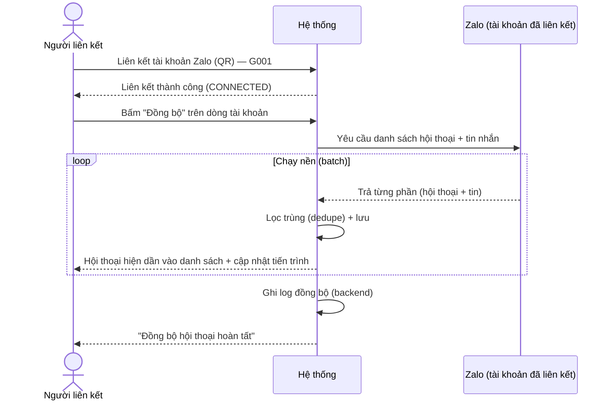
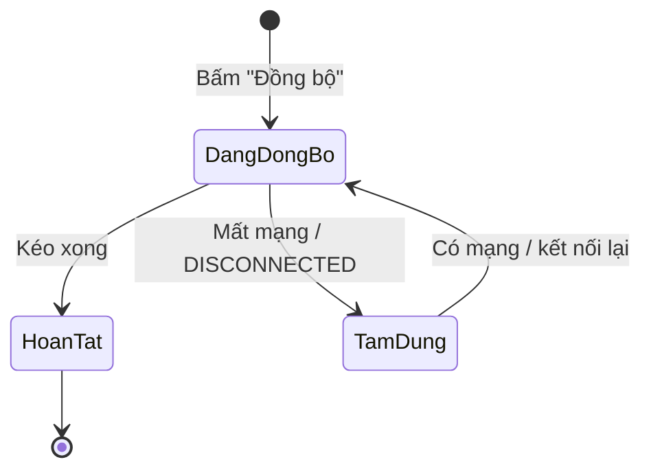

# [G031] Đồng bộ hội thoại sau khi liên kết tài khoản

| Trường | Nội dung |
|--------|----------|
| **Feature ID** | **G031** |
| **Tên** | Đồng bộ hội thoại sau khi liên kết tài khoản |
| **Module** | Chat / Chăm sóc khách hàng |
| **Owner (BA)** | Trân |
| **Version** | 1.0 |
| **Status** | Draft |
| **Last updated** | 2026-09-11 |

---

## 1. Tổng quan (Overview)

**Vấn đề:** Sau khi liên kết tài khoản Zalo, danh sách hội thoại trên hệ thống **trống** — nhân sự phải gõ tìm từng khách, hoặc chờ có tin mới hội thoại mới hiện → mất thời gian, dễ bỏ sót.

**Giải pháp:** Trên dòng tài khoản Zalo (đã CONNECTED) có nút **"Đồng bộ"**. Bấm → hệ thống kéo về **toàn bộ danh sách hội thoại (nhóm + 1:1) + tin nhắn**, hiển thị đầy đủ **như Zalo Desktop** để mở lên là dùng ngay, không cần tìm kiếm hay chờ tin mới.

> **Mục tiêu hành vi:** giống **Zalo Desktop** (đăng nhập là thấy đủ danh sách + lịch sử). *Cơ chế kỹ thuật do dev/hub — xem OQ01.*
> **Khác [G006]:** G006 = Thẻ + Danh bạ · G031 = hội thoại (danh sách + tin nhắn).

**Use Case Description:**
> Là **Admin hoặc Staff** của một công ty, sau khi liên kết tài khoản Zalo tôi muốn **bấm "Đồng bộ"** để danh sách hội thoại hiện đầy đủ (như Zalo Desktop), để tôi thấy sẵn các khách và nhắn ngay, không phải gõ tìm từng hội thoại hay chờ khách nhắn trước.

**Người dùng mục tiêu:** **Admin** và **Staff** được phân quyền tài khoản Zalo đó (G002) — đều bấm "Đồng bộ" được.

**Phụ thuộc:** **G001** (liên kết tài khoản Zalo — trigger), **G002** (quyền), **G006** (đồng bộ thẻ/danh bạ — bổ trợ, khác nội dung), **G003** (danh sách hội thoại & hiển thị tin), **G010** (trạng thái tài khoản Zalo), **G027/G029** (tin cũ không đẩy thông báo / không tính chưa đọc).

---

## 2. Điều kiện tiên quyết (Pre-conditions & Trigger)

**Trigger:** Người dùng **bấm nút "Đồng bộ"** trên **card tài khoản Zalo** (đã CONNECTED) tại **Cài đặt tin nhắn → tab Liên kết tài khoản** → bắt đầu đồng bộ hội thoại (BR01). Áp dụng cả tài khoản **vừa liên kết** lẫn **liên kết lại**.

**Pre-conditions:**
- [ ] Tài khoản Zalo đã liên kết & đang **CONNECTED** (G001).
- [ ] Người dùng có **quyền trên tài khoản đó** (Admin / Staff được phân quyền — G002).
- [ ] *(Kỹ thuật — OQ01)* hub/Zalo trả được **danh sách hội thoại + tin nhắn**.

---

## 3. Luồng chính (Happy Path)

### Sơ đồ luồng

> Auto-generated — comment nếu cần sửa logic

### UC-01 — Đồng bộ hội thoại (bấm "Đồng bộ")
1. **[Người dùng]** Liên kết tài khoản Zalo (G001); tài khoản ở trạng thái **CONNECTED** [→ E01]
2. **[Người dùng]** Bấm nút **"Đồng bộ"** trên dòng tài khoản → **[Hệ thống]** bắt đầu kéo **danh sách hội thoại + tin nhắn** của tài khoản (BR01, BR02), **chạy nền** (BR03) [→ E02, E03, E04]
3. **[Hệ thống]** Xử lý theo **batch**, **lọc trùng** hội thoại/tin đã có (BR04); **hội thoại hiện dần vào danh sách** kể cả khi chưa có tin mới (BR11); tin trong hội thoại sắp xếp đúng thời gian (BR09)
4. **[Hệ thống]** Hiển thị **thanh tiến trình** *"Đang đồng bộ hội thoại…"*; người dùng **vẫn dùng app bình thường** (BR03)
5. **[Hệ thống]** Hoàn tất → toast *"Đồng bộ hội thoại hoàn tất"*; **backend ghi log** (BR07)

*Use case kết thúc.*

---

## 4. Luồng phụ (Alternative Flows)

### AF01 — Bấm Đồng bộ lại → backfill phần thiếu
- Bấm **"Đồng bộ"** lại (sau liên kết lại, hoặc chủ động cập nhật) → **chỉ bổ sung hội thoại/tin còn thiếu** (dedupe — BR04/BR05), không kéo lại toàn bộ.

### AF02 — Dùng app trong lúc đang đồng bộ
- Đồng bộ chạy nền → người dùng **vẫn xem/nhắn tin bình thường**; hội thoại tiếp tục hiện dần vào danh sách khi kéo về (BR03).

### AF03 — Chọn hội thoại chưa đồng bộ xong
- Người dùng **tìm kiếm/mở** một hội thoại mà phần tin nhắn của nó chưa kéo xong → hệ thống ưu tiên tải hội thoại đó, tin cũ hiện dần; **không báo lỗi**.

---

## 5. Luồng ngoại lệ (Exception Flows)

| Code | Trigger | UI Response |
|------|---------|-------------|
| E01 | Liên kết tài khoản Zalo **thất bại** | Theo G001 (không tới bước đồng bộ) |
| E02 | **Mất mạng / gián đoạn** giữa chừng | Đồng bộ **tạm dừng**, giữ phần đã kéo; **tự tiếp tục** khi có mạng lại (không kéo lại từ đầu — BR08) |
| E03 | Tài khoản Zalo **DISCONNECTED** giữa chừng | Dừng đồng bộ; phần đã kéo giữ nguyên; tiếp tục khi kết nối lại (BR08) |
| E04 | **Hub/Zalo không hỗ trợ** trả danh sách hội thoại/tin (OQ01 = KHÔNG) | Danh sách vẫn hiện dần theo cơ chế hiện tại (có tin mới / tìm kiếm). *Ghi rõ giới hạn cho người dùng* |
| E05 | Đồng bộ xong nhưng **tài khoản không có hội thoại nào** | Empty state: *"Chưa có hội thoại nào"* + gợi ý bắt đầu trò chuyện |

**Exception Confirmation Log**

| Code | Từ UC | Nguồn | Confirmed |
|------|-------|-------|-----------|
| E01 | UC-01 | G001 | ✅ |
| E02 | UC-01 | Độc lập | ✅ |
| E03 | UC-01 | Độc lập | ✅ |
| E04 | UC-01 | OQ01 | ⚠️ Phụ thuộc hub |
| E05 | UC-01 | Độc lập | ✅ |

---

## 6. Business Rules — Quy tắc nghiệp vụ

| Code | Rule | Lý do |
|------|------|-------|
| BR01 | Đồng bộ **khi bấm nút "Đồng bộ"** trên tài khoản **CONNECTED**. Bấm lại được (đồng bộ bổ sung). | Người dùng chủ động, kiểm soát tải |
| BR02 | Kéo **toàn bộ hội thoại (nhóm + 1:1) + tin nhắn**. Cách kéo **LAZY**: danh sách + vài tin gần nhất trước; **mở hội thoại nào mới tải sâu lịch sử**. *(Giới hạn thực tế — OQ02.)* | Đầy đủ mà nhẹ tải |
| BR03 | **Chạy nền:** hiện thanh tiến trình *"Đang đồng bộ hội thoại…"*; người dùng vẫn xem/nhắn bình thường; hội thoại **hiện dần** (batch). | Không chặn thao tác |
| BR04 | **Dedupe:** hội thoại/tin đã có → không nhân đôi (theo định danh Zalo). | Tránh trùng |
| BR05 | **Bấm Đồng bộ lại → chỉ bổ sung phần THIẾU** (không kéo lại toàn bộ); **không đụng ẩn/ghim/đã đọc** đã có (G009/G028). | Nhanh, không đảo trạng thái người dùng |
| BR06 | **Quyền:** Admin + Staff được phân quyền tài khoản đó (G002); không thêm phân quyền riêng. | Theo quyền tài khoản |
| BR07 | **Backend ghi log đồng bộ (audit):** tài khoản · thời gian bắt đầu/kết thúc · số hội thoại + số tin · kết quả. **KHÔNG hiển thị trên UI** (sản phẩm chưa có màn lịch sử đồng bộ). | Truy vết khi cần, không phải làm màn mới |
| BR08 | **Gián đoạn (mất mạng / DISCONNECTED):** tạm dừng, giữ phần đã kéo, **tự tiếp tục** khi có lại — không kéo lại từ đầu. | Không mất công, không trùng |
| BR09 | **Xếp đúng thời gian:** hội thoại theo tin mới nhất; tin theo thời gian thật (không đẩy tin cũ lên như tin mới). | Đúng thứ tự |
| BR10 | Tin đồng bộ về **không đẩy thông báo (G027), không tính chưa đọc (G029)**. | Là dữ liệu cũ |
| BR11 | Hội thoại đồng bộ về **hiện trong danh sách kể cả khi chưa có tin mới**. | Hết cảnh danh sách trống (trọng tâm) |
| BR12 | Đồng bộ **một chiều (kéo TỪ Zalo về), KHÔNG xoá**: dữ liệu đã có ở hệ thống giữ nguyên dù đã xoá trên Zalo. | Không mất dữ liệu CSKH |

---

## 7. State Machine — Trạng thái phiên đồng bộ (theo tài khoản Zalo)

| Từ trạng thái | Sự kiện | Sang trạng thái | Ghi chú |
|---------------|---------|-----------------|---------|
| *(chưa chạy)* | Người dùng bấm **"Đồng bộ"** (BR01) | **Đang đồng bộ** | Chạy nền, có tiến trình |
| Đang đồng bộ | Kéo xong toàn bộ | **Hoàn tất** | Ghi lịch sử (BR07) |
| Đang đồng bộ | Mất mạng / DISCONNECTED | **Tạm dừng** | Giữ phần đã kéo (BR08) |
| Tạm dừng | Có mạng / kết nối lại | **Đang đồng bộ** | Tiếp tục phần thiếu |

> Auto-generated — comment nếu cần sửa logic

---

## 8. Data Model / 9. API Contract

**N/A — Spec thuần nghiệp vụ.** *(Cơ chế lấy danh sách hội thoại + tin nhắn qua hub/Zalo — để hệ thống hiển thị như Zalo Desktop — do dev tích hợp; ngoài phạm vi tài liệu nghiệp vụ.)*

---

## 10. UI/UX Notes — Ghi chú giao diện

### 10A — Nút "Đồng bộ" & tiến trình
- **Nút "Đồng bộ"** đặt trên **card tài khoản Zalo** tại **Cài đặt tin nhắn → tab Liên kết tài khoản** (cùng card với "Chọn nhân viên"/trạng thái); chỉ bật khi tài khoản **CONNECTED**; đang đồng bộ thì nút ở trạng thái *"Đang đồng bộ…"* (không cho bấm chồng).
- Sau khi bấm: banner/thanh nhẹ *"Đang đồng bộ hội thoại…"* (có thể kèm % hoặc số hội thoại/tin đã kéo); **không** che màn hình, **không** chặn thao tác.
- Hoàn tất → toast *"Đồng bộ hội thoại hoàn tất"*; banner tự ẩn.

### 10B — Danh sách hội thoại trong lúc/sau đồng bộ
- Hội thoại **hiện dần** vào danh sách theo thứ tự tin mới nhất; **không cần** gõ tìm kiếm mới thấy; **không cần** chờ có tin mới (BR11).
- Trong lúc đang đồng bộ, có thể hiện gợi ý nhẹ *"Đang tải thêm hội thoại…"* ở cuối danh sách.
- Tin cũ trong hội thoại **hiện đúng vị trí theo thời gian**; **không** badge chưa đọc / không push (BR09, BR10).

### 10C — Log đồng bộ (backend, không UI)
- Kết quả mỗi phiên đồng bộ **chỉ ghi log ở backend** (BR07) để truy vết — **không có màn hiển thị** trên sản phẩm hiện tại.

---

## 11. Acceptance Criteria — Tiêu chí nghiệm thu

- [ ] Tài khoản **CONNECTED** → có **nút "Đồng bộ"**; bấm → bắt đầu đồng bộ hội thoại (AC-BR01)
- [ ] Sau đồng bộ, **danh sách hội thoại hiển thị đầy đủ** (như Zalo Desktop) — **gồm cả nhóm và 1:1**, không cần tìm kiếm thủ công (AC-BR02)
- [ ] **Lazy:** kéo đầy đủ **danh sách + vài tin gần nhất** trước; mở hội thoại nào mới **tải sâu thêm lịch sử** (AC-BR02, AC-OQ04)
- [ ] Hội thoại **hiện trong danh sách kể cả khi chưa có tin mới** (AC-BR11)
- [ ] Đồng bộ **chạy nền** + thanh tiến trình; người dùng **vẫn dùng app** (AC-BR03)
- [ ] Hội thoại/tin đã có sẵn → **không nhân đôi** (dedupe) (AC-BR04)
- [ ] **Bấm Đồng bộ lại** (hoặc sau liên kết lại) → chỉ bổ sung phần thiếu, không kéo lại toàn bộ; **không đụng trạng thái ẩn/ghim/đã đọc** đã có (AC-BR05, AC-AF01)
- [ ] Đồng bộ **KHÔNG xoá** hội thoại/tin đã có ở hệ thống dù đã xoá trên Zalo (bổ sung một chiều) (AC-BR12)
- [ ] Mở hội thoại **chưa kéo xong** → ưu tiên tải, tin hiện dần, **không báo lỗi** (AC-AF03)
- [ ] Đồng bộ chạy **theo quyền liên kết tài khoản** (G001/G002), không thêm phân quyền riêng (AC-BR06)
- [ ] Mất mạng/DISCONNECTED giữa chừng → **tạm dừng, giữ phần đã kéo, tự tiếp tục** khi có lại (AC-BR08, AC-E02/E03)
- [ ] Hội thoại xếp theo tin mới nhất; tin cũ hiện **đúng vị trí theo thời gian** (AC-BR09)
- [ ] Dữ liệu đồng bộ → **không push (G027) & không tính chưa đọc (G029)** (AC-BR10)
- [ ] **Backend ghi log** đồng bộ (tài khoản, thời gian, số hội thoại/tin, kết quả); không cần màn hiển thị (AC-BR07)
- [ ] Hub không hỗ trợ → danh sách vẫn chạy theo cơ chế hiện tại + báo giới hạn (AC-E04)
- [ ] Tài khoản không có hội thoại → **empty state** đúng (AC-E05)

---

## 12. Out of Scope — Ngoài phạm vi

| # | Nội dung | Ghi chú |
|---|---------|---------|
| OOS01 | Đồng bộ **Thẻ / Danh bạ** | Đã có ở **G006** |
| OOS02 | **Tự động đồng bộ ngay khi vừa liên kết** (không cần bấm) | Bản này dùng **nút "Đồng bộ" bấm thủ công** (BR01); tự động hoá cân nhắc sau |
| OOS03 | Đồng bộ **media/file** cũ dung lượng lớn (ảnh/video/tệp lịch sử) | Cân nhắc phase sau tùy khả năng hub |
| OOS04 | Đồng bộ **2 chiều** (đẩy dữ liệu hệ thống ngược lên Zalo) | Chỉ kéo TỪ Zalo về |

---

## 13. Dependencies — Phụ thuộc

| Phụ thuộc | Ghi chú |
|-----------|---------|
| **G001 — Liên kết tài khoản Zalo** | Tài khoản CONNECTED mới có nút "Đồng bộ" (BR01) |
| **G002 — Chia sẻ tài khoản Zalo cho Staff** | Admin + Staff được phân quyền tài khoản đó đều bấm Đồng bộ được (BR01/BR06) |
| **G006 — Đồng bộ dữ liệu** | Bổ trợ (Thẻ/Danh bạ) — nội dung khác. *(Lưu ý: màn "Đồng bộ dữ liệu / Lịch sử đồng bộ" mô tả ở G006 hiện CHƯA có trên sản phẩm — G031 không phụ thuộc màn này.)* |
| **G003 — Chat** | Danh sách hội thoại & hiển thị tin theo thời gian (BR09, BR11) |
| **G010 — Soft Delete & Khôi phục dữ liệu** | Trạng thái CONNECTED/DISCONNECTED (BR08) |
| **G027 / G029** | Dữ liệu đồng bộ không đẩy thông báo / không tính chưa đọc (BR10) |

---

## 14. Câu hỏi mở (Open Questions)

| # | Câu hỏi | Người quyết định | Trạng thái |
|---|---------|------------------|-----------|
| OQ01 | **Hub/Zalo trả được TOÀN BỘ danh sách hội thoại + tin nhắn để hệ thống hiển thị như Zalo Desktop không?** Điều kiện tiên quyết — không hỗ trợ thì rơi về E04 | Dev / hub | ⏳ **Chờ dev xác nhận** |
| OQ02 | **Lấy được TỚI ĐÂU?** (toàn bộ hội thoại & toàn bộ lịch sử / giới hạn số hội thoại / giới hạn thời gian tin) — BR02 đang mặc định "toàn bộ" | Dev / hub | ⏳ Chờ dev |
| OQ03 | **Điều kiện để đồng bộ đầy đủ:** tài khoản/app có cần **đang mở/online** trong lúc đồng bộ không? Nếu có → nêu rõ điều kiện cho người dùng | Dev / hub | ⏳ Chờ dev |
| ~~OQ04~~ | **Cách tải phần tin nhắn:** kéo sẵn hay lazy? | BA | ✅ **Đã chốt: LAZY** (07/09) — kéo đầy đủ danh sách + vài tin gần nhất, mở hội thoại mới tải sâu (BR02). *Dev xác nhận khả thi & giới hạn thực tế (gộp OQ02).* |

---

## Changelog

| Ngày | Version | Người thay đổi | Sections | Nội dung | File:Line |
|------|---------|----------------|----------|----------|-----------|
| 2026-09-11 | v1.0 | Trân (BA) | Toàn bộ | Tạo spec: sau liên kết tài khoản, người dùng **bấm nút "Đồng bộ"** trên dòng tài khoản CONNECTED → kéo **toàn bộ danh sách hội thoại (cả nhóm + 1:1) + tin nhắn**, hiển thị **đầy đủ như Zalo Desktop**, hết cảnh danh sách trống. **Target users: Admin + Staff** (Staff có quyền tài khoản đó — BR01). Kéo **LAZY** (danh sách + tin gần nhất, mở mới tải sâu — BR02); bấm Đồng bộ lại chỉ bổ sung phần thiếu, không đụng ẩn/ghim/đã đọc (BR05); hội thoại hiện cả khi chưa có tin mới (BR11); chạy nền + tiến trình (BR03); dedupe (BR04); **bổ sung một chiều, không xoá** (BR12); không push/không chưa đọc (BR10). Phân biệt G006 (thẻ/danh bạ). §8/§9 = N/A. **OQ01–03 [chờ dev]** — điều kiện tiên quyết | — |

---

> **Điểm cốt lõi cho Dev:**
> 1. Nút **"Đồng bộ"** trên tài khoản CONNECTED → kéo **toàn bộ hội thoại (nhóm + 1:1) + tin**, hiển thị như Zalo Desktop (BR01, BR02, BR11).
> 2. Kéo **LAZY**, **chạy nền**, **dedupe**, xếp **đúng thời gian**; bấm lại chỉ **bổ sung phần thiếu** (BR02–05, BR09).
> 3. **Một chiều, KHÔNG xoá**; tin cũ **không push / không chưa đọc** (BR12, BR10).
> 4. Spec **thuần nghiệp vụ** — cơ chế lấy dữ liệu qua hub/Zalo do dev. **Chặn build tới khi chốt OQ01–03** (hub trả được không · tới đâu · cần app online không).
