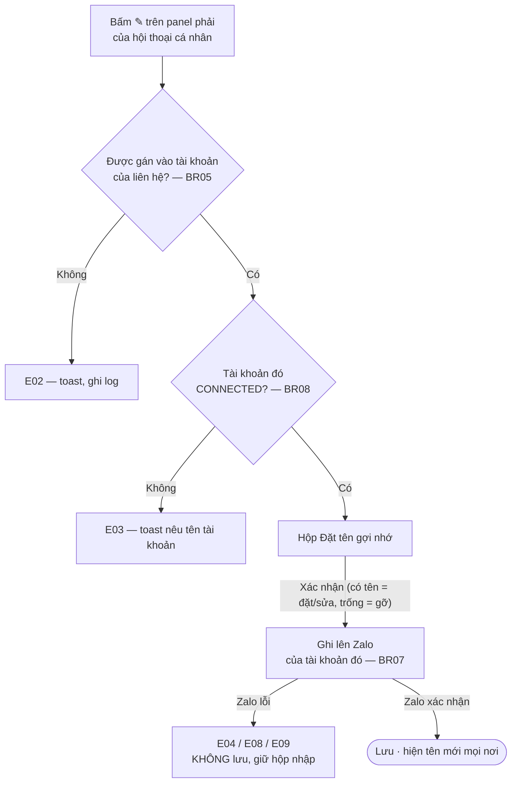

# [G032] Đặt tên gợi nhớ

| Trường | Nội dung |
|--------|----------|
| **Feature ID** | **G032** |
| **Tên** | Đặt tên gợi nhớ cho liên hệ *(hội thoại cá nhân)* |
| **Module** | Chat / Chăm sóc khách hàng |
| **Owner (BA)** | Trân (BA) |
| **Dev assignee** | — |
| **Priority** | — |
| **Version** | **1.0** |
| **Status** | Draft |
| **Last updated** | 2026-10-02 |

---

## 1. Tổng quan

Cho phép đặt **tên gợi nhớ** để thay tên Zalo của khách ở mọi nơi hiển thị. Tên Zalo là tên thật, thường không cho biết đó là khách nào trong công việc.

| Mục | Nội dung |
|---|---|
| **Bản chất** | **Zalo-native**: ghi đúng vào tên gợi nhớ của Zalo và **hành xử như Zalo**. Chỉ chủ tài khoản Zalo thấy, **khách không thấy** |
| **Phạm vi** | **Chỉ hội thoại cá nhân.** Đổi tên nhóm thuộc **G008 UC-04** |
| **Điểm vào** | **Một chỗ duy nhất: ✎ trên panel phải của hội thoại** — đúng như Zalo. Danh bạ **chỉ hiển thị** tên, không đặt được từ đó (BR02) |
| **Gắn với** | **Cặp (tài khoản Zalo, liên hệ)** — xem §2 |
| **Ai đặt được** | Nhân sự **được gán vào tài khoản Zalo** của liên hệ; Admin luôn đặt được |
| **Ai nhìn thấy** | Cả workspace và mọi thiết bị đăng nhập tài khoản Zalo đó |
| **Đồng bộ danh bạ** | **Không làm mất tên gợi nhớ** — chạy G006 xong vẫn hiện đúng tên đã đặt (BR14) |

> Là **nhân sự CSKH**, tôi muốn đặt tên gợi nhớ cho khách để nhìn danh sách hội thoại là biết ngay ai, và mở app Zalo cũng thấy đúng tên đó.

**Nền tảng:** Web · Android · iOS. Hành vi và giới hạn giống nhau; giao diện bám màn tương ứng của Zalo trên từng nền tảng (BR12).

**Phụ thuộc:** G001 (trạng thái tài khoản) · G002 (phân quyền) · G003 (Chat) · G006 (đồng bộ danh bạ) · G007 (Danh bạ) · G011 (panel phải) · G017 (tìm kiếm). **G011 giữ điểm vào duy nhất** *(icon ✎)*; **G007 chỉ hiển thị** tên gợi nhớ, **không có điểm vào**. Toàn bộ nghiệp vụ nằm ở đây.

---

## 2. Điều kiện & Trigger

**Trigger:** bấm **✎** cạnh tên trên panel phải của hội thoại cá nhân — **đây là chỗ duy nhất** (BR02).

> **Tài khoản của liên hệ** là tài khoản Zalo có liên hệ đó trong danh bạ hoặc hội thoại. Mỗi liên hệ chỉ thuộc **một** tài khoản.
>
> ⚠️ Zalo cấp **mã liên hệ (uid) riêng cho từng tài khoản**. Cùng một người, nhìn từ hai tài khoản Zalo là **hai liên hệ khác nhau**, và **không có khoá nào nối chúng lại** (số điện thoại thường bị Zalo ẩn). Vì vậy tên gợi nhớ gắn với cặp *(tài khoản Zalo, liên hệ)*.

**Pre-conditions:** đã đăng nhập · được gán vào tài khoản Zalo của liên hệ (BR05) · tài khoản đó đang **CONNECTED** (BR08).

**Post-conditions:** tên mới **đã ghi lên Zalo** và hiện ở mọi nơi trong hệ thống. Ghi thất bại thì **không có gì thay đổi**.

---

## 3. Luồng chính

### UC-01 — Đặt / sửa / gỡ tên từ panel phải

1. **[Người dùng]** Bấm **✎** cạnh tên trên panel phải [→ E02, E03]
2. **[Hệ thống]** Mở hộp **Đặt tên gợi nhớ**, ô nhập điền sẵn tên đang hiển thị và bôi đen để gõ đè ngay (§10B)
3. **[Người dùng]** Sửa tên rồi bấm **Xác nhận** (hoặc Enter). Muốn gỡ tên thì xoá trắng ô rồi **Xác nhận** (BR04) [→ E01]
4. **[Hệ thống]** Chuẩn hoá chuỗi (BR06), ghi lên **tài khoản Zalo của liên hệ** (BR07) [→ E04–E09]
5. **[Hệ thống]** Zalo xác nhận xong mới lưu; thay tên ở mọi nơi hiển thị (BR03) và cập nhật realtime mọi client (BR12)



> Auto-generated — comment nếu cần sửa logic

---

## 4. Luồng phụ

- **AF01 — Huỷ:** bấm **Huỷ**, ✕ hoặc `Esc` → đóng, không lưu.
- **AF02 — Gỡ tên:** xoá trắng ô rồi **Xác nhận** → xoá tên trên hệ thống và trên Zalo; mọi nơi về **tên Zalo gốc** (BR04).
- **AF03 — Danh bạ chỉ hiển thị:** đặt tên ở panel → card Danh bạ hiện tên mới **ngay**, nhưng **Danh bạ không có chỗ đặt tên** — hover card không có mục *Đặt tên gợi nhớ* (BR02).
- **AF04 — Hai nhân sự cùng đặt:** người lưu sau thắng, không báo lỗi (BR12).
- **AF05 — Khách chưa kết bạn:** đặt và gỡ tên **như mọi liên hệ khác**, ghi lên Zalo ngay (BR09).
- **AF06 — Tài khoản mất kết nối:** ✎ vẫn hiện; bấm vào thì ra toast E03, không mở hộp.
- **AF07 — Liên hệ chưa có hội thoại:** từ Danh bạ bấm **Nhắn tin** → hệ thống tạo hội thoại (**G007 BR09**) → đặt tên ở panel như bình thường. **Không có đường tắt từ Danh bạ** (BR02).
- **AF08 — Đặt tên trên app Zalo:** nhân sự đặt hoặc gỡ tên trên điện thoại / Zalo PC → hệ thống cập nhật **gần như ngay** như các thiết bị Zalo khác (BR10).
- **AF09 — Bấm Đồng bộ danh bạ:** chạy xong, liên hệ đã có tên gợi nhớ vẫn hiện **đúng tên gợi nhớ** ở mọi nơi; đồng bộ **không** đưa về tên Zalo gốc (BR14).

---

## 5. Luồng ngoại lệ

| Code | Trigger | Hiển thị | Log |
|------|---------|----------|-----|
| **E01** | Gõ quá **50 ký tự** | Ô nhập không nhận thêm ký tự (như Zalo) | — |
| **E02** | Không được gán vào tài khoản của liên hệ | Ẩn ✎. Gọi API thẳng → toast *"Bạn không có quyền thực hiện thao tác này"* | Ghi log truy cập trái phép |
| **E03** | Tài khoản của liên hệ **DISCONNECTED** | Toast *"Tài khoản Zalo «{tên}» đang ngắt kết nối. Vui lòng kết nối lại để đặt tên gợi nhớ."*, không mở hộp | — |
| **E04** | Zalo từ chối (mã khác E08/E09) hoặc **hết giờ chờ** | **Không lưu**, giữ hộp và nội dung. Toast *"Không đặt được tên gợi nhớ. Vui lòng thử lại."* | Error log kèm mã Zalo |
| **E05** | Mất mạng khi lưu | Toast *"Mất kết nối, vui lòng thử lại"*, giữ nội dung | — |
| **E06** | Lỗi hệ thống (500) | Toast *"Lỗi hệ thống. Vui lòng thử lại sau"*, giữ nội dung | Error log |
| **E07** | Liên hệ không còn tồn tại | Toast *"Không tìm thấy liên hệ. Vui lòng tải lại."*, đóng hộp | Error log |
| **E08** | Zalo báo **quá số lần đặt trong ngày** *(mã 221)* | **Không lưu.** Toast *"Hôm nay đã đặt tên gợi nhớ quá số lần Zalo cho phép. Vui lòng thử lại vào ngày mai."* | Error log kèm mã |
| **E09** | Zalo báo **danh sách tên gợi nhớ đã đầy** *(mã 237)* | **Không lưu.** Toast *"Danh sách tên gợi nhớ trên Zalo đã đầy. Cần gỡ bớt tên cũ trước khi đặt tên mới."* | Error log kèm mã |

> **Hết giờ chờ (E04):** Zalo có thể đã ghi xong dù hệ thống báo lỗi. Khi đó tín hiệu từ Zalo (BR10) sẽ đưa tên đúng về hệ thống — không cần xử lý thêm.

---

## 6. Business Rules

| Code | Rule | Lý do |
|------|------|-------|
| **BR01** | **Dùng chung cấp workspace:** một nhân sự đặt, mọi nhân sự cùng workspace thấy. Không có tên riêng theo từng nhân sự | Nhiều người cùng chăm một khách; mỗi người một tên thì bàn giao lệch nhau (BR-C16) |
| **BR02** | **Một điểm vào duy nhất: ✎ trên panel phải của hội thoại cá nhân.** **Danh bạ không có** mục *Đặt tên gợi nhớ* — card Danh bạ **chỉ hiển thị** tên gợi nhớ (BR03). Liên hệ chưa có hội thoại thì bấm **Nhắn tin** ở Danh bạ để mở hội thoại trước (AF07).<br>Giá trị tên vẫn là **một nguồn duy nhất** cho mọi nơi hiển thị | **Bám đúng Zalo:** Zalo cho đặt tên gợi nhớ ở **màn thông tin của hội thoại**, không đặt từ danh sách danh bạ. Một điểm vào thì chỉ có một hộp để kiểm, một chỗ để sửa khi đổi luật — và nhân sự không phải nhớ hai đường làm cùng một việc. Danh bạ vẫn hiện tên mới ngay nên không mất gì |
| **BR03** | Tên gợi nhớ **thay tên Zalo ở mọi nơi**: danh sách hội thoại · header chat · panel phải · Danh bạ · tìm kiếm · thành viên nhóm · thông báo.<br>**Khác trường "Họ tên" của Hồ sơ khách hàng (G011a)**: hai trường không ảnh hưởng nhau, Họ tên không đẩy lên Zalo. **Không** đổi tên thật trên profile khách | Đổi một chỗ thì không giải quyết được việc nhận diện |
| **BR04** | **Gỡ tên = xoá trắng ô rồi Xác nhận.** Không có nút "Gỡ" riêng; nút Xác nhận **không** disabled khi ô trống | Giống Zalo (BR-C15) |
| **BR05** | **Quyền:** được gán vào tài khoản Zalo của liên hệ (G002); Admin luôn có. **Không** cần quyền "Quản lý tài khoản Zalo" | Nhân sự chat hằng ngày cần đặt tên để làm việc |
| **BR06** | **Giống Zalo:** tối đa **50 ký tự** (đếm theo UTF-16, emoji tính 2). Khi lưu chỉ **cắt khoảng trắng hai đầu** và bỏ ký tự điều khiển; **giữ nguyên** khoảng trắng bên trong. Không giới hạn loại ký tự | 50 là giới hạn ô nhập của Zalo PC. Giữ chuỗi như Zalo thì tên đặt từ hệ thống và từ app không lệch nhau |
| **BR07** | **Ghi lên đúng một tài khoản:** tài khoản của liên hệ. Không ảnh hưởng liên hệ ở tài khoản Zalo khác, kể cả khi ngoài đời là cùng một người. **Zalo xác nhận xong mới lưu**; Zalo từ chối thì không lưu gì | Đúng cách Zalo lưu (uid theo từng tài khoản); không có rủi ro ghi nửa chừng |
| **BR08** | **Kết nối:** tài khoản của liên hệ phải **CONNECTED** mới mở được hộp (áp cả đặt lẫn gỡ). Tài khoản Zalo khác rớt kết nối không ảnh hưởng | Không kết nối thì không ghi lên Zalo được |
| **BR09** | **Khách chưa kết bạn đặt và gỡ tên như mọi liên hệ**, ghi lên Zalo ngay. Không có trạng thái chờ, không có hàng đợi | **Đã đo trên dev:** Zalo cho đặt và gỡ tên gợi nhớ với người chưa kết bạn, ~0,2 giây mỗi lần. Khách nhắn đến mà chưa kết bạn là nhóm đông nhất của CSKH, cũng là nhóm cần nhận diện nhất |
| **BR10** | **Zalo là nơi lưu chính thức.** Tên đặt hoặc gỡ trên app Zalo (điện thoại, PC) về hệ thống **gần như ngay** và **ghi đè** giá trị cũ — áp cho cả khách chưa kết bạn. Đồng bộ danh bạ (G006) vẫn chạy như lưới an toàn khi tài khoản mất kết nối | Zalo đồng bộ tên gợi nhớ ngay giữa các thiết bị; hệ thống phải như một thiết bị Zalo. Zalo **có** gửi tín hiệu mỗi khi tên đổi |
| **BR11** | **Tìm kiếm** khớp **tên đang hiển thị** (có tên gợi nhớ thì chỉ tìm theo tên gợi nhớ) **và số điện thoại**. Gõ tên Zalo gốc của liên hệ đã có tên gợi nhớ thì **không ra** — xem **OQ01** | Khớp với cái người dùng nhìn thấy |
| **BR12** | **Realtime** mọi client; hai người cùng đặt thì **người lưu sau thắng**. Hành vi giống nhau trên mọi nền tảng; giao diện bám Zalo từng nền tảng (§10B) | BR-C12; lệch hành vi giữa nền tảng là lỗi |
| **BR13** | **Hệ thống không tự gỡ tên:** xoá bạn, mất kết nối hay xoá tài khoản Zalo đều không xoá tên trên Zalo. Liên kết lại cùng `companyId + zaloUid` thì tên được kéo về như cũ | BR-C09 / C11 / C13 |
| **BR14** | **Đồng bộ danh bạ KHÔNG làm mất tên gợi nhớ.** Bấm *Đồng bộ danh bạ* (**G006**) → tên gợi nhớ **giữ nguyên**; màn hình sau đồng bộ vẫn hiện **đúng tên gợi nhớ**, không nhảy về tên Zalo gốc.<br>**Hai nhánh, chốt sẵn theo OQ03:** hub trả **alias** trong dữ liệu danh bạ → lấy alias về làm tên gợi nhớ, **ghi đè** giá trị cũ *(cùng chiều với **BR10** — ai đổi trên app Zalo thì đồng bộ về là đúng)*; hub **không** trả alias → đồng bộ **chỉ cập nhật tên Zalo gốc, avatar, số điện thoại** và **không đụng** tới tên gợi nhớ đang có.<br>**Ngoại lệ của G006 BR06** *(cập nhật từ Zalo, không giữ dữ liệu cũ)* — ngoại lệ này chỉ áp cho **trường tên gợi nhớ** | Tên gợi nhớ **không phải dữ liệu Gopany tự bịa** — nó nằm trên Zalo (BR07), nên đồng bộ từ Zalo về mà làm mất nó là **tự xoá thứ Zalo đang giữ**. Nhân sự CSKH đặt tên cho vài trăm khách rồi một lần bấm Đồng bộ mất sạch thì không có đường khôi phục *(không có lịch sử — OOS04)*. Nhánh "hub không trả alias" chọn **không đụng tới** thay vì ghi đè, vì **thiếu dữ liệu không phải là bằng chứng đã bị xoá** |

---

## 7. State Machine

**N/A.** Mỗi cặp *(tài khoản, liên hệ)* hoặc **chưa có tên gợi nhớ** (hiện tên Zalo gốc), hoặc **có tên gợi nhớ** (hiện tên đó, giống hệt trên app Zalo).

## 8. Data Model / 9. API Contract

**N/A — thuần nghiệp vụ.** Kỹ thuật tự quyết, miễn thoả **BR01** *(dùng chung workspace)* · **BR07** *(gắn với cặp tài khoản–liên hệ, Zalo xác nhận mới lưu)* · **BR10** *(Zalo là nơi lưu chính thức)* · **BR14** *(đồng bộ không ghi đè tên gợi nhớ)*.

---

## 10. UI/UX

### 10A — Icon ✎ trên panel phải *(thành phần mới)*

```
┌ Thông tin hội thoại ───────── ✕ ┐
│           ( avatar )            │
│      Chị Hồng - Kho Q7    ✎     │
│      (tên Zalo: Nguyễn Văn A)   │
│  ─────────────────────────────  │
│  ▸ Hồ sơ khách hàng      ✎ Sửa  │
│  ▸ Ghi chú nội bộ               │
└─────────────────────────────────┘
```

- **Tên:** tên gợi nhớ nếu có, không có thì tên Zalo. Tên dài thì cắt bằng `…`, ✎ luôn nhìn thấy.
- **Dòng phụ** *"(tên Zalo: …)"*: chỉ hiện khi đã có tên gợi nhớ *(Gopany thêm để đối chiếu khi khách nhắc tên thật)*.
- **✎** chỉ hiện với người có quyền (BR05). Hội thoại nhóm không có ✎ này.
- **Đây là điểm vào duy nhất** (BR02). Card Danh bạ **hiển thị** tên gợi nhớ nhưng **không có** mục *Đặt tên gợi nhớ* trong Option — xem **OOS10**.
- ⚠️ **Không nhầm với "✎ Sửa" của Hồ sơ khách hàng (G011a)**: nút đó sửa Họ tên · Năm sinh · SĐT · Email, không đổi tên hiển thị.

### 10B — Hộp Đặt tên gợi nhớ *(bám Zalo)*

**Web — giống hộp "Đặt tên gợi nhớ" của Zalo PC:**

```
┌──────────────────────────────────────┐
│          Đặt tên gợi nhớ          ✕  │
├──────────────────────────────────────┤
│              ( avatar )              │
│   Hãy đặt cho Nguyễn Văn A một cái   │
│          tên dễ nhớ.                 │
│   Tên này dùng chung cho cả nhóm     │
│   nhân sự trên tài khoản Zalo «CSKH  │
│   1». Khách không nhìn thấy.         │
│  ┌────────────────────────────────┐  │
│  │ Nguyễn Văn A                   │  │
│  └────────────────────────────────┘  │
├──────────────────────────────────────┤
│     [  Huỷ  ]       [ Xác nhận ]     │
└──────────────────────────────────────┘
```

| Thành phần | Quy định |
|---|---|
| **Tiêu đề** | *"Đặt tên gợi nhớ"* |
| **Avatar + câu gợi ý** | Avatar khách và *"Hãy đặt cho {tên Zalo} một cái tên dễ nhớ."* (đúng chữ Zalo) |
| **Dòng lưu ý** | Thay câu *"Tên gợi nhớ sẽ chỉ hiển thị riêng với bạn"* của Zalo bằng: *"Tên này dùng chung cho cả nhóm nhân sự trên tài khoản Zalo «{tên tài khoản}». Khách không nhìn thấy."* — **bắt buộc** |
| **Ô nhập** | Điền sẵn tên đang hiển thị, **focus + bôi đen** để gõ đè. Tối đa 50 ký tự, không có bộ đếm (như Zalo) |
| **Lưu** | Nút **Xác nhận** hoặc phím **Enter** (bỏ qua Enter khi đang gõ dấu tiếng Việt). **Không** disabled khi ô trống. Đang xử lý thì hiện vòng quay, chặn bấm lặp |
| **Huỷ** | Nút **Huỷ**, ✕ hoặc `Esc` — đóng, không lưu |

**Android · iOS:** bám **màn "Đặt tên gợi nhớ" của app Zalo mobile** tương ứng *(ảnh đối chiếu — OQ02)*. Giữ nguyên hành vi: điền sẵn tên, 50 ký tự, xoá trắng = gỡ, nút lưu không disabled, cùng dòng lưu ý.

### 10C — Hiển thị mặc định

- Chưa có tên gợi nhớ → **tên Zalo gốc**, không dòng phụ, không chữ "Chưa đặt tên".
- Tên Zalo rỗng → **số điện thoại** nếu có (G003 §10B).

---

## 11. Acceptance Criteria

**Dùng chung & một nguồn**
- [ ] Nhân sự A đặt tên → nhân sự B cùng workspace thấy ngay, **không cần reload**; workspace khác không thấy (AC-BR01/BR12, BR-C01)
- [ ] Đặt ở panel → card Danh bạ hiện tên mới **ngay** (AC-BR02/AF03)
- [ ] Hover card Danh bạ → Option **không có** mục *Đặt tên gợi nhớ*; không có đường nào đặt tên từ Danh bạ (AC-BR02/OOS10)
- [ ] Liên hệ **chưa có hội thoại** → từ Danh bạ bấm **Nhắn tin** → hội thoại mở ra → đặt tên ở panel bình thường (AC-AF07, G007 BR09)
- [ ] Toàn hệ thống **chỉ có một chỗ** mở được hộp *Đặt tên gợi nhớ*: icon ✎ trên panel phải (AC-BR02)

**Gắn với cặp (tài khoản, liên hệ)**
- [ ] Đặt tên liên hệ ở **tài khoản A** → app Zalo của A thấy tên mới; liên hệ ở **tài khoản B** (dù cùng người) giữ nguyên (AC-BR07)
- [ ] Tài khoản Zalo khác DISCONNECTED → vẫn đặt được tên liên hệ của tài khoản đang kết nối (AC-BR08)

**Giống Zalo**
- [ ] Hộp Web có tiêu đề "Đặt tên gợi nhớ", avatar, câu "Hãy đặt cho … một cái tên dễ nhớ.", nút Huỷ + Xác nhận; tên điền sẵn và được bôi đen (AC-10B)
- [ ] Enter = Xác nhận; Enter lúc đang gõ dấu tiếng Việt **không** lưu; Huỷ / ✕ / Esc đóng không lưu (AC-10B/AF01)
- [ ] Gõ tới **50 ký tự** → ô không nhận thêm; mỗi emoji tính 2 (AC-BR06/E01)
- [ ] `"  Chị  Hồng  "` → lưu thành `"Chị  Hồng"` (chỉ cắt hai đầu, giữ khoảng trắng bên trong) (AC-BR06)
- [ ] Đặt hoặc gỡ tên **trên app Zalo** → hệ thống cập nhật **trong vài giây**, không cần đồng bộ danh bạ — cả với khách chưa kết bạn (AC-BR10/AF08)

**Hiển thị**
- [ ] Tên gợi nhớ thay tên Zalo ở: danh sách hội thoại · header · panel · Danh bạ · tìm kiếm · thành viên nhóm · thông báo (AC-BR03)
- [ ] Panel hiện *"(tên Zalo: …)"* khi có tên gợi nhớ (AC-10A)
- [ ] Tên thật trên profile khách không đổi; Họ tên trong Hồ sơ khách hàng và tên gợi nhớ không ảnh hưởng nhau (AC-BR03)

**Sửa tên · Gỡ tên · Khách chưa kết bạn**
- [ ] **Sửa tên:** liên hệ đã có tên gợi nhớ → mở hộp thấy **tên hiện tại điền sẵn và bôi đen**; gõ tên khác rồi Xác nhận → mọi nơi và **app Zalo** hiện tên mới, **không** tạo thêm bản ghi thứ hai (AC-UC-01/BR07/10B)
- [ ] Sửa tên rồi bấm **Huỷ** / `Esc` → **giữ nguyên tên cũ** ở cả hệ thống và app Zalo (AC-AF01)
- [ ] **Gỡ tên:** xoá trắng rồi Xác nhận → mọi nơi và app Zalo về tên gốc; nút Xác nhận không disabled khi ô trống; không có nút "Gỡ" riêng (AC-BR04/AF02)
- [ ] Gỡ tên xong → **đặt lại được ngay** như liên hệ chưa từng có tên (AC-BR04)
- [ ] Đặt và gỡ tên cho khách chưa kết bạn → thành công, app Zalo thấy ngay như với bạn bè (AC-BR09/AF05)

**Quyền & kết nối**
- [ ] Được gán vào tài khoản → đặt được; Admin đặt được không cần gán; không cần quyền "Quản lý tài khoản Zalo" (AC-BR05)
- [ ] Không được gán → không thấy ✎; gọi API thẳng → bị từ chối và ghi log (AC-BR05/E02)
- [ ] Tài khoản của liên hệ DISCONNECTED → toast E03 nêu đúng tên tài khoản, không mở hộp (áp cả gỡ tên) (AC-BR08/E03/AF06)

**Lỗi từ Zalo**
- [ ] Zalo từ chối hoặc hết giờ → không lưu, giữ hộp; bấm Xác nhận lại chạy bình thường (E04) (AC-BR07/E04)
- [ ] Mã 221 → toast E08 · mã 237 → toast E09 · mã khác → E04; cả ba đều không lưu (AC-E08/E09/E04)

**Tìm kiếm**
- [ ] Có tên gợi nhớ → tìm theo tên gợi nhớ ra, theo tên Zalo gốc không ra; theo **số điện thoại** vẫn ra (AC-BR11)
- [ ] Chưa có tên gợi nhớ → tìm theo tên Zalo ra bình thường (AC-BR11)

**Đồng bộ danh bạ**
- [ ] Đặt tên gợi nhớ → bấm **Đồng bộ danh bạ** (G006) → chạy xong **vẫn hiện tên gợi nhớ**, **không** nhảy về tên Zalo gốc (AC-BR14/AF09)
- [ ] Đồng bộ vẫn cập nhật bình thường **avatar · số điện thoại · tên Zalo gốc** của liên hệ đó (AC-BR14, G006 BR06)
- [ ] Đổi tên gợi nhớ **trên app Zalo** rồi bấm Đồng bộ → hệ thống lấy **tên mới nhất**, không quay lại tên cũ (AC-BR14/BR10)
- [ ] Đồng bộ **nhiều lần liên tiếp** → tên gợi nhớ không đổi, không nhân bản, không mất (AC-BR14)

**Bảo toàn & chung**
- [ ] Xoá bạn, mất kết nối → tên vẫn hiển thị; xoá tài khoản rồi liên kết lại cùng `companyId + zaloUid` → tên được kéo về như cũ (AC-BR13)
- [ ] Hai nhân sự cùng lưu → người lưu sau thắng, không báo lỗi (AC-BR12/AF04)
- [ ] Mất mạng hoặc lỗi 500 → toast, giữ nội dung đang nhập; liên hệ đã bị xoá → toast, đóng hộp (AC-E05/E06/E07)

---

## 12. Out of Scope

| # | Nội dung | Ghi chú |
|---|---|---|
| OOS01 | Đổi tên nhóm | G008 UC-04 |
| OOS02 | Tên riêng theo từng nhân sự | Đã chốt dùng chung (BR01) |
| OOS03 | Gợi ý / tự ghép tên kèm SĐT | Nhân sự tự gõ |
| OOS04 | Lịch sử ai đặt, đặt lúc nào | Cân nhắc phase sau |
| OOS05 | Viết lại đồng bộ danh bạ | Thuộc G006 |
| OOS06 | Đổi avatar liên hệ | Zalo quản lý (BR-C10) |
| OOS07 | Đặt tên hàng loạt / import Excel | — |
| OOS08 | Đổi tên thật trên profile Zalo của khách | Zalo không cho phép |
| OOS09 | Nối liên hệ giữa các tài khoản để đặt tên một lần | Không có khoá nối (§2) |
| OOS10 | **Đặt tên gợi nhớ từ Danh bạ** — mục trong Option của card, hoặc icon đổi tên ở popup profile khi tìm người dùng | **Bám Zalo:** Zalo chỉ cho đặt ở màn thông tin hội thoại. Danh bạ **chỉ hiển thị** tên (BR02, BR03). Liên hệ chưa có hội thoại thì bấm **Nhắn tin** để mở hội thoại trước (AF07) |

---

## 13. Dependencies

| Spec | Dùng cho |
|---|---|
| **G001** | Trạng thái CONNECTED (BR08) · liên kết lại (BR13) |
| **G002** | Nhân sự được gán tài khoản nào (BR05) |
| **G011** | **Điểm vào duy nhất** — icon ✎ trên panel phải (BR02, §10A) |
| **G003 · G007** | **Chỉ hiển thị** tên gợi nhớ: danh sách hội thoại · header chat · card Danh bạ (BR03). **G007 không còn mục đặt tên** trong Option của card (OOS10) |
| **G006** | Đồng bộ danh bạ — lưới an toàn cho BR10. **BR14 là ngoại lệ của G006 BR06**: đồng bộ **không ghi đè tên gợi nhớ** bằng tên Zalo gốc (G006 v1.6) |
| **G017** | Hiển thị tên gợi nhớ trong kết quả tìm kiếm (BR03) và **tìm theo tên đang hiển thị + SĐT** (BR11) |

**Được phụ thuộc bởi:** G003 · G007 · G008 · G011 · G017 · G020 (hiển thị tên) · G022 · G027 · G029 (nội dung thông báo).

---

## 14. Open Questions

| # | Câu hỏi | Ai trả lời | Trạng thái |
|---|---|---|---|
| **OQ01** | Trên app Zalo, liên hệ đã có tên gợi nhớ thì **tìm bằng tên Zalo gốc có ra không?** Có ra thì **BR11** đổi thành tìm theo **cả hai tên** cho giống Zalo | BA thử trên app | ⏳ **Không chặn build** |
| **OQ02** | Ảnh chụp màn **"Đặt tên gợi nhớ" trên Zalo Android / iOS** để chốt giao diện mobile (§10B) | BA | ⏳ **Không chặn build** phần Web |
| **OQ03** | **Dữ liệu danh bạ hub trả về có kèm `alias` (tên gợi nhớ) không?** Có → đồng bộ lấy alias về, ghi đè giá trị cũ. Không → đồng bộ **chỉ đụng tên Zalo gốc / avatar / SĐT**, **chừa** tên gợi nhớ ra. **Nghiệp vụ đã chốt sẵn cả hai nhánh** (BR14) nên câu trả lời không kéo theo phỏng vấn lại | Dev / hub | ⏳ **Không chặn build** |

---

## 15. Performance

| Mục | Yêu cầu |
|---|---|
| **Ghi lên Zalo** | ≤ **3 giây**, quá thì báo E04 *(đo thực tế ~0,2 giây)* |
| **Realtime trong hệ thống** | Mọi client thấy tên mới trong ≤ **3 giây** |
| **Đổi từ app Zalo về hệ thống** | ≤ **5 giây** (BR10) |

## 16. Rollout

| Mục | Nội dung |
|---|---|
| **Phát hành** | Một điểm vào duy nhất ở panel (BR02); **gỡ mục *Đổi tên* khỏi Option của card Danh bạ** cùng lúc (G007). Thứ tự: G006, G007 (đã có) → G032 |
| **Migration** | Không cần — tên đã đặt trên app Zalo đã về qua G006 |
| **Breaking change** | Có — tên gợi nhớ trước là của riêng từng người, nay dùng chung cả team |
| **Báo nhân sự CSKH** | (1) Tên dùng chung cả team · (2) chỉ áp trên tài khoản Zalo đó · (3) hiện trên app Zalo, khách không thấy · (4) đặt tên rồi thì tìm bằng tên Zalo gốc có thể không ra (OQ01) — tìm bằng tên mới hoặc SĐT |

---

## Changelog

| Ngày | Version | Người thay đổi | Sections | Nội dung |
|------|---------|----------------|----------|----------|
| 2026-10-02 | **1.0** | Trân (BA) | Toàn bộ | Tạo **G032 — Đặt tên gợi nhớ**, gom nghiệp vụ đặt tên liên hệ từ **G011** và **G007** về một tài liệu. Phạm vi **chỉ hội thoại cá nhân**; đổi tên nhóm thuộc **G008**. Nguyên tắc xuyên suốt: **hành xử như Zalo**, chỗ nào Gopany khác đều ghi rõ. **Một điểm vào duy nhất — icon ✎ trên panel phải của hội thoại** *(đúng như Zalo: đặt tên ở màn thông tin hội thoại, không đặt từ danh sách danh bạ)*; Danh bạ **chỉ hiển thị** tên, liên hệ chưa có hội thoại thì bấm **Nhắn tin** để mở hội thoại trước. Kéo theo **G007** gỡ mục *Đổi tên* khỏi Option của card. Tên gắn với **cặp (tài khoản Zalo, liên hệ)** và **chỉ ghi lên đúng tài khoản đó**, vì Zalo cấp **uid riêng theo từng tài khoản** và không có khoá nối "cùng một người". **Zalo xác nhận xong mới lưu**. **Khách chưa kết bạn đặt và gỡ tên như mọi liên hệ**, không có trạng thái chờ. Tên đổi trên app Zalo về hệ thống **gần như ngay**. Giới hạn **50 ký tự** theo ô nhập Zalo PC, chỉ **cắt khoảng trắng hai đầu**. Quyền theo **tài khoản Zalo được gán**. Hộp nhập bám **Zalo PC**: avatar, câu gợi ý, Huỷ + Xác nhận, Enter, ô nhập bôi đen, không bộ đếm. Tách riêng hai mã lỗi Zalo *(221 · 237)*. **Đồng bộ danh bạ (G006) không làm mất tên gợi nhớ** — **BR14** là ngoại lệ của **G006 BR06**: hub trả `alias` thì lấy về, không trả thì **chừa trường tên gợi nhớ ra**, tuyệt đối không ghi đè bằng tên Zalo gốc *(kéo theo **G006 v1.6**)*. **Tìm kiếm** khớp **tên đang hiển thị** — có tên gợi nhớ thì tìm theo tên gợi nhớ, tên Zalo gốc không ra, **số điện thoại vẫn ra** (BR11) |

---

> **Lưu ý cho AI khi đọc spec này:**
> - Thuần nghiệp vụ — §8/§9 `N/A`, không tự thêm data model hay API contract. Chỉ hội thoại cá nhân.
> - **Hành xử như Zalo** là nguyên tắc chung; chỗ nào Gopany khác Zalo đều ghi rõ (BR01, BR05, dòng lưu ý, dòng "(tên Zalo: …)").
> - **BR07 quan trọng nhất:** tên gắn với cặp *(tài khoản Zalo, liên hệ)*, ghi lên **đúng một** tài khoản, **Zalo xác nhận xong mới lưu**.
> - **BR09:** khách chưa kết bạn xử lý **y như bạn bè** — **không** có cờ chờ ghi, **không** có hàng đợi, **không** hẹn ghi khi kết bạn.
> - **BR10:** tên đổi trên app Zalo về hệ thống **gần như ngay**, không phải chờ đồng bộ danh bạ.
> - **BR14 — đồng bộ danh bạ KHÔNG được xoá tên gợi nhớ.** **G006 BR06** nói *"cập nhật từ Zalo, không giữ dữ liệu cũ"* — **trường tên gợi nhớ là ngoại lệ**. Hub không trả `alias` thì **chừa trường đó ra**, đừng ghi đè bằng tên Zalo gốc (OQ03).
> - **BR02 — MỘT điểm vào duy nhất:** icon ✎ trên panel phải của hội thoại cá nhân. **Đừng thêm** mục *Đặt tên gợi nhớ* vào Option của card Danh bạ hay vào popup profile — xem **OOS10**. Danh bạ **hiển thị** tên gợi nhớ (BR03) nhưng không sửa được từ đó.
> - **BR04:** gỡ = xoá trắng rồi Xác nhận. **BR05:** quyền theo tài khoản được gán. **BR06:** **50 ký tự**, chỉ cắt hai đầu, **giữ** khoảng trắng bên trong.
> - **E08 · E09** là hai mã lỗi riêng của Zalo; mã khác mới rơi vào **E04**.
> - §12 là danh sách **cấm**; §11 là checklist tự verify trước khi báo done.
