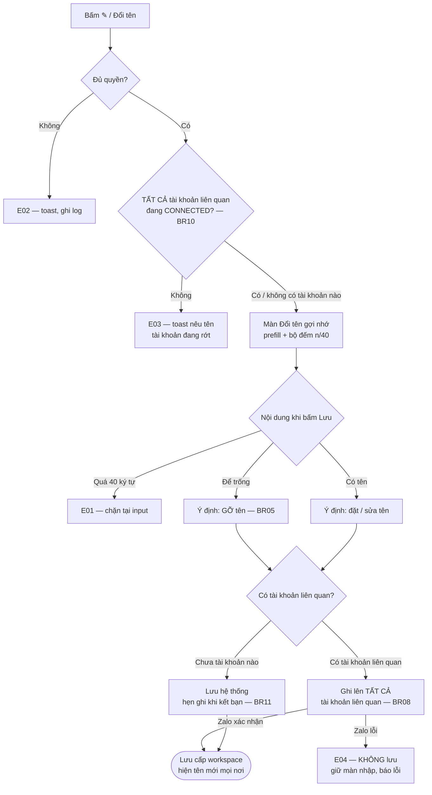

# [G032] Đổi tên gợi nhớ

| Trường | Nội dung |
|--------|----------|
| **Feature ID** | **G032** |
| **Tên** | Đổi tên gợi nhớ cho liên hệ (hội thoại cá nhân) |
| **Module** | Chat / Chăm sóc khách hàng |
| **Owner (BA)** | Trân (BA) |
| **Dev assignee** | — |
| **Priority** | Cao — khách yêu cầu |
| **Version** | **1.0** |
| **Status** | Draft |
| **Last updated** | 2026-09-22 |

---

## 1. Tổng quan (Overview)

Cho phép đặt **tên gợi nhớ** thay tên Zalo của khách ở mọi nơi hiển thị. Zalo bắt đặt **tên thật** nên tên khách hiện lên thường không cho biết đó là khách nào trong công việc — tên gợi nhớ giải quyết việc đó.

| Mục | Nội dung |
|---|---|
| **Bản chất** | **Zalo-native** — ghi vào **tên gợi nhớ** của Zalo, thứ chỉ chủ tài khoản Zalo thấy |
| **Phạm vi** | **Chỉ hội thoại cá nhân.** Đổi **tên nhóm** không thuộc tài liệu này — xem **G008 UC-04** |
| **Ai đổi được** | Nhân sự có quyền xem hội thoại **hoặc** danh bạ (BR06) |
| **Ai nhìn thấy** | Cả workspace, và hiện trên app Zalo của chính nhân sự. **Khách không thấy** |

**Use Case Description:**
> Là **nhân sự CSKH**, tôi muốn đặt tên gợi nhớ cho khách để nhìn danh sách hội thoại là biết ngay ai — và tên đó cũng hiện khi tôi mở app Zalo.

**Người dùng mục tiêu:** **Admin/Owner · Nhân sự quản lý · Nhân sự**.

**Nền tảng:** Web · Android · iOS — hành vi, chuỗi và giới hạn **đồng nhất**, chỉ cách trình bày được khác (BR14).

**Phụ thuộc:** **G001** (trạng thái tài khoản Zalo), **G002** (phân quyền), **G003** (Chat), **G006** (đồng bộ danh bạ — mang tên gợi nhớ từ Zalo về), **G007** (Danh bạ & kết bạn), **G011** (panel phải), **G017** (tìm kiếm).

**Cross-reference:** nghiệp vụ đổi tên liên hệ trước nằm rải ở **G011** và **G007** nay gom về đây; hai Spec đó chỉ còn giữ **entry point**. Chiều **Zalo → hệ thống** do **G006** lo (BR09). Đổi **tên nhóm** thuộc **G008**.

---

## 2. Điều kiện tiên quyết & Trigger

**Trigger:** bấm icon **✎** cạnh tên trên panel phải của hội thoại cá nhân, hoặc chọn **Đổi tên** trong menu Option của card Danh bạ.

> **Tài khoản liên quan** *(dùng xuyên suốt tài liệu)* = tài khoản Zalo **đã kết bạn** với liên hệ đó **và** đang tồn tại trong workspace. **Không** tính tài khoản chưa kết bạn và **không** tính tài khoản đã bị xóa (DELETED).

**Pre-conditions:**
- [ ] Người dùng đã đăng nhập và thuộc workspace
- [ ] Có quyền xem hội thoại **hoặc** xem danh bạ chứa liên hệ đó (BR06)
- [ ] **Tất cả tài khoản liên quan** đang **CONNECTED** (BR10)

**Post-conditions:**
- **Liên hệ đã kết bạn:** tên mới **đã ghi lên Zalo thành công** và hiển thị ở mọi nơi trong hệ thống.
- **Liên hệ chưa kết bạn:** tên lưu trong hệ thống và hiển thị bình thường; ghi lên Zalo **ngay khi kết bạn thành công** (BR11).
- Ghi lên Zalo thất bại → **không có gì thay đổi**, tên cũ giữ nguyên ở cả hai nơi (BR08).

---

## 3. Luồng chính (Happy Path)

### UC-01 — Đặt / sửa / gỡ tên gợi nhớ từ panel phải

1. **[Người dùng]** Bấm icon **✎** cạnh tên trên panel phải của hội thoại cá nhân [→ E02, E03]
2. **[Hệ thống]** Mở màn **Đổi tên gợi nhớ**: ô nhập prefill tên hiện tại, nút **⊗** xoá trắng trong ô, bộ đếm `n/40`, nút **Lưu** (§10B)
3. **[Người dùng]** Sửa tên → **Lưu**. Muốn **gỡ tên gợi nhớ** thì xoá trắng ô rồi **Lưu** (BR05) [→ E01]
4. **[Hệ thống]** Chuẩn hóa chuỗi (BR07) → ghi tên lên **tất cả tài khoản liên quan** (BR08) [→ E04, E05, E06, E07]. Liên hệ **chưa kết bạn với tài khoản nào** → không có gì để ghi, hẹn ghi khi kết bạn (BR11)
5. **[Hệ thống]** Lưu tên **cấp workspace** (BR01, BR02), thay tên ở **mọi nơi hiển thị** (BR04), cập nhật realtime mọi client (BR14)

*Use case kết thúc.*

### UC-02 — Đặt / sửa / gỡ tên gợi nhớ từ Danh bạ

1. **[Người dùng]** Vào **Danh bạ** → hover card liên hệ → **Option** → **Đổi tên** [→ E02, E03]
2. **[Hệ thống]** Mở **cùng màn** như UC-01 bước 2, bổ sung dòng chú thích phạm vi (§10C)
3. Các bước tiếp theo **giống UC-01 từ bước 3** — cùng một giá trị, cùng một chỗ lưu (BR02)

*Use case kết thúc.*



> Auto-generated — comment nếu cần sửa logic

---

## 4. Luồng phụ

- **AF01 — Hủy giữa chừng:** bấm **✕** / `Esc` → đóng màn, không lưu. Quay lại bước 1.
- **AF02 — Gỡ tên gợi nhớ:** xoá trắng ô nhập rồi **Lưu** → xoá tên trên hệ thống **và trên tất cả tài khoản Zalo có kết bạn**, mọi nơi về **tên Zalo gốc** (BR05, BR08). Quay lại bước 5 của UC-01.
- **AF03 — Đổi từ hai nơi:** panel và Danh bạ là **cùng một giá trị**, nơi còn lại hiện tên mới ngay (BR02, BR14). Quay lại bước 5 của UC-01.
- **AF04 — Hai nhân sự cùng đổi:** **lần lưu sau thắng** — người lưu sau ghi đè lên Zalo, client của người kia cập nhật ngay, không báo lỗi (BR14). Quay lại bước 5 của UC-01.
- **AF05 — Khách chưa kết bạn:** tên lưu và hiển thị bình thường, **không** ghi lên Zalo lúc này. Khi quan hệ chuyển sang bạn bè bằng **bất kỳ đường nào** (G007), hệ thống **tự ghi tên đang có lên tài khoản vừa kết bạn**; ghi lỗi thì **không báo người dùng**, thử lại ở lần đồng bộ danh bạ kế tiếp (BR11). Quay lại bước 5 của UC-01.
- **AF06 — Có tài khoản liên quan đang mất kết nối:** icon ✎ vẫn hiện, bấm vào ra toast E03 **nêu rõ tài khoản nào đang rớt**, không mở màn nhập. Kết nối lại (G001) rồi thao tác lại. Quay lại bước 1.
- **AF07 — Liên hệ chưa có hội thoại:** đổi tên từ Danh bạ vẫn thực hiện bình thường; hội thoại tạo sau đã có sẵn tên gợi nhớ (BR02). Quay lại bước 1 của UC-02.

---

## 5. Luồng ngoại lệ

| Code | Trigger | UI Response | Notification | Recovery |
|------|---------|-------------|--------------|----------|
| **E01** | Vượt **40 ký tự** *(UC-01 b3)* | **Chặn tại input**, không cho gõ thêm; bộ đếm `40/40` đổi màu cảnh báo | — | — |
| **E02** | **Không có quyền** — thiếu cả quyền xem hội thoại lẫn danh bạ *(UC-01 b1, UC-02 b1)* | Toast: *"Bạn không có quyền thực hiện thao tác này"*. Icon ✎ **ẩn** với người không có quyền (BR-C06) | Ghi log truy cập trái phép | — |
| **E03** | **Có tài khoản liên quan đang DISCONNECTED** *(UC-01 b1, UC-02 b1)* | Toast: *"Tài khoản Zalo «{tên tài khoản}» đang ngắt kết nối. Vui lòng kết nối lại để đổi tên."* — **không mở màn nhập**. Nhiều tài khoản rớt thì nêu tài khoản đầu tiên kèm *"và {n} tài khoản khác"* | — | Kết nối lại (G001) |
| **E04** | **Zalo từ chối hoặc không phản hồi** khi ghi tên *(UC-01 b4)* | **KHÔNG lưu gì cả** — tên cũ giữ nguyên ở cả hệ thống lẫn Zalo. Giữ nguyên màn nhập và nội dung đang gõ. Toast: *"Không đổi được tên. Vui lòng thử lại."* | Ghi error log | Bấm **Lưu** lại |
| **E05** | **Mất mạng** *(bước lưu)* | Toast: *"Mất kết nối, vui lòng thử lại"*; giữ nguyên nội dung đang nhập và màn đang mở | — | Lưu lại khi có mạng |
| **E06** | **Lỗi hệ thống (500)** *(bước lưu)* | Toast: *"Lỗi hệ thống. Vui lòng thử lại sau"*; giữ nội dung đang nhập | Ghi error log | Lưu lại |
| **E07** | **Liên hệ không còn tồn tại** khi lưu | Toast: *"Không tìm thấy liên hệ. Vui lòng tải lại."*; đóng màn nhập | Ghi error log | Tải lại màn hình |

**Confirmation Log:** E01 ← UC-01 b3 · E02/E03 ← UC-01 b1 · UC-02 b1 *(điểm thi hành BR06 và BR10)* · E04/E07 ← UC-01 b4 *(biên giới với Zalo)* · E05/E06 ← độc lập (mạng/server).

---

## 6. Business Rules

| Code | Rule | Lý do |
|------|------|-------|
| **BR01** | **Tên gợi nhớ là dữ liệu DÙNG CHUNG cấp workspace.** Một nhân sự đổi → mọi nhân sự trong workspace thấy tên mới. Không có tên riêng theo từng người | Nhiều nhân sự cùng chăm một khách; mỗi người thấy một tên thì bàn giao và báo cáo lệch nhau. Nhất quán **BR-C16** |
| **BR02** | **MỘT nguồn duy nhất** — tên đặt ở panel phải và ở Danh bạ là **cùng một giá trị**, đổi ở đâu cũng cập nhật cả hai. Không tồn tại hai trường tên riêng | Trước khi có G032, hai Spec cùng mô tả một thứ mà không nơi nào tuyên bố là một |
| **BR03** | Tên gợi nhớ **ghi vào tên gợi nhớ của Zalo** — thứ chỉ **chủ tài khoản Zalo** thấy. **Không** đổi tên thật trên profile khách; khách và người ngoài **không nhìn thấy** | Nhân sự làm việc song song trên app Zalo và trên hệ thống; tên chỉ có ở một nơi thì mất tác dụng ngay khi họ mở điện thoại. Đây cũng là thứ **duy nhất** Zalo cho ghi |
| **BR04** | **Tên gợi nhớ khác trường "Họ tên" trong Hồ sơ khách hàng (G011a)** — Họ tên là thông tin hồ sơ, chỉ nằm trong hệ thống, không đẩy lên Zalo và không thay tên hiển thị. Điền Họ tên **không** làm đổi tên hiển thị, và ngược lại.<br>Tên gợi nhớ **thay tên Zalo ở MỌI nơi hiển thị**: danh sách hội thoại · header chat · panel phải · Danh bạ · kết quả tìm kiếm · danh sách thành viên nhóm · nội dung thông báo | Đổi một chỗ thì không giải quyết được vấn đề nhận diện |
| **BR05** | **Gỡ tên gợi nhớ = xoá trắng ô rồi bấm Lưu** → xoá tên trên hệ thống và trên tất cả tài khoản Zalo, mọi nơi về tên Zalo gốc. **Không** có nút "Gỡ" riêng, và nút **Lưu không disabled** khi ô trống | Bám thao tác Zalo-native (**BR-C15**): ô nhập đã có nút ⊗ xoá trắng. Thêm nút riêng là thêm thành phần Zalo không có |
| **BR06** | **Quyền:** có quyền **xem hội thoại** *hoặc* **xem danh bạ** là đổi được. **KHÔNG** yêu cầu quyền *"Quản lý tài khoản Zalo"* | Nhân sự chat với khách hàng ngày cần đặt tên để làm việc; họ đã thấy toàn bộ nội dung hội thoại rồi. Kế thừa **G007 §2** và **G007 OOS07** |
| **BR07** | Tên gợi nhớ tối đa **40 ký tự** — chặn tại input, màn hiện bộ đếm `n/40`. Khi lưu: **trim** khoảng trắng đầu/cuối và thu gọn khoảng trắng liên tiếp. **Không** giới hạn loại ký tự | 40 là đúng giới hạn Zalo — lưu quá thì ghi lên Zalo thất bại. Không giới hạn loại ký tự vì đây là tên người, nhân sự có thể ghi thêm bối cảnh làm việc tuỳ cách của mình |
| **BR08** | **Một liên hệ có thể là bạn của nhiều tài khoản Zalo trong workspace** (G007 BR04), và Zalo lưu tên gợi nhớ **riêng cho từng tài khoản**. Vì vậy hệ thống **ghi lên tất cả tài khoản liên quan** — tức các tài khoản **đã kết bạn** với liên hệ và **đang tồn tại** trong workspace. Tài khoản **chưa kết bạn** thì không có gì để ghi (xử lý ở BR11); tài khoản **đã xóa (DELETED)** bỏ qua hoàn toàn.<br>**Ghi lên Zalo là điều kiện để lưu:** Zalo xác nhận xong mới lưu vào hệ thống. Thất bại ở **bất kỳ** tài khoản nào → **không lưu gì cả**, báo lỗi để người dùng bấm lại (E04) | Chỉ ghi một tài khoản thì mở app bằng tài khoản khác lại thấy tên cũ. Bắt ghi xong mới lưu để hệ thống và Zalo **không bao giờ có hai giá trị khác nhau** — nhờ vậy không cần bất cứ cơ chế đối chiếu hay bù trừ nào |
| **BR09** | **Zalo là nơi lưu chính thức của tên gợi nhớ.** Chiều **Zalo → hệ thống** do **đồng bộ danh bạ (G006 BR05/BR06)** đảm nhiệm — mang tên gợi nhớ đặt trên app Zalo về và **cập nhật đè** lên hệ thống. G032 **không** viết lại cơ chế này | Việc kéo tên từ Zalo về đã chạy sẵn trong G006. Viết lại ở G032 là hai tài liệu cùng mô tả một việc, chắc chắn lệch nhau về sau. Vì BR08 bắt ghi lên Zalo xong mới lưu nên hai nơi luôn khớp |
| **BR10** | **TẤT CẢ tài khoản liên quan** phải đang **CONNECTED** mới mở được màn đổi tên. Còn tài khoản nào mất kết nối → chặn (E03) và **nêu rõ tên tài khoản đó**. Áp **cả đặt tên lẫn gỡ tên**.<br>**Không xét:** tài khoản **chưa kết bạn** với liên hệ · tài khoản **đã xóa (DELETED)** — tài khoản đã xóa không bao giờ CONNECTED lại nếu không liên kết lại, tính vào thì khóa vĩnh viễn việc đổi tên cho mọi khách của nó | BR08 bắt ghi lên tất cả mới được lưu — nếu cho mở màn khi còn tài khoản rớt thì người dùng bấm Lưu bao nhiêu lần cũng thất bại mà không hiểu vì sao. Chặn ngay từ đầu và nói rõ tài khoản nào thì họ biết phải làm gì |
| **BR11** | **Khách chưa kết bạn vẫn đặt được tên gợi nhớ**, lưu trong hệ thống và hiển thị bình thường; chưa ghi lên Zalo ở thời điểm này.<br>**Kích hoạt ghi:** quan hệ với **một tài khoản bất kỳ** chuyển sang **bạn bè** — bằng **mọi đường**: mình gửi lời mời và khách đồng ý, hay khách gửi lời mời và mình đồng ý (G007) — hệ thống **tự ghi tên đang có lên tài khoản đó**.<br>**Ghi lỗi lúc này:** **không báo người dùng** (họ không thao tác gì để mà báo), thử lại ở lần **đồng bộ danh bạ** kế tiếp.<br>**Liên hệ là bạn của một số tài khoản và chưa là bạn của số còn lại:** ghi lên các tài khoản đã kết bạn, số còn lại chờ tới khi kết bạn được | Khách nhắn đến mà chưa kết bạn là nhóm đông nhất của CSKH, cũng là nhóm cần nhận diện nhất. Chặn họ là bỏ mất phần lớn giá trị tính năng. Đồng bộ danh bạ chỉ chạy trên bạn bè nên không có nguy cơ ghi đè mất tên này |
| **BR12** | **Tìm kiếm chỉ khớp theo tên đang hiển thị** — có tên gợi nhớ thì tìm theo tên gợi nhớ, chưa có thì tìm theo tên Zalo. **Không** tìm song song cả hai | Nhất quán với những gì người dùng nhìn thấy trên màn hình; giữ nguyên cách G017 đang chạy, không phải đụng vào cơ chế tìm kiếm |
| **BR13** | **Hệ thống không bao giờ tự gỡ tên gợi nhớ.** Xóa bạn (G007) · tài khoản Zalo DISCONNECTED hoặc DELETED → tên vẫn hiển thị. Khách **không bao giờ kết bạn** → tên **giữ mãi trong hệ thống**, không tự hết hạn — khách lạ nhắn một lần rồi vài tháng sau quay lại vẫn cần nhận ra. Liên kết lại cùng `companyId + zaloUid` → tên trên Zalo còn nguyên nên đồng bộ danh bạ mang về lại như cũ | Nhất quán **BR-C09** / **BR-C11** / **BR-C13** — hệ thống chỉ thêm/cập nhật, không tự xoá dữ liệu người dùng đặt |
| **BR14** | Đổi tên xong cập nhật **realtime** mọi client (BR-C12); hai người cùng đổi thì **lần lưu sau thắng**, không báo lỗi. **Nền tảng:** hành vi, chuỗi và giới hạn đồng nhất Web · Android · iOS; mobile dùng **bottom sheet**, **Web dùng popup giữa màn** (§10E) | Bottom sheet là quy ước mobile, bê lên màn rộng thì lạ mắt — nhưng chênh lệch **hành vi** giữa các nền tảng mới là lỗi |

---

## 7. State Machine

**N/A** — tên gợi nhớ không có vòng đời trạng thái. Mỗi liên hệ ở một trong ba tình huống:

| Tình huống | Hiển thị | Chuyển sang |
|---|---|---|
| **Chưa có tên gợi nhớ** | Tên Zalo gốc | Đặt tên → *Có tên gợi nhớ* |
| **Có tên gợi nhớ, đã ghi lên Zalo** | Tên gợi nhớ — giống hệt trên app Zalo (BR08) | Sửa → giữ nguyên · Gỡ (AF02) → *Chưa có tên gợi nhớ* |
| **Có tên gợi nhớ, chưa ghi lên Zalo** | Tên gợi nhớ — chỉ trong hệ thống (BR11) | Kết bạn thành công với một tài khoản → hệ thống tự ghi lên tài khoản đó. **Không bao giờ kết bạn → ở lại tình huống này vĩnh viễn**, không tự hết hạn (BR13) |

Tình huống thứ ba **không hiện dấu hiệu gì trên giao diện** — người dùng không cần biết và cũng không làm gì được với nó.

---

## 8. Data Model / 9. API Contract

**N/A — thuần nghiệp vụ.** Cách lưu tên gợi nhớ do kỹ thuật quyết định, miễn thỏa BR01 (một giá trị cấp workspace) và BR02 (một nguồn duy nhất). Điều kiện kỹ thuật chờ **OQ01**.

---

## 10. UI/UX Notes

### 10A — Icon ✎ trên panel phải

```
┌ Thông tin hội thoại ───────── ✕ ┐
│           ( avatar )            │
│                                 │
│      Chị Hồng - Kho Q7    ✎     │
│      (tên Zalo: Nguyễn Văn A)   │
│              🔔                 │
│  ─────────────────────────────  │
│  ▸ Hồ sơ khách hàng      ✎ Sửa  │
│  ▸ Ghi chú nội bộ               │
│  ▸ Nhắc hẹn                     │
│  ▸ Ảnh / Video                  │
│  ▸ Tài liệu                     │
│  ▸ Liên kết                     │
└─────────────────────────────────┘
```

> Panel phải là **một màn cuộn** (G011 BR02). Icon ✎ đặt **cạnh tên** trên Header — đây là **thành phần mới, chưa có trên sản phẩm**, dev cần dựng thêm.
>
> ⚠️ **Không nhầm với nút ✎ Sửa của khối "Hồ sơ khách hàng"** ngay bên dưới (G011a): nút đó sửa **Họ tên · Năm sinh · SĐT · Email** trong hồ sơ nội bộ, **không** đổi tên hiển thị và **không** ghi lên Zalo.

| Thành phần | Quy định |
|---|---|
| **Tên hiển thị** | Tên gợi nhớ nếu có; chưa có thì tên Zalo (BR04). Dài quá thì cắt bằng `…`, giữ icon ✎ luôn nhìn thấy |
| **Dòng phụ** | Khi **có** tên gợi nhớ, hiện dòng nhỏ mờ *"(tên Zalo: {tên gốc})"* — để đối chiếu khi khách nhắc tên thật |
| **Icon ✎** | Luôn hiện với người có quyền (BR06); hội thoại **nhóm** không dùng icon này — đổi tên nhóm xem **G008** |

### 10B — Màn Đổi tên gợi nhớ *(bám Zalo-native)*

```
┌──────────────────────────────────────┐
│        Đổi tên gợi nhớ           ✕   │
├──────────────────────────────────────┤
│  Nguyễn Văn A             ⊗   13/40  │
│  ──────────────────────────────────  │
│                                      │
│         [        Lưu        ]        │
└──────────────────────────────────────┘
```

| Thành phần | Quy định |
|---|---|
| **Tiêu đề · nút đóng** | *"Đổi tên gợi nhớ"* · **✕** góc phải, đóng không lưu (AF01). **Không có** nút "Hủy" dạng chữ |
| **Ô nhập** | Một dòng, gạch chân, prefill tên gợi nhớ hiện tại *(chưa có thì tên Zalo)* |
| **Nút ⊗ trong ô** | Xoá trắng toàn bộ. Xoá trắng rồi **Lưu** = **gỡ tên gợi nhớ** (BR05, AF02) |
| **Bộ đếm** | `n/40` góc phải ô, cập nhật theo từng ký tự; chạm 40 đổi màu cảnh báo và chặn gõ thêm (BR07, E01) |
| **Nút Lưu** | **Full-width**, màu chính, dưới cùng. **Không** disabled khi ô trống |
| **Trình bày** | Mobile: **bottom sheet**. Web: **popup giữa màn** — xem **§10E** (BR14) |

### 10C — Mở từ Danh bạ

Dùng **đúng màn 10B**, mở từ menu **Option** của card liên hệ, bổ sung **một dòng chú thích** dưới ô nhập:

> *"Tên này áp dụng cho cả nhóm nhân sự, và hiện cả trên app Zalo. Khách không nhìn thấy."*

Dòng này **bắt buộc** và phải nói đủ **ba ý**: dùng chung cả team (BR01) · hiện trên app Zalo (BR03) · **khách không nhìn thấy** (BR03). Thiếu ý thứ ba thì nhân sự ngại đặt tên thẳng thắn vì tưởng khách đọc được.

### 10D — Hiển thị mặc định

| Tình huống | Hiển thị |
|---|---|
| Chưa có tên gợi nhớ | **Tên Zalo gốc**, không dòng phụ, không chữ *"Chưa đặt tên"* |
| Tên Zalo rỗng | Hiển thị **số điện thoại** nếu có — nhất quán G003 §10B |
| Chưa kết bạn nên chưa ghi lên Zalo | Hiển thị **bình thường**, không icon, không nhãn (BR11) |

### 10E — Bản Web

Trên Web, màn §10B dựng thành **popup giữa màn** (BR14). **Nội dung, chuỗi hiển thị, giới hạn ký tự và hành vi nút giữ nguyên hệt bản mobile** — chỉ khác cách đặt khung.

**E1 — Vị trí icon ✎ trong layout 3 cột** *(G003 §10A)*

```
┌ Chat ───────────────────────────────────────────────────────┐
│ Hội thoại      │ Khung chat             │ Thông tin      ✕  │
│                │                        │     (avatar)      │
│ ▸ Chị Hồng     │                        │  Chị Hồng    ✎    │
│ ▸ Anh Nam      │        ...             │  (tên Zalo: ...)  │
│                │                        │  ▸ Hồ sơ khách    │
│                │                        │  ▸ Ghi chú nội bộ │
└────────────────┴────────────────────────┴───────────────────┘
```

**E2 — Popup Đổi tên gợi nhớ**

```
       ┌──────────────────────────────────────┐
       │  Đổi tên gợi nhớ                 ✕   │
       ├──────────────────────────────────────┤
       │  Nguyễn Văn A          ⊗     13/40   │
       │  ──────────────────────────────────  │
       │                                      │
       │        [         Lưu         ]       │
       └──────────────────────────────────────┘
```

| Điểm | Quy định bản Web |
|---|---|
| **Dạng khung** | Popup giữa màn, nền phía sau làm mờ. Bề rộng cố định ~**420px**, cao theo nội dung |
| **Cách đóng** | Nút **✕** · phím **Esc** · click ra nền mờ — cả ba đều là **đóng không lưu** (AF01) |
| **Nút Lưu** | Một nút chiếm hết bề ngang, đặt dưới cùng. **Không** có nút Hủy — giống mobile |
| **Giữ nguyên hệt mobile** | Tiêu đề · chuỗi chú thích · giới hạn **40** ký tự · bộ đếm `n/40` · nút **⊗** xoá trắng · nút Lưu **không disabled khi ô trống** |

> Khác biệt duy nhất được phép giữa Web và mobile là **vị trí và kích thước khung**. Mọi thứ khác lệch đi đều là lỗi (BR14).

---

## 11. Acceptance Criteria

**Phạm vi dùng chung & một nguồn**
- [ ] Nhân sự A đổi tên → nhân sự B **cùng workspace** thấy tên mới (AC-BR01)
- [ ] Nhân sự ở **workspace khác** không thấy tên gợi nhớ này (AC-BR01, BR-C01)
- [ ] Đổi ở **panel phải** → Danh bạ hiện tên mới, và ngược lại (AC-BR02/AF03)
- [ ] Không tồn tại hai trường tên gợi nhớ riêng cho panel và Danh bạ (AC-BR02)

**Hành vi & giới hạn**
- [ ] Đặt tên → mở **app Zalo trên điện thoại** thấy đúng tên đó (AC-BR03)
- [ ] **Tên thật trên profile khách KHÔNG đổi**; khách và người ngoài không thấy (AC-BR03)
- [ ] Tên gợi nhớ thay tên Zalo ở: danh sách hội thoại · header chat · panel · Danh bạ · tìm kiếm · danh sách thành viên nhóm · thông báo (AC-BR04)
- [ ] Panel hiện dòng *"(tên Zalo: …)"* khi có tên gợi nhớ (AC-10A)
- [ ] Điền **Họ tên** trong Hồ sơ khách hàng (G011a) → **KHÔNG** làm đổi tên hiển thị ở danh sách hội thoại (AC-BR04)
- [ ] Đặt **tên gợi nhớ** → **KHÔNG** làm đổi trường Họ tên trong Hồ sơ khách hàng (AC-BR04)
- [ ] Gõ tới **40 ký tự** → chặn, bộ đếm `40/40` đổi màu (AC-BR07/E01)
- [ ] `"  Chị  Hồng  "` → lưu thành `"Chị Hồng"` (AC-BR07)

**Gỡ tên**
- [ ] **Xoá trắng ô rồi Lưu** → mọi nơi về tên Zalo gốc, tên trên **tất cả** tài khoản Zalo bị xoá (AC-BR05/AF02)
- [ ] Nút **Lưu KHÔNG disabled** khi ô trống (AC-BR05/10B)
- [ ] **Không** có nút "Gỡ tên gợi nhớ" riêng trên giao diện (AC-BR05)

**Quyền**
- [ ] Nhân sự **chỉ có quyền xem hội thoại** → vẫn đổi được (AC-BR06)
- [ ] Nhân sự **chỉ có quyền xem danh bạ** → vẫn đổi được (AC-BR06)
- [ ] **KHÔNG** yêu cầu quyền *"Quản lý tài khoản Zalo"* (AC-BR06)
- [ ] Không có cả hai quyền → không thấy icon ✎; gọi API thẳng → từ chối + ghi log (AC-E02)

**Ghi lên Zalo**
- [ ] Liên hệ là bạn của **3 tài khoản Zalo** → đặt tên một lần, mở app bằng **cả 3** đều thấy tên mới (AC-BR08)
- [ ] Zalo từ chối ghi → **hệ thống KHÔNG lưu**, tên cũ giữ nguyên, màn nhập vẫn mở kèm thông báo lỗi (AC-BR08/E04)
- [ ] Sau khi Zalo từ chối, bấm **Lưu** lại → thực hiện bình thường (AC-E04)
- [ ] **Không** tồn tại trạng thái hệ thống một tên, Zalo một tên khác *(với liên hệ đã kết bạn)* (AC-BR08/§7)

**Điều kiện kết nối**
- [ ] Liên hệ là bạn của 3 tài khoản, **một tài khoản DISCONNECTED** → bấm ✎ ra toast E03 **nêu đúng tên tài khoản đang rớt**, không mở màn nhập (AC-BR10/E03/AF06)
- [ ] Liên hệ là bạn của tài khoản A, **chưa kết bạn** với tài khoản B → B **không** bị xét điều kiện CONNECTED; ghi tên lên A bình thường (AC-BR10/BR11)
- [ ] Tài khoản Zalo **đã xóa (DELETED)** từng kết bạn với liên hệ → **không** chặn việc đổi tên (AC-BR10)
- [ ] **Tất cả** tài khoản CONNECTED → mở màn bình thường (AC-BR10)
- [ ] **Gỡ tên** áp cùng điều kiện kết nối với đặt tên (AC-BR10)

**Khách chưa kết bạn**
- [ ] Khách **chưa kết bạn** → vẫn đặt được tên gợi nhớ, hiển thị bình thường (AC-BR11)
- [ ] Đặt tên cho khách chưa kết bạn → **không** bị chặn bởi điều kiện CONNECTED (AC-BR11/BR10)
- [ ] **Khách gửi lời mời và mình đồng ý** → hệ thống tự ghi tên lên Zalo (AC-BR11)
- [ ] **Mình gửi lời mời và khách đồng ý** → hệ thống tự ghi tên lên Zalo (AC-BR11)
- [ ] Ghi tên lúc kết bạn **thất bại** → **không** hiện thông báo lỗi cho người dùng; lần đồng bộ danh bạ kế tiếp ghi lại (AC-BR11)
- [ ] Khách **không bao giờ kết bạn** → tên gợi nhớ **vẫn còn** sau nhiều tháng, không tự xóa (AC-BR13)
- [ ] Trước khi kết bạn, giao diện **không** hiện dấu hiệu "chưa đồng bộ" nào (AC-BR11/10D)

**Tìm kiếm**
- [ ] Liên hệ **có** tên gợi nhớ → gõ tên gợi nhớ **ra kết quả**; gõ tên Zalo gốc **không ra** (AC-BR12)
- [ ] Liên hệ **chưa có** tên gợi nhớ → gõ tên Zalo ra kết quả bình thường (AC-BR12)

**Bảo toàn dữ liệu**
- [ ] **Xóa bạn** (G007) → tên gợi nhớ vẫn hiển thị (AC-BR13)
- [ ] Tài khoản **DELETED** rồi liên kết lại cùng `companyId + zaloUid` → đồng bộ danh bạ mang tên gợi nhớ về lại như cũ (AC-BR13)
- [ ] Đặt tên gợi nhớ **trên app Zalo** → chạy đồng bộ danh bạ → hệ thống hiện tên đó (AC-BR09, G006 BR05/BR06)

**Nền tảng**
- [ ] **Web** dùng popup giữa màn, bề rộng ~420px, nền sau làm mờ (AC-BR14/10E)
- [ ] Web: **✕**, phím **Esc** và click ra nền mờ — cả ba đều đóng **không lưu** (AC-10E/AF01)
- [ ] Web giữ nguyên chuỗi, giới hạn 40, bộ đếm, hành vi nút Lưu như mobile (AC-BR14/10E)
- [ ] Không có chênh lệch **hành vi** giữa Web · Android · iOS (AC-BR14)
- [ ] Đổi tên → mọi client cập nhật ngay, **không cần reload** (AC-BR14)
- [ ] Hai nhân sự cùng lưu → lần lưu sau thắng, không hiện lỗi (AC-BR14/AF04)

**Ngoại lệ chung**
- [ ] Mất mạng khi lưu → toast + giữ nguyên nội dung đang nhập (AC-E05)
- [ ] Liên hệ đã bị xóa khi bấm Lưu → toast + đóng màn (AC-E07)

---

## 12. Out of Scope

| # | Nội dung | Ghi chú |
|---|---|---|
| **OOS01** | **Đổi tên nhóm** | Thuộc **G008 UC-04 / BR05b**. G032 chỉ làm hội thoại cá nhân |
| **OOS02** | Tên gợi nhớ **riêng theo từng nhân sự** | Đã chốt dùng chung workspace (BR01) |
| **OOS03** | **Gợi ý / tự ghép tên kèm số điện thoại** khi mở màn đổi tên | Prefill giữ nguyên tên hiện tại; nhân sự tự gõ phần bối cảnh |
| **OOS04** | **Lịch sử ai đổi tên, đổi lúc nào** | Cân nhắc phase sau nếu phát sinh tranh chấp |
| **OOS05** | **Cơ chế kéo tên từ Zalo về** | Đã có ở **G006 BR05/BR06** — G032 không viết lại (BR09) |
| **OOS06** | **Tìm kiếm theo tên Zalo gốc** khi liên hệ đã có tên gợi nhớ | Đã chốt chỉ tìm theo tên đang hiển thị (BR12) |
| **OOS07** | Đổi **avatar** liên hệ | Do Zalo quản lý (BR-C10) |
| **OOS08** | Đổi tên **hàng loạt** / import từ Excel | — |
| **OOS09** | Đổi **tên thật trên profile Zalo** của khách | Zalo không cho phép — chỉ ghi được tên gợi nhớ (BR03) |

---

## 13. Dependencies

**Phụ thuộc vào**

| Spec | Nội dung |
|---|---|
| **G001 — Liên kết tài khoản Zalo** | Trạng thái CONNECTED/DISCONNECTED (BR10) · liên kết lại cùng `companyId + zaloUid` (BR13) |
| **G002 — Phân quyền tài khoản Zalo** | Xác định nhân sự thấy được hội thoại/danh bạ nào (BR06) |
| **G003 — Chat** | Nơi hiển thị tên ở danh sách hội thoại và header chat (BR04) |
| **G006 — Đồng bộ dữ liệu** | **Mang tên gợi nhớ từ Zalo về hệ thống** (BR05/BR06) — là toàn bộ chiều Zalo → hệ thống của G032 (BR09) |
| **G007 — Kết bạn / Danh bạ** | Entry point menu Option (UC-02) · danh sách tài khoản Zalo có chung bạn bè (BR08, theo G007 BR04) · **sự kiện kết bạn thành công** kích hoạt ghi tên lên Zalo (BR11) |
| **G011 — Panel Thông tin** | Vị trí icon ✎ trên Header của panel phải (§10A, G011 BR02) |
| **G017 — Tìm kiếm hợp nhất** | Tìm theo tên đang hiển thị (BR12) |

**Được phụ thuộc bởi**

| Spec | Nội dung |
|---|---|
| **G003 · G007 · G008 · G011 · G017 · G020** | Mọi nơi hiển thị tên liên hệ lấy tên gợi nhớ trước, tên Zalo sau (BR04) |
| **G022 · G027 · G029** | Nội dung thông báo dùng tên hiển thị theo BR04 |

---

## 14. Open Questions

| # | Câu hỏi | Người quyết định | Trạng thái |
|---|---|---|---|
| **OQ01** | **Hub/Zalo có API GHI tên gợi nhớ của liên hệ không?** Không có thì BR03/BR08 bất khả thi, phải quay về phương án tên chỉ lưu nội bộ hệ thống. *(Chiều đọc đã có sẵn — G006 đang mang tên gợi nhớ về.)* | Dev / hub | ⏳ **Chờ dev — chặn build** |
| **OQ02** | **Ghi được tên gợi nhớ cho người CHƯA kết bạn không?** Nếu Zalo cho thì BR11 bỏ được vế "hẹn ghi khi kết bạn" — ghi luôn như mọi liên hệ khác, tài liệu gọn thêm một tình huống | Dev / hub | ⏳ Chờ dev |

---

## 15. Performance & Scalability

| Mục | Yêu cầu |
|---|---|
| **Ghi tên lên Zalo** | Liên hệ là bạn của nhiều tài khoản thì ghi **song song**; toàn bộ hoàn tất trong ≤ **3 giây**, quá thì coi là lỗi và bắn E04 |
| **Màn đổi tên** | Nút **Lưu** chuyển trạng thái đang xử lý ngay khi bấm, chặn bấm lặp |
| **Lan truyền realtime** | Mọi client đang mở thấy tên mới trong ≤ **3 giây** (BR14) |

---

## 16. Rollout & Migration

| Mục | Nội dung |
|---|---|
| **Rollout strategy** | Phát hành đồng thời cả hai entry point (panel + Danh bạ) — BR02 chỉ có ý nghĩa khi cả hai cùng trỏ về một nguồn |
| **Data migration** | **Không cần làm gì.** Tên gợi nhớ nhân sự đã đặt sẵn trên app Zalo vốn đã về hệ thống qua **đồng bộ danh bạ (G006)**; G032 chỉ bổ sung đường đặt tên **từ hệ thống lên Zalo** |
| **Breaking change** | **Có** — tên gợi nhớ vốn do từng người đặt trên máy mình, nay thành **dữ liệu dùng chung cả team** và nhân sự khác sửa được |
| **User communication** | Báo cho nhân sự CSKH **trước khi phát hành**: (1) tên gợi nhớ **dùng chung cả team**, không phải ghi chú riêng; (2) đặt trong hệ thống thì **hiện luôn trên app Zalo**, nhưng **khách không nhìn thấy**; (3) sau khi đặt tên gợi nhớ thì **tìm kiếm bằng tên Zalo gốc sẽ không ra** — phải tìm bằng tên vừa đặt |
| **Deploy order** | G006 và G007 (đã có) → G032 |

---

## Changelog

| Ngày | Version | Người thay đổi | Sections | Nội dung |
|------|---------|----------------|----------|----------|
| 2026-09-22 | **1.0** | Trân (BA) | Toàn bộ | Tạo G032 — gom nghiệp vụ đổi tên liên hệ từ **G011** và **G007** về một tài liệu. Tên gợi nhớ **dùng chung cấp workspace**, **một nguồn duy nhất**, **ghi lên Zalo xong mới lưu**; chiều Zalo → hệ thống giao cho **G006**. Phạm vi **chỉ hội thoại cá nhân** — đổi tên nhóm thuộc **G008**. Giao diện bám **Zalo-native** |

---

> **Lưu ý cho AI khi đọc spec này:**
> - Spec **thuần nghiệp vụ** — Section 8 và 9 ghi `N/A`. Không tự thêm data model hay API contract.
> - **Phạm vi:** chỉ **hội thoại cá nhân**. Đổi **tên nhóm** là của **G008 UC-04**, không thuộc tài liệu này.
> - **BR01:** tên gợi nhớ là dữ liệu **dùng chung cấp workspace**, KHÔNG phải ghi chú riêng của từng nhân sự.
> - **BR02:** panel phải và Danh bạ đổi **cùng một giá trị**.
> - **BR03:** ghi vào **tên gợi nhớ** của Zalo, chỉ chủ tài khoản Zalo thấy. **KHÔNG** đổi tên thật của khách.
> - **BR05:** gỡ tên = **xoá trắng ô rồi Lưu**. Nút Lưu **không** disabled khi ô trống, **không** có nút "Gỡ" riêng.
> - **BR08 quan trọng nhất:** ghi lên **tất cả** tài khoản Zalo có kết bạn, và **ghi xong mới lưu**.
> - **BR10 đi kèm BR08:** phải **TẤT CẢ** tài khoản CONNECTED mới mở được màn — còn một tài khoản rớt thì chặn ngay và **nêu tên tài khoản đó**, vì có mở ra cũng không lưu được.
> - **BR11:** khách **chưa kết bạn vẫn đặt được tên**; hệ thống tự ghi lên Zalo khi kết bạn thành công.
> - **BR12:** tìm kiếm **chỉ** khớp tên đang hiển thị. Đặt tên gợi nhớ rồi thì gõ tên Zalo gốc sẽ không ra — đây là chủ ý, phải báo cho người dùng khi phát hành.
> - **OQ01 chặn build:** cần dev/hub xác nhận Zalo **ghi** được tên gợi nhớ.
> - Section 12 (Out of Scope) là danh sách **cấm** — không implement dù có vẻ logic.
> - Section 11 (Acceptance Criteria) là checklist tự verify trước khi báo done.
