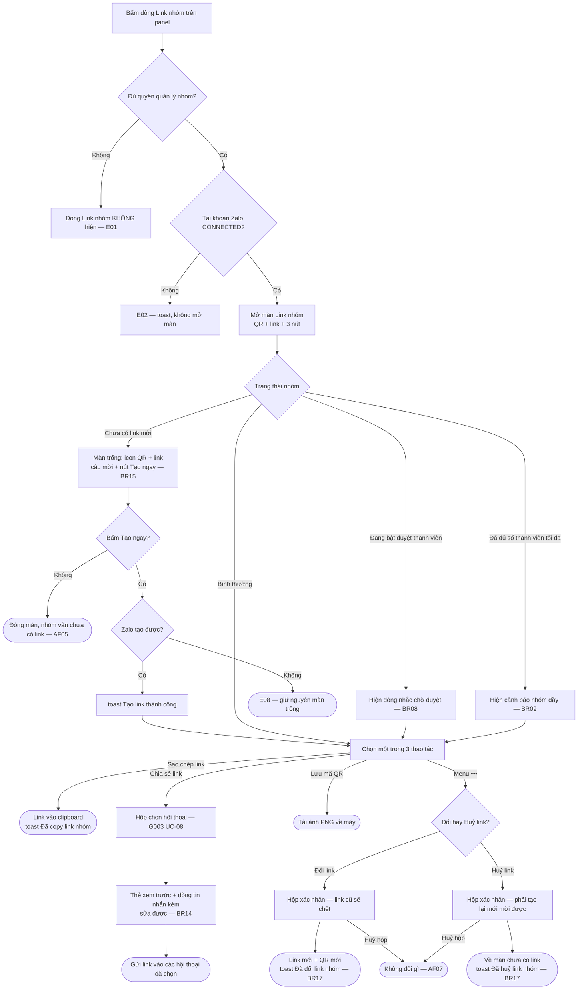
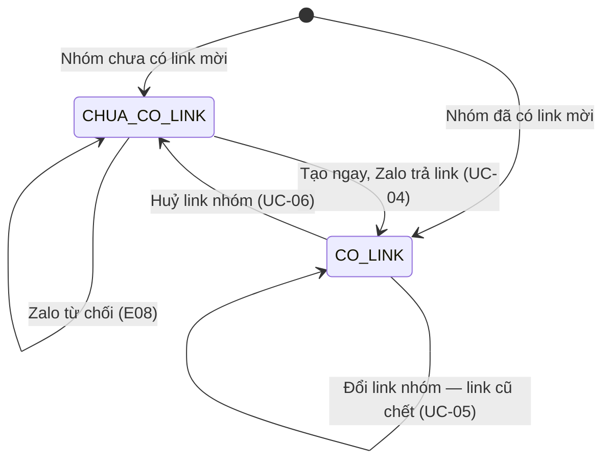

# [G033] Màn Link nhóm — mời bằng QR hoặc link

| Trường | Nội dung |
|--------|----------|
| **Feature ID** | **G033** |
| **Tên** | Màn Link nhóm — mời người vào nhóm bằng mã QR hoặc link |
| **Module** | Chat / Quản lý nhóm |
| **Owner (BA)** | Trân (BA) |
| **Dev assignee** | — |
| **Priority** | **Cao** |
| **Version** | **1.0** |
| **Status** | Draft |
| **Last updated** | **2026-10-02** |

---

## 1. Tổng quan (Overview)

Một màn hiển thị **mã QR và link tham gia nhóm** để mời người ngoài vào nhóm — quét QR khi gặp trực tiếp, gửi link khi ở xa. Mở từ dòng **Link nhóm** trên panel thông tin nhóm.

| Mục | Nội dung |
|---|---|
| **Bản chất** | **Zalo-native** — dùng đúng **link nhóm có sẵn** (G008 BR15); QR chỉ là **cách mã hoá** chính link đó |
| **Khi nhóm chưa có link** | Màn vẫn mở, hiện câu mời và nút **Tạo ngay** (BR15, BR16) |
| **Đổi · huỷ link** | Trong menu `•••` góc phải trên, **có hộp xác nhận** vì link đã phát đi sẽ chết (BR17) |
| **Ai dùng được** | **Admin** và người có **quyền quản lý nhóm** — cùng quyền với link nhóm (BR04) |
| **Người quét / bấm link** | Đi **đúng luồng tham gia hiện có**: chờ duyệt nếu **G026** bật, vào thẳng nếu tắt (BR10) |

**Use Case Description:**
> Là **Admin hoặc người quản lý nhóm**, tôi muốn mở một màn có sẵn **mã QR và link nhóm** để mời người khác vào nhóm — không phải vào màn *Thêm thành viên* chỉ để copy một chuỗi.

**Người dùng mục tiêu:** **Admin/Owner** · **Nhân sự quản lý** có quyền quản lý nhóm.

**Nền tảng:** Web · Android · iOS — hành vi, chuỗi và giới hạn **đồng nhất**, chỉ cách trình bày được khác (BR13).

**Phụ thuộc:** **G008** (link nhóm, quyền quản lý nhóm, giới hạn thành viên) · **G026** (duyệt thành viên) · **G011** (panel — vị trí lối vào) · **G003** (hộp chọn hội thoại, dùng cho *Chia sẻ link*) · **G001** (trạng thái tài khoản Zalo).

**Cross-reference:** **G008 §10C** có dòng *Link nhóm* trên panel — nay trỏ sang G033. **G008 BR15** vẫn là **nguồn link**. G033 có **hai lối vào, cùng một màn**: dòng *Link nhóm* trên panel, và nút **Mời qua link** trong màn *Thêm thành viên* — nút này nay **mở màn G033** thay vì copy thẳng vào clipboard (**G008 BR15 v1.9**; BR01, AF06).

---

## 2. Điều kiện tiên quyết & Trigger

**Trigger:** bấm dòng **Link nhóm** trên panel thông tin nhóm, **hoặc** nút **Mời qua link** trong màn *Thêm thành viên* (BR01, AF06).

**Pre-conditions:**
- [ ] Người dùng là **Admin** hoặc có **quyền quản lý nhóm** (BR04)
- [ ] Đang mở một **hội thoại nhóm** còn tồn tại
- [ ] Tài khoản Zalo của nhóm đang **CONNECTED** (BR11)

**Post-conditions:** người dùng có được link hoặc ảnh QR để gửi đi. **Không thay đổi gì** của nhóm — **trừ ba thao tác người dùng chủ động**: **tạo link** khi nhóm chưa có (BR16, UC-04), **đổi link** và **huỷ link** trong menu `•••` (BR17, UC-05, UC-06).

---

## 3. Luồng chính (Happy Path)

### UC-01 — Mở màn Link nhóm và sao chép link

1. **[Người dùng]** Bấm dòng **Link nhóm** trên panel thông tin nhóm, hoặc nút **Mời qua link** ở màn Thêm thành viên [→ E01, E02, AF06]
2. **[Hệ thống]** Mở **màn Link nhóm** (§10B): avatar + tên nhóm · câu hướng dẫn · **mã QR** · **link dạng chữ** · 3 nút [→ E03, E04, E05, E06]
3. **[Hệ thống]** Nếu nhóm đang bật duyệt thành viên hoặc đã đủ số thành viên tối đa → hiện **dòng nhắc tương ứng** (BR08, BR09) [→ AF05]
4. **[Người dùng]** Bấm **Sao chép link**
5. **[Hệ thống]** Copy link vào clipboard → toast *"Đã copy link nhóm"* (BR03, BR05)

*Use case kết thúc.*

### UC-02 — Chia sẻ link vào một hội thoại

1. **[Người dùng]** Tại màn Link nhóm, bấm **Chia sẻ link**
2. **[Hệ thống]** Mở **màn chia sẻ link** (§10D) — dùng lại hộp chọn hội thoại của chuyển tiếp tin nhắn (**G003 UC-08**), kèm **thẻ xem trước** và **dòng tin nhắn** mặc định *"Truy cập link để tham gia nhóm"* (BR14)
3. **[Người dùng]** Chọn **một hoặc nhiều** hội thoại — **tối đa 99** (G003 BR27); sửa lại dòng tin nhắn nếu muốn → **Gửi**
4. **[Hệ thống]** Gửi vào từng hội thoại đã chọn **một tin nhắn** gồm dòng chữ kèm và link nhóm → toast *"Đã gửi link nhóm"* (BR06, BR14) [→ E05, E06]

*Use case kết thúc.*

### UC-03 — Lưu mã QR

1. **[Người dùng]** Tại màn Link nhóm, bấm **Lưu mã QR**
2. **[Hệ thống]** Tải ảnh QR định dạng **PNG** về máy, tên file theo tên nhóm — `QR - {tên nhóm}.png` (BR07) [→ E07]

*Use case kết thúc.*

### UC-04 — Tạo link cho nhóm chưa có link

1. **[Người dùng]** Mở màn Link nhóm của nhóm **chưa có link mời** → màn hiện hai icon **QR + link**, câu *"Mời bất kỳ ai vào nhóm mà không cần kết bạn"* và nút **Tạo ngay** (BR15, §10F)
2. **[Người dùng]** Bấm **Tạo ngay** — **không có hộp xác nhận** (BR16)
3. **[Hệ thống]** Yêu cầu Zalo tạo link, **chờ Zalo xác nhận** [→ E08, E05, E06]
4. **[Hệ thống]** Zalo trả link → màn **đổi tại chỗ** sang §10B: avatar + tên nhóm · **mã QR** · **link dạng chữ** · ba nút; toast **"Tạo link thành công"** (BR16)

*Use case kết thúc — dùng tiếp UC-01, UC-02, UC-03 bình thường.*

### UC-05 — Đổi link nhóm

1. **[Người dùng]** Tại màn Link nhóm, bấm **`•••`** → chọn **Đổi link nhóm** (BR17, §10G)
2. **[Hệ thống]** Mở **hộp xác nhận** *"Đổi link nhóm?"* kèm câu *"Link cũ sẽ không dùng được nữa. Người đã nhận link cũ phải xin link mới."* [→ AF07]
3. **[Người dùng]** Bấm **Đổi link**
4. **[Hệ thống]** Yêu cầu Zalo sinh link mới, **chờ Zalo xác nhận** [→ E08, E05, E06]
5. **[Hệ thống]** Zalo trả link mới → màn hiện **link mới và mã QR mới**; toast **"Đã đổi link nhóm"**. **Link cũ chết ngay** (BR02, BR17)

*Use case kết thúc.*

### UC-06 — Huỷ link nhóm

1. **[Người dùng]** Tại màn Link nhóm, bấm **`•••`** → chọn **Huỷ link nhóm** (BR17, §10G)
2. **[Hệ thống]** Mở **hộp xác nhận** *"Huỷ link nhóm?"* kèm câu *"Link hiện tại sẽ không dùng được nữa. Muốn mời bằng link thì phải tạo link mới."* [→ AF07]
3. **[Người dùng]** Bấm **Huỷ link**
4. **[Hệ thống]** Yêu cầu Zalo huỷ link, **chờ Zalo xác nhận** [→ E08, E05, E06]
5. **[Hệ thống]** Zalo nhận xong → màn **quay về trạng thái chưa có link** (§10F — icon + câu mời + nút *Tạo ngay*); toast **"Đã huỷ link nhóm"** (BR17)

*Use case kết thúc — tạo lại bằng **UC-04**.*



> Auto-generated — comment nếu cần sửa logic

---

## 4. Luồng phụ (Alternative Flows)

- **AF01 — Đóng màn:** bấm **←** / **✕** / phím `Esc` → về panel thông tin nhóm, không thay đổi gì. Quay lại bước 1.
- **AF02 — Nhóm đang bật duyệt thành viên:** dưới link hiện dòng nhắc *"Nhóm đang bật duyệt thành viên — người tham gia sẽ chờ trưởng nhóm duyệt"* (BR08). Ba thao tác vẫn dùng bình thường. Quay lại bước 4 của UC-01.
- **AF03 — Nhóm đã đủ số thành viên tối đa (G008 BR02):** hiện cảnh báo *"Nhóm đã đủ {số} thành viên — người mới chưa vào được"* — `{số}` là mức tối đa của **loại tài khoản Zalo đang dùng** (cá nhân: 100 · Business: cao hơn) (BR09). Màn **vẫn mở và vẫn lấy được link/QR** để dùng sau. Quay lại bước 4 của UC-01.
- **AF05 — Nhóm chưa có link mời:** màn vẫn mở nhưng **không có QR, không có link, không có ba nút** — thay vào đó là hai icon **QR + link**, câu *"Mời bất kỳ ai vào nhóm mà không cần kết bạn"* và nút **Tạo ngay** (BR15, §10F). Muốn có link thì sang **UC-04**; không thì đóng màn bằng ← / ✕ / `Esc` như bình thường.
- **AF06 — Mở màn từ nút *Mời qua link*:** trong màn *Thêm thành viên* của **G008**, bấm **Mời qua link** → **mở đúng màn Link nhóm này**, không copy thẳng vào clipboard (BR01, **G008 BR15**). Từ đây mọi luật của G033 áp dụng y như khi vào từ panel. Đóng màn → **về lại màn Thêm thành viên**, không nhảy về panel.
- **AF07 — Huỷ hộp xác nhận đổi / huỷ link:** tại hộp xác nhận của **UC-05** hoặc **UC-06**, bấm **Huỷ** / **✕** / phím `Esc` → đóng hộp, **link giữ nguyên như cũ**, màn không đổi gì. Quay lại bước 4 của UC-01.
- **AF08 — Nhóm chưa có link, mở từ nút *Mời qua link*:** vào bằng lối nào thì màn cũng xử như nhau — hiện màn *Tạo ngay* (AF05, AF06). Tạo xong đóng màn vẫn **về lại màn Thêm thành viên**.

---

## 5. Luồng ngoại lệ (Exception Flows)

| Code | Trigger | UI Response | Notification | Recovery |
|------|---------|-------------|--------------|----------|
| **E01** | **Không có quyền** — không phải Admin và không có quyền quản lý nhóm | **Ẩn hoàn toàn dòng Link nhóm** trên panel (BR-C06). Gọi API thẳng → từ chối | Ghi log truy cập trái phép | — |
| **E02** | **Tài khoản Zalo DISCONNECTED** *(UC-01 b1)* | Toast: *"Tài khoản Zalo đang ngắt kết nối. Vui lòng kết nối lại"* — **không mở màn** | — | Kết nối lại (G001) |
| **E03** | **Zalo không trả được link hoặc QR** *(UC-01 b2)* | Màn mở nhưng vùng QR và link hiện: *"Không lấy được link nhóm. Vui lòng thử lại."* + nút **Thử lại**. Ba nút thao tác **disable** | Ghi error log | Bấm **Thử lại** |
| **E04** | **Nhóm đã giải tán / người dùng đã rời nhóm** *(UC-01 b2)* | Toast: *"Nhóm không còn tồn tại"*; đóng màn, panel tải lại | Ghi error log | — |
| **E05** | **Mất mạng** *(mọi bước)* | Toast: *"Mất kết nối, vui lòng thử lại"*; giữ nguyên màn đang mở | — | Thử lại khi có mạng |
| **E06** | **Lỗi hệ thống (500)** *(mọi bước)* | Toast: *"Lỗi hệ thống. Vui lòng thử lại sau"* | Ghi error log | Thử lại |
| **E07** | **Tải ảnh QR thất bại** *(UC-03 b2)* | Toast: *"Không tải được mã QR. Vui lòng thử lại."*; màn giữ nguyên | Ghi error log | Bấm lại **Lưu mã QR** |
| **E08** | **Zalo từ chối thao tác link** *(UC-04 b3 · UC-05 b4 · UC-06 b4)* — người bấm **không phải trưởng nhóm hoặc phó nhóm** trên Zalo, hoặc Zalo chặn vì lý do khác | Toast theo việc đang làm: *"Không tạo được link nhóm…"* · *"Không đổi được link nhóm…"* · *"Không huỷ được link nhóm…"*, cùng đuôi *"Vui lòng kiểm tra lại trên app Zalo"*. Màn **giữ nguyên trạng thái trước đó**, thao tác bấm lại được | Ghi error log **kèm nguyên văn mã lỗi Zalo** | Bấm lại, hoặc làm trên app Zalo |

**Confirmation Log:** E01/E02 ← UC-01 b1 *(điểm thi hành BR04, BR11)* · E03/E04 ← UC-01 b2 · E07 ← UC-03 b2 · E05/E06 ← độc lập (mạng/server).

---

## 6. Business Rules

| Code | Rule | Lý do |
|------|------|-------|
| **BR01** | **Hai lối vào, cùng một màn.** ❶ **G033 tự khai dòng "Link nhóm"** trong nhóm dòng chức năng của panel thông tin nhóm (**G011 BR02b**). ❷ Nút **Mời qua link** trong màn *Thêm thành viên* (**G008 BR15**). **Cả hai đều MỞ MÀN Link nhóm**, không copy thẳng vào clipboard. Đóng màn thì **về đúng chỗ vừa đi ra** (AF01, AF06) | Người dùng cần **nhìn thấy link** trước khi gửi, và cần chỗ để đặt mã QR. Bám cách Zalo-native làm. Dòng trên panel do chính G033 khai để thêm tính năng không phải sửa G011. Nút *Mời qua link* **đổi hành vi** thay vì giữ nguyên: cùng một việc *"lấy link nhóm"* mà hai chỗ làm hai kiểu thì người dùng không đoán được chỗ nào ra gì — mà màn *Thêm thành viên* đúng là nơi người ta nghĩ tới việc mời, nên không bỏ lối đó đi |
| **BR02** | **Mã QR chứa đúng link nhóm** — không sinh đường tham gia thứ hai. Link đổi thì QR đổi theo. **Hình thức mã theo nguồn cấp (gắn với OQ01):** Zalo trả về ảnh QR → **dùng nguyên ảnh đó**, kể cả logo Zalo ở giữa; hệ thống **tự sinh** từ chuỗi link → **mã trơn, KHÔNG chèn logo Zalo** | Hai đường tham gia độc lập sẽ kéo theo hai vòng đời, hai chỗ thu hồi, hai nơi phải đối soát — không đáng cho một việc chỉ là "mời vào nhóm" |
| **BR03** | Dùng **đúng link có sẵn của nhóm** (**G008 BR15**). Hệ thống **không tự tạo, không tự đổi, không tự huỷ** link — mỗi lần mở màn vẫn ra **đúng link cũ**. Link chỉ đổi khi **người dùng chủ động** bấm *Tạo ngay* (BR16) hoặc *Đổi link* / *Huỷ link* (BR17) | Link đã phát đi rồi vẫn phải dùng được. Tự tạo mới mỗi lần mở màn thì link cũ chết, người nhận bấm vào không vào được — mà họ không hề biết vì sao |
| **BR04** | **Quyền trên Gopany quyết định ai THẤY dòng *Link nhóm*:** **Admin** hoặc nhân sự được cấp quyền **"Quản lý nhóm"** (**G008 BR06**). Không có quyền → **ẩn hoàn toàn** dòng đó trên panel (**BR-C06**).<br>**Vai trò trên Zalo** *(trưởng nhóm · phó nhóm · thành viên thường)* **không phải điều kiện của Gopany** — Zalo có trả link hay không là việc của Zalo; Zalo từ chối thì rơi vào **E03** | Hai thứ khác trục: **Gopany quyết ai thấy, Zalo quyết có trả link không**. Trộn lại thì phải đặt luật cho điều **chưa đo được** — hiện chưa biết Zalo có chặn thành viên thường hay không (**OQ02**) |
| **BR05** | **Thao tác trên màn đổi theo trạng thái link, bám đúng Zalo-native:**<br>**❶ Nhóm đã có link** — ba nút hàng ngang **Sao chép link · Chia sẻ link · Lưu mã QR**, cộng menu **`•••`** góc phải trên chứa **Đổi link nhóm** và **Huỷ link nhóm** (BR17, §10G).<br>**❷ Nhóm chưa có link** — **không có nút nào trong ba nút trên và không có `•••`**; chỉ một nút **Tạo ngay** giữa màn (BR15, §10F).<br>Ngoài những thao tác trên **không thêm gì khác** | Zalo bày đúng như vậy: màn chưa có link chỉ có *Tạo ngay*, màn đã có link mới hiện ba nút và `•••`. Ẩn `•••` khi chưa có link vì **không có link thì không có gì để đổi hay huỷ** — hiện ra một menu rỗng chỉ làm người dùng bấm thử rồi hoang mang |
| **BR06** | **Chia sẻ link** → mở **hộp chọn hội thoại**, chọn xong thì gửi link vào các hội thoại đó như một tin nhắn thường. Dùng lại **hộp chọn của chuyển tiếp tin nhắn (G003 UC-08)** **và giữ nguyên mọi luật của nó**: chọn **tối đa 99 hội thoại** một lượt (**G003 BR27**) · chỉ hiện hội thoại người dùng **có quyền xem** (**G003 BR23**) · nhóm bật *"chỉ trưởng nhóm được nhắn tin"* vẫn hiện nhưng **disable** (**G003 BR21**). Bộ lọc tài khoản Zalo **mặc định = tài khoản đang quản lý nhóm** đó, nhưng **đổi được** sang tài khoản khác người dùng có quyền — link gửi đi từ tài khoản nào cũng dùng được | **Đúng cách Zalo đang làm:** app Zalo bấm *Chia sẻ link nhóm* cũng **mở danh sách hội thoại ngay trong app** (có ô tìm kiếm, checkbox, bộ đếm *"Đã chọn: n"*), **không** bật bảng chia sẻ của hệ điều hành. Gửi link cho nhiều người cùng lúc đúng là việc CSKH hay làm; **dùng nguyên luật sẵn có** thì không phát sinh trường hợp mới phải kiểm, và không có hai mức trần khác nhau trên cùng một hộp chọn |
| **BR07** | **Lưu mã QR** → tải ảnh **PNG** về máy, tên file `QR - {tên nhóm}.png` | PNG để gửi email, chèn slide hay in ra đều dùng được. Đặt tên theo nhóm để không lẫn khi lưu nhiều mã |
| **BR08** | Nhóm **đang bật duyệt thành viên** (**G026**) → dưới link hiện dòng nhắc *"Nhóm đang bật duyệt thành viên — người tham gia sẽ chờ trưởng nhóm duyệt"*. Cài đặt tắt thì **không hiện** | Người gửi link biết trước để báo lại cho khách, tránh khách quét xong tưởng hỏng rồi hỏi ngược |
| **BR09** | Nhóm **đã đủ số thành viên tối đa** → hiện cảnh báo *"Nhóm đã đủ {số} thành viên — người mới chưa vào được"*. Màn **vẫn mở, vẫn lấy được link và QR**. **Số tối đa lấy theo giá trị Zalo trả về cho từng nhóm** *(`maxMember`)* — **không ghi cứng ở tài liệu** | Mỗi nhóm một mức khác nhau tuỳ loại tài khoản và chính sách Zalo. Ghi cứng con số là đặt luật cho thứ Zalo đã nói sẵn, và sẽ sai ngay khi Zalo đổi |
| **BR10** | Người **quét QR** hoặc **bấm link** **không vào nhóm ngay**. App Zalo mở **màn xem trước nhóm** — avatar · tên nhóm · số thành viên · *"Nhóm của {tên chủ nhóm}"* · *"Đã tạo {thời gian} trước"* · danh sách **bạn chung đang ở trong nhóm** — và một nút **Tham gia**. Bấm *Tham gia* rồi mới đi **đúng luồng tham gia hiện có**: chờ duyệt nếu **G026** bật, vào thẳng nếu tắt.<br>Toàn bộ màn xem trước này **do app Zalo dựng**, G033 **không** định nghĩa lại và **không** can thiệp (OOS03) | Người nhận cần biết mình sắp vào nhóm nào trước khi bấm — đó là lý do Zalo chèn một bước. Nhân sự CSKH phải nắm bước này để trả lời khách *"bấm link rồi mà sao chưa thấy vào nhóm"*. Luồng sau nút *Tham gia* đã chạy và đã nghiệm thu, viết lại ở đây là hai tài liệu cùng mô tả một việc |
| **BR11** | **Tài khoản Zalo DISCONNECTED** → **không mở được màn** (E02) | Lấy link và QR đều cần gọi Zalo. Nhất quán **BR-C07** |
| **BR13** | **Nền tảng:** hành vi, chuỗi và giới hạn **đồng nhất** Web · Android · iOS. Mobile mở **màn toàn trang** có nút ←; **Web mở popup giữa màn** có nút ✕. **Hai điểm được phép khác vì thuộc về máy, không phải nghiệp vụ:** (1) *Chia sẻ link* — **cả hai nền tảng đều mở danh sách hội thoại trong hệ thống**, đúng như Zalo làm; (2) *Lưu mã QR* — Web tải file vào thư mục tải về, điện thoại lưu vào **thư viện ảnh** | Chênh lệch **cách trình bày** và **nơi máy cất file** là bình thường; chênh lệch **hành vi** mới là lỗi |
| **BR14** | **Màn chia sẻ link** (mở từ *Chia sẻ link*) có thêm hai thành phần, bám Zalo-native: (1) **Thẻ xem trước** cuối màn — **avatar + tên nhóm + link** đang sắp gửi; (2) **Dòng tin nhắn kèm** mặc định *"Truy cập link để tham gia nhóm"*, **sửa được** trước khi gửi.<br>**Tin gửi đi ở dạng THẺ XEM TRƯỚC**, không phải tin chữ thường. Dòng chữ kèm không chứa link thì **Zalo tự nối link vào cuối** — nên xoá trắng dòng chữ thì người nhận **chỉ thấy link** | Khách nhận một đường link trần thường không dám bấm; có câu dẫn thì biết là gì, và nhân sự CSKH hay muốn viết lại theo giọng của mình. Thẻ xem trước để không gửi nhầm link của nhóm khác — nhân sự quản nhiều nhóm, link nhóm nào cũng là một chuỗi ký tự vô nghĩa giống nhau. Dạng thẻ cũng là cách Zalo-native làm |
| **BR15** | **Nhóm chưa có link mời** → màn vẫn mở nhưng là **một màn khác hẳn** (§10F): hai icon **QR + link** ở giữa, câu *"Mời bất kỳ ai vào nhóm mà không cần kết bạn"*, một nút **Tạo ngay**. **Không có** mã QR, **không có** link dạng chữ, **không có** ba nút lấy thông tin, **không có** menu `•••`. Đây là **trạng thái bình thường của nhóm, không phải lỗi** — **không** dùng **E03**, **không** có nút *Thử lại*, **không** hiện ba nút ở dạng mờ.<br>Hệ thống **không bao giờ tự tạo link** khi mở màn (BR03) | Đúng như Zalo bày. Dùng **E03** cho việc này thì tester và người dùng đều tưởng hệ thống lỗi rồi bấm *Thử lại* mãi không ra gì. Hiện ba nút **mờ** cũng sai: người dùng không biết phải làm gì để chúng sáng lên — Zalo thay bằng một câu mời và một nút, nhìn là hiểu. Tự tạo link khi mở màn là đổi dữ liệu nhóm mà người dùng không yêu cầu — trái post-condition |
| **BR16** | **Tạo link ngay trên màn.** Bấm **Tạo ngay** → **gọi Zalo luôn, KHÔNG hộp xác nhận**. Zalo trả link → màn **đổi tại chỗ** sang §10B *(QR + link + ba nút + `•••`)* kèm toast **"Tạo link thành công"**. Zalo từ chối → **không đổi gì trên màn**, bắn **E08**.<br>**Ai bấm được:** đúng những người đã thấy dòng *Link nhóm* (**BR04**) — Gopany **không thêm điều kiện vai trò Zalo**. Trên Zalo chỉ **trưởng nhóm và phó nhóm** đổi được cài đặt nhóm (**G008 BR25** — việc này **không** nằm trong ba đặc quyền riêng của trưởng nhóm), nên thành viên thường bấm sẽ bị **Zalo** từ chối → **E08** | **Không hỏi xác nhận vì không có gì để mất**: nhóm chưa từng có link thì chưa ai đang giữ link cũ, tạo xong vẫn huỷ được bằng **BR17**. Zalo cũng làm đúng vậy — bấm là ra toast *"Tạo link thành công"*. **Ghi lên Zalo xong mới đổi màn** để không hiện một link mà Zalo chưa hề cấp. **Không chặn theo vai trò Zalo ở phía Gopany** vì đúng trục của BR04 — vai trò trên Zalo đổi lúc nào cũng được, chặn trước thì chặn sai người |
| **BR17** | **Đổi link · Huỷ link — trong menu `•••`** góc phải trên, **chỉ có khi nhóm đã có link** (BR05, §10G). Hai mục: **Đổi link nhóm** → Zalo sinh link mới, màn hiện **link mới + QR mới**, toast *"Đã đổi link nhóm"* (UC-05); **Huỷ link nhóm** → màn **quay về trạng thái chưa có link** của §10F, toast *"Đã huỷ link nhóm"* (UC-06).<br>**Cả hai đều BẮT BUỘC qua hộp xác nhận** nói rõ hậu quả, với nút **Huỷ** để thoát (AF07). **Ghi lên Zalo xong mới đổi màn**; Zalo từ chối → **không đổi gì**, bắn **E08**. Điều kiện người bấm **giống BR16**.<br>**Link cũ chết ngay** sau khi đổi hoặc huỷ — người đã nhận link cũ bấm vào sẽ không vào được nhóm; hệ thống **không** báo cho họ và **không** giữ lại link cũ ở đâu | **Đây mới là chỗ cần hộp xác nhận**, không phải lúc tạo: đổi hoặc huỷ làm **chết một link đã phát ra ngoài** — có thể đang nằm trong tin nhắn gửi khách, trong email, trên một tờ rơi đã in. Hành động **không gỡ lại được**, nên phải nói trước hậu quả và cho đường thoát. Không báo cho người giữ link cũ vì hệ thống **không biết link đã đi tới đâu** — đó cũng chính là lý do người ta đổi link |

---

## 7. State Machine

Bản thân **màn** không có vòng đời — mở ra, lấy link hoặc QR, đóng lại. Nhưng **link mời của nhóm** có **hai trạng thái** mà màn này phản ánh, và đi lại được **cả hai chiều**:



> Auto-generated — comment nếu cần sửa logic

| Trạng thái | Màn hiển thị |
|---|---|
| **CHƯA CÓ LINK** | Icon QR + link, câu mời, **nút Tạo ngay**. Không QR, không link, không ba nút, không `•••` (BR15, §10F) |
| **CÓ LINK** | Mã QR và link hiện đủ, **ba nút** dùng được, có menu **`•••`** *(Đổi link · Huỷ link)* (BR05, §10G) |

**Mọi chuyển trạng thái đều do người dùng bấm** — hệ thống không tự tạo, tự đổi hay tự huỷ (BR03). *Đổi link* giữ nguyên trạng thái **CÓ LINK** nhưng **thay chuỗi link và mã QR**, link cũ chết ngay (BR17). Trạng thái đổi **trên app Zalo** trong lúc màn đang mở → màn cập nhật **ngay**, không cần tải lại (**BR-C12**).

*Trạng thái của người tham gia sau khi quét QR / bấm link (chờ duyệt → thành viên) thuộc **G026**.*

---

## 8. Data Model / 9. API Contract

**N/A — thuần nghiệp vụ.** Link nhóm lấy từ G008; cách sinh và lưu mã QR do kỹ thuật quyết định, miễn thỏa **BR02** (QR chứa đúng link) và **BR03** (dùng link có sẵn). Điều kiện kỹ thuật chờ **OQ01**.

---

## 10. UI/UX Notes

### 10A — Lối vào trên panel thông tin nhóm

| Thành phần | Quy định |
|---|---|
| Dòng **Link nhóm** | Trên panel thông tin nhóm (**G008 §10C**). Bấm → **mở màn Link nhóm** (BR01) |
| Nút **Mời qua link** | Trong màn *Thêm thành viên* của **G008** (**BR15**). Bấm → **mở cùng màn Link nhóm**, **không** copy thẳng vào clipboard (BR01, AF06). Đóng màn → về lại màn *Thêm thành viên* |
| Quyền | **Ẩn hoàn toàn** dòng này nếu không có quyền quản lý nhóm (BR04, BR-C06) |

### 10B — Màn Link nhóm

```
┌ ←  Link nhóm            ••• ───┐
│          ( avatar nhóm )       │
│           Nhóm Kho Q7          │
│  Mời mọi người tham gia nhóm   │
│  bằng mã QR hoặc link dưới đây:│
│                                │
│        ▛▀▀▀▜  ██  ▛▀▀▀▜        │
│        ▌ ▣ ▐  ██  ▌ ▣ ▐        │
│        ▙▄▄▄▟ Zalo ▙▄▄▄▟        │
│        ██ ▣▣▣ ██ ▣▣ ██         │
│                                │
│    zalo.me/g/abcxyz1234567     │
│                                │
│   ⧉          ↗          ↓      │
│ Sao chép  Chia sẻ   Lưu mã QR  │
│   link      link               │
└────────────────────────────────┘
```

| Thành phần | Quy định |
|---|---|
| **Tiêu đề · nút quay lại** | *"Link nhóm"* · mobile dùng **←**, Web dùng **✕** (BR13) |
| **Menu `•••`** | Góc phải trên — **Đổi link nhóm** · **Huỷ link nhóm** (BR17, §10G). **Chỉ có ở màn này**, không có ở §10F |
| **Avatar + tên nhóm** | Lấy từ thông tin nhóm; tên dài thì cắt bằng `…` |
| **Câu hướng dẫn** | *"Mời mọi người tham gia nhóm bằng mã QR hoặc link dưới đây:"* — chép đúng chuỗi Zalo đang dùng |
| **Mã QR** | Đặt giữa màn, chứa đúng link bên dưới (BR02). **Hình vẽ trên đây là trường hợp Zalo trả về ảnh QR** *(có logo Zalo ở giữa)*. Nếu hệ thống **tự sinh** từ chuỗi link thì mã **để trơn, không chèn logo Zalo** — theo BR02, chốt cùng **OQ01** |
| **Link dạng chữ** | Hiện **đầy đủ** dạng `zalo.me/g/…`, **tô màu nhấn** như Zalo, người dùng nhìn được trước khi copy. Dài quá thì cắt giữa bằng `…`, vẫn copy đủ |
| **Ba nút** | **Sao chép link** · **Chia sẻ link** · **Lưu mã QR** — hàng ngang, icon trên chữ dưới (BR05) |

### 10C — Dòng nhắc theo trạng thái nhóm

Đặt **ngay dưới link**, chỉ hiện khi đúng tình huống:

| Tình huống | Dòng hiển thị |
|---|---|
| Nhóm bật **duyệt thành viên** (G026) | *"Nhóm đang bật duyệt thành viên — người tham gia sẽ chờ trưởng nhóm duyệt"* (BR08) |
| Nhóm **đủ số thành viên tối đa** (G008 BR02) | ⚠️ *"Nhóm đã đủ {số} thành viên — người mới chưa vào được"* — `{số}` theo loại tài khoản Zalo, **không ghi cứng 100** (BR09) |
| Cả hai cùng đúng | Hiện **cả hai dòng**, cảnh báo nhóm đầy đặt **trên** |
| Bình thường | Không hiện gì |

### 10D — Màn chia sẻ link

```
┌ ✕  Chia sẻ link nhóm ─────────┐
│    Đã chọn: 2                 │
│  ┌──────────────────────────┐ │
│  │ 🔍  Tìm kiếm             │ │
│  └──────────────────────────┘ │
│                               │
│  Trò chuyện gần đây           │
│   ☑  ( )  Khách A             │
│   ☑  ( )  Nhóm Giao hàng Q7   │
│   ☐  ( )  Khách B             │
│   ☐  ( )  Nhóm nội bộ   (mờ)  │
│            XEM THÊM  ›        │
│                               │
│  ┌──────────────────────────┐ │
│  │ ( )  Nhóm Kho Q7         │ │
│  │      zalo.me/g/abcxyz123 │ │
│  └──────────────────────────┘ │
│  Truy cập link để tham gia... │
│                      ( Gửi 2 )│
└───────────────────────────────┘
```

| Thành phần | Quy định |
|---|---|
| **Tiêu đề · đóng** | *"Chia sẻ link nhóm"* · nút **✕** |
| **Bộ đếm** | *"Đã chọn: n"* — theo **G003 §10G**, chạm **99** thì chặn chọn thêm |
| **Ô tìm kiếm · danh sách hội thoại** | Dùng nguyên hộp chọn của **G003 UC-08**: chỉ hiện hội thoại có quyền xem (BR23), nhóm bật *"chỉ trưởng nhóm được nhắn tin"* hiện nhưng **mờ, không tích được** (BR21) |
| **Thẻ xem trước** | Cuối màn — **avatar + tên nhóm + link** sắp gửi (BR14) |
| **Dòng tin nhắn kèm** | Mặc định *"Truy cập link để tham gia nhóm"*, **sửa được**; xoá trắng → gửi chỉ link (BR14) |
| **Nút Gửi** | Hiện số đã chọn — **"Gửi (n)"**; **mờ** khi chưa chọn hội thoại nào (G003 §10G) |

> Tin gửi đi ở **dạng thẻ xem trước** — không phải tin chữ thường. Dòng chữ kèm không chứa link thì **Zalo tự nối link vào cuối** (BR14).

### 10E — Bản Web

Mở **popup giữa màn**, bề rộng ~**420px**, nền phía sau làm mờ. Đóng bằng **✕** · phím **Esc** · click ra nền mờ.

**Giữ nguyên hệt mobile:** tiêu đề · câu hướng dẫn · mã QR · link dạng chữ · ba nút và chuỗi trên nút · menu **`•••`** và hai mục trong đó (§10G) · màn **chưa có link** (§10F) · các dòng nhắc ở §10C · toàn bộ chuỗi trong hộp xác nhận.

> Khác biệt duy nhất được phép giữa Web và mobile là **vị trí và kích thước khung** (BR13).

### 10F — Màn khi nhóm chưa có link mời

```
┌ ←  Link nhóm ──────────────────┐
│                                │
│                                │
│          ▣▣      🔗            │
│          ▣▣                    │
│                                │
│   Mời bất kỳ ai vào nhóm mà    │
│      không cần kết bạn         │
│                                │
│      ┌──────────────────┐      │
│      │     Tạo ngay     │      │
│      └──────────────────┘      │
│                                │
│                                │
└────────────────────────────────┘
```

| Thành phần | Quy định |
|---|---|
| **Hai icon** | **Mã QR** và **mắt xích link** đặt cạnh nhau giữa màn — gợi đúng hai thứ sắp có |
| **Câu mời** | *"Mời bất kỳ ai vào nhóm mà không cần kết bạn"* — chép đúng chuỗi Zalo đang dùng |
| **Nút Tạo ngay** | Nút chính, giữa màn. Bấm → **gọi Zalo luôn, không hộp xác nhận** (BR16) [→ E08] |
| **Không có gì khác** | **Không** avatar/tên nhóm · **không** vùng QR · **không** link dạng chữ · **không** ba nút *(kể cả dạng mờ)* · **không** menu `•••` (BR15, BR05) |
| **Trong lúc chờ Zalo** | Nút chuyển trạng thái đang xử lý, **không bấm được lần hai** |
| **Tạo xong** | Màn **đổi tại chỗ** sang §10B + toast **"Tạo link thành công"**. **Không đóng màn, không bắt mở lại** (BR16) |

> Đây **không phải màn lỗi** — không có thông báo lỗi, không có nút *Thử lại*. Lỗi *"Không lấy được link nhóm"* là **E03**, một màn khác hẳn.

### 10G — Menu `•••` (Đổi link · Huỷ link)

```
┌ ←  Link nhóm            ••• ───┐
│                   ┌──────────────────┐
│    ( QR + link )  │ Đổi link nhóm    │
│                   │ Huỷ link nhóm    │
│                   └──────────────────┘
└────────────────────────────────┘
```

| Thành phần | Quy định |
|---|---|
| **Vị trí** | Góc phải trên màn §10B. **Chỉ có khi nhóm đã có link** — màn §10F không có (BR05) |
| **Đổi link nhóm** | → hộp xác nhận → Zalo sinh link mới → **link + QR đổi tại chỗ**, toast *"Đã đổi link nhóm"* (UC-05, BR17) |
| **Huỷ link nhóm** | → hộp xác nhận → **màn quay về §10F** *(trạng thái chưa có link)*, toast *"Đã huỷ link nhóm"* (UC-06, BR17) |

**Hộp xác nhận — Đổi link** (UC-05 b2):

```
┌ Đổi link nhóm? ───────────────┐
│ Link cũ sẽ không dùng được    │
│ nữa. Người đã nhận link cũ    │
│ phải xin link mới.            │
│                               │
│        ( Huỷ )  ( Đổi link )  │
└───────────────────────────────┘
```

**Hộp xác nhận — Huỷ link** (UC-06 b2):

```
┌ Huỷ link nhóm? ───────────────┐
│ Link hiện tại sẽ không dùng   │
│ được nữa. Muốn mời bằng link  │
│ thì phải tạo link mới.        │
│                               │
│        ( Huỷ )  ( Huỷ link )  │
└───────────────────────────────┘
```

| Thành phần | Quy định |
|---|---|
| **Nút Huỷ · ✕ · `Esc`** | Đóng hộp, **link giữ nguyên như cũ**, màn không đổi gì (AF07) |
| **Nút xác nhận** | Ghi lên Zalo; **chờ Zalo xác nhận mới đổi màn** (BR17) [→ E08] |
| **Trong lúc chờ Zalo** | Nút chuyển trạng thái đang xử lý, **không bấm được lần hai** |

> Hai việc này **không gỡ lại được** — link đã phát ra ngoài sẽ chết ngay. Vì vậy hộp xác nhận là **bắt buộc** và phải **nói rõ hậu quả**, khác hẳn *Tạo ngay* *(không hỏi gì, vì chưa có gì để mất — BR16)*.

---

## 11. Acceptance Criteria

**Lối vào & quyền**
- [ ] Bấm dòng **Link nhóm** trên panel → **mở màn Link nhóm**, **không** copy thẳng vào clipboard (AC-BR01)
- [ ] Bấm **Mời qua link** ở màn Thêm thành viên → **mở cùng màn Link nhóm**, **không** copy thẳng vào clipboard (AC-BR01/AF06, G008 BR15)
- [ ] Vào từ **Mời qua link** rồi đóng màn → **về lại màn Thêm thành viên**; vào từ panel rồi đóng → về **panel** (AC-BR01/AF01/AF06)
- [ ] Hai lối vào cho ra **cùng một link** và cùng một mã QR (AC-BR01/BR03)
- [ ] Admin và người có **quyền quản lý nhóm** → thấy dòng Link nhóm (AC-BR04)
- [ ] **Phó nhóm** thấy dòng Link nhóm và mở được màn, lấy được link/QR (AC-BR04, G008 BR25)
- [ ] Người **không có quyền** → **không thấy** dòng Link nhóm; gọi API thẳng → từ chối + ghi log (AC-BR04/E01)
- [ ] Tài khoản Zalo **DISCONNECTED** → bấm vào ra toast, **không mở màn** (AC-BR11/E02)

**Nội dung màn**
- [ ] Màn hiện đủ: avatar + tên nhóm · câu hướng dẫn · **mã QR** · **link dạng chữ** · **3 nút** (AC-BR05/10B)
- [ ] **Quét mã QR** → ra **đúng link** hiển thị bên dưới (AC-BR02)
- [ ] Mã do **hệ thống tự sinh** → **không có logo Zalo** ở giữa; mã do **Zalo trả về** → giữ nguyên như Zalo cấp (AC-BR02)
- [ ] Mở màn **nhiều lần** → vẫn **cùng một link**, không sinh link mới (AC-BR03)

**Ba thao tác**
- [ ] **Sao chép link** → link vào clipboard + toast *"Đã copy link nhóm"* (AC-BR05)
- [ ] **Chia sẻ link** → mở hộp chọn hội thoại; chọn rồi gửi → link vào từng hội thoại đã chọn như một tin nhắn (AC-BR06/UC-02)
- [ ] Chọn được **nhiều hội thoại**, chạm **99** thì chặn chọn thêm đúng như chuyển tiếp tin nhắn (AC-BR06, G003 BR27)
- [ ] Nhóm bật *"chỉ trưởng nhóm được nhắn tin"* → hiện nhưng **disable** (AC-BR06, G003 BR21)
- [ ] Bộ lọc tài khoản Zalo mở ra **mặc định là tài khoản đang quản lý nhóm** (AC-BR06)
- [ ] **Đổi được** bộ lọc sang tài khoản Zalo khác mình có quyền, gửi link từ tài khoản đó vẫn vào nhóm bình thường (AC-BR06)
- [ ] Màn chia sẻ hiện **thẻ xem trước** đúng **tên nhóm + link** của nhóm đang mở (AC-BR14/10D)
- [ ] Dòng tin nhắn mặc định là *"Truy cập link để tham gia nhóm"* và **sửa được** trước khi gửi (AC-BR14)
- [ ] Tin gửi đi hiện ở **dạng thẻ xem trước**, không phải tin chữ thường (AC-BR14)
- [ ] Sửa dòng tin nhắn rồi gửi → hội thoại đích nhận **đúng chữ đã sửa** kèm link (AC-BR14)
- [ ] **Xoá trắng** dòng tin nhắn rồi gửi → chỉ nhận link (AC-BR14)
- [ ] **Lưu mã QR** → tải file **PNG**, tên `QR - {tên nhóm}.png` (AC-BR07/UC-03)
- [ ] Nhóm **đã có link** → màn có **ba nút** + menu **`•••`**, **không có** nút *Tạo ngay* (AC-BR05)

**Nhóm chưa có link — tạo link**
- [ ] Nhóm **chưa có link mời** → màn hiện **hai icon QR + link**, câu *"Mời bất kỳ ai vào nhóm mà không cần kết bạn"* và nút **Tạo ngay** (AC-BR15/AF05/10F)
- [ ] Trạng thái này **không có** mã QR, **không có** link dạng chữ, **không có** ba nút *(kể cả dạng mờ)*, **không có** menu `•••` (AC-BR15/BR05/10F)
- [ ] Trường hợp này **không** hiện lỗi *"Không lấy được link nhóm"* và **không** có nút *Thử lại* (AC-BR15, khác E03)
- [ ] Mở màn khi nhóm chưa có link → hệ thống **không tự tạo** link (AC-BR03/BR15)
- [ ] Bấm **Tạo ngay** → **không có hộp xác nhận**, gọi Zalo luôn (AC-BR16/UC-04)
- [ ] Zalo trả link → màn **đổi tại chỗ** sang màn đủ QR + link + ba nút + `•••`, kèm toast **"Tạo link thành công"** — **không** phải đóng màn mở lại (AC-BR16/10F)
- [ ] Vào từ **Mời qua link** khi nhóm chưa có link → vẫn ra màn *Tạo ngay*; tạo xong đóng màn → **về lại màn Thêm thành viên** (AC-AF08)
- [ ] Trong lúc chờ Zalo → nút **không bấm được lần hai** (AC-10F)
- [ ] **Zalo từ chối** tạo *(bấm bằng tài khoản chỉ là thành viên thường)* → toast E08, màn **giữ nguyên màn trống**, bấm **Tạo ngay** lại được, log ghi **nguyên văn mã lỗi Zalo** (AC-BR16/E08)
- [ ] **Trưởng nhóm** và **phó nhóm** tạo được link *(việc này không nằm trong ba đặc quyền riêng của trưởng nhóm)* (AC-BR16, G008 BR25)

**Đổi link · Huỷ link (menu `•••`)**
- [ ] Nhóm **đã có link** → có menu **`•••`** với đúng hai mục **Đổi link nhóm** · **Huỷ link nhóm** (AC-BR17/10G)
- [ ] Nhóm **chưa có link** → **không có** menu `•••` (AC-BR05/BR17/10G)
- [ ] **Đổi link nhóm** → ra **hộp xác nhận** nói rõ *"Link cũ sẽ không dùng được nữa"*; **không** đổi ngay khi bấm (AC-BR17/UC-05)
- [ ] Xác nhận đổi → **link và mã QR đổi tại chỗ**, toast *"Đã đổi link nhóm"*; **quét QR mới ra đúng link mới** (AC-BR17/BR02/UC-05)
- [ ] Sau khi đổi → **bấm link cũ không vào được nhóm** (AC-BR17)
- [ ] **Huỷ link nhóm** → ra **hộp xác nhận** nói rõ *"Muốn mời bằng link thì phải tạo link mới"* (AC-BR17/UC-06)
- [ ] Xác nhận huỷ → màn **quay về trạng thái chưa có link** (§10F), toast *"Đã huỷ link nhóm"*; **tạo lại được ngay** bằng *Tạo ngay* (AC-BR17/UC-06)
- [ ] Hộp xác nhận của **cả hai mục**: **Huỷ** / **✕** / `Esc` → **link giữ nguyên như cũ**, màn không đổi gì (AC-AF07)
- [ ] **Zalo từ chối** đổi hoặc huỷ → toast E08 đúng việc đang làm, màn **giữ nguyên trạng thái trước đó** (AC-BR17/E08)
- [ ] Mở màn **nhiều lần** → vẫn **cùng một link**; hệ thống **không tự đổi, không tự huỷ** (AC-BR03)
- [ ] Link bị **đổi hoặc huỷ trên app Zalo** trong lúc màn đang mở → màn cập nhật **ngay**, không cần tải lại (AC-§7, BR-C12)

**Dòng nhắc theo trạng thái nhóm**
- [ ] Nhóm **bật duyệt thành viên** → hiện dòng nhắc chờ duyệt; **ba nút lấy thông tin vẫn dùng bình thường** (AC-BR08/AF02/10C)
- [ ] Nhóm **tắt duyệt thành viên** → **không** hiện dòng đó (AC-BR08)
- [ ] Nhóm **đủ số thành viên tối đa** → hiện cảnh báo, **màn vẫn mở và vẫn lấy được link/QR** (AC-BR09/AF03)
- [ ] Con số trong cảnh báo **lấy đúng giá trị Zalo trả về cho nhóm đó**, **không ghi cứng** ở bất kỳ đâu (AC-BR09)
- [ ] Cả hai tình huống cùng đúng → hiện **cả hai dòng**, cảnh báo nhóm đầy ở trên (AC-10C)

**Luồng tham gia**
- [ ] Quét QR hoặc bấm link → **app Zalo mở màn xem trước nhóm** *(avatar · tên nhóm · số thành viên · "Nhóm của {chủ nhóm}" · "Đã tạo … trước" · bạn chung)* + nút **Tham gia** — **không vào thẳng nhóm** (AC-BR10)
- [ ] Bấm **Tham gia** khi nhóm **tắt duyệt** → vào nhóm ngay (AC-BR10)
- [ ] Bấm **Tham gia** khi nhóm **bật duyệt** → vào hàng chờ duyệt đúng theo **G026** (AC-BR10)
- [ ] Màn xem trước đó **do app Zalo dựng** — Gopany không dựng lại, không can thiệp (AC-BR10/OOS03)
- [ ] Bấm link và quét QR cho **kết quả giống nhau** (AC-BR02/BR10)

**Nền tảng**
- [ ] **Web** mở popup giữa màn ~420px; **✕**, **Esc** và click nền mờ đều đóng, không thay đổi gì (AC-BR13/10E/AF01)
- [ ] Không có chênh lệch **hành vi** giữa Web · Android · iOS (AC-BR13)

**Ngoại lệ**
- [ ] Zalo không trả được link/QR → vùng QR hiện thông báo + nút **Thử lại**, ba nút thao tác **disable** (AC-E03)
- [ ] Nhóm đã giải tán / đã rời nhóm → toast + đóng màn (AC-E04)
- [ ] Mất mạng → toast + **giữ nguyên màn đang mở** (AC-E05)
- [ ] Lỗi hệ thống khi mở màn → toast, màn giữ nguyên, bấm **Thử lại** được (AC-E06)
- [ ] Tải ảnh QR thất bại → toast, màn giữ nguyên (AC-E07)

---

## 12. Out of Scope

| # | Nội dung | Ghi chú |
|---|---|---|
| **OOS01** | QR có **vòng đời riêng** — hạn dùng, thu hồi, đổi mã **độc lập với link** | QR chỉ là cách mã hoá link (BR02). Đổi hoặc huỷ **link** thì QR đổi/mất theo (BR17), nhưng **không** có thao tác nào tác động riêng lên QR |
| **OOS02** | **Lịch sử link nhóm** — xem lại các link đã đổi/huỷ, khôi phục link cũ, biết link cũ đã gửi cho ai | Đổi và huỷ link **nay nằm trong phạm vi** (BR17, §10G), nhưng **link cũ chết là chết hẳn** — hệ thống không lưu lại và không báo cho người đang giữ link cũ |
| **OOS03** | **Quét QR từ trong hệ thống** để vào nhóm của người khác | Người quét dùng app Zalo trên điện thoại |
| **OOS04** | Thống kê ai vào nhóm qua QR, qua link | — |
| **OOS05** | **In mã QR** trực tiếp từ hệ thống | Tải PNG về rồi tự in (BR07) |
| **OOS06** | Tuỳ biến mã QR — logo riêng, màu riêng | Bám mẫu Zalo-native |
| **OOS07** | **Áp luật cache và giới hạn tần suất của G016/G018 lên QR nhóm** | ⚠️ **Hai loại QR khác nhau.** G016/G018 nói về **QR liên kết tài khoản Zalo** (G001 *"Thêm liên kết"*) — mã đó **hết hạn sau 2 phút**, **chiếm một proxy**, nên phải cache và chặn bấm nhiều. **QR nhóm của G033 không như vậy**: nó chỉ mã hoá **link nhóm có sẵn** (BR02/BR03) và **không chiếm tài nguyên**, nên **không cache, không giới hạn số lần mở màn**. *Link nhóm có hạn dùng hay không — xem **OQ03*** |
| **OOS08** | **Công tắc Bật / Tắt link mời** như một cài đặt nhóm | G033 làm theo đúng mô hình Zalo: **chưa có link → Tạo ngay**, **đã có link → Đổi / Huỷ** (BR15–BR17). **Không** dựng thêm một công tắc bật/tắt song song — hai mô hình cùng lúc thì không ai biết trạng thái thật là gì. Nếu sau này đo ra Zalo thực có công tắc riêng *(xem **OQ05**)* thì bổ sung vào **G026** theo yêu cầu riêng |

---

## 13. Dependencies

**Phụ thuộc vào**

| Spec | Nội dung |
|---|---|
| **G008 — Quản lý nhóm** | **BR15** nguồn link nhóm (BR03) **và lối vào thứ hai** — nút *Mời qua link* nay mở màn này (BR01, AF06) · **§10C** vị trí dòng Link nhóm (10A) · **BR02** mức thành viên tối đa (BR09) · **BR06** quyền *"Quản lý nhóm"* (BR04) · **BR25** vai trò trưởng/phó nhóm — Zalo chỉ cho hai vai trò này đổi cài đặt nhóm (BR16, E08) |
| **G026 — Cài đặt nhóm** | Cài đặt **duyệt thành viên** quyết định dòng nhắc (BR08) và luồng tham gia **sau khi người nhận bấm *Tham gia*** (BR10) |
| **G011 — Panel Thông tin** | **BR02b** — G011 làm chủ **cấu trúc** panel; **G033 tự khai dòng *Link nhóm*** trong nhóm dòng chức năng và đặc tả hành vi khi bấm (BR01, §10A) |
| **G003 — Chat** | **UC-08** hộp chọn hội thoại, dùng lại **nguyên luật** cho *Chia sẻ link* — **BR27** trần 99 hội thoại · **BR23** lọc theo quyền xem · **BR21** disable nhóm chặn nhắn tin · **§10G** bộ đếm *"Đã chọn n"* và nút **Gửi (n)** (BR06, BR14) |
| **G001 — Liên kết tài khoản Zalo** | Trạng thái CONNECTED/DISCONNECTED (BR11) |

**Được phụ thuộc bởi**

| Spec | Nội dung |
|---|---|
| **G008** | §10C dòng *Link nhóm* trỏ sang G033 cho hành vi · **BR15 v1.9** nút *Mời qua link* **đổi hành vi** — mở màn G033 thay vì copy thẳng vào clipboard |

---

## 14. Open Questions

| # | Câu hỏi | Người quyết định | Trạng thái |
|---|---|---|---|
| **OQ01** | **Hub/Zalo có cho lấy mã QR của nhóm không?** Nếu không, hệ thống **tự sinh QR từ chuỗi link** — với người dùng kết quả như nhau, nhưng cách làm và nơi chịu trách nhiệm khác hẳn. **Nghiệp vụ đã chốt sẵn cả hai nhánh** nên câu trả lời không kéo theo phỏng vấn lại: Zalo trả ảnh → dùng nguyên *(có logo)*; tự sinh → **mã trơn, không logo Zalo** (BR02) | Dev / hub | ⏳ **Chờ dev — chặn build** |
| **OQ02** | **Zalo có chặn tài khoản chỉ là thành viên thường xem link nhóm không?** Chưa đo. Nếu có chặn thì rơi vào **E03**; biết rồi thì ghi thêm một dòng vào BR04 | Dev / hub | ⏳ Chờ dev — **không chặn build** |
| **OQ03** | **Link nhóm có hạn dùng không?** Hub trả `expirationDate` nhưng **chưa đo giá trị thật**. Có hạn thì phải bổ sung cách xử lý khi link hết hạn | Dev / hub | ⏳ Chờ dev — **không chặn build** |
| **OQ04** | **Hub có đủ ba API tạo · đổi · huỷ link nhóm không?** Thiếu cái nào thì **ẩn đúng thao tác đó** — thiếu *tạo* → màn §10F chỉ còn câu mời, bỏ nút *Tạo ngay*; thiếu *đổi* hoặc *huỷ* → bỏ mục tương ứng khỏi menu `•••`, hết cả hai thì **bỏ luôn `•••`**. **Nghiệp vụ đã chốt sẵn mọi nhánh** nên câu trả lời không kéo theo phỏng vấn lại | Dev / hub | ⏳ Chờ dev — **không chặn build** |
| **OQ05** | **Zalo có trạng thái "tắt link mời" tách khỏi "chưa có link" không?** Ảnh Zalo-native chỉ cho thấy **hai** trạng thái *(chưa có link → Tạo ngay · đã có link → ba nút + `•••`)*. Nếu đo ra còn một trạng thái thứ ba *(link tồn tại nhưng bị tắt)* thì bổ sung cách hiển thị; **chưa đo thì không đặt luật** | BA đo trên app Zalo | ⏳ Chờ đo — **không chặn build** |

---

## 15. Performance & Scalability

| Mục | Yêu cầu |
|---|---|
| **Mở màn Link nhóm** | Hiện trong ≤ **2 giây**; quá **10 giây** không lấy được link → coi là lỗi, bắn E03 |
| **Mã QR** | Sinh/lấy **một lần** khi mở màn, không sinh lại mỗi lần bấm nút |
| **Tải ảnh QR** | Hoàn tất trong ≤ **3 giây** |
| **Chia sẻ link** | Hộp chọn hội thoại mở trong ≤ **1 giây** — dùng lại thành phần sẵn có của G003 |

---

## 16. Rollout & Migration

| Mục | Nội dung |
|---|---|
| **Rollout strategy** | Phát hành cùng lúc **màn Link nhóm**, **dòng *Link nhóm* trên panel** và **hành vi mới của nút *Mời qua link***. Ba thao tác **tạo · đổi · huỷ** link theo kết quả **OQ04** — thiếu API nào thì ẩn đúng thao tác đó, phần còn lại vẫn phát hành |
| **Data migration** | **Không cần.** Nhóm nào đã có link thì giữ nguyên link đó; nhóm **chưa có link** thì hệ thống **không tạo hộ** — người dùng tự bấm *Tạo ngay* khi cần (BR03, BR16) |
| **Breaking change** | **Một điểm:** nút *Mời qua link* ở màn Thêm thành viên **không còn copy thẳng vào clipboard** mà mở màn Link nhóm (**G008 BR15 v1.9**). Thao tác cũ vẫn làm được — thêm một lần bấm *Sao chép link*, và bù lại thấy được link trước khi gửi |
| **User communication** | Báo cho nhân sự bốn việc: ❶ lấy link nhóm **ngay trên panel**, có thêm **mã QR** để mời khi gặp trực tiếp; ❷ nút *Mời qua link* nay **mở màn** chứ không copy thẳng; ❸ nhóm **chưa có link** thì bấm **Tạo ngay**; ❹ **đổi hoặc huỷ link trong `•••` làm link đã gửi khách chết ngay** — nhắc kỹ chỗ này |
| **Deploy order** | G008 và G026 (đã có) → G033 |

---

## Changelog

| Ngày | Version | Người thay đổi | Sections | Nội dung |
|------|---------|----------------|----------|----------|
| 2026-10-02 | **1.0** | Trân (BA) | Toàn bộ | Tạo **G033 — Màn Link nhóm**: mở từ **dòng *Link nhóm* trên panel** hoặc **nút *Mời qua link*** ở màn Thêm thành viên — cả hai lối vào đều **mở màn**, không copy thẳng vào clipboard *(kéo theo **G008 BR15 → v1.9**)*. Màn hiển thị **avatar + tên nhóm · mã QR · link dạng chữ** và **đúng ba thao tác** *(Sao chép link · Chia sẻ link · Lưu mã QR)*. **Mã QR chứa đúng link nhóm có sẵn** (G008 BR15) — không sinh đường tham gia thứ hai, nên người quét đi **đúng luồng tham gia hiện có** của **G026**. Quyền hiển thị dòng *Link nhóm* theo **quyền trên Gopany**; Zalo từ chối trả link thì rơi vào **E03**. Số thành viên tối đa **lấy theo giá trị Zalo trả về cho từng nhóm**. *Chia sẻ link* dùng lại hộp chọn hội thoại của **G003 UC-08**, gửi **dạng thẻ xem trước** kèm dòng tin nhắn sửa được; *Lưu mã QR* tải ảnh **PNG** theo tên nhóm. Màn có **hai trạng thái bám đúng Zalo-native**: nhóm **chưa có link** → icon QR + link, câu *"Mời bất kỳ ai vào nhóm mà không cần kết bạn"* và nút **Tạo ngay** *(bấm là gọi Zalo luôn, không hỏi xác nhận, xong thì toast "Tạo link thành công")*; nhóm **đã có link** → đủ QR + link + ba nút, kèm menu **`•••`** chứa **Đổi link nhóm** và **Huỷ link nhóm** — hai việc này **bắt buộc qua hộp xác nhận** vì làm **link đã phát đi chết ngay**, huỷ thì màn quay về trạng thái chưa có link. Mọi thao tác đều **ghi lên Zalo xong mới đổi màn**; Zalo từ chối → **E08**. Hệ thống **không tự tạo, không tự đổi, không tự huỷ** link. Người nhận bấm link **không vào thẳng nhóm** — app Zalo mở **màn xem trước nhóm** *(tên · số thành viên · chủ nhóm · bạn chung)* rồi mới có nút **Tham gia** |

---

> **Lưu ý cho AI khi đọc spec này:**
> - Spec **thuần nghiệp vụ** — Section 8 và 9 ghi `N/A`.
> - **BR01:** **hai lối vào, cùng một màn** — dòng *Link nhóm* trên panel **và** nút *Mời qua link* ở màn Thêm thành viên (**G008 BR15 v1.9**). Cả hai đều **MỞ MÀN**, không copy thẳng vào clipboard. Đóng màn thì **về đúng chỗ vừa đi ra**.
> - **BR02 quan trọng nhất:** **QR chứa đúng link nhóm** — không sinh đường tham gia thứ hai, không có vòng đời riêng.
> - **BR03:** dùng **link có sẵn** của nhóm, **không tạo link mới** mỗi lần mở màn — link đã phát đi vẫn phải dùng được.
> - **BR05 — thao tác đổi theo trạng thái:** nhóm **đã có link** → ba nút *(Sao chép · Chia sẻ · Lưu mã QR)* **+ menu `•••`**; nhóm **chưa có link** → **chỉ một nút *Tạo ngay***, không có ba nút kia kể cả dạng mờ, không có `•••`. Ngoài đó không thêm gì.
> - **BR06:** *Chia sẻ link* trên Web = **gửi link vào một hội thoại**, dùng lại hộp chọn của **G003 UC-08** — không tự dựng hộp mới.
> - **BR09:** nhóm đủ số thành viên tối đa thì **vẫn mở màn và vẫn lấy được link/QR**, chỉ hiện cảnh báo. **Không ghi cứng con số** — lấy đúng giá trị **Zalo trả về cho từng nhóm**.
> - **BR10 — người nhận KHÔNG vào thẳng nhóm.** App Zalo mở **màn xem trước nhóm** *(avatar · tên · số thành viên · "Nhóm của {chủ nhóm}" · "Đã tạo … trước" · bạn chung)* rồi mới có nút **Tham gia**. Màn đó **do Zalo dựng**, Gopany không dựng lại (OOS03). Luồng sau nút *Tham gia* thuộc **G026**.
> - **BR15:** nhóm **chưa có link** là **trạng thái bình thường, không phải lỗi** — màn hiện icon + câu mời + nút *Tạo ngay*. **Không** dùng E03, **không** có nút *Thử lại*, **không** hiện ba nút ở dạng mờ, và **không tự tạo** link khi mở màn.
> - **BR16 — Tạo ngay KHÔNG hỏi xác nhận.** Zalo cũng vậy: bấm là ra toast *"Tạo link thành công"*. Chưa có link thì chưa ai giữ link cũ, không có gì để mất. **Ghi lên Zalo xong mới đổi màn** — đừng đổi màn trước rồi gọi Zalo sau, người dùng sẽ copy một link mà Zalo chưa hề cấp.
> - **BR17 — Đổi / Huỷ link BẮT BUỘC hỏi xác nhận.** Đây mới là chỗ cần hỏi, không phải lúc tạo: hai việc này làm **chết một link đã phát ra ngoài**, không gỡ lại được. Hộp xác nhận phải **nói rõ hậu quả**. Huỷ xong màn **quay về §10F**.
> - **Cả ba thao tác** *(tạo · đổi · huỷ)*: Gopany **không chặn theo vai trò Zalo** — thành viên thường bấm thì để **Zalo** từ chối → **E08**.
> - **OOS08:** **không** dựng thêm công tắc Bật/Tắt song song với mô hình Tạo/Đổi/Huỷ. Hai mô hình cùng lúc thì không ai biết trạng thái thật là gì.
> - **BR04:** **Gopany quyết ai thấy dòng *Link nhóm*** *(Admin hoặc quyền "Quản lý nhóm")*; **Zalo quyết có trả link không**. Đừng trộn với vai trò trưởng/phó nhóm.
> - **⚠️ Đừng nhầm hai loại "mã QR":** G016/G018 là **QR liên kết tài khoản Zalo** (hạn 2 phút, chiếm proxy, có cache + giới hạn tần suất). **QR nhóm ở đây không áp luật đó** — xem OOS07.
> - **BR14:** màn chia sẻ có **thẻ xem trước** (tên nhóm + link) và **dòng tin nhắn kèm sửa được**; tin gửi đi ở **dạng thẻ**, không phải tin chữ thường.
> - **BR06:** hộp chọn hội thoại **dùng nguyên** luật của G003 UC-08 — trần **99 hội thoại** (BR27), lọc quyền xem (BR23), disable nhóm chặn nhắn tin (BR21). **Không đặt trần riêng**, và **không khoá** bộ lọc tài khoản Zalo.
> - **BR02 — logo trên mã QR:** Zalo trả ảnh thì dùng nguyên *(có logo Zalo)*; **hệ thống tự sinh thì để mã trơn**, không chèn logo Zalo.
> - **Ba mockup, đừng gộp:** **§10B** = nhóm **đã có link** *(QR + link + 3 nút + `•••`)*; **§10F** = nhóm **chưa có link** *(icon + câu mời + nút Tạo ngay, trống trơn ngoài ra)*; **§10G** = menu `•••` và **hai hộp xác nhận** của Đổi / Huỷ.
> - **OQ01 chặn build:** cần dev/hub xác nhận Zalo có cho lấy QR nhóm không.
> - **OQ04 không chặn build:** hub có đủ ba API **tạo · đổi · huỷ** link không. **Thiếu cái nào thì ẩn đúng thao tác đó** — nhánh này đã chốt sẵn ở OQ04, không phải hỏi lại BA.
> - **OQ05:** ảnh Zalo-native chỉ chứng minh **hai** trạng thái *(chưa có link · đã có link)*. **Đừng tự thêm** trạng thái "link bị tắt" — chưa ai đo thấy.
> - Section 12 (Out of Scope) là danh sách **cấm** — không implement dù có vẻ logic.
> - Section 11 (Acceptance Criteria) là checklist tự verify trước khi báo done.
