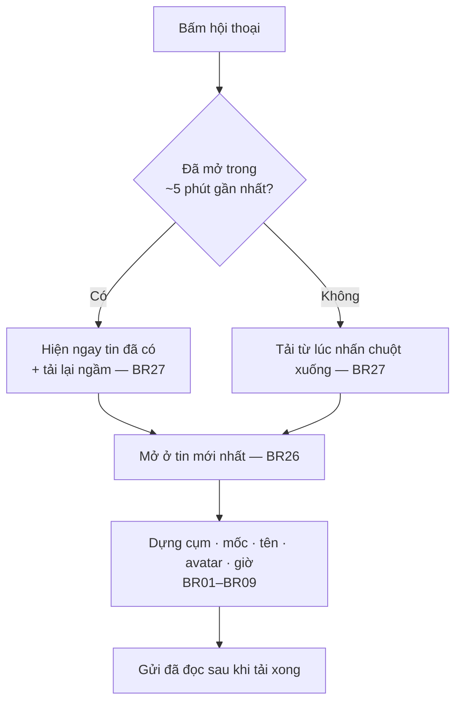

# [G036] Giao diện khung hội thoại — giống Zalo PC

| Trường | Nội dung |
|--------|----------|
| **Feature ID** | **G036** |
| **Tên** | Giao diện khung hội thoại — hiển thị tin nhắn giống Zalo PC |
| **Module** | Chat / Giao diện hội thoại |
| **Owner (BA)** | Trân (BA) |
| **Dev assignee** | FE |
| **Priority** | — |
| **Version** | **1.0** |
| **Status** | Draft |
| **Last updated** | **2026-10-09** |

---

## 1. Tổng quan (Overview)

### Bối cảnh

Khung hội thoại trước đây hiển thị khác Zalo PC ở nhiều chỗ: tin chỉ gộp với nhau khi cách **tối đa 2 phút**, mốc thời gian chỉ có khi **sang ngày** và luôn dạng `DD/MM/YYYY`, dấu `✓✓` nằm trong **mọi** tin mình gửi, ảnh bị cắt vào khung cố định **260×180**, thẻ tệp hiện sai dung lượng. Nhân sự quen Zalo phải đọc lại theo một cách khác.

### Tài liệu này làm gì

Là **nơi duy nhất** quy định **tin nhắn trông thế nào** trong khung hội thoại — gộp cụm, mốc thời gian, tên và ảnh đại diện, từng loại tin, thao tác trên tin, trạng thái gửi, thanh ghim, cuộn và chuyển hội thoại.

**Chỉ phần hiển thị.** Luật nghiệp vụ *(ghim tối đa mấy tin, ai được thả cảm xúc, trả lời gửi gì lên Zalo…)* vẫn ở Spec gốc; Spec gốc trỏ sang G036 cho phần hiển thị.

| Phạm vi | |
|---|---|
| Loại hội thoại | **Nhóm** và **1-1** |
| Bề ngang khung chat | **390px → 1600px** |
| Ngôn ngữ | Tiếng Việt · tiếng Anh |

### Hai chỗ cố ý khác Zalo

| | Zalo | Hệ thống |
|---|---|---|
| **Người gửi phía mình** | Một tài khoản là một người | Một tài khoản có **nhiều nhân viên** → tên nhân viên đi kèm giờ gửi ở tin cuối cụm (BR07) |
| **Tin thu hồi / đã xoá** | Ẩn nội dung | **Giữ nội dung** (BR20) |

### Spec gốc ↔ phần hiển thị ở G036

| Nghiệp vụ | Spec gốc | Hiển thị ở G036 |
|---|---|---|
| Gửi, nhận, trạng thái tin | G003 | BR01–BR09 · BR11 · BR24 |
| Trưởng / phó nhóm | G008 | BR10 |
| Thả cảm xúc, trả lời | G009 | BR13 · BR21–BR23 |
| Ghim tin | G014 | BR25 |
| Thẻ xem trước link | G015 | BR17 |
| Danh thiếp, nhãn dán | G023 | BR15 · BR18 |
| Bình chọn | G025 | BR01 *(đứng riêng)* |
| Tên gợi nhớ | G032 | BR06 · BR19 |

**Phụ thuộc:** G003 · G008 · G009 · G014 · G015 · G023 · G025 · G026 *(cài đặt nhóm)* · G032

---

## 2. Điều kiện tiên quyết & Trigger

**Trigger:** mở một hội thoại *(nhóm hoặc 1-1)*.

**Pre-conditions:** người dùng có quyền xem hội thoại đó *(G003)*.

**Post-conditions:** khung hội thoại hiển thị đúng các quy tắc dưới đây; không thay đổi dữ liệu nào.

---

## 3. Luồng chính (Happy Path)

### UC-01 — Mở hội thoại

1. **[Người dùng]** Bấm vào một hội thoại trong danh sách
2. **[Hệ thống]** Hội thoại **đã mở trong ~5 phút gần nhất** → hiện **ngay** tin đã có, không vòng quay chờ, đồng thời tải lại ngầm phần tin mới nhất. **Mở lần đầu** → tải tin **ngay khi nhấn chuột xuống**, trước khi nhả chuột (BR27)
3. **[Hệ thống]** Mở ở **tin mới nhất**; ảnh tải muộn không đẩy lệch khỏi đáy (BR26)
4. **[Hệ thống]** Dựng khung chat theo cụm, mốc thời gian, tên, ảnh đại diện, giờ gửi (BR01–BR09)
5. **[Hệ thống]** Gửi đánh dấu *đã đọc* **sau khi** tải lại xong (BR27)

### UC-02 — Cuộn lên đọc tin cũ

1. **[Người dùng]** Cuộn lên
2. **[Hệ thống]** Bắt đầu tải tin cũ khi còn cách đầu danh sách khoảng **3 màn hình** (BR26)
3. **[Hệ thống]** Chèn tin cũ lên trên; tin đang xem **đứng yên** (BR26)

### UC-03 — Thao tác trên một tin

1. **[Người dùng]** Rê chuột lên tin
2. **[Hệ thống]** Hiện 3 nút **Trả lời · Chuyển tiếp · "…"** và nút 👍 ở góc phải dưới khung tin (BR21, BR22)
3. **[Người dùng]** Chọn thao tác — xử lý theo Spec gốc *(G003, G009)*



> Auto-generated — comment nếu cần sửa logic

---

## 4. Luồng phụ (Alternative Flows)

- **AF01 — Tin mới tới khi đang ở đáy:** tự cuộn xuống tin mới (BR26).
- **AF02 — Tin mới tới khi đang đọc tin cũ:** giữ nguyên chỗ đang đọc (BR26).
- **AF03 — Người dùng tự cuộn trong lúc hệ thống đang chỉnh vị trí:** hệ thống **dừng chỉnh ngay**, không giành quyền cuộn (BR26).
- **AF04 — Nhảy tới tin** *(bấm ghim, bấm trích dẫn, kết quả tìm kiếm)*: nhảy tới đúng tin, **tô sáng vài giây**, không bị kéo về đáy (BR26). Tin đích là tin hệ thống nằm trong nhóm tin hệ thống đang thu gọn → vẫn nhảy tới được (BR19).
- **AF05 — Qua 0 giờ đêm khi đang mở màn chat:** nhãn mốc tự đổi *("Hôm nay" thành "Hôm qua")*, không cần tải lại trang (BR05).
- **AF06 — Màn cảm ứng:** các nút vốn chỉ hiện khi rê chuột thì **luôn hiện** (BR28).

---

## 5. Luồng ngoại lệ (Exception Flows)

| Code | Trigger | Hiển thị |
|---|---|---|
| **E01** | Tin gửi lỗi | **Viền đỏ** + nút **"Thử lại"**, ở **bất kỳ vị trí nào** trong hội thoại (BR24) |
| **E02** | Ngày giờ của tin không đọc được | **Không hiện mốc**, thay vì hiện một ô trống (BR05) |
| **E03** | Ảnh / video đang tải | Hiện **khung chờ** đúng tỉ lệ (BR14) |
| **E04** | Trang web không có thông tin xem trước | Chỉ hiện **dòng link** (BR17) |

Không quyền xem, mất kết nối, lỗi hệ thống, tài khoản Zalo ngắt kết nối khi mở hội thoại: **theo G003**.

---

## 6. Business Rules

| Code | Quy tắc | Chi tiết |
|---|---|---|
| **BR01** | **Gộp cụm.** Hai tin liền nhau **cùng một cụm** khi thoả **tất cả**: ❶ **cùng người gửi** — phía khách: cùng một người trong nhóm; phía mình: cùng một **nhân viên** *(hai nhân viên dùng chung một tài khoản Zalo vẫn là hai cụm)* · ❷ **cùng ngày** · ❸ tin sau cách tin trước **không quá 30 phút** · ❹ không tin nào là **tin đứng riêng** — **tin hệ thống** và **bình chọn** luôn tách cụm riêng | Trước: cùng người gửi, cách tối đa 2 phút |
| **BR02** | **Khoảng cách:** trong cụm **4px** · giữa hai cụm **8px** · trước và sau tin đứng riêng **16px** · ngay trước mốc thời gian **0** *(mốc tự có khoảng trống)* | §10A |
| **BR03** | **Khi nào hiện mốc thời gian:** ❶ trước tin đầu tiên của danh sách · ❷ **sang ngày mới** — mốc chỉ ghi ngày · ❸ **cùng ngày, cách tin trước hơn 30 phút** — mốc ghi giờ + ngày · ❹ tin thường ngay sau một tin đứng riêng — mốc ghi giờ + ngày | Trước: chỉ có mốc khi sang ngày |
| **BR04** | **Định dạng mốc:** *Hôm nay* · *Hôm qua* · trong 30 ngày: thứ + ngày đầy đủ · cũ hơn 30 ngày: ngày đầy đủ; mốc giờ ghép giờ phía trước | Bảng §10B |
| **BR05** | Qua 0 giờ đêm khi đang mở màn chat → nhãn **tự cập nhật**, không cần tải lại. Ngày giờ của tin không đọc được → **không hiện mốc**. Tiếng Anh: `Today` · `Yesterday` · `Sun/Mon/…` | AF05 · E02 |
| **BR06** | **Tên người gửi phía khách:** chỉ trong **nhóm**, chỉ ở **tin đầu cụm**; chat **1-1 không hiện tên**. Ưu tiên **tên gợi nhớ** nếu có *(G032 BR03)*. Chữ **13px** | |
| **BR07** | **Tên phía mình:** **không hiện tên phía trên tin**. Tên **nhân viên** đi kèm **giờ gửi** ở **tin cuối cụm**, vd `Nguyễn Thu Hồng 21:22` — giờ nằm ở đâu theo BR09 thì tên đi cùng ở đó *(tin chữ: trong khung; ảnh, video, sticker: ô nhỏ dưới ảnh)* | Một tài khoản có nhiều nhân viên |
| **BR08** | **Ảnh đại diện:** **40px**, chỉ ở **tin đầu cụm**, căn theo đỉnh tin. Phía khách bên **trái**; phía mình *(ảnh nhân viên)* bên **phải** | |
| **BR09** | **Giờ gửi:** chỉ ở **tin cuối cụm**. Tin chữ: giờ nằm **trong** khung tin. Ảnh, video, sticker: giờ là **ô nhỏ dưới** ảnh | |
| **BR10** | **Trưởng / phó nhóm:** chìa khoá nhỏ ở góc ảnh đại diện — **vàng = trưởng nhóm**, **xám = phó nhóm**; rê chuột hiện *"Trưởng nhóm"* / *"Phó nhóm"*. Tin của trưởng/phó có **viền xanh nhạt**. Tài khoản Zalo đang dùng là trưởng/phó → tin mình gửi cũng có viền xanh.<br>**Chỉ hiện khi** nhóm **bật cài đặt "Làm nổi tin nhắn trưởng và phó nhóm"** *(cài đặt nhóm của Zalo — **G026 BR03**)* **và** người gửi **vẫn còn** trong nhóm với vai trò đó. Người đã rời hoặc bị xoá khỏi nhóm không còn dấu | Trước: vương miện cạnh tên, chỉ trưởng nhóm |
| **BR11** | **Khung tin:** phía mình **xanh nhạt**, phía khách **trắng**; bo góc đều, không viền, có bóng mờ; chữ **15px**. Bề ngang tối đa **90% khung chat, không quá 720px** | |
| **BR12** | **Chữ có link, @nhắc tên:** link và @tên **màu xanh**, **không gạch chân**, @tên **không in đậm**. Link dài được ngắt dòng để không tràn khung; chữ thường xuống dòng theo từ | Trước: link gạch chân, @tên in đậm |
| **BR13** | **Trích dẫn khi trả lời:** nằm **trong** khung tin chữ — vạch xanh bên trái, **tên người được trích** + nội dung. Trích ảnh/video: ảnh nhỏ **40px** + `[Hình ảnh]`. Trích tin của chính tài khoản mình: hiện **tên tài khoản**. Bấm vào trích dẫn → **nhảy tới tin gốc** | Trước: khối trích dẫn tách riêng phía trên |
| **BR14** | **Ảnh, video:** giữ **đúng tỉ lệ thật**, rộng tối đa **360px**, cao tối đa **368px**. Chú thích *(nếu có)* dính liền ngay dưới ảnh, cùng bề ngang. Đang tải → **khung chờ** | Trước: khung cố định 260×180, ảnh bị cắt |
| **BR15** | **Hàng sticker:** sticker gửi liên tiếp xếp **chung một hàng** theo công thức §10D. Mỗi sticker **vẫn là một tin riêng** — thả cảm xúc, trả lời, chọn nhiều, tải về **từng cái** | Trước: mỗi sticker một dòng |
| **BR16** | **Thẻ tệp:** rộng **376px** *(co lại khi màn hẹp)*; biểu tượng theo loại tệp *(Word, Excel, PowerPoint, PDF, ZIP…)*; **dung lượng thật**; tên tệp hiện **một lần** | Trước: dung lượng luôn "1.0 MB", tên bị lặp |
| **BR17** | **Thẻ xem trước link:** ảnh lớn **306×161** phía trên, tiêu đề **1 dòng**, mô tả **2 dòng**, tên miền **màu xanh**. Không có ảnh → ô nhỏ bên trái. Trang không có thông tin xem trước → chỉ hiện **dòng link** | Trước: thẻ kiểu riêng, có nút "Mở trong…" |
| **BR18** | **Danh thiếp, tài khoản ngân hàng, ghi âm:** co theo khung chat, không tràn | |
| **BR19** | **Tin hệ thống:** có **ảnh đại diện nhỏ** của người làm, **tên in đậm** *(theo tên gợi nhớ nếu có)*. Tin ghim không kèm ảnh. Ghim hoặc trích dẫn trỏ tới tin hệ thống → **nhảy tới được**, kể cả khi nó nằm trong nhóm tin hệ thống đang thu gọn | Trước: chữ thường, không ảnh, không nhảy tới được |
| **BR20** | **Tin đã thu hồi / đã xoá:** **giữ nội dung** *(khác Zalo)*. **Không** có nút 👍, **không** có trạng thái gửi | |
| **BR21** | **Rê chuột lên tin:** hiện 3 nút tròn **Trả lời · Chuyển tiếp · "…" (Thêm)**; sticker có thêm **Tải sticker**. Nút **"…"** mở **đúng menu như bấm chuột phải** *(Copy, Ghim, Chọn nhiều, Xoá phía tôi, Người đã xem…)*, tại vị trí nút | Trước: nút trả lời, chuyển tiếp, thả cảm xúc |
| **BR22** | **Nút 👍:** nhỏ, ở **góc phải dưới** khung tin. Hiện khi rê chuột; **luôn hiện ở tin cuối cùng của khách**. **Bấm một lần = thả "Thích"**. Rê chuột lên nút khoảng **0,4 giây** = mở bảng chọn cảm xúc; rời chuột khỏi nút mà không đi vào bảng thì bảng **tự đóng** | Trước: nút mặt cười trong nhóm nút |
| **BR23** | **Cảm xúc đã thả:** nằm ở **góc phải dưới** khung tin, **không đè** lên tin bên dưới | |
| **BR24** | **Trạng thái gửi:** chỉ **một ô**, dưới **tin cuối cùng của hội thoại nếu tin đó là của phía mình**; khách nhắn sau đó thì ô biến mất. Các mức: `Đang gửi` → `Đã gửi` → `Đã nhận` → `Đã xem`. Tin **gửi lỗi**: luôn có **viền đỏ** + nút **"Thử lại"**, ở bất kỳ vị trí nào | Trước: `✓✓` trong mọi tin mình gửi |
| **BR25** | **Thanh ghim:** theo bảng §10E | |
| **BR26** | **Cuộn:** mở hội thoại luôn ở **tin mới nhất**, ảnh tải muộn không đẩy lệch. Tải tin cũ khi còn cách đầu khoảng **3 màn hình**; tin đang xem **đứng yên**. Hệ thống **không giành quyền cuộn**. Tin mới tới: ở đáy thì tự cuộn xuống, đang đọc tin cũ thì giữ chỗ. Nhảy tới tin thì **tô sáng vài giây**, không bị kéo về đáy | Trước: mở có lúc dừng cách đáy; tải tin cũ làm tin đang xem nhảy 180–350px |
| **BR27** | **Chuyển hội thoại:** đã mở trong **~5 phút gần nhất** → hiện **ngay**, không vòng quay, tải lại ngầm; tin mới, tin thu hồi, cảm xúc tới trong lúc rời đi được bổ sung sau. Mở **lần đầu** → tải từ lúc **nhấn chuột xuống**. Đánh dấu **đã đọc** gửi **sau khi** tải lại xong | Trước: luôn hiện vòng quay chờ |
| **BR28** | **Màn hình & ngôn ngữ:** bề ngang 390–1600px không tràn, không thanh cuộn ngang. Thẻ tệp, link, danh thiếp, ngân hàng, ảnh **co theo khung** khi màn hẹp. Màn cảm ứng: nút vốn chỉ hiện khi rê chuột thì **luôn hiện**. Mọi nhãn có bản **tiếng Anh** | Trước: tiếng Anh thiếu 14 nhãn, hiện tên mã thay vì chữ |

---

## 7. State Machine

**N/A.** Vòng đời trạng thái gửi thuộc **G003 §7**; G036 chỉ quy định **hiện ở đâu** (BR24).

---

## 8. Data Model / 9. API Contract

**N/A — thuần hiển thị.** Một chỗ cần BE: **trạng thái `Đã nhận` / `Đã xem`** — giao diện đã có, nhưng hiện BE chỉ trả `Đã gửi` *(G003 §7)*. Cài đặt làm nổi tin trưởng/phó nhóm đã có ở **G026 BR03**.

---

## 10. UI/UX Notes

### 10A — Cụm, tên, ảnh đại diện, giờ gửi

```
   ── T3 23/09/2026 ──                         ← mốc sang ngày (BR03 ❷)

(ava) Lan                                      ← tên: chỉ trong nhóm, tin đầu cụm (BR06)
      ┌─────────────────────┐
      │ tin 1               │                  ← cách 4px trong cụm (BR02)
      └─────────────────────┘
      ┌─────────────────────┐
      │ tin 2         09:05 │                  ← giờ chỉ ở tin cuối cụm (BR09)
      └─────────────────────┘
                                               ← cách 8px giữa hai cụm
                  ┌──────────────────────────────┐ (ava NV)
                  │ tin phía mình                │
                  │         Nguyễn Thu Hồng 09:12│   ← tên NV đi cùng giờ, TRONG khung (BR07, BR09)
                  └──────────────────────────────┘
                                        Đã gửi      ← một ô duy nhất, dưới tin cuối (BR24)

   ── 10:05 23/09/2026 ──                      ← cùng ngày, cách > 30 phút (BR03 ❸)
```

### 10B — Định dạng mốc thời gian *(ví dụ: hôm nay là 09/10/2026)*

| Trường hợp | Mốc hiện | Ví dụ |
|---|---|---|
| Sang ngày, là hôm nay | Hôm nay | `Hôm nay` |
| Sang ngày, là hôm qua | Hôm qua | `Hôm qua` |
| Sang ngày, trong vòng 30 ngày | Thứ + ngày đầy đủ | `T3 23/09/2026` · `CN 04/10/2026` |
| Sang ngày, cũ hơn 30 ngày | Ngày đầy đủ | `23/08/2026` |
| Cách > 30 phút, hôm nay | Giờ + Hôm nay | `20:47 Hôm nay` |
| Cách > 30 phút, hôm qua | Giờ + Hôm qua | `09:05 Hôm qua` |
| Cách > 30 phút, ngày khác | Giờ + ngày đầy đủ | `09:05 23/09/2026` |

### 10C — Trưởng / phó nhóm

| Thành phần | Quy định |
|---|---|
| Chìa khoá ở góc ảnh đại diện | **Vàng** = trưởng nhóm · **Xám** = phó nhóm. Rê chuột hiện chữ |
| Viền tin | **Xanh nhạt** cho tin của trưởng/phó, kể cả tin phía mình khi tài khoản đang dùng là trưởng/phó |
| Điều kiện | Nhóm bật **"Làm nổi tin nhắn trưởng và phó nhóm"** *(G026 BR03)* và người gửi **vẫn còn** vai trò đó (BR10) |

### 10D — Công thức hàng sticker

1. Tối đa **3 sticker** một hàng; sticker thứ 4 sang hàng mới
2. Mỗi sticker gửi **dưới 5 phút** sau sticker trước
3. **Cùng cụm** *(BR01)*
4. Sticker **đã thu hồi** hoặc là **tin trả lời** *(có trích dẫn)* thì **đứng riêng**
5. Giờ gửi dưới **sticker cuối hàng**. Trạng thái gửi và người đã xem hiện dưới **cả hàng**
6. Chọn nhiều: **mỗi sticker một ô chọn riêng**

### 10E — Thanh ghim

| Hạng mục | Quy định |
|---|---|
| Thanh trên cùng | Hiện **ghim mới nhất**: biểu tượng tin nhắn, dòng *"Tin nhắn"*, dòng *"Tên người gửi: nội dung"*. Ghim ảnh/sticker/tệp hiện `[Hình ảnh]` · `[Nhãn dán]` · `[Tập tin]`. Ghim tin của chính tài khoản mình mà không có tên → hiện **tên tài khoản** |
| Nhiều ghim | Nút `+N ghim ⌄` *(N = số ghim còn lại)*. Chỉ 1 ghim thì **không có** nút này |
| Danh sách ghim | Bấm `+N ghim` → bảng `Danh sách ghim (tổng số)` nổi trên khung chat, **nền mờ** phía sau. Đóng bằng **"Thu gọn"** hoặc bấm ra ngoài |
| Bấm một ghim | Nhảy tới tin được ghim, **tô sáng**, bảng tự đóng |
| Nút "…" của ghim | Hiện khi rê chuột *(màn cảm ứng luôn hiện)*: **Copy** *(chỉ ghim có chữ)* · **Bỏ ghim tin nhắn** |
| Bàn phím | Enter / Space trên dòng ghim → mở ghim. Enter trên `+N ghim` → mở bảng, **không** nhảy tới tin |

---

## 11. Acceptance Criteria

**Cụm & mốc thời gian**
- [ ] Cùng người gửi, cùng ngày, cách ≤ 30 phút → **cùng cụm**; cách > 30 phút → **cụm mới** (AC-BR01)
- [ ] Hai nhân viên khác nhau dùng chung một tài khoản Zalo → **hai cụm** (AC-BR01)
- [ ] Tin hệ thống và bình chọn **luôn đứng riêng**; tin thường ngay sau chúng bắt đầu cụm mới (AC-BR01)
- [ ] Khoảng cách: trong cụm 4px · giữa cụm 8px · quanh tin đứng riêng 16px (AC-BR02)
- [ ] Sang ngày → mốc **chỉ ngày**; cùng ngày cách > 30 phút → mốc **giờ + ngày**; tin thường sau tin đứng riêng → mốc giờ + ngày (AC-BR03)
- [ ] Mốc đúng định dạng bảng §10B cho cả 7 trường hợp (AC-BR04)
- [ ] Đang mở màn chat qua 0 giờ đêm → *"Hôm nay"* tự thành *"Hôm qua"* (AC-BR05/AF05)
- [ ] Ngày giờ tin lỗi → không hiện mốc, không có ô trống (AC-BR05/E02)
- [ ] Tiếng Anh hiện `Today` · `Yesterday` · `Sun/Mon/…` (AC-BR05)

**Tên, ảnh đại diện, giờ gửi**
- [ ] Nhóm: tên khách ở **tin đầu cụm**, theo tên gợi nhớ nếu có; chat 1-1 **không** hiện tên (AC-BR06)
- [ ] Phía mình **không** có tên phía trên tin; tin cuối cụm có `Tên nhân viên + giờ` (AC-BR07)
- [ ] Ảnh đại diện 40px chỉ ở tin đầu cụm; khách bên trái, nhân viên bên phải (AC-BR08)
- [ ] Giờ gửi chỉ ở tin cuối cụm; tin chữ giờ trong khung, ảnh/video/sticker giờ là ô nhỏ dưới ảnh (AC-BR09)

**Trưởng / phó nhóm**
- [ ] Nhóm bật cài đặt → trưởng nhóm có chìa khoá **vàng**, phó nhóm **xám**, tin có viền xanh (AC-BR10)
- [ ] Nhóm tắt cài đặt → **không** có chìa khoá, **không** có viền (AC-BR10)
- [ ] Người đã rời hoặc bị xoá khỏi nhóm → **không** còn dấu (AC-BR10)
- [ ] Tài khoản Zalo đang dùng là trưởng/phó → tin mình gửi có viền xanh (AC-BR10)

**Từng loại tin**
- [ ] Khung tin phía mình xanh nhạt, phía khách trắng; bề ngang ≤ 90% khung và ≤ 720px (AC-BR11)
- [ ] Link và @tên màu xanh, không gạch chân, @tên không in đậm; link dài ngắt dòng không tràn (AC-BR12)
- [ ] Trích dẫn nằm trong khung tin; trích ảnh có ảnh 40px + `[Hình ảnh]`; trích tin của mình hiện tên tài khoản; bấm → nhảy tới tin gốc (AC-BR13)
- [ ] Ảnh/video đúng tỉ lệ, ≤ 360×368px; chú thích dính liền dưới ảnh; đang tải có khung chờ (AC-BR14/E03)
- [ ] Sticker liên tiếp xếp hàng đúng §10D; mỗi sticker thả cảm xúc / trả lời / chọn / tải được riêng (AC-BR15)
- [ ] Thẻ tệp 376px, đúng biểu tượng loại tệp, **dung lượng thật**, tên hiện một lần (AC-BR16)
- [ ] Thẻ link: ảnh 306×161, tiêu đề 1 dòng, mô tả 2 dòng, tên miền xanh; không ảnh → ô nhỏ trái; không có xem trước → chỉ dòng link (AC-BR17/E04)
- [ ] Danh thiếp, ngân hàng, ghi âm co theo khung, không tràn (AC-BR18)
- [ ] Tin hệ thống có ảnh nhỏ + tên đậm; ghim/trích dẫn trỏ tới tin hệ thống nhảy tới được kể cả khi đang thu gọn (AC-BR19/AF04)
- [ ] Tin thu hồi/xoá giữ nội dung, không có 👍, không có trạng thái gửi (AC-BR20)

**Thao tác**
- [ ] Rê chuột → 3 nút Trả lời · Chuyển tiếp · "…"; sticker thêm Tải sticker (AC-BR21)
- [ ] Nút "…" mở đúng menu chuột phải, tại vị trí nút (AC-BR21)
- [ ] 👍 ở góc phải dưới; luôn hiện ở tin cuối của khách; bấm = Thích; rê ~0,4s = bảng chọn; rời chuột không vào bảng thì bảng đóng (AC-BR22)
- [ ] Cảm xúc đã thả ở góc phải dưới, không đè tin bên dưới (AC-BR23)

**Trạng thái gửi**
- [ ] Chỉ **một ô trạng thái**, dưới tin cuối nếu là của phía mình; khách nhắn sau thì ô biến mất (AC-BR24)
- [ ] Tin gửi lỗi có viền đỏ + "Thử lại" ở **mọi vị trí** (AC-BR24/E01)

**Thanh ghim**
- [ ] Thanh hiện ghim mới nhất đúng §10E; `+N ghim` chỉ khi có ≥ 2 ghim (AC-BR25)
- [ ] Bảng danh sách ghim nổi, nền mờ, đóng bằng "Thu gọn" hoặc bấm ra ngoài; bấm ghim → nhảy tới + tô sáng + đóng bảng (AC-BR25)
- [ ] Nút "…" của ghim có Copy *(chỉ ghim có chữ)* và Bỏ ghim; bàn phím đúng §10E (AC-BR25)

**Cuộn & chuyển hội thoại**
- [ ] Mở hội thoại luôn ở tin mới nhất, ảnh tải muộn không đẩy lệch (AC-BR26)
- [ ] Cuộn lên tải tin cũ: tin đang xem lệch **0–1px** (AC-BR26/UC-02)
- [ ] Tin mới tới: ở đáy thì tự cuộn; đang đọc tin cũ thì giữ chỗ (AC-BR26/AF01/AF02)
- [ ] Người dùng lăn chuột khi hệ thống đang chỉnh vị trí → hệ thống dừng chỉnh (AC-BR26/AF03)
- [ ] Mở lại hội thoại vừa xem → hiện ngay, không vòng quay; tin tới trong lúc rời đi được bổ sung (AC-BR27/UC-01)
- [ ] Đánh dấu đã đọc gửi sau khi tải lại xong (AC-BR27)

**Màn hình & ngôn ngữ**
- [ ] 390 · 640 · 1000 · 1600px: không tràn, không thanh cuộn ngang (AC-BR28)
- [ ] Màn cảm ứng: nút chỉ-hiện-khi-rê-chuột luôn hiện (AC-BR28/AF06)
- [ ] Mọi nhãn mới có bản tiếng Anh, không hiện tên mã (AC-BR28)

---

## 12. Out of Scope

| # | Nội dung | Ghi chú |
|---|---|---|
| **OOS01** | Gộp nhiều ảnh thành **lưới** như album Zalo | Đã thống nhất bỏ qua — vẫn hiện từng ảnh |
| **OOS02** | **Giao diện tối** cho màn chat | Màn chat vẫn dùng giao diện sáng |
| **OOS03** | Ngưỡng **30 phút** đổi theo cấu hình | Cố định theo mặc định Zalo PC |
| **OOS04** | Hiện nút Trả lời · Chuyển tiếp · "…" · 👍 khi di chuyển bằng **phím Tab** | Chưa làm |
| **OOS05** | Ẩn nội dung tin thu hồi / đã xoá như Zalo | Giữ nội dung theo quyết định sản phẩm (BR20) |

---

## 13. Dependencies

| Spec | Dùng cho |
|---|---|
| **G003** | Gửi/nhận tin, trạng thái gửi (§7), quyền xem hội thoại, chọn nhiều, ngoại lệ chung |
| **G008** | Vai trò trưởng / phó nhóm (BR10) |
| **G009** | Thả cảm xúc, trả lời tin (BR13, BR22, BR23) |
| **G014** | Ghim tin (BR25) |
| **G015** | Dữ liệu xem trước link (BR17) |
| **G023** | Danh thiếp, nhãn dán (BR15, BR18) |
| **G025** | Bình chọn — tin đứng riêng (BR01) |
| **G026** | **BR03** — cài đặt nhóm **"Làm nổi tin nhắn trưởng và phó nhóm"** (BR10) |
| **G032** | Tên gợi nhớ ở tên người gửi, tin hệ thống, trích dẫn (BR06, BR13, BR19) |

---

## 14. Open Questions

| # | Câu hỏi | Người quyết | Trạng thái |
|---|---|---|---|
| — | Không còn câu hỏi mở. Cài đặt làm nổi tin trưởng/phó nhóm đã có ở **G026 BR03** | — | — |

---

## 15. Performance & Scalability

| Mục | Mức đạt *(đo trên môi trường dev, tính từ lúc nhấn chuột)* |
|---|---|
| Mở lại hội thoại vừa xem | ~**0,15 giây**, không vòng quay *(trước ~0,4 giây)* |
| Mở hội thoại lần đầu | ~**0,2 giây** *(trước ~0,4 giây)* |
| Bổ sung tin tới trong lúc rời đi | ~**0,1–0,3 giây** sau khi mở lại |
| Tải tin cũ khi cuộn | Bắt đầu khi còn ~**3 màn hình** tới đầu danh sách *(trước: 800px)* |

Thời gian thực tế phụ thuộc tốc độ mạng và máy chủ.

---

## 16. Rollout & Migration

| Mục | Nội dung |
|---|---|
| **Phạm vi** | **FE.** Một chỗ cần BE: trạng thái `Đã nhận` / `Đã xem` |
| **Data migration** | Không cần |
| **Giới hạn hiện tại** | `Đã nhận` / `Đã xem` đã có giao diện nhưng BE chỉ trả `Đã gửi` → tạm thời chỉ thấy `Đang gửi` và `Đã gửi` |
| **Lưu ý khi kiểm** | Giao diện khác mô tả sau khi cập nhật bản mới → **tải lại trang cứng** *(Ctrl+Shift+R / Cmd+Shift+R)* |

---

## Changelog

| Ngày | Version | Người thay đổi | Sections | Nội dung |
|------|---------|----------------|----------|----------|
| 2026-10-09 | **1.0** | Trân (BA) | Toàn bộ | Tạo G036 — **giao diện khung hội thoại giống Zalo PC**, là nơi duy nhất quy định phần hiển thị. Gộp cụm theo **người gửi · cùng ngày · ≤ 30 phút**, tin hệ thống và bình chọn đứng riêng; mốc *Hôm nay / Hôm qua / thứ*; tên khách chỉ trong nhóm, tên nhân viên kèm giờ ở tin cuối cụm; chìa khoá trưởng/phó nhóm; trích dẫn trong khung tin; ảnh đúng tỉ lệ; hàng sticker; nút 👍; một ô trạng thái dưới tin cuối; thanh `+N ghim`; cuộn không nhảy |

---

> **Lưu ý cho AI khi đọc spec này:**
> - **Chỉ phần hiển thị.** Luật nghiệp vụ ở Spec gốc — đừng viết lại ở đây, đừng sửa ở đây.
> - **BR01:** phía mình gộp cụm theo **nhân viên**, không theo tài khoản Zalo.
> - **BR06 + BR07:** chat 1-1 **không** hiện tên khách; phía mình **không** hiện tên phía trên — tên nhân viên đi kèm giờ ở **tin cuối cụm**.
> - **BR10:** chìa khoá và viền xanh **chỉ khi** nhóm bật *"Làm nổi tin nhắn trưởng và phó nhóm"* (G026 BR03).
> - **BR20:** tin thu hồi **giữ nội dung** — cố ý khác Zalo.
> - **BR24:** **một** ô trạng thái dưới tin cuối, không phải dưới mọi tin.
