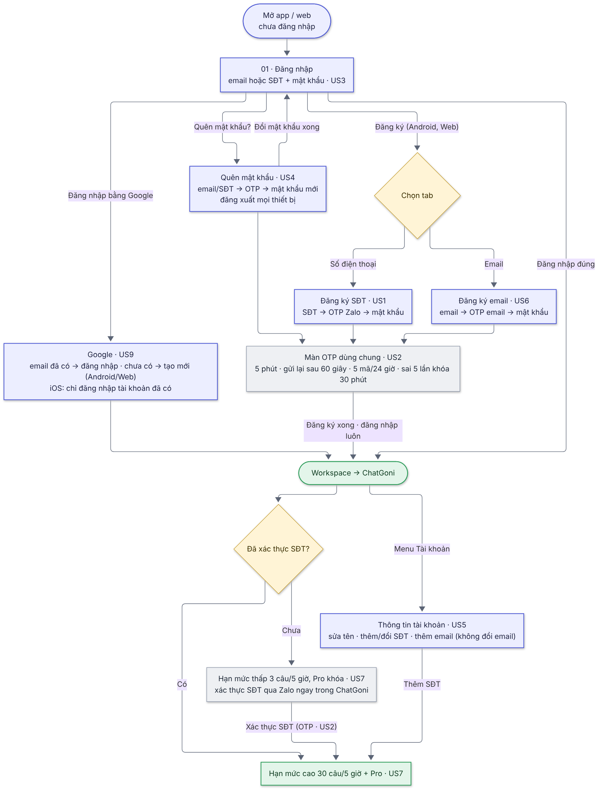

# 00  [EPIC][Login/Signup] Đăng ký, đăng nhập bằng số điện thoại & hạn mức ChatGoni

# \[EPIC\]\[Login/Signup\] Đăng ký, đăng nhập (SĐT, email, Google), quên mật khẩu, thông tin tài khoản & hạn mức ChatGoni

> **Tóm tắt:** Người dùng đăng ký bằng SĐT hoặc email qua luồng ngắn có xác thực OTP (Zalo/email) hoặc bằng Google; đăng nhập bằng email hoặc SĐT; lấy lại mật khẩu bằng OTP; tự quản lý thông tin tài khoản; xác thực SĐT để nâng hạn mức ChatGoni và mở chế độ Pro (chống spam, giảm chi phí).
>
> **Nền tảng:** Android · iOS · Web (BE làm mới, dùng chung, quản lý API version; xác thực qua SSO Keycloak) · **Priority:** High · **Trạng thái:** READY · **Tiến độ:** 0/8 story DONE
>
> **Yêu cầu từ:** anh Vương (CEO) · **Phụ trách:** PdM Hường · Tech lead anh Vương · BA Chình · Design Hiếu · FE mobile Hiếu (FE), lead Hoàng · FE web (chưa có người) · BE Chiến · QA Hồng (lead), Trà
>
> **Figma:** <https://www.figma.com/design/aPKF4iF1YI2FPUwvdrz56V/Gopany-v1.1?node-id=1609-4700>

## 1. Đọc nhanh theo vai trò

| Bạn là | Đọc mục |
|--------|---------|
| Sếp / quản lý | Tóm tắt, 2, 3, 9, 10, 11 |
| Design | 4, 5, 6, các story |
| FE / BE | 4, 6, 7, 8, các story |
| QA     | Toàn bộ, đặc biệt mục 8 |
| CSKH   | Tóm tắt, 4, 6 |

## 2. Bối cảnh & mục tiêu

**Bối cảnh**

* Hiện chỉ đăng ký/đăng nhập được bằng email hoặc Google. Form đăng ký email dài (họ tên, email, SĐT, mật khẩu, xác nhận mật khẩu) và **không xác thực** email/SĐT.
* Trên mobile, đăng nhập và quên mật khẩu đang mở trang web; trải nghiệm không tốt.
* ChatGoni là màn đầu tiên sau đăng nhập. Tài khoản tạo dễ nên có rủi ro bị spam ChatGoni, gây thiệt hại chi phí.
* Hệ thống đã có Zalo OA và OTP qua Zalo. iOS không có đăng ký trong app (theo hướng đã được Apple duyệt).

**Mục tiêu**

* Đăng ký nhanh, ít bước: SĐT/email → OTP → mật khẩu (hoặc 1 chạm bằng Google).
* Mọi tài khoản mới có email hoặc SĐT **đã xác thực**.
* Đăng nhập, quên mật khẩu, thông tin tài khoản là **màn riêng trong app**, không phụ thuộc web.
* Chặn spam ChatGoni: muốn dùng nhiều hơn hoặc dùng Pro phải xác thực SĐT; 1 SĐT chỉ mở khóa cho 1 tài khoản.
* Sau 1 tháng release: ≥ \[X\]% tài khoản mới xác thực SĐT; chi phí ChatGoni/người dùng không vượt \[Y\] (đo khi có tracking).

## 3. Các story trong Epic

| Story | Nội dung | Nền tảng | Màn |
|-------|----------|----------|-----|
| US1   | Đăng ký bằng số điện thoại (OTP Zalo) | Android, Web | 05a–05d |
| US2   | Giới hạn & bảo vệ OTP – Zalo/email, component dùng chung mọi luồng | Android, iOS, Web | 05b, 12, 03, 10, 10b, 19, email 23–25 |
| US3   | Đăng nhập bằng email hoặc SĐT + mật khẩu; tạm khóa khi sai nhiều lần | Android, iOS, Web | 01  |
| US4   | Quên mật khẩu bằng SĐT hoặc email (OTP) | Android, iOS, Web | 02, 03, 04 |
| US5   | Thông tin tài khoản: sửa tên, thêm/đổi SĐT, thêm email | Android, iOS, Web | 07–10, 08b–10b |
| US6   | Đăng ký bằng email (OTP email) – thay form cũ | Android, Web | 11–14 |
| US7   | Hạn mức ChatGoni khung 5 giờ & xác thực SĐT để nâng hạn mức, mở Pro | Android, iOS, Web | 15–20 |
| US9   | Đăng ký & đăng nhập bằng Google theo quy tắc mới | Android, iOS, Web | 01, 05a/11, 21 |

*Ngoài Epic này: US8 (Admin cấu hình hạn mức ChatGoni – đang draft, trước khi có US8 BE dùng giá trị mặc định 3 / 30 câu, khung 5 giờ) và BUG iOS vào được màn đăng ký (sửa riêng, không chờ Epic).*

**Thứ tự làm:** US2 (nền tảng OTP) → US1, US6, US3, US4, US9 song song → US5, US7. Tất cả task trong **Sprint 1**.

## 4. User flow tổng

 

* **Đăng ký SĐT (Android, Web – US1):** Nhập SĐT → OTP Zalo → Mật khẩu + Nhập lại mật khẩu (trong 10 phút) → Thành công, đăng nhập luôn → tạo workspace (nếu chưa có) → ChatGoni hạn mức cao.
* **Đăng ký email (Android, Web – US6):** Nhập email → OTP email → Mật khẩu + Nhập lại mật khẩu (trong 10 phút) → Thành công, đăng nhập luôn → tạo workspace → ChatGoni hạn mức thấp.
* **Đăng nhập (mọi nền tảng – US3):** 1 ô "Email hoặc số điện thoại" + mật khẩu; nút Google.
* **Google (US9):** Android/Web: email chưa có → tạo tài khoản; email đã có → đăng nhập vào tài khoản đó. iOS: chỉ đăng nhập tài khoản đã có.
* **Quên mật khẩu (mọi nền tảng – US4):** Nhập SĐT/email → OTP → Mật khẩu mới (trong 10 phút) → đăng xuất mọi thiết bị → về màn đăng nhập.
* **Thông tin tài khoản (US5):** sửa tên · thêm SĐT lần đầu (chỉ OTP) · đổi SĐT (mật khẩu + OTP số mới) · thêm email khi chưa có (mật khẩu + OTP email).
* **ChatGoni (US7):** chat ngay → hiện % hạn mức 5 giờ → hết 100% hoặc chọn Pro → popup xác thực SĐT → OTP Zalo → nâng hạn mức + mở Pro.

## 5. Wireframe & design

* Design final: <https://www.figma.com/design/aPKF4iF1YI2FPUwvdrz56V/Gopany-v1.1?node-id=1609-4700> (Hiếu – Design). Wireframe cũ chỉ để tham khảo.
* Màn OTP vẽ ở nhiều luồng nhưng là **một component dùng chung** (US2), chỉ khác tiêu đề, kênh gửi và màn tiếp theo.
* Design còn cần bổ sung: popup 17 (US7), màn 21 (US9), trạng thái tài khoản Google chưa có mật khẩu bấm đổi SĐT (US5), thông báo hết 30 câu khi đã xác thực (US7); sửa câu chữ theo AC của từng story.

## 6. Quy tắc nghiệp vụ chung

**Định danh tài khoản**

* Mỗi SĐT và mỗi email chỉ gắn với **một** tài khoản.
* **SĐT hợp lệ:** số di động VN. Ô nhập chấp nhận 0xxxxxxxxx, 84xxxxxxxxx, +84xxxxxxxxx, hoặc 9 số khi ô có sẵn +84; khoảng trắng, dấu chấm, gạch tự bỏ. BE chuẩn hóa và lưu dạng 84xxxxxxxxx; app hiển thị 0xxxxxxxxx.
* **Email hợp lệ:** ten@tenmien.duoi, đúng 1 dấu @, tên miền có dấu chấm, đuôi tối thiểu 2 chữ cái, không khoảng trắng, không dấu tiếng Việt, tối đa 254 ký tự; tự cắt khoảng trắng đầu/cuối; cho phép `. _ - +` trước @ (alias có "+" là email khác). Kiểm tra trùng không phân biệt hoa/thường.
* SĐT/email chỉ được lưu vào tài khoản **sau khi xác thực** (OTP hoặc email Google). Mỗi dòng chỉ có "Chưa có" hoặc "Đã xác thực".
* **SĐT trong dữ liệu cũ** (nhập ở form đăng ký email cũ, chưa xác thực) không dùng để đăng nhập, không mở hạn mức ChatGoni, hiển thị là "Chưa có".
* Tài khoản có cả email và SĐT đăng nhập được bằng **cả hai**, cùng một mật khẩu.
* **Đổi SĐT:** không giới hạn số lần; số cũ giải phóng ngay; giữ trạng thái đã xác thực. **Không cho đổi email** (chỉ thêm khi chưa có; cần đổi thì liên hệ hỗ trợ).
* **Họ tên:** tên tự tạo = SĐT (0912345678) hoặc email đăng ký, Google lấy tên Google. Khi người dùng sửa: 1–50 ký tự, chỉ chữ và khoảng trắng.

**Đăng ký**

* Không nhập họ tên. Bước tạo mật khẩu có 2 ô: Mật khẩu + Nhập lại mật khẩu, mỗi ô có nút Hiện.
* Nhập đúng OTP → có **10 phút** để tạo mật khẩu; kết quả xác thực dùng 1 lần, gắn với phiên đó. Quá 10 phút, bỏ ngang hoặc bấm Back (quay về luôn, không hỏi) thì phải nhận mã mới.
* Chỉ tạo tài khoản khi đã xác thực OTP và mật khẩu hợp lệ, 2 ô khớp; không tạo tài khoản dở dang.
* Đăng ký xong **đăng nhập luôn** → tạo workspace (nếu chưa có) → ChatGoni.
* Hai phiên cùng đăng ký một SĐT/email: không chặn phiên nào; phiên tạo tài khoản trước thì thành công, phiên sau báo "đã được đăng ký".
* Không giới hạn đăng ký theo IP (tạm hoãn kiểm tra IP Việt Nam).
* iOS: không có bất kỳ đường nào vào màn đăng ký; Google trên iOS chỉ đăng nhập tài khoản đã có.

**Mật khẩu & phiên đăng nhập**

* Quy định mật khẩu: 8–16 ký tự, có chữ, có số, có ký tự đặc biệt, không khoảng trắng, không dấu tiếng Việt; áp dụng mọi luồng. *(Chờ Chiến xác nhận có bắt buộc chữ hoa + chữ thường không)*
* **Sai mật khẩu 5 lần liên tiếp → khóa đăng nhập bằng mật khẩu 15 phút**; đếm theo tài khoản; đăng nhập đúng hoặc đặt lại mật khẩu thì về 0 và gỡ khóa. Trong thời gian khóa vẫn đăng nhập bằng Google được.
* Đổi mật khẩu qua Quên mật khẩu → mật khẩu cũ hết hiệu lực, **đăng xuất mọi thiết bị**, gỡ tạm khóa, về màn đăng nhập (không tự đăng nhập).
* Màn đăng nhập không tiết lộ email/SĐT có tồn tại hay không. Màn đăng ký và Quên mật khẩu báo rõ (đã đăng ký / không đúng), được bù bằng giới hạn tần suất và reCAPTCHA chạy ngầm.

**OTP (US2)**

* Mã 6 chữ số. SĐT → Zalo; email → email.
* Hiệu lực **5 phút**; chờ **60 giây** mới gửi lại được; gửi mã mới thì mã cũ hết hiệu lực.
* Mỗi SĐT/email nhận tối đa **5 mã/24 giờ** (tính trượt), chung mọi luồng.
* Sai **5 lần** → hủy mã + **khóa gửi và nhập OTP 30 phút**; mã cũ và mã hết hạn đều tính 1 lần sai.
* BE chống spam chạy ngầm: giới hạn theo thiết bị/IP, reCAPTCHA chạy ngầm, giới hạn ngân sách gửi; app chỉ hiện 1 câu chung.
* Mọi con số cấu hình được.

**Hạn mức ChatGoni (US7)**

* Hạn mức theo **khung 5 giờ** (bắt đầu từ câu hỏi đầu tiên); app chỉ hiện **% đã dùng** và **giờ làm mới**.
* Chưa xác thực SĐT: mặc định **3 câu/5 giờ**, không dùng Pro. Đã xác thực SĐT: mặc định **30 câu/5 giờ**, dùng được Pro (tính chung). Hết hạn mức thì chặn và thông báo, chờ giờ làm mới.
* 1 SĐT chỉ mở khóa hạn mức cao/Pro cho **1** tài khoản. Xác thực giữa khung thì % tính lại ngay.

**Thông báo dùng chung**

| Tình huống | Hiện ở | Nội dung |
|------------|--------|----------|
| Mất mạng   | Thông báo | Không có kết nối mạng. Vui lòng kiểm tra và thử lại. |
| Lỗi hệ thống | Thông báo | Đã xảy ra lỗi. Vui lòng thử lại sau. |

Quy ước: lỗi định dạng hiện dưới ô và tô đỏ ô; chưa nhập đủ thì nút chính mờ, không hiện thông báo; đang gửi yêu cầu thì nút chuyển sang đang tải, không gửi trùng. Kiểm tra 2 lớp: FE kiểm tra định dạng tại ô, BE kiểm tra lại toàn bộ và trả mã lỗi.

## 7. Không làm trong Epic này

* Đăng ký trên iOS · OTP qua SMS · đăng nhập bằng OTP (không mật khẩu).
* Đổi email (để story riêng sau: cần mật khẩu + OTP email mới + báo email cũ, xử lý liên kết Google và lời mời workspace).
* Giới hạn đăng ký SĐT theo IP Việt Nam (tạm hoãn).
* Link "Liên hệ CSKH" trên màn OTP (task riêng, backlog).
* Email thông báo bảo mật khi đặt lại mật khẩu / thêm, đổi SĐT.
* Danh sách đen SĐT/email; thông báo riêng cho giới hạn theo thiết bị.
* Mời thành viên bằng SĐT · gói trả phí khi đã xác thực mà vẫn hết hạn mức · tracking sự kiện.
* Sign in with Apple · đăng nhập Facebook/Zalo.

## 8. Dữ liệu cũ & môi trường test

**Dữ liệu cũ**

* SĐT cũ chưa xác thực: coi như "Chưa có" (không đăng nhập, không mở hạn mức); người dùng thêm và xác thực lại qua OTP.
* Tài khoản hiện có chưa có SĐT sẽ ở hạn mức thấp ngay khi release.
* Tài khoản Google hiện có: đăng nhập như cũ; muốn dùng mật khẩu thì đặt qua Quên mật khẩu.

**Môi trường test cho QA**

* Rút ngắn được các mốc: OTP 5 phút, chờ 60 giây, 24 giờ, khóa 30 phút, 10 phút tạo/đặt mật khẩu, khóa đăng nhập 15 phút, khung ChatGoni 5 giờ; chỉnh được hạn mức nhỏ (1–2 câu).
* Reset được bộ đếm OTP theo SĐT/email.
* Có SĐT dùng Zalo và không dùng Zalo; nhiều hộp thư test; tài khoản Google test.
* Tài khoản mẫu: chỉ email, chỉ SĐT, có cả hai, Google chưa đặt mật khẩu, tài khoản cũ có SĐT chưa xác thực, tài khoản đang bị khóa đăng nhập.

## 9. Câu hỏi đang mở

| #   | Câu hỏi | Người chốt | Hạn |
|-----|---------|------------|-----|
| 1   | Giải pháp Keycloak (BE1): đăng nhập SĐT, cấp token cho màn riêng trong app và Google trong app, khóa sai mật khẩu 5 lần/15 phút cho API của app, đăng xuất mọi phiên | Chiến      | 15/10 (quá hạn) |
| 2   | Mật khẩu có bắt buộc chữ hoa + chữ thường không? Có nới tối đa lên 64 ký tự không? | Chiến      |     |
| 3   | Có nhận số nhập dạng 0084… không? | Chiến      |     |
| 4   | Có cho đặt mật khẩu mới trùng mật khẩu cũ không? | Chiến      |     |
| 5   | Cách tính khung 5 giờ và đếm câu ChatGoni BE làm được như mô tả không? | Chiến      |     |
| 6   | Ngưỡng chặn ngầm theo thiết bị/IP, ngân sách gửi OTP/ngày; địa chỉ gửi email OTP | Chiến      |     |
| 7   | Trước khi web cập nhật, trang đăng nhập web có nhận SĐT không? Người làm FE web? | Chiến + Hường, anh Vương |     |

**Đã chốt (tóm tắt):** màn riêng trong app · mobile/web release riêng · OTP 5 phút / 60 giây / 5 mã 24 giờ / sai 5 lần khóa 30 phút · mã cũ và mã hết hạn tính sai · tên tự tạo = SĐT/email · 1 SĐT 1 tài khoản · không làm SMS · iOS Google chỉ đăng nhập · tài khoản Google đặt mật khẩu qua Quên mật khẩu · không đổi email · đổi SĐT không giới hạn · đặt lại mật khẩu gỡ khóa · khóa đăng nhập 5 lần/15 phút, Google vẫn vào được · SĐT cũ chưa xác thực không dùng · tạm hoãn IP VN · Quên mật khẩu báo lỗi khi chưa có tài khoản · bỏ email thông báo bảo mật · bỏ link CSKH khỏi Epic.

## 10. Kế hoạch & release

| Việc | Phụ trách | Hạn |
|------|-----------|-----|
| Design màn 01–25 (đã xong, đang bổ sung theo review) | Hiếu (Design) | 15/10 |
| BA: tài liệu final, đối chiếu design | Chình, Hường | 19/10 |
| BE1: giải pháp Keycloak | Chiến     | 15/10 |
| BE / FE / QA (Sprint 1) | Chiến · Hiếu (FE) · Hồng | 22/10 |
| UAT + release | Hường, Hồng | \[ngày\] |

* Mobile và web **release riêng**: BE deploy trước (API version, v2 chạy song song v1) → app Android + iOS (cần Apple/Google duyệt) → web làm sau qua cùng API.
* Trước lần submit iOS tiếp theo: có US9 AC6 (iOS không tạo tài khoản bằng Google), BUG iOS đã sửa, cập nhật App Review Notes.
* Story DONE khi task QA đã TESTED và UAT pass. Epic DONE khi tất cả story DONE và app đã lên store.

## 11. Rủi ro

| Rủi ro | Hướng xử lý |
|--------|-------------|
| Spam OTP / spam ChatGoni, tốn chi phí | US2 giới hạn OTP + chặn ngầm thiết bị/IP + reCAPTCHA + giới hạn ngân sách; US7 hạn mức + 1 SĐT/1 tài khoản |
| Dò tài khoản qua màn đăng ký / Quên mật khẩu (có báo "đã đăng ký"/"không đúng") | Giới hạn tần suất + reCAPTCHA chạy ngầm ở các bước kiểm tra |
| Người dùng không dùng Zalo không xác thực được SĐT | Đăng ký bằng email; dùng ChatGoni hạn mức thấp; BE log lỗi gửi Zalo, xem lại sau 2 tuần để cân nhắc SMS |
| Email OTP vào Spam / đến chậm | Gợi ý kiểm tra Spam trên màn OTP; cho gửi lại mã |
| Apple reject vì iOS vào được đăng ký | Sửa BUG iOS; iOS Google chỉ đăng nhập; QA rà mọi đường; App Review Notes ghi rõ |
| Keycloak làm đăng nhập SĐT / token cho app phức tạp hơn dự kiến | Chiến chốt BE1 sớm (đang quá hạn) |
| BE dùng chung → lỗi ảnh hưởng cả web và mobile | API version; deploy BE trước; test cả 3 nền tảng |
| Người dùng hiện có tụt về hạn mức thấp khi release | Gợi ý xác thực SĐT ngay trong ChatGoni (US7) |
| Số điện thoại bị nhà mạng thu hồi, cấp cho người khác | Chấp nhận trong Epic này (không gửi email thông báo); xem lại khi làm story bảo mật sau |

## 12. Definition of Done (áp dụng mọi story)

- [ ] Đạt toàn bộ AC của story
- [ ] Chạy đúng trên các nền tảng của story (QA: 2 iOS, 2 Android; web Chrome/Safari)
- [ ] QA test pass, không còn bug Critical/High; luồng email/Google hiện tại không bị ảnh hưởng
- [ ] PdM + BA UAT pass
- [ ] Tài liệu cập nhật trên docs.gopany.tech

## 13. Quy ước task ERP

Epic & story quản lý trên docs; ERP chỉ có task theo người: `[EPIC-SĐT][US1][BE] …`, `[EPIC-SĐT][US1][FE-Mobile] …`, `[EPIC-SĐT][US1][QA] …`, `[EPIC-SĐT][Chung][Design/BA] …`. Mô tả task có link Epic + link story.

## 14. Lịch sử thay đổi

| Ngày | Thay đổi | Người quyết định |
|------|----------|------------------|
| 19/10/2026 | Bản final: gom US1–US7, US9; gắn Figma final; tạm hoãn kiểm tra IP VN; bỏ email thông báo bảo mật; Quên mật khẩu báo lỗi khi chưa có tài khoản (theo design); khóa đăng nhập 5 lần/15 phút, Google vẫn vào được; SĐT cũ chưa xác thực không dùng; họ tên khi sửa 1–50 ký tự chữ; không đổi email; đổi SĐT không giới hạn; 5 mã OTP/24 giờ, sai 5 lần khóa 30 phút, mã hết hạn tính sai; nút Back không hỏi; gộp nội dung thông báo vào AC từng story; tách US8 và BUG iOS ra ngoài Epic | Hường            |
| 16/10/2026 | Chốt với Chiến: 5 mã OTP/ngày; các góp ý plan Register V2 | Hường, Chiến     |
| 13/10/2026 | Kiểm tra dữ liệu 2 lớp FE/BE; đăng nhập bằng cả email và SĐT | Hường            |
| 12/10/2026 | Màn riêng trong app; mobile/web release riêng; tên tự tạo = SĐT/email; OTP 5 phút / 60 giây; thêm ô Nhập lại mật khẩu; không đổi email | Hường            |
| 09/10/2026 | ChatGoni chat ngay, hạn mức khung 5 giờ, Pro cần xác thực SĐT; thêm US9; quên mật khẩu email dùng OTP | anh Vương / Hường |
| 06/10/2026 | Đổi scope: đăng ký SĐT + mật khẩu; đăng nhập SĐT + mật khẩu; quên mật khẩu | anh Vương / Hường |
| 05/10/2026 | Tạo Epic | Hường            |