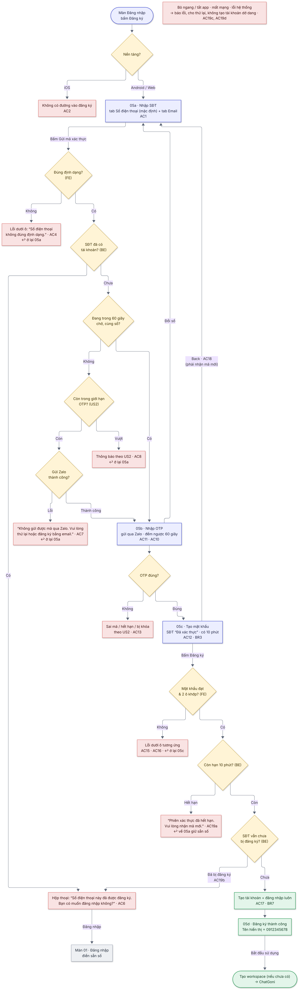

# 01  [EPIC-SĐT] US1 – Đăng ký bằng số điện thoại

> **Tóm tắt:** Nhập SĐT → OTP Zalo → tạo mật khẩu → đăng ký thành công · **Nền tảng:** Android, Web · **Wireframe:** 05a–05d · **Số AC:** 19 · **Priority:** High · **Trạng thái:** READY
>
> **Phụ trách:** BE Chiến · FE mobile Hiếu (FE) · QA Hồng · Design Hiếu · BA Chình
>
> **Epic:** <https://docs.gopany.tech/s/8fea0a57-d3ce-477d-aac2-d08b7036856c> · **Figma:** <https://www.figma.com/design/aPKF4iF1YI2FPUwvdrz56V/Gopany-v1.1?node-id=1609-4700>

## 1. Background

* Hiện chỉ đăng ký được bằng email hoặc Google, chưa đăng ký được bằng SĐT.
* Người dùng SME quen dùng SĐT và Zalo hơn email.
* Tài khoản đăng ký bằng SĐT đã xác thực được hạn mức ChatGoni cao và dùng Pro ngay (US7), giúp giảm spam.

## 2. User Story

Là **người dùng mới**, tôi muốn **đăng ký tài khoản Gopany bằng số điện thoại**, để **bắt đầu dùng nhanh mà không cần email**.

## 3. Scope

**Trong phạm vi:**

* Tab "Số điện thoại" trên màn đăng ký (Android, Web).
* Luồng 3 bước: nhập SĐT → OTP Zalo → tạo mật khẩu; màn đăng ký thành công.
* Trên mobile: màn riêng trong app, không mở trang web.

**Ngoài phạm vi:**

* Đăng ký trên iOS · OTP qua SMS · giới hạn OTP (xem US2) · đăng ký bằng Google (xem US9).
* Link Liên hệ CSKH trên màn OTP (task riêng).
* Giới hạn đăng ký SĐT theo IP Việt Nam (tạm hoãn, làm sau).

## 4. User flow

 

*Nhãn AC/BR trên sơ đồ khớp với mục 6 và 7 bên dưới.*

## 5. Wireframe

*Giao diện theo Figma final của Hiếu (Design):* [*https://www.figma.com/design/aPKF4iF1YI2FPUwvdrz56V/Gopany-v1.1?node-id=1609-4700*](https://www.figma.com/design/aPKF4iF1YI2FPUwvdrz56V/Gopany-v1.1?node-id=1609-4700) *· Lỗi OTP xem US2 · Nút "Tiếp tục với Google" xem US9.*

| Màn | Nội dung |
|-----|----------|
| 05a | Thanh bước 1/3 · "Đăng ký" + "Tạo tài khoản Gopany bằng số điện thoại" · tab Số điện thoại / Email · ô SĐT có sẵn (+84), placeholder "Nhập số điện thoại", bàn phím số · dòng "Mã xác thực sẽ gửi qua Zalo của số này" · nút "Gửi mã xác thực" · nút "Tiếp tục với Google" · dòng Điều khoản & Chính sách bảo mật · "Đã có tài khoản? Đăng nhập" |
| 05b | Thanh bước 2/3 · màn nhập OTP Zalo (component dùng chung US2) |
| 05c | Thanh bước 3/3 · "Tạo mật khẩu" · SĐT dạng 0912 345 678 + nhãn "Đã xác thực" · ô "Nhập mật khẩu" và ô "Nhập lại mật khẩu", mỗi ô có nút Hiện · dòng quy định luôn hiện dưới ô mật khẩu · nút "Đăng ký" · nút Back |
| 05d | Dấu tích xanh · "Đăng ký thành công" · "Tài khoản của bạn đã được tạo với số điện thoại 0912 345 678." · ô "Tên hiển thị: 0912345678, bạn có thể đổi trong Tài khoản → Thông tin tài khoản" · nút "Bắt đầu sử dụng" |

## 6. Business Rules

| Mã  | Quy tắc |
|-----|---------|
| BR1 | **SĐT hợp lệ:** số di động VN. Ô nhập chấp nhận 0xxxxxxxxx (10 số), 84xxxxxxxxx, +84xxxxxxxxx, hoặc 9 số (vì ô đã có sẵn +84). Khoảng trắng, dấu chấm, dấu gạch tự bỏ. BE chuẩn hóa và lưu dạng 84xxxxxxxxx; app hiển thị dạng 0xxxxxxxxx. *(Dạng 0084…: chờ Chiến xác nhận)* |
| BR2 | Chỉ SĐT chưa gắn tài khoản nào mới được đăng ký. Kiểm tra trùng sau khi đã chuẩn hóa. |
| BR3 | Nhập đúng OTP thì có **10 phút** để tạo mật khẩu. Kết quả xác thực chỉ dùng 1 lần, gắn với phiên đăng ký đó. Quá 10 phút, bỏ ngang hoặc bấm Back thì phải nhận mã mới (tính vào giới hạn 5 mã/24 giờ của US2). |
| BR4 | **Mật khẩu:** 8–16 ký tự, có chữ, có số, có ký tự đặc biệt, không khoảng trắng, không dấu tiếng Việt. Ô "Nhập lại mật khẩu" phải khớp. *(Chờ Chiến xác nhận có bắt buộc chữ hoa + chữ thường không)* |
| BR5 | Chỉ tạo tài khoản khi đã xác thực OTP, mật khẩu hợp lệ và 2 ô khớp. Không tạo tài khoản dở dang. |
| BR6 | Không nhập họ tên. Tên tự tạo = SĐT dạng 0912345678, sửa được trong Thông tin tài khoản (US5). |
| BR7 | Đăng ký xong thì **đăng nhập luôn** (API trả token). SĐT ở trạng thái "Đã xác thực" → hạn mức ChatGoni cao và dùng Pro ngay (US7). |
| BR8 | **Hai phiên cùng đăng ký một SĐT:** không chặn phiên nào, cả hai đều nhận được OTP. Phiên tạo tài khoản trước thì thành công, phiên sau báo đã được đăng ký. BE dùng mã đăng ký 1 lần + khóa khi tạo + ràng buộc duy nhất trong DB. |
| BR9 | Kiểm tra 2 lớp: FE kiểm tra định dạng ngay tại ô; BE kiểm tra lại toàn bộ + quy tắc nghiệp vụ và trả mã lỗi. |

## 7. Acceptance Criteria

*Cột "Kết quả mong đợi": **FE** = kiểm tra ngay tại ô · **BE** = kiểm tra sau khi bấm nút · nội dung trong "…" là câu hiển thị chính xác. Cột Mã lỗi BE do Chiến điền.*

| Mã  | Tình huống | Kết quả mong đợi | Mã lỗi BE |
|-----|------------|------------------|-----------|
| **Hiển thị** |            |                  |           |
| AC1 | Mở màn đăng ký trên Android/Web | Có tab "Số điện thoại" (mặc định) và tab "Email" |           |
| AC2 | Dùng app iOS theo mọi đường | Không vào được màn đăng ký |           |
| **Bước 1 – Nhập SĐT (05a)** |            |                  |           |
| AC3 | Chưa nhập hoặc chỉ nhập khoảng trắng | FE · nút "Gửi mã xác thực" mờ, không hiện thông báo |           |
| AC4 | SĐT sai định dạng | FE + BE · lỗi dưới ô SĐT, ô tô đỏ: "Số điện thoại không đúng định dạng." · không gửi mã |           |
| AC5 | Nhập 0912345678, 84912345678, +84912345678 hoặc 912345678 | Nhận là cùng một số, xử lý bình thường |           |
| AC6 | SĐT đã có tài khoản | BE · không gửi OTP · hộp thoại \[Hủy\] \[Đăng nhập\]: "Số điện thoại này đã được đăng ký. Bạn có muốn đăng nhập không?" · bấm Đăng nhập → màn 01, điền sẵn số · bấm Hủy → đóng, ở lại 05a |           |
| AC7 | Không gửi được qua Zalo (số không dùng Zalo, Zalo lỗi, lỗi hệ thống) | BE · thông báo: "Không gửi được mã qua Zalo. Vui lòng thử lại hoặc đăng ký bằng email." · ở lại 05a |           |
| AC8 | Vượt 5 mã/24 giờ, bị chặn ngầm, hệ thống bận | BE · thông báo theo US2 · ở lại 05a |           |
| AC9 | Bấm "Gửi mã xác thực" nhiều lần liên tiếp | FE · nút chuyển sang trạng thái đang tải và mờ, chỉ gửi 1 yêu cầu |           |
| AC10 | Đang trong 60 giây chờ, quay lại 05a và bấm gửi lại cùng số | Vào thẳng 05b với đếm ngược còn lại; không gửi mã mới, không báo lỗi |           |
| AC11a | Đổi số điện thoại quá 3 lần | Hiển thị lỗi dưới ô nhập "Bạn đã gửi quá nhiều yêu cầu." |           |
| **Bước 2 – Nhập OTP (05b)** |            |                  |           |
| AC11 | Gửi mã với SĐT hợp lệ | OTP gửi qua Zalo · màn OTP hiện "Mã số đã được gửi qua Zalo tới số 09•• ••• 678.", nút "Đổi số", đếm ngược gửi lại 60 giây |           |
| AC12 | Nhập đúng OTP | Sang 05c, SĐT hiện nhãn "Đã xác thực" |           |
| AC13 | Sai mã, hết hạn, gửi quá nhiều, bị khóa | Theo US2         |           |
| **Bước 3 – Tạo mật khẩu (05c) & thành công (05d)** |            |                  |           |
| AC14 | Chưa nhập đủ 2 ô | FE · nút "Đăng ký" mờ, không hiện thông báo |           |
| AC15 | Mật khẩu chưa đạt quy định | FE + BE · dòng quy định dưới ô mật khẩu chuyển đỏ, ô tô đỏ: "Mật khẩu phải có từ 8–16 ký tự, gồm chữ, số và ký tự đặc biệt, không có khoảng trắng hoặc dấu tiếng Việt." · chưa tạo tài khoản |           |
| AC16 | Ô Nhập lại mật khẩu không khớp | FE · lỗi dưới ô Nhập lại mật khẩu, ô tô đỏ: "Mật khẩu xác nhận không khớp. Vui lòng nhập lại." · chưa tạo tài khoản |           |
| AC17 | Mật khẩu hợp lệ, bấm Đăng ký | BE · nút chuyển sang đang tải · tạo tài khoản và đăng nhập luôn → màn 05d: "Đăng ký thành công" + "Tài khoản của bạn đã được tạo với số điện thoại 0912 345 678." + "Tên hiển thị: 0912345678, bạn có thể đổi trong Tài khoản → Thông tin tài khoản" · bấm "Bắt đầu sử dụng" → tạo workspace (nếu chưa có) → ChatGoni |           |
| AC18 | Bấm Back ở 05c (nút trên màn hoặc back hệ thống) | FE · về 05a, giữ sẵn số đã nhập, không hỏi xác nhận · kết quả xác thực cũ hết hiệu lực, phải gửi OTP mới |           |
| **Lỗi khi tạo tài khoản & lỗi chung** |            |                  |           |
| AC19 | Bấm Đăng ký nhưng: (a) đã quá 10 phút sau khi xác thực OTP · (b) người khác vừa đăng ký xong cùng số · (c) mất mạng / lỗi hệ thống · (d) trước đó đã bỏ ngang hoặc tắt app | Không tạo tài khoản, không có tài khoản dở dang. (a) BE · thông báo "Phiên xác thực đã hết hạn. Vui lòng nhận mã mới." → về 05a giữ sẵn số. (b) BE · hộp thoại \[Hủy\] \[Đăng nhập\]: "Số điện thoại này đã được đăng ký. Bạn có muốn đăng nhập không?" (c) Thông báo theo Epic mục 6, ở lại 05c, cho bấm lại. (d) Mở lại app thì bắt đầu từ 05a. | (b) 30103 |

## 8. Dependencies

* US2 (dịch vụ OTP dùng chung) xong trước.
* BE1: giải pháp Keycloak cấp token cho màn riêng trong app (Chiến).
* Zalo OA đang hoạt động; reCAPTCHA chạy ngầm đã cấu hình key cho app.
* Luồng tạo workspace hiện có dùng lại được sau đăng ký.
* Môi trường test cho QA: có SĐT dùng Zalo và không dùng Zalo; rút ngắn được mốc 10 phút.

## 9. Open Questions

| #   | Câu hỏi | Người chốt | Kết quả |
|-----|---------|------------|---------|
| 1   | Mật khẩu có bắt buộc chữ hoa + chữ thường không? Có nới tối đa lên 64 ký tự không? | Chiến      |         |
| 2   | Có nhận số nhập dạng 0084… không? | Chiến      |         |
| 3   | Giải pháp Keycloak cấp token cho app (BE1) | Chiến, anh Vương duyệt |         |
| 4   | Tài khoản đăng ký SĐT trên app có đăng nhập được web trước khi web cập nhật không? | Chiến + Hường |         |

## 10. Lịch sử thay đổi

| Ngày | Nội dung | Người quyết định |
|------|----------|------------------|
| 19/10/2026 | Thêm AC11a | Chình            |
| 19/10/2026 | Gắn Figma design final (Gopany v1.1) và ảnh user flow; tạm hoãn kiểm tra IP Việt Nam; câu chữ khớp design final | Hường            |
| 18/10/2026 | Bản final: gộp nội dung thông báo vào AC; thêm quy tắc 10 phút, nút Back, chuẩn hóa SĐT, 2 phiên đồng thời, đăng nhập luôn sau đăng ký, gửi lại trong 60 giây; lỗi Zalo gợi ý đăng ký email | Hường            |
| 16/10/2026 | Thêm AC nút mờ khi chưa nhập (màn 05a, 05c) | Chình            |
| 12/10/2026 | Tên tự tạo = SĐT; thêm ô Xác nhận mật khẩu | Hường            |