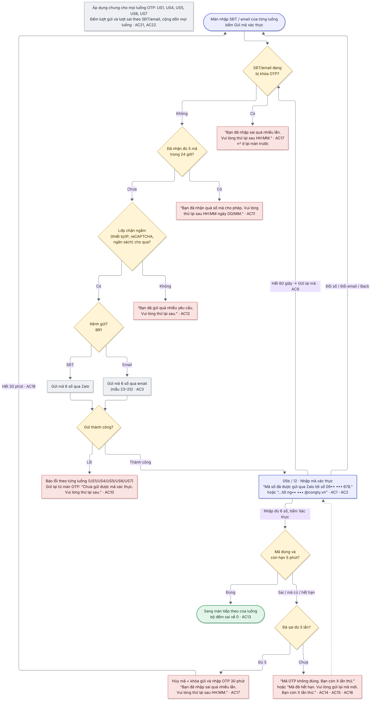

# 02  [EPIC-SĐT] US2 – Giới hạn & bảo vệ OTP

> **Tóm tắt:** Gửi mã đúng kênh (SĐT → Zalo, email → email); thời hạn mã, chờ gửi lại, giới hạn số lần gửi, tạm khóa khi nhập sai – một component dùng chung cho mọi luồng OTP · **Nền tảng:** Android, iOS, Web · **Màn:** 05b, 12, 03, 10, 10b, 19 · email 23–25 · **Số AC:** 22 · **Priority:** High (làm đầu tiên) · **Trạng thái:** READY
>
> **Phụ trách:** BE Chiến · FE mobile Hiếu (FE) · QA Hồng · Design Hiếu · BA Chình
>
> **Epic:** <https://docs.gopany.tech/s/8fea0a57-d3ce-477d-aac2-d08b7036856c> · **Figma:** <https://www.figma.com/design/aPKF4iF1YI2FPUwvdrz56V/Gopany-v1.1?node-id=1609-4700>

## 1. Background

* OTP dùng ở nhiều luồng: đăng ký SĐT (US1), quên mật khẩu (US4), thông tin tài khoản (US5), đăng ký email (US6), xác thực SĐT ở ChatGoni (US7).
* Người dùng xác thực bằng SĐT hoặc email nên mã phải gửi đúng kênh.
* Không giới hạn thì OTP bị gửi liên tục (tốn chi phí Zalo/email, làm phiền chủ số) hoặc bị dò mã để chiếm tài khoản.

## 2. User Story

Là **chủ số điện thoại/email**, tôi muốn **nhận mã xác thực đúng kênh của mình và việc gửi, nhập mã được giới hạn**, để **số/email và tài khoản của tôi không bị người khác chiếm dụng hay làm phiền**.

## 3. Scope

**Trong phạm vi:**

* Chọn kênh gửi theo thông tin người dùng nhập (SĐT → Zalo, email → email).
* Màn nhập OTP dùng chung cho cả 2 kênh (component dùng lại ở mọi luồng).
* Nội dung email gửi mã (mẫu 23–25).
* Quy tắc thời hạn, chờ gửi lại, giới hạn gửi, tạm khóa; lớp chống spam chạy ngầm phía BE.
* Các thông báo trên màn nhập OTP.

**Ngoài phạm vi:**

* OTP qua SMS · link Liên hệ CSKH trên màn OTP (task riêng) · màn CAPTCHA riêng (reCAPTCHA chạy ngầm).
* Thông báo khi gửi mã lần đầu bị lỗi ở màn nhập SĐT/email: xử lý trong từng luồng (US1, US4, US5, US6, US7).

## 4. User flow

 

*Nhãn AC/BR trên sơ đồ khớp với mục 6 và 7 bên dưới.*

## 5. Wireframe

*Giao diện theo Figma final của Hiếu (Design):* [*https://www.figma.com/design/aPKF4iF1YI2FPUwvdrz56V/Gopany-v1.1?node-id=1609-4700*](https://www.figma.com/design/aPKF4iF1YI2FPUwvdrz56V/Gopany-v1.1?node-id=1609-4700)

| Màn | Nội dung |
|-----|----------|
| 05b · 03 · 10 · 19 | Nhập OTP kênh Zalo: "Nhập mã xác thực" · "Mã số đã được gửi qua Zalo tới số 09•• ••• 678." · link "Đổi số" · 6 ô mã · "Chưa nhận được mã?" + đếm ngược 60 giây → link "Gửi lại mã" · nút "Xác thực" · bàn phím số |
| 12 · 10b | Nhập OTP kênh email: "Mã số đã được gửi tới ng•• ••• @congty.vn" · link "Đổi email" · dòng "Không thấy mã? Kiểm tra hộp thư Spam/Quảng cáo." · còn lại giống kênh Zalo |
| 06  | Các trạng thái lỗi dùng chung: sai mã, mã hết hạn, gửi lại lỗi, vượt giới hạn, tạm khóa |
| 23 · 24 · 25 | Email gửi mã cho đăng ký (US6), đặt lại mật khẩu (US4), thêm email (US5): logo Gopany · tiêu đề theo mục đích · "Xin chào \[email\]," · mô tả · khung "MÃ XÁC THỰC CỦA BẠN" 6 số + nút "Sao chép" · "Mã có hiệu lực trong 5 phút và chỉ dùng được một lần." · cảnh báo không chia sẻ mã · "Nếu bạn không thực hiện thao tác này, hãy bỏ qua email này." · chân trang email tự động. Không có nút/link đăng nhập |

## 6. Business Rules

| Mã  | Quy tắc |
|-----|---------|
| BR1 | **Kênh gửi:** mã gồm 6 chữ số, gửi đúng kênh của thông tin người dùng nhập: SĐT → Zalo, email → email. |
| BR2 | **Thời hạn:** mã có hiệu lực **5 phút** kể từ lúc gửi và chỉ dùng được 1 lần. Gửi mã mới thì mã cũ hết hiệu lực. |
| BR3 | **Chờ gửi lại:** phải chờ **60 giây** kể từ lần gửi gần nhất mới được gửi lại. |
| BR4 | **Giới hạn gửi:** mỗi SĐT/email nhận tối đa **5 mã trong 24 giờ** (tính trượt: trong bất kỳ khoảng 24 giờ nào không quá 5 mã), tính chung mọi luồng (đăng ký, quên mật khẩu, thêm/đổi SĐT, thêm email, ChatGoni) và mọi thiết bị. |
| BR5 | **Tạm khóa:** nhập sai **5 lần** → hủy mã hiện tại và **khóa gửi và nhập OTP 30 phút** cho SĐT/email đó. Nhập mã cũ hoặc mã đã hết hạn đều tính 1 lần sai. Bộ đếm sai tính theo SĐT/email (không về 0 khi gửi mã mới); về 0 khi xác thực đúng hoặc khi hết thời gian khóa. |
| BR6 | **Chống spam chạy ngầm (BE):** giới hạn theo thiết bị/IP, reCAPTCHA chạy ngầm (chấm điểm; tuần đầu chỉ ghi log, chưa chặn), giới hạn ngân sách gửi trong ngày. Không có màn riêng; app chỉ hiện 1 câu chung, không nêu lý do. |
| BR7 | **Dữ liệu BE trả về** để app hiển thị: thời điểm được gửi lại, thời điểm mã hết hạn, số lần thử còn lại, thời điểm hết khóa / được gửi lại sau giới hạn. App đếm ngược theo các mốc này, không tự đếm theo giờ máy. |
| BR8 | Mọi con số (5 phút, 60 giây, 5 mã/24 giờ, 5 lần sai, 30 phút) cấu hình được; môi trường test rút ngắn được để QA kiểm tra. |

## 7. Acceptance Criteria

*Cột "Kết quả mong đợi": **FE** = kiểm tra ngay trên màn · **BE** = kiểm tra sau khi bấm nút · nội dung trong "…" là câu hiển thị chính xác. Cột Mã lỗi BE do Chiến điền.*

| Mã  | Tình huống | Kết quả mong đợi | Mã lỗi BE |
|-----|------------|------------------|-----------|
| **Kênh gửi** |            |                  |           |
| AC1 | Nhập SĐT, bấm gửi mã | Mã gửi qua Zalo · màn OTP hiện "Mã số đã được gửi qua Zalo tới số 09•• ••• 678." (che giữa số) · link "Đổi số" |           |
| AC2 | Nhập email, bấm gửi mã | Mã gửi qua email · màn OTP hiện "Mã số đã được gửi tới ng•• ••• @congty.vn" · link "Đổi email" · dòng "Không thấy mã? Kiểm tra hộp thư Spam/Quảng cáo." |           |
| AC3 | Mở email nhận mã | Đúng mẫu 23/24/25 theo mục đích · tiêu đề email: "Mã xác thực Gopany của bạn là 488888" · có mã 6 số, nút Sao chép, thời hạn 5 phút, cảnh báo không chia sẻ mã · không có nút/link đăng nhập |           |
| **Nhập mã** |            |                  |           |
| AC4 | Nhập hoặc dán vào ô OTP | FE · bàn phím số · chỉ nhận chữ số 0–9, bỏ qua chữ cái, khoảng trắng, ký tự đặc biệt · dán cả câu có mã (VD "Mã của bạn là 482915") thì lấy các chữ số, điền tối đa 6 ô · tự chuyển ô khi nhập, xóa thì lùi ô |           |
| AC5 | Chưa nhập đủ 6 số | FE · nút "Xác thực" mờ, không gửi yêu cầu |           |
| AC6 | Nhập đủ 6 số | FE · nút "Xác thực" bấm được; không tự gửi, người dùng phải bấm nút |           |
| AC7 | Bấm "Xác thực" | FE · nút chuyển sang đang tải và mờ đến khi có kết quả, không gửi trùng yêu cầu |           |
| **Gửi lại mã** |            |                  |           |
| AC8 | Vừa gửi mã | FE · dòng "Chưa nhận được mã?" + đếm ngược 60 giây (VD "45s"); chưa bấm gửi lại được |           |
| AC9 | Hết 60 giây, bấm "Gửi lại mã" | BE kiểm tra lại BR4–BR6 · gửi mã mới cùng kênh, mã cũ hết hiệu lực · xóa 6 ô đã nhập · đếm ngược 60 giây lại từ đầu |           |
| AC10 | Gửi lại mã nhưng Zalo/email lỗi | BE · thông báo: "Chưa gửi được mã xác thực. Vui lòng thử lại sau." · vẫn ở màn OTP, cho bấm gửi lại |           |
| AC11 | Đã nhận đủ 5 mã trong 24 giờ, yêu cầu thêm (ở màn nhập SĐT/email hoặc bấm Gửi lại mã) | BE · không gửi · thông báo: "Bạn đã nhận quá số mã cho phép. Vui lòng thử lại sau HH:MM ngày DD/MM." |           |
| AC12 | Bị lớp chống spam ngầm chặn (thiết bị/IP, reCAPTCHA, ngân sách) | BE · không gửi · thông báo: "Bạn đã gửi quá nhiều yêu cầu. Vui lòng thử lại sau." · không nêu lý do · lỗi ngân sách gửi cảnh báo cho team | 30115 (chặn ngầm) · 30114 (ngân sách) |
| **Kết quả xác thực** |            |                  |           |
| AC13 | Nhập đúng mã, còn hạn | BE · sang màn tiếp theo của luồng (US1 → 05c, US4 → 04, US5 → Thông tin tài khoản, US6 → 13, US7 → ChatGoni) · bộ đếm sai về 0 |           |
| AC14 | Nhập sai mã, chưa đủ 5 lần | BE · 6 ô tô đỏ, dòng lỗi dưới ô: "Mã OTP không đúng. Bạn còn X lần thử." · nhập lại thì ẩn lỗi |           |
| AC15 | Nhập mã cũ sau khi đã gửi mã mới | Như AC14, tính 1 lần sai |           |
| AC16 | Nhập mã sau hơn 5 phút kể từ lúc gửi | BE · dòng lỗi: "Mã đã hết hạn. Vui lòng gửi lại mã mới. Bạn còn X lần thử." · tính 1 lần sai |           |
| **Tạm khóa** |            |                  |           |
| AC17 | Sai lần thứ 5 (gồm sai mã, mã cũ, mã hết hạn) | BE · hủy mã · khóa gửi và nhập OTP cho SĐT/email đó 30 phút · dòng lỗi: "Bạn đã nhập sai quá nhiều lần. Vui lòng thử lại sau HH:MM." · nút "Xác thực" và "Gửi lại mã" mờ · trong thời gian khóa, gửi mã cho SĐT/email này từ bất kỳ luồng nào cũng báo cùng câu |           |
| AC18 | Hết 30 phút khóa | Gửi và nhập mã lại bình thường · bộ đếm sai về 0 · lượt gửi trong 24 giờ vẫn tính theo BR4 |           |
| **Áp dụng chung** |            |                  |           |
| AC19 | Bấm "Đổi số" / "Đổi email" / Back trên màn OTP | FE · về màn nhập trước, giữ sẵn giá trị đã nhập · lượt gửi và lượt sai của SĐT/email cũ vẫn được tính |           |
| AC20 | Đưa app ra nền rồi quay lại màn OTP | Đếm ngược gửi lại và hạn mã tính theo thời điểm BE trả về, không bị lệch; mã đã hết hạn thì xử lý như AC16 khi bấm Xác thực |           |
| AC21 | Gửi mã ở luồng này rồi sang luồng khác với cùng SĐT/email | Lượt gửi và lượt sai tính tiếp, không đếm lại từ đầu |           |
| AC22 | Kiểm tra AC1–AC21 ở mọi luồng OTP (US1, US4, US5, US6, US7), cả kênh Zalo và email, trên Android, iOS, Web | Hành vi và thông báo giống nhau |           |

## 8. Dependencies

* Zalo OA đang hoạt động; mẫu tin Zalo gửi mã đã được duyệt (có mã 6 số, thời hạn 5 phút, lời nhắc không chia sẻ mã).
* Dịch vụ gửi email OTP; HTML 3 mẫu email 23–25 do Design bàn giao cho BE.
* reCAPTCHA chạy ngầm đã cấu hình key cho app và web.
* Môi trường test cho QA: rút ngắn được các mốc 5 phút, 60 giây, 24 giờ, 30 phút; reset được bộ đếm theo SĐT/email; có SĐT dùng Zalo và không dùng Zalo.

## 9. Open Questions

| #   | Câu hỏi | Người chốt | Kết quả |
|-----|---------|------------|---------|
| 1   | Ngưỡng giới hạn theo thiết bị/IP và ngân sách gửi OTP/ngày (BE tự cấu hình, báo lại để QA test) | Chiến      |         |
| 2   | Địa chỉ gửi email OTP (VD no-reply@gopany…) và cách giảm vào Spam | Chiến      |         |

## 10. Lịch sử thay đổi

| Ngày | Nội dung | Người quyết định |
|------|----------|------------------|
| 19/10/2026 | Bản final: chốt 5 mã/24 giờ (tính trượt), sai 5 lần → hủy mã + khóa 30 phút, mã cũ và mã hết hạn đều tính sai; lớp chống spam chạy ngầm + câu báo chung; gộp nội dung thông báo vào AC; câu chữ khớp design final; gắn Figma | Hường            |
| 16/10/2026 | Chốt với Chiến: 5 mã OTP/ngày | Hường, Chiến     |
| 14/10/2026 | Gộp quy tắc nhập ô OTP thành 1 AC | Chình            |
| 12/10/2026 | Chốt mã hiệu lực 5 phút, gửi lại sau 60 giây, dùng chung Zalo và email | Hường            |