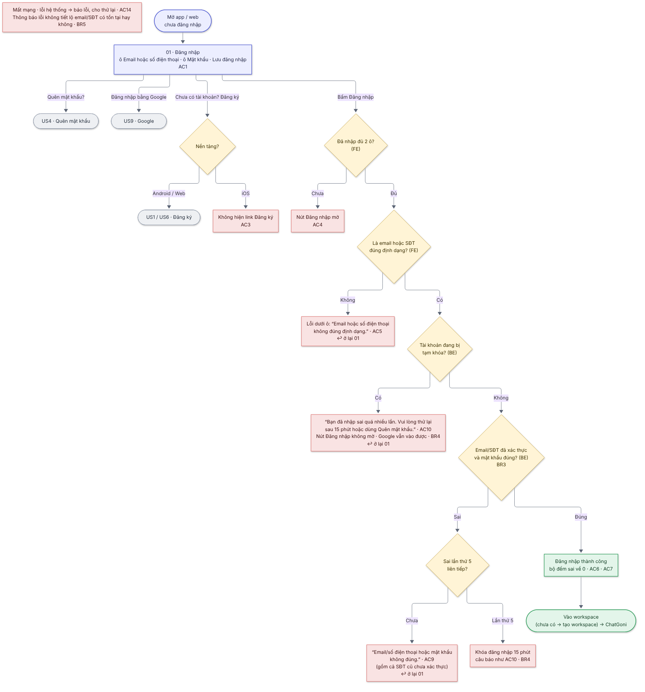

# 03  [EPIC-SĐT] US3 – Đăng nhập bằng email hoặc số điện thoại

> **Tóm tắt:** 1 ô "Email hoặc số điện thoại" + mật khẩu; tạm khóa khi sai nhiều lần · **Nền tảng:** Android, iOS, Web · **Màn:** 01 · **Số AC:** 14 · **Priority:** High · **Trạng thái:** READY
>
> **Phụ trách:** BE Chiến · FE mobile Hiếu (FE) · QA Hồng · Design Hiếu · BA Chình
>
> **Epic:** <https://docs.gopany.tech/s/8fea0a57-d3ce-477d-aac2-d08b7036856c> · **Figma:** <https://www.figma.com/design/aPKF4iF1YI2FPUwvdrz56V/Gopany-v1.1?node-id=1609-4700>

## 1. Background

* Màn đăng nhập hiện chỉ nhận email, trên mobile đang mở trang web [sso.gopany.com](http://sso.gopany.com).
* Người đăng ký bằng SĐT (US1) cần đăng nhập được bằng SĐT trên cả Android, iOS và Web.
* Tài khoản có cả email và SĐT (thêm trong US5) cần đăng nhập được bằng cả hai.

## 2. User Story

Là **người dùng Gopany**, tôi muốn **đăng nhập bằng email hoặc số điện thoại cùng mật khẩu**, để **vào app/web bằng thông tin tôi nhớ**.

## 3. Scope

**Trong phạm vi:**

* 1 ô "Email hoặc số điện thoại" trên màn đăng nhập (Android, iOS, Web).
* Tạm khóa đăng nhập khi sai mật khẩu nhiều lần.
* Ẩn link Đăng ký trên iOS.
* Trên mobile: màn đăng nhập riêng trong app (thay trang [sso.gopany.com](http://sso.gopany.com)).

**Ngoài phạm vi:**

* Đăng nhập bằng OTP (không mật khẩu).
* Quên mật khẩu (US4) · đăng nhập Google (US9) · đăng ký (US1, US6).
* "Lưu đăng nhập": giữ như hiện tại.

## 4. User flow

 

*Nhãn AC/BR trên sơ đồ khớp với mục 6 và 7 bên dưới.*

## 5. Wireframe

*Giao diện theo Figma final của Hiếu (Design):* [*https://www.figma.com/design/aPKF4iF1YI2FPUwvdrz56V/Gopany-v1.1?node-id=1609-4700*](https://www.figma.com/design/aPKF4iF1YI2FPUwvdrz56V/Gopany-v1.1?node-id=1609-4700)

| Màn | Nội dung |
|-----|----------|
| 01  | Logo Gopany · "Đăng nhập" + "Chào mừng bạn đến với Gopany" · ô "Nhập email hoặc số điện thoại" · ô "Nhập mật khẩu" có nút Hiện · ô chọn "Lưu đăng nhập" · link "Quên mật khẩu?" · nút "Đăng nhập" · "Hoặc" · nút "Đăng nhập bằng Google" · "Chưa có tài khoản? Đăng ký" (Android, Web; **không có trên iOS**) |

## 6. Business Rules

| Mã  | Quy tắc |
|-----|---------|
| BR1 | Hệ thống tự nhận biết người dùng nhập email hay SĐT. SĐT chấp nhận mọi dạng 0912…, 84912…, +84912… (khoảng trắng, dấu chấm tự bỏ) và được chuẩn hóa trước khi tra tài khoản. Email không phân biệt hoa/thường, tự cắt khoảng trắng đầu/cuối. |
| BR2 | Tài khoản có cả email và SĐT đã xác thực đăng nhập được bằng **cả hai**, cùng một mật khẩu. |
| BR3 | Chỉ SĐT/email **đã xác thực** trên tài khoản mới dùng để đăng nhập. SĐT trong dữ liệu cũ (nhập ở form đăng ký email cũ, chưa xác thực) **không dùng để đăng nhập** và hiển thị là "Chưa có" trong Thông tin tài khoản; người dùng thêm và xác thực lại qua OTP (US5). |
| BR4 | **Tạm khóa:** sai mật khẩu **5 lần liên tiếp** → khóa đăng nhập bằng mật khẩu **15 phút**, hết 15 phút mở lại bình thường. Đếm theo tài khoản (đăng nhập bằng email hay SĐT đều cộng chung 1 bộ đếm). Đăng nhập đúng thì bộ đếm về 0. Đặt lại mật khẩu qua Quên mật khẩu (US4) thì gỡ khóa ngay. Khóa chỉ áp dụng cho đăng nhập bằng mật khẩu: trong thời gian khóa, **đăng nhập bằng Google vẫn vào được**. Con số cấu hình được. *(Chờ Chiến xác nhận Keycloak áp dụng được cho API đăng nhập của app)* |
| BR5 | Thông báo lỗi **không tiết lộ** email/SĐT có tồn tại hay không. |
| BR6 | Tài khoản tạo bằng Google chưa đặt mật khẩu: nhập email + mật khẩu thì báo như sai thông tin; người dùng đăng nhập bằng Google hoặc đặt mật khẩu qua Quên mật khẩu (US4, US9). |
| BR7 | Kiểm tra 2 lớp: FE kiểm tra để trống và định dạng; BE kiểm tra thông tin đăng nhập, tạm khóa và trả mã lỗi. |

## 7. Acceptance Criteria

*Cột "Kết quả mong đợi": **FE** = kiểm tra ngay trên màn · **BE** = kiểm tra sau khi bấm nút · nội dung trong "…" là câu hiển thị chính xác. Cột Mã lỗi BE do Chiến điền.*

| Mã  | Tình huống | Kết quả mong đợi | Mã lỗi BE |
|-----|------------|------------------|-----------|
| **Hiển thị** |            |                  |           |
| AC1 | Mở màn đăng nhập | Có ô "Nhập email hoặc số điện thoại", ô "Nhập mật khẩu" (nút Hiện), "Lưu đăng nhập", "Quên mật khẩu?", nút "Đăng nhập", nút "Đăng nhập bằng Google" |           |
| AC2 | Mở trên Android/Web | Có dòng "Chưa có tài khoản? Đăng ký" → sang màn đăng ký (US1/US6) |           |
| AC3 | Mở trên iOS | Không có link "Đăng ký" ở bất kỳ trạng thái nào của màn |           |
| **Nhập & kiểm tra** |            |                  |           |
| AC4 | Chưa nhập đủ 2 ô (hoặc chỉ nhập khoảng trắng) | FE · nút "Đăng nhập" mờ, không hiện thông báo |           |
| AC5 | Ô đầu không phải email cũng không phải SĐT hợp lệ | FE · lỗi dưới ô, ô tô đỏ: "Email hoặc số điện thoại không đúng định dạng." · không gửi yêu cầu |           |
| **Đăng nhập** |            |                  |           |
| AC6 | Nhập đúng SĐT (dạng 0912…, 84912… hoặc +84912…) hoặc email + mật khẩu | BE · đăng nhập thành công · vào đúng workspace gần nhất; chưa có workspace thì sang tạo workspace (luồng hiện có) → ChatGoni |           |
| AC7 | Tài khoản có cả email và SĐT | Đăng nhập được bằng email + mật khẩu và bằng SĐT + mật khẩu |           |
| AC8 | Bấm "Đăng nhập" | FE · nút chuyển sang đang tải và mờ đến khi có kết quả, không gửi trùng yêu cầu |           |
| AC9 | Sai email/SĐT hoặc mật khẩu (kể cả email/SĐT chưa có tài khoản, SĐT cũ chưa xác thực, tài khoản Google chưa đặt mật khẩu), chưa đủ 5 lần | BE · lỗi dưới ô mật khẩu: "Email/số điện thoại hoặc mật khẩu không đúng." · nút Đăng nhập vẫn bấm được |           |
| **Tạm khóa** |            |                  |           |
| AC10 | Sai lần thứ 5 liên tiếp, hoặc đăng nhập khi tài khoản đang bị khóa | BE · thông báo: "Bạn đã nhập sai quá nhiều lần. Vui lòng thử lại sau 15 phút hoặc dùng Quên mật khẩu." · **không làm mờ nút Đăng nhập** (khóa theo tài khoản, người khác vẫn đăng nhập được trên cùng màn) · đăng nhập bằng Google vẫn vào được tài khoản này |           |
| AC11 | Hết 15 phút khóa | Đăng nhập lại bình thường · bộ đếm sai về 0 |           |
| AC12 | Đặt lại mật khẩu thành công qua Quên mật khẩu (US4) | Quay về màn 01 với thông báo "Đổi mật khẩu thành công. Vui lòng đăng nhập lại." · tài khoản được gỡ khóa ngay, đăng nhập bằng mật khẩu mới được luôn |           |
| **Tương thích & lỗi chung** |            |                  |           |
| AC13 | Tài khoản tạo trên Android/Web đăng nhập trên iOS; đăng nhập Google và đăng nhập email hiện có | Đều hoạt động như cũ |           |
| AC14 | Mất mạng, lỗi hệ thống | Báo lỗi theo Epic mục 6, cho thử lại; không tính là 1 lần sai |           |

## 8. Dependencies

* BE1: giải pháp Keycloak cho đăng nhập bằng SĐT và cấp token cho màn đăng nhập riêng trong app (Chiến).
* Keycloak Brute Force Detection (hoặc cơ chế tương đương) áp dụng cho API đăng nhập của app.
* US4 (Quên mật khẩu) để gỡ khóa; US9 (Google) dùng chung màn 01.
* Môi trường test cho QA: rút ngắn được mốc 15 phút; có tài khoản chỉ email, chỉ SĐT, có cả hai, tài khoản Google chưa đặt mật khẩu.

## 9. Open Questions

| #   | Câu hỏi | Người chốt | Kết quả |
|-----|---------|------------|---------|
| 1   | Keycloak có khóa được đúng 5 lần/15 phút cho API đăng nhập của app không? | Chiến      |         |
| 2   | Trước khi web cập nhật, trang đăng nhập web có nhận SĐT không? | Chiến + Hường |         |

## 10. Lịch sử thay đổi

| Ngày | Nội dung | Người quyết định |
|------|----------|------------------|
| 19/10/2026 | Chốt câu hỏi 2, 3: khi bị khóa vẫn đăng nhập bằng Google được; SĐT cũ chưa xác thực không dùng để đăng nhập (BR3, BR4, AC9, AC10) | Hường            |
| 19/10/2026 | Bản final: chốt sai 5 lần → khóa 15 phút, đếm theo tài khoản, không làm mờ nút Đăng nhập khi khóa; đăng nhập bằng cả email và SĐT; đặt lại mật khẩu gỡ khóa; gộp nội dung thông báo vào AC; gắn Figma | Hường            |
| 13/10/2026 | Thêm đăng nhập bằng cả email và SĐT (dual login) | Hường            |
| 12/10/2026 | Mobile làm màn đăng nhập riêng trong app, không dùng web | Hường            |