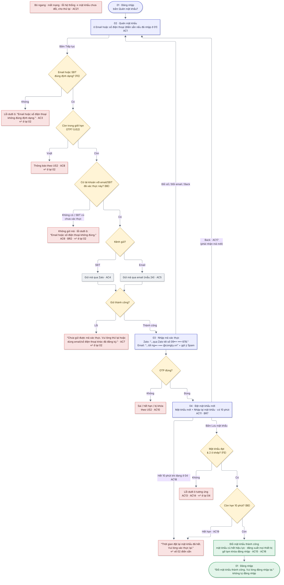

# 04  [EPIC-SĐT] US4 – Quên mật khẩu bằng số điện thoại hoặc email

# 04 \[EPIC-SĐT\] US4 – Quên mật khẩu bằng số điện thoại hoặc email

> **Tóm tắt:** Nhập SĐT hoặc email → nhập OTP (Zalo/email) → đặt mật khẩu mới → đăng xuất mọi thiết bị, về màn đăng nhập · **Nền tảng:** Android, iOS, Web · **Màn:** 02, 03, 04, 01 · **Số AC:** 22 · **Priority:** High · **Trạng thái:** READY
>
> **Phụ trách:** BE Chiến · FE mobile Hiếu (FE) · QA Hồng · Design Hiếu · BA Chình
>
> **Epic:** <https://docs.gopany.tech/s/8fea0a57-d3ce-477d-aac2-d08b7036856c> · **Figma:** <https://www.figma.com/design/aPKF4iF1YI2FPUwvdrz56V/Gopany-v1.1?node-id=1609-4700>

## 1. Background

* Quên mật khẩu hiện chỉ gửi **liên kết** qua email; người đăng ký bằng SĐT có thể không có email.
* Các luồng đăng ký mới đều dùng OTP → quên mật khẩu đổi sang OTP cho **cả SĐT và email**, dùng chung màn OTP (US2) và màn mật khẩu.
* Trên mobile hiện mở trang [app.gopany.com](http://app.gopany.com); chuyển thành màn riêng trong app.

## 2. User Story

Là **người dùng Gopany quên mật khẩu**, tôi muốn **lấy lại mật khẩu bằng số điện thoại hoặc email qua mã OTP**, để **tự vào lại tài khoản nhanh mà không cần nhờ hỗ trợ**.

## 3. Scope

**Trong phạm vi:**

* Màn 02 với 1 ô "Email hoặc số điện thoại".
* OTP qua Zalo (SĐT) hoặc email (component US2).
* Màn 04 đặt mật khẩu mới + nhập lại mật khẩu; hiệu lực 10 phút sau khi xác thực OTP.
* Sau khi đổi: đăng xuất mọi thiết bị, gỡ tạm khóa đăng nhập.
* Trên mobile: màn riêng trong app (thay trang [app.gopany.com](http://app.gopany.com)).

**Ngoài phạm vi:**

* Liên kết đặt lại mật khẩu qua email: bỏ hẳn, thay bằng OTP (web cũng bỏ khi cập nhật).
* Đổi mật khẩu khi đang đăng nhập (giữ như hiện tại).
* OTP qua SMS · link Liên hệ CSKH (task riêng).

## 4. User flow

 

*Nhãn AC/BR trên sơ đồ khớp với mục 6 và 7 bên dưới.*

## 5. Wireframe

*Giao diện theo Figma final của Hiếu (Design):* [*https://www.figma.com/design/aPKF4iF1YI2FPUwvdrz56V/Gopany-v1.1?node-id=1609-4700*](https://www.figma.com/design/aPKF4iF1YI2FPUwvdrz56V/Gopany-v1.1?node-id=1609-4700) *· Màn OTP và trạng thái lỗi OTP xem US2.*

| Màn | Nội dung |
|-----|----------|
| 02  | Nút Back · "Quên mật khẩu" + "Nhập email hoặc số điện thoại đã đăng ký. Mã xác thực sẽ được gửi qua email hoặc Zalo." · ô "Nhập email hoặc số điện thoại" · nút "Tiếp tục" |
| 03  | Màn nhập OTP dùng chung (US2): kênh Zalo "Mã số đã được gửi qua Zalo tới số 09•• ••• 678." + "Đổi số"; kênh email "Mã số đã được gửi tới ng•• ••• @congty.vn" + "Đổi email" + gợi ý kiểm tra Spam |
| 04  | Nút Back · "Đặt mật khẩu mới" + "Mật khẩu mới dùng để đăng nhập bằng cả email và số điện thoại" · ô "Nhập mật khẩu" và ô "Nhập lại mật khẩu", mỗi ô có nút Hiện · dòng quy định luôn hiện dưới ô mật khẩu · nút "Lưu mật khẩu" |
| 01  | Màn đăng nhập (US3) với thông báo "Đổi mật khẩu thành công. Vui lòng đăng nhập lại." |

## 6. Business Rules

| Mã  | Quy tắc |
|-----|---------|
| BR1 | Hệ thống tự nhận biết: SĐT → gửi OTP qua **Zalo**; email → gửi OTP qua **email** (mẫu 24). SĐT chấp nhận mọi dạng 0/84/+84 và được chuẩn hóa. |
| BR2 | Chỉ email/SĐT **đã xác thực** trên một tài khoản mới nhận mã. Email/SĐT chưa có tài khoản (kể cả SĐT cũ chưa xác thực) → không gửi mã, **báo lỗi ngay tại màn 02** (theo design). Chống dò tài khoản bằng giới hạn tần suất và reCAPTCHA chạy ngầm (US2 BR6) áp dụng cho cả bước kiểm tra này. |
| BR3 | Mật khẩu mới theo quy định chung: 8–16 ký tự, có chữ, có số, có ký tự đặc biệt, không khoảng trắng, không dấu tiếng Việt. Ô "Nhập lại mật khẩu" phải khớp. *(Chờ Chiến xác nhận có bắt buộc chữ hoa + chữ thường không)* |
| BR4 | **Đổi thành công:** mật khẩu cũ hết hiệu lực, **đăng xuất mọi thiết bị** (kể cả thiết bị đang dùng), gỡ tạm khóa đăng nhập nếu có (US3), quay về màn đăng nhập, **không tự đăng nhập**. |
| BR5 | Giới hạn OTP theo US2 (5 mã/24 giờ, sai 5 lần khóa 30 phút), tính chung với các luồng khác. |
| BR6 | Tài khoản tạo bằng Google cũng đặt được mật khẩu qua luồng này bằng email Google; đặt xong đăng nhập được bằng email/SĐT + mật khẩu và vẫn dùng Google như cũ (US9). |
| BR7 | **Thời hạn 10 phút:** kết quả xác thực OTP cho mục đích đặt lại mật khẩu có hiệu lực **10 phút** kể từ khi BE xác nhận OTP đúng, chỉ dùng 1 lần. Hết 10 phút thì BE không cho đổi mật khẩu; người dùng phải xác thực lại. Ra nền, quay lại màn, sửa dữ liệu nhập không làm reset hay kéo dài thời hạn. |
| BR8 | iOS: không có bất kỳ đường nào từ luồng này sang màn đăng ký (xem BUG iOS). |

## 7. Acceptance Criteria

*Cột "Kết quả mong đợi": **FE** = kiểm tra ngay trên màn · **BE** = kiểm tra sau khi bấm nút · nội dung trong "…" là câu hiển thị chính xác. Cột Mã lỗi BE do Chiến điền.*

| Mã  | Tình huống | Kết quả mong đợi | Mã lỗi BE |
|-----|------------|------------------|-----------|
| **Bước 1 – Nhập email/SĐT (02)** |            |                  |           |
| AC1 | Bấm "Quên mật khẩu?" ở màn 01 | Mở màn 02 với câu hướng dẫn "Nhập email hoặc số điện thoại đã đăng ký. Mã xác thực sẽ được gửi qua email hoặc Zalo." · nếu đã nhập email/SĐT ở màn 01 thì điền sẵn vào ô |           |
| AC2 | Chưa nhập hoặc chỉ nhập khoảng trắng | FE · nút "Tiếp tục" mờ, không hiện thông báo |           |
| AC3 | Không phải email cũng không phải SĐT hợp lệ | FE + BE · lỗi dưới ô, ô tô đỏ: "Email hoặc số điện thoại không đúng định dạng." · không gửi mã |           |
| AC4 | Nhập SĐT đã xác thực trên một tài khoản | BE · gửi OTP qua Zalo → màn 03: "Mã số đã được gửi qua Zalo tới số 09•• ••• 678." |           |
| AC5 | Nhập email đã xác thực trên một tài khoản | BE · gửi OTP qua email (mẫu 24) → màn 03: "Mã số đã được gửi tới ng•• ••• @congty.vn" + "Không thấy mã? Kiểm tra hộp thư Spam/Quảng cáo." |           |
| AC6 | Nhập email/SĐT chưa có tài khoản, hoặc SĐT cũ chưa xác thực | BE · không gửi mã · lỗi dưới ô, ô tô đỏ: "Email hoặc số điện thoại không đúng." · ở lại 02 |           |
| AC7 | Không gửi được mã (Zalo/email lỗi) | BE · thông báo: "Chưa gửi được mã xác thực. Vui lòng thử lại hoặc dùng email/số điện thoại khác đã đăng ký." · ở lại 02 |           |
| AC8 | Vượt 5 mã/24 giờ, đang bị khóa OTP, bị chặn ngầm, hệ thống bận | BE · thông báo theo US2 · ở lại 02 |           |
| AC9 | Bấm "Tiếp tục" nhiều lần liên tiếp | FE · nút chuyển sang đang tải và mờ, chỉ gửi 1 yêu cầu |           |
| **Bước 2 – Nhập OTP (03)** |            |                  |           |
| AC10 | Sai mã, hết hạn, gửi lại, gửi quá nhiều, bị khóa; Đổi số / Đổi email | Theo US2         |           |
| AC11 | Nhập đúng OTP | BE · sang màn 04 · bắt đầu tính 10 phút (BR7) |           |
| **Bước 3 – Đặt mật khẩu mới (04)** |            |                  |           |
| AC12 | Chưa nhập đủ 2 ô | FE · nút "Lưu mật khẩu" mờ. Đã nhập đủ 2 ô thì nút bấm được, sai thì báo lỗi theo AC13/AC14 |           |
| AC13 | Mật khẩu chưa đạt quy định | FE + BE · dòng quy định dưới ô mật khẩu chuyển đỏ, ô tô đỏ: "Mật khẩu phải có từ 8–16 ký tự, gồm chữ, số và ký tự đặc biệt, không có khoảng trắng hoặc dấu tiếng Việt." · chưa đổi |           |
| AC14 | Ô Nhập lại mật khẩu không khớp | FE · lỗi dưới ô Nhập lại mật khẩu, ô tô đỏ: "Mật khẩu xác nhận không khớp. Vui lòng nhập lại." · chưa đổi |           |
| AC15 | Mật khẩu hợp lệ, 2 ô khớp, bấm "Lưu mật khẩu" | BE · nút chuyển sang đang tải · đổi mật khẩu → về màn 01 với thông báo "Đổi mật khẩu thành công. Vui lòng đăng nhập lại." · điền sẵn email/SĐT đã dùng ở 02 · không tự đăng nhập |           |
| AC16 | Sau khi đổi thành công | Thiết bị khác đang đăng nhập bị đăng xuất · mật khẩu cũ không dùng được · mật khẩu mới đăng nhập được bằng cả email và SĐT của tài khoản · nếu tài khoản đang bị tạm khóa đăng nhập thì được gỡ khóa ngay |           |
| AC17 | Bấm Back ở màn 04 (nút trên màn hoặc back hệ thống) | FE · về màn 02, giữ sẵn email/SĐT, không hỏi xác nhận · kết quả xác thực cũ hết hiệu lực, phải nhận mã mới |           |
| **Hết hạn 10 phút** |            |                  |           |
| AC18 | Hết 10 phút khi người dùng vẫn ở màn 04 | FE tính theo thời điểm hết hạn BE trả về (không tự đếm theo giờ máy) · thông báo: "Thời gian đặt lại mật khẩu đã hết. Vui lòng xác thực lại." → về màn 02, điền sẵn email/SĐT; bấm Tiếp tục để nhận mã mới |           |
| AC19 | Bấm "Lưu mật khẩu" tại hoặc sau mốc 10 phút khi giao diện chưa kịp cập nhật | BE từ chối dù mật khẩu hợp lệ và 2 ô khớp · thông báo và điều hướng như AC18 |           |
| AC20 | Đưa app ra nền rồi quay lại màn 04 / tắt hẳn app rồi mở lại | Ra nền: còn hạn thì làm tiếp với thời gian còn lại, hết hạn thì như AC18 · tắt hẳn: làm lại từ màn 02 (app không lưu kết quả xác thực xuống máy) |           |
| **Lỗi chung & tài khoản Google** |            |                  |           |
| AC21 | Bỏ ngang, mất mạng, lỗi hệ thống | Mật khẩu chưa đổi nếu chưa hoàn tất · báo lỗi theo Epic mục 6, cho thử lại, không treo |           |
| AC22 | Tài khoản tạo bằng Google, quên mật khẩu bằng email Google | Nhận OTP qua email, đặt mật khẩu mới thành công · sau đó đăng nhập được bằng email + mật khẩu và vẫn dùng Google như cũ |           |

## 8. Dependencies

* US2 (component OTP dùng chung, giới hạn OTP) xong trước.
* US3 (màn đăng nhập, tạm khóa) để hiển thị thông báo sau khi đổi và gỡ khóa.
* BE1: Keycloak cập nhật mật khẩu, thu hồi mọi phiên đăng nhập (đăng xuất mọi thiết bị), gỡ tạm khóa (Chiến).
* Email mẫu 24 (OTP đặt lại mật khẩu): Design bàn giao HTML cho BE.
* Môi trường test cho QA: rút ngắn được mốc 10 phút; có tài khoản chỉ SĐT, chỉ email, có cả hai, tài khoản Google chưa đặt mật khẩu, tài khoản đang bị tạm khóa.

## 9. Open Questions

| #   | Câu hỏi | Người chốt | Kết quả |
|-----|---------|------------|---------|
| 1   | Có cho đặt mật khẩu mới trùng mật khẩu cũ không? (phụ thuộc chính sách mật khẩu trên Keycloak) | Chiến      |         |

## 10. Lịch sử thay đổi

| Ngày | Nội dung | Người quyết định |
|------|----------|------------------|
| 19/10/2026 | Bỏ email thông báo khi đặt lại mật khẩu bằng SĐT (BR8, AC17 cũ); đánh lại số AC | Hường            |
| 19/10/2026 | Màn 02: email/SĐT chưa có tài khoản báo lỗi ngay tại ô theo design (BR2, AC6); bỏ link đặt lại mật khẩu qua email trên web (bỏ khỏi câu hỏi mở) | Hường            |
| 19/10/2026 | Bản final: SĐT cũ chưa xác thực không nhận mã; nút Back ở 04; điền sẵn email/SĐT; gộp nội dung thông báo vào AC; câu chữ khớp design final; gắn Figma | Hường            |
| 14/10/2026 | Bổ sung quy tắc 10 phút (BR7–BR9 cũ), AC13–AC18 | Chình            |
| 12/10/2026 | Thêm ô Xác nhận mật khẩu mới | Hường            |
| 09/10/2026 | Quên mật khẩu bằng email cũng dùng OTP (bỏ liên kết) | Hường            |