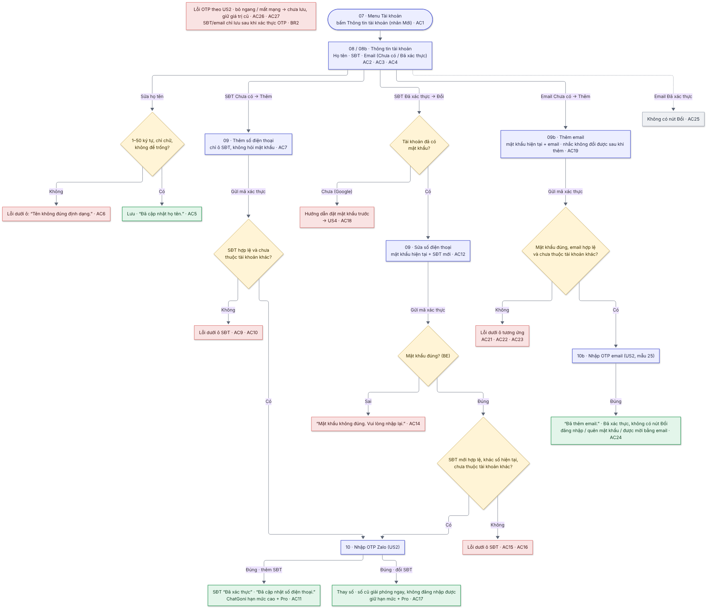

# 05  [EPIC-SĐT] US5 – Thông tin tài khoản

> **Tóm tắt:** Xem và sửa họ tên, thêm/đổi SĐT, thêm email (không cho đổi email) – SĐT/email chỉ được lưu sau khi xác thực OTP · **Nền tảng:** Android, iOS, Web · **Màn:** 07, 08, 08b, 09, 10, 09b, 10b · **Số AC:** 27 · **Priority:** High · **Trạng thái:** READY
>
> **Phụ trách:** BE Chiến · FE mobile Hiếu (FE) · QA Hồng · Design Hiếu · BA Chình
>
> **Epic:** <https://docs.gopany.tech/s/8fea0a57-d3ce-477d-aac2-d08b7036856c> · **Figma:** <https://www.figma.com/design/aPKF4iF1YI2FPUwvdrz56V/Gopany-v1.1?node-id=1609-4700>

## 1. Background

* Đăng ký mới không nhập họ tên (tên tự tạo = SĐT hoặc email) → cần chỗ sửa tên.
* Tài khoản đăng ký bằng email/Google chưa có SĐT → cần thêm SĐT để đăng nhập bằng SĐT và nâng hạn mức ChatGoni.
* Tài khoản đăng ký bằng SĐT chưa có email → chưa được mời vào workspace (hiện chỉ mời bằng email).

## 2. User Story

Là **người dùng Gopany**, tôi muốn **xem và cập nhật thông tin tài khoản của mình**, để **dùng được cả email lẫn SĐT và được mời vào workspace**.

## 3. Scope

**Trong phạm vi:**

* Mục "Thông tin tài khoản" ở đầu menu Tài khoản.
* Sửa họ tên.
* Thêm SĐT (lần đầu, chỉ cần OTP) và đổi SĐT (cần mật khẩu + OTP số mới).
* Thêm email khi tài khoản chưa có email (cần mật khẩu + OTP email).

**Ngoài phạm vi:**

* Đổi email (tạm thời không cho, cần đổi thì liên hệ hỗ trợ).
* Đổi mật khẩu khi đang đăng nhập (giữ như hiện tại).
* Xóa SĐT/email khỏi tài khoản · mời thành viên bằng SĐT.
* Email thông báo khi thêm/đổi SĐT.

## 4. User flow

 

*Nhãn AC/BR trên sơ đồ khớp với mục 6 và 7 bên dưới.*

## 5. Wireframe

*Giao diện theo Figma final của Hiếu (Design):* [*https://www.figma.com/design/aPKF4iF1YI2FPUwvdrz56V/Gopany-v1.1?node-id=1609-4700*](https://www.figma.com/design/aPKF4iF1YI2FPUwvdrz56V/Gopany-v1.1?node-id=1609-4700) *· Màn OTP và lỗi OTP xem US2.*

| Màn | Nội dung |
|-----|----------|
| 07  | Menu Tài khoản: "Thông tin tài khoản" ở đầu, có nhãn "Mới" · Đổi mật khẩu · Cài đặt thông báo · Thoát workspace · Điều khoản và chính sách · Xóa tài khoản · Đăng xuất |
| 08  | Thông tin tài khoản – tài khoản đăng ký bằng email/Google: ảnh đại diện chữ cái đầu + họ tên · dòng Họ tên (bút sửa) · dòng SĐT "Thêm số điện thoại" · dòng Email + nhãn "Đã xác thực" (không có bút sửa) · hộp gợi ý vàng "Thêm số điện thoại để đăng nhập, lấy lại mật khẩu bằng số điện thoại và nâng hạn mức ChatGoni" |
| 08b | Thông tin tài khoản – tài khoản đăng ký bằng SĐT: dòng SĐT dạng 0912 345 678 + "Đã xác thực" + bút sửa (Đổi) · dòng "Thêm Email" · hộp gợi ý vàng "Thêm email để được mời vào workspace, đăng nhập và lấy lại mật khẩu bằng email" |
| 09 (thêm) | "Thêm số điện thoại": chỉ ô "(+84) Nhập số điện thoại" · nút "Gửi mã xác thực" |
| 09 (đổi) | "Sửa số điện thoại": "Để bảo vệ tài khoản, vui lòng nhập mật khẩu hiện tại. Mã xác thực sẽ gửi qua Zalo của số điện thoại bên dưới." · ô mật khẩu hiện tại (nút Hiện) · ô SĐT mới · dòng "Số chỉ được lưu vào tài khoản sau khi xác thực OTP. Số cũ giữ nguyên đến khi số mới xác thực xong." · nút "Gửi mã xác thực" |
| 10  | Nhập OTP Zalo (component US2) |
| 09b | "Thêm email": "Để bảo vệ tài khoản, vui lòng nhập mật khẩu hiện tại. Mã xác thực sẽ gửi tới email bên dưới." · ô mật khẩu hiện tại · ô email · dòng "Email chỉ được lưu sau khi xác thực OTP. Kiểm tra kỹ: tạm thời không đổi được email sau khi thêm." · nút "Gửi mã xác thực" |
| 10b | Nhập OTP email (component US2, email mẫu 25) |

## 6. Business Rules

| Mã  | Quy tắc |
|-----|---------|
| BR1 | **Họ tên khi người dùng sửa:** 1–50 ký tự, chỉ gồm chữ (có dấu tiếng Việt) và khoảng trắng; không để trống hoặc chỉ khoảng trắng. **Tên tự tạo** khi đăng ký vẫn giữ nguyên SĐT/email đầy đủ (VD 0912345678, [nguyenvana@congty.vn](mailto:nguyenvana@congty.vn)) dù có số, ký tự đặc biệt hoặc dài hơn 50 ký tự; quy tắc trên chỉ kiểm tra khi người dùng sửa tên. |
| BR2 | SĐT/email chỉ được lưu vào tài khoản **sau khi xác thực OTP**. Mỗi dòng chỉ có 2 trạng thái: "Chưa có" hoặc "Đã xác thực". SĐT trong dữ liệu cũ chưa xác thực hiển thị là "Chưa có". |
| BR3 | **Thêm SĐT lần đầu:** chỉ cần OTP Zalo, không hỏi mật khẩu (dùng được cho tài khoản Google chưa có mật khẩu). Không giới hạn IP. |
| BR4 | **Đổi SĐT:** nhập mật khẩu hiện tại + SĐT mới → OTP Zalo gửi tới số mới. Không giới hạn số lần đổi. Số cũ giữ nguyên đến khi số mới xác thực xong; đổi xong thì số cũ được giải phóng ngay (dùng được cho tài khoản khác) và không đăng nhập được nữa. Tài khoản giữ nguyên trạng thái đã xác thực (hạn mức ChatGoni cao, Pro). |
| BR5 | Tài khoản Google chưa có mật khẩu muốn đổi SĐT thì phải đặt mật khẩu trước qua Quên mật khẩu (US4). |
| BR6 | **Thêm email:** chỉ khi tài khoản chưa có email; nhập mật khẩu hiện tại + email → OTP email (mẫu 25). Email vừa thêm dùng được ngay để đăng nhập (mật khẩu hiện tại), lấy lại mật khẩu và nhận lời mời vào workspace. |
| BR7 | **Không cho đổi email** với mọi tài khoản (đăng ký email, Google, tài khoản cũ). Cần đổi thì liên hệ hỗ trợ. |
| BR8 | SĐT/email đã thuộc tài khoản khác → không cho lưu, không gửi mã. Tài khoản luôn còn ít nhất một email hoặc SĐT đã xác thực. |
| BR9 | Thêm SĐT ở đây có hiệu lực như xác thực SĐT ở ChatGoni (US7): hạn mức cao và Pro ngay. 1 SĐT chỉ gắn với 1 tài khoản. |
| BR10 | Giới hạn OTP theo US2, tính chung với các luồng khác. |
| BR11 | Hiển thị SĐT dạng 0912 345 678; ô nhập có sẵn (+84), chấp nhận mọi dạng 0/84/+84 và được chuẩn hóa. |

## 7. Acceptance Criteria

*Cột "Kết quả mong đợi": **FE** = kiểm tra ngay trên màn · **BE** = kiểm tra sau khi bấm nút · nội dung trong "…" là câu hiển thị chính xác. Cột Mã lỗi BE do Chiến điền.*

| Mã  | Tình huống | Kết quả mong đợi | Mã lỗi BE |
|-----|------------|------------------|-----------|
| **Xem thông tin** |            |                  |           |
| AC1 | Mở menu Tài khoản | Có mục "Thông tin tài khoản" ở đầu menu, nhãn "Mới" |           |
| AC2 | Mở Thông tin tài khoản | Hiện họ tên, SĐT, email. SĐT: "Đã xác thực" + bút sửa (Đổi) hoặc "Thêm số điện thoại". Email: "Đã xác thực" (không có bút sửa) hoặc "Thêm Email" |           |
| AC3 | Tài khoản chưa có SĐT / chưa có email | Hiện hộp gợi ý tương ứng: "Thêm số điện thoại để đăng nhập, lấy lại mật khẩu bằng số điện thoại và nâng hạn mức ChatGoni" / "Thêm email để được mời vào workspace, đăng nhập và lấy lại mật khẩu bằng email" |           |
| AC4 | Tài khoản cũ có SĐT nhập ở form cũ, chưa xác thực | Dòng SĐT hiện "Thêm số điện thoại" (coi như chưa có) |           |
| **Sửa họ tên** |            |                  |           |
| AC5 | Sửa họ tên hợp lệ (1–50 ký tự, chỉ chữ và khoảng trắng), bấm lưu | Lưu · thông báo "Đã cập nhật họ tên." · tên mới hiện ngay ở mọi nơi |           |
| AC6 | Để trống, chỉ khoảng trắng, quá 50 ký tự, hoặc có số / ký tự đặc biệt (VD "Nguyễn Văn 2") | FE + BE · lỗi dưới ô, ô tô đỏ: "Tên không đúng định dạng." · không lưu |           |
| **Thêm SĐT lần đầu (09, 10)** |            |                  |           |
| AC7 | Tài khoản chưa có SĐT, bấm "Thêm số điện thoại" | Mở màn "Thêm số điện thoại" chỉ có ô SĐT, không có ô mật khẩu |           |
| AC8 | Chưa nhập SĐT | FE · nút "Gửi mã xác thực" mờ |           |
| AC9 | SĐT sai định dạng | FE + BE · lỗi dưới ô SĐT: "Số điện thoại không đúng định dạng." · không gửi mã |           |
| AC10 | SĐT đã thuộc tài khoản khác | BE · lỗi dưới ô SĐT: "Số điện thoại đã được sử dụng cho tài khoản khác." · không gửi mã |           |
| AC11 | Nhập đúng OTP | Lưu SĐT · quay về Thông tin tài khoản, SĐT hiện "Đã xác thực" · thông báo "Đã cập nhật số điện thoại." · đăng nhập được bằng SĐT + mật khẩu hiện tại (nếu có) · ChatGoni nâng hạn mức và mở Pro ngay (US7) |           |
| **Đổi SĐT (09, 10)** |            |                  |           |
| AC12 | Tài khoản đã có SĐT và đã có mật khẩu, bấm bút sửa SĐT | Mở màn "Sửa số điện thoại" có ô mật khẩu hiện tại + ô SĐT mới + dòng nhắc (không có giới hạn số lần đổi) |           |
| AC13 | Chưa nhập đủ 2 ô | FE · nút "Gửi mã xác thực" mờ |           |
| AC14 | Sai mật khẩu hiện tại | BE · lỗi dưới ô mật khẩu, ô tô đỏ: "Mật khẩu không đúng. Vui lòng nhập lại." · không gửi mã |           |
| AC15 | SĐT mới trùng số hiện tại | FE + BE · lỗi dưới ô SĐT: "Bạn vui lòng nhập số điện thoại khác số điện thoại hiện tại." · không gửi mã |           |
| AC16 | SĐT mới sai định dạng / đã thuộc tài khoản khác | Như AC9 / AC10   |           |
| AC17 | Nhập đúng OTP gửi tới số mới | SĐT mới hiện "Đã xác thực" · thông báo "Đã cập nhật số điện thoại." · đăng nhập được bằng số mới, số cũ không đăng nhập được · số cũ dùng được cho tài khoản khác ngay · hạn mức ChatGoni và Pro giữ nguyên |           |
| ~~AC18~~ | ~~Tài khoản Google chưa có mật khẩu, bấm bút sửa SĐT~~ | ~~Thông báo: "Bạn cần đặt mật khẩu trước khi đổi số điện thoại." + nút "Đặt mật khẩu" → mở luồng Quên mật khẩu (US4) với email của tài khoản điền sẵn~~ |           |
| AC18a | Tài khoản Google chưa có mật khẩu  | Ẩn nút đổi số điện thoại đối với tài khoản google(chức năng đổi sđt cho tài khoản google sẽ thực hiện ở task khác) |           |
| **Thêm email (09b, 10b)** |            |                  |           |
| AC19 | Tài khoản chưa có email, bấm "Thêm Email" | Mở màn "Thêm email": ô mật khẩu hiện tại + ô email + dòng nhắc "Kiểm tra kỹ: tạm thời không đổi được email sau khi thêm." |           |
| AC20 | Chưa nhập đủ 2 ô | FE · nút "Gửi mã xác thực" mờ |           |
| AC21 | Email sai định dạng | FE + BE · lỗi dưới ô email: "Email không đúng định dạng." · không gửi mã |           |
| AC22 | Sai mật khẩu hiện tại | BE · lỗi dưới ô mật khẩu: "Mật khẩu không đúng. Vui lòng nhập lại." · không gửi mã |           |
| AC23 | Email đã thuộc tài khoản khác | BE · lỗi dưới ô email: "Email đã được sử dụng cho tài khoản khác." · không gửi mã |           |
| AC24 | Nhập đúng OTP email | Quay về Thông tin tài khoản · thông báo "Đã thêm email." · email hiện "Đã xác thực", không có bút sửa · đăng nhập bằng email + mật khẩu hiện tại được · quên mật khẩu bằng email được · được mời vào workspace bằng email này |           |
| AC25 | Tài khoản đã có email | Không có nút/bút sửa email, không sửa được email |           |
| **Chung** |            |                  |           |
| AC26 | Lỗi OTP (sai, hết hạn, vượt giới hạn, bị khóa); bấm Đổi số / Đổi email / Back trên màn OTP; bỏ ngang trước khi nhập đúng mã | Theo US2 · SĐT/email chưa được lưu, giá trị cũ (nếu có) giữ nguyên |           |
| AC27 | Bấm "Gửi mã xác thực" / lưu tên; mất mạng, lỗi hệ thống | FE · nút chuyển sang đang tải, không gửi trùng yêu cầu · lỗi thì báo theo Epic mục 6, cho thử lại |           |

## 8. Dependencies

* US2 (component OTP, giới hạn OTP) xong trước.
* US4 (Quên mật khẩu) cho tài khoản Google chưa có mật khẩu (AC18).
* US7 dùng chung trạng thái "đã xác thực SĐT" để mở hạn mức ChatGoni.
* BE: API cập nhật họ tên, thêm/đổi SĐT, thêm email; đồng bộ với Keycloak để đăng nhập được bằng SĐT/email mới ngay sau khi lưu.
* Email mẫu 25 (OTP thêm email): Design bàn giao HTML cho BE.
* Môi trường test cho QA: tài khoản đăng ký email, đăng ký SĐT, Google chưa đặt mật khẩu, tài khoản cũ có SĐT chưa xác thực.

## 9. Open Questions

*Không còn câu hỏi mở.*

## 10. Lịch sử thay đổi

| Ngày | Nội dung | Người quyết định |
|------|----------|------------------|
| 19/10/2026 | Bản final: đổi SĐT không giới hạn, số cũ giải phóng ngay; thêm SĐT lần đầu không hỏi mật khẩu; tài khoản Google chưa có mật khẩu phải đặt mật khẩu trước khi đổi SĐT; SĐT cũ chưa xác thực hiển thị "Chưa có"; họ tên khi sửa 1–50 ký tự, chỉ chữ (tên tự tạo giữ nguyên SĐT/email); bỏ email thông báo khi thêm/đổi SĐT; gộp nội dung thông báo vào AC; câu chữ khớp design final; gắn Figma | Hường            |
| 16/10/2026 | Thêm SĐT lần đầu không hỏi mật khẩu (BR10 cũ); thêm AC15–AC18 cũ | Chình            |
| 12/10/2026 | Thêm luồng tài khoản đăng ký bằng SĐT thêm email (08b–10b); tạm thời không cho đổi email | Hường            |