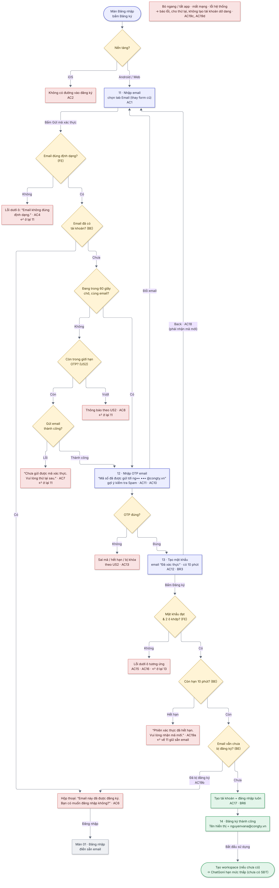

# 06  [EPIC-SĐT] US6 – Đăng ký bằng email với xác thực OTP

# 06 \[EPIC-SĐT\] US6 – Đăng ký bằng email với xác thực OTP

> **Tóm tắt:** Nhập email → OTP email → tạo mật khẩu → đăng ký thành công; thay form đăng ký email cũ · **Nền tảng:** Android, Web · **Màn:** 11–14 · **Số AC:** 19 · **Priority:** High · **Trạng thái:** READY
>
> **Phụ trách:** BE Chiến · FE mobile Hiếu (FE) · QA Hồng · Design Hiếu · BA Chình
>
> **Epic:** <https://docs.gopany.tech/s/8fea0a57-d3ce-477d-aac2-d08b7036856c> · **Figma:** <https://www.figma.com/design/aPKF4iF1YI2FPUwvdrz56V/Gopany-v1.1?node-id=1609-4700>

## 1. Background

* Form đăng ký email hiện dài (họ tên, email, SĐT, mật khẩu, xác nhận mật khẩu) và không xác thực email/SĐT.
* Tài khoản tạo dễ nên có rủi ro spam ChatGoni; email phải được xác thực bằng OTP.
* Dùng chung màn OTP (US2) và bước tạo mật khẩu với đăng ký SĐT (US1).

## 2. User Story

Là **người dùng mới**, tôi muốn **đăng ký bằng email qua vài bước ngắn**, để **bắt đầu nhanh và chắc chắn email của tôi đúng**.

## 3. Scope

**Trong phạm vi:**

* Tab "Email" trên màn đăng ký (Android, Web), thay form đăng ký email cũ.
* Luồng 3 bước: nhập email → OTP email → tạo mật khẩu; màn đăng ký thành công.
* Trên mobile: màn riêng trong app, không mở trang web.

**Ngoài phạm vi:**

* Đăng ký trên iOS · giới hạn OTP (xem US2) · đăng ký bằng Google (xem US9).
* Chặn email tạm thời / danh sách chặn email.

## 4. User flow

 

*Nhãn AC/BR trên sơ đồ khớp với mục 6 và 7 bên dưới.*

## 5. Wireframe

*Giao diện theo Figma final của Hiếu (Design):* [*https://www.figma.com/design/aPKF4iF1YI2FPUwvdrz56V/Gopany-v1.1?node-id=1609-4700*](https://www.figma.com/design/aPKF4iF1YI2FPUwvdrz56V/Gopany-v1.1?node-id=1609-4700) *· Lỗi OTP xem US2 · Nút "Tiếp tục với Google" xem US9.*

| Màn | Nội dung |
|-----|----------|
| 11  | Thanh bước 1/3 · "Đăng ký" + "Tạo tài khoản Gopany bằng email" · tab Số điện thoại / Email (đang chọn Email) · ô "Nhập email" · dòng "Mã xác thực sẽ gửi qua email này" · nút "Gửi mã xác thực" · nút "Tiếp tục với Google" · dòng Điều khoản & Chính sách bảo mật · "Đã có tài khoản? Đăng nhập" |
| 12  | Thanh bước 2/3 · màn nhập OTP email (component US2): "Mã số đã được gửi tới ng•• ••• @congty.vn" · link "Đổi email" · dòng "Không thấy mã? Kiểm tra hộp thư Spam/Quảng cáo." |
| 13  | Thanh bước 3/3 · "Tạo mật khẩu" · email + nhãn "Đã xác thực" · ô "Nhập mật khẩu" và ô "Nhập lại mật khẩu", mỗi ô có nút Hiện · dòng quy định luôn hiện dưới ô mật khẩu · nút "Đăng ký" · nút Back |
| 14  | Dấu tích xanh · "Đăng ký thành công" · "Tài khoản của bạn đã được tạo với email [nguyenvana@congty.vn](mailto:nguyenvana@congty.vn)." · ô "Tên hiển thị: [nguyenvana@congty.vn](mailto:nguyenvana@congty.vn), bạn có thể đổi trong Tài khoản → Thông tin tài khoản" · nút "Bắt đầu sử dụng" |

## 6. Business Rules

| Mã  | Quy tắc |
|-----|---------|
| BR1 | **Email hợp lệ:** dạng ten@tenmien.duoi, đúng 1 dấu @, tên miền có dấu chấm, đuôi tối thiểu 2 chữ cái, không khoảng trắng, không dấu tiếng Việt, tối đa 254 ký tự. Khoảng trắng đầu/cuối tự cắt. Cho phép `. _ - +` trước @ (VD [a.b+1@gmail.com](mailto:a.b+1@gmail.com) hợp lệ và được coi là email khác với [a.b@gmail.com](mailto:a.b@gmail.com)). |
| BR2 | Chỉ email chưa gắn tài khoản nào mới được đăng ký. Kiểm tra trùng **không phân biệt hoa/thường** ([ABC@gmail.com](mailto:ABC@gmail.com) = [abc@gmail.com](mailto:abc@gmail.com)). |
| BR3 | Nhập đúng OTP thì có **10 phút** để tạo mật khẩu. Kết quả xác thực chỉ dùng 1 lần, gắn với phiên đăng ký đó. Quá 10 phút, bỏ ngang hoặc bấm Back thì phải nhận mã mới (tính vào giới hạn 5 mã/24 giờ của US2). |
| BR4 | **Mật khẩu:** 8–16 ký tự, có chữ, có số, có ký tự đặc biệt, không khoảng trắng, không dấu tiếng Việt. Ô "Nhập lại mật khẩu" phải khớp. *(Chờ Chiến xác nhận có bắt buộc chữ hoa + chữ thường không)* |
| BR5 | Chỉ tạo tài khoản khi đã xác thực OTP, mật khẩu hợp lệ và 2 ô khớp. Không tạo tài khoản dở dang. |
| BR6 | Không nhập họ tên, SĐT. Tên tự tạo = email đăng ký đầy đủ (VD [nguyenvana@congty.vn](mailto:nguyenvana@congty.vn)), sửa được trong Thông tin tài khoản (US5). Đăng ký xong thì **đăng nhập luôn** (API trả token). |
| BR7 | Tài khoản email mới **chưa có SĐT** → ChatGoni ở hạn mức thấp, không dùng Pro cho đến khi thêm SĐT (US5, US7). |
| BR8 | Không giới hạn IP. |
| BR9 | **Hai phiên cùng đăng ký một email:** không chặn phiên nào; phiên tạo tài khoản trước thì thành công, phiên sau báo email đã được đăng ký. BE dùng mã đăng ký 1 lần + khóa khi tạo + ràng buộc duy nhất trong DB. |
| BR10 | Kiểm tra 2 lớp: FE kiểm tra định dạng ngay tại ô; BE kiểm tra lại toàn bộ + quy tắc nghiệp vụ và trả mã lỗi. |

## 7. Acceptance Criteria

*Cột "Kết quả mong đợi": **FE** = kiểm tra ngay tại ô · **BE** = kiểm tra sau khi bấm nút · nội dung trong "…" là câu hiển thị chính xác. Cột Mã lỗi BE do Chiến điền.*

| Mã  | Tình huống | Kết quả mong đợi | Mã lỗi BE |
|-----|------------|------------------|-----------|
| **Hiển thị** |            |                  |           |
| AC1 | Mở màn đăng ký trên Android/Web, chọn tab "Email" | Hiện màn 11 thay cho form đăng ký email cũ (không còn ô họ tên, SĐT) |           |
| AC2 | Dùng app iOS theo mọi đường | Không vào được màn đăng ký |           |
| **Bước 1 – Nhập email (11)** |            |                  |           |
| AC3 | Chưa nhập hoặc chỉ nhập khoảng trắng | FE · nút "Gửi mã xác thực" mờ, không hiện thông báo |           |
| AC4 | Email sai định dạng (VD abc@gmail, abc@@gmail.com, a [b@gmail.com](mailto:b@gmail.com), abc@gmail.c, nguyễn@gmail.com) | FE + BE · lỗi dưới ô email, ô tô đỏ: "Email không đúng định dạng." · không gửi mã |           |
| AC5 | Nhập " [ABC@Gmail.com](mailto:ABC@Gmail.com) " hoặc [a.b+1@gmail.com](mailto:a.b+1@gmail.com) | Tự cắt khoảng trắng; kiểm tra trùng không phân biệt hoa/thường; alias có "+" hợp lệ |           |
| AC6 | Email đã có tài khoản | BE · không gửi OTP · hộp thoại \[Hủy\] \[Đăng nhập\]: "Email này đã được đăng ký. Bạn có muốn đăng nhập không?" · bấm Đăng nhập → màn 01, điền sẵn email · bấm Hủy → đóng, ở lại 11 |           |
| AC7 | Không gửi được email | BE · thông báo: "Chưa gửi được mã xác thực. Vui lòng thử lại sau." · ở lại 11 |           |
| AC8 | Vượt 5 mã/24 giờ, bị chặn ngầm, hệ thống bận | BE · thông báo theo US2 · ở lại 11 |           |
| AC9 | Bấm "Gửi mã xác thực" nhiều lần liên tiếp | FE · nút chuyển sang trạng thái đang tải và mờ, chỉ gửi 1 yêu cầu |           |
| AC10 | Đang trong 60 giây chờ, quay lại 11 và bấm gửi lại cùng email | Vào thẳng 12 với đếm ngược còn lại; không gửi mã mới, không báo lỗi |           |
| AC11a | Đổi email quá 3 lần một ngày  | Thông báo lỗi tại ô nhập "Bạn đã gửi quá nhiều yêu cầu. Vui lòng thử lại sau." |           |
| **Bước 2 – Nhập OTP (12)** |            |                  |           |
| AC11 | Gửi mã với email hợp lệ | OTP gửi qua email (mẫu 23) · màn 12 hiện "Mã số đã được gửi tới ng•• ••• @congty.vn", link "Đổi email", gợi ý kiểm tra Spam, đếm ngược gửi lại 60 giây |           |
| AC12 | Nhập đúng OTP | Sang 13, email hiện nhãn "Đã xác thực" |           |
| AC13 | Sai mã, hết hạn, gửi quá nhiều, bị khóa | Theo US2         |           |
| **Bước 3 – Tạo mật khẩu (13) & thành công (14)** |            |                  |           |
| AC14 | Chưa nhập đủ 2 ô | FE · nút "Đăng ký" mờ, không hiện thông báo |           |
| AC15 | Mật khẩu chưa đạt quy định | FE + BE · dòng quy định dưới ô mật khẩu chuyển đỏ, ô tô đỏ: "Mật khẩu phải có từ 8–16 ký tự, gồm chữ, số và ký tự đặc biệt, không có khoảng trắng hoặc dấu tiếng Việt." · chưa tạo tài khoản |           |
| AC16 | Ô Nhập lại mật khẩu không khớp | FE · lỗi dưới ô Nhập lại mật khẩu, ô tô đỏ: "Mật khẩu xác nhận không khớp. Vui lòng nhập lại." · chưa tạo tài khoản |           |
| AC17 | Mật khẩu hợp lệ, bấm Đăng ký | BE · nút chuyển sang đang tải · tạo tài khoản và đăng nhập luôn → màn 14: "Đăng ký thành công" + "Tài khoản của bạn đã được tạo với email [nguyenvana@congty.vn](mailto:nguyenvana@congty.vn)." + "Tên hiển thị: [nguyenvana@congty.vn](mailto:nguyenvana@congty.vn), bạn có thể đổi trong Tài khoản → Thông tin tài khoản" · bấm "Bắt đầu sử dụng" → tạo workspace (nếu chưa có) → ChatGoni chat ngay ở hạn mức thấp |           |
| AC18 | Bấm Back ở 13 (nút trên màn hoặc back hệ thống) | FE · về 11, giữ sẵn email đã nhập, không hỏi xác nhận · kết quả xác thực cũ hết hiệu lực, phải gửi OTP mới |           |
| **Lỗi khi tạo tài khoản & lỗi chung** |            |                  |           |
| AC19 | Bấm Đăng ký nhưng: (a) đã quá 10 phút sau khi xác thực OTP · (b) người khác vừa đăng ký xong cùng email · (c) mất mạng / lỗi hệ thống · (d) trước đó đã bỏ ngang hoặc tắt app | Không tạo tài khoản, không có tài khoản dở dang. (a) BE · thông báo "Phiên xác thực đã hết hạn. Vui lòng nhận mã mới." → về 11 giữ sẵn email. (b) BE · hộp thoại \[Hủy\] \[Đăng nhập\]: "Email này đã được đăng ký. Bạn có muốn đăng nhập không?" (c) Thông báo theo Epic mục 6, ở lại 13, cho bấm lại. (d) Mở lại app thì bắt đầu từ 11. | (b) 30103 |

## 8. Dependencies

* US2 (dịch vụ OTP dùng chung) xong trước; US1 dùng chung bước tạo mật khẩu.
* BE1: giải pháp Keycloak cấp token cho màn riêng trong app (Chiến).
* Dịch vụ gửi email OTP; email mẫu 23 (OTP đăng ký): Design bàn giao HTML cho BE.
* Luồng tạo workspace hiện có dùng lại được sau đăng ký.
* Web: thay form đăng ký email cũ khi web cập nhật (mobile làm trước).
* Môi trường test cho QA: nhiều hộp thư test (Gmail, email công ty), rút ngắn được mốc 10 phút.

## 9. Open Questions

| #   | Câu hỏi | Người chốt | Kết quả |
|-----|---------|------------|---------|
| 1   | Mật khẩu có bắt buộc chữ hoa + chữ thường không? Có nới tối đa lên 64 ký tự không? | Chiến      |         |
| 2   | Địa chỉ gửi email OTP và cách giảm vào Spam | Chiến      |         |

## 10. Lịch sử thay đổi

| Ngày | Nội dung | Người quyết định |
|------|----------|------------------|
| 19/10/2026 | Thêm AC11a |                  |
| 19/10/2026 | Bản final: thêm quy tắc định dạng email (cho phép alias "+"), kiểm tra trùng không phân biệt hoa/thường; quy tắc 10 phút, nút Back, 2 phiên đồng thời, đăng nhập luôn sau đăng ký, gửi lại trong 60 giây; bỏ danh sách chặn email; gộp nội dung thông báo vào AC; câu chữ khớp design final; gắn Figma | Hường            |
| 16/10/2026 | Thêm AC nút mờ khi chưa nhập (màn 11, 13) | Chình            |
| 12/10/2026 | Tên tự tạo = email đăng ký; thêm ô Xác nhận mật khẩu | Hường            |
| 08/10/2026 | Thêm đăng ký email bằng OTP (thay form cũ) | Hường            |