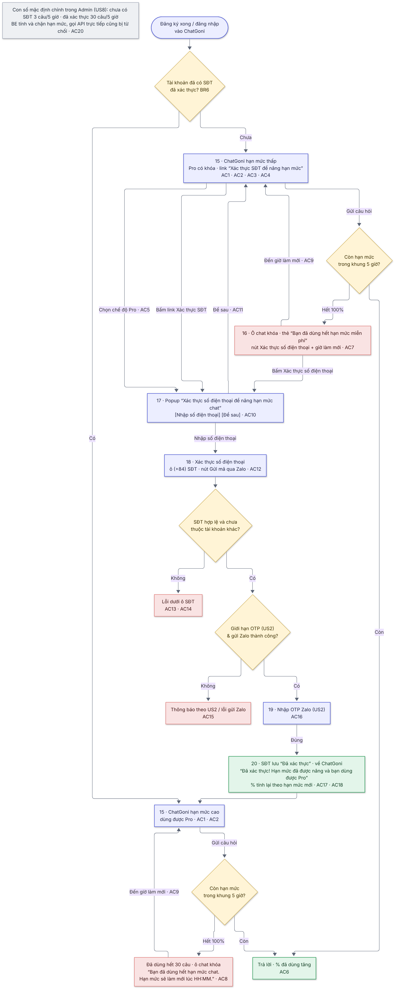

# 07  [EPIC-SĐT] US7 – Hạn mức ChatGoni & xác thực SĐT để nâng hạn mức, mở Pro

# 07 \[EPIC-SĐT\] US7 – Hạn mức ChatGoni & xác thực SĐT để nâng hạn mức, mở Pro

> **Tóm tắt:** Chat ngay sau đăng ký; hạn mức theo khung 5 giờ, app hiện %; hết hạn mức hoặc chọn Pro → xác thực SĐT qua Zalo để nâng hạn mức và mở Pro · **Nền tảng:** Android, iOS, Web · **Màn:** 15–20 · **Số AC:** 20 · **Priority:** High · **Trạng thái:** READY
>
> **Phụ trách:** BE Chiến · FE mobile Hiếu (FE) · QA Hồng · Design Hiếu · BA Chình
>
> **Epic:** <https://docs.gopany.tech/s/8fea0a57-d3ce-477d-aac2-d08b7036856c> · **Figma:** <https://www.figma.com/design/aPKF4iF1YI2FPUwvdrz56V/Gopany-v1.1?node-id=1609-4700>

## 1. Background

* ChatGoni là màn đầu tiên sau đăng nhập; mặc định chế độ **Tức thì** (Tức thì → Chuyên sâu → Pro).
* Tài khoản email/Google tạo dễ → nguy cơ spam ChatGoni gây thiệt hại chi phí.
* Sếp chốt: không chặn ngay sau đăng ký (dễ làm mất người dùng); cho chat ít, rồi yêu cầu xác thực SĐT để dùng nhiều hơn và dùng Pro.

## 2. User Story

Là **Gopany**, chúng tôi muốn **giới hạn lượng dùng ChatGoni theo mức xác thực của tài khoản**, để **người dùng mới thử được ngay nhưng không thể spam gây thiệt hại chi phí**.

## 3. Scope

**Trong phạm vi:**

* Hiển thị % hạn mức khung 5 giờ; khóa Pro khi chưa xác thực SĐT.
* Thẻ hết hạn mức; popup và luồng xác thực SĐT ngay trong ChatGoni.
* BE tính và chặn theo hạn mức.

**Ngoài phạm vi:**

* Trang Admin cấu hình con số (US8).
* Gói trả phí khi đã xác thực mà vẫn hết hạn mức · tracking sự kiện.

## 4. User flow

 

*Nhãn AC/BR trên sơ đồ khớp với mục 6 và 7 bên dưới.*

## 5. Wireframe

*Giao diện theo Figma final của Hiếu (Design):* [*https://www.figma.com/design/aPKF4iF1YI2FPUwvdrz56V/Gopany-v1.1?node-id=1609-4700*](https://www.figma.com/design/aPKF4iF1YI2FPUwvdrz56V/Gopany-v1.1?node-id=1609-4700) *· Màn OTP và lỗi OTP xem US2.*

| Màn | Nội dung |
|-----|----------|
| 15  | ChatGoni: "Xin chào, mình là Goni" + gợi ý câu hỏi · ô chat có nút chọn chế độ (Tức thì / Chuyên sâu / Pro) · thanh hạn mức + "X%" dưới ô chat · tài khoản chưa xác thực: link "Xác thực SĐT để nâng hạn mức"; trong menu chế độ, Pro có biểu tượng khóa + "Pro cần xác thực số điện thoại" |
| 16  | Hết hạn mức (chưa xác thực): thanh 100% đỏ · thẻ "Bạn đã dùng hết hạn mức miễn phí" + mô tả + nút "Xác thực số điện thoại" · ô chat khóa "Hết hạn mức, làm mới lúc HH:MM". Hết hạn mức (đã xác thực, hết 30 câu): thanh 100% · thông báo "Bạn đã dùng hết hạn mức chat. Hạn mức sẽ làm mới lúc HH:MM." · ô chat khóa "Hết hạn mức, làm mới lúc HH:MM"; không có nút xác thực |
| 17  | Popup "Xác thực số điện thoại để nâng hạn mức chat": lợi ích (hạn mức cao hơn · mở chế độ Pro · chỉ làm 1 lần qua Zalo) · nút "Nhập số điện thoại" · nút "Để sau" |
| 18  | "Xác thực số điện thoại": "Nhập số điện thoại có dùng Zalo. Chúng tôi sẽ gửi mã xác thực qua Zalo." · ô "(+84) Nhập số điện thoại" · nút "Gửi mã qua Zalo" |
| 19  | Nhập OTP Zalo (component US2) |
| 20  | Quay về ChatGoni với thông báo xanh "Đã xác thực! Hạn mức đã được nâng và bạn dùng được Pro" · thanh % tính lại |

## 6. Business Rules

| Mã  | Quy tắc |
|-----|---------|
| BR1 | **Khung 5 giờ:** khung bắt đầu từ câu hỏi đầu tiên khi chưa có khung nào đang chạy, kéo dài 5 giờ; hết khung thì hạn mức về 0 và khung mới bắt đầu ở câu hỏi tiếp theo. "Giờ làm mới" = thời điểm kết thúc khung hiện tại. |
| BR2 | **Cách đếm:** 1 câu = 1 tin nhắn người dùng gửi và được ChatGoni trả lời thành công. Câu lỗi, không có câu trả lời thì không tính. |
| BR3 | **Chưa xác thực SĐT:** hạn mức thấp (mặc định **3 câu/5 giờ**), không dùng được Pro. |
| BR4 | **Đã xác thực SĐT:** hạn mức cao (mặc định **30 câu/5 giờ**), dùng được Pro. Câu hỏi ở chế độ Pro **tính chung** hạn mức. Hết 30 câu thì vẫn bị chặn và thông báo, chờ đến giờ làm mới (chưa có gói trả phí trong Epic này). |
| BR5 | App chỉ hiện **% đã dùng** và **giờ làm mới**, không hiện số câu. |
| BR6 | **"Đã xác thực SĐT"** = tài khoản có SĐT đã xác thực (đăng ký bằng SĐT, thêm SĐT ở Thông tin tài khoản – US5, hoặc xác thực ở đây). Tài khoản chỉ có email/Google, hoặc có SĐT cũ chưa xác thực, đều tính là chưa xác thực. |
| BR7 | Xác thực SĐT ở ChatGoni **không hỏi mật khẩu**, không giới hạn IP; có hiệu lực như thêm SĐT lần đầu ở US5 (SĐT lưu vào tài khoản, dùng được để đăng nhập). |
| BR8 | **1 SĐT chỉ mở khóa cho 1 tài khoản.** SĐT đã thuộc tài khoản khác thì không xác thực được. |
| BR9 | **Xác thực giữa khung:** khung giữ nguyên, % tính lại ngay theo hạn mức mới (VD đã dùng 3/3 câu → sau khi xác thực thành 3/30 = 10%). |
| BR10 | Các con số (3 câu, 30 câu, 5 giờ) chỉnh được trong Admin (US8). BE tính và chặn hạn mức; gọi API trực tiếp khi đã hết hạn mức cũng bị từ chối. |

## 7. Acceptance Criteria

*Cột "Kết quả mong đợi": **FE** = kiểm tra ngay trên màn · **BE** = kiểm tra phía server · nội dung trong "…" là câu hiển thị chính xác. Cột Mã lỗi BE do Chiến điền.*

| Mã  | Tình huống | Kết quả mong đợi | Mã lỗi BE |
|-----|------------|------------------|-----------|
| **Chat ngay (15)** |            |                  |           |
| AC1 | Đăng ký xong / đăng nhập lần đầu | Vào ChatGoni chat được ngay, không có popup, mặc định chế độ Tức thì |           |
| AC2 | Đang dùng ChatGoni | Dưới ô chat hiện thanh hạn mức + "X%" đã dùng trong khung 5 giờ hiện tại |           |
| AC3 | Tài khoản chưa xác thực SĐT | Có link "Xác thực SĐT để nâng hạn mức" dưới thanh hạn mức → bấm mở popup 17 |           |
| AC4 | Mở chọn chế độ khi chưa xác thực | Pro có biểu tượng khóa + dòng "Pro cần xác thực số điện thoại" |           |
| AC5 | Chọn Pro khi chưa xác thực | Không chuyển chế độ · mở popup 17 |           |
| AC6 | Gửi câu hỏi khi còn hạn mức | Trả lời bình thường · % tăng theo BR2 (câu lỗi không tính) |           |
| **Hết hạn mức (16)** |            |                  |           |
| AC7 | Chưa xác thực, dùng hết 100% | BE chặn · thanh 100% · thẻ "Bạn đã dùng hết hạn mức miễn phí" + mô tả xác thực SĐT qua Zalo hoặc chờ đến HH:MM + nút "Xác thực số điện thoại" · ô chat khóa "Hết hạn mức, làm mới lúc HH:MM" |           |
| AC8 | Đã xác thực, dùng hết 100% (mặc định 30 câu trong khung 5 giờ) | BE chặn, không cho gửi thêm · thanh 100% · thông báo trên ô chat: "Bạn đã dùng hết hạn mức chat. Hạn mức sẽ làm mới lúc HH:MM." · ô chat khóa "Hết hạn mức, làm mới lúc HH:MM" · không có thẻ/nút xác thực (đã xác thực rồi) |           |
| AC9 | Đến giờ làm mới | Ô chat mở lại, % về 0, chat lại được |           |
| **Popup & xác thực (17–20)** |            |                  |           |
| AC10 | Mở popup 17 | Tiêu đề "Xác thực số điện thoại để nâng hạn mức chat" · 3 lợi ích: hạn mức cao hơn, mở chế độ Pro, chỉ làm 1 lần qua Zalo · nút "Nhập số điện thoại", "Để sau" |           |
| AC11 | Bấm "Để sau" | Đóng popup, giữ nguyên trạng thái và chế độ trước đó |           |
| AC12 | Bấm "Nhập số điện thoại" | Mở màn 18 "Xác thực số điện thoại" (không có ô mật khẩu) |           |
| AC13 | Chưa nhập SĐT / SĐT sai định dạng | FE · nút "Gửi mã qua Zalo" mờ khi chưa nhập · sai định dạng: lỗi dưới ô "Số điện thoại không đúng định dạng." · không gửi mã |           |
| AC14 | SĐT đã thuộc tài khoản khác | BE · lỗi dưới ô: "Số điện thoại này đã được dùng cho một tài khoản khác." · không gửi mã |           |
| AC15 | Vượt giới hạn OTP, bị chặn ngầm, không gửi được Zalo | Thông báo theo US2 · không gửi Zalo được: "Không gửi được mã qua Zalo. Vui lòng thử lại sau." · ở lại 18 |           |
| AC16 | Màn OTP 19 (sai, hết hạn, gửi lại, bị khóa, Đổi số) | Theo US2         |           |
| AC17 | Nhập đúng OTP | SĐT lưu vào tài khoản "Đã xác thực" · về ChatGoni với thông báo "Đã xác thực! Hạn mức đã được nâng và bạn dùng được Pro" · % tính lại theo hạn mức mới (BR9) · Pro mở khóa · chế độ đang chọn giữ nguyên, người dùng tự chọn Pro nếu muốn |           |
| AC18 | Sau khi xác thực ở ChatGoni | Thông tin tài khoản (US5) hiện SĐT "Đã xác thực" · đăng nhập được bằng SĐT + mật khẩu hiện tại (nếu tài khoản có mật khẩu) |           |
| **Hệ thống** |            |                  |           |
| AC19 | Tài khoản có SĐT cũ chưa xác thực (form cũ) | Tính là chưa xác thực: hạn mức thấp, Pro khóa, có link/popup xác thực |           |
| AC20 | Kiểm tra hạn mức phía BE | BE tính đúng theo khung 5 giờ (BR1, BR2) và theo con số trong Admin (US8) · gọi API trực tiếp khi đã hết hạn mức cũng bị từ chối |           |

## 8. Dependencies

* US2 (component OTP, giới hạn OTP); US5 dùng chung trạng thái và API thêm SĐT.
* US8 (Admin cấu hình con số) cần có trước release US7; trước khi có US8 thì BE dùng giá trị mặc định 3 / 30 / 5 giờ.
* Design: bổ sung popup 17; đổi tiêu đề màn 18 thành "Xác thực số điện thoại"; đổi chữ "Nhập mã xác thực" ở link (15) và nút (16) thành "Xác thực SĐT để nâng hạn mức" / "Xác thực số điện thoại".
* Môi trường test cho QA: rút ngắn được khung 5 giờ, chỉnh được hạn mức nhỏ (VD 1–2 câu) để test nhanh.

## 9. Open Questions

| #   | Câu hỏi | Người chốt | Kết quả |
|-----|---------|------------|---------|
| 1   | Cách tính khung 5 giờ (BR1) và cách đếm câu (BR2) BE làm được như mô tả không? | Chiến      |         |

## 10. Lịch sử thay đổi

| Ngày | Nội dung | Người quyết định |
|------|----------|------------------|
| 19/10/2026 | Đã xác thực mà hết 30 câu/5 giờ vẫn chặn và có thông báo riêng (BR4, AC8); bỏ tự chuyển sang Pro sau khi xác thực (AC17) | Hường            |
| 19/10/2026 | Bản final: định nghĩa khung 5 giờ và cách đếm câu; xác thực giữa khung tính lại % ngay; xác thực ở ChatGoni không hỏi mật khẩu; SĐT cũ chưa xác thực tính là chưa xác thực; 1 SĐT chỉ mở khóa 1 tài khoản; gộp nội dung thông báo vào AC; câu chữ khớp design final; gắn Figma | Hường            |
| 16/10/2026 | Thêm AC nút mờ khi chưa nhập SĐT (màn 18) | Chình            |
| 09/10/2026 | ChatGoni chat ngay; hạn mức khung 5 giờ hiện %; chưa xác thực 3 câu, đã xác thực 30 câu (chỉnh trong Admin); Pro cần xác thực SĐT, tính chung hạn mức | anh Vương        |