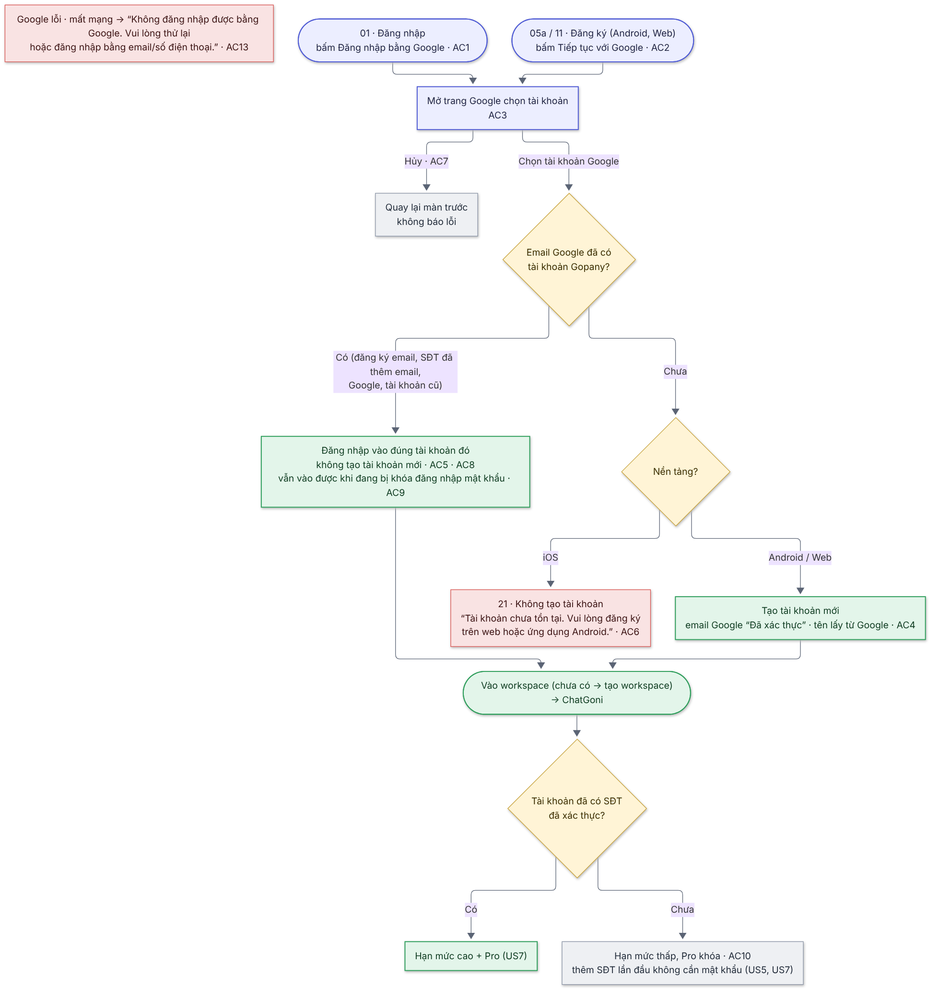

# 09  [EPIC-SĐT] US9 – Đăng ký & đăng nhập bằng Google

# 09 \[EPIC-SĐT\] US9 – Đăng ký & đăng nhập bằng Google

> **Tóm tắt:** Giữ nút Google, bổ sung quy tắc cho tài khoản mới, trùng email, iOS, mật khẩu và hạn mức ChatGoni · **Nền tảng:** Android, iOS, Web · **Màn:** 01, 05a/11, 21 · **Số AC:** 13 · **Priority:** High · **Trạng thái:** READY
>
> **Phụ trách:** BE Chiến · FE mobile Hiếu (FE) · QA Hồng · Design Hiếu · BA Chình
>
> **Epic:** <https://docs.gopany.tech/s/8fea0a57-d3ce-477d-aac2-d08b7036856c> · **Figma:** <https://www.figma.com/design/aPKF4iF1YI2FPUwvdrz56V/Gopany-v1.1?node-id=1609-4700>

## 1. Background

* Đăng nhập Google đang có trên cả 3 nền tảng.
* Epic thay đổi cách đăng ký (OTP, tên tự tạo), thêm hạn mức ChatGoni và quy tắc mỗi email chỉ gắn 1 tài khoản → luồng Google cần quy tắc đi kèm.
* iOS không có đăng ký trong app; nếu Google tự tạo tài khoản trên iOS thì thành đăng ký trong app (rủi ro Apple, guideline 4.8 – Sign in with Apple).

## 2. User Story

Là **người dùng có tài khoản Google**, tôi muốn **đăng ký và đăng nhập Gopany bằng Google chỉ với vài chạm**, để **không phải nhớ thêm mật khẩu**.

## 3. Scope

**Trong phạm vi:**

* Đăng ký bằng Google (Android, Web); đăng nhập bằng Google (mọi nền tảng).
* Gộp vào tài khoản đã có khi trùng email.
* Trạng thái xác thực và hạn mức ChatGoni cho tài khoản Google.
* Trên mobile: mở trang Google chọn tài khoản rồi quay về app (Epic #19).

**Ngoài phạm vi:**

* Sign in with Apple · đăng nhập Facebook/Zalo.
* Hủy liên kết Google khỏi tài khoản · đổi email gắn Google.

## 4. User flow

 

*Nhãn AC/BR trên sơ đồ khớp với mục 6 và 7 bên dưới.*

## 5. Wireframe

*Giao diện theo Figma final của Hiếu (Design):* [*https://www.figma.com/design/aPKF4iF1YI2FPUwvdrz56V/Gopany-v1.1?node-id=1609-4700*](https://www.figma.com/design/aPKF4iF1YI2FPUwvdrz56V/Gopany-v1.1?node-id=1609-4700)

| Màn | Nội dung |
|-----|----------|
| 01  | Đăng nhập: nút "Đăng nhập bằng Google" dưới dòng "Hoặc" (mọi nền tảng) |
| 05a / 11 | Đăng ký: nút "Tiếp tục với Google" dưới dòng "Hoặc" (Android, Web) |
| 21  | iOS – email Google chưa có tài khoản: thông báo "Tài khoản chưa tồn tại. Vui lòng đăng ký trên web hoặc ứng dụng Android.", không tạo tài khoản |

## 6. Business Rules

| Mã  | Quy tắc |
|-----|---------|
| BR1 | Email Google được tính là **email đã xác thực**, không cần OTP. |
| BR2 | Email Google trùng email đã xác thực của một tài khoản có sẵn (đăng ký email, đăng ký SĐT đã thêm email, Google, tài khoản cũ, được mời) → **đăng nhập vào tài khoản đó**, không tạo tài khoản mới. So khớp không phân biệt hoa/thường. |
| BR3 | **Android, Web:** email Google chưa có tài khoản → tạo tài khoản mới; họ tên lấy từ tên Google (sửa được trong Thông tin tài khoản – US5). Không giới hạn IP. |
| BR4 | **iOS:** email Google chưa có tài khoản → **không tạo tài khoản**, hiện màn 21 hướng dẫn đăng ký trên web/Android. |
| BR5 | Tài khoản Google chưa có SĐT → ChatGoni hạn mức thấp, không dùng Pro cho đến khi thêm SĐT (US7). Thêm SĐT lần đầu không cần mật khẩu (US5). |
| BR6 | Tài khoản tạo bằng Google không có mật khẩu. Muốn đăng nhập bằng email/SĐT + mật khẩu thì đặt mật khẩu qua Quên mật khẩu (US4) bằng email Google; đặt xong vẫn dùng Google như cũ. |
| BR7 | Email gắn Google không đổi được trong Thông tin tài khoản (US5 BR7). |
| BR8 | Tài khoản đang bị tạm khóa đăng nhập bằng mật khẩu (US3) **vẫn đăng nhập bằng Google được**. |

## 7. Acceptance Criteria

*Cột "Kết quả mong đợi": nội dung trong "…" là câu hiển thị chính xác. Cột Mã lỗi BE do Chiến điền.*

| Mã  | Tình huống | Kết quả mong đợi | Mã lỗi BE |
|-----|------------|------------------|-----------|
| **Hiển thị** |            |                  |           |
| AC1 | Màn đăng nhập 01 (mọi nền tảng) | Có nút "Đăng nhập bằng Google" |           |
| AC2 | Màn đăng ký 05a / 11 (Android, Web) | Có nút "Tiếp tục với Google" |           |
| AC3 | Bấm nút Google | Mở trang Google chọn tài khoản; chọn xong quay về app/web |           |
| **Đăng ký / đăng nhập** |            |                  |           |
| AC4 | Android/Web, email Google chưa có tài khoản | Tạo tài khoản: email "Đã xác thực", họ tên lấy từ Google → tạo workspace (nếu chưa có) → ChatGoni chat ngay |           |
| AC5 | Email Google đã có tài khoản (mọi nền tảng, mọi nguồn tạo tài khoản) | Đăng nhập vào đúng tài khoản đó, đúng workspace; không tạo tài khoản thứ hai |           |
| AC6 | iOS, email Google chưa có tài khoản | Không tạo tài khoản · màn 21: "Tài khoản chưa tồn tại. Vui lòng đăng ký trên web hoặc ứng dụng Android." · không có nút/link đăng ký |           |
| AC7 | Hủy giữa chừng ở trang chọn tài khoản Google | Quay lại màn trước, không báo lỗi |           |
| AC8 | Bấm "Tiếp tục với Google" ở màn đăng ký nhưng email Google đã có tài khoản | Đăng nhập luôn vào tài khoản đó (không báo "đã đăng ký") |           |
| AC9 | Tài khoản đang bị tạm khóa đăng nhập bằng mật khẩu | Đăng nhập bằng Google vẫn thành công |           |
| **Sau khi vào app** |            |                  |           |
| AC10 | Tài khoản Google chưa có SĐT mở ChatGoni | Hạn mức thấp, Pro có khóa, link/popup xác thực SĐT theo US7 |           |
| AC11 | Mở Thông tin tài khoản | Email hiện "Đã xác thực", không có nút sửa · SĐT hiện "Thêm số điện thoại" (thêm lần đầu không hỏi mật khẩu) |           |
| AC12 | Quên mật khẩu bằng email Google | Nhận OTP qua email, đặt mật khẩu mới · sau đó đăng nhập được bằng email + mật khẩu và vẫn dùng Google được |           |
| **Lỗi** |            |                  |           |
| AC13 | Google lỗi, mất mạng | Thông báo: "Không đăng nhập được bằng Google. Vui lòng thử lại hoặc đăng nhập bằng email/số điện thoại." · ở lại màn trước |           |

## 8. Dependencies

* BE1: giải pháp Keycloak cho đăng nhập Google trong app (mở trang Google chọn tài khoản, cấp token cho app) (Chiến).
* Cấu hình Google OAuth (client ID, redirect về app) cho Android, iOS, Web.
* US3 (màn đăng nhập), US4 (đặt mật khẩu cho tài khoản Google), US5 (thêm SĐT), US7 (hạn mức).
* Design: bổ sung màn 21 (iOS, email Google chưa có tài khoản).
* **AC6 phải có trước lần submit iOS tiếp theo**; cập nhật App Review Notes (iOS không có đăng ký, Google chỉ đăng nhập tài khoản đã có).
* Môi trường test cho QA: tài khoản Google chưa có trên Gopany, Google trùng email tài khoản email/SĐT, tài khoản đang bị khóa đăng nhập.

## 9. Open Questions

*Không còn câu hỏi mở.*

## 10. Lịch sử thay đổi

| Ngày | Nội dung | Người quyết định |
|------|----------|------------------|
| 19/10/2026 | Bản final: chốt iOS chỉ đăng nhập tài khoản đã có (#10), tài khoản Google đặt mật khẩu qua Quên mật khẩu (#11), không đổi email gắn Google (#12), mở trang Google chọn tài khoản (#19); khóa đăng nhập mật khẩu không chặn Google; bấm Google ở màn đăng ký mà email đã có tài khoản thì đăng nhập luôn; gộp nội dung thông báo vào AC; gắn Figma | Hường            |
| 09/10/2026 | Thêm US9 – Google theo quy tắc mới (gộp tài khoản trùng email, iOS chỉ đăng nhập tài khoản đã có) | Hường            |