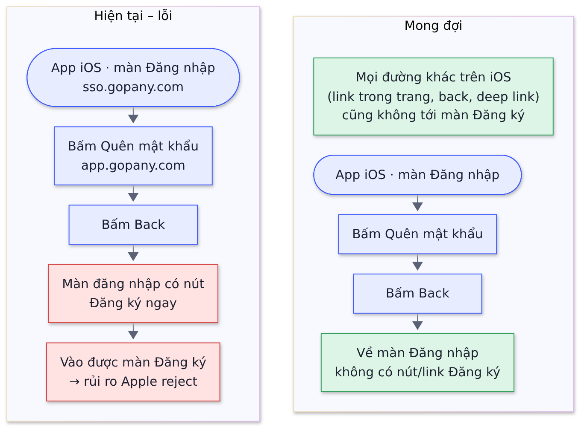

# 10  [BUG][iOS][Login] App iOS vào được màn đăng ký qua Quên mật khẩu → back

> **Mức độ:** High – rủi ro Apple reject · **Nền tảng:** iOS · **Phụ trách:** Hoàng (FE) · **Liên quan:** Chiến, Trà, Hường · **Làm:** ngay, không chờ Epic

## 1. Mô tả

Trên app iOS, người dùng vào được màn đăng ký qua đường Quên mật khẩu → back. iOS không được có đăng ký trong app (theo hướng đã được Apple duyệt). Sửa ngay cho bản đang chạy. Khi Epic lên, màn đăng nhập/quên mật khẩu làm riêng trong app (Epic #1) nên đường dẫn sang trang web này không còn.

## 2. User flow

 

## 3. Các bước tái hiện

1. Mở app iOS → màn đăng nhập (sso.gopany.com).
2. Bấm "Quên mật khẩu" (mở app.gopany.com).
3. Bấm Back.
4. Màn đăng nhập hiện nút "Đăng ký ngay" → bấm vào được màn đăng ký.

## 4. Kết quả hiện tại

Hiện nút "Đăng ký ngay" và vào được màn đăng ký trên iOS.

## 5. Kết quả mong đợi

Trên iOS không có đường nào tới màn/nút đăng ký – kể cả back, link trong trang, deep link.

## 6. Acceptance Criteria

| Mã  | Tình huống | Kết quả mong đợi |
|-----|------------|------------------|
| AC1 | Làm lại 4 bước tái hiện | Về màn đăng nhập, không có nút/link Đăng ký |
| AC2 | Rà mọi màn trên iOS (đăng nhập, quên mật khẩu, lỗi, hết phiên…) | Không có nút/link Đăng ký |
| AC3 | Mở link đăng ký trực tiếp trên iOS (deep link, link trong trang web) | Không vào được màn đăng ký |
| AC4 | Android, Web | Đăng ký vẫn hoạt động bình thường |