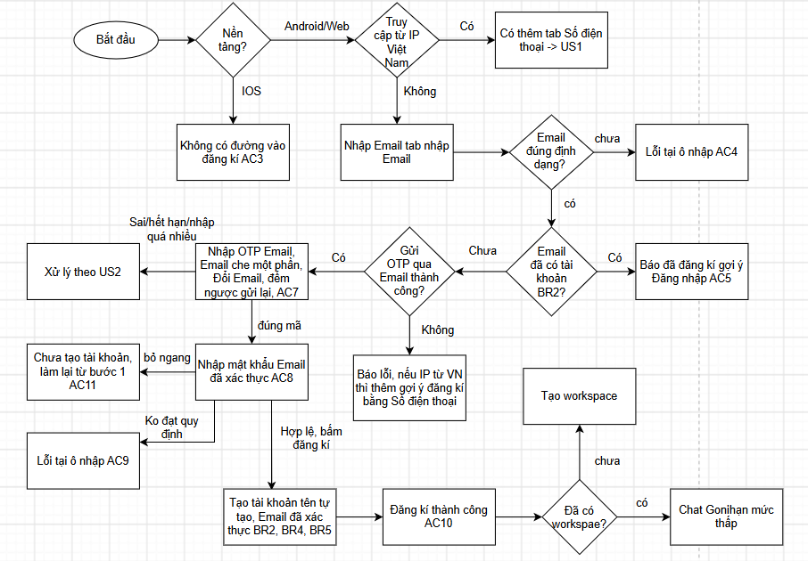
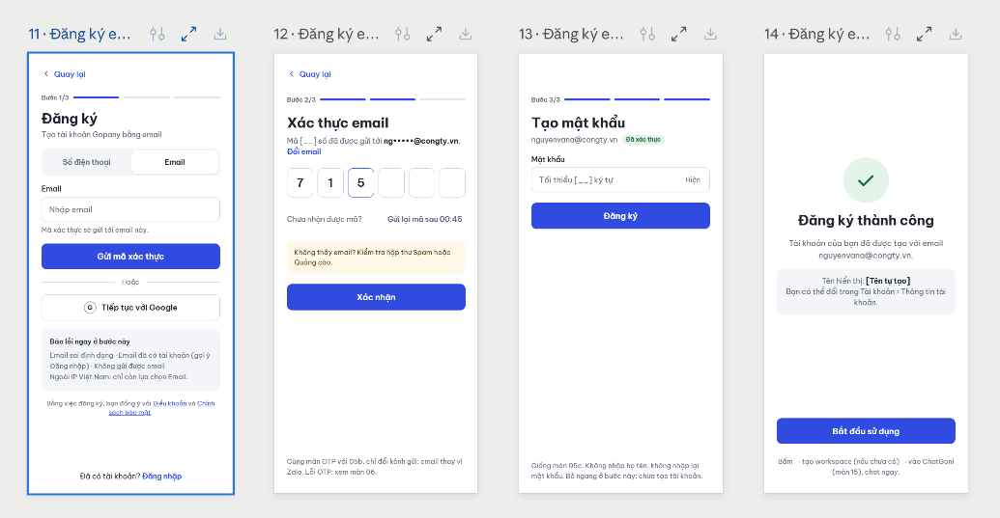

# Chình - [EPIC-SĐT] US6 – Đăng ký bằng email với xác thực OTP

> **Tóm tắt:** Nhập Email → OTP Email → nhập mật khẩu → đăng ký thành công · **Nền tảng:** Android, Web · **Wireframe:** 11-14 · **Số AC:** 12 · **Priority:** 

## 1. Background

Hiện tại, chức năng đăng ký tài khoản Gopany bằng Gmail chưa tích hợp xác thực OTP qua email. Quy trình đăng ký còn nhiều bước.

## 2. User Story

Là người dùng mới tại các quốc gia, tôi muốn đăng ký tài khoản Gopany bằng email và xác thực OTP qua email, để xác minh quyền truy cập email và bắt đầu sử dụng hệ thống nhanh chóng.

## 3. Scope

**Trong phạm vi:** tab "Gmail" trên màn đăng ký (Android, Web); luồng 3 bước; màn đăng ký thành công.

**Ngoài phạm vi:** iOS · giới hạn OTP (xem US2) · OTP qua SMS.

4. ## User flow

   

## 5. Wireframe

 

| Màn | Nội dung |
|-----|----------|
| 11  | Đăng ký – nhập số điện thoại |
| 12  | Nhập mã OTP gửi qua Email |
| 13  | Tạo mật khẩu |
| 14  | Đăng ký thành công |

## 6. Business Rules

| Mã  | Quy tắc |
|-----|---------|
| BR1 | Chỉ Gmail chưa gắn tài khoản nào mới được đăng ký. |
| BR2 | Chỉ tạo tài khoản khi đã xác thực OTP và nhập mật khẩu hợp lệ. |
| BR3 | Không nhập họ tên, không nhập lại mật khẩu; họ tên do hệ thống tự tạo, sửa được trong Thông tin tài khoản (US5). |
| BR4 | Gmail đăng ký xong ở trạng thái **Đã xác thực** → được hạn mức ChatGoni thấp và không cho dùng Pro ngay khi chưa xác thực SĐT. |

## 7. Acceptance Criteria

| Mã  | Tình huống | Kết quả mong đợi |
|-----|------------|------------------|
| **Hiển thị** |            |                  |
| AC1 | Mở màn đăng ký trên Android/Web từ IP VN | Có tab "Số điện thoại" và tab "Email" |
| AC2 | Mở màn đăng ký từ IP ngoài VN | Chỉ có đăng ký bằng Email |
| AC3 | Dùng app iOS theo mọi đường | Không vào được màn đăng ký |
| **Bước 1 – Nhập gmail (11)** |            |                  |
| AC4 | Gmail sai định dạng | Báo lỗi tại ô, không gửi mã |
| AC5 | Gmail đã có tài khoản | Không gửi OTP; báo đã đăng ký, gợi ý Đăng nhập |
| AC6 | Không gửi được qua Gmail | Báo lỗi, nếu từ IP VN thêm gợi ý đăng kí bằng số điện thoại |
| **Bước 2 – Nhập OTP (12)** |            |                  |
| AC7 | Bấm "Gửi mã" với Gmail hợp lệ | OTP gửi qua Zalo; màn OTP hiện Email che một phần, nút Đổi Email, đếm ngược gửi lại |
| AC8 | Nhập đúng OTP | Sang bước tạo mật khẩu, Email hiện "Đã xác thực" |
| **Bước 3 – Mật khẩu & thành công (13, 14)** |            |                  |
| AC9 | Mật khẩu không đạt quy định | Báo lỗi tại ô, chưa tạo tài khoản |
| AC10 | Mật khẩu hợp lệ, bấm Đăng ký | Tạo tài khoản; màn Đăng ký thành công hiện tên tự tạo + gợi ý đổi tên; bấm "Bắt đầu sử dụng" → tạo workspace (nếu chưa có) → vào ChatGoni |
| **Lỗi chung** |            |                  |
| AC11 | Bỏ ngang sau bước OTP | Chưa tạo tài khoản; quay lại phải làm từ bước 1 |
| AC12 | Lỗi mạng, Lỗi hệ thống | Cho thử lại, không treo, không tạo tài khoản dở dang |

## 8. Open Questions