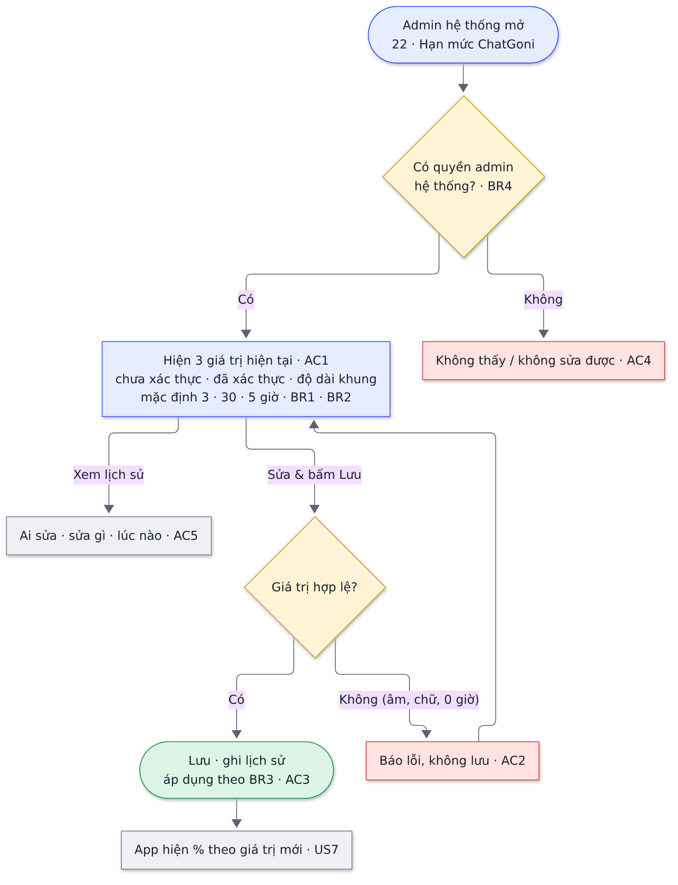
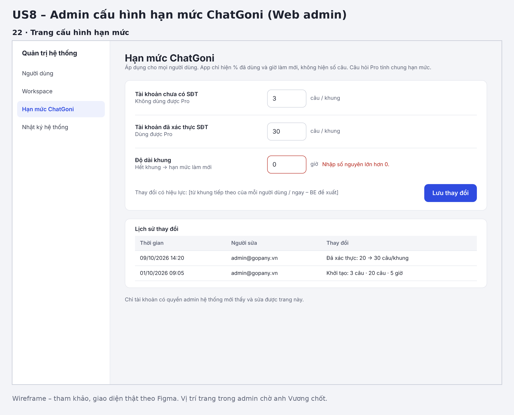

# Daft 08 -   [EPIC-SĐT] US8 – Admin cấu hình hạn mức ChatGoni

> **Tóm tắt:** Admin chỉnh hạn mức ChatGoni cho tài khoản chưa có SĐT / đã xác thực SĐT và độ dài khung · **Nền tảng:** Web admin · **Wireframe:** 22 · **Số AC:** 5 · **Priority:** Medium (cần có trước release US7)

## 1. Background

Sếp chốt các con số hạn mức (3 câu, 30 câu, khung 5 giờ) phải chỉnh được trong Admin để cân đối trải nghiệm và chi phí mà không cần sửa code, build lại.

## 2. User Story

Là **admin Gopany**, tôi muốn **chỉnh hạn mức ChatGoni mà không cần sửa code**, để **cân đối trải nghiệm người dùng và chi phí**.

## 3. Scope

**Trong phạm vi:** 1 trang cấu hình trong admin hệ thống với 3 giá trị; kiểm tra giá trị nhập; lịch sử thay đổi; phân quyền.

**Ngoài phạm vi:** hạn mức riêng theo từng người dùng/workspace · cấu hình theo từng chế độ (Tức thì, Chuyên sâu, Pro).

## 4. User flow

 

*Nhãn AC/BR trên sơ đồ khớp với mục 6 và 7 bên dưới.*

## 5. Wireframe

 

*Wireframe dùng để tham khảo; giao diện thật theo Figma. Vị trí trang trong admin chờ chốt.*

| Màn | Nội dung |
|-----|----------|
| 22  | Trang "Hạn mức ChatGoni": 3 ô số, nút Lưu, lịch sử thay đổi |

## 6. Business Rules

| Mã  | Quy tắc |
|-----|---------|
| BR1 | Cấu hình: số câu/khung cho tài khoản chưa có SĐT; số câu/khung cho tài khoản đã xác thực SĐT; độ dài khung (giờ). |
| BR2 | Mặc định: 3 câu · 30 câu · 5 giờ. |
| BR3 | Thay đổi có hiệu lực từ khung tiếp theo của mỗi người dùng \[hoặc ngay – BE đề xuất\]. |
| BR4 | Chỉ tài khoản có quyền admin hệ thống mới thấy và sửa được; lưu lịch sử thay đổi. |

## 7. Acceptance Criteria

| Mã  | Tình huống | Kết quả mong đợi |
|-----|------------|------------------|
| AC1 | Mở trang cấu hình | Hiện 3 giá trị hiện tại |
| AC2 | Nhập giá trị không hợp lệ (âm, chữ, 0 giờ) | Báo lỗi tại ô, không lưu |
| AC3 | Lưu giá trị hợp lệ | Áp dụng theo BR3; app hiện % theo giá trị mới |
| AC4 | Người không có quyền admin hệ thống | Không thấy / không sửa được trang |
| AC5 | Xem lịch sử | Thấy ai sửa, sửa gì, lúc nào |

## 8. Open Questions

* Trang admin đặt ở đâu, ai làm (BE/FE web)? – anh Vương chốt.
* Thay đổi áp dụng ngay hay từ khung tiếp theo? (BR3) – BE đề xuất, Hường chốt.